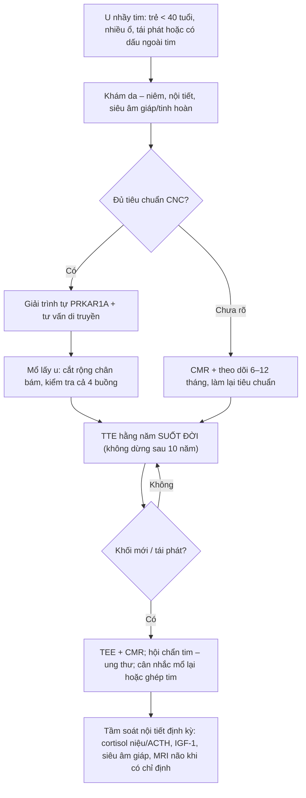
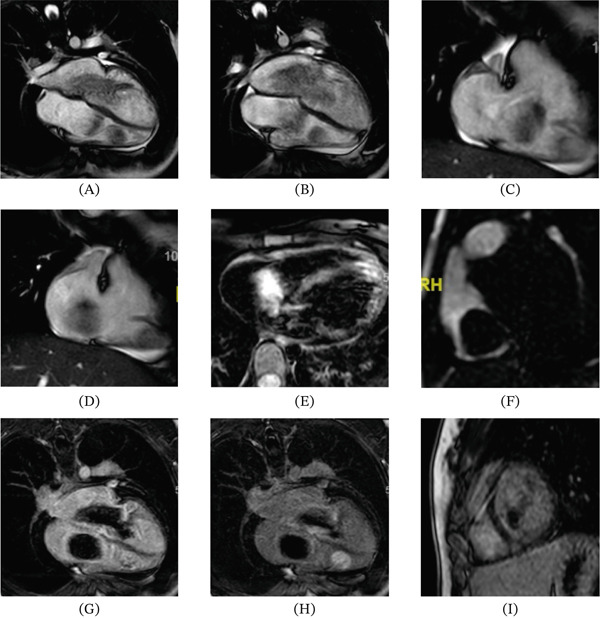
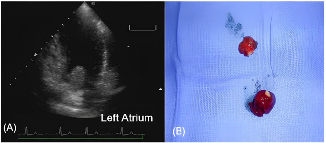
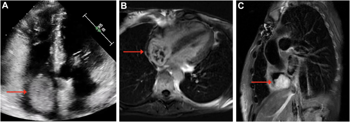

# 3094 — U nhầy tim thể gia đình & hội chứng Carney: u nhiều buồng, tái phát và tầm soát suốt đời / Familial cardiac myxoma & Carney complex (CNC)

**Tags:** `pattern:khoi-trong-buong-tim` `pattern:nhieu-o` `pattern:di-dong` `vung:tim` `protocol:TTE` `protocol:TEE` `protocol:CMR` `incidentaloma:khong`

**Mức chắc chắn (certainty):** tổng hợp y văn (literature synthesis) — **1 ca nguyên văn có CMR nhiều buồng** (*Case Rep Cardiol* 2026, PMC13201253, CC BY), **2 ca nguyên văn có ảnh** (PMC12240784 CC BY; PMC12441505 CC BY-NC-ND), **1 ca tái phát sớm 4 tháng** (PMC13554902, CC BY-NC-ND) và **2 bài tổng quan/tổng hợp ca** (PMC13698925 CC BY-NC-ND; PMC12399879 CC BY). Nhóm **không có bệnh nhân của mình**. Các chỗ nguồn lệch nhau về **tỉ lệ u nhầy trong CNC** (20–40% so với 42,6–63,1%) và **tỉ lệ u nhầy thuộc CNC** (7% so với 10%) được ghi rõ là **mâu thuẫn nguồn**, không chọn bừa.

> **Câu chốt:** u nhầy tim (cardiac myxoma, CM) ở người trẻ, **nhiều buồng – nhiều ổ – tái phát** phải được coi là **bệnh hệ thống do đột biến dòng mầm *PRKAR1A*** (hội chứng Carney, Carney complex – CNC), không phải một khối lành đơn lẻ. Ba số phải thuộc: **(1)** u nhầy xuất hiện ở **20–40%** bệnh nhân CNC, và **~10%** tất cả u nhầy tim nằm trong CNC (PMC12441505); **(2)** tái phát sau mổ **tới 22%** ở CNC so với **< 3%** ở u nhầy lẻ tẻ, và u **đồng thời nhiều ổ gặp tới 53%** bệnh nhân CNC (PMC13698925); **(3)** **57%** ca tử vong trong CNC là **do tim** (u chèn/thuyên tắc), nên theo dõi phải **suốt đời** — kể cả sau ghép tim, đã có ca tái phát **26 năm** sau ghép (PMC12441505).

## 1. Tổng quan bệnh học – cơ chế hình ảnh

### 1.1 Vì sao gọi là bệnh hệ thống: một gen, nhiều u

- **CNC** (OMIM #160980) là bệnh di truyền **trội trên nhiễm sắc thể thường** với **biểu hiện đa cơ quan**: đốm sắc tố da–niêm, u nhầy da/niêm/mắt, **u nhầy tim**, **PPNAD** (bệnh tuyến thượng thận nốt sắc tố nguyên phát) gây Cushing, u tuyến yên tiết GH, ung thư giáp, u Sertoli tế bào lớn (LCCST), schwannoma sắc tố dạng psammoma.
- **Gen:** **~70–80%** ca có đột biến bất hoạt **PRKAR1A** — gen mã hóa **tiểu đơn vị điều hòa 1A của protein kinase A (PKA)**. Mất chức năng PRKAR1A → PKA **hoạt động liên tục** → tăng sinh tế bào và tạo u. Cơ chế **"hai cú đánh"**: một allen dòng mầm + mất allen lành (LOH 17q24) trong tế bào u.
- **Vì sao u "nhiều ổ" và "tái phát" lại là bản chất:** khiếm khuyết di truyền có mặt **trong mọi tế bào nội mạc/dưới nội mạc của tim**, nên u xuất hiện ở **nhiều buồng khác nhau**, ở **vòng van**, **thành thất**, và mọc lại **dù đã cắt "sạch"** — đó là **u mới (de novo)** chứ không chỉ là "cắt chưa hết". Ca của Abarca-Rozas: u ở **cả hai nhĩ và thất phải** ở tuổi 14, cắt rồi mọc lại ở **sẹo vách liên nhĩ** và **2 ổ mới ở sàn nhĩ trái/thất phải** ở tuổi 15 và 18 (PMC13201253).
- **Dịch tễ:** khoảng **750 ca** được xác nhận trên toàn cầu (PMC12399879 — con số **dưới thực tế** vì bệnh bị bỏ sót); tuổi khởi phát u nhầy **20–40** (PMC13698925), nhưng thể gia đình khởi phát **sớm hơn** (14 tuổi trong PMC13201253).

### 1.2 Số liệu cốt lõi (ghi rõ nguồn và chỗ mâu thuẫn)

| Đại lượng | Giá trị | Nguồn |
|---|---|---|
| U nhầy tim trong CNC | **20–40%** (một tổng hợp ca ghi **42,6–63,1%**) | PMC12441505, PMC12240784; PMC12399879 |
| Tỉ lệ u nhầy tim thuộc CNC | **~10%** (bài khác ghi **~7%**) | PMC12441505; PMC13698925 |
| Tái phát sau mổ (CNC) | **tới 22%** (> một nửa bệnh nhân trong một tổng quan) | PMC13698925; PMC12399879 |
| Tái phát sau mổ (u nhầy lẻ tẻ) | **< 3%** | PMC13698925 |
| U đồng thời nhiều ổ trong CNC | **tới 53%** | PMC13698925 |
| Tử vong do nguyên nhân tim trong CNC | **57%** | PMC13698925 |
| Tổn thương da (dấu sớm nhất) | **> 80%** bệnh nhân | PMC12399879 |
| PPNAD / Cushing | **26–60%** | PMC12399879 |
| Bất thường tuyến yên (tăng GH) | **30–75%**; acromegaly **15–18,9%** | PMC12399879 |

### 1.3 TẠI SAO u nhầy sáng trên T2 — và vì sao CMR phân biệt được với huyết khối

- **Mô bệnh:** u nhầy là **chất nền nhầy (myxoid stroma) giàu glycosaminoglycan và nước**, tế bào hình sao/thoi rải rác, nhiều mạch nhỏ, có thể **xuất huyết, vôi hóa, nang giả**. Chính **nước liên kết trong chất nền** quyết định tín hiệu.
- **Vật lý T2:** chuỗi xung T2 nhạy với **thời gian T2 dài** của proton nước tự do/liên kết lỏng lẻo → mô giàu nước **sáng trên T2**; trên T1, mô u **đồng tín hiệu cơ tim** vì T1 của mô mềm tương tự. Sau tiêm, u ngấm **không đồng nhất** (phần mô sống ngấm, phần nhầy/xuất huyết/nang không ngấm).
- **Huyết khối thì khác:** huyết khối cũ chứa **hemosiderin/hemoglobin thoái hóa** → **T2 tối**, **T2* tối hơn nữa**, và **không ngấm thuốc** trên chuỗi LGE. Đây là dấu **chốt loại** quan trọng nhất khi phân biệt "khối nhĩ trái" với huyết khối ở bệnh nhân rung nhĩ.
- **Cine (SSFP):** u nhầy **di động, sa qua van** theo nhịp tim → giải thích **triệu chứng tắc nghẽn van** (ngất, khó thở tư thế) và **nguy cơ thuyên tắc**. Cine cũng cho biết **cuống/vị trí bám** — yếu tố quyết định đường mổ và khả năng bảo tồn van.
- **TẠI SAO không dùng 18FDG-PET để loại trừ:** u nhầy có chuyển hóa glucose **thấp và không ổn định**; trong ca PMC12240784, **PET âm tính** ở bệnh nhân vẫn còn khối — **PET âm không loại trừ** u nhầy.

## 2. Mẫu hình + chẩn đoán phân biệt theo vị trí (gamut)

- **Mẫu hình "lẻ tẻ" (sporadic):** **một** khối, **~75–90% ở nhĩ trái**, bám **hố bầu dục (fossa ovalis)**, cuống rõ, ngấm thuốc không đồng nhất, **không tái phát** sau mổ đúng.
- **Mẫu hình "gia đình/CNC":** **nhiều ổ**, **cả hai nhĩ hoặc có ổ ở thất**, **bám vòng van/vách/thành tự do**, **tái phát sớm** sau mổ, kèm **dấu ngoài tim** (đốm môi–kết mạc, u nhầy da, Cushing, acromegaly, nốt giáp).
- **Theo vị trí:**
  - **Nhĩ trái (phổ biến nhất):** hố bầu dục, vách liên nhĩ, thành nhĩ, vòng van hai lá.
  - **Nhĩ phải:** vách liên nhĩ, **chỗ nối tĩnh mạch chủ dưới – nhĩ** (ca PMC12441505), vòng van ba lá (ca PMC13554902 — u mới **41 × 27 mm** sau **4 tháng**).
  - **Thất:** thành tự do, vách liên thất, đường ra — **hiếm ở người lớn, phải nghĩ CNC hoặc sarcoma**.
  - **Van:** vòng van, lá van — dễ nhầm với **u nhú sợi đàn hồi (papillary fibroelastoma)**.
- **Gamut khối trong buồng tim:** huyết khối (rung nhĩ, bệnh van, suy tim), **u nhầy**, **u nhú sợi đàn hồi**, huyết khối nhiễm khuẩn (vegetation), **sarcoma (angiosarcoma, myxofibrosarcoma)**, di căn (melanoma, RCC, HCC qua tĩnh mạch chủ), **fibroma**, **lipoma**, **mạng Chiari (Chiari network)**, **phình vách liên nhĩ + huyết khối trong**, nang ký sinh trùng (echinococcus), khối máu tụ sau chấn thương.

## 3. Bảng so sánh phân biệt (ma trận đối chiếu)

| Thực thể (entity) | Hình ảnh điển hình (TTE/TEE/CMR) | Chốt vào (rule-in) | Chốt loại (rule-out) | Gợi ý xác nhận |
|---|---|---|---|---|
| **U nhầy lẻ tẻ** | Một khối nhĩ trái bám hố bầu dục, cuống rõ, di động, T2 sáng, ngấm không đồng nhất | **Một ổ + bám hố bầu dục + T2 sáng + ngấm thuốc** | Nhiều ổ/có ổ ở thất/van → không phải thể lẻ tẻ | TEE + CMR; mô bệnh sau mổ |
| **U nhầy trong CNC** | **Nhiều ổ nhiều buồng**, tái phát ở sẹo/vòng van, có dấu ngoài tim | **≥ 2 ổ, hoặc tái phát, hoặc tuổi trẻ + dấu da/nội tiết** | Khối đơn độc ở người > 40 tuổi không dấu ngoài tim → ít nghĩ CNC | Tiêu chuẩn CNC + **giải trình tự PRKAR1A**; tầm soát gia đình |
| **Huyết khối trong nhĩ** | Bám thành sau nhĩ trái/rung nhĩ, **T2 tối**, **không ngấm**, có thể lớp | **T2 tối + không ngấm + bối cảnh rung nhĩ/giảm EF** | T2 sáng + ngấm thuốc + cuống → không phải huyết khối | CMR (T2/T2*/LGE); TEE; điều trị kháng đông thử |
| **U nhú sợi đàn hồi** | Khối nhỏ **< 1–2 cm**, bám **mặt van**, dạng "san hô", di động | **Kích thước nhỏ + bám van + T2 trung tính** | Khối lớn, xâm lấn, nhiều ổ → không phải | TEE; CMR nếu cần; mổ khi có triệu chứng/thuyên tắc |
| **Sarcoma tim** | Khối **xâm lấn**, bờ không đều, **T2 trung–cao không đồng nhất**, ngấm mạnh, **tràn dịch màng tim**, di căn | **Xâm lấn + phát triển nhanh + tràn dịch** | Bờ nhẵn, cuống rõ, không xâm lấn → ít nghĩ sarcoma | CMR + PET/CT + sinh thiết; **cảnh giác "tái phát u nhầy" thực ra là sarcoma** |
| **Di căn tim** | Nhiều ổ, thường **màng tim/cơ tim phải**, có u nguyên phát | **Nhiều ổ ngoài buồng + u nguyên phát đã biết** | Khối đơn độc trong buồng có cuống → không phải | CT ngực–bụng–chậu, PET/CT |
| **Mạng Chiari / van Eustachian** | Dải mảnh **di động** ở nhĩ phải, không có thân khối | **Cấu trúc dải mảnh, không ngấm, không chèn van** | Có thân khối > 1 cm, ngấm thuốc → không phải biến thể | TEE/CMR; không can thiệp |

## 4. Protocol chụp + hệ phân độ/điểm chuẩn hóa

### 4.1 Chẩn đoán hình ảnh theo bước

1. **Siêu âm tim qua thành ngực (TTE)** — đầu tay: đo **kích thước 3 chiều**, vị trí bám, **độ di động/sa van**, chênh áp qua van, chức năng thất. Hạn chế: bỏ sót u **nhĩ phải/thất** và u **< 1 cm**.
2. **Siêu âm tim qua thực quản (TEE)** — khi nghi u nhầy, khi cần **đo cuống/chân bám** để lập kế hoạch mổ, hoặc khi TTE không thấy rõ. Với CNC, **phải khảo sát cả 4 buồng**, không dừng ở nhĩ trái.
3. **CMR tim** — chuẩn mô học không xâm lấn: cine (di động, bám), **T1/T2 + T2*** (phân biệt huyết khối), **tưới máu + LGE** (ngấm không đồng nhất), đánh giá xâm lấn cơ/túi phình. Đây là chuỗi quyết định **khi TTE mơ hồ** và khi cần **theo dõi tái phát**.
4. **CT tim đồng bộ điện tâm đồ** — khi CMR chống chỉ định/không sẵn; đánh giá **vôi hóa**, tương quan mạch vành trước mổ.
5. **Xét nghiệm di truyền:** giải trình tự **PRKAR1A** (và MLPA nếu âm) khi: u nhầy **< 40 tuổi**, **nhiều ổ**, **tái phát**, có **dấu ngoài tim**, hoặc **tiền sử gia đình**. Sau đó **tầm soát dạng thác (cascade)** cho người thân bậc 1.

### 4.2 Tiêu chuẩn chẩn đoán CNC (bảng gốc, PMC12240784)

| Nhóm | Tiêu chí |
|---|---|
| **Tiêu chí chính (major)** | (1) Đốm sắc tố điển hình (môi, kết mạc, góc mắt, niêm mạc sinh dục); (2) u nhầy da/niêm; (3) **u nhầy tim**; (4) myxomatosis vú hoặc MRI ức chế mỡ gợi ý; (5) **PPNAD** hoặc cortisol niệu tăng sau dexamethasone liều cao; (6) acromegaly do u tuyến yên tiết GH; (7) ung thư giáp **hoặc nhiều nốt giảm âm tuyến giáp ở người trẻ**; (8) schwannoma sắc tố dạng psammoma; (9) blue nevus (nhiều); (10) adenoma ống tuyến vú (nhiều); (11) osteochondromyxoma; (12) **LCCST** hoặc vôi hóa đặc trưng trên siêu âm tinh hoàn ở người trẻ |
| **Tiêu chí bổ sung (supplemental)** | (1) Người thân bậc 1 mắc bệnh; (2) **đột biến bất hoạt PRKAR1A** |
| **Chẩn đoán xác định** | **≥ 2 tiêu chí chính**, hoặc **1 tiêu chí chính + 1 tiêu chí bổ sung** |

### 4.3 Lịch theo dõi (flowchart)

- **Vì sao "suốt đời":** tái phát **hay gặp trong 10 năm đầu** nhưng **không dừng ở 10 năm** — đã có ca tái phát **26 năm sau ghép tim** ở bệnh nhân CNC (PMC12441505); khuyến cáo chuyên gia cho u nhầy lẻ tẻ là **TTE hằng năm trong 10 năm**, còn **thể gia đình cần theo dõi trọn đời** (PMC12441505).
- **Không có guideline chính thức** về lịch theo dõi sau mổ u nhầy (nguồn gốc ghi rõ "no guidelines"); mọi con số ở trên là **khuyến cáo chuyên gia/ca lâm sàng**, không phải mức chứng cứ cao.

## 5. Biến thể bình thường và cạm bẫy

- **Biến thể bình thường dễ nhầm:** **mạng Chiari** và **van Eustachian** (dải mảnh nhĩ phải, không ngấm, không chèn van); **phình vách liên nhĩ** (vách mỏng lồi, không có thân khối); **mỏm cơ nhú** lớn; **vôi hóa vòng van**; **dây xơ sau mổ** (sẹo ngấm thuốc tại chỗ nối).
- **Cạm bẫy 1 — "u nhầy lành, mổ xong là khỏi":** bỏ qua **tầm soát CNC** ở người trẻ/nhiều ổ → bỏ sót u thứ hai, Cushing, acromegaly và **ung thư giáp**; 57% tử vong trong CNC là do tim (PMC13698925).
- **Cạm bẫy 2 — chỉ khảo sát nhĩ trái:** u ở **nhĩ phải/thất/vòng van** dễ bị bỏ trên TTE; ca CNC có u **3 buồng** (PMC13554902) và u **thất phải** (PMC13201253). Phải khảo sát **cả 4 buồng** và **đo lại sau mổ**.
- **Cạm bẫy 3 — nhầm huyết khối với u:** huyết khối **T2 tối, không ngấm**; nếu chỉ dùng TTE sẽ gọi "khối nhĩ trái" và cho kháng đông kéo dài trong khi u vẫn tiếp tục **gây tắc van/thuyên tắc**.
- **Cạm bẫy 4 — "tái phát u nhầy" thực ra là sarcoma:** u **myxofibrosarcoma**/sarcoma có thể **giống hệt** trên hình thái và chỉ lộ ra ở mô bệnh; bờ xâm lấn, phát triển nhanh, tràn dịch màng tim là dấu cảnh báo (đã có ca "tái phát" được phân loại lại thành myxofibrosarcoma — PMC13464279, chỉ dùng số liệu/nhận định).
- **Cạm bẫy 5 — bỏ sót nhiễm khuẩn u:** u nhầy có thể **nhiễm khuẩn** (sốt, cấy dương) và gây **tắc van ba lá**; ca PMC13554902 có u nhĩ phải nhiễm khuẩn, sau mổ **tái phát 4 tháng** ở vòng van ba lá.
- **Cạm bẫy 6 — PET âm:** **18FDG-PET âm không loại trừ** u nhầy (PMC12240784); không dùng PET để "yên tâm" rồi bỏ TEE/CMR.
- **Cạm bẫy 7 — bỏ theo dõi sau ghép tim:** ghép tim **không chữa khỏi** CNC; mô nhĩ nhận còn sót có thể sinh u mới **hàng chục năm** sau (PMC12441505).

## 6. Tự lượng giá — Blind Quiz ngay trên trang tĩnh

**Ca 1 — thiếu niên, nhiều khối trong tim**

- Gợi ý lâm sàng: nữ **14 tuổi**, tình cờ phát hiện **nhiều khối trong tim**; 3 năm sau mổ lại vì khối mới.
- Câu hỏi: Khối nằm ở **buồng nào** (A–D)? Dấu hiệu nào trên (E–I) giúp phân biệt **u nhầy với huyết khối**? Chẩn đoán **hệ thống** nào phải nghĩ tới?

<b>Bấm để hiện đáp án (findings + chẩn đoán)</b>

- Dấu hiệu: (A, B) cine 4 buồng — khối **di động ở cả nhĩ phải và nhĩ trái**, sa qua van nhĩ–thất; (C, D) trục dài thất phải — **khối thứ ba bám thành tự do thất phải** giữa–mỏm; (E) T2 ức chế mỡ — khối **tăng tín hiệu** (giàu nước/nhầy); (F–I) các lát cắt theo trục và LGE cho thấy khối **ngấm thuốc không đồng nhất**, không xâm lấn cơ tim.
- Chẩn đoán: **u nhầy tim nhiều ổ trong hội chứng Carney (CNC)** — nhiều buồng + tuổi trẻ + tái phát là bộ ba gợi ý; xác nhận bằng tiêu chuẩn CNC và **PRKAR1A**.
- Vì sao: u nhầy **giàu chất nền nhầy chứa nước** → T2 sáng; huyết khối cũ có hemosiderin → **T2 tối, không ngấm**.
- Nguồn ảnh: Abarca-Rozas B, Saavedra F, Retamal JP, Vergara F, Revello J, Zelada P, Fullerton DA. *Case Rep Cardiol* 2026;2026:7261880. Fig. 1 — PMC13201253 · CC BY 4.0.

**Ca 2 — khối nhĩ trái tái phát, kèm triệu chứng thần kinh**

- Gợi ý lâm sàng: nữ **46 tuổi** đã mổ u nhầy nhĩ trái, nay **đột quỵ tái diễn**; siêu âm thấy khối **bám vách liên nhĩ**.
- Câu hỏi: Khối bám ở đâu (A)? Vì sao bệnh nhân vẫn **đột quỵ dù đã mổ**? Kích thước khối trong bài là bao nhiêu?

<b>Bấm để hiện đáp án (findings + chẩn đoán)</b>

- Dấu hiệu: (A) TTE 4 buồng — khối **di động trong nhĩ trái, bám vách liên nhĩ**, đo được khoảng **3,3 × 2,5 × 1,5 cm**; (B) bệnh phẩm **nhầy, trong, màu vàng–hồng** đặc trưng.
- Chẩn đoán: **u nhầy nhĩ trái tái phát trong CNC** (bệnh nhân đã có Cushing do PPNAD, đốm môi, u nhầy da); 7 năm sau, khối mới ở **hố bầu dục 3,5 × 2,9 × 1,3 cm** kèm u cũ còn **1,7 × 1,1 × 1,1 cm**.
- Vì sao: tái phát + nhiều ổ + dấu nội tiết/da = CNC; mảnh u hoặc huyết khối trên bề mặt u gây **thuyên tắc não tái diễn** — kháng đông không thay được mổ.
- Nguồn ảnh: Kuhn AW, Lerario AM, Morais ANR, Iglesio RF, Ramires FJA, Maluf LCA, Hoff AO, Latronico AC, Mendonça BB, Almeida MQ, Fragoso MCBV. *Front Oncol* 2025;15:1605692. Fig. 1 — PMC12240784 · CC BY 4.0.

**Ca 3 — khối nhĩ phải rất muộn sau ghép tim**

- Gợi ý lâm sàng: nữ có CNC, **đã ghép tim 26 năm** vì u nhầy tái phát, nay khó thở và phù.
- Câu hỏi: Khối nằm ở đâu (mũi tên)? Vì sao ghép tim **không** chữa khỏi bệnh? Theo dõi sau ghép nên làm gì?

<b>Bấm để hiện đáp án (findings + chẩn đoán)</b>

- Dấu hiệu: (A) TTE — khối lớn ở **nhĩ phải**, gần **chỗ nối tĩnh mạch chủ dưới – nhĩ**; (B) CMR mặt phẳng trục (PSIR/LGE) — khối **ngấm thuốc không đồng nhất**; (C) mặt phẳng dọc — khối **lấp một phần nhĩ phải**, không xâm lấn thành.
- Chẩn đoán: **u nhầy tái phát muộn từ mô nhĩ gốc còn sót sau ghép tim** — khoảng **26 năm** sau ghép, dài nhất trong y văn (trước đó **20 năm** ở một bệnh nhân có hội chứng u nhầy gia đình).
- Vì sao: đột biến **PRKAR1A dòng mầm** vẫn còn trong mô nhĩ nhận → u mới; **ghép tim không phải chữa khỏi**, cần **TTE hằng năm suốt đời**.
- Nguồn ảnh: Ayer A, Silver E, Birs A, Martillo Correa M, Hajduczok A, Pretorius V, Adler E. *JACC Case Rep* 2025;30(21):104333. Fig. 1 — PMC12441505 · CC BY-NC-ND 4.0 (nguyên bản, không chỉnh sửa).

## Bài liên quan chéo
- [3093 – Nhồi máu não do u nhầy tim: nhiều ổ, túi phình myxoma & khi nào mổ tim](../3093-nhoi-mau-nao-do-u-nhay-tim/lesson.md)
- [810 – CTA động mạch vành & CAD-RADS](../810-coronary-cta-cadrads/lesson.md)
- [820 – MRI tim: LGE & mapping](../820-cardiac-mri-lge-mapping/lesson.md)

## Ảnh
- Tên file: `NNN_slug_Modality_SourceID.jpg`. Nguồn + giấy phép từng ảnh trong `images/CREDITS.md`.
- Bài này **không có composite** vì một ảnh là **CC BY-NC-ND** (không được tạo tác phẩm phái sinh) — theo quy tắc ảnh của `AGENTS.md`.

> Không dùng để chẩn đoán độc lập khi chưa có người hướng dẫn.
