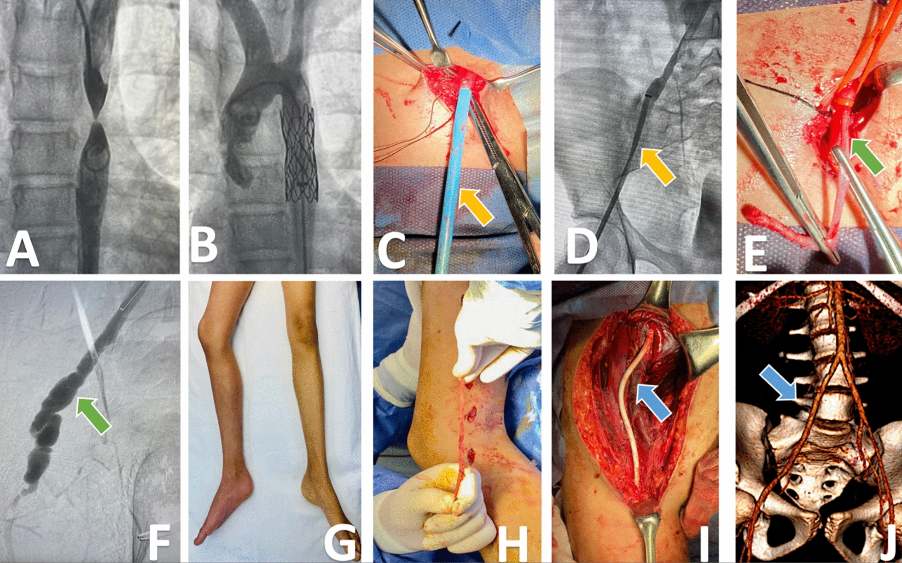
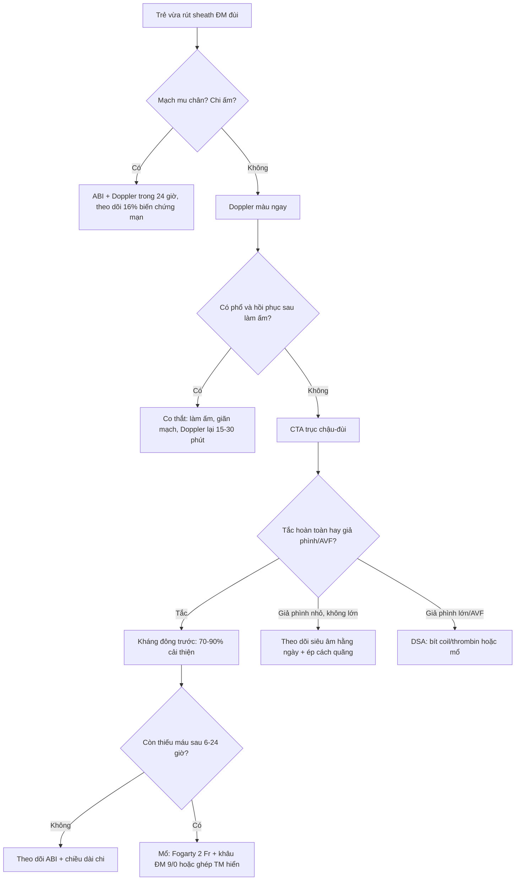
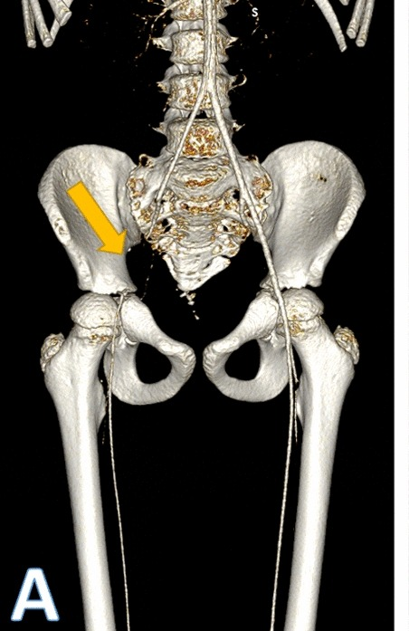
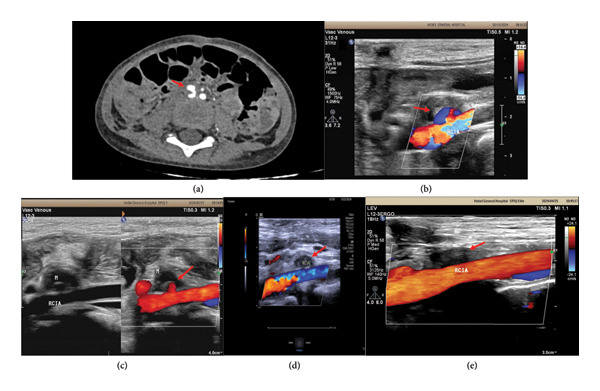

# 3095 — Tổn thương động mạch đùi–chậu sau can thiệp nội mạch ở trẻ: vì sao cỡ sheath quyết định, và ngưỡng nào buộc phải mổ / can thiệp lại / Iliac–femoral artery injury after pediatric catheterization

**Tags:** `pattern:tac-mach` `pattern:huyet-khoi` `pattern:gia-phinh` `pattern:ro-dong-tinh-mach` `pattern:thieu-mau-chi` `vung:dong-mach-dui` `vung:dong-mach-chau` `score:ABI` `score:PSV` `protocol:Doppler` `protocol:CTA` `protocol:DSA`

**Mức chắc chắn (certainty):** tổng hợp y văn (literature synthesis) — số liệu lấy từ 3 bài open-access đọc toàn văn: Lozano-Corona và cs, *Eur J Med Res* 2023 (PMC10652633, **CC BY 4.0** — tổng quan 171 bệnh nhi + 3 ca nguyên văn, nguồn 2 ảnh); Ding và cs, *Case Rep Pediatr* 2025 (PMC12752840, **CC BY 4.0** — ca giả phình chậu ở trẻ 3 tuổi điều trị bảo tồn, nguồn 1 ảnh); Salimi & Ahrabi, *SAGE Open Med Case Rep* 2025 (PMC12166270, **CC BY-NC 4.0** — 7 ca AVF/giả phình chi ở trẻ). Không có ca nguyên văn riêng của nhóm; 3 ca trong quiz là ca nguyên văn của nguồn, ghi rõ Fig.

> **Câu hỏi gốc của bài:** trẻ **2 tuổi** vừa chọc **động mạch đùi phải** để theo dõi huyết động, **rút sheath xong 2 giờ** thì chân phải **lạnh, tái, không bắt được mạch mu chân**. Vậy: **đây là co thắt (chờ) hay huyết khối (mổ)? Doppler lúc nào, đo gì, ngưỡng nào gọi can thiệp? Và vì sao cùng một chiếc sheath 6 Fr lại an toàn ở trẻ 12 tuổi nhưng gây tắc mạch ở trẻ 8 kg?**
> **Điểm tựa:** ở trẻ, **đường kính lòng mạch — không phải cân nặng — mới là biến quyết định**. Catheter chiếm **> 50% đường kính lòng mạch** hoặc để **< 1,9 mm** khoảng trống quanh catheter là đủ gây co thắt và huyết khối; **CFA < 3 mm** làm **mất mạch sau chọc tăng gấp 8,44 lần** (OR 8,44; KTC 95% 2,07–34,5) (PMC10652633).

## 1. Tổng quan — vì sao chọc mạch ở trẻ lại khác người lớn, và vì sao huyết khối hình thành

**A. Bệnh học (pathology) và cơ chế:**

- **Mạch trẻ không phải "mạch người lớn thu nhỏ":** thành mạch **giàu sợi chun, ít cơ trơn**, đường kính nhỏ, **di động và gấp góc** nhiều hơn; động mạch dễ co thắt (vasospasm) khi bị kích thích cơ học. Đây là lý do **cùng cỡ thiết bị**, trẻ nhỏ chịu tổn thương nặng hơn (PMC10652633).
- **Tổn thương do chọc (access injury) hình thành theo 3 bước:** (1) kim/catheter **bóc tách nội mạc** và làm **lộ lớp dưới nội mạc** (yếu tố mô); (2) catheter **chiếm phần lớn lòng mạch** → dòng chảy quanh catheter thành **dòng rối, vận tốc thấp** (yếu tố dòng chảy); (3) **ép sheath kéo dài** + trẻ **mất nước/đang dùng vận mạch** → tăng đông (yếu tố máu). Ba yếu tố này là **tam giác Virchow tại chỗ chọc**, nên **huyết khối là biến chứng hay gặp nhất**, không phải giả phình.
- **Vì sao lộn nội mạc (intimal eversion) lại gây tắc:** sheath quá lớn so với mạch, khi rút **dính chặt vào nội mạc**; kéo mạnh làm **nội mạc + trung mạc lộn ra ngoài** như "lộn cổ tay áo", **bịt lòng CFA**, và phần mạch mất chỗ tựa có thể **phình giả chỉ còn giữ bởi lớp ngoại mạc** (PMC10652633, ca 1).
- **Vì sao giả phình (pseudoaneurysm) hình thành:** lỗ chọc **không kín** ở lớp nội mạc–trung mạc nhưng **còn lớp ngoại mạc** → máu phun thành **túi ngoài lòng mạch**; túi **không có cơ trơn** nên **không tự co**, chỉ **huyết khối lấp dần** hoặc **to ra**. Vì vậy **tiếng thổi (bruit) + "yin-yang sign"** trên Doppler màu là dấu hiệu chốt.
- **Vì sao AVF:** kim xuyên **cả động mạch và tĩnh mạch** ở vùng bẹn (đặc biệt khi **chọc tĩnh mạch thất bại rồi chọc lại**). Ở trẻ, AVF **không chỉ gây suy tim** mà còn **cướp dòng → chi ngắn hơn** theo thời gian (PMC12166270: một bé 3 tuổi có **chênh chiều dài chi** do AVF CFA–CFV).
- **Vì sao biến chứng mạn xuất hiện muộn:** trẻ **có tuần hoàn bàng hệ tốt** nên **qua được giai đoạn cấp** với ABI gần bình thường; nhưng **giường mạch bị hẹp** làm chi **tăng trưởng chậm** → **chênh chiều dài chi (limb-length discrepancy)** và **đau cách hồi** nhiều năm sau. Vì vậy theo dõi **không dừng ở lúc ra viện**.

**B. Ngưỡng định lượng bắt buộc (cửa 1 Argon):**

| Đại lượng | Con số đã kiểm chứng | Ý nghĩa thực hành |
|---|---|---|
| Chấn thương mạch ở trẻ do nguyên nhân y tế (iatrogenic) | **~50%** mọi chấn thương mạch nhi; chấn thương mạch chung **0,6–1%** dân số nhi (PMC10652633) | Phần lớn là **do thủ thuật của chính ta** → phòng ngừa bằng cỡ dụng cụ |
| Biến chứng tại chỗ chọc sau can thiệp | **2–40%** tùy yếu tố nguy cơ (PMC10652633) | Khoảng rộng này phản ánh **cỡ mạch và cỡ dụng cụ**, không phải tay nghề đơn thuần |
| Tuổi/cân nặng nguy cơ cao | **< 1 tuổi hoặc < 8 kg: 1,3%** vs **0,3%** ở trẻ > 1 tuổi (**p = 0,001**) (PMC10652633 trích Vitellio/Kim) | Trẻ sơ sinh/toddler là nhóm phải **đo mạch trước** |
| Yếu tố nguy cơ độc lập (Lin) | **< 3 tuổi**, **≥ 3 lần chọc trước**, **thủ thuật điều trị** (không chỉ chẩn đoán), **dụng cụ ≥ 6 Fr** (PMC10652633) | Đếm số lần chọc như đếm liều thuốc |
| Tương quan catheter – lòng mạch | Catheter chiếm **> 50% đường kính lòng mạch** hoặc **< 1,9 mm** khoảng trống quanh catheter → **co thắt + tổn thương** (PMC10652633) | Chọn cỡ theo **đường kính đo được**, không theo cân nặng |
| Sheath 7 Fr | **OD 2,5–3 mm** → lòng mạch phải **> 3 mm** (PMC10652633) | Tính theo **OD** (vỏ ngoài), không theo **ID** (lòng trong) |
| Đường kính CFA | **< 3 mm** → **mất mạch sau chọc OR 8,44** (KTC 95% **2,07–34,5**, p < 0,001) (PMC10652633) | Đây là **ngưỡng tiên lượng mạnh nhất** trong bài |
| Huyết khối cấp (ALLI) | **109/144** biến chứng cấp; **chỉ 35** phải mổ (PMC10652633) | **70–90%** cải thiện bằng **kháng đông đơn thuần** |
| Vị trí tổn thương | **CFA 73%**, **EIA 15%** (PMC10652633) | Đọc hình phải **theo trục**, không chỉ nhìn chỗ chọc |
| Biến chứng mạn | **27/171 (16%)**: đau cách hồi **14**, chênh chiều dài chi **11** (PMC10652633) | Theo dõi **tới khi trưởng thành** |
| Chênh chiều dài chi | **≥ 2 cm** là mức có hại; bảo tồn **23%** vs mổ **9%** khi thiếu máu **> 30 ngày** (Flanigan 1983, trích trong PMC10652633) | Lý do phải **tái thông sớm**, không "chờ bàng hệ" |

## 2. Mẫu hình + chẩn đoán phân biệt theo vị trí và thời điểm (Gamut)

- **Theo thời điểm:** **cấp (≤ 30 ngày)** — huyết khối/tắc, giả phình, tụ máu, AVF, bóc tách, đứt/lộn; **mạn (> 30 ngày)** — hẹp do xơ, AVF, chênh chiều dài chi, đau cách hồi (PMC10652633 định nghĩa đúng mốc 30 ngày).
- **Theo vị trí:** **chỗ chọc CFA** (giả phình, AVF, tụ máu, lộn nội mạc) · **EIA** (huyết khối do catheter đi ngược dòng, bóc tách, giả phình) · **CIA** (bóc tách, di lệch dụng cụ như Amplatzer) — phân bố **CFA 73% / EIA 15%**.
- **Theo hình thái dòng chảy trên Doppler:** **mất tín hiệu màu + phổ tắt** = tắc · **túi có dòng xoáy hai chiều ("yin-yang") + cổ** = giả phình · **dòng tâm trương cao ở động mạch + phổ mạch máu đập ở tĩnh mạch** = AVF · **hẹp lòng có tia tăng vận tốc** = bóc tách/hẹp.
- Gợi nhớ **4T sau sheath**: **T**hrombosis (huyết khối/tắc) · **T**ear (bóc tách/lộn nội mạc) · **T**ube (túi giả phình) · **T**ransit shunt (AVF).

## 3. Bảng so sánh phân biệt (ma trận đối chiếu)

| Thực thể (entity) | Hình ảnh điển hình (US / CTA / DSA) | Chốt vào (rule-in) | Chốt loại (rule-out) | Gợi ý xác nhận |
|---|---|---|---|---|
| **Huyết khối/tắc CFA–EIA** | Mất tín hiệu màu đoạn dài, **phổ tắt (absent end-diastolic flow)**, CTA: **khuyết thuốc lòng mạch** + bàng hệ | **Thiếu máu chi cấp + mất phổ + khuyết thuốc cố định trên CTA** | **Co thắt**: phổ còn, **hồi phục sau làm ấm/giãn mạch**, CTA **không khuyết thuốc** | Doppler + CTA; DSA khi định can thiệp |
| **Giả phình (pseudoaneurysm)** | Túi cạnh mạch, **"yin-yang sign"** xoáy hai chiều, **cổ (neck)** thấy trên Doppler; CTA: túi ngấm thuốc **song song lòng mạch** | **Cổ rõ + dòng xoáy hai chiều + tiếng thổi** | **Tụ máu đơn thuần**: khối **không có dòng**, không cổ | Doppler màu; CTA nếu túi lớn/cần can thiệp |
| **AVF (rò động–tĩnh mạch)** | Động mạch: **dòng tâm trương cao, RI thấp**; tĩnh mạch: **phổ đập (pulsatile)**, giãn; CTA: **ngấm thuốc sớm ở tĩnh mạch thì động mạch** | **Ngấm tĩnh mạch thì động mạch + chênh bão hòa O₂** | **Giả phình**: không có ngấm tĩnh mạch sớm | Doppler + CTA; DSA để bít |
| **Bóc tách / lộn nội mạc** | **Vạt nội mạc (intimal flap)**, hai lòng; CTA: **đường tối trong lòng ngấm thuốc** | **Flap nhìn thấy + hai lòng** | **Huyết khối**: lòng tắc hoàn toàn, không flap | CTA mỏng; DSA |
| **Tụ máu tại chỗ chọc** | Khối **echo hỗn hợp**, **không có dòng**, có thể **chèn ép mạch** | **Khối không dòng + bầm tím bẹn** | **Giả phình**: có dòng trong khối | Doppler (không dòng = an tâm hơn) |
| **Co thắt (vasospasm)** | Lòng mạch **hẹp đều, dài**, phổ **giảm biên độ nhưng còn**, hồi phục | **Hồi phục sau 15–30 phút làm ấm/giãn mạch** | **Khuyết thuốc cố định** trên CTA → không phải co thắt | Doppler lặp lại; tránh nong mù |
| **Hẹp mạn/AVF muộn** | Hẹp dài, xơ; **chênh chiều dài chi**, đau cách hồi | **ABI giảm + chênh chi ≥ 2 cm** | **Bệnh lý cơ–xương** gây đau | ABI, Doppler, CTA |

*Hình 10 panel của ca 1 (bé gái 12 tuổi, đặt stent hẹp eo ĐMC qua sheath 12 Fr): **C** sheath nằm trong CFA; **D** đầu sheath ở CIA, mũi tên vàng chỉ **chỗ hẹp EIA**; **E** lộn nội mạc–trung mạc ra ngoài lỗ chọc; **F** DSA sau rút sheath: **giả phình EIA** dọa vỡ; **G** chi phải tím; **I** cầu nối ePTFE 6 mm; **J** dựng 3D CTA sau mổ, cầu nối thông. Nguồn: *Eur J Med Res* 2023 (PMC10652633), CC BY 4.0 — cắt từ hình gốc, giữ nguyên nhãn panel.*

## 4. Protocol chụp + ngưỡng xử trí

**A. Trước thủ thuật (phòng ngừa bằng hình ảnh):**

- **Siêu âm đo đường kính trục chậu–đùi** trước chọc ở mọi trẻ, nhất là **< 1 tuổi hoặc < 10 kg**; đầu dò **10–13 MHz** dùng được cả ở sơ sinh (PMC10652633, đề xuất của Tadphale).
- Chọn sheath theo **OD**: sheath 7 Fr có **OD 2,5–3 mm**, nên **lòng mạch phải > 3 mm**; mục tiêu **catheter chiếm < 50% đường kính lòng** và còn **≥ 1,9 mm** khoảng trống.
- **Chọc dưới hướng dẫn siêu âm** và **chụp mạch kiểm tra ngay sau khi đặt sheath**, trước khi đưa dụng cụ cỡ lớn (PMC10652633).

**B. Sau thủ thuật — đo gì, lúc nào:**

- **Ngay sau rút sheath:** bắt **mạch mu chân + mạch chày sau**, màu/ấm chi, **ABI** (bình thường **1,0–1,1**; **< 0,9** là bất thường).
- **Doppler mạch màu** ngay khi **mất mạch, chi lạnh/tái, hoặc bẹn sưng nhanh**; lặp lại sau **15–30 phút làm ấm** để **phân biệt co thắt với huyết khối** (thực hành; nguồn chỉ nêu nguyên tắc co thắt hồi phục).
- **CTA** khi Doppler không kết luận, khi cần **bản đồ trước mổ** (vị trí tắc, bàng hệ, bóc tách, giả phình) — hình 3D CTA là cách nhanh nhất để thấy **toàn trục chậu–đùi hai bên**.
- **DSA** là **tiêu chuẩn vàng** và đồng thời là **điều trị** (nong bóng, stent, bít giả phình/AVF).
- **Theo dõi dài hạn:** ABI, đau cách hồi, **đo chiều dài hai chi** và biểu đồ tăng trưởng **tới tuổi trưởng thành** — vì **16%** biến chứng mạn chỉ lộ ra sau nhiều năm.

**C. Sơ đồ xử trí mất mạch sau rút sheath:**

**D. Vì sao ngưỡng "3 mm" quan trọng hơn tuổi:** OR 8,44 nghĩa là **nguy cơ mất mạch tăng ~8 lần** chỉ vì CFA nhỏ hơn 3 mm, **bất kể cân nặng hay tuổi** (PMC10652633). Đây là lý do phải **đo**, không suy từ cân nặng.

## 5. Biến thể bình thường và cạm bẫy

- **Co thắt "giả tắc" ở trẻ nhỏ:** mạch co thắt do kích thích có thể **mất màu hoàn toàn trên Doppler** nhưng **hồi phục**; nong/mổ ngay là **can thiệp oan**. Ngược lại, **chờ quá lâu** ở huyết khối thật làm tăng **chênh chiều dài chi** (23% nếu thiếu máu > 30 ngày).
- **Bàng hệ tốt đánh lừa:** trẻ có thể **ABI gần 1** nhờ bàng hệ, nhưng **vẫn đau cách hồi khi gắng sức** và **chi tăng trưởng chậm** — ABI nghỉ bình thường **không loại trừ** hẹp có ý nghĩa.
- **"Sheath kẹt" không được kéo mạnh:** kéo mạnh gây **lộn nội mạc–trung mạc** và **tắc CFA** (ca 1). Khi sheath không rút được: **ngừng kéo, gọi mổ mạch**, kiểm tra bằng huỳnh quang, có thể cần **đường mổ bẹn** để lấy sheath dưới huỳnh quang.
- **Giả phình nhỏ có thể tự khỏi:** ca trẻ 3 tuổi có giả phình ĐM chậu **có huyết khối một phần** được điều trị **theo dõi siêu âm hằng ngày + ép cách quãng**, không mổ (PMC12752840). Điều kiện: **triệu chứng nhẹ, huyết động ổn, có thể mổ cấp cứu bất cứ lúc nào**. Giả phình **to nhanh, da căng, đau tăng** thì không chờ.
- **AVF sau "chọc tĩnh mạch thất bại":** 71% ca trong loạt 7 ca là **tổn thương động mạch xảy ra trong lần chọc tĩnh mạch** (PMC12166270) — nên **mọi lần chọc bẹn thất bại đều phải khám lại mạch**.
- **Cạm bẫy "đo bằng mắt":** chọn sheath theo cân nặng là nguyên nhân hệ thống của **lệch cỡ dụng cụ (device mismatch)** ở trẻ **béo hoặc suy dinh dưỡng** (PMC10652633).

## 6. Tự lượng giá — Blind Quiz

**Ca 1 — Bé gái 12 tuổi, đặt stent hẹp eo động mạch chủ. Rút sheath 12 Fr không được.**

- Gợi ý lâm sàng: sau đặt stent, khi rút dụng cụ thì **sheath dính chặt**, kéo thấy **nội mạc lộn ra**; sau đó chi phải **tím, mất mạch**.
- Câu hỏi: (1) Panel D chỉ điều gì? (2) Panel F là tổn thương gì và vì sao nguy hiểm? (3) Xử trí đúng — kéo mạnh tiếp hay mổ?

<b>Bấm để hiện đáp án (findings + chẩn đoán)</b>

- **Panel D:** đầu sheath ở **động mạch chậu chung**, mũi tên vàng chỉ **chỗ hẹp/lộn ở động mạch chậu ngoài** — dấu hiệu sheath **quá lớn so với lòng mạch**.
- **Panel F:** **giả phình động mạch chậu ngoài** sau khi rút sheath, **chỉ còn lớp ngoại mạc giữ** → **dọa vỡ**.
- **Xử trí:** **không kéo mạnh**; mổ bẹn lấy sheath dưới huỳnh quang, cắt đoạn lộn, **cầu nối ePTFE 6 mm** (panel I) — theo dõi 6 tháng **ABI 0,9**, mạch rõ, không đau cách hồi (panel J).
- **Bài học:** sheath **12 Fr** ở trẻ 12 tuổi đã gây **lộn nội mạc**; chọn cỡ theo **OD sheath và đường kính lòng mạch**, không theo tuổi.
- Nguồn ảnh: *Eur J Med Res* 2023 (PMC10652633), CC BY 4.0.

**Ca 2 — Bé trai 2 tuổi (trisomy 21, sốc nhiễm khuẩn). Sau chọc ĐM đùi phải để theo dõi huyết động, chân phải lạnh, tái.**

- Gợi ý: rút catheter, khởi đầu **heparin toàn thân**, nhưng **thiếu máu chi vẫn còn**.
- Câu hỏi: Chẩn đoán? Vì sao ưu tiên **khâu động mạch** hơn cầu nối? Mốc nào quyết định mổ?

<b>Bấm để hiện đáp án</b>

- **Thiếu máu chi dưới cấp (ALLI) do huyết khối CFA** sau chọc mạch — nguyên nhân **hay gặp nhất** (109/144 biến chứng cấp; CFA 73%).
- **70–90%** cải thiện với **kháng đông**; ca này **không cải thiện** → **lấy huyết khối bằng Fogarty 2 Fr + khâu động mạch mũi rời 7/0**.
- **Khâu động mạch** giữ được **tiềm năng tăng trưởng** của mạch trẻ; **ghép nhân tạo** kém thuận lợi ở trẻ **< 2 tuổi**.
- Theo dõi 1 năm: **không tái thiếu máu, biểu đồ tăng trưởng bình thường**.
- Nguồn: *Eur J Med Res* 2023 (PMC10652633), CC BY 4.0 — ca nguyên văn, không có ảnh trong bài này.

**Ca 3 — Bé trai 9 tuổi, thông tim chẩn đoán qua ĐM đùi phải trước khi vá thông liên thất. Sau mổ 24 giờ, chân phải lạnh.**

- Gợi ý: thiếu máu xuất hiện **24 giờ sau mổ tim**, không ngay sau rút sheath.
- Câu hỏi: Mũi tên vàng chỉ gì? Vì sao phải **chụp toàn trục** chứ không chỉ siêu âm chỗ chọc? Can thiệp gì?

<b>Bấm để hiện đáp án</b>

- **3D CTA:** mũi tên vàng chỉ **huyết khối động mạch chậu ngoài phải** — tổn thương **cách chỗ chọc**, đúng nhóm **EIA 15%**.
- Phải chụp **toàn trục chậu–đùi** vì catheter đi ngược dòng gây tổn thương **dọc đường đi**, không chỉ tại lỗ chọc.
- Xử trí: **lấy huyết khối bằng Fogarty 2 Fr + khâu động mạch 7/0**; theo dõi 2 năm không đau cách hồi.
- Nguồn ảnh: *Eur J Med Res* 2023 (PMC10652633), CC BY 4.0 — cắt panel A của Fig. 3, giữ nhãn gốc.

**Ca 4 — Bé trai 3 tuổi, sau mổ nội soi ổ bụng: đau bụng nhẹ, huyết động ổn. Siêu âm và CT thấy giả phình động mạch chậu.**

- Gợi ý: không sốt, không thiếu máu chi, tổn thương **có huyết khối một phần**.
- Câu hỏi: Dấu hiệu nào trên Doppler chốt giả phình? Khi nào được **theo dõi** thay vì can thiệp?

<b>Bấm để hiện đáp án</b>

- **(a) CT:** túi cạnh động mạch chậu, **ngấm thuốc một phần + huyết khối một phần**. **(b)–(e) Doppler màu:** dòng xoáy **hai chiều trong túi ("yin-yang")**, **cổ** nối với lòng mạch, và **ép được** bằng đầu dò.
- **Điều kiện theo dõi bảo tồn:** triệu chứng nhẹ, huyết động ổn, **có khả năng mổ cấp cứu bất cứ lúc nào**; theo dõi **siêu âm hằng ngày + ép cách quãng** → ca này **khỏi không cần mổ**.
- **Phải can thiệp** khi: túi **to nhanh**, đau tăng, da căng, thiếu máu chi, hoặc **AVF kèm theo**.
- Nguồn ảnh: *Case Rep Pediatr* 2025 (PMC12752840), CC BY 4.0 — nguyên bản.

## Bài liên quan chéo
- [3064 — REBOA ở trẻ: cỡ bóng theo đường kính ĐMC](../3064-reboa-o-tre-em-chon-bong-the-tich-bom-nguong-thoi-gian/lesson.md) (cùng nguyên lý: cỡ dụng cụ theo **đường kính mạch**, không theo cân nặng)
- [6113 — Huyết khối động mạch chủ ở sơ sinh](../6113-huyet-khoi-dong-mach-chu-so-sinh-uac/lesson.md)
- [1816 — REBOA: bóng chèn nội mạch động mạch chủ trong chấn thương](../1816-reboa-bong-chen-noi-mach-chu/lesson.md)
- [900 — Đại cương IR: kim, đông máu & cửa sổ chọc](../900-ir-fundamentals-biopsy/lesson.md)

## Ảnh
- `3095_dong-mach-dui_Fluoroscopy-DSA_PMC10652633-f1.jpg`, `3095_dong-mach-chau_CTA-3D_PMC10652633-f3.jpg`, `3095_gia-phinh_CT-Doppler_PMC12752840-f1.jpg` — nguồn + giấy phép từng ảnh trong `images/CREDITS.md`.
- Không tải được ảnh nào từ Radiopaedia/AuntMinnie cho chủ đề này (không crawl, không dùng ảnh license mơ hồ) — dẫn link ở `sources.md`.

> Không dùng để chẩn đoán độc lập khi chưa có người hướng dẫn.
