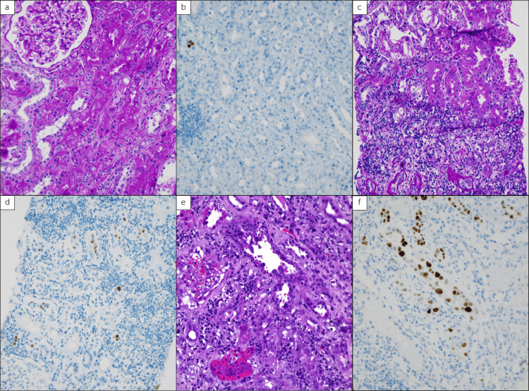
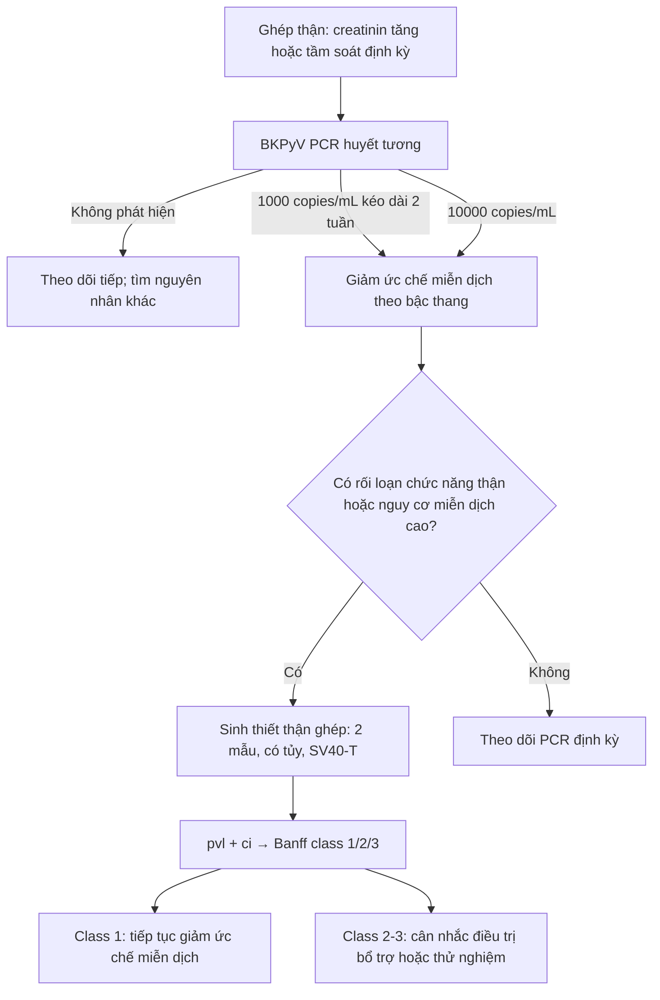
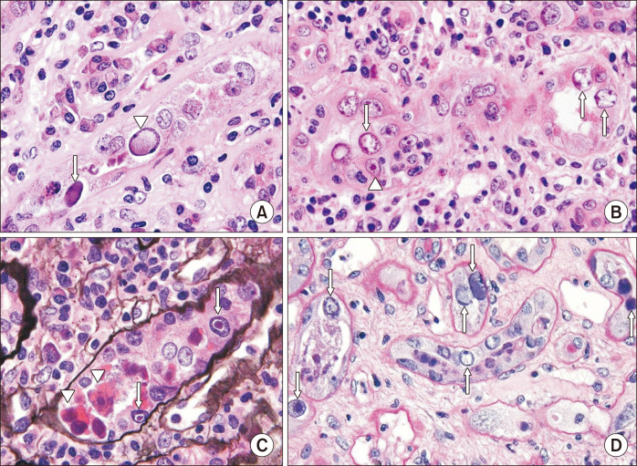
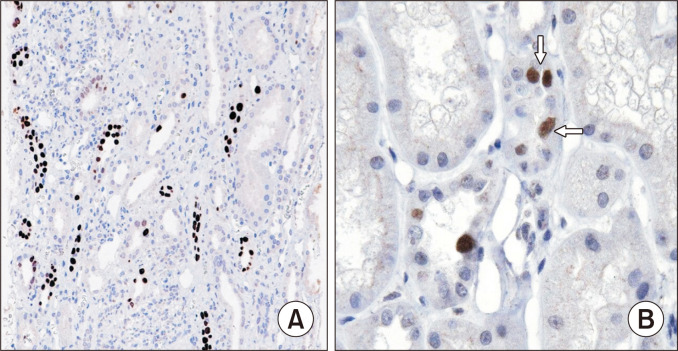

# 3096 — Bệnh thận do BK polyomavirus sau ghép thận / BK polyomavirus nephropathy (BKPyVAN)

**Tags:** `pattern:creatinin-tang` `pattern:viem-ong-than-ke` `pattern:ton-thuong-ong-than` `vung:than-ghep` `vung:than` `protocol:sieu-am-Doppler` `protocol:sinh-thiet-than-ghep` `score:BK-viral-load` `score:Banff-PVN`
**Mức chắc chắn (certainty):** tổng hợp y văn (literature synthesis) — chủ yếu từ **đồng thuận quốc tế lần 2 về BKPyV** (Transplantation 2024, PMC11335089), **nghiên cứu xác nhận phân loại Banff 2018** (Am J Transplant 2021, PMC7891590), **tổng quan BKPyV** (Viruses 2022, PMC9330039; Front Transplant 2024, PMC11235301), **loạt 272 ca C4d** (Kidney Int Rep 2025, PMC12266260) và **nghiên cứu siêu âm tần số cao** (Radiology 2022, PMID 35503018). Không có ca do nhóm tự chụp.

> **Câu hỏi thực hành:** nam **56 tuổi**, ghép thận **8 tháng**, creatinin **1,3 → 1,9 mg/dL**, **BK PCR huyết tương 12.000 copies/mL**, siêu âm **không ứ nước**. Có cần sinh thiết không, và nếu có thì đọc gì?
> Bài chốt **ba quyết định**: **(1)** BK-DNAemia **> 10.000 copies/mL** là mức "giả định" (presumptive) — phải **giảm ức chế miễn dịch ngay**, không chờ sinh thiết; **(2)** sinh thiết khi creatinin tăng **> 15%** so với nền hoặc để phân biệt thải ghép/phân độ Banff — **hình ảnh không chẩn đoán được BKPyVAN**; **(3)** siêu âm/CT/MRI chỉ để **loại trừ tắc nghẽn, tụ dịch, huyết khối mạch**, không được dùng để "trấn an" khi nghi BK.

## 1. Tổng quan bệnh học – cơ chế hình ảnh

- **Virus học:** BK polyomavirus (BKPyV) là virus ADN sợi đôi, không vỏ, thuộc *Polyomaviridae*. **80–90% người trưởng thành có huyết thanh dương**; sau nhiễm tiên phát, virus **tồn tại tiềm tàng trong biểu mô niệu và tế bào ống thận**. Ghép thận + ức chế miễn dịch làm **tế bào T đặc hiệu BK suy yếu** → virus tái hoạt.
- **Chuỗi tự nhiên:** **viruria 30–40%** → **BK-DNAemia 10–20%** → **BKPyVAN (bệnh thận do BK) 1–10%** ở người ghép thận. Đa số xảy ra **trong năm đầu**, đỉnh **2–6 tháng** sau ghép; thể muộn vẫn có.
- **TẠI SAO tổn thương là ống thận–kẽ, không phải khối:** BKPyV sao chép trong **tế bào biểu mô ống thận**. Kháng nguyên T lớn (large T antigen) đẩy tế bào vào chu kỳ tế bào, gây **thể vùi trong nhân**, ly giải tế bào, rồi **viêm kẽ và xơ hóa/teo ống thận**. Vì tổn thương là **vi mô, rải rác**, CT không thấy khối và đậm độ HU gần như bình thường; không có "dấu hiệu hình ảnh đặc hiệu".
- **TẠI SAO hình ảnh mờ nhạt:** siêu âm chỉ đổi **echogenicity** khi phù/viêm hoặc xơ hóa đủ lan rộng; DWI/ADC chịu ảnh hưởng đồng thời của **khuếch tán tế bào, tưới máu và dòng nước tiểu trong ống**, nên **không có ngưỡng ADC được chuẩn hóa** để phân biệt BK với thải ghép hay hoại tử ống thận. Hình ảnh có giá trị **loại trừ**, không có giá trị **chốt**.
- **TẠI SAO dễ bỏ sót trên sinh thiết:** ổ sao chép virus **khu trú rải rác**, ưu thế **tủy**. Trong loạt 99 ca hiện đại, tổn thương chẩn đoán **chỉ ở 1 core** trong **29%** và **chỉ ở tủy** trong **23%**; sinh thiết có thể bỏ sót **10–30%** ổ virus. Vì vậy quy ước phải lấy **≥ 2 mẫu, có tủy**.
- **Hậu quả định lượng:** xơ hóa kẽ và teo ống thận làm giảm GFR. Ở loạt lịch sử, **suy mảnh ghép 5% (class 1) – 30% (class 2) – 50% (class 3)**; ở loạt hiện đại, suy mảnh ghép chung **8%**, nhưng **bệnh tồn tại** vẫn là yếu tố tiên lượng xấu. Ở trẻ, một đoàn hệ ghi nhận **mất mảnh ghép 24%** sau trung bình **24 tháng**.

## 2. Mẫu hình + chẩn đoán phân biệt theo vị trí (gamut)

- **Mẫu hình lâm sàng–hình ảnh:** người ghép thận **1–18 tháng**, creatinin tăng **âm ỉ** (thường **> 15%** so với nền), protein niệu/tiểu máu nhẹ hoặc không, **không sốt, không đau**, **BK-DNAemia dương**, siêu âm **không ứ nước** hoặc ứ nước nhẹ không tương xứng.
- **Gamut theo cơ chế — 5 nhóm "creatinin tăng ở thận ghép":**
  1. **Ống thận:** hoại tử ống thận cấp (ATN), độc thận do calcineurin inhibitor (CNI).
  2. **Kẽ:** **BKPyVAN**, thải ghép tế bào cấp (TCMR), thải ghép qua trung gian kháng thể (ABMR), thuốc.
  3. **Mạch:** hẹp động mạch thận ghép (TRAS — bài 3087), huyết khối tĩnh mạch/động mạch, giả phình miệng nối.
  4. **Niệu:** hẹp niệu quản/miệng nối (bài 3067, 3011), sỏi, nang bạch huyết/urinoma chèn ép, trào ngược.
  5. **Cầu thận:** bệnh cầu thận tái phát (IgA, FSGS, membranous), đái tháo đường, PTLD.
- **Dấu hiệu siêu âm gợi ý BKPyVAN (không đặc hiệu):** thận ghép **to**, **giảm âm vỏ**, **mất phân biệt vỏ–tủy**, **RI > 0,80**; trên đầu dò tần số cao (**7–12 MHz**) có thể thấy **vùng giảm âm dưới bao** và **ứ nước lệch trục** (eccentric hydronephrosis). Trong một nghiên cứu 105 người ghép thận, **ứ nước lệch trục + vùng giảm âm dưới bao** là yếu tố độc lập; **phối hợp siêu âm + BK-DNAemia + BK-niệu cho AUC 0,90, độ đặc hiệu 92%**; riêng **vùng giảm âm dưới bao** có AUC **0,66** và độ đặc hiệu **92%**.
- **Nguyên tắc:** siêu âm **bình thường không loại trừ** BKPyVAN; siêu âm **bất thường cũng không chốt** vì ATN, thải ghép, độc CNI và viêm thận–bể thận cho hình ảnh chồng lấp.

## 3. Bảng so sánh phân biệt (ma trận đối chiếu)

| Thực thể (entity) | Hình ảnh/mô học điển hình | Chốt vào (rule-in) | Chốt loại (rule-out) | Gợi ý xác nhận |
|---|---|---|---|---|
| **BKPyVAN** | Thận to, giảm âm vỏ, mất phân biệt vỏ–tủy, **vùng giảm âm dưới bao**, ứ nước lệch trục; mô học: **thể vùi trong nhân tế bào ống thận**, viêm kẽ–ống thận, xơ hóa theo **pvl/ci** | **SV40-T dương + BK-DNAemia + pvl ≥ 1** | **SV40-T âm + không có thể vùi + DSA dương/viêm nội mô mạch** | PCR huyết tương + sinh thiết **≥ 2 core có tủy**, SV40-T IHC |
| **Thải ghép tế bào cấp (TCMR)** | Thâm nhiễm lympho kẽ, **tubulitis**, **viêm nội mô mạch (endothelialitis)**; không thể vùi | **Tubulitis + endothelialitis + SV40-T âm** | **SV40-T dương + thể vùi nhân** | Banff i/t/v; đáp ứng corticoid |
| **Thải ghép qua trung gian kháng thể (ABMR)** | Viêm mao mạch cầu thận **g + ptc**, **C4d dương mao mạch quanh ống**, DSA+ | **DSA+ + g/ptc + C4d ở mao mạch quanh ống** | **C4d chỉ dương màng đáy ống thận** (gặp 81% BKPyVAN) và **SV40-T dương** | DSA, C4d, mô học |
| **Hoại tử ống thận cấp (ATN)** | Thận to, giảm âm, **RI > 0,80**; mô học hoại tử tế bào ống, trụ sắc tố, không thể vùi | **Khởi phát sớm < 1 tháng, thiếu niệu, hồi phục theo thời gian** | **SV40-T dương/thể vùi** | Diễn tiến, sinh thiết nếu không hồi phục |
| **Độc thận do CNI** | Thận bình thường hoặc giảm âm, RI > 0,80; không đặc hiệu | **Nồng độ thuốc cao, cải thiện khi giảm liều** | **Thể vùi/SV40-T dương** | Nồng độ thuốc, thử giảm liều có kiểm soát |
| **Viêm thận–bể thận cấp** | Vùng giảm đậm độ/viêm quanh thận, có thể có khí; CT rõ hơn siêu âm | **Sốt, đau, cấy nước tiểu dương** | **Không sốt, BK-DNAemia, SV40-T dương** | Cấy nước tiểu, CT |
| **Tắc nghẽn niệu quản/lymphocele** | **Ứ nước, giãn bể thận**, RI tăng; thấy ổ dịch chèn ép | **Giãn bể thận + creatinin giảm sau giải áp** | **Không ứ nước, BK-DNAemia dương** | Siêu âm/CT, stent/tháo chèn ép |
| **Bệnh cầu thận tái phát** | Protein niệu, tiểu máu; mô học IgA/FSGS/membranous, IF dương | **Tổn thương cầu thận + IF đặc hiệu** | **Không tổn thương cầu thận** | Sinh thiết + IF |

*Ba lớp Banff 2018 trên cùng một khung: **(a,b)** class I — pvl 1, ci 0; **(c,d)** class II — pvl 2, ci 1; **(e,f)** class III — pvl 3, ci 3. Hàng trên: H&E; hàng dưới: SV40-T IHC (nhân nâu = tế bào ống thận nhiễm virus). Nguồn: Cureus 2023 (PMC10799693), Fig. 1, **CC BY 4.0**, ảnh nguyên bản.*

### Dấu hiệu mô học "chốt" và cách đọc

- **Thể vùi trong nhân** (intranuclear inclusions): nhân tế bào ống thận to, chất nhiễm sắc bị đẩy ra ngoại vi, có thể dạng **"kính mờ" (ground-glass)**, **dạng bọng (vesicular)** hoặc **ưa eosin**. Thể vùi chỉ thấy trên H&E ở **57%** ca trong loạt 99 ca; vì vậy **không thể dựa vào H&E đơn thuần**.
- **SV40-T IHC** phát hiện **kháng nguyên T lớn** trong nhân tế bào nhiễm; đây là phương pháp được ưu tiên để chẩn đoán **BKPyVAN xác định**. IHC dương **một nhân trong một lát cắt ống thận** đã đủ tính là "ống thận dương".
- **pvl (polyomavirus load)** đếm **tỷ lệ ống thận có ≥ 1 nhân dương**, không phải tỷ lệ nhân: **pvl 1 ≤ 1%**, **pvl 2 > 1–10%**, **pvl 3 > 10%** ống thận/ống góp.
- **ci (interstitial fibrosis)** theo Banff: **ci 0 ≤ 5%**, **ci 1 6–25%**, **ci 2 26–50%**, **ci 3 > 50%** diện tích vỏ thận.
- **C4d màng đáy ống thận** dương ở **81%** BKPyVAN (so với **14%** ca không BK), và **dương lan tỏa 23%** — dương C4d **không đồng nghĩa ABMR**; dương lan tỏa còn gắn với tải virus cao hơn và sống mảnh ghép kém hơn.

## 4. Protocol chụp + hệ phân độ/điểm chuẩn hóa

### 4.1. Tầm soát và định nghĩa (đồng thuận 2024)

| Bước | Ngưỡng/định nghĩa | Hành động |
|---|---|---|
| **Tầm soát** | **PCR BKPyV huyết tương mỗi tháng đến tháng thứ 9**, sau đó **mỗi 3 tháng đến 2 năm** (trẻ: đến **3 năm**) | Ở nơi thiếu PCR, dùng **tế bào học nước tiểu** (decoy cells) để loại trừ, rồi làm PCR khi có decoy cells |
| **Possible BKPyVAN** | **BK-DNA niệu > 10 triệu copies/mL** hoặc decoy cells/tiểu thể virus, **PCR huyết tương âm** | Chưa phải bệnh thận; theo dõi sát, tìm nguyên nhân khác |
| **Probable BKPyVAN** | **BK-DNA huyết tương > 1.000 copies/mL kéo dài > 2 tuần** | **Giảm ức chế miễn dịch** theo bậc thang |
| **Presumptive BKPyVAN** | **BK-DNA huyết tương > 10.000 copies/mL** | Giảm ức chế miễn dịch ngay; cân nhắc sinh thiết nếu có rối loạn chức năng thận |
| **Biopsy-proven BKPyVAN** | **Tổn thương tế bào phù hợp + IHC + xét nghiệm phân biệt BKPyV với JCPyV** | Phân độ Banff, theo dõi PCR, điều chỉnh ức chế miễn dịch |

### 4.2. Phân độ Banff 2018 (được đưa vào Banff 2019 với **pvl score**)

| Lớp (class) | pvl | ci | Ý nghĩa thực hành |
|---|---|---|---|
| **Class 1** | 1 | 0–1 | Nhẹ, xơ hóa tối thiểu; tiên lượng tốt nhất |
| **Class 2** | 1 | 2–3 | Trung gian — **vùng xám**, quyết định theo PCR/diễn tiến |
| **Class 2** | 2 | 0–3 | Trung gian |
| **Class 2** | 3 | 0–1 | Trung gian (tải virus cao nhưng chưa xơ hóa nhiều) |
| **Class 3** | 3 | 2–3 | Nặng, xơ hóa nhiều; nguy cơ mất mảnh ghép cao nhất |

### 4.3. Protocol hình ảnh

- **Siêu âm B-mode + Doppler màu/phổ là bước đầu**, đầu dò **7–12 MHz** (thận ghép nằm nông): đo **kích thước thận ghép**, **độ dày vỏ**, **phân biệt vỏ–tủy**, **bể thận**, **RI** ở động mạch gian tiểu thùy; tìm **ổ dịch quanh thận**, **ứ nước**, **huyết khối**.
- **Siêu âm tần số cao** có thể thấy **vùng giảm âm dưới bao** và **ứ nước lệch trục** — gợi ý BKPyVAN nhưng **không đủ chẩn đoán**; độ đặc hiệu của vùng giảm âm dưới bao **92%**, nhưng độ nhạy thấp (AUC **0,66**).
- **CT/MRI** chỉ khi siêu âm không giải thích được: **CT có cản quang** để loại trừ tắc nghẽn, tụ dịch, giả phình, huyết khối; **MRI** (T1/T2, DWI/ADC, có thể T1 mapping) để đánh giá nhu mô và xơ hóa — nhưng **không có ngưỡng ADC/DTI được chấp nhận** để chẩn đoán BKPyVAN.
- **Sinh thiết là chuẩn**: **≥ 2 core, có tủy**, gửi **H&E + trichrome + SV40-T IHC**; báo cáo kèm **pvl, ci, i/t, C4d (nếu nghi ABMR)** và **phân độ Banff**.

### 4.4. Điều trị — nguyên tắc

- **Giảm ức chế miễn dịch là điều trị nền**, ưu tiên **thuốc chống chuyển hóa (MMF/azathioprine)** và/hoặc **CNI**, theo bậc thang của trung tâm. Mục tiêu là **giảm tải virus và cho phép miễn dịch đặc hiệu BK phục hồi**, không phải "diệt virus".
- **Không có kháng virus được chấp thuận** cho BKPyV; đồng thuận 2024 **không ủng hộ dùng thường quy leflunomide, cidofovir, quinolone hay IVIG**. Các thuốc này chỉ nên dùng trong **thử nghiệm lâm sàng** hoặc ca chọn lọc.
- **Theo dõi:** BK-DNA huyết tương định kỳ cho đến khi **âm tính**; theo dõi creatinin, protein niệu, và **thải ghép** sau khi giảm ức chế miễn dịch. Trong các mô hình chi phí, **kháng thể de novo/ thải ghép cấp không vượt quá 20%** sau giảm ức chế miễn dịch.
- **Ghép lại thận** sau mất mảnh ghép do BKPyVAN là khả thi nếu **BK-DNA huyết tương không phát hiện được**; không khuyến cáo cắt thận ghép thường quy. Nguy cơ tái phát BKPyVAN ở lần ghép sau **15,2%** so với **2,2%** ở người ghép lại không có tiền sử BKPyVAN.

## 5. Biến thể bình thường và cạm bẫy

- **Giãn nhẹ bể thận sau ghép là bình thường:** thận ghép bị **mất trương lực thần kinh**, lợi niệu sau mổ và phù miệng nối → bể thận có thể "hơi giãn" mà không tắc. Đừng gọi ứ nước nếu không có **giãn đài thận** và không có **chênh creatinin sau giải áp**.
- **RI 0,70–0,80 có thể bình thường:** RI phụ thuộc **tần số tim, huyết áp mạch đập, tuổi, độ sâu**, và **không đặc hiệu** cho BK; RI > 0,80 gặp trong ATN, thải ghép, độc CNI, tắc nghẽn. **RI bình thường không loại trừ BKPyVAN**.
- **Decoy cells không phải tế bào ung thư:** decoy cells là **tế bào biểu mô niệu nhiễm BKPyV** với nhân to, chất nhiễm sắc thô — dễ bị đọc nhầm **ung thư biểu mô đường niệu**. Xác nhận bằng **PCR BK** và **SV40-T**, không sinh thiết bàng quang chỉ vì decoy cells.
- **C4d dương không đồng nghĩa ABMR:** C4d màng đáy ống thận dương **81%** BKPyVAN; chỉ khi C4d dương **mao mạch quanh ống** kèm **DSA + viêm mao mạch** mới nghi ABMR.
- **BK-DNAemia có thể từ đường niệu, không từ nhu mô:** viêm bàng quang xuất huyết do BK, bể chứa ruột, hoặc ổ nhiễm ngoài thận có thể làm PCR dương mà **không có BKPyVAN**. Ngược lại, **PVN xác định có thể xảy ra với BK-DNA huyết tương < 500 copies/mL**, và **không có PVN** ở một số ca **> 10.000 copies/mL**; tương quan PCR–tải nội thận chỉ **r ≈ 0,43**.
- **Sinh thiết âm không loại trừ:** nếu chỉ 1 core hoặc không có tủy, có thể bỏ sót **10–30%** ổ virus; làm lại khi lâm sàng vẫn nghi.
- **Giảm ức chế miễn dịch quá tay → thải ghép:** luôn cân nhắc nguy cơ miễn dịch, DSA, tiền sử thải ghép; không "cắt sạch" thuốc.
- **Đừng điều trị viruria đơn thuần:** BK-niệu không triệu chứng, không DNAemia, không rối loạn chức năng thận **không phải BKPyVAN**; điều trị bằng giảm ức chế miễn dịch có thể gây hại.

## 6. Tự lượng giá — Blind Quiz

**Ca 1 — nam 52 tuổi, ghép thận 7 tháng, creatinin 1,2 → 1,8 mg/dL, BK PCR huyết tương 6.000 copies/mL. Sinh thiết có H&E và SV40-T.**

- Gợi ý lâm sàng: không sốt, không đau, siêu âm không ứ nước.
- Câu hỏi: mô tả **pvl** và **ci** ở từng cặp ảnh; xếp **class 1/2/3**; yếu tố nào quyết định tiên lượng?

<b>Bấm để hiện đáp án (findings + chẩn đoán)</b>

- **(a,b) class I:** SV40-T dương ở **≤ 1% ống thận** (pvl 1), mô kẽ **xơ hóa ≤ 5%** (ci 0). **(c,d) class II:** pvl 2 (**1–10%** ống thận), ci 1 (**6–25%**). **(e,f) class III:** pvl 3 (**> 10%** ống thận), ci 3 (**> 50%**).
- **Chẩn đoán:** BKPyVAN — **class II** nếu ca này rơi vào pvl 2/ci 1; xác định bằng **thể vùi + SV40-T + BK-DNAemia**.
- **Tiên lượng:** ngoài class, **bệnh tồn tại** (không clear BK-DNAemia) và **C4d màng đáy ống lan tỏa** là yếu tố xấu; class 1 có suy ghép **5%**, class 2 **30%**, class 3 **50%** trong loạt lịch sử.
- Nguồn ảnh: Cureus 2023 (PMC10799693), Fig. 1, **CC BY 4.0**.

**Ca 2 — nữ 48 tuổi, ghép thận 5 tháng, creatinin tăng, BK PCR 3.000 copies/mL. Ảnh H&E độ phóng đại cao.**

- Câu hỏi: dấu hiệu trong nhân là gì? Ba chẩn đoán phân biệt? Xét nghiệm nào chốt?

<b>Bấm để hiện đáp án (findings + chẩn đoán)</b>

- **Findings:** nhân tế bào ống thận to, có **thể vùi dạng kính mờ, dạng bọng và ưa eosin**; kèm tổn thương ống thận và thâm nhiễm đơn nhân kẽ. Đây là **viral cytopathic changes** của BKPyV.
- **DDx:** ATN (không thể vùi), thải ghép tế bào cấp (tubulitis, không thể vùi), độc CNI (không thể vùi); viêm thận–bể thận nếu có sốt/neutrophil.
- **Chốt:** **SV40-T IHC** (nhân nâu) + **BK-DNA huyết tương**; H&E một mình chỉ thấy thể vùi ở **57%** ca.
- Nguồn ảnh: Clin Transplant Res 2024 (PMC11228385), Fig. 1, **CC BY-NC 4.0**, ảnh nguyên bản.

**Ca 3 — nam 60 tuổi, ghép thận 9 tháng, BK PCR 15.000 copies/mL, sinh thiết có SV40-T.**

- Câu hỏi: vì sao dùng IHC thay vì chỉ H&E? **pvl** được tính thế nào? Cần lấy bao nhiêu mẫu và ở đâu?

<b>Bấm để hiện đáp án (findings + chẩn đoán)</b>

- **Findings:** nhân tế bào ống thận bắt màu nâu đậm với **SV40-T** — kháng nguyên T lớn của BKPyV; mật độ dương phản ánh **pvl**.
- **Vì sao IHC:** thể vùi trên H&E chỉ thấy **57%**; IHC phát hiện sớm cả khi chưa có thể vùi rõ, và là tiêu chuẩn **BKPyVAN xác định**.
- **Cách tính pvl:** đếm **tỷ lệ ống thận có ≥ 1 nhân dương**, không phải tỷ lệ nhân: **pvl 1 ≤ 1%**, **pvl 2 > 1–10%**, **pvl 3 > 10%**.
- **Lấy mẫu:** **≥ 2 core, có tủy**; tổn thương chỉ ở 1 core **29%**, chỉ ở tủy **23%** — một core không đủ.
- Nguồn ảnh: Clin Transplant Res 2024 (PMC11228385), Fig. 4, **CC BY-NC 4.0**, ảnh nguyên bản.

## Bài liên quan chéo

- [3067 – Hẹp niệu quản do BK sau ghép thận: hẹp đoạn dài, BK niệu 26,7% vs 7,0%, nong lặp lại ít hiệu quả](../3067-hep-nieu-quan-do-bk-sau-ghep-than/lesson.md)
- [3011 – Biến chứng niệu quản sau ghép thận: hẹp miệng nối & rò nước tiểu](../3011-bien-chung-nieu-quan-sau-ghep-than/lesson.md)
- [116 – Nhiễm trùng nang gan ở người ghép thận: chỉnh ức chế miễn dịch & tương tác thuốc](../116-nhiem-trung-nang-gan-ghep-than/lesson.md)
- [1721 – Nhiễm khuẩn stent niệu quản: biofilm, rút stent ≤ 3 tuần ở thận ghép](../1721-nhiem-khuan-stent-nieu-quan/lesson.md)
- [1750 – UTUC ở bệnh nhân thận ghép: kẻ bắt chước "viêm thận–bể thận" và BK virus](../1750-utuc-than-ghep/lesson.md)
- [3090 – Bacteriuria không triệu chứng ở trẻ có bể chứa ruột: phân biệt nhiễm khuẩn thật](../3090-bacteriuria-khong-trieu-chung-be-chua-ruot/lesson.md)

## Ảnh

- `images/3096_bk-polyomavirus_histology_Cureus-2023.jpg` — ba lớp Banff (H&E + SV40-T), Cureus 2023 (PMC10799693), Fig. 1, **CC BY 4.0**.
- `images/3096_bk-polyomavirus_inclusions_ClinTransplantRes-2024.jpg` — thể vùi trong nhân, Clin Transplant Res 2024 (PMC11228385), Fig. 1, **CC BY-NC 4.0**.
- `images/3096_bk-polyomavirus_SV40-IHC_ClinTransplantRes-2024.jpg` — SV40-T IHC, Clin Transplant Res 2024 (PMC11228385), Fig. 4, **CC BY-NC 4.0**.
- Nguồn, giấy phép và tác giả từng ảnh: xem [images/CREDITS.md](images/CREDITS.md).

> **Disclaimer:** Bài học chỉ dùng cho mục đích giáo dục, không thay thế đánh giá của bác sĩ chuyên khoa. Quyết định sinh thiết, giảm ức chế miễn dịch và điều trị phải cá thể hóa theo bệnh nhân.
