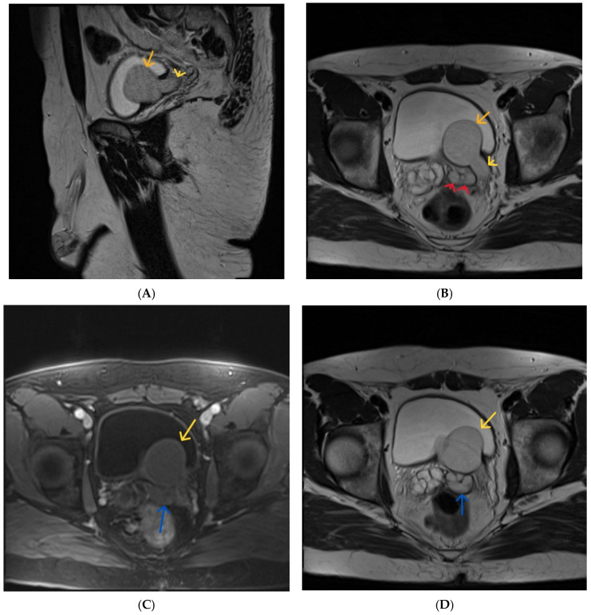
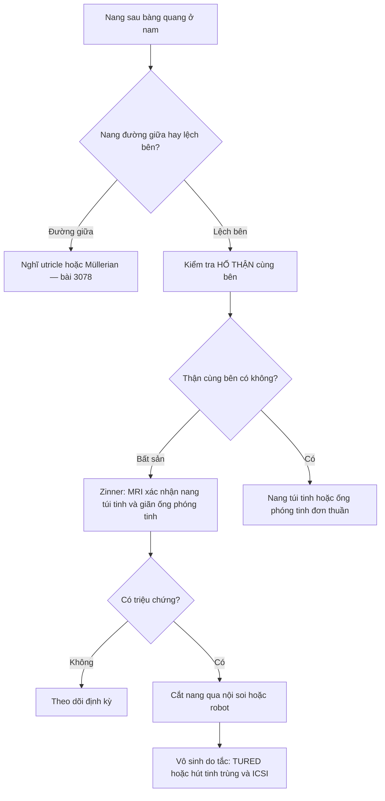
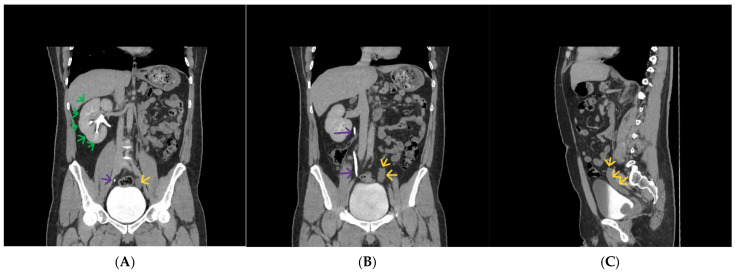
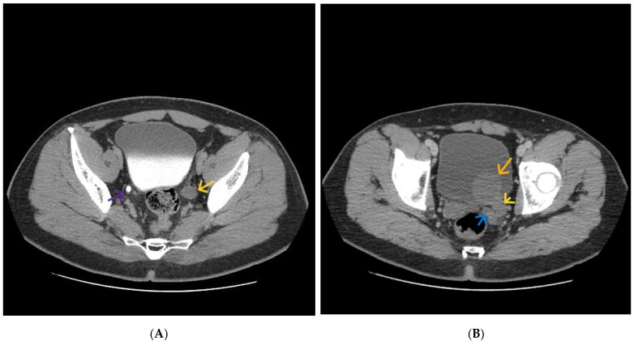

# 3097 — Hội chứng Zinner: nang túi tinh + bất sản thận cùng bên + tắc ống phóng tinh

**Tags:** `pattern:nang-sau-bang-quang` `pattern:nang-tui-tinh` `pattern:bat-san-than` `pattern:gian-ong-phong-tinh` `vung:tui-tinh` `vung:sau-bang-quang` `vung:than` `vung:tiet-nieu` `protocol:MRI-tieu-khung` `protocol:CT-tiet-nieu` `protocol:sieung-am` `incidentaloma:nang-sau-bang-quang`

**Mức chắc chắn (certainty):** tổng hợp y văn (literature synthesis) — ghép 1 tổng quan có ca minh họa (Diagnostics 2026, PMC13115000, CC BY 4.0), 1 ca + tổng quan tài liệu (Urol Case Rep 2026, PMC13100478, CC BY-NC-ND 4.0), 1 ca + tổng quan (BMC Urol 2026, PMC13169955, CC BY-NC-ND 4.0), 1 loạt ca MRI (Cureus 2026, PMC13221453, CC BY 4.0), 1 ca biến thể (Radiol Case Rep 2026, PMC13499116, CC BY-NC-ND 4.0). Số nào nguồn không đưa thì ghi "chưa rõ".

> **Bài này trả lời 4 câu hỏi của ca "nang sau bàng quang ở nam giới":**
> (1) **Nang này thuộc túi tinh, ống Müllerian, utricle hay ống phóng tinh?** (2) **Vì sao phải chụp/xem HỐ THẬN cùng bên?** (3) **Khi nào chỉ theo dõi, khi nào cắt nang?** (4) **Vô sinh do tắc thì xử trí thế nào?**
> Đây là **nang bên + bất sản thận cùng bên**; hai bài cùng gamut nhưng khác vị trí: [3078 – Nang utricle & Müllerian](../3078-nang-ong-utricle-mullerian/lesson.md) (**đường giữa**) và [3077 – Áp-xe túi tinh](../3077-ap-xe-tui-tinh/lesson.md) (**nang viêm, có sốt**).

## 1. Tổng quan bệnh học – cơ chế hình ảnh

### 1.1 Phôi thai: một ống — ba cấu trúc

- **Ống trung thận (mesonephric/Wolffian duct)** cho ra **mầm niệu quản** (về sau thành niệu quản, bể thận, đài thận) **và** các cấu trúc sinh dục cùng bên: **túi tinh, ống dẫn tinh, ống phóng tinh**.
- Khiếm khuyết **mầm niệu quản** trong khoảng **tuần 5–13** của thai kỳ → **bất sản thận cùng bên** (không có mô thận, không phải "thận teo").
- Khiếm khuyết **đoạn xa ống trung thận** → **tắc ống phóng tinh** → túi tinh giãn thành **nang** (giãn thứ phát do ứ dịch, không phải nang bẩm sinh đơn thuần).
- **Tại sao nang to dần sau dậy thì:** androgen làm túi tinh **tăng bài tiết** nhưng đường ra bị tắc → dịch tích trong nang, nang **căng dần**; vì vậy đa số được phát hiện ở **tuổi 20–40**, dù dị tật có từ bào thai.

### 1.2 TẠI SAO hình ảnh trông như "nang đơn thuần"

- Dịch túi tinh giàu protein và fructose nhưng **ít tế bào** → **T2 rất sáng** (gần nước), **T1 thấp**; nếu ứ đạm đặc hoặc có máu cũ → **T1 sáng**, dễ bị gọi nhầm là "khối đặc".
- Nang **không ngấm thuốc**, vách mỏng; **không có thành dày, không nốt trong nang** — nếu có thành dày/ngấm thuốc/nốt cần nghĩ **u túi tinh** (hiếm) hoặc **áp-xe** (bài 3077).
- **Bất sản thận** biểu hiện là **hố thận trống** (không thấy mô thận, không thấy bể thận) + **thận đối bên phì đại bù**; niệu quản cùng bên có thể **dừng tận cùng mù (blind-ending)** hoặc giãn thành **nang dạng ureterocele** — biến thể hay gặp (Diagnostics 2026, PMC13115000; Cureus 2026, PMC13221453).
- **Tắc ống phóng tinh** trên MRI: **ống phóng tinh giãn > 2–3 mm**, kéo dài tới **verumontanum**, đôi khi thấy **nang trong tuyến tiền liệt**.

### 1.3 Số liệu định lượng và dịch tễ

- **Tần suất:** **13 ca / ~280.000** lần siêu âm sàng lọc (Đài Bắc) ≈ **4,6/100.000**; toàn y văn **< 200 ca** (Urol Case Rep 2026, PMC13100478; BMC Urol 2026, PMC13169955).
- **Tuổi chẩn đoán:** trung bình **29 tuổi** (khoảng **sơ sinh – người lớn**); đa số **20–40 tuổi**; thể trẻ vị thành niên hiếm.
- **Triệu chứng thường gặp:** tiểu nhiều **24,3%**, đau khi tiểu **23,1%**, đau tầng sinh môn **20,2%**; ngoài ra đau sau xuất tinh, **xuất tinh máu**, **vô sinh do tắc** (Urol Case Rep 2026).
- **Kích thước nang trong ca báo cáo:** **3,3 × 3,8 cm** (Urol Case Rep 2026); nang "khổng lồ" có thể chèn ép bàng quang gây **bí tiểu** (BMC Urol 2026).
- **Vô sinh:** tắc ống phóng tinh hai bên → **azoospermia**; trong ca 17 tuổi, thể tích tinh dịch **1,5 mL**, **không có tinh trùng**, nhưng **hút tinh trùng từ mào tinh (PESA)** vẫn thu được tinh trùng → **vô sinh do tắc, có thể điều trị** (BMC Urol 2026).

## 2. Mẫu hình + chẩn đoán phân biệt theo vị trí (gamut)

- **Quy tắc vàng — BÊN + THẬN:** nang **lệch bên (paramedian)** + **bất sản thận cùng bên** = **Zinner** cho tới khi chứng minh ngược lại.
- **Theo vị trí:**
  - **Sau – bên bàng quang, trên tiền liệt tuyến:** nang túi tinh (Zinner nếu kèm bất sản thận), nang ống phóng tinh.
  - **Đường giữa sau bàng quang:** nang ống Müllerian, nang utricle (thường nhỏ, trong tiền liệt tuyến).
  - **Trong lòng bàng quang:** ureterocele lạc chỗ ("cyst-within-cyst", liên quan hệ niệu quản đôi).
  - **Trước xương cùng, sau trực tràng:** nang tailgut, nang trùng lặp ruột.
  - **Bất kỳ:** áp-xe vùng chậu (sốt, thành dày, hạn chế khuếch tán).
- **Theo tuổi/dậy thì:** nang **to nhanh sau dậy thì** gợi ý nang túi tinh/ống phóng tinh (bài tiết androgen); nang **không đổi kích thước** gợi ý nang bẩm sinh đơn thuần.
- **Gợi nhớ WOLFF:** **W**olffian remnant (Zinner), **O**bstruction of ejaculatory duct, **L**ateralized cyst, **F**ailure of ipsilateral kidney, **F**ertility (vô sinh do tắc).

## 3. Bảng so sánh phân biệt (ma trận đối chiếu)

| Thực thể (entity) | Hình ảnh điển hình | Chốt vào (rule-in) | Chốt loại (rule-out) | Gợi ý xác nhận |
|---|---|---|---|---|
| **Nang túi tinh trong Zinner** | Nang **paramedian** sau–bên bàng quang, T2 rất sáng, T1 thấp (có thể sáng), vách mỏng; **bất sản thận cùng bên**; ống phóng tinh giãn | **Nang bên + bất sản thận cùng bên + giãn ống phóng tinh** | Nang đường giữa, hai thận đủ → không phải Zinner | MRI tiểu khung + FOV gồm hố thận; CT urography thì muộn |
| **Nang ống Müllerian (nam)** | Nang **đường giữa** giữa bàng quang và trực tràng, không thông túi tinh, hai thận bình thường | **Đường giữa + không liên tục với túi tinh** | Lệch bên + bất sản thận → Zinner | MRI đa mặt phẳng; không thấy ống phóng tinh giãn |
| **Nang utricle (prostatic utricle)** | Nang **đường giữa trong tiền liệt tuyến**, nhỏ, thông niệu đạo tiền liệt | **Trong tiền liệt + thông niệu đạo** | Nang lớn sau bàng quang, ngoài tiền liệt → không phải utricle | MRI; thường kèm **lỗ tiểu đóng thấp (hypospadias)** |
| **Nang ống phóng tinh** | Nang **paramedian gần verumontanum**, hình ống, kèm giãn túi tinh thượng nguồn | **Hình ống + giãn túi tinh + vô sinh** | Có bất sản thận → nghĩ Zinner (thể nang ống phóng tinh) | MRI T2; TRUS |
| **Ureterocele lạc chỗ** | Nang **trong lòng bàng quang**, "cyst-within-cyst", liên quan **hệ niệu quản đôi** | **Nằm trong bàng quang + thấy niệu quản đổ vào** | Nang ngoài bàng quang, không thấy niệu quản nối → không phải ureterocele | CT urography/MRU; soi bàng quang |
| **Túi thừa bàng quang** | Túi **thông với lòng bàng quang**, đầy/thay đổi theo lượng nước tiểu | **Thông bàng quang + thay đổi khi đi tiểu** | Nang kín, không thông → không phải túi thừa | So sánh trước/sau đi tiểu; CT |
| **Nang tailgut / trùng lặp** | Nang **trước xương cùng, sau trực tràng**, nhiều vách | **Vị trí sau trực tràng + không liên quan đường niệu dục** | Nang sát bàng quang/túi tinh → không phải tailgut | MRI; mô học nếu mổ |
| **Áp-xe vùng chậu** | Nang **thành dày ngấm thuốc**, khí, hạn chế khuếch tán, dịch quanh | **Sốt + thành dày + hạn chế khuếch tán** | Nang thành mỏng, không ngấm, không sốt → không phải áp-xe | CRP/máu; chọc hút |

*MRI T2 (A, B, D, E, F) và T1 fat-sat sau tiêm (C): nang túi tinh bên trái (mũi tên đỏ), niệu quản trái giãn (mũi tên vàng), ureterocele trong bàng quang (mũi tên cam), ống phóng tinh giãn (mũi tên xanh). Nguồn: Diagnostics 2026 (PMC13115000), Fig. 4, CC BY 4.0.*

## 4. Protocol chụp + chiến lược xử trí

### 4.1 Protocol hình ảnh (thứ tự thực hành)

- **Siêu âm (đầu tay):** xác định **hố thận trống**, nang sau bàng quang, có thể thấy **niệu quản mù**; siêu âm qua trực tràng (TRUS) đánh giá túi tinh/ống phóng tinh.
- **CT urography (nếu chưa MRI):** thì **muộn 5–10 phút** để thấy **niệu quản dừng mù**, ureterocele, bất sản thận; **không cần** nếu MRI đã đủ.
- **MRI tiểu khung — chuẩn tham chiếu** (Diagnostics 2026, PMC13115000):
  - **Bắt buộc:** T2 axial + sagittal + coronal; T1 axial.
  - **Bổ sung khi cần:** T1 **fat-sat** (phân biệt đạm/máu), **DWI** (áp-xe/độ phức tạp), **T1 sau tiêm** (thành/ngấm thuốc).
  - **FOV phải gồm cả hố thận** — đây là lỗi hay gặp nhất: chụp tiểu khung hẹp rồi **bỏ sót thận bất sản**.
- **Đo và ghi:** kích thước nang (3 chiều), **bên**, quan hệ với **túi tinh cùng bên**, **ống phóng tinh** (đường kính, có giãn/teo), **niệu quản** (mù/giãn/ureterocele), **thận đối bên** (phì đại bù).

### 4.2 Chiến lược xử trí

- **Không triệu chứng, nang nhỏ:** **theo dõi** bằng siêu âm/MRI định kỳ (ngưỡng thực dụng **< 3 cm**, chưa có đồng thuận tuyệt đối — ghi "chưa rõ").
- **Có triệu chứng (chèn ép, nhiễm trùng tái diễn, đau, vô sinh do tắc):** **cắt nang** qua **nội soi ổ bụng/robot** — kết quả tốt, ít biến chứng (BMC Urol 2026; Urol Case Rep 2026).
- **Chọc hút ± xơ hóa:** lựa chọn khi không mổ được; **tái phát cao** vì nang vẫn bài tiết — không phải điều trị triệt để (chưa rõ tỷ lệ tái phát chính xác trong y văn mở).
- **Tắc ống phóng tinh:** **TURED** (cắt ống phóng tinh qua nội soi) hoặc **hút tinh trùng + ICSI** khi không tái thông được — vô sinh **do tắc** nên tiên lượng tốt hơn vô sinh do suy sinh dục.
- **Nghi u túi tinh** (thành dày, nốt ngấm thuốc, nang phức tạp): **cắt toàn bộ + mô học**, không chọc hút đơn thuần.

## 5. Biến thể bình thường và cạm bẫy

- **Cạm bẫy 1 — không xem hố thận:** gọi nang "Müllerian" hoặc "utricle" chỉ vì nang nằm sau bàng quang; **bất sản thận cùng bên là chốt chẩn đoán**, bỏ sót = chẩn đoán sai và tư vấn sai về sinh sản.
- **Cạm bẫy 2 — nhầm "đường giữa" và "lệch bên":** Müllerian/utricle **đường giữa**; nang túi tinh **lệch bên**. Đây là **bước 1** trong mọi thuật toán (Diagnostics 2026).
- **Cạm bẫy 3 — bỏ sót ống phóng tinh:** không thấy ống phóng tinh giãn/teo → bỏ mất thành tố "tắc" của tam chứng, dẫn tới đánh giá vô sinh không đầy đủ.
- **Cạm bẫy 4 — ureterocele giả nang túi tinh:** ureterocele lạc chỗ nằm **trong lòng bàng quang**, có "cyst-within-cyst" và **niệu quản đổ vào**; nang túi tinh nằm **ngoài bàng quang**. Cần trace **toàn bộ niệu quản**.
- **Cạm bẫy 5 — T1 sáng = "khối đặc":** dịch đạm đặc/máu cũ trong nang có thể **T1 sáng**; dùng **T1 fat-sat + DWI + sau tiêm**: nang **không ngấm**, **không hạn chế khuếch tán mạnh**.
- **Cạm bẫy 6 — "thận teo" thay vì "bất sản":** teo thận do bệnh mạch/mạn tính vẫn còn **mô thận nhỏ**; bất sản = **không có mô thận**. Chỉ bất sản mới đi với Zinner.
- **Cạm bẫy 7 — bỏ kiểm tra túi tinh đối bên:** Zinner một bên nhưng túi tinh **đối bên** có thể bất sản/teo → ảnh hưởng khả năng sinh sản.

## 6. Tự lượng giá — Blind Quiz

**Ca 1 — Nam 26 tuổi, tiểu buốt và đau tinh hoàn trái 2 tháng, vô sinh.**

- Câu hỏi: Bất thường ở đâu? Vì sao phải chụp thì muộn? Chẩn đoán liên quan gì tới sinh sản?

<b>Bấm để hiện đáp án (findings + chẩn đoán)</b>

- Dấu hiệu: **thận phải phì đại bù** (mũi tên xanh), **hố thận trái trống** (không có thận trái); **niệu quản trái dừng tận cùng mù** (mũi tên vàng); niệu quản phải bình thường (mũi tên tím).
- Chẩn đoán: **bất sản thận trái** + niệu quản mù — thành tố thứ nhất của **hội chứng Zinner**; phải tìm **nang túi tinh trái** và **giãn ống phóng tinh**.
- Liên quan sinh sản: tắc ống phóng tinh → **vô sinh do tắc** (azoospermia), có thể điều trị bằng TURED hoặc hút tinh trùng + ICSI.
- Nguồn ảnh: *Diagnostics* 2026 (PMC13115000), Fig. 2, CC BY 4.0.

**Ca 2 — Cùng bệnh nhân, MRI tiểu khung: mô tả từng thành tố của tam chứng.**

- Câu hỏi: Ba thành tố của Zinner nằm ở đâu? Vì sao nang T2 rất sáng? Có biến thể gì kèm theo?

<b>Bấm để hiện đáp án</b>

- Dấu hiệu: **nang túi tinh trái** nhiều thùy (mũi tên đỏ) T2 rất sáng; **niệu quản trái giãn** (mũi tên vàng); **ống phóng tinh giãn** (mũi tên xanh); **ureterocele** trong bàng quang (mũi tên cam); thận trái không thấy.
- Tam chứng: **bất sản thận trái + nang túi tinh trái + tắc ống phóng tinh**.
- Vì sao T2 sáng: dịch giàu nước, ít tế bào; T1 sáng hơn nếu đạm đặc/máu cũ.
- Biến thể: **niệu quản mù tận cùng bằng ureterocele** — nằm ngoài phổ kinh điển nhưng vẫn cùng bất thường ống trung thận.
- Nguồn ảnh: *Diagnostics* 2026 (PMC13115000), Fig. 4, CC BY 4.0.

**Ca 3 — Nam 55 tuổi, đau tầng sinh môn, tiểu khó; CT có nang cạnh bàng quang.**

- Câu hỏi: Hai cấu trúc hình ống giãn là gì? Phân biệt với ureterocele và túi thừa bàng quang thế nào?

<b>Bấm để hiện đáp án</b>

- Dấu hiệu: (A) **niệu quản trái giãn** (mũi tên vàng) cạnh niệu quản phải bình thường (tím); (B) **ống phóng tinh giãn** (mũi tên xanh), **ureterocele** (mũi tên cam).
- Phân biệt: **ureterocele** nằm **trong lòng bàng quang**, "cyst-within-cyst", liên quan hệ niệu quản đôi; **túi thừa bàng quang** thông với lòng bàng quang và **thay đổi theo lượng nước tiểu**; nang túi tinh nằm **ngoài bàng quang**, lệch bên.
- Nguồn ảnh: *Diagnostics* 2026 (PMC13115000), Fig. 3, CC BY 4.0.

## Bài liên quan chéo
- [100 – Tổng quan hệ Bụng](../100-tong-quan-he-bung/lesson.md)
- [3078 – Nang ống utricle & nang ống Müllerian](../3078-nang-ong-utricle-mullerian/lesson.md) (nang **đường giữa**)
- [3077 – Áp-xe túi tinh](../3077-ap-xe-tui-tinh/lesson.md) (nang **viêm**, có sốt)
- [3011 – Biến chứng niệu quản sau ghép thận](../3011-bien-chung-nieu-quan-sau-ghep-than/lesson.md) (hẹp/rò niệu quản)
- [150 – Nang thận Bosniak & u thận](../150-nang-than-Bosniak/lesson.md) (nang thận, khác nang túi tinh)

> Không dùng để chẩn đoán độc lập khi chưa có người hướng dẫn.
