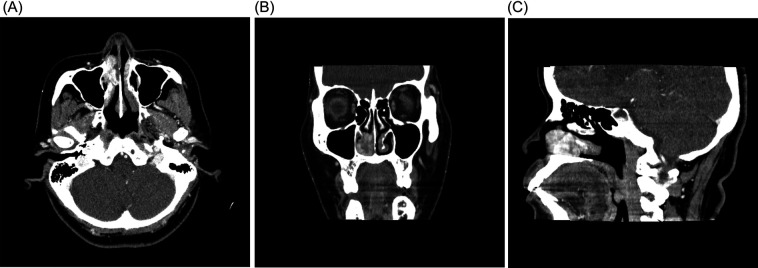
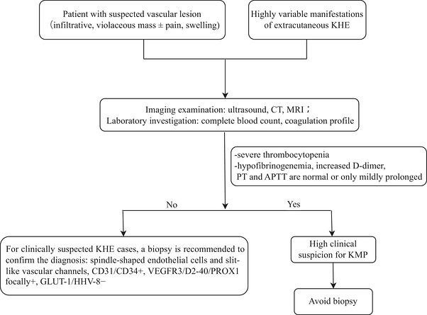
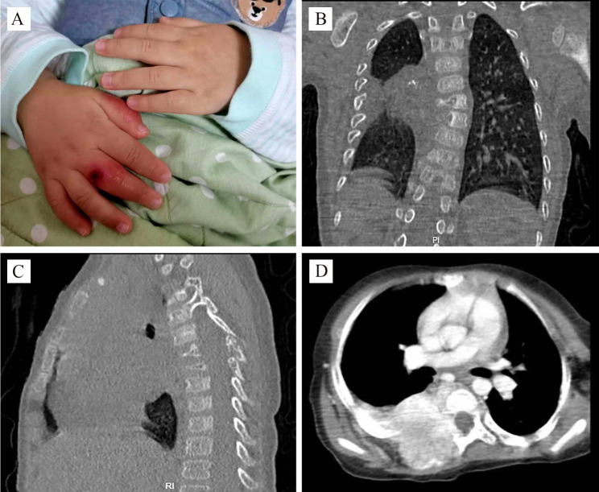

# 3099 — KHE ở người lớn và thể sâu (sau phúc mạc – trung thất – mũi xoang): không có KMP nhưng dễ nhầm sarcoma mạch / Adult & deep-seated kaposiform hemangioendothelioma

**Tags:** `pattern:khoi-mo-mem` `pattern:u-mach-mau` `pattern:xam-lan` `vung:mo-mem` `vung:trung-that` `vung:sau-phuc-mac` `vung:mui` `protocol:MRI-co-can-quang`

**Mức chắc chắn (certainty):** tổng hợp y văn (literature synthesis) — số liệu lấy từ **một bài tổng quan có thuật toán chẩn đoán – điều trị** (PMC13291430) và **hai ca nguyên văn có ảnh, giấy phép CC BY** (người lớn 59 tuổi: PMC13212465; trẻ 2 tuổi thể cạnh sống: PMC10655467). Không có thử nghiệm ngẫu nhiên; các ngưỡng điều trị là **đồng thuận thực hành**, chỗ suy luận được ghi rõ.

> **Câu chốt:** KHE là u mạch máu **giáp biên (borderline)**, **không thoái triển tự nhiên** — **2%** các u mạch máu, **0,071/100.000 trẻ/năm** (PMC13291430). Ba điều phân biệt bài này với KHE ở nhũ nhi (bài 3074):
> 1. **Thể sâu (deep type) không có tổn thương da** → chẩn đoán muộn, hình ảnh giống **sarcoma mô mềm/xương**;
> 2. **KHE khởi phát ở người lớn gần như không có Kasabach–Merritt (KMP)** — tổng quan ghi rõ **"chưa có ca KMP nào được báo cáo ở KHE khởi phát người lớn"** (PMC13291430) → **tiểu cầu bình thường KHÔNG loại trừ KHE**;
> 3. Vì vậy câu hỏi lâm sàng đổi từ *"truyền tiểu cầu thế nào"* sang *"khối này có phải sarcoma không, có cắt được không, sinh thiết có an toàn không"*.

## 1. Tổng quan bệnh học – cơ chế hình ảnh (TẠI SAO)

### 1.1 Dịch tễ và sinh bệnh học: vì sao "người lớn" là một bài riêng

- KHE là u mạch máu **giáp biên** theo ISSVA/WHO (trung gian ác tính), chiếm **~2%** các u mạch máu; **~50%** bẩm sinh, phần lớn xuất hiện trong **năm đầu đời**; thể **hỗn hợp (nông + sâu) ~60%**, thể **sâu thuần túy** chỉ nằm trong cơ/xương/khoang cơ thể, **không có dấu hiệu da** nên **chẩn đoán muộn** (PMC13291430).
- Sinh bệnh học: tăng sinh **lympho–mạch máu** qua trục **VEGF-C/VEGFR-3** và **Angiopoietin-2/TIE2** → hội tụ về **PI3K/AKT/mTOR**; đột biến soma **GNA14, PIK3CA, RAD50** đã được mô tả → giải thích vì sao **sirolimus (ức chế mTOR)** là thuốc đầu tay (PMC13291430).
- **Vì sao người lớn hiếm và không có KMP:** KMP là hiện tượng **giữ – hoạt hóa tiểu cầu trong lòng mạch u**, phụ thuộc **thể tích u lớn + tuổi rất nhỏ**; cả ba yếu tố nguy cơ (**tuổi khởi phát ≤ 1 tháng, u ≥ 6 cm, vị trí sâu/ngoài chi**) đều nghiêng về nhũ nhi. Tổng quan ghi **KMP ~40%** tổng số KHE nhưng **không có ca nào ở KHE người lớn** (PMC13291430). Ca người lớn 59 tuổi trong bài này có **tiểu cầu, PT, aPTT, INR hoàn toàn bình thường** (PMC13212465).

### 1.2 Vật lý hình ảnh: vì sao KHE "sáng T2 lốm đốm" và "ngấm thuốc không đều"

| Thành phần mô bệnh | Thể hiện trên MRI/CT | Giải thích vật lý |
|---|---|---|
| **Khe mạch dạng khe (slit-like) + tế bào nội mô hình thoi** | T1 **đồng/giảm** tín hiệu so với cơ; T2 **tăng không đồng nhất** | Nhiều nước trong lòng mạch và mô đệm → T2 dài; tế bào thoi xếp đặc làm tín hiệu không thuần nhất |
| **Xơ hóa (fibrosis) + hemosiderin** | **Ổ giảm tín hiệu T2** rải rác trong khối | Collagen và hemosiderin rút ngắn T2* → đốm tối; hemosiderin còn làm **blooming** trên SWI |
| **Mạng mạch giàu dòng chảy** | **Ngấm thuốc lan tỏa nhưng không đều** thì động mạch → muộn; **flow void** trong khối | Thuốc vào nhanh qua mạng mao mạch dày; vùng xơ/hoại tử ngấm chậm hơn |
| **Xâm lấn mô mỡ – cơ – xương** | Bờ **không rõ**, **dày da**, **stranding mỡ dưới da**; xương: **tiêu xương thể thấm (permeative)** + thành phần mô mềm ngấm thuốc | U mọc theo **vách cân và khoang cơ**, không tạo vỏ; tế bào u tiết enzyme phân hủy xương → tiêu xương không vôi hóa |

- **Siêu âm (bước đầu):** khối **echo hỗn hợp, bờ không rõ**, tăng sinh mạch; trên **3D color Doppler** mô tả kiểu **"branch-shape"**; **tới 40%** xâm lấn cơ kế cận (PMC13291430).
- **CT:** tổn thương **giảm/đồng đậm độ**, **ngấm thuốc**; CT có cản quang là cách tốt nhất thấy **tiêu xương, mòn xương, tái tạo xương** (PMC13291430). Ca cạnh sống 2 tuổi: khối **cạnh sống T3–T6, phá hủy thân đốt + cung sau + nhiều sườn**, ngấm thuốc lan ra **cơ lưng và ống sống** (PMC10655467) — hình ảnh **không thể phân biệt với sarcoma xương** nếu chỉ nhìn CT.
- **Ngưỡng định lượng cần nhớ:** KMP ~**40%**; tử vong do KMP **chưa điều trị 20–30%**, tử vong chung thời kỳ trước sirolimus **10–30%**, nay **< 2%**; phù bạch mạch mạn **~10%**; **hạn chế vận động ~70%** trong 2 năm nếu có phá hủy xương (PMC13291430).

## 2. Mẫu hình + chẩn đoán phân biệt theo vị trí và tuổi (Gamut)

- **Người lớn – khối mô mềm ngấm thuốc, không đau nhiều, không có dấu da:** KHE (hiếm) · **angiosarcoma** · **epithelioid hemangioendothelioma (EHE)** · sarcoma mô mềm khác (synovial, UPS) · **solitary fibrous tumor** · lymphoma · di căn.
- **Mũi–xoang (ca người lớn trong bài):** KHE · **ung thư biểu mô vảy** · **u nhú đảo ngược** · u mạch máu (hemangioma) · **u xơ mạch vòm họng (JNA)** ở nam trẻ · u hắc tố niêm mạc.
- **Cạnh sống – trung thất – sau phúc mạc ở trẻ:** KHE · **u nguyên bào thần kinh (neuroblastoma)** · ganglioneuroma · **sarcoma Ewing** · lymphoma · teratoma · **kaposiform lymphangiomatosis (KLA)** · desmoid.
- **Có tổn thương xương:** KHE · Ewing · osteosarcoma · di căn neuroblastoma · lymphoma · **u tế bào khổng lồ** · abcès xương.
- **Mnemonic "VASCULAR-BORDERLINE" (theo 4 câu hỏi):** **(1) tuổi** (nhũ nhi → KHE/KMP; người lớn → angiosarcoma/EHE); **(2) da** (có mảng tím → thể hỗn hợp; không có → thể sâu, dễ muộn); **(3) xương** (tiêu xương thấm + mô mềm ngấm thuốc); **(4) xét nghiệm** (tiểu cầu/fibrinogen chỉ hữu ích ở nhũ nhi).

## 3. Bảng so sánh phân biệt (ma trận đối chiếu)

| Thực thể (entity) | Hình ảnh điển hình | Chốt vào (rule-in) | Chốt loại (rule-out) | Gợi ý xác nhận |
|---|---|---|---|---|
| **KHE người lớn (bài này)** | Khối mô mềm **bờ không rõ**, T2 tăng không đồng nhất, **ổ tối T2** (xơ/hemosiderin), ngấm thuốc lan tỏa; có thể tiêu xương; **tiểu cầu bình thường** | **Bờ xâm lấn + ổ tối T2 + ngấm thuốc đều–không đều + không có dấu da**; mô học: tế bào thoi, khe mạch, **CD31/CD34/D2-40 dương, GLUT1 âm** | **Không có dấu hiệu tăng sinh mạch ác tính** (hoại tử rộng, xuất huyết tự phát, xâm lấn da loét) → nghĩ angiosarcoma; **không thoái triển theo thời gian** → loại u máu nhũ nhi | Sinh thiết **core** (không FNA) + IHC; MRI có cản quang |
| **KHE nhũ nhi có KMP (bài 3074)** | Mảng tím + khối sâu; **tiểu cầu < 100 × 10⁹/L**, fibrinogen thấp, D-dimer cao; **flow void** | **Giảm tiểu cầu tiêu thụ + khối mạch máu ở nhũ nhi** | **Tiểu cầu bình thường ở người lớn không loại trừ KHE** — đây là bẫy chính | CBC + fibrinogen + D-dimer; sirolimus |
| **Angiosarcoma** | Khối **hoại tử – xuất huyết**, bờ thấm, **ngấm thuốc mạnh không đều**, hay ở da đầu/vùng xạ/chi dưới; xương: tiêu hủy nhanh | **Hoại tử rộng + xuất huyết + tuổi lớn + tiền sử xạ** | **Bờ tương đối rõ, không hoại tử, tuổi trẻ** → ít nghĩ angiosarcoma | Sinh thiết + IHC (CD31, ERG, **c-MYC khuếch đại** ở thể thứ phát) |
| **EHE (epithelioid hemangioendothelioma)** | Nhiều nốt **ở phổi/gan/xương**, bờ rõ, **"halo sign"** (vòng xơ), vôi hóa trong 20% | **Nhiều ổ + vôi hóa + halo** | **Một khối đơn độc xâm lấn mô mềm** → ít nghĩ EHE | Sinh thiết: **WWTR1–CAMTA1** |
| **Kaposiform lymphangiomatosis (KLA)** | Trung thất/sau phúc mạc, **dịch bạch huyết**, tiêu xương, **giảm tiểu cầu nhẹ** | **Nang dịch bạch huyết + tiêu xương + D2-40 dương mạnh** | **Khối đặc ngấm thuốc mạnh, không nang** → nghĩ KHE | MRI + sinh thiết; **KRAS** |
| **U máu nhũ nhi (infantile hemangioma)** | Xuất hiện **sau sinh 2–6 tuần**, **thoái triển**, GLUT1 **dương**, đáp ứng propranolol | **GLUT1 dương + thoái triển** | **Có từ lúc sinh, không thoái triển, GLUT1 âm** → KHE/tufted angioma | GLUT1; theo dõi 12–18 tháng |
| **Sarcoma Ewing (xương/cạnh sống)** | Tiêu xương **thấm**, **phản ứng màng xương "vỏ hành"**, khối mô mềm lớn | **Tuổi 10–20 + tiêu xương thấm + màng xương "onion-skin"** | **Vôi hóa trong khối, bờ rõ** → ít Ewing | Sinh thiết: **CD99, EWSR1** |
| **Neuroblastoma (trẻ < 5 tuổi)** | Cạnh sống/thượng thận, **vôi hóa 80–90%**, chèn ép tủy, di căn xương | **Vôi hóa + catecholamine niệu + MIBG dương** | **Không vôi hóa, chỉ một khối mô mềm** → không loại trừ, nhưng ít điển hình | MIBG, **NSE, ferritin, HVA/VMA** |

*CT có cản quang (A trục, B coronal, C sagittal): khối **3 × 2 cm** xuất phát từ **cuốn mũi dưới phải**, đẩy vào vách mũi và ra sau tới giữa ổ mũi; không phá hủy xương. Chẩn đoán sau mổ: KHE, **không KMP**. Nguồn: Front Surg 2026 (PMC13212465), CC BY 4.0.*

## 4. Protocol chụp + thuật toán xử trí

### 4.1 Chụp

- **MRI là phương thức chọn** (PMC13291430): **T1W, T2W fat-sat/STIR, DWI, T1W fat-sat sau tiêm**, thêm **MRA** khi khối lớn/nghi mạch lớn. Cần mô tả: **bờ, độ sâu (da–mỡ–cân–cơ–xương), tổn thương da, thâm nhiễm ống sống, flow void, ổ tối T2**.
- **CT có cản quang** khi nghi **xương** (tiêu xương, mòn, tái tạo) hoặc cần đánh giá mũi–xoang/nền sọ.
- **Siêu âm Doppler** cho tổn thương nông và theo dõi; **không đủ** để đo độ sâu (PMC13291430).
- **Xét nghiệm trước sinh thiết:** CBC, **fibrinogen, PT/aPTT, D-dimer** — để phát hiện KMP (chỉ có ý nghĩa ở nhũ nhi, nhưng vẫn làm vì rẻ và đổi thái độ sinh thiết).
- **Sinh thiết:** **core needle**, tránh vùng hoại tử; **FNA không đủ** vì cần cấu trúc khe mạch + IHC. Ở khối cạnh sống/trung thất, sinh thiết **dưới CT/US** và cân nhắc **nguy cơ chảy máu** (KHE rất giàu mạch).

### 4.2 Điều trị theo bối cảnh

```mermaid
flowchart TD
  A["Khối mô mềm ngấm thuốc, nghi KHE"] --> B{"Tiểu cầu / fibrinogen bất thường?"}
  B -->|"Có &#40;nhũ nhi, u lớn&#41;"| C["Coi như KHE + KMP: sirolimus ± corticoid, KHÔNG truyền tiểu cầu theo con số"]
  B -->|"Không &#40;người lớn / thể sâu&#41;"| D{"Cắt được toàn bộ, chức năng chấp nhận?"}
  D -->|"Có"| E["Cắt toàn bộ + xác nhận mô học; theo dõi MRI 3–6 tháng"]
  D -->|"Không"| F["Sirolimus 0,8 mg/m2 × 2/ngày, đích 8–15 ng/mL; đánh giá 3 tháng"]
  F --> G{"Đáp ứng?"}
  G -->|"Có"| H["Duy trì ≥ 12 tháng, giảm liều chậm"]
  G -->|"Không"| I["Vincristine ± phối hợp; xạ/embolization chọn lọc"]
```

*Sơ đồ gốc: tiếp cận khối nghi KHE → xét nghiệm đông máu → nhánh có/không KMP → CT/MRI và sinh thiết. Nguồn: Pediatr Investig 2026 (PMC13291430), CC BY-NC-ND 4.0, dùng nguyên bản không chỉnh sửa.*

- **Sirolimus:** đầu tay cho mọi KHE không cắt được; **0,8 mg/m² × 2/ngày**, đích **8–15 ng/mL** (có nhóm dùng **5–8 ng/mL**; **sơ sinh 2–6 ng/mL** vì CYP3A4 chỉ **30–40%** người lớn); đáp ứng **> 90%**, huyết học cải thiện sau **4–7 ngày** (PMC13291430). **Ở người lớn, dữ liệu này là ngoại suy** (không có thử nghiệm riêng) — khối khu trú vẫn ưu tiên **cắt toàn bộ** trước.
- **Vincristine:** đáp ứng **60–80%** nhưng khởi phát chậm **4–5 tuần** (PMC13291430).
- **Cắt toàn bộ** là lựa chọn khi khu trú: ca mũi người lớn **3 × 2 cm** được cắt nội soi, **không tái phát sau 5 tháng và 1 năm** (PMC13212465). Cắt không toàn bộ → **tái phát sớm** (ca ống tai ngoài tái phát trong **1 tháng**, dẫn trong PMC13212465).
- **Propranolol không phải thuốc của KHE** (khác u máu nhũ nhi): hiệu quả kém, đặc biệt khi có KMP (PMC13291430).

### 4.3 Theo dõi

- **MRI 3–6 tháng/lần** trong 2 năm đầu, sau đó theo đáp ứng; KHE **không tự thoái triển**, nên "khối nhỏ lại" là do điều trị.
- **Tầm soát di chứng:** hạn chế vận động (**~70%** nếu phá hủy xương trong 2 năm), phù bạch mạch (**~10%**), đau mạn (PMC13291430).

## 5. Biến thể bình thường và cạm bẫy

- **Bẫy 1 — "không giảm tiểu cầu thì không phải KHE":** đúng với nhũ nhi, **sai với người lớn**. Tổng quan khẳng định **chưa có KMP ở KHE người lớn** (PMC13291430); ca 59 tuổi có **CBC và đông máu bình thường** (PMC13212465).
- **Bẫy 2 — "không có tổn thương da thì không phải u mạch":** thể sâu **không có dấu da**, biểu hiện bằng **chèn ép** (tắc ruột, ứ nước thận, đau/giảm vận động) (PMC13291430).
- **Bẫy 3 — gọi là sarcoma rồi mổ/xạ quá mức:** tiêu xương thấm + khối mô mềm lớn trên CT **không phân biệt được** với Ewing/osteosarcoma (ca 2 tuổi, PMC10655467). Cần **sinh thiết trước**, không dựa vào hình ảnh.
- **Bẫy 4 — sinh thiết ở khối nhiều mạch:** nguy cơ chảy máu; dùng **core nhỏ, dưới hướng dẫn**, chuẩn bị cầm máu; tránh chọc vào vùng **xuất huyết/hoại tử** vì dễ lấy nhầm mô.
- **Bẫy 5 — "u mạch thì lành":** KHE **không thoái triển**, tái phát sau cắt không toàn bộ (PMC13291430, PMC13212465); theo dõi phải bằng **MRI**, không chỉ siêu âm.
- **Bẫy 6 — nhầm với KLA:** KLA có **nang dịch bạch huyết + tiêu xương + tràn dưỡng chấp**, không phải khối đặc ngấm thuốc mạnh; D2-40 dương mạnh ở cả hai → cần mô học + gen.

## 6. Tự lượng giá — Blind Quiz

**Ca 1 — Nữ 59 tuổi, nghẹt mũi phải và chảy máu mũi nhiều tháng. Nhìn CT trước, mô tả.**

- Gợi ý: không sốt, không chấn thương; xét nghiệm máu bình thường.
- Hỏi: khối xuất phát ở đâu, có phá xương không? 3 chẩn đoán phân biệt? Dấu hiệu nào **không** giúp loại KHE?

<b>Bấm để hiện đáp án</b>

- **Dấu hiệu:** khối ngấm thuốc **3 × 2 cm** từ **cuốn mũi dưới phải**, lấp ống mũi dưới, đẩy vách mũi, **không phá hủy xương**; không vôi hóa.
- **Chẩn đoán:** KHE thể mũi ở người lớn — mô học: tế bào thoi xếp quanh khe mạch, **CD31/CD34 dương**; **không KMP** (tiểu cầu/PT/aPTT/INR bình thường).
- **Điều trị:** cắt nội soi toàn bộ, không tái phát sau 5 tháng và 1 năm.
- **Chốt:** tiểu cầu bình thường **không loại trừ** KHE ở người lớn; phân biệt với SCC/u nhú đảo ngược cần **sinh thiết**.
- Nguồn ảnh: Front Surg 2026, PMC13212465, CC BY 4.0 (Alkholaiwi F, Yun Choi J).

**Ca 2 — Bé trai 2 tuổi, sưng và tím bàn tay phải, tiểu cầu thấp. CT ngực dưới đây:**

- Hỏi: mô tả tổn thương xương và phần mô mềm; vì sao không được kết luận sarcoma từ CT? Xét nghiệm nào chốt hướng đi?

<b>Bấm để hiện đáp án</b>

- **Dấu hiệu:** khối cạnh sống **T3–T6**, **phá hủy thân đốt, cung sau và nhiều sườn**, ngấm thuốc lan vào **cơ lưng và ống sống**; kèm tím/loét đầu chi do hiện tượng Raynaud.
- **Chẩn đoán:** KHE thể sâu + **KMP** (tiểu cầu thấp) — khối xâm lấn nhưng mô học là u mạch máu giáp biên, không phải sarcoma.
- **Chốt:** **sinh thiết + IHC** (CD31/CD34/D2-40 dương, GLUT1 âm); **không mổ lớn dựa trên CT**; điều trị **sirolimus** (đích 8–15 ng/mL; nhũ nhi/trẻ nhỏ có thể 5–8).
- Nguồn ảnh: BMC Pediatr 2023, PMC10655467, CC BY 4.0 (Liu L et al.).

## Bài liên quan chéo
- [3074 – KHE & Kasabach–Merritt: khối tím lan sâu + tiểu cầu tụt](../3074-u-mach-kaposi-kasabach-merritt/lesson.md) (thể nhũ nhi, KMP, truyền tiểu cầu)
- [3072 – Tái phát u máu nhũ nhi sau ngừng propranolol](../3072-tai-phat-u-mau-nhu-nhi-sau-ngung-propranolol/lesson.md) (vì sao propranolol không dùng cho KHE)
- [741 – Dị dạng mạch máu đầu–cổ ở trẻ: ISSVA 2018](../741-di-dang-mach-mau-dau-co-o-tre/lesson.md) (phân loại u/dị dạng mạch máu)
- [3048 – U máu gan ở nhũ nhi: propranolol & suy tim do shunt](../3048-u-mau-gan-o-nhu-nhi/lesson.md)
- [1602 – Hemangioma & tổn thương mạch lành tính của vú vs angiosarcoma](../1602-hemangioma-ton-thuong-mach-lanh-vu/lesson.md) (ma trận lành–ác của u mạch)
- [1804 – Suy giáp tiêu thụ do D3 lạc vị (u mạch máu ngoài gan)](../1804-suy-giap-tieu-thu-do-u-mach-mau-ngoai-gan/lesson.md)

## Ảnh
- `images/3099_khe-nguoi-lon_CT_PMC13212465-fsurg13-g001.jpg` — CT mũi xoang người lớn 59 tuổi, **CC BY 4.0**.
- `images/3099_khe-nguoi-lon_CT_PMC10655467-fig1.jpg` — CT ngực trẻ 2 tuổi, thể cạnh sống + KMP, **CC BY 4.0**.
- `images/3099_khe-nguoi-lon_SoDo_PMC13291430-PED4-g003.jpg` — sơ đồ thuật toán chẩn đoán KHE, **CC BY-NC-ND 4.0** (dùng nguyên bản, không chỉnh sửa).
- Nguồn + giấy phép từng ảnh: `images/CREDITS.md`.

> Không dùng để chẩn đoán độc lập khi chưa có người hướng dẫn.
