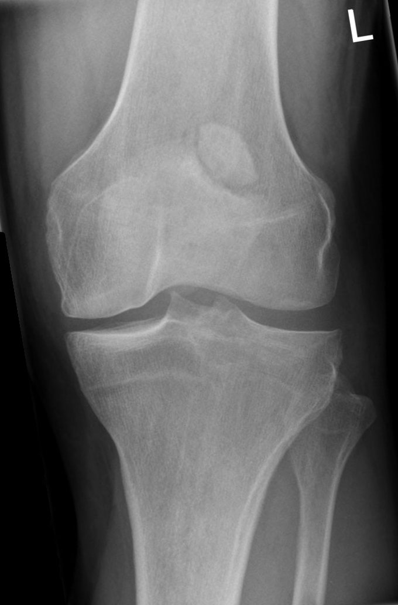
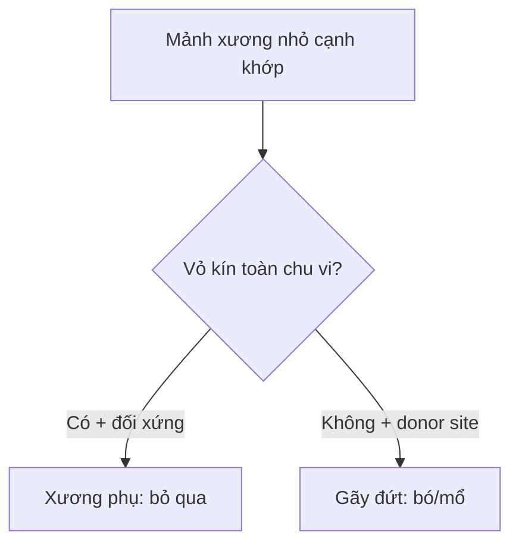

# 310 — Xương phụ & điểm cốt hóa: đừng gọi là gãy / Accessory ossicles

**Tags:** `pattern:xuong-phu` `vung:co-xuong-khop` `anatomy:co-xuong-khop`
**Mức chắc chắn (certainty):** tổng hợp y văn (literature synthesis) — nhóm tự biên từ y văn mở, chưa gắn ca nguyên văn đơn lẻ.

## 1. Tổng quan — vỏ xương kín chu vi là ranh giới sống còn

- Xương phụ (accessory ossicle) / xương vừng (sesamoid) là điểm cốt hóa thứ phát không liền vào xương chính — TẠI SAO có **vỏ xương (cortex) bao kín toàn bộ chu vi + bờ nhẵn tròn + thường đối xứng 2 bên**: nó phát triển như một xương con độc lập từ trung tâm cốt hóa riêng.
- Mảnh gãy đứt điểm bám (avulsion) ngược lại: **bờ sắc nhọn không vỏ ở mặt gãy (uncorticated jagged margin)** + khớp vừa khít vào giường xương khuyết (donor site) + sưng nề mô mềm khu trú — TẠI SAO: mặt gãy là xương xốp (trabecular) lộ ra, chưa kịp tạo vỏ.

## 2. Gamut xương nhỏ cạnh khớp (Gamut)

- **Góc trên-ngoài bánh chè + bờ viền đặc nhẵn:** bánh chè hai mảnh (bipartite patella) — bỏ qua.
- **Sau xương sên + cổ chân đau sau:** os trigonum — phân biệt gãy mỏm sau Shepherd.
- **Cạnh nền xương bàn V:** os peroneum / vesalianum — phân biệt gãy Jones + gãy đứt gân mác ngắn.
- **Bờ sắc + donor site + sưng nề:** gãy đứt thật — bó bột/mổ theo di lệch.

## 3. Bảng so sánh phân biệt (ma trận đối chiếu)

| Thực thể (entity) | Hình ảnh điển hình | Chốt vào (rule-in) | Chốt loại (rule-out) | Gợi ý xác nhận |
|---|---|---|---|---|
| Bipartite patella | **Mảnh góc trên-ngoài + viền đặc nhẵn + đối xứng** | **Superolateral + vỏ kín + không sưng nề** | Đường sáng cực dưới/ngang giữa → gãy | Chụp đối bên + CT khi nghi ngờ |
| Os trigonum | **Xương tròn sau sên + khe đều + vỏ kín** | **Tròn nhẵn + đau kẹt sau mạn** | Sắc nhọn + chấn thương cấp → gãy Shepherd | CT + MRI phù tủy |
| Os peroneum/vesalianum | **Hạt cạnh nền bàn V + vỏ kín** | **Tròn + không donor site** | Bờ sắc + hở nền bàn V → gãy Jones | Chụp chéo + hỏi gân mác |
| Gãy đứt (avulsion) | **Bờ sắc không vỏ + donor site + sưng nề** | **Khớp vừa giường khuyết + chấn thương** | Vỏ kín toàn chu vi → xương phụ | Bó bột/mổ theo mm di lệch |

*Mảnh phụ góc trên-ngoài, bờ viền đặc nhẵn, không sưng nề. Nguồn: Hellerhoff, Wikimedia Commons, CC BY-SA 3.0.*

## 4. Protocol

- **X-quang 2 bình diện + chụp đối bên so sánh:** vỏ kín + đối xứng = xương phụ; CT khi còn nghi ngờ (vỏ mặt gãy).
- Bánh chè: đường sáng cực dưới/ngang giữa + ngã đập gối = gãy thật (mổ khi di lệch > 2–3 mm + mất duỗi).

## 5. Cạm bẫy

- **Bipartite cực dưới** không tồn tại — đường sáng cực dưới luôn là gãy (đừng gọi 2 mảnh).
- **Os trigonum đau (kẹt sau)** tưởng gãy cũ — phù tủy MRI + chích thử mới mổ cắt.
- **Gãy Jones vùng watershed** liền xấu — phân biệt vesalianum để khỏi mổ oan/mổ thiếu.

## 6. Tự lượng giá — Blind Quiz

**Ca 1 — Đau gối trước sau ngã, X-quang có mảnh trên-ngoài bánh chè. Đọc phim.**

- Hỏi: mảnh ở đâu? Vỏ kín hay sắc nhọn? Gãy hay xương phụ?

<b>Bấm để hiện đáp án</b>

- Dấu hiệu (findings): mảnh góc trên-ngoài (superolateral) + bờ viền đặc nhẵn + không sưng nề mô mềm.
- Chẩn đoán (diagnosis): **bánh chè hai mảnh (bipartite patella)** — vỏ kín + vị trí kinh điển (khác gãy cực dưới/ngang giữa).
- Nguồn: Hellerhoff, CC BY-SA 3.0.

**Ca 2 — Sưng đau cạnh nền bàn V sau lật cổ chân, mảnh bờ sắc khớp vừa giường khuyết:** xương phụ hay gãy Jones? *(Bảng mục 3.)*

<b>Bấm để hiện đáp án</b>

- **Gãy Jones/đứt gân mác ngắn:** bờ sắc + donor site + sưng nề — bó bột/mổ (khác vesalianum vỏ kín).

**Ca 3 — Đau sau cổ chân mạn ở vũ công ballet, xương tròn sau sên vỏ kín + phù nhẹ:** os trigonum hay gãy Shepherd? *(Bảng mục 3.)*

<b>Bấm để hiện đáp án</b>

- **Os trigonum có triệu chứng (kẹt sau):** tròn vỏ kín + mạn — vật lý trị liệu/chích (gãy Shepherd là sắc + chấn thương cấp).

## Bài liên quan chéo
- [300 – Tổng quan MSK](../300-tong-quan-he-co-xuong-khop/lesson.md)
- [320 – Gãy & trật khớp](../320-gay-xuong-trat-khop-cap-cuu/lesson.md) (gãy thật)
- 355 – Cổ tay (gãy xương thuyền, dự kiến viết sau)

> Không dùng để chẩn đoán độc lập khi chưa có người hướng dẫn.
