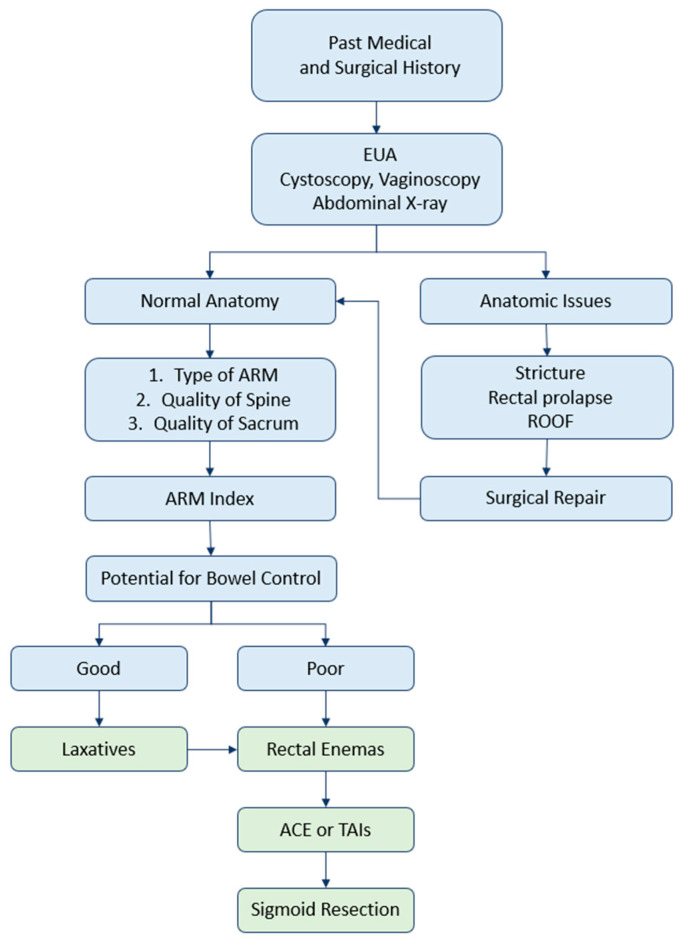
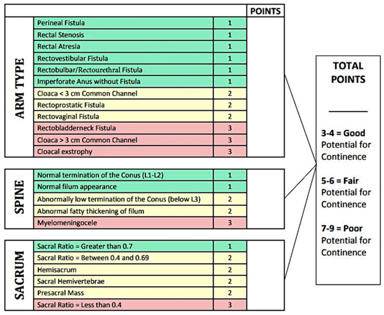
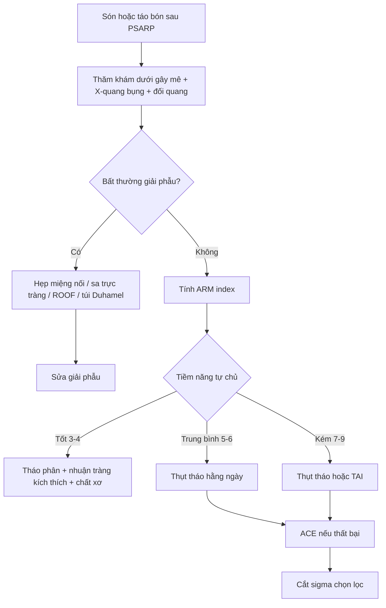
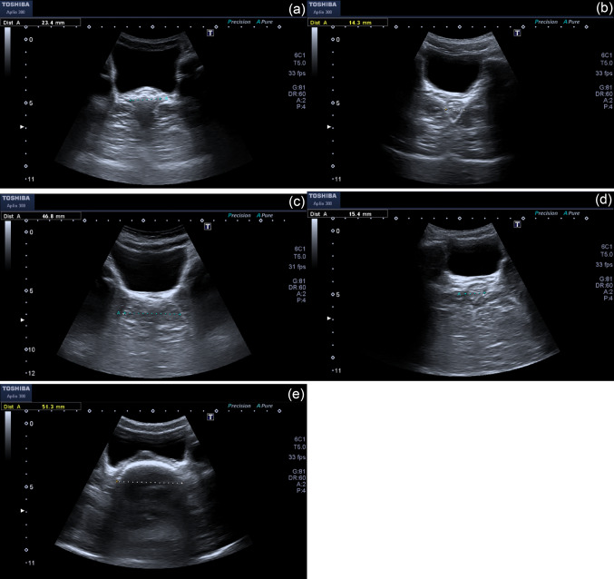
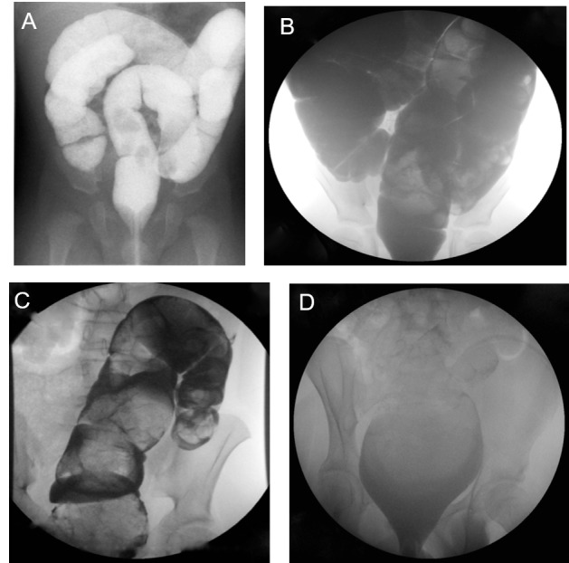

# 3100 — Quản lý ruột & kiểm soát đại tiện sau mổ ARM: Krickenbeck, bowel management và khi nào tái mổ

**Tags:** `pattern:di-tat-hau-mon` `pattern:son-phan` `pattern:tao-bon` `pattern:bat-thuong-tuy` `vung:hau-mon-truc-trang` `vung:dai-trang` `vung:mong-cung-cut` `protocol:XR-doi-quang` `protocol:MRI-chau` `protocol:US-truc-trang` `score:Krickenbeck` `score:ARM-index`

**Mức chắc chắn (certainty):** tổng hợp y văn (literature synthesis) — ghép **bài tổng quan bowel management ARM** (Children 2023, PMCID **PMC10217060**), **đoàn hệ 43 trẻ ARM sau mổ định hình xếp theo Krickenbeck** (Heliyon 2020, PMCID **PMC7033552**), **nghiên cứu POCUS đo đường kính trực tràng 2026** (Pediatr Surg Int, PMCID **PMC13379443**) và **loạt 83 trẻ đối chiếu đối quang với thể tích thụt hiệu quả** (Cureus 2016, PMCID **PMC5036987**). Không có ca do nhóm tự chụp; ca trong quiz lấy từ ảnh công bố, ghi nguồn từng ảnh.

> **Câu hỏi thực hành:** bé gái **5 tuổi**, mổ ARM thể rò tiền đình lúc 6 tháng, nay **són phân mỗi ngày**, mẹ tả "lúc nào cũng ướt quần", nhưng có hôm **3–4 ngày không đi được**. Đối quang đại tràng **không hẹp**, không giãn. Gia đình hỏi: **"Có phải mổ lại không? Có thuốc nào cho con tự đi được?"**
> Bài chốt **bốn quyết định**: **(1) són hằng ngày + bí phân nhiều ngày = táo bón ứ tràn, không phải "mất cơ thắt" — điều trị bằng tháo phân + nhuận tràng kích thích, không mổ; (2) đối quang đại tràng bình thường KHÔNG dự đoán được thể tích thụt hiệu quả (R² chỉ 0,21) — phải chuẩn độ theo cân nặng và đáp ứng lâm sàng; (3) thuốc làm mềm phân bị CẤM ở ARM vì làm phân lỏng khó nhận biết, tăng són; (4) chỉ mổ lại khi có bất thường giải phẫu thật (hẹp miệng nối, sa trực tràng, ROOF) hoặc thất bại với thụt/ACE.** Nối [3075 – Dị tật hậu môn–trực tràng ở sơ sinh](../3075-di-tat-hau-mon-truc-trang-so-sinh/lesson.md), [1779 – Hẹp miệng nối sau kéo trực tràng](../1779-hep-mieng-noi-sau-keo-truc-trang-o-tre/lesson.md), [3001 – Hẹp lỗ thông Mitrofanoff](../3001-hep-lo-thong-mitrofanoff-o-tre/lesson.md).

## 1. Tổng quan bệnh học – cơ chế hình ảnh: vì sao "mổ thành công" vẫn són

### 1.1 Bốn trụ cột của tự chủ đại tiện và chỗ ARM bị hỏng

- **Bốn trụ cột:** (1) **cảm giác hậu môn** — phân biệt đặc/lỏng/hơi; (2) **chức năng cơ thắt** — siết và giãn đúng lúc; (3) **nhu động trực tràng–sigma** — không quá nhanh, không quá chậm; (4) **chức năng chứa (proprioception)** — nhận biết căng giãn của trực tràng (PMC10217060).
- **ARM hỏng cả bốn:** phức hợp cơ thắt **phát triển bất thường**, **cảm giác hậu môn giảm**, và **dị tật tủy–xương cùng** đi kèm làm mất cảm giác và phản xạ. Vì thế kết quả chức năng **không thể suy ra từ "miệng nối trông đẹp"** trên phim.
- **TẠI SAO phân lỏng lại tệ hơn phân đặc:** khi cảm giác hậu môn kém, trẻ chỉ nhận ra **khối phân đặc, lớn, gây căng trực tràng**; phân lỏng **chảy qua cơ thắt mà không tạo tín hiệu căng** → són âm thầm. Đây là lý do **không dùng thuốc làm mềm phân** ở ARM; thay vào đó là **nhuận tràng kích thích + chất xơ tạo khối** để có phân thành khuôn (PMC10217060).
- **TẠI SAO táo bón lại gây són:** phân ứ lâu trong trực tràng–sigma giãn thành **megarectosigmoid**; phân lỏng đi vòng qua khối phân cứng (**overflow soiling**) và rỉ ra ngoài. Trẻ bị gọi nhầm là "tiêu chảy" rồi cho thuốc cầm — càng bít, càng són.
- **Vì sao cần hình ảnh chứ không chỉ khám:** đối quang đại tràng trả lời **có hẹp/megarectosigmoid/ROOF không**; MRI chậu–tủy trả lời **tủy căng, xương cùng, khối trước cùng**; X-quang bụng và POCUS trả lời **mức ứ phân**. Ba câu hỏi khác nhau, không thay thế nhau.

### 1.2 Dịch tễ và gánh nặng — con số phải nhớ

| Chỉ số | Số liệu | Nguồn |
|---|---|---|
| Tần suất ARM | **1/4.000–5.000** trẻ sinh sống, nam hơi nhiều hơn nữ | PMC10217060 |
| Dị tật kèm | **> 75%** có ít nhất một dị tật kèm (VACTERL, tim, thận, tủy–cột sống) | PMC10217060 |
| Táo bón sau PSARP | **tới 79%** | PMC10217060 |
| Són phân sau PSARP | **tới 48%** | PMC10217060 |
| Ngày điều trị trong 5 năm đầu | trung bình **32 ngày nội trú + 126 ngày ngoại trú** | PMC10217060 |
| Kết quả chức năng một trung tâm (n = 43, Krickenbeck) | **vận động ruột tự chủ 53,5%** · **són 11,6%** · **táo bón 9,3%** | PMC7033552 |
| Mục tiêu "sạch" | **1–3 lần đi phân/ngày** và **≤ 1 lần "tai nạn"/tuần** (Rome IV) | PMC10217060 |
| Tỉ lệ sạch sau chương trình bowel management | **70%** lúc 1 năm (222 trẻ); trong đó **74%** sạch nhờ thụt, **62%** nhờ nhuận tràng | PMC10217060 (dẫn Wood) |
| Thụt hằng ngày | **80%** sạch; **97%** sạch nếu chỉ cần nhuận tràng; còn **71%** duy trì sạch lúc 2 năm | PMC10217060 (dẫn Kilpatrick) |
| ACE (Malone) | **78%** "thành công" (sạch hoặc chỉ rỉ nhẹ đêm sau thụt); **13%** cải thiện nhưng chưa sạch | PMC10217060 (dẫn Peeraully) |
| Thể tích thụt hiệu quả | trung vị **22 mL/kg** (khoảng **5–48 mL/kg**); **không ca nào cần > 48 mL/kg** | PMC5036987 |
| Đối quang dự đoán thể tích thụt | **R² = 0,21**; thêm chẩn đoán + giãn đại tràng + ứ cản quang chỉ lên **R² = 0,35** | PMC5036987 |
| POCUS đường kính trực tràng (TRD) | cắt **3,1 cm**: **Se 63,3% / Sp 96,3%**; có triệu chứng **3,64 cm** vs không triệu chứng **2,20 cm** vs chứng lành **2,05 cm** | PMC13379443 |

## 2. Mẫu hình + chẩn đoán phân biệt theo cơ chế (Gamut)

- **Nhóm A — Bất thường giải phẫu (phải thấy trên hình ảnh, có thể mổ):**
  - **Hẹp miệng nối (anastomotic stricture):** chỗ hẹp tại neoanus/miệng nối, đại tràng trên giãn; triệu chứng **bí phân, rặn, són ứ tràn**; soi/thăm khám dưới gây mê + đối quang là chốt.
  - **Sa trực tràng (rectal prolapse):** niêm mạc lòi ra khi rặn; đối quang thấy nếp gấp, nhưng chẩn đoán chủ yếu lâm sàng.
  - **ROOF (remnant of original fistula):** **đoạn rò cũ còn lại** sau mổ — túi mù nằm giữa trực tràng và niệu đạo/âm đạo; gây **són liên tục, nhiễm trùng tái diễn**; cần soi bàng quang/âm đạo + MRI.
  - **Megarectosigmoid:** trực tràng–sigma giãn mất trương lực, chứa phân; đối quang thấy giãn, không hẹp.
  - **Đoạn vô hạch còn lại/túi Duhamel:** bệnh Hirschsprung bị bỏ sót hoặc miệng nối kiểu Duhamel để lại túi; đối quang có **vùng chuyển tiếp** và túi giãn.
- **Nhóm B — Rối loạn chức năng (điều trị bằng bowel management, không mổ):**
  - **Táo bón ứ tràn:** khối phân lớn + són lỏng; X-quang bụng/POCUS thấy ứ phân; đối quang không hẹp.
  - **Nhu động nhanh, chứa kém:** đi nhiều lần, phân lỏng, són ngay sau ăn; không có tổn thương giải phẫu.
  - **Són do cơ thắt yếu:** són khi ho/gắng, không táo bón; thường gặp thể ARM cao, xương cùng kém.
- **Nhóm C — Bất thường thần kinh (quyết định tiên lượng, không sửa được bằng thuốc):**
  - **Tủy căng (tethered cord):** chóp tủy **dưới L2–L3**, dây tận cùng dày/mỡ; gây són tiến triển, yếu chi dưới, bàn chân biến dạng.
  - **Thiểu sản/xương cùng ngắn:** tỉ lệ xương cùng (sacral ratio) thấp; càng thấp càng kém tự chủ.
  - **Myelomeningocele/nứt tủy:** mất chức năng thần kinh–cơ vòng và cảm giác.

## 3. Bảng so sánh phân biệt (ma trận đối chiếu)

| Thực thể (entity) | Hình ảnh điển hình | Chốt vào (rule-in) | Chốt loại (rule-out) | Gợi ý xác nhận |
|---|---|---|---|---|
| **Hẹp miệng nối** | Đối quang: **chỗ hẹp tại neoanus**, đại tràng trên giãn; không thấy cản quang qua dễ dàng | **Không đưa được ống Hegar theo tuổi** + hẹp trên đối quang + bí phân | Đối quang rộng đều, ống thông qua dễ → không phải nguyên nhân | Thăm khám dưới gây mê + đối quang; nong hoặc mổ lại (bài 1779) |
| **ROOF (đoạn rò cũ)** | **Túi mù** giữa trực tràng và niệu đạo/âm đạo; có thể thấy trên MRI/soi | **Són liên tục + nhiễm trùng niệu–sinh dục tái diễn** + túi mù | Không có túi mù, đối quang trơn → loại | Soi bàng quang/âm đạo + MRI chậu |
| **Sa trực tràng** | Đối quang: nếp niêm mạc lồng; lâm sàng thấy khối lòi khi rặn | **Khối đỏ lòi ra khi rặn**, tự co lại | Không lòi khi rặn → loại | Khám tư thế rặn; đối quang thì rặn |
| **Táo bón ứ tràn/megarectosigmoid** | X-quang: **khối phân lớn**; đối quang: **trực tràng–sigma giãn**, không hẹp | **Bí phân nhiều ngày + són lỏng + ứ phân trên phim** | Đối quang hẹp + ống Hegar không qua → hẹp | Tháo phân thử; đáp ứng nhuận tràng |
| **Tủy căng** | MRI: **chóp tủy dưới L2–L3**, dây tận cùng dày > 2 mm hoặc mỡ; siêu âm < 6 tháng | **Són tiến triển + bất thường da vùng cùng cụt + yếu chi dưới** | Chóp tủy L1–L2, dây mảnh, không mỡ → loại | Siêu âm tủy < 6 tháng; MRI > 6 tháng |
| **Thiểu sản xương cùng** | X-quang: **sacral ratio < 0,4**; xương cùng ngắn, mất đốt | **SR thấp + ARM thể cao + són từ nhỏ** | SR > 0,7 → tiên lượng tốt hơn | Đo SR trên phim chậu thẳng (bài 3075) |
| **Đoạn vô hạch/túi Duhamel** | Đối quang: **vùng chuyển tiếp** + túi giãn sau miệng nối | **Bí phân nặng, không đáp ứng nhuận tràng** + vùng chuyển tiếp | Đối quang không chuyển tiếp → loại | Sinh thiết trực tràng; đối quang cản quang |
| **Són do cơ thắt yếu** | Không tổn thương giải phẫu; đối quang bình thường | **Són khi gắng sức, không táo bón**, ARM thể cao | Có ứ phân/hẹp → không phải thể đơn thuần | Đo áp lực hậu môn; ARM index |

*Sơ đồ 6 bước: tiền sử → thăm khám dưới gây mê + soi bàng quang/âm đạo + X-quang bụng → nếu có bất thường giải phẫu thì sửa; nếu không, tính **ARM index** từ thể ARM + tủy + xương cùng → tiềm năng tự chủ tốt → nhuận tràng; kém → thụt tháo → ACE/TAI → cắt sigma chọn lọc. Nguồn: Children 2023 (PMC10217060), Fig. 3, **CC BY 4.0**.*

## 4. Protocol chụp + hệ phân độ/điểm chuẩn hóa

### 4.1 Bộ ba hình ảnh tối thiểu

- **X-quang bụng tư thế nằm:** đánh giá **khối phân** và mức ứ khí; không đo được chức năng, chỉ là "bản đồ ứ phân" trước khi chuẩn độ.
- **Đối quang đại tràng (contrast enema):** bơm cản quang qua neoanus hoặc hậu môn nhân tạo; trả lời **hẹp, giãn, ROOF, vùng chuyển tiếp, chiều dài đại tràng**. **Không** dùng để chọn thể tích thụt (xem mục 5).
- **MRI chậu–tủy:** chỉ định khi nghi **tủy căng, khối trước cùng, ROOF, hoặc ARM thể cao/phức tạp**; trẻ **< 6 tháng** dùng **siêu âm tủy** thay MRI (PMC10217060).
- **POCUS đo TRD (transrectal diameter):** đầu dò đặt **trên bụng dưới, lát cắt ngang qua trực tràng**, đo **đường kính trước–sau lớn nhất**; cắt **3,1 cm** gợi ý ứ phân có triệu chứng (Se 63,3%, Sp 96,3%) — **không thay** đánh giá toàn bộ đại tràng, nhưng không bức xạ và lặp lại được (PMC13379443).

### 4.2 Krickenbeck — ngôn ngữ chung để ghi kết quả

- **Vận động ruột tự chủ (voluntary bowel movement, VBM):** trẻ **cảm nhận được mót**, **nói được** và **nín được**.
- **Són phân (soiling):** **độ 1** — thỉnh thoảng, **≤ 1–2 lần/tuần**; **độ 2** — hằng ngày nhưng **không ảnh hưởng xã hội**; **độ 3** — **són liên tục, có vấn đề xã hội**.
- **Táo bón (constipation):** **độ 1** — kiểm soát bằng **chế độ ăn**; **độ 2** — cần **nhuận tràng**; **độ 3** — **kháng nhuận tràng + chế độ ăn**.
- **Cách dùng:** ghi **cả ba trục** ở mỗi lần khám, không chỉ "sạch/không sạch"; so sánh theo thời gian để biết chương trình có hiệu quả.

### 4.3 ARM index — tiên lượng trước khi hứa với gia đình

| Yếu tố | 1 điểm | 2 điểm | 3 điểm |
|---|---|---|---|
| **Thể ARM** | rò tầng sinh môn, hẹp trực tràng, teo trực tràng, rò tiền đình, rò niệu đạo hành/niệu đạo, không rò | cloaca **< 3 cm**, rò niệu đạo tiền liệt tuyến, rò âm đạo | rò cổ bàng quang, cloaca **> 3 cm**, lộ bàng quang–cloaca |
| **Tủy** | chóp tủy **L1–L2**, hình dạng bình thường | chóp tủy **dưới L3**, dây tận cùng **dày mỡ** | **myelomeningocele** |
| **Xương cùng** | **SR > 0,7** | **SR 0,4–0,69**, bán xương cùng, nửa đốt sống cùng, khối trước cùng | **SR < 0,4** |

- **Tổng điểm:** **3–4 = tiềm năng tốt**; **5–6 = trung bình**; **7–9 = kém** (PMC10217060, Fig. 2).
- **Cách nói với gia đình:** "Điểm này **không phải số phận**, mà là **dự báo để chọn mức hỗ trợ**; điểm kém vẫn có thể sạch nhờ **thụt/ACE**, nhưng khả năng tự đi hoàn toàn thấp hơn."

*Bảng điểm ARM continence index: mỗi trục 1–3 điểm; tổng **3–4 tốt**, **5–6 trung bình**, **7–9 kém**. Nguồn: Children 2023 (PMC10217060), Fig. 2, **CC BY 4.0**.*

### 4.4 Thứ tự điều trị (bowel management)

- **Bước 1 — tháo phân (disimpaction):** làm sạch khối phân trước khi chuẩn độ; nếu bỏ bước này, mọi thuốc đều thất bại.
- **Bước 2 — nhuận tràng kích thích:** **senna** ± chất xơ tạo khối; **không dùng thuốc làm mềm phân**. Chuẩn độ theo phân thành khuôn và số lần đi; **không vượt 60 mg/ngày** vì nguy cơ **phỏng da vùng đáy quần** (với chuẩn độ từng bước, tỉ lệ này chỉ **2,2%**) (PMC10217060).
- **Bước 3 — thụt tháo:** **dung dịch muối sinh lý**, bắt đầu **400 mL**, cùng giờ mỗi ngày; thể tích hiệu quả trung vị **22 mL/kg** (5–48 mL/kg) — **chuẩn độ theo cân nặng và đáp ứng**, không theo đối quang. **Nước máy chỉ dùng cho trẻ ≥ 3 tuổi**; trẻ nhỏ có nguy cơ **hạ natri máu** (PMC10217060; PMC5036987).
- **Bước 4 — TAI/ACE:** **transanal irrigation** hoặc **antegrade continence enema** (Malone appendicostomy) khi thụt ngược không hiệu quả/không dung nạp; **ACE thành công 78%**, thêm **13%** cải thiện (PMC10217060).
- **Bước 5 — cắt sigma chọn lọc:** chỉ khi **megarectosigmoid** thất bại với mọi biện pháp; cắt sigma có thể **làm són nặng hơn** vì mất chức năng chứa, nên không phải lựa chọn đầu tay.
- **Theo dõi:** đánh giá lại ở **6 tháng, 1 năm, 2 năm**; mục tiêu **1–3 lần/ngày, ≤ 1 tai nạn/tuần**; chuyển sang người lớn với **hồ sơ ghi rõ thể ARM, chiều dài đại tràng, kiểu miệng nối, ACE**.

## 5. Biến thể bình thường và cạm bẫy

- **Đối quang "bình thường" không loại trừ rối loạn chức năng:** thể tích cản quang làm đầy đại tràng chỉ dự đoán **R² = 0,21** thể tích thụt hiệu quả; thêm giãn đại tràng/ứ cản quang lên **0,35** — tức **65% phương sai còn lại không giải thích được**. Đừng hứa "phim bình thường thì sẽ tự đi".
- **Thuốc làm mềm phân làm són nặng hơn:** phân lỏng khó nhận biết khi cảm giác hậu môn kém; dùng **nhuận tràng kích thích + chất xơ** thay thế.
- **Són ứ tràn bị chẩn đoán nhầm là tiêu chảy:** hỏi số ngày không đi, sờ khối phân, chụp X-quang bụng trước khi cho thuốc cầm.
- **Bỏ sót tủy căng:** X-quang bụng bình thường không loại trừ; trẻ **< 6 tháng** phải **siêu âm tủy**, lớn hơn **MRI** khi có bất thường da, yếu chi, són tiến triển.
- **Nước máy ở trẻ nhỏ:** nguy cơ **hạ natri máu**; dùng nước muối sinh lý cho trẻ **< 3 tuổi**.
- **Senna liều cao:** **60 mg/ngày** liên quan **phỏng da vùng đáy quần**; chuẩn độ từng bước, ngừng khi phân lỏng.
- **"Hẹp" trên phim không đồng nghĩa cần mổ:** nhiều hẹp đáp ứng **nong/calibration**; chỉ mổ khi hẹp tái phát kèm bí phân hoặc có đoạn vô hạch/túi Duhamel (bài 1779).
- **ROOF bị bỏ qua:** són liên tục sau mổ "đẹp" + nhiễm trùng niệu–sinh dục tái diễn → soi bàng quang/âm đạo + MRI, đừng chỉ tăng liều nhuận tràng.

## 6. Tự lượng giá — Blind Quiz

**Ca 1 — Bé trai 5 tuổi, mổ ARM thể rò niệu đạo hành. Són phân mỗi ngày, 3–4 ngày mới đi một lần. Đối quang không hẹp.**

- Gợi ý: không sốt, bụng mềm, sờ thấy khối phân dọc khung chậu trái.
- Câu hỏi: Đây là són do cơ thắt hay són ứ tràn? Cần làm gì trước khi kê thuốc?

<b>Bấm để hiện đáp án (findings + chẩn đoán)</b>

- Dấu hiệu: **TRD 45,9 mm** (panel c), lớn hơn ngưỡng **3,1 cm**; đối quang không hẹp → **ứ phân + táo bón ứ tràn**, không phải hẹp.
- Chẩn đoán: **són ứ tràn sau ARM** — điều trị **tháo phân trước**, sau đó **senna + chất xơ**, **không dùng thuốc làm mềm phân**.
- Vì sao: phân lỏng đi vòng qua khối phân cứng và rỉ ra; làm mềm phân chỉ làm són nặng hơn. Mục tiêu **1–3 lần/ngày, ≤ 1 tai nạn/tuần**.
- Nguồn ảnh: Pediatr Surg Int 2026 (PMC13379443), Fig. 3, **CC BY 4.0**.

**Ca 2 — Bé gái 7 tuổi, ARM thể cloaca > 3 cm, chóp tủy L4, xương cùng SR 0,35. Gia đình hỏi "sau này con có tự đi được không".**

- Câu hỏi: Tính điểm ARM index và trả lời gia đình thế nào?

<b>Bấm để hiện đáp án (findings + chẩn đoán)</b>

- Điểm: thể cloaca > 3 cm = **3**; chóp tủy dưới L3 = **2**; SR < 0,4 = **3** → **tổng 8 = tiềm năng kém**.
- Tư vấn: khả năng **tự đi hoàn toàn thấp**, nhưng **thụt tháo/ACE** vẫn đạt sạch ở phần lớn trẻ; đặt mục tiêu **sạch với hỗ trợ**, không hứa "tự đi như trẻ bình thường".
- Vì sao: điểm cao phản ánh **cơ thắt + cảm giác + tủy–xương cùng** cùng kém, không chỉ một yếu tố.
- Nguồn ảnh: Children 2023 (PMC10217060), Fig. 2, **CC BY 4.0**.

**Ca 3 — Bé trai 9 tuổi, 2 năm sau PSARP, bí phân tăng dần, đối quang thấy trực tràng–sigma giãn nhưng không có chỗ hẹp.**

- Câu hỏi: Trong 4 kiểu đối quang, kiểu nào phù hợp? Có cần mổ lại không?

<b>Bấm để hiện đáp án (findings + chẩn đoán)</b>

- Dấu hiệu: **kiểu C — giãn trực tràng–sigma**, không có chỗ hẹp khu trú; kiểu A là đại tràng bình thường, B giãn toàn bộ, D chỉ giãn trực tràng.
- Chẩn đoán: **megarectosigmoid do táo bón ứ tràn** — **không mổ lại**; điều trị **tháo phân + senna + chất xơ**, theo dõi 6–12 tháng. Chỉ cân nhắc **cắt sigma** khi thất bại với thụt/ACE và giãn tiến triển.
- Vì sao: không có hẹp cơ học thì nhuận tràng đúng liều giải quyết được phần lớn; mổ sớm làm mất chức năng chứa và **tăng són**.
- Nguồn ảnh: Cureus 2016 (PMC5036987), Fig. 1, **CC BY 4.0**.

## Bài liên quan chéo

- [600 – Tổng quan Nhi khoa](../600-tong-quan-nhi-khoa/lesson.md)
- [3075 – Dị tật hậu môn–trực tràng ở sơ sinh](../3075-di-tat-hau-mon-truc-trang-so-sinh/lesson.md) (phân loại, PPD, sacral ratio, thì đầu)
- [1779 – Hẹp miệng nối sau kéo trực tràng](../1779-hep-mieng-noi-sau-keo-truc-trang-o-tre/lesson.md) (hẹp lành tính vs đoạn vô hạch)
- [3001 – Hẹp lỗ thông Mitrofanoff](../3001-hep-lo-thong-mitrofanoff-o-tre/lesson.md) (bài học về lỗ thông ruột–da)
- [622 – Tắc ruột sơ sinh](../622-tac-ruot-so-sinh/lesson.md) (microcolon, Hirschsprung)
- [656 – Bất thường tủy–cột sống kín ở trẻ](../656-bat-thuong-tuy-cot-song-nhi/lesson.md) (tủy căng, dây tận cùng)

> Không dùng để chẩn đoán độc lập khi chưa có người hướng dẫn.
