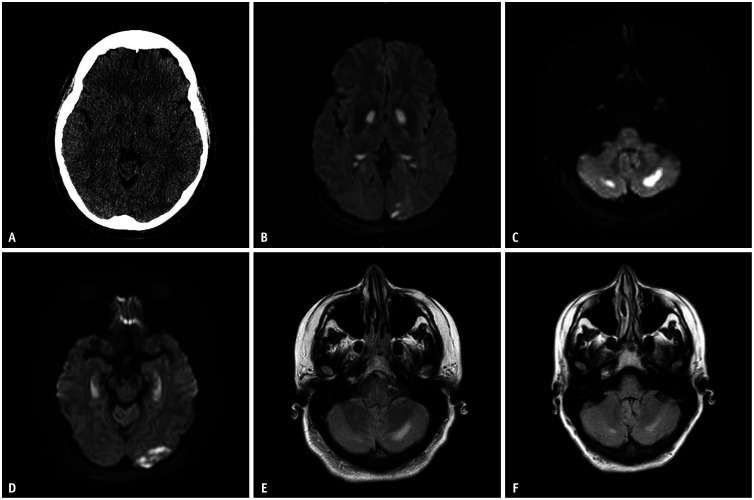
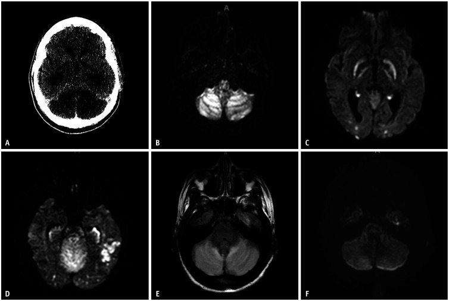
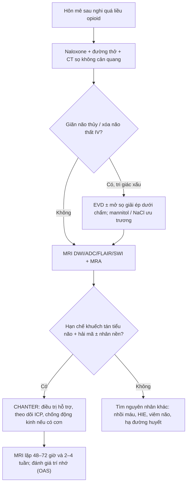
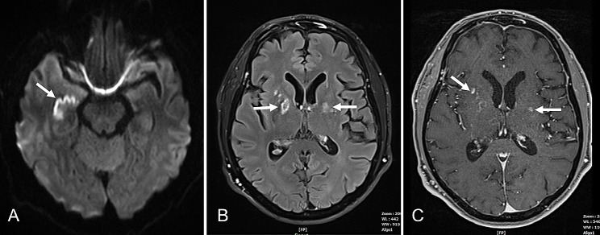

# 3101 — Hội chứng CHANTER: phù tạm thời tiểu não – hải mã – nhân nền sau opioid / Cerebellar, Hippocampal and Basal Nuclei Transient Edema with Restricted diffusion

**Tags:** `pattern:han-che-khuech-tan` `pattern:ton-thuong-doi-xung` `pattern:phu-nao` `vung:nao` `vung:tieu-nao` `protocol:MRI-DWI` `protocol:CT-so-nao`

**Mức chắc chắn (certainty):** tổng hợp y văn (literature synthesis) — **loạt ca nguyên văn đầu tiên 6 ca** (PMC6757017, 2019), **loạt 3 ca có ảnh DWI/CT** (PMC10912496, Korean J Radiol 2024), **loạt 3 ca AJNR 2022** (PMC9575414), **một ca có ảnh SWI xuất huyết** (PMC11265104), và **một ca 2026 diễn tiến thành OAS** (PMC12934230). Không có thử nghiệm ngẫu nhiên; ngưỡng điều trị là đồng thuận thực hành.

> **Câu chốt:** CHANTER là **bệnh não do opioid/nhiễm độc**, hình ảnh **"ba tầng"**: **tiểu não hai bên + hải mã hai bên + nhân nền (thường bèo nhạt/globus pallidus)** hạn chế khuếch tán, kèm **phù tiểu não gây não úng thủy tắc nghẽn**. Khác với **HIE** (tiên lượng xấu), CHANTER **hồi phục được** nếu nhận ra và **giải áp kịp**: loạt đầu tiên **6 ca** hồi phục tốt sau can thiệp sớm (PMC6757017); loạt KJR **3 ca** cho thấy tín hiệu DWI **đảo ngược trong vài ngày–1 tháng** (PMC10912496). Bỏ sót = **gán nhãn HIE, tiên lượng tử vong, ngừng điều trị oan**.

## 1. Tổng quan bệnh học – cơ chế hình ảnh (TẠI SAO)

### 1.1 Sinh lý bệnh: hai đòn bẩy "độc + thiếu oxy" trên tế bào dễ tổn thương

- Opioid (và các chất pha trộn) gây **ức chế hô hấp → thiếu oxy toàn thể**, đồng thời **độc trực tiếp lên ty thể** → giảm ATP. Hai cơ chế cộng hưởng trên **quần thể tế bào thần kinh giàu thụ thể opioid**: **hải mã** (trí nhớ) và **tiểu não** (thăng bằng), cộng thêm **nhân nền** (PMC10912496; PMC11265104).
- **TẠI SAO hạn chế khuếch tán:** thiếu ATP → bơm Na⁺/K⁺ ngừng → nước **vào nội bào** (phù độc tế bào) → khoảng ngoại bào hẹp lại → **DWI tăng tín hiệu, ADC giảm**. Đây là phù **độc tế bào**, khác phù **mạch máu (vasogenic)** của PRES (ADC tăng).
- **TẠI SAO tiểu não phù gây não úng thủy:** hố sau là khoang kín; phù tiểu não hai bên **xóa não thất IV** → tắc dòng dịch não tủy → **giãn não thất bên** (úp ngược) → giảm tri giác, tụt khe, thoát vị. Loạt KJR: ca 1 có **xóa não thất IV + giãn não thủy**, phải **mở sọ dưới chẩm + đặt EVD**, rút EVD **ngày 10** (PMC10912496).
- **TẠI SAO hồi phục:** tổn thương là **phù chức năng**, không phải nhồi máu; tín hiệu DWI **đảo ngược** sau **3 ngày** (ca 1) tới **1 tháng** (ca 3) (PMC10912496); FLAIR có thể tồn tại lâu hơn, đặc biệt ở tiểu não → **di chứng nhận thức** (PMC12934230).

### 1.2 Số liệu và mốc thời gian cần nhớ

| Mốc | Nội dung | Nguồn |
|---|---|---|
| **2019** | Mô tả lần đầu, **6 ca**, hôn mê/stupor kèm **não úng thủy tắc nghẽn**, kết cục tốt nếu can thiệp sớm | PMC6757017 |
| **2022** | Loạt **3 ca** AJNR: cùng kiểu hình, nhấn mạnh **chẩn đoán phân biệt với HIE** | PMC9575414 |
| **2024** | **3 nữ 23–60 tuổi**: 2 sau quá liều, 1 ban đầu bị cho là HIE; CT **giảm đậm độ tiểu não/nhân nền**, DWI hạn chế khuếch tán **tiểu não + bèo nhạt + hải mã + chẩm**, có ca **hồi phục DWI sau 3 ngày** | PMC10912496 |
| **2024** | Ca có **xuất huyết tiểu não hai bên trên SWI** và **ngấm thuốc nhân nền** ở ngày 6 | PMC11265104 |
| **2026** | Ca 20 tuổi, **xét nghiệm nước tiểu âm tính opioid** nhưng MRI điển hình; cải thiện sau **lọc máu**; sau đó **teo hải mã + quên thuận chiều (OAS)** | PMC12934230 |

- **Ngưỡng hình ảnh:** hạn chế khuếch tán **hai bên** ở **≥ 2 trong 3 tầng** (tiểu não, hải mã, nhân nền) + bối cảnh **opioid/hôn mê** = gợi ý mạnh CHANTER; **không cần** đủ cả ba tầng (ca 1 loạt KJR có thêm vỏ não–dưới vỏ; ca 3 chỉ tiểu não + hải mã + đuôi).
- **Không có ngưỡng ADC tuyệt đối** được chuẩn hóa; đọc **ADC map định tính** (tín hiệu thấp hơn nhu mô bình thường) và so **hai bên**.

## 2. Mẫu hình + chẩn đoán phân biệt theo kiểu phân bố (Gamut)

- **Tiểu não + hải mã + nhân nền hai bên, có phù tiểu não:** **CHANTER** · HIE · ngộ độc CO · hạ đường huyết · bệnh não do thuốc khác (benzodiazepine, cocaine pha) · viêm não.
- **Chỉ hải mã hai bên:** **OAS (opioid-associated amnestic syndrome)** · viêm não limbic (LGI1, Hu) · động kinh trạng thái sau cơn · thiếu oxy khu trú.
- **Chỉ nhân nền hai bên:** ngộ độc **CO** · **hạ đường huyết** · ngộ độc cyanid · bệnh não gan · Wilson · mất myelin thẩm thấu (cầu não).
- **Vỏ não + nhân nền đối xứng:** **HIE** (vỏ, đồi thị, nhân đuôi/bèo) · MELAS · CJD (dải vỏ) · viêm não.
- **Chất trắng ưu thế:** **heroin spongiform leukoencephalopathy ("chasing the dragon")** · ngộ độc dung môi · ADEM.
- **Mnemonic "CHANTER" = Cerebellum – Hippocampus – basal nuclei – Amnestic – hydrocephalus – Toxic (opioid) – Edema Reversible.**

*Ca 2 (nữ 60 tuổi): (A) CT — giảm đậm độ nhân nền hai bên; (B–D) DWI — hạn chế khuếch tán nhân nền, chẩm trái, tiểu não và hải mã; (E–F) FLAIR tiểu não tăng tín hiệu, giảm một phần sau 2 tuần. Nguồn: Korean J Radiol 2024 (PMC10912496), CC BY-NC 4.0.*

## 3. Bảng so sánh phân biệt (ma trận đối chiếu)

| Thực thể (entity) | Hình ảnh điển hình | Chốt vào (rule-in) | Chốt loại (rule-out) | Gợi ý xác nhận |
|---|---|---|---|---|
| **CHANTER** | **Hạn chế khuếch tán hai bên tiểu não + hải mã + bèo nhạt**; CT giảm đậm độ tiểu não/nhân nền; **phù tiểu não → xóa não thất IV, giãn não thủy**; SWI có thể có **xuất huyết tiểu não** | **Bối cảnh opioid/quá liều + hôn mê + phân bố ba tầng + não úng thủy** | **Tổn thương một bán cầu, theo lãnh thổ mạch, ADC không giảm** → nghĩ nhồi máu, không phải CHANTER | MRI DWI/ADC + FLAIR + SWI; CT sớm để loại úng thủy |
| **HIE (thiếu oxy–thiếu máu não)** | **Vỏ não + đồi thị + nhân đuôi/bèo** đối xứng, **ít tiểu não/hải mã**; phù lan tỏa, mất phân biệt xám–trắng | **Ngừng tim, tụt huyết áp kéo dài, không có opioid** | **Tiểu não + hải mã nổi bật, vỏ não nguyên** → nghĩ CHANTER | Bệnh sử + MRI; tiên lượng khác hẳn |
| **OAS (opioid-associated amnestic syndrome)** | **Chỉ hải mã hai bên** hạn chế khuếch tán; không phù tiểu não, không não úng thủy | **Quên thuận chiều dai dẳng + hải mã hai bên + tiền sử opioid** | **Có phù tiểu não/nhân nền** → CHANTER, không phải OAS đơn thuần | MRI; theo dõi trí nhớ |
| **Ngộ độc CO** | **Bèo nhạt hai bên** ± vỏ não, **không hải mã nổi bật**, không phù tiểu não | **Bối cảnh khói/than, COHb cao** | **Tiểu não + hải mã + não úng thủy** → CHANTER | COHb, bệnh sử |
| **Hạ đường huyết** | Vỏ não + hải mã + nhân nền, **né tiểu não**, hồi phục sau glucose | **Glucose máu thấp, hồi phục nhanh** | **Tiểu não là tổn thương chính** → không điển hình | Glucose, đáp ứng |
| **PRES** | **Phù mạch máu** vùng chẩm–đỉnh, **ADC tăng**, thường có tăng huyết áp | **Tăng HA + phù đối xứng chẩm–đỉnh, không hạn chế khuếch tán** | **ADC giảm + hải mã** → không phải PRES | MRI DWI/ADC |
| **Viêm não herpes** | **Thùy thái dương–trán dưới, KHÔNG đối xứng**, có xuất huyết, ngấm thuốc | **Sốt + co giật + tổn thương thùy thái dương một bên** | **Đối xứng ba tầng, không sốt** → ít do herpes | PCR HSV dịch não tủy |
| **Heroin spongiform leukoencephalopathy** | **Chất trắng** lan tỏa (tiểu não, thân não, thể chai), **ít vỏ**, khuếch tán không đồng nhất | **Hít heroin ("chasing the dragon") + tổn thương chất trắng** | **Vỏ/tiểu não vỏ + hải mã** → CHANTER | Bệnh sử hít; MRI |

*Ca 1 (A–F): (A) CT ban đầu — giảm đậm độ tiểu não hai bên, xóa não thất IV; (B–D) DWI hôm sau — hạn chế khuếch tán tiểu não, bèo nhạt, hải mã + chẩm; (E) FLAIR tăng tín hiệu tiểu não; (F) DWI lặp sau 3 ngày — gần như đảo ngược. Nguồn: Korean J Radiol 2024 (PMC10912496), CC BY-NC 4.0.*

## 4. Protocol chụp + xử trí theo mốc thời gian

### 4.1 Chụp

- **Bước 1 — CT sọ không cản quang:** loại chảy máu, đánh giá **phù tiểu não, xóa não thất IV, giãn não thủy**. CT có thể **bình thường sớm** (ca 3 loạt KJR: CT không có tổn thương cấp, MRI 5 ngày sau mới rõ) → **CT âm không loại trừ**.
- **Bước 2 — MRI khẩn (≤ 24 giờ nếu bệnh nhân hôn mê không giải thích được):** **DWI + ADC** (bắt buộc), **FLAIR**, **SWI** (xuất huyết tiểu não), **T1 sau tiêm** (ngấm thuốc nhân nền/hải mã), **MRA/CTA** để loại tắc mạch lớn.
- **Bước 3 — chụp lặp:** **48–72 giờ** (đánh giá đảo ngược/tiến triển) và **2–4 tuần** (FLAIR tồn tại, teo hải mã). Ca 1 loạt KJR chụp lặp **ngày 3**; ca 3 chụp lặp **1 tháng** (PMC10912496).
- **Cần ghi rõ trong báo cáo:** vị trí **ba tầng**, **tính đối xứng**, **ADC**, **não thất IV/não úng thủy**, **xuất huyết trên SWI**, **ngấm thuốc**.

### 4.2 Xử trí

- **Naloxone** đảo ngược opioid, nhưng **không sửa được tổn thương đã hình thành** — loạt KJR: naloxone cải thiện tri giác ban đầu nhưng bệnh nhân vẫn **ngừng tim ngày 2** và cần mở sọ (PMC10912496).
- **Kiểm soát áp lực nội sọ:** mannitol/NaCl ưu trương; **EVD** khi giãn não thủy; **mở sọ giải ép dưới chẩm** khi phù tiểu não đe dọa thoát vị (PMC6757017; PMC10912496).
- **Lọc máu** đã được dùng ở ca 20 tuổi (nghi ngộ độc kéo dài, xét nghiệm nước tiểu âm tính) với cải thiện rõ (PMC12934230) — **không phải chỉ định chuẩn**, chỉ cân nhắc khi nghi độc chất kéo dài.
- **Chống động kinh:** chỉ khi có cơn/điện não đồ phù hợp; ca 1 được khởi động levetiracetam (PMC10912496).
- **Theo dõi sau xuất viện:** đánh giá **trí nhớ thuận chiều** — một phần bệnh nhân chuyển thành **OAS** với **teo hải mã** (PMC12934230).

## 5. Biến thể bình thường và cạm bẫy

- **Bẫy 1 — gán HIE rồi ngừng điều trị:** HIE và CHANTER cùng "hôn mê + hạn chế khuếch tán hai bên"; nhưng HIE **ưu thế vỏ–đồi thị–nhân đuôi**, **ít tiểu não/hải mã**, còn CHANTER **tiểu não + hải mã** nổi bật và **hồi phục** (PMC10912496; PMC9575414). Đây là lỗi **đổi tiên lượng và quyết định can thiệp**.
- **Bẫy 2 — CT bình thường:** tổn thương có thể **chưa thấy trên CT** trong 24–48 giờ đầu; **MRI mới là chốt** (ca 3, PMC10912496).
- **Bẫy 3 — xét nghiệm nước tiểu âm tính:** ca 2026 âm tính opioid nhưng MRI điển hình và đáp ứng lọc máu (PMC12934230) → **không loại trừ**.
- **Bẫy 4 — bỏ não úng thủy:** phù tiểu não có thể **xóa não thất IV** gây giãn não thủy; không đặt EVD kịp → thoát vị. Luôn **đo não thất IV** trên CT.
- **Bẫy 5 — SWI có xuất huyết → gọi là u/AVM:** xuất huyết tiểu não hai bên trong CHANTER đã được mô tả (PMC11265104); bối cảnh + đối xứng + hải mã giúp phân biệt.
- **Bẫy 6 — T2 "sáng" do hiệu ứng T2 shine-through:** phải xem **ADC**; chỉ DWI sáng mà ADC không thấp thì không phải hạn chế khuếch tán thật.
- **Bẫy 7 — cho rằng hồi phục hoàn toàn:** FLAIR tiểu não có thể **tồn tại**; một phần bệnh nhân còn **quên thuận chiều** (OAS) (PMC10912496; PMC12934230).

## 6. Tự lượng giá — Blind Quiz

**Ca 1 — Nữ 23 tuổi, hôn mê sau uống thuốc giảm đau chứa opioid. CT dưới đây, sau đó là DWI.**

- Hỏi: CT có gì? DWI hạn chế khuếch tán ở những tầng nào? Vì sao không gọi là HIE?

<b>Bấm để hiện đáp án</b>

- **CT:** giảm đậm độ **tiểu não hai bên**, **xóa não thất IV** → não úng thủy tắc nghẽn.
- **DWI:** hạn chế khuếch tán **tiểu não + bèo nhạt + hải mã + chẩm**, thêm vỏ–dưới vỏ thái dương trái; FLAIR tăng tín hiệu tiểu não; **lặp ngày 3 gần như đảo ngược**.
- **Không phải HIE vì:** tổn thương **tiểu não + hải mã** nổi bật, **vỏ não nguyên**, bối cảnh opioid, và **hồi phục nhanh**.
- **Xử trí:** naloxone, EVD + mở sọ dưới chẩm, theo dõi ICP; rút EVD ngày 10; khởi động levetiracetam.
- Nguồn ảnh: Korean J Radiol 2024, PMC10912496, CC BY-NC 4.0 (Pandit R et al.).

**Ca 2 — Nữ 60 tuổi, đau đầu nhiều ngày dùng nhiều thuốc giảm đau, vào viện trong trạng thái sững sờ. MRI ngày 6:**

- Hỏi: mô tả A/B/C; tổn thương nào dễ bị bỏ qua nếu không chụp SWI?

<b>Bấm để hiện đáp án</b>

- **A (DWI):** hạn chế khuếch tán **hải mã hai bên** (mũi tên). **B (FLAIR):** tăng tín hiệu **nhân nền hai bên**. **C (T1 sau tiêm):** **ngấm thuốc** nhân nền — dấu hiệu hàng rào máu não bị phá vỡ, thường hồi phục.
- **Bỏ qua nếu không SWI:** **xuất huyết tiểu não hai bên** (mô tả trong bài gốc, Fig. 2) — dễ bị gọi nhầm là u/AVM.
- **Chẩn đoán:** CHANTER sau dùng nhiều thuốc giảm đau opioid; MRI lặp cho thấy hồi phục một phần.
- Nguồn ảnh: BMC Neurol 2024, PMC11265104, CC BY 4.0 (Jansen N et al.).

**Ca 3 — Bệnh nhân 20 tuổi hôn mê sâu, xét nghiệm nước tiểu âm tính opioid, MRI có hạn chế khuếch tán tiểu não + hải mã + nhân nền:**

- Hỏi: có loại trừ CHANTER vì xét nghiệm âm không? Điều gì có thể xảy ra sau hồi phục?

<b>Bấm để hiện đáp án</b>

- **Không loại trừ:** xét nghiệm nước tiểu âm tính vẫn có thể CHANTER (PMC12934230); chẩn đoán dựa **hình ảnh + bối cảnh**, không dựa một xét nghiệm.
- **Diễn tiến:** sau cải thiện (ca này cải thiện sau **lọc máu**), bệnh nhân có thể còn **quên thuận chiều nhẹ + teo hải mã** = **OAS** — cần theo dõi trí nhớ và MRI lặp.
- **Bài học:** CHANTER không phải "bệnh lành hoàn toàn"; nhưng **tiên lượng tốt hơn HIE** nếu can thiệp sớm.
- Nguồn số liệu: PMC12934230 (2026).

## Bài liên quan chéo
- [211 – Đột quỵ não: nhồi máu & bẫy phân bố mạch](../211-dot-quy-nao/lesson.md) (phân biệt hạn chế khuếch tán theo lãnh thổ)
- [3034 – Chảy máu não thất & não úng thủy sau xuất huyết](../3034-chay-mau-nao-that-ivh-nao-ung-thuy/lesson.md) (EVD, giãn não thất)
- [1738 – Ngộ độc CO do khói lửa ở trẻ](../1738-ngo-doc-co-khoi-lua-o-tre/lesson.md) (bèo nhạt hai bên)
- [219 – PRES & RCVS](../219-pres-rcvs/lesson.md) (phù mạch máu, ADC tăng)
- [267 – PRES & syrinx: tổn thương hồi phục](../267-presyrinx-va-tuy-mem-hoi-phuc/lesson.md)
- [3033 – Bệnh não Wernicke & thiếu thiamin](../3033-benh-nao-wernicke-thieu-thiamin/lesson.md) (đối xứng quanh cống, không hạn chế khuếch tán điển hình)
- [212 – Xuất huyết dưới nhện & xuất huyết não](../212-xuat-huyet-so-nao/lesson.md)

## Ảnh
- `images/3101_chanter_DWI_PMC10912496-fig1.jpg` — CT + DWI ca 1, **CC BY-NC 4.0**.
- `images/3101_chanter_DWI_PMC10912496-fig2.jpg` — CT + DWI + FLAIR ca 2 của loạt KJR, **CC BY-NC 4.0**.
- `images/3101_chanter_MRI_PMC11265104-fig1.jpg` — DWI/FLAIR/T1 sau tiêm ca 2024, **CC BY 4.0**.
- Nguồn + giấy phép từng ảnh: `images/CREDITS.md`.

> Không dùng để chẩn đoán độc lập khi chưa có người hướng dẫn.
