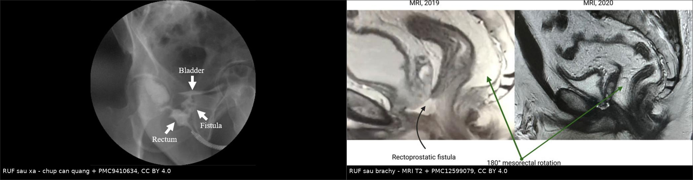
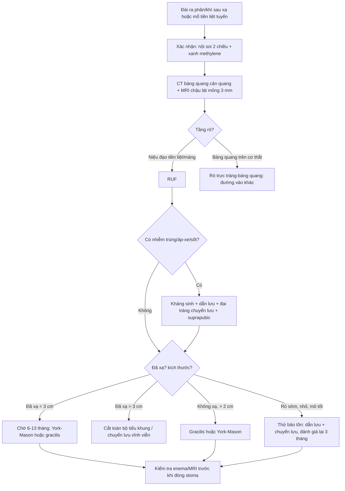
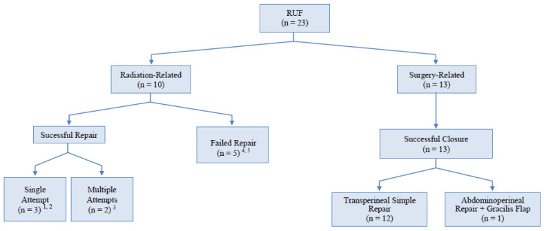
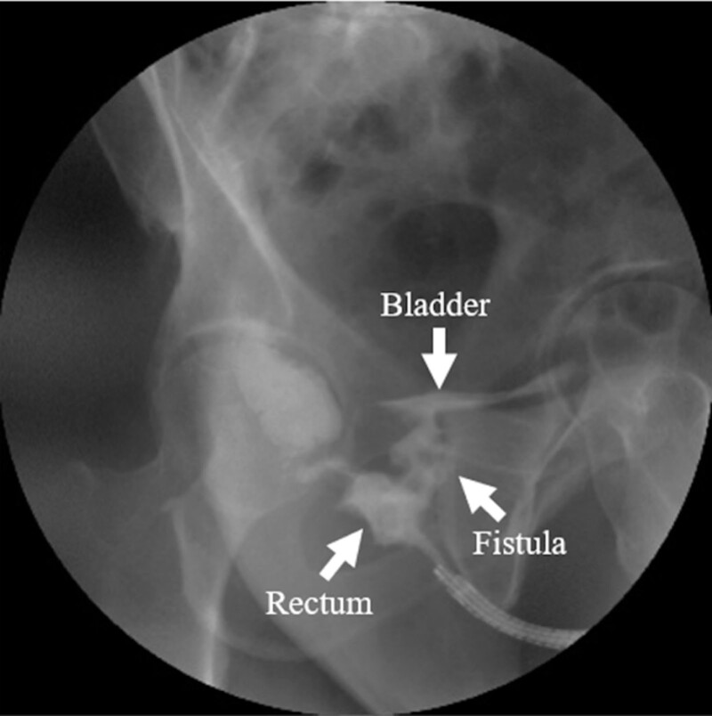
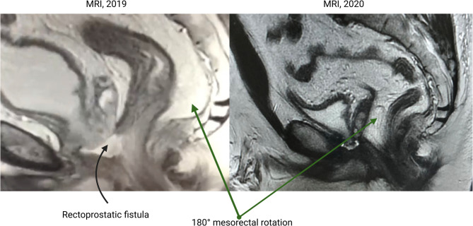
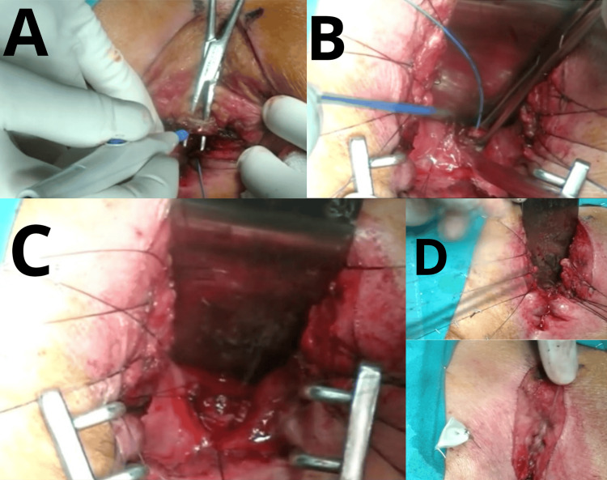

# 3103 — Rò trực tràng – niệu đạo sau xạ trị tiền liệt tuyến / Radiation-induced rectourethral fistula (RUF)

**Tags:** `pattern:ro` `pattern:ro-nieu-sinh-duc` `pattern:viem-sau-xa` `vung:truc-trang` `vung:tuyen-tien-liet` `vung:tieu-khung` `protocol:CT-bang-quang-can-quang` `protocol:MRI-chau` `incidentaloma:khong`

**Mức chắc chắn (certainty):** tổng hợp y văn (literature synthesis) — số liệu chính từ **một đoàn hệ đa trung tâm 72 ca** (PMC12971167), **một loạt 23 ca có thuật toán điều trị** (PMC8432514), **một loạt 23 ca ghép cơ thon (gracilis)** (PMC11964384), và **ba báo cáo ca có ảnh** (PMC9410634; PMC12599079; PMC13457398). Chưa có thử nghiệm ngẫu nhiên; thời điểm và thứ tự phẫu thuật là thực hành đồng thuận, chỗ suy luận được ghi rõ.

> **Câu chốt:** RUF sau xạ là **"lỗ rò của mô đã xạ"** — không phải một lỗ thủng đơn thuần. Ba con số quyết định: **(1)** tỷ lệ chung **0,4–3%** sau điều trị ung thư tiền liệt tuyến, và **hơn một nửa** RUF hiện nay liên quan **xạ trị/brachytherapy/cryo** (PMC8432514; PMC11964384); **(2)** xạ làm **thời gian lành và tỷ lệ thành công tụt hẳn**: vá kín **50%** ở nhóm đã xạ so với **100%** ở nhóm chỉ mổ (PMC8432514), và ở 72 ca đa trung tâm, lành hoàn toàn **83,8% (rò sớm) vs 42,9% (rò muộn)** (PMC12971167); **(3)** hơn **3 cm ở mô đã xạ** gần như không lành bằng chuyển vạt — phải tính **cắt toàn bộ tiểu khung (exenteration)** (PMC11964384).

## 1. Tổng quan bệnh học – cơ chế hình ảnh (TẠI SAO)

### 1.1 Giải phẫu: "tầng" nào bị rò quyết định tên gọi và đường mổ

- **Trực tràng** nằm sau **tuyến tiền liệt** và **niệu đạo màng**; giữa chúng chỉ có **vách trực tràng – tiền liệt (rectoprostatic septum / Denonvilliers' fascia)**. Xạ trị tiền liệt tuyến chiếu **liều cao vào đúng vách này** — đây là "điểm nóng" của rò.
- **Rò trực tràng – niệu đạo (RUF):** lỗ rò mở vào **niệu đạo tiền liệt/màng**, **dưới bàng quang** → nước tiểu và phân gặp nhau ở tầng thấp.
- **Rò trực tràng – bàng quang (rectovesical fistula):** lỗ rò mở vào **bàng quang**, thường sau **cắt bàng quang** hoặc xạ rất rộng → khác đường vào và khác cách xử trí.
- **Rò đại tràng – bàng quang (colovesical):** từ **đại tràng sigma**, bệnh cảnh **viêm túi thừa**, không liên quan niệu đạo.
- Vì vậy câu hỏi đầu tiên trên hình ảnh không phải "có rò không" mà là **"rò từ trực tràng vào tầng nào của đường niệu"**.

### 1.2 TẠI SAO xạ trị gây rò — và vì sao vết rò không tự lành

- **Xạ gây viêm nội mạc mạch (endarteritis obliterans)**: mạch máu nhỏ bị dày – tắc dần trong **nhiều tháng đến nhiều năm**; mô trở nên **thiếu oxy (hypoxia)**, **xơ hóa**, **giảm tế bào sinh sản**. Đây là lý do:
  - **Thời gian tiềm tàng dài:** rò xuất hiện **9 tháng** sau xạ ngoài 74 Gy (PMC9410634), **1 năm** sau brachytherapy (PMC12599079), có thể muộn hơn nữa.
  - **Mô không lành:** thiếu mạch nuôi + xơ → **miệng nối không bao giờ liền** nếu chỉ khâu trực tiếp, đặc biệt khi có nhiễm.
  - **Liều tại chỗ rất cao:** liều tới **cổ bàng quang và niệu đạo sau** trong các phác đồ EBRT ± brachytherapy được ghi nhận **60–155 Gy** (PMC8432514) — vượt xa ngưỡng dung nạp của trực tràng.
- **Yếu tố làm nặng thêm:** **hút thuốc**, **đái tháo đường**, **bệnh mạch máu** (ca báo cáo: **thromboangiitis obliterans** làm rò xuất hiện sau 9 tháng, PMC9410634), **phẫu thuật tiểu khung trước đó**, **nhiễm trùng**, **thiếu máu**, **suy dinh dưỡng**.
- **Hậu quả sinh lý:** phân và nước tiểu trộn → **nhiễm khuẩn niệu tái diễn**, **viêm bàng quang**, **nhiễm trùng huyết**, **viêm mô hoại tử (Fournier)**; đau và **rò nước tiểu ra trực tràng** làm bệnh nhân không thể sinh hoạt bình thường.

### 1.3 Vật lý hình ảnh: vì sao CT thường quy bỏ sót, và cái gì nhìn thấy

- **CT có cản quang tĩnh mạch đơn thuần** chỉ thấy **dày vách trực tràng – tiền liệt**, **bọt khí trong bàng quang**, **dịch quanh tiền liệt** — **không chứng minh được đường rò**. Bọt khí trong bàng quang có thể do **ống thông, nội soi, nhiễm khuẩn sinh hơi**, không đặc hiệu.
- **CT bàng quang – cản quang (CT cystography):** bơm **dung dịch cản quang pha loãng** vào bàng quang qua ống thông, chụp **lát mỏng 1–2 mm** thì **muộn**; nếu có rò, cản quang **đi từ bàng quang/niệu đạo sang trực tràng**. Độ nhạy phụ thuộc **thể tích bơm, áp lực, hướng đường rò**; rò **nhỏ, chéo, hoặc bị bóng ống thông bịt** → **âm tính giả**.
- **Chụp cản quang trực tràng (contrast enema):** bơm cản quang tan trong nước từ trực tràng; thấy **đường rò đi ra trước vào niệu đạo/bàng quang** (hình dưới). Đây là cách **xác nhận kinh điển**, nhưng **không nên bơm áp lực cao** khi đang nhiễm trùng/đau nhiều.
- **MRI tiểu khung:** **T2W lát mỏng 3 mm** thấy **đường rò tăng tín hiệu** (dịch), **khiếm khuyết thành trực tràng**, **ổ dịch/áp-xe** giữa trực tràng và tiền liệt; **T1 sau tiêm + fat-sat** thấy **thành đường rò ngấm thuốc**. MRI còn trả lời câu hỏi **không thể trả lời trên CT**: **mức xơ hóa do xạ**, **hoại tử tiền liệt**, **tình trạng cơ thắt**, **kích thước lỗ rò** — tất cả quyết định chọn đường mổ.
- **TẠI SAO MRI T2 sáng:** đường rò chứa **dịch/nước tiểu** (nhiều proton tự do, T2 dài) → **tăng tín hiệu**; mô xơ do xạ **giảm tín hiệu T2** và **ngấm thuốc muộn** → vùng xơ dày xung quanh lỗ rò là dấu hiệu "mô đã xạ", tiên lượng lành kém.

### 1.4 Dịch tễ và kết cục (số liệu định lượng)

- **Tỷ lệ RUF** sau điều trị ung thư tiểu khung: **0,4–3%** (PMC8432514); **0,5–3,3%** trong đoàn hệ 72 ca (PMC12971167).
- **Hơn 50%** RUF hiện nay do **xạ trị, brachytherapy hoặc cryo** điều trị ung thư tiền liệt tuyến (PMC11964384).
- Loạt 23 ca (4 trung tâm): tuổi **57–79**, trung vị **68**; theo dõi trung vị **54 tháng** (18–115); **tất cả** được **mở đại tràng chuyển lưu tạm + mở bàng quang trên xương mu**; vá kín **78%** toàn nhóm, nhưng **nhóm đã xạ 5/10 (50%)** so với **nhóm chỉ mổ 13/13 (100%)**; **vạt chen (interposition flap)** dùng **60%** ở nhóm xạ so với **7,7%** ở nhóm mổ (p = 0,019) (PMC8432514).
- Đoàn hệ 72 ca: **rò sớm ≤ 31 ngày** (37 ca) vs **rò muộn > 31 ngày** (35 ca). Lành hoàn toàn **83,8% vs 42,9%**; **phải chuyển lưu tiêu hóa vĩnh viễn 13,5% vs 48,5%**; ghép cơ thon thành công **83% vs 40%**; York-Mason **71% vs 33%** (PMC12971167).
- **Tối đa 31%** RUF do xạ phải **đại tràng vĩnh viễn** trong một số loạt (PMC8432514).
- Loạt **8 ca tổn thương trực tràng sau cắt tiền liệt tuyến** (10 năm, bệnh viện vùng): **3 ca phát hiện trong mổ**, **5 ca sau mổ**, xuất hiện muộn **5 ngày – 2,5 năm**, khuyết **< 1 – 4 cm** (PMC13506524).

## 2. Mẫu hình + chẩn đoán phân biệt theo vị trí (gamut)

- **Theo tầng rò:**
  - **Rò niệu đạo – trực tràng (RUF):** thấp, dưới bàng quang; **đái ra phân/khí**, đau tầng sinh môn; thường sau **xạ/cắt tiền liệt tuyến**.
  - **Rò bàng quang – trực tràng (rectovesical):** cao, trên cơ thắt; **phân vào bàng quang nhiều**, thường sau **cắt bàng quang tận gốc** hoặc xạ rất rộng.
  - **Rò đại tràng – bàng quang (colovesical):** từ **sigma**, bệnh nhân **viêm túi thừa**, không có rò niệu đạo.
  - **Rò trực tràng – âm đạo:** nữ, sau xạ/cắt tử cung (bài 1665).
- **Theo cơ chế:** **do xạ** (mô xơ, thiếu mạch, lành kém) vs **do mổ** (tổn thương trực tiếp, thường sớm, lành tốt hơn) vs **do bệnh** (ung thư xâm lấn, Crohn, nhiễm trùng).
- **Theo thời điểm:** **sớm ≤ 31 ngày** (thường do mổ) vs **muộn > 31 ngày** (thường do xạ) (PMC12971167).
- **Mnemonic "FISTULA":** **F**ecaluria, **I**nfection tái diễn, **S**phincter (đánh giá trước mổ), **T**issue đã xạ, **U**rethra (tầng rò), **L**ength/defect size, **A**bscess.

## 3. Bảng so sánh phân biệt (ma trận đối chiếu)

| Thực thể (entity) | Hình ảnh điển hình (CT/MRI/enema) | Chốt vào (rule-in) | Chốt loại (rule-out) | Gợi ý xác nhận |
|---|---|---|---|---|
| **RUF sau xạ** | Đường rò **T2 sáng** từ trực tràng trước vào **niệu đạo tiền liệt/màng**; vách dày, xơ T2 tối; khuyết thành trực tràng | **Cản quang đi từ niệu đạo/bàng quang sang trực tràng** + tiền sử xạ + **đái ra phân/khí** | Rò mở **trên bàng quang** hoặc có **đường rò từ sigma** → không phải RUF | MRI lát mỏng + CT cystography + nội soi hai chiều |
| **RUF sau mổ (sớm)** | Khuyết thành trực tràng – niệu đạo **sau cắt tiền liệt tuyến**, ổ dịch nhỏ, không xơ nhiều | **Xuất hiện ≤ 31 ngày sau mổ**, mô mềm bình thường | Xơ hóa dày, tiền sử xạ → thể muộn, tiên lượng xấu hơn | Enema/CT cystography; mổ thì đầu |
| **Rò trực tràng – bàng quang** | Cản quang từ **bàng quang** vào trực tràng, **trên tầng niệu đạo**; thường sau cắt bàng quang | **Lỗ rò ở thành sau bàng quang**, không qua niệu đạo | Cản quang chỉ ở **niệu đạo** → RUF | CT cystography, MRI |
| **Rò đại tràng – bàng quang** | **Sigma dính bàng quang**, khí trong bàng quang, **không có rò niệu đạo** | **Rò từ đại tràng**, bệnh nhân viêm túi thừa | Có **đường rò trực tràng – niệu đạo** → loại | CT bụng – chậu, nội soi |
| **Rò trực tràng – âm đạo** | Đường rò ra **thành sau âm đạo**, không vào niệu đạo | **Khám âm đạo thấy lỗ rò**, khí/phân qua âm đạo | Bệnh nhân **nam** hoặc lỗ rò ra niệu đạo → loại | Khám + MRI + enema |
| **Hoại tử/áp-xe tiền liệt** | **Ổ dịch hoại tử** trong tiền liệt, **khí**, bờ ngấm thuốc; có thể chưa thủng trực tràng | **Khí + dịch trong tiền liệt** sau brachytherapy | **Có đường rò rõ ràng** → đã có RUF, không chỉ áp-xe | MRI, CT, nội soi; cấy dịch |
| **Viêm trực tràng xạ có loét** | **Loét nông, phù nề, mạch máu giãn**, không có đường rò | **Loét nhưng không thấy đường rò** trên MRI/enema | **Có đường rò** → RUF | Nội soi + sinh thiết loại trừ tái phát |

*Trái: cản quang trực tràng — cản quang đi từ **trực tràng** qua **đường rò** vào **bàng quang/niệu đạo** (PMC9410634, CC BY 4.0). Phải: MRI T2 **2019** có **rò trực tràng – tiền liệt**, và **2020** sau khi xoay 180° mạc treo trực tràng làm vạt chen (PMC12599079, CC BY 4.0). Ảnh ghép letterbox.*

## 4. Protocol chụp + phân loại + chiến lược xử trí

- **Bước 1 — xác nhận lâm sàng:** **đái ra phân (fecaluria)** và **đái ra khí (pneumaturia)** gần như chẩn đoán; ngoài ra **nhiễm khuẩn niệu tái diễn**, **đau tầng sinh môn**, **rò nước tiểu qua hậu môn**, **viêm da quanh hậu môn**.
- **Bước 2 — nội soi hai chiều:** **soi bàng quang – niệu đạo** tìm lỗ rò ở **niệu đạo tiền liệt/màng**; **soi trực tràng/sigma** tìm lỗ rò và **sinh thiết** nếu bờ loét không đều (loại tái phát u). Nghiệm pháp **xanh methylene**: đặt **bông/gạc trong trực tràng**, bơm xanh methylene vào niệu đạo/bàng quang → **bông xanh** = rò.
- **Bước 3 — hình ảnh:**
  - **CT bàng quang – cản quang + cản quang trực tràng** (nếu dung nạp): lát mỏng **1–2 mm**, cửa sổ mô mềm + xương.
  - **MRI tiểu khung 1,5–3 T**: **T2W lát mỏng 3 mm** (trục, sagittal, coronal vuông góc vách), **T1W sau tiêm + fat-sat**, **DWI** nếu nghi áp-xe/u; đo **kích thước lỗ rò (mm)** và **độ dày xơ**.
  - **Không bơm áp lực cao** khi có **sốt, đau nhiều, áp-xe** — nguy cơ làm bùng phát nhiễm trùng huyết.
- **Phân loại dùng trong thực hành:** **sớm (≤ 31 ngày) vs muộn (> 31 ngày)** (PMC12971167); **đơn giản vs phức tạp** (đã xạ, > 3 cm, đã vá thất bại, cơ thắt kém, có áp-xe); **theo tầng** (niệu đạo vs bàng quang).
- **Nguyên tắc điều trị:**
  1. **Kiểm soát nhiễm trước:** dẫn lưu áp-xe, **kháng sinh**, **chuyển lưu phân (đại tràng/ileostomy)** + **dẫn lưu nước tiểu (suprapubic cystostomy)**, nuôi dưỡng; trong loạt 23 ca, **100%** được chuyển lưu tạm cả hai đường (PMC8432514).
  2. **Trì hoãn vá dứt điểm:** thực hành đồng thuận là chờ **3–6 tháng** sau khi kiểm soát nhiễm; với **mô đã xạ**, các loạt lớn mổ xác định **6–13 tháng** sau chuyển lưu (ca brachytherapy: **13 tháng**) (PMC12599079) — đây là **kinh nghiệm thực hành**, không phải ngưỡng từ thử nghiệm ngẫu nhiên.
  3. **Chọn đường mổ:** **York-Mason xuyên cơ thắt** cho rò **thấp – giữa**, mô tương đối tốt; **đường tầng sinh môn** cho rò thấp; **đường bụng – tầng sinh môn** cho rò cao/phức tạp; **ghép cơ thon (gracilis)** khi **đã xạ < 3 cm** hoặc **không xạ > 2 cm**; **đã xạ > 3 cm** → tỷ lệ lành rất thấp, phải tính **cắt toàn bộ tiểu khung** (PMC11964384).
  4. **Chỉ đóng da trong thì cuối** và **không rút dẫn lưu quá sớm**; theo dõi **rò tái phát** bằng enema/MRI trước khi đóng hậu môn nhân tạo.

*Kết cục 23 ca: **nhóm đã xạ (n = 10)** chỉ 3 ca lành sau một lần vá, 2 ca cần nhiều lần, **5 ca thất bại**; **nhóm chỉ mổ (n = 13)** lành **13/13** (12 ca vá đơn thuần qua tầng sinh môn, 1 ca cần vạt cơ thon qua đường bụng – tầng sinh môn). Nguồn: PMC8432514, CC BY 4.0.*

## 5. Biến thể bình thường và cạm bẫy

- **Khí trong bàng quang ≠ rò:** gặp sau **đặt ống thông, nội soi, nhiễm khuẩn sinh hơi**; ngược lại **rò nhỏ có thể không có khí**. Chẩn đoán dựa vào **triệu chứng + hình ảnh đường rò**, không dựa riêng vào khí.
- **"Đái ra phân" bị gọi là tiêu chảy/không kiểm soát:** ở người cao tuổi sau xạ, **phân lỏng ra niệu đạo** dễ bị quy cho **tiêu chảy do xạ** hoặc **suy cơ thắt**; hỏi thẳng **"nước tiểu có lẫn phân/khí không"**.
- **Loét do xạ vs tái phát u:** bờ loét **không đều, cứng, chảy máu** → **sinh thiết** trước khi kết luận "chỉ là viêm trực tràng xạ". Bỏ sót tái phát là sai lầm chết người.
- **Vá sớm trên mô đã xạ:** khâu trực tiếp trong mô xơ, thiếu mạch → **thất bại gần như chắc chắn**; cần **vạt chen (cơ thon, mạc nối, mạc treo trực tràng xoay)**.
- **Đóng hậu môn nhân tạo quá sớm:** chưa kiểm tra **enema/MRI** mà đóng stoma → rò tái phát, nhiễm trùng huyết; chờ **3–6 tháng** (xạ: lâu hơn) và xác nhận lành.
- **Bỏ sót hẹp niệu đạo/cổ bàng quang đi kèm:** sau xạ, RUF thường đi cùng **hẹp niệu đạo** và **hoại tử tiền liệt**; chỉ vá rò mà không giải quyết hẹp → **bí tiểu, nhiễm trùng tái diễn** (nối bài 1666).
- **Vật liệu chen (spacer) hydrogel:** có thể gây **loét trực tràng rồi rò** (PMC13447750) — hỏi tiền sử can thiệp, không chỉ hỏi "xạ hay không".
- **Bệnh mạch máu nền:** **thromboangiitis obliterans** làm rò xuất hiện sớm và nặng hơn (PMC9410634); đánh giá yếu tố nguy cơ mạch máu trước khi hứa "vá được".

## 6. Tự lượng giá — Blind Quiz

**Ca 1 — Nam 73 tuổi, xạ ngoài 74 Gy vì ung thư tiền liệt tuyến 9 tháng trước; nay đái ra phân và khí.**

- Hỏi: mô tả đường đi của cản quang? Chẩn đoán? Vì sao rò xuất hiện muộn đến 9 tháng?

<b>Bấm để hiện đáp án</b>

- **Findings:** cản quang từ **trực tràng** đi qua một **đường rò** vào **bàng quang/niệu đạo** (mũi tên "Fistula"), một phần cản quang đọng ở **bàng quang**. Đây là **rò trực tràng – đường niệu**.
- **Chẩn đoán:** RUF sau xạ trị tiền liệt tuyến.
- **Vì sao muộn:** xạ gây **viêm nội mạc mạch** tiến triển nhiều tháng → thiếu máu nuôi, xơ hóa, mô mỏng dần rồi **thủng**; ca này còn có **thromboangiitis obliterans** làm mạch máu nặng thêm.
- **Nguồn ảnh:** Ohira K et al., Medicine (Baltimore) 2022 — **PMC9410634** — Fig. 2, **CC BY 4.0**.

**Ca 2 — Nam 54 tuổi, brachytherapy 1 năm trước, đái ra phân; MRI trước và sau mổ.**

- Hỏi: dấu hiệu trên MRI 2019? Vì sao phải **chuyển lưu phân trước** rồi mới vá? Vai trò của **xoay 180° mạc treo trực tràng**?

<b>Bấm để hiện đáp án</b>

- **Findings 2019:** **đường rò/ổ dịch giữa trực tràng và tiền liệt**, tăng tín hiệu T2, **khuyết thành trước trực tràng** — tương ứng **rò trực tràng – tiền liệt**; ca này có **khuyết thành trực tràng trước 1,6 cm**.
- **Vì sao chuyển lưu trước:** kiểm soát nhiễm và làm sạch vùng mổ; mô đã xạ không chịu được miệng nối ướt, nhiễm. Sau **sigmoidostomy**, vá xác định được thực hiện **13 tháng sau**.
- **Vai trò xoay mạc treo:** đưa **mạc treo trực tràng ra sau** làm **vạt chen tự thân** giữa miệng nối trực tràng và đường niệu, giảm rò tái phát; ảnh 2020 cho thấy mạc treo đã xoay 180°.
- **Nguồn ảnh:** Goncharov A et al., BMC Urol 2025 — **PMC12599079** — Fig. 4, **CC BY 4.0**.

**Ca 3 — Rò tầng thấp, mô đã xạ, đã chuyển lưu; chọn đường vào nào?**

- Hỏi: kể tên 4 thì trong ảnh. Ưu/nhược của đường vào này so với đường bụng? Khi nào **không** chọn?

<b>Bấm để hiện đáp án</b>

- **Các thì:** (A) **bộc lộ sau xuyên cơ thắt** sau cắt xương cụt; (B) **xác định đường rò** trực tràng – niệu đạo; (C) **đóng nhiều lớp** sau cắt đường rò; (D) **đóng da/tầng sinh môn** (hoàn tất).
- **Ưu:** đi thẳng vào **vách trực tràng – niệu đạo**, **không mở ổ bụng** — rất hữu ích khi **bụng "thù địch"** do nhiều lần mổ (chỉ định trong ca báo cáo).
- **Nhược/không chọn:** rò **rất cao**, **áp-xe lớn**, **mô xạ nặng > 3 cm** cần **vạt cơ/gracilis** hoặc **cắt tiểu khung**; nguy cơ **suy cơ thắt** nếu cơ thắt đã kém — phải đánh giá trước mổ.
- **Nguồn ảnh:** Morillo Lemus LE, Gerardo Benito CM, Cureus 2026 — **PMC13457398** — Fig. 1, **CC BY 4.0**.

## Bài liên quan chéo
- [111 – Tắc ruột non sau xạ trị tiểu khung](../111-tac-ruot-non-sau-xa-tri-tieu-khung/lesson.md)
- [112 – Chảy máu trực tràng muộn sau xạ trị](../112-chay-mau-truc-trang-muon-sau-xa-tri/lesson.md)
- [1665 – Rò trực tràng – âm đạo sau xạ trị](../1665-ro-truc-trang-am-dao-sau-xa-tri/lesson.md)
- [1666 – Hẹp niệu quản sau và rò sau xạ trị](../1666-hep-nieu-quan-sau-va-ro-va-sau-xa-tri/lesson.md)
- [1872 – Thoát vị Littre (túi thừa Meckel trong túi thoát vị)](../1872-thoat-vi-littre-tui-thua-meckel-trong-tui-thoat-vi/lesson.md)

## Ảnh
- `images/3103_ro-truc-trang-nieu-dao_CanQuang_PMC9410634.jpg` — cản quang trực tràng, **PMC9410634**, CC BY 4.0.
- `images/3103_ro-truc-trang-nieu-dao_MRI_PMC12599079.jpg` — MRI T2 trước/sau mổ, **PMC12599079**, CC BY 4.0.
- `images/3103_ro-truc-trang-nieu-dao_Mo_PMC13457398.jpg` — các thì York-Mason, **PMC13457398**, CC BY 4.0.
- `images/3103_ro-truc-trang-nieu-dao_SoDo_PMC8432514.jpg` — thuật toán 23 ca, **PMC8432514**, CC BY 4.0.
- `images/composite_ruf.jpg` — ảnh ghép cản quang + MRI, letterbox, **PMC9410634 + PMC12599079**, CC BY 4.0.
- Chi tiết giấy phép từng file: `images/CREDITS.md`.

> Không dùng để chẩn đoán độc lập khi chưa có người hướng dẫn.
