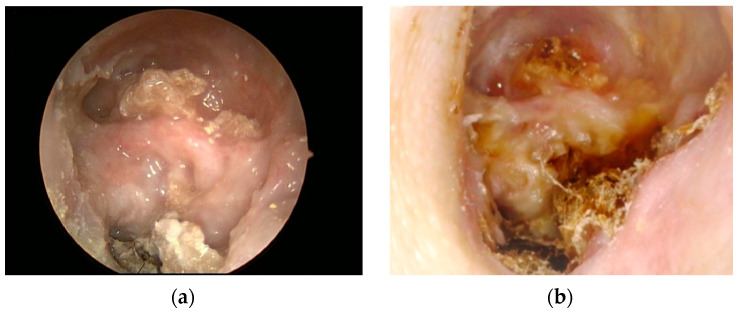
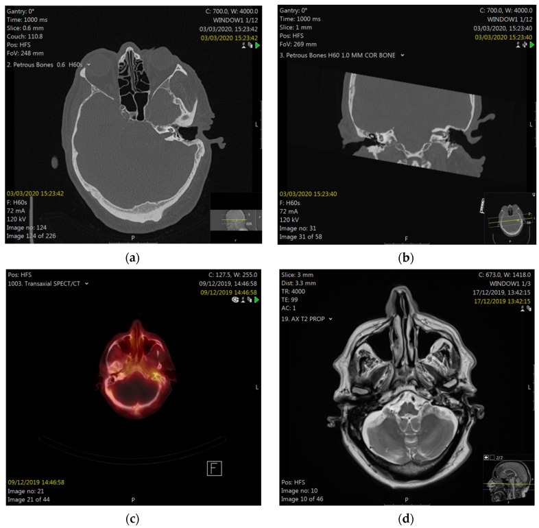
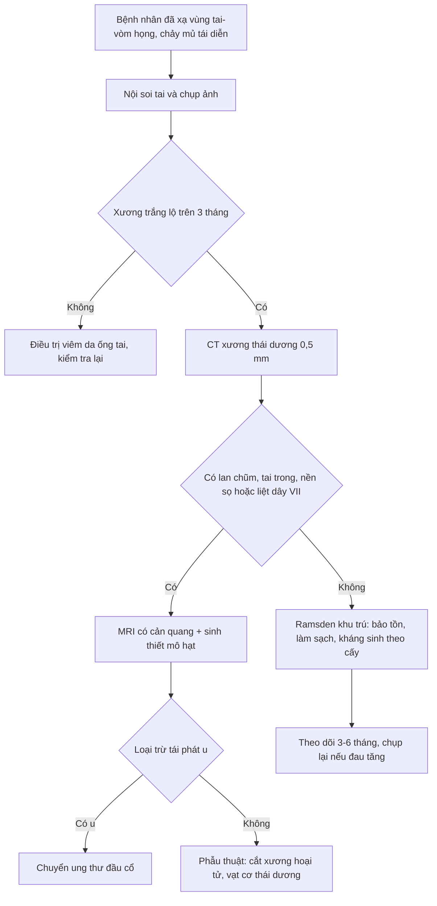
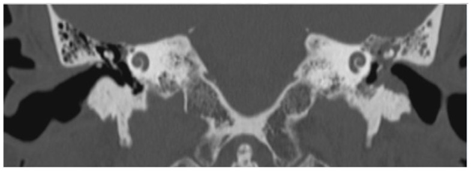

# 3104 — Hoại tử xương thái dương & hẹp ống tai ngoài sau xạ vòm họng: "viêm tai ngoài" kéo dài **8–10 năm** sau xạ

**Tags:** `pattern:hoai-tu-xuong` `pattern:viem-sau-xa` `pattern:hep-ong-tai-ngoai` `pattern:chay-mu-tai` `vung:xuong-thai-duong` `vung:ong-tai-ngoai` `vung:tai-giua` `vung:dau-co` `protocol:CT-xuong-thai-duong` `protocol:MRI-dau-co` `protocol:noi-soi-tai` `score:Ramsden` `incidentaloma:khong`

**Mức chắc chắn (certainty):** tổng hợp y văn (literature synthesis) — ghép **loạt lớn nhất 145 xương thái dương / 128 bệnh nhân** (*Laryngoscope* 2021, **PMC9214913**, tóm tắt đầy đủ, bản toàn văn không mở), **loạt 33 bệnh nhân có thời gian tiềm tàng và liều xạ** (*Otol Neurotol* 2014, **PMC4134375**), **ca liệt mặt do hoại tử xương thái dương** (*Diagnostics* 2022, **PMC9140046**, CC BY 4.0), **tổng quan hệ thống cholesteatoma ống tai ngoài sau xạ vòm họng** (*J Clin Med* 2023, **PMC10004166**, CC BY 4.0) và **ca hoại tử nền sọ bên được phẫu thuật** (*Front Oncol* 2026, **PMC13061727**, CC BY 4.0). Nhóm **không có bệnh nhân của mình**.

> **Câu chốt:** bệnh nhân ung thư vòm họng sống lâu sau xạ trị thường quay lại với **chảy mủ tai + đau tai + nghe kém** và được điều trị như **"viêm tai ngoài tái diễn"** — trong khi nền là **xương đã hoại tử, không có mạch máu để lành**. Hai chốt cần nhớ: **(1) thời gian tiềm tàng rất dài — trung bình 8–10 năm, tới 22 năm**; **(2) thấy xương trắng lộ trong ống tai > 3 tháng = hoại tử xương cho tới khi chứng minh ngược lại**, và **phải loại tái phát u bằng sinh thiết/mô bệnh** trước khi điều trị triệu chứng dài hạn.

## 1. Tổng quan bệnh học – cơ chế hình ảnh (TẠI SAO)

### 1.1 Xương thái dương "chết dần": tam chứng Marx trong xương mỏng nhất cơ thể

- Xạ trị gây **giảm mạch – giảm oxy – giảm tế bào** (hypovascular – hypoxic – hypocellular, tam chứng Marx): **tế bào xương chết** nhưng **không được thay thế** vì không có mạch nuôi; mô mềm phủ (da ống tai **dày < 1 mm**) teo và dễ loét do chấn thương nhỏ (ngoáy tai, nút tai, ống nghe).
- **TẠI SAO vị trí hay gặp là ống tai ngoài và xương nhĩ:** đây là phần **xương mỏng, sát da, nằm trong vùng liều cao** của trường chiếu vòm họng–hố sau hàm. Liều trung bình tới **xương thái dương bị tổn thương 53,1 Gy** và tới **xương nhĩ 65,2 Gy** trong loạt 33 bệnh nhân (PMC4134375); ca liệt mặt ghi nhận **liều tối thiểu 41,8 Gy** mới gây hoại tử (PMC9140046) — nghĩa là **ngưỡng thấp hơn liều chữa bệnh**, nên mọi bệnh nhân xạ vùng tai–vòm đều có nguy cơ.
- **TẠI SAO tiềm tàng 8–10 năm:** chu chuyển xương chậm (tạo cốt bào–hủy cốt bào theo chu kỳ nhiều tháng) nên **hoại tử biểu hiện sau khi lớp xương cuối cùng mất nuôi đã bị đào thải**. Số liệu: **trung bình 10 năm** ở 145 xương (PMC9214913); **1–22 năm, trung bình 7,9 năm** ở 33 bệnh nhân (PMC4134375).
- **TẠI SAO CT thấy "xương gặm" chứ không chỉ "viêm":** hoại tử → **hủy xương vá víu, mảnh xương chết (sequestrum), xơ hóa quanh** và **mô mềm lấp ống tai**; mất liên tục vỏ xương nhĩ là dấu **không hồi phục bằng kháng sinh** (Hình CT bên dưới).
- **Hệ quả điều trị:** kháng sinh chỉ **diệt bội nhiễm**, không tái tạo mạch; vì vậy **kháng sinh làm hết mủ nhưng xương lộ vẫn còn** — đúng như loạt 33 ca: điều trị bảo tồn **giảm triệu chứng nhưng không loại bỏ xương lộ ở đa số** (PMC4134375).

### 1.2 Hẹp ống tai ngoài: cùng tổn thương, biểu hiện khác

- Da ống tai sau xạ **teo, mất tuyến ráy, xơ hóa** → **hẹp lòng ống tai** tiến triển, đôi khi **bít hoàn toàn**; bệnh nhân phàn nàn **ù tai, nghe kém dẫn truyền, khó làm sạch ráy**, dễ **viêm tai ngoài–viêm tai giữa ứ mủ** phía sau chỗ hẹp.
- **TẠI SAO hẹp lại nguy hiểm:** chỗ hẹp **giữ ẩm và mảnh sừng** → **cholesteatoma ống tai ngoài thứ phát**. Bệnh nhân xạ vòm họng có nguy cơ cholesteatoma ống tai **cao gấp 18 lần** dân số chung, xuất hiện **trung bình 6,5 năm** sau xạ (**0,5–15,4 năm**), ưu thế **thành trước và thành dưới** ống tai (PMC10004166).
- **Tần suất hẹp ống tai sau xạ:** **chưa có con số thống nhất — cần tra**; các loạt mô tả hẹp/xơ ống tai như một phần của **phổ tổn thương da–xương sau xạ** cùng với hoại tử xương, không tách riêng.

### 1.3 Số liệu định lượng nằm lòng

| Đại lượng | Số liệu | Nguồn |
|---|---|---|
| Thời gian tiềm tàng tới hoại tử xương thái dương | **trung bình 10 năm** (145 xương thái dương) | PMC9214913 |
| Thời gian tiềm tàng (loạt khác) | **1–22 năm**, trung bình **7,9 năm** | PMC4134375 |
| Liều xạ tới xương thái dương bị tổn thương | trung bình **53,1 Gy**; xương nhĩ **65,2 Gy** | PMC4134375 |
| Liều tối thiểu gây hoại tử (ca liệt mặt) | **41,8 Gy** | PMC9140046 |
| Phân bố Ramsden lúc chẩn đoán | **76% khu trú** (ống tai + xương nhĩ) / **24% lan tỏa** | PMC9214913 |
| Tỉ lệ lan tỏa ở lần khám cuối | **37%** | PMC9214913 |
| Yếu tố nguy cơ lan tỏa (đa biến) | **đái tháo đường**, **xạ 3D-CRT**, **ung thư da quanh tai** | PMC9214913 |
| Triệu chứng hay gặp (33 ca) | **chảy mủ tai 15**, **nghe kém 13**, **đau tai 12** | PMC4134375 |
| Bội nhiễm khuẩn | **15/33**, trong đó **S. aureus 9** | PMC4134375 |
| Liệt mặt trong hoại tử xương thái dương | **2,9%** | PMC9140046 |
| Nguy cơ cholesteatoma ống tai sau xạ vòm họng | **18×** dân số chung; **6,5 năm** (0,5–15,4) | PMC10004166 |
| Viêm tai giữa ứ dịch sau xạ vòm họng | **32,4%** bệnh nhân (phân tích gộp) | PMC13460465 |

> **Đọc số cho đúng:** "**76% khu trú**" là **tại thời điểm chẩn đoán**, không phải tiên lượng — **37%** bệnh nhân đã chuyển sang **lan tỏa** ở lần theo dõi cuối (PMC9214913). Vì vậy bệnh "khu trú" vẫn phải **theo dõi dài hạn**, không được coi là lành.

## 2. Mẫu hình + chẩn đoán phân biệt theo vị trí lan (Gamut)

- **Nhóm A — khu trú ống tai ngoài/xương nhĩ (Ramsden khu trú):** **xương trắng lộ** ở sàn/thành ống tai, **chảy mủ ít, đau vừa**, màng nhĩ có thể còn; CT: **hủy xương khu trú vỏ xương nhĩ**, không lan vào chũm.
- **Nhóm B — lan tỏa trong xương thái dương (Ramsden lan tỏa):** **đau dữ dội**, mủ nhiều, **hủy xương chũm–tai trong**, có thể **liệt mặt (2,9%)**, **viêm mê nhĩ**, **áp-xe nội sọ**; CT: hủy xương rộng, **mảnh xương chết**, mất vỏ ốc tai–tiền đình.
- **Nhóm C — lan ra ngoài xương thái dương:** **khớp thái dương–hàm, hố dưới thái dương, nền sọ, nội sọ**; đây là nhóm **bảo tồn luôn thất bại**, bắt buộc **phẫu thuật + tạo hình che phủ** (PMC9214913, PMC13061727).
- **Nhóm D — tái phát ung thư (vòm họng/ung thư ống tai):** **khối thịt, chảy máu, đau sâu, liệt dây thần kinh sọ**, **không đáp ứng kháng sinh**; **chỉ mô bệnh mới loại trừ** — đây là lý do **mọi mô hạt trong ống tai đã xạ đều phải sinh thiết**.
- **Nhóm E — viêm tai ngoài ác tính (hoại tử nền sọ do Pseudomonas):** người **đái tháo đường lớn tuổi**, đau dữ dội **về đêm**, mô hạt đáy ống tai, **liệt dây VII–XII**, CT/MRI **hủy xương nền sọ**; **không có tiền sử xạ** là chốt loại quan trọng nhất.
- **Nhóm F — cholesteatoma ống tai ngoài thứ phát sau xạ:** **túi sừng** ở **thành trước/dưới** ống tai, **hủy xương khu trú**, tiền sử xạ vòm họng **6,5 năm**; khác hoại tử xương ở chỗ **có khối sừng** chứ không chỉ xương lộ.
- **Nhóm G — hoại tử xương do thuốc (MRONJ) ở ống tai:** tiền sử **bisphosphonate/denosumab hoặc teriparatide**, không có xạ — cơ chế và xử trí gần hoại tử xương nhưng **bối cảnh thuốc** là chốt.

**Ba câu hỏi định vị:** (1) **Có tiền sử xạ vùng tai–vòm họng không, cách đây bao nhiêu năm?** (2) **Xương lộ > 3 tháng hay chỉ viêm da ống tai?** (3) **Có dấu hiệu lan: liệt mặt, chóng mặt, đau sâu, khối thịt?**

## 3. Bảng so sánh phân biệt (ma trận đối chiếu)

| Thực thể (entity) | Hình ảnh điển hình (nội soi / CT / MRI) | Chốt vào (rule-in) | Chốt loại (rule-out) | Gợi ý xác nhận |
|---|---|---|---|---|
| **Hoại tử xương thái dương** | **Xương trắng lộ** ở sàn/thành ống tai; CT **hủy xương vá víu + mảnh xương chết + xơ hóa** | **Tiền sử xạ + xương lộ > 3 tháng + CT hủy xương** | Mô hạt không có xương lộ, CT xương bình thường → nghĩ viêm da ống tai | Nội soi + CT xương thái dương lát 0,5 mm; sinh thiết mô hạt |
| **Tái phát ung thư vòm họng/ống tai** | Khối thịt dễ chảy máu, **hủy xương một bên không đều**, xâm lấn mô mềm | **Khối thịt + chảy máu + liệt dây sọ + hủy xương tiến triển** | Xương lộ phẳng, không khối, không tiến triển nhiều năm → hoại tử xương | **Sinh thiết bắt buộc**; MRI T1 sau tiêm + DWI; PET/CT |
| **Viêm tai ngoài ác tính** | Mô hạt **đáy ống tai**, đau dữ dội; CT **hủy xương nền sọ**; MRI ngấm lan | **Đái tháo đường + đau đêm + Pseudomonas + hủy xương nền sọ** | **Có tiền sử xạ đúng vùng** → nghĩ hoại tử xương do xạ hơn | Cấy mô sâu, CT/MRI nền sọ, theo dõi đáp ứng kháng sinh |
| **Cholesteatoma ống tai sau xạ** | **Túi sừng** thành trước/dưới ống tai, **hủy xương khu trú**, màng nhĩ nguyên | **Khối sừng + tiền sử xạ vòm họng + hủy xương khu trú** | Chỉ xương lộ không có khối sừng → hoại tử xương | Nội soi, CT; mổ lấy cholesteatoma |
| **Hoại tử xương do thuốc (MRONJ)** | Xương lộ ống tai, **không có xạ**, tiền sử bisphosphonate/denosumab | **Thuốc chống hủy xương + xương lộ > 8 tuần** | Có xạ vùng tai → hoại tử do xạ | Bệnh sử thuốc, CT |
| **Viêm tai giữa ứ dịch sau xạ** | Màng nhĩ lõm, **dịch vàng** sau màng nhĩ, **không xương lộ** | **Tiền sử xạ + màng nhĩ lõm/dịch, xương ống tai nguyên** | Xương lộ/hủy xương → không phải chỉ ứ dịch | Nội soi, nhĩ lượng đồ (bài 1704) |

*Nội soi tai trái lúc nhập viện (a) và sau 6 tháng (b): xương hoại tử lộ rộng ở sàn ống tai và gờ mặt. Nguồn: PMC9140046, CC BY 4.0.*

*CT thì xương, mặt phẳng trục (a) và vành (b): hủy xương không đều sàn ống tai ngoài trên nền xương đã mổ. Nguồn: PMC9140046, CC BY 4.0.*

## 4. Protocol & phân độ

### 4.1 Chẩn đoán hình ảnh

| Bước | Việc làm | Ngưỡng / lý do |
|---|---|---|
| 1 | **Nội soi tai** hai bên, ghi vị trí–diện xương lộ, chụp ảnh | Xương lộ **> 3 tháng** = định nghĩa hoại tử xương |
| 2 | **CT xương thái dương không cản quang, lát 0,5 mm**, trục + vành | Thấy **hủy xương, mảnh xương chết, xơ hóa, mô mềm lấp**; đánh giá **lan vào chũm/tai trong/nền sọ** |
| 3 | **MRI đầu cổ có cản quang** khi nghi **tái phát u, liệt dây sọ, biến chứng nội sọ** | T1 sau tiêm + T2 fat-sat + DWI; phân biệt **mô xơ–viêm** với **u** |
| 4 | **Sinh thiết mô hạt/khối** trong ống tai đã xạ | Bắt buộc để loại **tái phát ung thư** trước khi điều trị dài hạn |
| 5 | **Thính lực đồ** + nhĩ lượng | Theo dõi **điếc dẫn truyền** do hẹp/cholesteatoma và **điếc tiếp nhận** do tổn thương tai trong |
| 6 | **PET/CT** khi vẫn nghi u sau MRI | Không dùng thay sinh thiết |

### 4.2 Phân độ (dùng để quyết định bảo tồn hay mổ)

- **Ramsden 1975:** **khu trú** = giới hạn ở **ống tai ngoài + xương nhĩ**, đau và mủ nhẹ; **lan tỏa** = hoại tử rộng xương thái dương, **lan tới mê nhĩ, dây VII, khớp thái dương–hàm, não**, đau dữ dội và mủ nhiều (dẫn qua PMC9140046). Loạt 145 xương: **76% khu trú / 24% lan tỏa** lúc chẩn đoán, **37% lan tỏa** lúc theo dõi cuối (PMC9214913).
- **Morrissey–Grigg 2011:** **I** = loét da ống tai **chưa có tổn thương xương**; **IVb** = **lan tới nền sọ** (dẫn qua PMC9140046) — hữu ích để phân biệt **viêm da đơn thuần** với **hoại tử xương thật**.
- **Nguyên tắc điều trị theo độ lan:** **khu trú → bảo tồn** (làm sạch ống tai, kháng sinh tại chỗ theo cấy, gắp mảnh xương chết, kiểm soát đái tháo đường); **lan tỏa → phẫu thuật** (khoét chũm, **che phủ bằng vạt cơ thái dương**, cắt xương rộng, bịt ống tai khi cần). Khi đã lan **ra ngoài chũm/hố dưới thái dương**, **bảo tồn luôn thất bại** (PMC9214913).

### 4.3 Sơ đồ quyết định

### 4.4 Theo dõi và dự phòng

- **Khám tai mỗi 6–12 tháng** ở mọi bệnh nhân xạ vòm họng sống > 5 năm — vì **thời gian tiềm tàng tới 22 năm**.
- **Kiểm soát đái tháo đường** là can thiệp có bằng chứng nhất (yếu tố nguy cơ **lan tỏa**, PMC9214913).
- **Tránh chấn thương nhỏ**: không ngoáy tai, hạn chế đặt nút tai/ống nghe cứng ở tai đã xạ.
- **Điều trị ứ dịch sau xạ** (32,4%) bằng **đặt thông nhĩ** khi cần — nhưng **không đặt thông nhĩ qua vùng xương hoại tử** đang hoạt động.

## 5. Biến thể bình thường & cạm bẫy

- **"Viêm tai ngoài tái diễn nhiều năm"** ở bệnh nhân đã xạ = **hoại tử xương cho tới khi chứng minh ngược lại**; điều trị kháng sinh–corticoid tại chỗ kéo dài chỉ **che triệu chứng**.
- **Cạm bẫy thời gian:** bệnh xuất hiện **8–10 năm** sau xạ (tới **22 năm**) — bệnh nhân và bác sĩ đều đã "quên" tiền sử xạ; **phải hỏi lại**.
- **Cạm bẫy "da còn hồng hào":** da ống tai mỏng, xương đã chết vẫn có thể **phủ da hồng** — **không loại trừ** hoại tử xương.
- **Cạm bẫy CT:** hủy xương **một bên, bờ không đều, có khối mô mềm** = phải **loại u**; đừng gọi ngay là "hoại tử xương do xạ" khi chưa có mô bệnh.
- **Cạm bẫy mổ:** khoét chũm ở **xương đã xạ** lành rất kém; nếu mở rộng khoang thì cần **vạt cơ che phủ** ngay, tránh để **hốc mở không có mạch nuôi** (PMC13061727).
- **Cạm bẫy "hẹp ống tai = ráy"**: hẹp do xơ hóa **không lấy được bằng bơm rửa**; đẩy mạnh dễ **rách da và làm lộ xương thêm**.
- **Cạm bẫy liệt mặt:** liệt mặt trong hoại tử xương chỉ **2,9%** nhưng **không hồi phục** ở nhiều ca — là **dấu hiệu lan tỏa**, không phải "liệt Bell".

## 6. Tự lượng giá — Blind Quiz

**Ca 1 — Nam 69 tuổi, xạ hóa trị ung thư amiđan 20 năm trước, nay đau tai trái và chảy dịch lẫn máu. Nội soi:**

- Hỏi: Mô tả tổn thương? Chẩn đoán hàng đầu? Cần làm gì trước khi kết luận?

<b>Bấm để hiện đáp án</b>

- **Xương trắng, hoại tử lộ rộng ở sàn ống tai và gờ mặt**, hốc chũm mở (bệnh nhân đã khoét chũm 30 năm trước); mủ lẫn máu.
- Chẩn đoán: **hoại tử xương thái dương do xạ** (Ramsden khu trú/lan tỏa tùy CT).
- Trước khi kết luận: **CT xương thái dương 0,5 mm** + **sinh thiết mô hạt** để loại **tái phát ung thư**; khám **dây VII** và thính lực.
- Nguồn: *Diagnostics* 2022, **PMC9140046**, CC BY 4.0.

**Ca 2 — Cùng bệnh nhân, CT xương thái dương:**

- Hỏi: Dấu hiệu nào trên CT xác nhận hoại tử xương? Cần phân biệt với gì?

<b>Bấm để hiện đáp án</b>

- **Hủy xương vá víu sàn ống tai ngoài** (mũi tên), **mất liên tục vỏ xương nhĩ**, **mảnh xương chết** và xơ hóa quanh, trên nền xương đã mổ khoét chũm.
- Phân biệt: **tái phát ung thư** (khối mô mềm + hủy xương tiến triển), **viêm tai ngoài ác tính** (không có tiền sử xạ, đái tháo đường), **cholesteatoma ống tai** (khối sừng, hủy xương khu trú).
- Nguồn: **PMC9140046**, CC BY 4.0.

**Ca 3 — Bệnh nhân xạ vòm họng 6 năm, nghe kém + chảy mủ; CT thấy mô mềm lấp hốc nhĩ và hủy xương thành trước ống tai:**

- Hỏi: Hai khả năng chính? Dấu hiệu nào nghiêng về cholesteatoma? Vì sao bệnh nhân này có nguy cơ cao hơn dân số chung?

<b>Bấm để hiện đáp án</b>

- Hai khả năng: **hoại tử xương thái dương** và **cholesteatoma ống tai ngoài thứ phát sau xạ**.
- Nghiêng về **cholesteatoma**: **mô mềm dạng khối lấp hốc nhĩ + hủy xương khu trú thành trước/dưới ống tai**, màng nhĩ còn; hoại tử xương thuần thường **xương lộ phẳng, xơ hóa, không khối sừng**.
- Nguy cơ: bệnh nhân xạ vòm họng có **nguy cơ cholesteatoma ống tai gấp 18 lần**, xuất hiện trung bình **6,5 năm** sau xạ (0,5–15,4 năm).
- Nguồn: *J Clin Med* 2023, **PMC10004166**, CC BY 4.0.

## Bài liên quan chéo
- [272 – Sarcoma xương sọ do xạ](../272-sarcoma-xuong-so-do-xa/lesson.md)
- [253 – Viêm xương nền sọ giữa không do tai](../253-viem-xuong-nen-so-giua-khong-do-tai/lesson.md)
- [236 – Viêm tai xương chũm và biến chứng nội sọ](../236-viem-tai-xuong-chum-bien-chung-noi-so/lesson.md)
- [1765 – Hạ thiết sau xạ trị đầu cổ](../1765-ha-thiet-sau-xa-tri-dau-co/lesson.md)
- [1704 – Viêm tai giữa mạn/cholesteatoma ở trẻ có cấy ốc tai](../1704-vtg-man-cholesteatoma-tre-cay-oc-tai/lesson.md)
- [700 – Tổng quan Đầu Mặt Cổ](../700-head-neck-overview/lesson.md)

> Không dùng để chẩn đoán độc lập khi chưa có người hướng dẫn.
