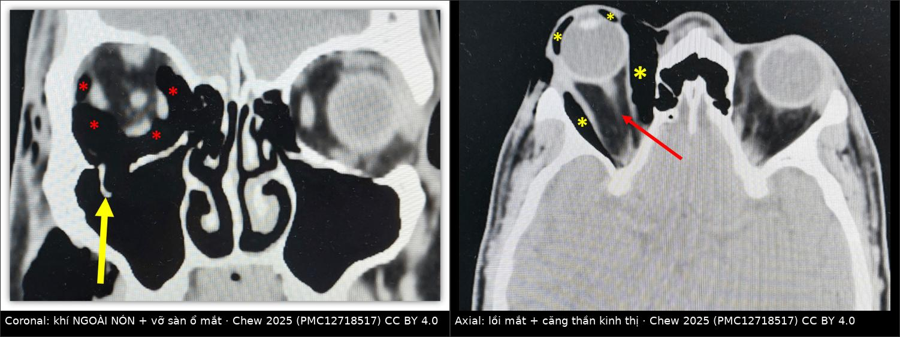
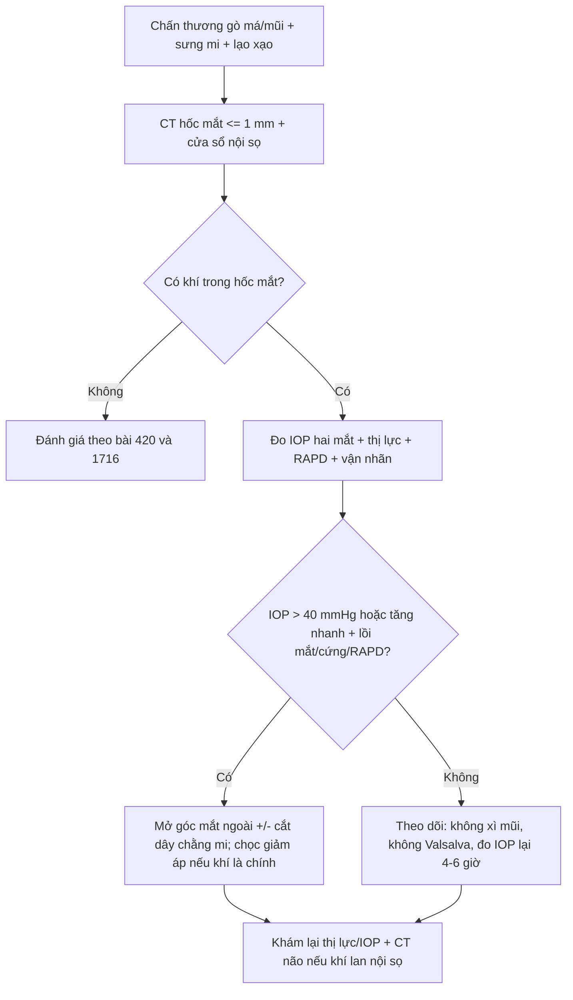
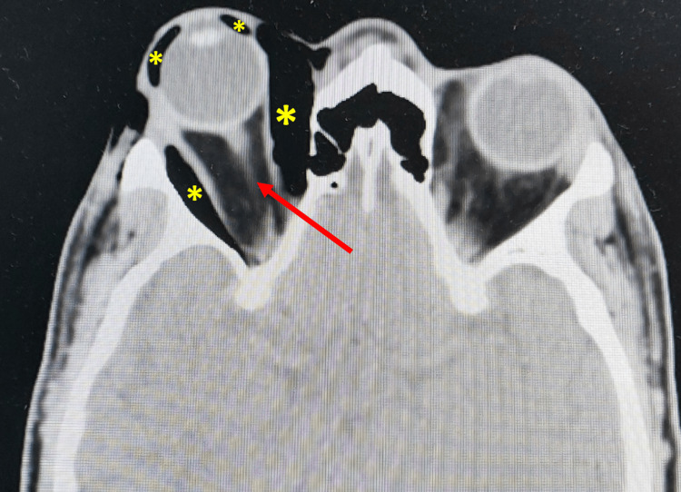
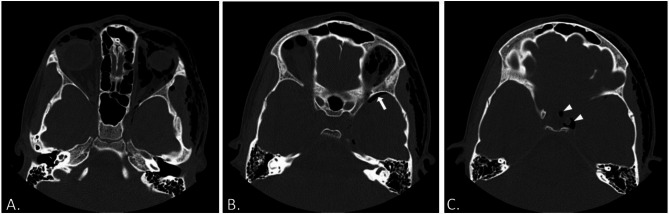

# 3105 — Tràn khí ổ mắt sau chấn thương gò má ở trẻ / Orbital emphysema after zygomatic trauma

**Tags:** `pattern:khi-trong-mo-mem` `pattern:tran-khi` `pattern:loi-mat` `pattern:gay-xuong` `pattern:phu-mi` `vung:hoc-mat` `vung:so-mat` `vung:xoang-ham` `protocol:CT-lat-mong` `protocol:coronal` `protocol:canthotomy` `score:IOP`
**Mức chắc chắn (certainty):** tổng hợp y văn (literature synthesis) — ghép **1 ca người lớn 47 tuổi** diễn tiến **tràn khí căng (tension orbital emphysema) → hội chứng khoang** (*Cureus* 2025, PMC12718517, CC BY 4.0), **1 ca trẻ 12 tuổi** tràn khí ổ mắt **hai bên + khí vào nội sọ không gãy xương** do súng khí nén (*BMC Pediatr* 2025, PMC11874850, CC BY 4.0) và **bài nền 420** (vỡ sàn + hội chứng khoang). Không có thử nghiệm ngẫu nhiên.

> **Câu chốt:** tràn khí ổ mắt **thường lành tính và tự hết trong vài ngày đến vài tuần**, nhưng nó có thể biến thành **"van một chiều"**: không khí vào được mà không ra được → **tràn khí căng** → **hội chứng khoang ổ mắt (OCS)** → mù trong vài giờ. **Chốt hành động không phải là CT, mà là IOP + lồi mắt + đồng tử + vận nhãn.** Ở trẻ, hai bẫy lớn là **chấn thương khí nén** (khí theo khe ổ mắt trên vào xoang hang/nội sọ dù **không gãy xương**) và **trapdoor** với bề ngoài "mắt trắng".

## 1. Tổng quan bệnh học – cơ chế hình ảnh (TẠI SAO)

### 1.1 Khí vào hốc mắt bằng đường nào

- Hốc mắt là **một khoang kín hình nón, thể tích ≈ 30 mL** ở người lớn, giới hạn bởi xương cứng và phía trước là **vách ngăn (orbital septum) + sụn mi** — hai cấu trúc **kém đàn hồi**. Vì **thể tích cố định**, một lượng khí nhỏ cũng làm **áp lực trong hốc mắt tăng rất nhanh** (quan hệ Laplace: áp lực ∝ lực/thể tích; thành càng kém giãn, áp lực càng tăng).
- Sau **gãy sàn ổ mắt hoặc thành trong**, xoang hàm/xoang sàng thông với hốc mắt. **Xì mũi, hắt hơi, ho, thở Valsalva, thổi khí nén** làm **áp lực đường thở trên tăng vọt** → khí bị đẩy qua lỗ xương vào mô mềm hốc mắt.
- **Cơ chế "van một chiều":** mô mềm/niêm mạc sa vào lỗ vỡ như **nắp van** — khí vào được nhưng **không thoát ra** khi áp lực hạ → khí tích lũy dần → **tràn khí căng**. Đây là lý do **triệu chứng có thể nặng lên sau 24 giờ** dù phim đầu tiên "chỉ khí nhẹ" (ca 47 tuổi: IOP **28 → 48 mmHg** trong **1 ngày**).
- **Khí lên nội sọ:** từ hốc mắt, khí theo **khe ổ mắt trên (superior orbital fissure)** quanh **xoang hang** vào **nội sọ** — không cần gãy xương sọ. Ca trẻ 12 tuổi bị súng khí nén có **khí ở thùy thái dương, dọc xoang hang và cạnh hố yên**, kèm khí ở **khoang nhai, tuyến mang tai, khoang cảnh và hai bên cạnh hầu**, **không có gãy xương** trên CT.

### 1.2 TẠI SAO CT đọc được chính xác

- **Khí có tỷ trọng ≈ −1.000 HU**, đen tuyệt đối trên cửa sổ mô mềm — **khác mỡ (−50 đến −120 HU, xám đen) và khác dịch (0–20 HU)**. Vì vậy CT **không cần cản quang** vẫn định vị được khí trong **khoang ngoài nón, trong nón, dưới kết mạc, trong bao cơ**.
- Vị trí khí điển hình: **phía trên và phía trong, khoang ngoài nón** → trên phim thẳng tạo **dải sáng hình liềm "dấu lông mày đen" (black eyebrow sign)**. Dấu này **gợi ý mạnh** nhưng **dễ bị bỏ sót**; CT là chuẩn.
- **TẠI SAO phải nhìn thần kinh thị:** khí tăng thể tích đẩy **nhãn cầu ra trước (lồi mắt)** và **kéo căng – gập thần kinh thị** (dấu **"globe tenting"**). Trên CT axial, thần kinh thị **mất đoạn cong mềm** và **căng thẳng** giữa nhãn cầu và đỉnh ổ mắt — tương ứng với **giảm tưới máu thần kinh**, không chỉ là "khí đẹp mắt".
- **Ngưỡng thiếu máu:** tài liệu ca dẫn **thiếu máu thần kinh thị sau khoảng 3 giờ** chèn ép kéo dài; bài 420 dùng **cửa sổ vàng 60–90 phút** cho hội chứng khoang do máu. Vì vậy **không chờ CT để giải áp** khi đã có dấu hiệu lâm sàng.

### 1.3 Ngưỡng định lượng nằm lòng

| Đại lượng | Số liệu | Nguồn |
|---|---|---|
| Thể tích hốc mắt người lớn | **≈ 30 mL** | PMC12718517 |
| IOP lúc vào → lúc nặng nhất (ca 47 tuổi) | **28 → 48 mmHg** trong **24 giờ** | PMC12718517 |
| IOP sau **mở góc mắt ngoài đơn thuần** | **48 → 28 mmHg** | PMC12718517 |
| Thời gian hồi phục thị lực/vận nhãn | **5 ngày**, thị lực **6/9**, không RAPD | PMC12718517 |
| Ngưỡng IOP thực hành cho OCS | **> 40 mmHg** + lồi mắt/cứng/giảm thị lực | bài 420; PMC12718517 |
| Thời gian thiếu máu thần kinh thị | **≈ 3 giờ** (dẫn từ y văn ca) | PMC12718517 |
| Tỷ lệ tràn khí ổ mắt sau gãy thành ổ mắt | **chưa rõ — thay đổi theo loạt**; nguồn chỉ ghi "thường gặp" | PMC12718517 |

## 2. Mẫu hình + chẩn đoán phân biệt theo vị trí (gamut)

- **Theo khoang:** **ngoài nón** (hay gặp nhất, trên–trong) → **dưới kết mạc** (khí nổi thành bọt, lạo xạo) → **trong nón** (hiếm, nguy hiểm hơn vì chèn ép trực tiếp thần kinh thị) → **nội sọ** (pneumocephalus, theo khe ổ mắt trên/xoang hang).
- **Theo cơ chế:** (1) **chấn thương gãy sàn/thành trong** — phổ biến nhất; (2) **sau mổ** hốc mắt/mi/lệ/xoang; (3) **áp lực dương** — súng khí nén, thổi bóng, lặn, thông khí áp lực dương; (4) **nhiễm khuẩn sinh hơi** (rất hiếm, kèm sốt/đau nhiều); (5) **dị vật/kén khí bẩm sinh** (loại trừ bằng bối cảnh).
- **Mnemonic "GAS":** **G**ãy xương ổ mắt (floor/medial wall), **A**p lực dương (khí nén/Valsalva/nose blowing), **S**au mổ / Sinh hơi (infection).
- **Gamut theo triệu chứng:** sưng mi + lạo xạo (tràn khí dưới da) ≠ lồi mắt + IOP cao (tràn khí căng) ≠ nhìn đôi dọc + nôn (trapdoor) ≠ sốt + đau + hạn chế vận nhãn (áp-xe/viêm mô tế bào).

## 3. Bảng so sánh phân biệt (ma trận đối chiếu)

| Thực thể (entity) | Hình ảnh điển hình (CT không cản quang) | Chốt vào (rule-in) | Chốt loại (rule-out) | Gợi ý xác nhận |
|---|---|---|---|---|
| **Tràn khí ổ mắt đơn thuần** | Khí **−1.000 HU** khoang ngoài nón trên–trong; **dấu lông mày đen** trên X-quang | **Lạo xạo + khí trên CT + IOP bình thường/không lồi mắt** | Khí trong nón + lồi mắt + IOP tăng → không còn "đơn thuần" | CT ≤ 1 mm; theo dõi 4–6 giờ |
| **Tràn khí căng / OCS do khí** | Khí lượng lớn + **lồi mắt + căng thần kinh thị**; có thể **khí trong nón** | **IOP > 40 mmHg + lồi mắt/cứng + RAPD/liệt vận nhãn** | IOP bình thường + không lồi mắt + thị lực nguyên → chưa căng | Giải áp **ngay**, không chờ CT |
| **Máu sau nhãn cầu (retrobulbar hematoma)** | Khối **tăng tỷ trọng 50–90 HU**, hình thấu kính, đẩy nhãn cầu; **không có khí** | **Chấn thương + lồi mắt nhanh + IOP cao + CT khối máu** | Khí đen tuyệt đối −1.000 HU → không phải máu | Canthotomy/cantholysis; CT để loại trừ |
| **Áp-xe/viêm mô tế bào ổ mắt** | Mô mềm dày, **ngấm thuốc viền**, có thể **khí sinh hơi**; **lâm sàng sốt/đau** | **Sốt + đau + hạn chế vận nhãn + viền ngấm thuốc** | Khí đơn thuần không viền ngấm + không sốt → tràn khí chấn thương | Kháng sinh ± dẫn lưu; không chọc khí |
| **Khí dưới kết mạc** | Bọt khí **dưới kết mạc**, có thể lan mi; nhãn cầu nguyên | **Lạo xạo dưới kết mạc + không giảm thị lực** | **Giảm thị lực + tiền phòng nông + nhãn cầu mềm** → nghi vỡ củng mạc | Soi đèn khe; **không thăm dò mù** |
| **Pneumocephalus do khí lan** | Khí **trong khoang nội sọ**, dọc xoang hang/khe ổ mắt trên | **Khí nội sọ trên CT + đau đầu/ý thức thay đổi** | Không khí nội sọ → chỉ theo dõi ổ mắt | CT não; tránh Valsalva/N₂O |

*Trái: khí ngoài nón (dấu \*) + vỡ sàn ổ mắt (mũi tên vàng). Phải: lồi mắt + khí (dấu \*) + thần kinh thị căng thẳng (mũi tên đỏ). Nguồn: Chew 2025, PMC12718517, CC BY 4.0. Ảnh ghép letterbox, giữ nguyên nhãn gốc.*

## 4. Protocol chụp + ngưỡng xử trí

- **CT hốc mắt – sọ mặt không cản quang, lát ≤ 1 mm, axial + coronal + sagittal**, cửa sổ xương **và** mô mềm; **luôn kèm cửa sổ nội sọ** để tìm khí nội sọ (khe ổ mắt trên → xoang hang → thùy thái dương).
- **Trước CT (nếu nghi OCS):** đo **IOP hai mắt**, thị lực, **đồng tử/RAPD**, vận nhãn, soi đèn khe; **không để xe CT làm trễ giải áp**.
- **Ngưỡng giải áp:** **IOP > 40 mmHg** hoặc IOP tăng nhanh kèm **lồi mắt, nhãn cầu cứng, RAPD, liệt vận nhãn, giảm thị lực** → **mở góc mắt ngoài (lateral canthotomy) ± cắt dây chằng mi (cantholysis)**; nếu **khí là thành phần chính** có thể **chọc giảm áp bằng kim** dưới hướng dẫn CT/siêu âm (đã báo cáo trong y văn), hoặc **giải áp nội soi/mở** khi thất bại.
- **Điều trị nội khoa hỗ trợ:** **acetazolamid toàn thân**, thuốc hạ nhãn áp tại chỗ, **đầu cao**, giảm đau; **tuyệt đối không xì mũi**, tránh Valsalva/ho mạnh; **tránh N₂O** khi gây mê (N₂O khuếch tán vào khoang khí kín làm khí to thêm).
- **Khí nội sọ:** theo dõi tri giác/đồng tử, **oxy 100%** (giúp hấp thu khí), CT não lặp nếu tri giác xấu; hội chẩn ngoại thần kinh khi **pneumocephalus căng**.
- **Sau giải áp:** đo lại IOP, khám thần kinh thị mỗi 1–2 giờ trong 24 giờ đầu; chụp lại CT nếu lồi mắt tái diễn.

## 5. Biến thể bình thường và cạm bẫy

- **IOP bình thường lúc đầu không loại trừ:** ca 47 tuổi vào với **IOP 28 mmHg**, **chưa lồi mắt**, chỉ 1 ngày sau đã **48 mmHg + lồi mắt + liệt vận nhãn**. Phải **đo lại** và dặn bệnh nhân **quay lại ngay nếu đau tăng/mắt lồi**.
- **"Mắt trắng" ở trẻ:** trapdoor (vỡ kiểu nắp) có thể **không phù nề nhiều**, nhưng **kẹt cơ + nôn + nhịp chậm** (phản xạ mắt–tim) lại nặng — **tin triệu chứng, không tin vẻ ngoài** (bài 1716, 420).
- **Khí dưới kết mạc giả vỡ củng mạc:** bọt khí + xuất huyết dưới kết mạc có thể che một vết rách củng mạc; ca trẻ 12 tuổi đã **thăm dò dưới gây mê** để loại trừ. **Không chọc/ấn nhãn cầu** khi chưa loại trừ vỡ; chỉ thăm dò khi nghi cao.
- **Bỏ sót khí nội sọ:** khí dọc **khe ổ mắt trên** dễ bị coi là "khí ngoài nón"; phải **đọc lên tới xoang hang/hố yên**, hỏi đau đầu, tri giác. **Không dùng N₂O**, tránh Valsalva sau mổ.
- **Xì mũi sau mổ/chấn thương = tự bơm khí:** dặn **tuyệt đối không xì mũi**, hắt hơi mở miệng, tránh thổi bóng/ống thổi; trẻ chơi **súng khí nén** là cơ chế đặc thù.
- **Canthotomy đơn thuần có thể đủ:** ca này chỉ **mở góc mắt ngoài, không cắt dây chằng**, IOP giảm **48 → 28**; nhưng nếu nhãn cầu vẫn căng/không cải thiện thì **phải cắt dây chằng** hoặc chuyển giải áp phẫu thuật — **không chờ**.
- **Kháng sinh không thường quy** cho tràn khí đơn thuần; cân nhắc khi có **viêm xoang/áp-xe** hoặc gãy xoang hở bẩn.

## 6. Tự lượng giá — Blind Quiz

**Ca 1 — Nam 47 tuổi, chấn thương má phải do tai nạn xe máy, 1 ngày sau mắt lồi, nhãn cầu cứng, IOP 48 mmHg.**

- Gợi ý: thị lực còn **6/9**, không RAPD; vận nhãn hạn chế mọi hướng; không sốt.
- Câu hỏi: Khí nằm ở khoang nào? Dấu hiệu nào cho thấy **thần kinh thị đang bị chèn ép**? Xử trí **ngay** là gì, và vì sao **không chờ** chuyển tuyến?

<b>Bấm để hiện đáp án (findings + chẩn đoán)</b>

- Dấu hiệu: **khí (dấu \*) ở khoang ngoài nón + trong nón**, **nhãn cầu lồi ra trước**, **thần kinh thị căng thẳng** (mũi tên đỏ) — dấu **"globe tenting"**; không thấy khối máu tăng tỷ trọng.
- Chẩn đoán: **tràn khí căng (tension orbital emphysema) gây hội chứng khoang ổ mắt** trên nền vỡ sàn — **chẩn đoán lâm sàng**, IOP 48 + lồi mắt + cứng + hạn chế vận nhãn.
- Xử trí: **mở góc mắt ngoài ± cắt dây chằng mi ngay**, acetazolamid toàn thân; nếu khí là thành phần chính có thể **chọc giảm áp bằng kim**. Ca nguồn: canthotomy đơn thuần đưa IOP **48 → 28 mmHg**, hồi phục hoàn toàn sau **5 ngày**.
- Vì sao không chờ: **thiếu máu thần kinh thị sau khoảng 3 giờ** chèn ép có thể để lại mù không hồi phục; **CT không phải điều kiện để giải áp**.
- Nguồn ảnh: *Cureus* 2025;17(11):e97421 (PMC12718517), Fig. 3, CC BY 4.0.

**Ca 2 — Trẻ 12 tuổi, súng khí nén bắn vào mặt, mắt trái sưng, lạo xạo lan tới hàm, vận nhãn hạn chế; không sốt, không gãy xương trên CT.**

- Gợi ý: IOP và đáy mắt bình thường; thị lực **6/18** mắt trái, **6/9** mắt phải; có bọt khí dưới kết mạc.
- Câu hỏi: Vì sao trẻ có thể có **khí nội sọ mà không gãy xương**? Cần tìm dấu hiệu nào trên CT? Điều trị ban đầu gồm gì?

<b>Bấm để hiện đáp án (findings + chẩn đoán)</b>

- Dấu hiệu: **(A)** khí dưới da + **khí ổ mắt hai bên** + khí dọc **khe ổ mắt trên trái**; **(B)** **khí nội sọ thùy thái dương trái** (mũi tên); **(C)** khí dọc **xoang hang trái và cạnh hố yên** (đầu mũi tên). **Không có gãy xương** trên CT.
- Cơ chế: khí áp lực cao đi qua **khe ổ mắt trên** quanh **xoang hang** vào nội sọ — **đường giải phẫu, không cần gãy xương**.
- Điều trị: **bảo tồn** — nằm đầu cao, **không Valsalva/không xì mũi**, theo dõi tri giác; ca nguồn hồi phục sau **4 tuần**. Thăm dò củng mạc dưới gây mê chỉ để loại trừ vỡ khi có xuất huyết dưới kết mạc + bọt khí.
- Nguồn ảnh: *BMC Pediatr* 2025;25:160 (PMC11874850), Fig. 2, CC BY 4.0 (Bassiouny A và cs).

## Bài liên quan chéo
- [420 – Vỡ sàn hốc mắt & hội chứng khoang](../420-vo-san-hoc-mat/lesson.md) — ngưỡng IOP > 40 mmHg, canthotomy/cantholysis.
- [1716 – Gãy phức hợp gò má–hàm trên ở trẻ](../1716-gay-phuc-hop-go-ma-ham-tren-o-tre/lesson.md) — trapdoor, bốn trụ đỡ, chỉ định mổ.
- [423 – Rò động mạch cảnh–xoang hang](../423-fistula-xoang-hang/lesson.md) — khí/giãn tĩnh mạch mắt, tiếng thổi, phân biệt với khí đơn thuần.
- [422 – Viêm giả u hốc mắt](../422-viem-gia-u/lesson.md) — đau + cả gân + đáp ứng corticoid.

## Ảnh
- `images/3105_tran-khi-o-mat_CT_PMC12718517-f2.jpg` (coronal: khí ngoài nón + vỡ sàn) và `..._f3.jpg` (axial: lồi mắt + căng thần kinh thị) — *Cureus* 2025 (PMC12718517), **CC BY 4.0**, giữ nguyên nhãn gốc.
- `images/3105_tran-khi-o-mat_CT_PMC11874850-f2.jpg` (A–C: khí ổ mắt hai bên, khe ổ mắt trên, khí nội sọ) — *BMC Pediatr* 2025;25:160 (PMC11874850), **CC BY 4.0**.
- `images/composite_tran-khi-o-mat.jpg` — ảnh ghép letterbox từ hai hình của ca người lớn (cùng bệnh nhân, hai bình diện), dải đen ghi attribution.
- Chi tiết nguồn + giấy phép: `images/CREDITS.md`.

> Không dùng để chẩn đoán độc lập khi chưa có người hướng dẫn.
