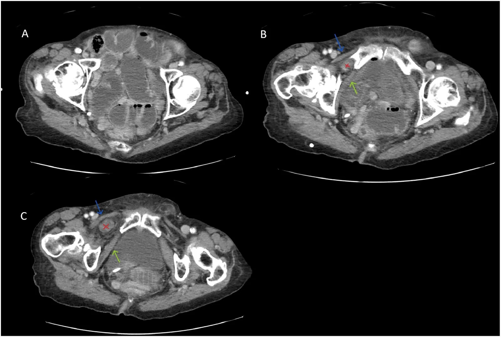
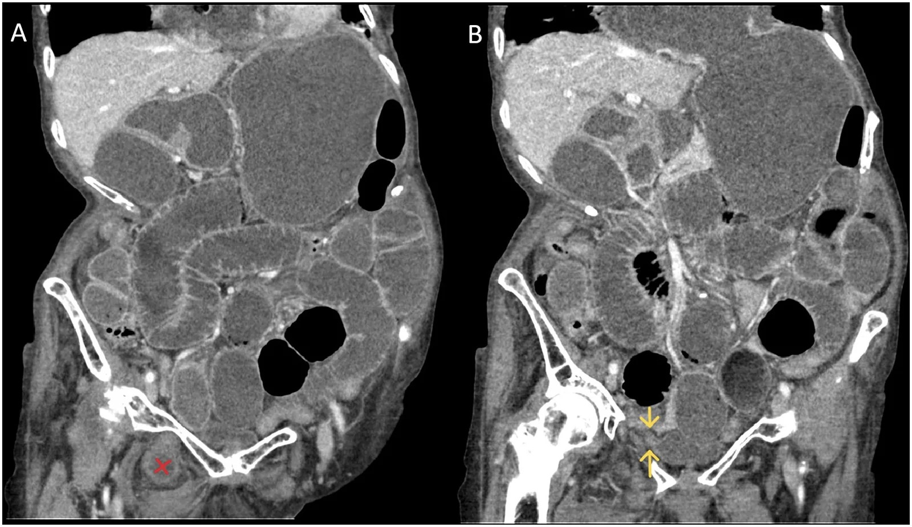
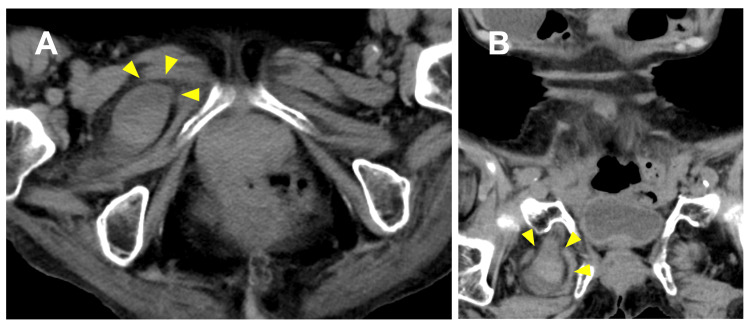
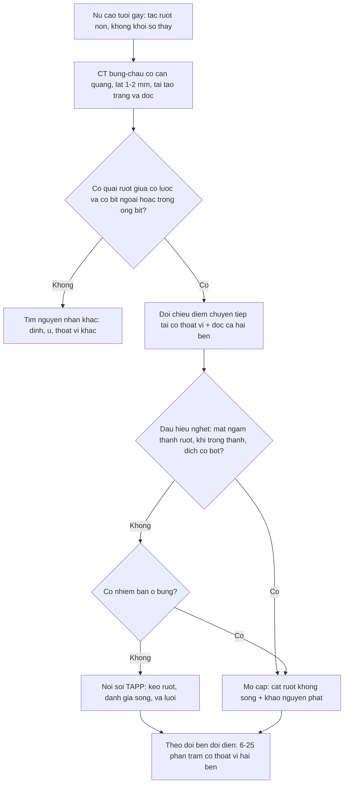

# 3106 — Thoát vị lỗ bịt: nữ cao tuổi gầy, Howship–Romberg chỉ 15–56%, tử vong 13–47%, CT phát hiện > 90% / Obturator hernia

**Tags:** `pattern:thoat-vi` `pattern:tac-ruot` `pattern:quai-ruot-ngoai-phuc-mac` `pattern:chen-ep-than-kinh` `vung:chau` `vung:thanh-bung` `protocol:CT-3-thi` `protocol:noi-soi-o-bung` `incidentaloma:thoat-vi-lo-bit`

**Mức chắc chắn (certainty):** tổng hợp y văn (literature synthesis) — số liệu lấy từ 5 bài open access đã đọc toàn văn: *Cureus* 2026 (PMC12917865, CC BY 4.0 — 10 ca mổ cấp + thuật toán điều trị), *Cureus* 2026 (PMC13341281, CC BY 4.0 — ca biến chứng thủng ruột + tổng quan bẫy chẩn đoán), *Int J Surg Case Rep* 2026 (PMC13045959, CC BY-NC-ND 4.0 — loạt 3 ca + dịch tễ), *J Belg Soc Radiol* 2024 (PMC11546075, CC BY 4.0 — hình CT 3 bình diện), *Radiol Case Rep* 2026 (PMC13559990, CC BY 4.0 — hình CT có chú thích giải phẫu), *BMC Surg* 2026 (PMC13700125, CC BY-NC-ND 4.0 — khoảng cách cơ bịt trong–xương mu dự báo thoát vị). Bài **không** có ca nguyên văn riêng của nhóm; ca trong quiz là ca nguyên văn của nguồn, giữ đúng chú thích gốc và ghi rõ Fig.

> **Câu hỏi gốc của bài:** bà **82 tuổi, gầy (BMI 18)**, vào viện vì **nôn và bí trung đại tiện 2 ngày**; bụng **chướng, không sờ thấy khối**, chỉ **đau mặt trong đùi phải** tăng khi duỗi và xoay trong. Siêu âm không kết luận. Vậy: **tắc ruột do dính hay do thoát vị? khối ở đâu mà không sờ thấy? khi nào mổ nội soi, khi nào mở, khi nào phải cắt ruột — và vì sao "đau đùi" lại là chìa khóa hình ảnh?**
> **Điểm tựa:** **lỗ bịt (obturator canal)** là một đường hầm **sau và dưới** sàn chậu, nằm **giữa cơ lược ở trước và cơ bịt ngoài ở sau** — sâu hơn nhiều so với ống bẹn và ống đùi, nên **không bao giờ sờ thấy**. Trong lỗ bịt có **thần kinh bịt (L2–L4)**; khi túi thoát vị chèn vào, bệnh nhân đau **mặt trong đùi/đầu gối** (dấu **Howship–Romberg**) chứ không đau bụng — và chính vì thế, ca này thường bị điều trị như **tắc ruột do dính** cho tới khi CT được đọc đúng tầng.

## 1. Tổng quan — vì sao lỗ bịt "mở ra" ở người già gầy, và vì sao chẩn đoán muộn giết người

**A. Bệnh học (pathology) và cơ chế:**

- **Giải phẫu:** **lỗ bịt** nằm ở **thành trước–dưới khung chậu**, giới hạn bởi **xương mu trên**, **màng bịt (obturator membrane)** và **các cơ bịt trong/ngoài**; **ống bịt** dài **2–3 cm** chứa **thần kinh bịt, động mạch và tĩnh mạch bịt**. Thoát vị lỗ bịt là **quai ruột (hoặc tạng) chui qua ống này ra ngoài khung chậu**.
- **Vì sao gặp ở nữ cao tuổi, gầy:** **khung chậu nữ rộng hơn**, **sinh nhiều lần** làm **giãn sàn chậu**, và **mất lớp mỡ tiền phúc mạc quanh ống bịt** theo tuổi/sụt cân làm **ống bịt "trống" và rộng ra**. Kèm **tăng áp lực ổ bụng mạn** (táo bón, COPD) → đẩy ruột vào chỗ yếu. Trong loạt 10 ca: **100% nữ**, tuổi trung vị **88,9** (84–97) (PMC12917865).
- **Vì sao đau mặt trong đùi (Howship–Romberg):** túi thoát vị **chèn ép thần kinh bịt**; đau lan **mặt trong đùi tới đầu gối**, **tăng khi duỗi/xoay trong**, **giảm khi gấp háng**. Dấu này **chỉ có ở 15–56%** ca (PMC12917865) — **thiếu dấu hiệu không loại trừ**.
- **Dấu Hannington–Kiff:** **mất phản xạ cơ khép (adductor reflex)** cùng bên do tổn thương thần kinh bịt — ít được khám nhưng **đặc hiệu**.
- **Vì sao không sờ thấy khối:** túi nằm **dưới cơ lược**, sau ống đùi; khám bụng–bẹn **bình thường**. Vì vậy **không có khối sờ thấy** là quy luật, không phải ngoại lệ.
- **Vì sao biểu hiện chính là tắc ruột non:** **0,2–1,6%** các ca tắc ruột non cơ học là do thoát vị lỗ bịt (PMC13045959); **80–90%** bệnh nhân vào viện với **tắc ruột** chứ không phải "khối thoát vị".
- **Vì sao có thể tắc "từng đợt" rồi đột ngột nặng:** thể **Richter** (chỉ **một phần chu vi** ruột chui vào) gây **nghẹt mạch máu** mà **không tắc hoàn toàn**, nên bệnh nhân **đi lại được, còn trung tiện**, rồi **thủng/hoại tử** đột ngột. Đây là lý do **không được chờ "hết tắc"** khi đã thấy thoát vị.
- **Vì sao chẩn đoán muộn = tử vong:** hoại tử ruột khi phải mổ cấp lên tới **40,7%** (PMC13341281); **tử vong 13–47%** — **cao nhất trong các loại thoát vị thành bụng** (PMC12917865); loạt Đan Mạch toàn quốc ghi **tử vong 30 ngày 14%** cho mổ cấp (dẫn trong PMC12917865).
- **Vì sao cần CT chứ không phải siêu âm:** ổ thoát vị **sâu trong khung chậu**, bị **xương và khí ruột** che; siêu âm **không thấy được**. **CT là chuẩn**, phát hiện trước mổ **> 90%** (PMC12917865).

**B. Ngưỡng định lượng bắt buộc (cửa 1 Argon):**

| Đại lượng | Con số đã kiểm chứng | Ý nghĩa thực hành |
|---|---|---|
| Tần suất trong thoát vị thành bụng | **0,07–1%** (PMC12917865) | Hiếm, nhưng **không được bỏ** khi đọc CT tắc ruột ở người già |
| Tần suất trong tắc ruột non cơ học | **0,2–1,6%** (PMC13045959) | Là nguyên nhân **hiếm nhưng chết người** của SBO |
| Giới và tuổi | **100% nữ**; tuổi trung vị **88,9** (84–97) trong 10 ca (PMC12917865) | Nữ **> 80 tuổi, gầy** = nhóm cần đọc kỹ tầng lỗ bịt |
| Dấu Howship–Romberg | **15–56%** (PMC12917865) | **Thiếu dấu hiệu không loại trừ** |
| Tử vong | **13–47%** chung (PMC12917865); **14%** tử vong 30 ngày khi mổ cấp (registry Đan Mạch, dẫn trong PMC12917865) | Cao nhất trong các thoát vị thành bụng |
| Hoại tử ruột khi mổ cấp | **40,7%** (PMC13341281) | Càng chờ, tỉ lệ cắt ruột càng tăng |
| Cắt ruột trong loạt 10 ca | **6/10 = 60%** (PMC12917865) | Đa số ca đến muộn đã có ruột không sống |
| Giá trị CT | Phát hiện trước mổ **> 90%** (PMC12917865) | CT là **chuẩn**; siêu âm không đủ |
| Thoát vị hai bên / thể hiện lần lượt | **6–25%** (PMC12917865) | **Luôn đọc cả hai bên** và hẹn theo dõi bên còn lại |
| Khoảng cách cơ bịt trong – xương mu (OI–P gap) | **≥ 12,9 mm**: nhạy **67%**, đặc hiệu **93%**, **AUC 0,79** cho thoát vị lỗ bịt **tình cờ** (PMC13700125; 9/79 ca) | Dùng để **phân tầng nguy cơ** bên đối diện/không triệu chứng |
| Giảm thể tích bằng tay có hướng dẫn siêu âm | Thành công **78% vs 33%** khi làm thủ công; **cắt ruột ít hơn nếu làm trong 72 giờ đầu** (dẫn trong PMC13341281) | Chỉ áp dụng **chọn lọc**, và **không thay thế** đánh giá mổ |
| Mổ nội soi vs mở | Giảm biến chứng, **OR 0,29** (tổng quan hệ thống, dẫn trong PMC12917865) | **TAPP** là lựa chọn mặc định khi **không nhiễm bẩn** |

**C. TẠI SAO ảnh trông như vậy (vật lý hình ảnh):**

- **Vì sao phải đọc tầng ngang ở ngang xương mu:** ống bịt nằm **dưới–sau** ổ cối; trên CT, dấu hiệu chốt là **quai ruột có thành, chứa khí/dịch, nằm giữa cơ lược (trước) và cơ bịt ngoài (sau)** — tức **ngoài khung chậu**, thấp hơn ống bẹn. Nếu chỉ đọc các lát từ rốn xuống bàng quang, **bạn dừng trước khi tới tầng bệnh**.
- **Vì sao cần tái tạo tràng (coronal) và dọc (sagittal):** quai ruột đi **chéo** qua ống bịt; trên lát ngang đơn thuần nó chỉ là "một quai ruột trong khung chậu". Tái tạo tràng cho thấy **điểm chuyển tiếp (transition point)** đúng tại **cổ thoát vị** — dấu hiệu quyết định **tắc do thoát vị** chứ không phải do dính.
- **Vì sao thấy "beak sign" và "small bowel faeces sign":** ruột trên chỗ nghẹt **ứ đầy dịch–khí** (hình **phân ruột non**), còn tại cổ thoát vị quai ruột **thắt nhọn** như mỏ chim; **mỡ quanh ống bịt bị đẩy** và **mất mặt phẳng mỡ** giữa cơ lược và cơ bịt ngoài.
- **Vì sao khó phân biệt với ổ áp-xe cơ bịt:** áp-xe cũng nằm **giữa các cơ vùng bịt**, nhưng là **khối dịch có viền ngấm, khí trong mô, không có thành ruột liên tục với lòng ruột**. Điểm khác biệt quyết định: **tìm được chỗ quai ruột chui vào và đi ra** (điểm chuyển tiếp), không chỉ "có khí trong khối".
- **Vì sao thoát vị có thể "biến mất" trên CT lần 2:** ruột có thể **tự tụt vào** hoặc được **giảm bằng tay** trước khi chụp; khi đó ổ bụng vẫn **tắc** do **dính/niêm mạc phù** tại chỗ thoát vị cũ. Có ca **thoát vị nghẹt "biến mất" trên CT tuần tự** trước khi mổ nội soi (PMC13424230) — nên **không loại trừ** chỉ vì lần chụp sau không thấy túi.

## 2. Mẫu hình + chẩn đoán phân biệt theo vị trí (Gamut)

### 2a. Theo đường đi của túi (giải phẫu — quyết định cách mổ)

1. **Giữa cơ lược và cơ bịt ngoài (thể "nông", hay gặp nhất trên CT):** quai ruột **ngay dưới cơ lược**, sát xương mu — hình ảnh kinh điển, dễ thấy khi tái tạo tràng.
2. **Giữa cơ bịt ngoài và cơ bịt trong:** túi nằm **trong ống bịt**, sát thần kinh bịt → **đau đùi rõ**, khối **nhỏ, khó thấy**.
3. **Trong ống bịt / dưới màng bịt:** thể **hiếm**, dễ nhầm với **nang/áp-xe** vùng bịt.

### 2b. Theo nội dung túi

- **Ruột non** (phổ biến nhất) → tắc ruột non.
- **Richter** (một phần chu vi) → **nghẹt không tắc hoàn toàn**, dễ bỏ sót.
- **Đại tràng, ruột thừa, túi thừa Meckel, bàng quang, buồng trứng** → hình ảnh "khối" không điển hình; **bàng quang** thoát vị gây **đái khó/tiểu máu**.
- **Thoát vị tình cờ (không triệu chứng):** thấy khi chụp vì lý do khác; **OI–P gap ≥ 12,9 mm** giúp phân tầng (PMC13700125).

### 2c. Theo bối cảnh lâm sàng (gamut "tắc ruột ở người già")

- **Thoát vị lỗ bịt** (bài này) — không khối sờ thấy, có thể có đau đùi.
- **Thoát vị đùi** — khối **dưới ống bẹn**, trong tam giác đùi; trên CT quai ruột **trước xương mu**, dễ thấy hơn.
- **Thoát vị bẹn/bẹn–đùi tái phát** — tiền sử mổ, có khối.
- **Tắc do dính** — tiền sử mổ bụng; **không có điểm chuyển tiếp ngoài ổ bụng**.
- **Áp-xe cơ thắt lưng–chậu / cơ bịt** — sốt, đau háng, **không có quai ruột**.
- **Đau thần kinh bịt do nguyên nhân khác** (tiểu đường, chèn ép trong khung chậu) — **không có tắc ruột**, CT không thấy túi.

## 3. Bảng so sánh phân biệt (ma trận đối chiếu)

| Thực thể (entity) | Hình ảnh điển hình (CT) | Chốt vào (rule-in) | Chốt loại (rule-out) | Gợi ý xác nhận |
|---|---|---|---|---|
| **Thoát vị lỗ bịt** | Quai ruột **giữa cơ lược và cơ bịt ngoài** (hoặc trong ống bịt), **điểm chuyển tiếp tại cổ**, ruột trên giãn | **Quai ruột có thành liên tục với lòng ruột, đi qua lỗ bịt**, + **điểm chuyển tiếp** | **Không có quai ruột nào ra ngoài khung chậu** ở tầng lỗ bịt → loại trừ | CT có cản quang + **tái tạo tràng/dọc**; đọc **cả hai bên** |
| **Thoát vị đùi** | Quai ruột **trước xương mu**, dưới **dây chằng bẹn**, trong tam giác đùi; thường thấy **khối** | **Túi ở ống đùi** + tĩnh mạch đùi bị đẩy ra ngoài | **Túi nằm sau cơ lược, trong lỗ bịt** → không phải đùi | CT tràng; siêu âm vùng bẹn có thể thấy |
| **Thoát vị bẹn** | Túi **trên–trong** dây chằng bẹn, dọc ống bẹn; sờ thấy khối | **Túi xuất phát trên dây chằng bẹn** | **Túi dưới dây chằng bẹn** → không phải bẹn | CT; khám lâm sàng |
| **Áp-xe cơ bịt / cơ thắt lưng–chậu** | Khối **dịch viền ngấm**, **khí trong cơ**, **không có thành ruột**; sốt, CRP cao | **Khối dịch trong cơ + phản ứng viêm** | **Quai ruột có thành và khí trong lòng, liên tục với ruột** → thoát vị | CT; chọc hút/dẫn lưu nếu áp-xe |
| **Tắc ruột do dính** | Nhiều mức khí–dịch, **điểm chuyển tiếp trong ổ bụng**, không có túi | **Điểm chuyển tiếp trong phúc mạc + tiền sử mổ** | **Có quai ruột ngoài khung chậu** → không phải dính đơn thuần | CT; đối chiếu tiền sử mổ |
| **Thoát vị bàng quang qua lỗ bịt** | **Bàng quang "giọt nước"** chui qua lỗ bịt, thành dày, ± sỏi | **Thành bàng quang liên tục qua lỗ bịt** + đái khó | **Cấu trúc chứa khí/dịch dạng ruột** → thoát vị ruột | CT có cản quang thì bài tiết |
| **Đau thần kinh bịt (không thoát vị)** | Không có túi; có thể teo cơ khép, nguyên nhân trong khung chậu | **Đau điển hình + không có túi trên CT** | **Thấy túi/thoát vị** → nguyên nhân cơ học | MRI khung chậu; EMG |

*Nữ cao tuổi, tắc ruột non. (A) Các quai ruột non giãn trong khung chậu. (B, C) **Quai ruột (dấu X đỏ)** nằm **giữa cơ lược (mũi tên xanh) và cơ bịt ngoài (mũi tên xanh lá)** — tức đã **ra ngoài khung chậu qua lỗ bịt**. Đây là dấu hiệu chốt, chỉ thấy khi đọc tới **tầng xương mu**. Nguồn: *Radiol Case Rep* 2026 (PMC13559990), Fig. 3, CC BY 4.0.*

*Cùng bệnh nhân. (A) Ruột non giãn lan tỏa + **quai thoát vị (X đỏ)** ở dưới–trong khung chậu phải. (B) **Điểm chuyển tiếp (mũi tên vàng)** đúng tại **cổ thoát vị** — chứng minh tắc ruột **do thoát vị**, không phải do dính. Nguồn: PMC13559990, Fig. 4, CC BY 4.0.*

*Ca khác: (A) lát ngang — **quai ruột nghẹt (đầu mũi tên)** trong lỗ bịt phải; (B) tái tạo tràng — quai ruột **chui qua lỗ bịt** xuống dưới xương mu. Hình này cho thấy vì sao **chỉ một bình diện là không đủ**: trên lát ngang, quai ruột trông như "ruột trong khung chậu". Nguồn: *Cureus* 2026 (PMC12917865), Fig. 1, CC BY 4.0.*

### Dấu hiệu trên từng modality (đọc theo thứ tự thực hành)

- **X-quang bụng:** chỉ thấy **mức khí–dịch của tắc ruột non**; **không** thấy thoát vị. X-quang bình thường **không loại trừ**.
- **Siêu âm:** có thể thấy **quai ruột không di động** sâu trong khung chậu, nhưng **bị xương che**; giá trị chủ yếu để **loại trừ sỏi mật/giãn đường mật** và đánh giá dịch tự do.
- **CT bụng–chậu có cản quang (thì cửa):** **chuẩn**. Đọc **ba bình diện**, **luôn xuống tới bờ dưới xương mu**, **so hai bên**, tìm **điểm chuyển tiếp**, **dấu hiệu nghẹt** (thành dày, mất ngấm, khí trong thành, dịch quanh ruột).
- **Đo OI–P gap (khi thấy thoát vị tình cờ/không triệu chứng):** khoảng cách **cơ bịt trong – xương mu** trên lát tràng; **≥ 12,9 mm** → nguy cơ cao (PMC13700125).

## 4. Protocol chụp + hệ phân độ/ngưỡng xử trí

- **Chỉ định CT:** **mọi tắc ruột non ở nữ > 70 tuổi**, đặc biệt khi **không có tiền sử mổ bụng**, hoặc **có đau mặt trong đùi**. Không chờ "thử điều trị bảo tồn" nếu bệnh nhân **đau nhiều, CRP tăng, không đỡ sau 6–12 giờ**.
- **Kỹ thuật:** CT **bụng–chậu có cản quang tĩnh mạch**, lát **1–2 mm**, cửa sổ mô mềm; tái tạo **tràng và dọc**; đọc **từ vòm hoành tới bờ dưới xương mu**; nếu nghi thoát vị, **đo OI–P gap** và **đọc bên đối diện**.
- **Đánh giá ruột nghẹt (quyết định cắt ruột):** thành ruột **mất ngấm**, **khí trong thành (pneumatosis)**, **khí trong tĩnh mạch cửa**, **dịch tự do có bọt khí**, **dấu "ruột khô"** — đều là dấu hiệu **phải mổ ngay**, không chờ nội soi.
- **Điều trị (theo thuật toán PMC12917865):**
  - **Nội soi TAPP là lựa chọn mặc định** khi **không có nhiễm bẩn ổ bụng** và **ruột còn sống**: quan sát **cả hai lỗ bịt**, kéo ruột vào, đánh giá sống, **vá bằng lưới**.
  - **Mở bụng** khi **nhiễm bẩn nặng (thủng/viêm phúc mạc phân)**, **ruột không sống phải cắt**, hoặc **bệnh nhân không chịu được bơm hơi**; trong nhiễm bẩn, **khâu nguyên phát, không đặt lưới**.
  - **Cắt ruột** khi **hoại tử/thủng**; **không cố giảm bằng tay** nếu có dấu nghẹt/thủng.
  - **Giảm bằng tay có hướng dẫn siêu âm** (chọn lọc, **trong 72 giờ đầu**): thành công **78% vs 33%** so với thủ công, **giảm tỉ lệ cắt ruột** (PMC13341281) — nhưng **phải mổ nội soi kiểm tra** sau đó, không coi là điều trị triệt để.

## 5. Biến thể bình thường và cạm bẫy

- **Biến thể bình thường:**
  - **Mỡ trong ống bịt** ở người trẻ **bình thường**; **không** gọi là thoát vị khi **không có quai ruột/tạng**.
  - **Thoát vị lỗ bịt tình cờ, không triệu chứng** (thấy khi chụp vì lý do khác) — **không phải chỉ định mổ cấp**; đánh giá **OI–P gap**, theo dõi, mổ chương trình nếu có triệu chứng.
  - **Bất đối xứng nhẹ kích thước ống bịt** hai bên là bình thường.
- **Cạm bẫy (pitfall):**
  - **Không đọc tới tầng xương mu:** đây là **lỗi số 1**. CT "tắc ruột non, không rõ nguyên nhân" ở nữ già thường là **thoát vị lỗ bịt bị bỏ qua** vì **dừng lát cắt sớm**.
  - **Đọc lát ngang đơn thuần:** quai ruột trong lỗ bịt **trông như ruột trong khung chậu**; **luôn tái tạo tràng/dọc**.
  - **Quy tắc "không có khối = không thoát vị":** **sai**. Thoát vị lỗ bịt **không bao giờ sờ thấy**.
  - **Bỏ qua đau mặt trong đùi** ở bệnh nhân tắc ruột: **Howship–Romberg** chỉ có **15–56%**, nhưng khi có thì **gần như chẩn đoán**.
  - **Bỏ sót thể Richter:** bệnh nhân **còn trung tiện, bụng mềm**, nhưng **ruột đã nghẹt**; **không chờ "hết tắc"**.
  - **Chỉ đọc một bên:** **6–25%** có thoát vị **hai bên** hoặc **xuất hiện lần lượt** — phải **ghi rõ bên đối diện**.
  - **Thoát vị "biến mất" trên CT lần 2:** ruột **tự tụt/được giảm**, nhưng **tắc vẫn còn** do phù/dính tại chỗ; **không loại trừ** (ca PMC13424230).
  - **Nhầm với áp-xe cơ bịt:** áp-xe có **khối dịch + khí trong cơ**, **không có thành ruột**; thoát vị có **quai ruột liên tục** và **điểm chuyển tiếp**.
  - **Đặt lưới trong viêm phúc mạc phân:** nguy cơ **nhiễm lưới**; trong nhiễm bẩn **khâu nguyên phát** rồi tính mổ chương trình.

## 6. Tự lượng giá — Blind Quiz ngay trên trang tĩnh

**Ca 1 — Nữ 84 tuổi, gầy, nôn 2 ngày, bụng chướng, đau mặt trong đùi phải. Nhìn CT ngang, mô tả trước khi mở đáp án.**

- Gợi ý lâm sàng: không có tiền sử mổ bụng; khám bẹn và đùi **không thấy khối**.
- Câu hỏi: (1) quai ruột nằm ở đâu so với cơ lược và cơ bịt ngoài? (2) vì sao không sờ thấy khối? (3) cần tái tạo bình diện nào để chốt?

<b>Bấm để hiện đáp án (findings + chẩn đoán)</b>

- **Findings:** (A) ruột non giãn; (B, C) **quai ruột (X đỏ)** nằm **giữa cơ lược (mũi tên xanh) và cơ bịt ngoài (mũi tên xanh lá)** — đã **ra ngoài khung chậu qua lỗ bịt**.
- **Chẩn đoán:** **thoát vị lỗ bịt nghẹt (incarcerated obturator hernia)** gây tắc ruột non.
- **Vì sao không sờ thấy:** túi nằm **sau cơ lược**, sâu hơn ống bẹn/ống đùi.
- **Bình diện cần:** **tái tạo tràng/dọc** để thấy **điểm chuyển tiếp tại cổ thoát vị**.
- **Nguồn ảnh:** *Radiol Case Rep* 2026 (PMC13559990), Fig. 3, CC BY 4.0.

**Ca 2 — Cùng bệnh nhân: tìm điểm chuyển tiếp và quyết định điều trị.**

- Câu hỏi: (1) mũi tên vàng chỉ gì? (2) dấu hiệu nào trên CT buộc **mổ mở** thay vì nội soi? (3) nếu ruột còn sống và không nhiễm bẩn, chọn đường nào?

<b>Bấm để hiện đáp án</b>

- **(A)** ruột non giãn + quai thoát vị; **(B)** **điểm chuyển tiếp tại cổ thoát vị** (mũi tên vàng) — chốt **tắc do thoát vị**.
- **Mổ mở khi:** **khí trong thành ruột/mất ngấm thành**, **dịch có bọt khí**, **thủng/viêm phúc mạc phân**, hoặc **bệnh nhân không chịu được bơm hơi**.
- **Nếu ruột sống, không nhiễm bẩn:** **nội soi TAPP** — quan sát cả hai lỗ bịt, kéo ruột, **vá lưới**; giảm biến chứng so với mở (**OR 0,29**).
- **Nguồn ảnh:** PMC13559990, Fig. 4, CC BY 4.0.

**Ca 3 — Nữ 78 tuổi, tắc ruột non; CT ngang và tràng cho hình dưới. Bên đối diện thì sao?**

- Câu hỏi: (1) mô tả (A) và (B); (2) vì sao phải **đọc bên đối diện**? (3) yếu tố nào khiến bệnh nhân này **dễ thoát vị lỗ bịt**?

<b>Bấm để hiện đáp án</b>

- **(A)** lát ngang: **quai ruột nghẹt** trong lỗ bịt phải (đầu mũi tên); **(B)** tái tạo tràng: quai ruột **chui qua lỗ bịt**, dưới xương mu.
- **Đọc bên đối diện** vì **6–25%** có thoát vị **hai bên hoặc xuất hiện lần lượt**; bên còn lại có thể đã có túi nhỏ hoặc **OI–P gap ≥ 12,9 mm** (nguy cơ cao).
- **Yếu tố dễ gặp:** **nữ, cao tuổi, gầy**, **sinh nhiều**, **tăng áp lực ổ bụng mạn** (táo bón/COPD).
- **Nguồn ảnh:** *Cureus* 2026 (PMC12917865), Fig. 1, CC BY 4.0.

## Bài liên quan chéo
- [162 – Tắc ruột non: tiếp cận hình ảnh và điểm chuyển tiếp](../162-tac-ruot/lesson.md) — khung chung của SBO
- [160 – Bụng cấp: tiếp cận 6 bước trên CT](../160-bung-cap-GI/lesson.md) — thứ tự đọc và "không dừng sớm"
- [1928 – Áp-xe cơ chậu ở thai phụ](../1928-ap-xe-co-chau-thai-ky/lesson.md) — "kẻ bắt chước" khối dịch vùng chậu
- [3061 – Di căn lỗ trocar sau PTNS](../3061-di-can-lo-trocar-sau-pipac-va-noi-soi/lesson.md) — khối thành bụng sau mổ, cùng vị trí lỗ
- [3097 – Nang túi tinh/Zinner](../3097-zinner-nang-tui-tinh-than-bat-san/lesson.md) — khối dịch tiểu khung, khác hoàn toàn về xử trí
- [100 – Tổng quan hệ Bụng](../100-tong-quan-he-bung/lesson.md)

## Ảnh
- Tên file theo quy ước `3106_thoat-vi-lo-bit_CT_SourceID.jpg`; nguồn + giấy phép từng ảnh trong `images/CREDITS.md`.
- Ba ảnh đều **CC BY 4.0** → dùng nguyên bản, ghi công; không tạo ảnh ghép trong bài này vì các hình đã là chuỗi nhiều khung của cùng một ca.
- Không có ảnh nào từ Radiopaedia/AuntMinnie (chỉ dẫn link ở `sources.md`).

> Không dùng để chẩn đoán độc lập khi chưa có người hướng dẫn.
