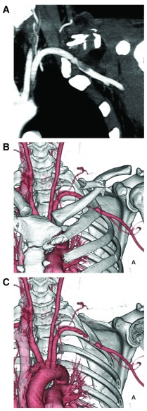
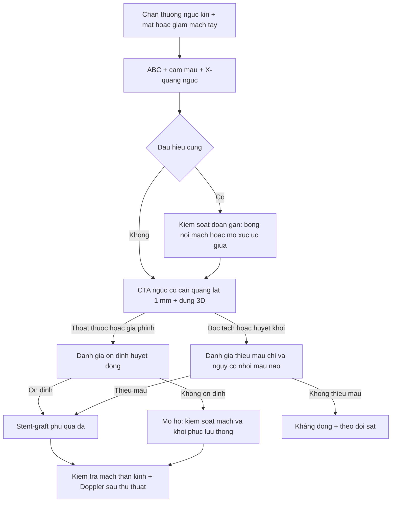
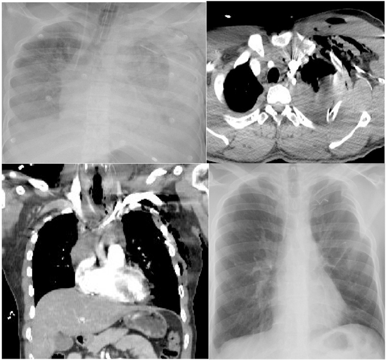
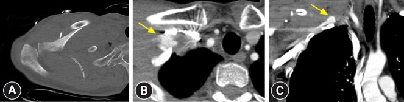

# 3107 — Đứt – rách động mạch dưới đòn sau chấn thương ngực kín / Traumatic subclavian artery injury

**Tags:** `pattern:mat-mach-chi-tren` `pattern:gia-phinh-dong-mach` `pattern:thoat-mach` `pattern:tran-mau-mang-phoi` `vung:nguc` `vung:thanh-nguc` `protocol:CTA-nguc` `protocol:DSA` `protocol:stent-graft` `score:ATLS` `score:ISS`

**Mức chắc chắn (certainty):** tổng hợp y văn (literature synthesis) — ghép 5 chuỗi dữ liệu: (a) meta-phân tích **12 nghiên cứu, 2.854 bệnh nhân** so sánh can thiệp nội mạch và mổ hở (**Tsai SY et al., *World J Emerg Surg* 2026, PMC13449391, CC BY-NC-ND 4.0**); (b) **14 ca** tại một trung tâm mạch máu (**Tadayon N et al., *J Cardiovasc Thorac Res* 2020, PMC7321003, CC BY 4.0**); (c) **7 ca** tại trung tâm chấn thương cấp I, 5 ca đặt stent (**Zhang J et al., *J Vasc Surg Cases Innov Tech* 2022, PMC8743185, CC BY 4.0**); (d) ca chấn thương kín đặt stent nitinol (**Nakada TA et al., *F1000Research* 2014, PMC4329670, CC BY 4.0**); (e) 2 ca nguyên văn có ảnh (**Chaudhry IUH et al., *Ann Med Surg* 2022, PMC8977998, CC BY 4.0**; **Kim J & Moon J, *J Trauma Inj* 2025, PMC12800519, CC BY-NC 4.0**). Số nào nguồn không đưa thì ghi "chưa rõ".

> **Bài này trả lời 4 câu hỏi của ca "chấn thương ngực kín + tay lạnh, mạch yếu":**
> (1) **Động mạch dưới đòn bị tổn thương khi nào — và vì sao mạch quay vẫn bắt được?** (2) **Dấu hiệu "cứng" nào buộc mổ ngay, dấu hiệu "mềm" nào cho phép chụp CTA?** (3) **Stent-graft phủ có thay được mổ hở — và ai không được đặt stent?** (4) **Bỏ sót giả phình trên CT đầu tiên gây hậu quả gì?**
> Đây là mặt **mạch máu** của chấn thương ngực kín; mặt **đường thở** ở [3083 – Chấn thương khí – phế quản do lực tù](../3083-chan-thuong-khi-phe-quan-do-luc-tu/lesson.md), mặt **thành ngực** ở [080 – Chấn thương ngực](../080-chan-thuong-nguc/lesson.md), mặt **can thiệp mạch chi** ở [3095 – Tổn thương động mạch đùi sau can thiệp](../3095-ton-thuong-dong-mach-dui-sau-can-thiep-noi-mach-tre/lesson.md).

## 1. Tổng quan bệnh học – cơ chế hình ảnh

### 1.1 Giải phẫu quyết định cả chẩn đoán lẫn đường mổ

- Động mạch dưới đòn đi từ **quai ĐMC → bờ ngoài xương sườn 1**, chia **3 đoạn** theo cơ bậc thang trước (anterior scalene):
  - **Đoạn 1 (trước cơ bậc thang):** ngực – trung thất, sát **đỉnh phổi** và **màng phổi**; tổn thương ở đây gây **máu tụ đỉnh phổi / tràn máu màng phổi**, đường vào là **mở xương ức giữa** hoặc **mở ngực trước bên**.
  - **Đoạn 2 (sau cơ bậc thang):** nằm giữa **xương đòn và xương sườn 1** — bị **kẹp** khi 2 xương này gãy/di lệch; đường vào **trên – dưới xương đòn**.
  - **Đoạn 3 (sau cơ bậc thang → nách):** ngoài lỗ ngực, đường vào **dưới xương đòn**; thường mổ hở được.
- **Vì sao chấn thương kín gây đứt:** (1) **mảnh xương gãy** (xương đòn, xương sườn 1) đâm/rách; (2) **lực kéo – nén** giữa xương đòn và xương sườn 1 khi vai bị đẩy ra sau (scapulothoracic dissociation); (3) **giảm tốc** làm rách tại chỗ cố định. Ở người trẻ, mạch máu đàn hồi nên **đứt nội mạc (intimal tear) → huyết khối/bóc tách** nhiều hơn đứt toàn thành.
- **Vì sao khó thấy trên phim và dễ bỏ sót:** động mạch nằm **sau xương đòn, trong lỗ ngực hẹp**, bị **xương che**; chấn thương thường kèm **tràn máu màng phổi** làm mất dấu mạch; và **hệ tuần hoàn bàng hệ quanh vai rất giàu** nên **mạch quay vẫn bắt được** dù động mạch đã rách hoặc tắc.

### 1.2 Số liệu định lượng

- **Tần suất:** tổn thương động mạch dưới đòn sau **gãy xương đòn gặp < 1%** ca gãy xương đòn (PMC12800519); là tổn thương mạch **hiếm nhưng tử vong cao** của chấn thương ngực.
- **Tổn thương thần kinh đi kèm: 42,9% (6/14)** — đám rối cánh tay nằm ngay sau động mạch (PMC7321003). Đây là lý do **khám thần kinh trước và sau can thiệp** phải ghi vào phiếu.
- **Điều trị trong 14 ca (PMC7321003):** khâu mạch **50,0%**, ghép đoạn **21,4%**, **buộc mạch 28,6%**; **kiểm soát đoạn gần bằng nội mạch trước khi mở 42,9%**.
- **So sánh nội mạch vs mổ hở (2.854 ca, PMC13449391):** mổ hở có **tử vong cao hơn** — **OR 2,07** (KTC 95% 1,46–2,93; p < 0,001); **không khác** về **cắt cụt chi OR 1,26** (0,59–2,73), **huyết khối stent/miệng nối OR 1,05** (0,37–2,94), **đột quỵ OR 1,06** (0,69–1,63). Tuy vậy, phân tích độ nhạy **loại các nghiên cứu nguy cơ cao** làm mất lợi thế (OR 0,92; 0,24–3,57) → lợi thế sống còn **một phần do chọn bệnh nhân** (nhóm mổ hở nặng hơn).
- **Nhóm 7 ca (PMC8743185):** **80% giảm mạch**, **40% thiếu hụt vận động/cảm giác**, **20% chảy máu phun thành tia**, **100% có CTA trước mổ**; 5 ca nội mạch (Viabahn 4, VBX 1), **thành công kỹ thuật 100%**, thời gian mổ trung bình **61,8 phút** (42–115).

## 2. Mẫu hình + chẩn đoán phân biệt theo vị trí và cơ chế (Gamut)

- **Theo cơ chế:** **chấn thương kín** (gãy xương đòn/sườn 1, giảm tốc, scapulothoracic dissociation) · **xuyên thấu** (đạn, dao — hay gặp hơn ở một số trung tâm) · **y sinh** (đặt catheter tĩnh mạch trung tâm nhầm vào động mạch, can thiệp nội mạch).
- **Theo hình thái tổn thương:** **rách toàn thành / đứt** (chảy máu ồ ạt, tràn máu màng phổi) · **bóc tách kèm huyết khối** (thiếu máu chi, **nguy cơ huyết khối ngược dòng lên động mạch đốt sống → nhồi máu não** — PMC4329670) · **giả phình** (khối đập theo mạch, có thể **vỡ khi mổ xương đòn** — PMC12800519) · **rò động – tĩnh mạch** (tiếng thổi liên tục).
- **Gamut "mất/giảm mạch chi trên + máu tụ đỉnh phổi"** — gợi nhớ **SHOULDER**:
  - **S**ubclavian artery injury (bài này) — **chênh huyết áp hai tay**, máu tụ **đỉnh phổi/trung thất trên**.
  - **H**aematoma expanding (máu tụ lan nhanh vùng trên đòn) — dấu hiệu **cứng**, mổ/kiểm soát ngay.
  - **O**cclusion of axillary artery — tổn thương **xa hơn**, thường do **trật khớp vai** hoặc gãy cổ xương cánh tay.
  - **U**pper limb nerve injury (đám rối cánh tay) — **yếu/ tê** nhưng **mạch còn**; đừng quy mọi thiếu hụt cho mạch.
  - **L**ung/pleural injury — tràn máu màng phổi **lượng lớn** là dấu chỉ điểm gián tiếp.
  - **D**issection/vertebral steal — **nhồi máu não thùy sau** trong vài giờ (động mạch đốt sống xuất phát sát tổn thương).
  - **E**ndovascular first (nếu ổn định) — stent-graft phủ.
  - **R**ib 1 / clavicle fracture — **hai xương bảo vệ cũng là hai xương gây thương tích**.

## 3. Bảng so sánh phân biệt (ma trận đối chiếu)

| Thực thể (entity) | Hình ảnh điển hình | Chốt vào (rule-in) | Chốt loại (rule-out) | Gợi ý xác nhận |
|---|---|---|---|---|
| **Đứt/rách động mạch dưới đòn** | **Thoát thuốc** tại chỗ, **máu tụ đỉnh phổi/trung thất trên**, mạch xa yếu, chênh HA hai tay | **Thoát thuốc + máu tụ cùng vị trí + mạch chi yếu** | Mạch đều hai tay + CTA không thoát thuốc, không hẹp → loại | CTA 1 mm + dựng 3D; DSA khi can thiệp |
| **Giả phình dưới đòn** | **Túi đối quang có cổ**, giữ hình thì muộn, có thể **vôi hóa/chứng**; khối đập | **Túi + cổ + giữ thuốc thì muộn** | Không túi, chỉ dày mô mềm → không phải giả phình | CTA; siêu âm Doppler nếu ở nông |
| **Bóc tách/huyết khối nội mạc** | **Vạt nội mạc**, **lòng thật hẹp**, huyết khối lấp; mạch yếu nhưng **không thoát thuốc** | **Vạt nội mạc + hẹp/tắc lòng mạch** | Có thoát thuốc tự do → tổn thương toàn thành | CTA ± IVUS (ca PMC4329670 dùng IVUS) |
| **Tổn thương đám rối cánh tay** | Mạch **bình thường**, không máu tụ lớn; **yếu/tê theo phân bố thần kinh** | **Thiếu hụt thần kinh + mạch bình thường + CTA âm** | Mất mạch/máu tụ lớn → nghĩ mạch trước | Khám thần kinh; MRI đám rối khi ổn định |
| **Tổn thương tĩnh mạch dưới đòn** | Máu tụ **không đập**, chảy máu tĩnh mạch, **không mất mạch**; có thể huyết khối muộn | **Chảy máu tĩnh mạch + mạch chi còn** | Có túi đối quang/động mạch hẹp → tổn thương động mạch | CTA thì tĩnh mạch; siêu âm |
| **Tổn thương ĐMC ngực (eo ĐMC)** | **Giả phình/ loét tại eo**, trung thất trên rộng, **máu tụ trung thất** | **Tổn thương tại eo + trung thất rộng** | Tổn thương **ngoại vi eo** ở nhánh trên quai → dưới đòn | CTA toàn ngực; TEVAR |
| **Gãy xương đòn đơn thuần** | Gãy xương, **không máu tụ lớn**, mạch đều | **Gãy xương + mạch đều + CTA âm** | Có giả phình/thoát thuốc → có tổn thương mạch | CTA khi có dấu hiệu mềm |

*(A) CT có cản quang — **động mạch dưới đòn tổn thương**; (B, C) dựng 3D xương — **gãy xương đòn giữa** và mảnh xương nằm sát mạch. Nguồn: F1000Research 2014, PMC4329670, CC BY 4.0.*

## 4. Protocol chụp + phân độ + ngưỡng can thiệp

### 4.1 Trình tự theo ATLS

1. **ABC + cầm máu**: nén trực tiếp, băng ép; **không** đặt catheter tĩnh mạch trung tâm cùng bên nghi tổn thương; đặt đường truyền **chi đối diện**.
2. **X-quang ngực tại giường:** tràn máu màng phổi, trung thất trên rộng, **gãy xương sườn 1 / xương đòn**. Ống dẫn lưu ra **> 1.000–1.500 mL** máu hoặc **> 200 mL/giờ × 3 giờ** là dấu hiệu chảy máu đang hoạt động (ca PMC8977998: **1.300 mL** rồi **ngừng tim khi đang chụp CT**).
3. **Dấu hiệu CỨNG → kiểm soát ngay, không chờ CT:** chảy máu phun, máu tụ lan nhanh, mất mạch rõ kèm sốc, tiếng thổi/rung miu, thiếu máu chi nặng. Ở đây **kiểm soát đoạn gần bằng nội mạch (bóng/REBOA zone 1)** hoặc **mở xương ức giữa** để cầm máu trước.
4. **Dấu hiệu MỀM → CTA ngực – cổ có cản quang, lát ≤ 1 mm, dựng 3D xương và mạch:** giảm mạch nhẹ, chênh huyết áp, đau vùng trên đòn, gãy xương đòn/sườn 1 phức tạp, tràn máu màng phổi không giải thích được. **CTA là chuẩn** — 100% ca trong PMC8743185 được chụp CTA trước can thiệp.
5. **DSA** khi can thiệp: đo chiều dài tổn thương, chọn stent-graft. **IVUS** khi nghi bóc tách/huyết khối lòng mạch (ca PMC4329670: tổn thương **3 cm**, đặt stent nitinol **8 × 40 mm**).

### 4.2 Ngưỡng và lựa chọn điều trị

- **Bệnh nhân ổn định + tổn thương khu trú, đoạn 1–3:** **stent-graft phủ qua da là lựa chọn đầu tay** (ESC/ESVS ủng hộ khi có chuyên môn). Meta 2.854 ca: nội mạch **giảm tử vong** so với mổ hở, **không tăng** cắt cụt/huyết khối/đột quỵ.
- **Không nên/ không thể stent:** **mất mạch kèm sốc không ổn định**, **máu tụ lan nhanh đang chảy**, **nhiễm trùng tại chỗ**, **tổn thương quá gần nguyên ủy động mạch đốt sống** (nguy cơ bít nhầm), **mạch quá nhỏ** (trẻ nhỏ), hoặc **không có chỗ neo** đủ dài hai đầu.
  - Thực tế **trẻ em:** ca **13 tuổi** được đặt stent-graft thành công (PMC13694797) nhưng đây là **ngoài chỉ định chuẩn** — cần theo dõi dài vì stent không lớn theo trẻ.
- **Buộc mạch (ligation)** chỉ dùng khi **không cứu được chi** hoặc **bệnh nhân không chịu được can thiệp**; trong 14 ca có **28,6%** phải buộc mạch, và tổn thương thần kinh đi kèm **42,9%** cho thấy cái giá chức năng rất cao.
- **Sau can thiệp:** khám mạch + thần kinh ngay, **siêu âm Doppler/CTA kiểm tra** (nguy cơ **huyết khối stent**), kháng kết tập tiểu cầu theo quy ước; theo dõi **nhồi máu não** nếu tổn thương sát động mạch đốt sống.

### 4.3 Phân độ dùng trong chấn thương (không thay thế mô tả tổn thương)

- **Phân đoạn giải phẫu 1–3** (theo cơ bậc thang trước) quyết định **đường mổ** và **khả năng can thiệp nội mạch** — đoạn 3 dễ đặt stent và dễ mổ nhất; đoạn 1 khó nhất.
- **ISS (Injury Severity Score)** dùng để so sánh mức nặng toàn thân; nhóm 7 ca nội mạch có **ISS trung bình 26,2** (15–41) — tức là **đa chấn thương nặng**, không phải ca đơn thuần.
- **Không có RADS riêng** cho chấn thương mạch; dùng **phân loại tổn thương mạch của ATLS/SVS** (đứt, rách, giả phình, bóc tách, rò) để ghi phiếu — mỗi loại có chỉ định khác nhau.

## 5. Biến thể bình thường và cạm bẫy

- **Biến thể bình thường:** **động mạch dưới đòn phải lạc chỗ (arteria lusoria)** đi sau thực quản — dễ bị tổn thương khi đặt ống thông/ mổ; **nhánh động mạch đốt sống xuất phát thấp** (sát nguyên ủy dưới đòn) — phải nhận diện trước khi đặt stent để **không bít nhầm**; **vòng tuần hoàn bàng hệ vai** rất giàu nên **mạch quay có thể còn** dù mạch đã tắc.
- **Cạm bẫy 1 — "mạch quay bắt được nên không sao":** ca PMC12800519 — bệnh nhân **mạch quay rõ, tay hồng, cảm giác bình thường**, nhưng **giả phình đã có trên CTA đầu tiên** và **bị bỏ sót**; đến khi mổ xương đòn ngày 11, **giả phình vỡ, chảy máu ồ ạt**. Mạch ngoại vi bình thường **không loại trừ** tổn thương động mạch dưới đòn.
- **Cạm bẫy 2 — bỏ sót trên CT vì "xương che":** đọc **CTA trên MPR + dựng 3D**, không chỉ lát trục; đối chiếu **máu tụ đỉnh phổi/trung thất trên** với vị trí mạch.
- **Cạm bẫy 3 — ngừng tim khi đang chụp CT:** ca PMC8977998 — **1.300 mL** máu ra từ ống dẫn lưu, bệnh nhân **ngừng tim trong máy CT**, phải CPR rồi mổ cấp cứu tư thế nằm ngửa. **Bệnh nhân chảy máu ồ ạt không được đưa vào máy CT** trước khi kiểm soát.
- **Cạm bẫy 4 — co thắt mạch giả tổn thương:** trong 5 ca can thiệp có **1 ca mạch trở lại khi mở** do **co thắt** (PMC8743185) — đừng mổ ngay vì "mất mạch" đơn thuần khi huyết động ổn; nhưng cũng đừng chờ nếu có dấu hiệu cứng.
- **Cạm bẫy 5 — nhồi máu não ngược dòng:** bóc tách/huyết khối ở động mạch dưới đòn có thể **trôi lên động mạch đốt sống** gây **nhồi máu thùy sau trong vài giờ** (PMC4329670). Khám thần kinh **trước và sau** can thiệp; đau đầu/chóng mặt mới sau chấn thương là dấu hiệu phải chụp sọ.
- **Cạm bẫy 6 — bỏ sót tổn thương phối hợp:** gãy xương sườn 1 là dấu chỉ điểm của **chấn thương mạch lớn**; luôn tìm **tràn máu màng phổi, tràn khí, tổn thương ĐMC, đám rối cánh tay** cùng lúc.

## 6. Tự lượng giá — Blind Quiz

**Ca 1 — Nam 25 tuổi, tai nạn xe máy, chấn thương ngực kín; X-quang mờ nửa ngực trái, dẫn lưu ra 1.300 mL máu. Nhìn 2 hình.**

- Gợi ý lâm sàng: huyết áp 50/24 mmHg sau CPR, đang thở máy, vận mạch liều cao.
- Câu hỏi: (1) Dấu hiệu trên CT là gì và ứng với mạch nào? (2) Vì sao bệnh nhân ngừng tim **trong lúc chụp CT**? (3) Xử trí tiếp theo?

<b>Bấm để hiện đáp án (findings + chẩn đoán)</b>

- **Findings:** (A) X-quang — **mờ gần toàn bộ nửa ngực trái** + ống dẫn lưu; (B) CT lát trục — **thoát thuốc cản quang** vùng đỉnh phổi trái cạnh **động mạch dưới đòn**; (C) mặt cắt vành xác nhận nguồn thoát; (D) X-quang sau mổ.
- **Chẩn đoán:** **đứt động mạch dưới đòn trái** sau chấn thương ngực kín, gây **tràn máu màng phổi lượng lớn** và **sốc mất máu**.
- **Vì sao ngừng tim khi chụp:** mất máu ồ ạt (**1.300 mL** qua ống dẫn lưu) + **chèn ép/ giảm tưới máu**; bệnh nhân không ổn định **không được đưa vào máy CT** khi chưa kiểm soát chảy máu.
- **Xử trí:** hồi sức máu + **mổ cấp cứu tư thế nằm ngửa**, kiểm soát đoạn gần, khâu/phục hồi mạch; ca gốc hồi phục hoàn toàn.
- **Nguồn:** Ann Med Surg 2022, PMC8977998, CC BY 4.0.

**Ca 2 — Nam 48 tuổi, ngã xe đạp, gãy xương đòn phải; tay ấm, mạch quay rõ. Nhìn CT ban đầu.**

- Gợi ý lâm sàng: huyết động ổn, không thiếu hụt cảm giác; mổ xương đòn dự kiến ngày 11.
- Câu hỏi: (1) Có gì bất thường trên CT? (2) Vì sao "mạch quay rõ" vẫn nguy hiểm? (3) Hậu quả nếu bỏ sót?

<b>Bấm để hiện đáp án (findings + chẩn đoán)</b>

- **Findings:** (A) CT vai — **gãy xương đòn giữa nhiều mảnh**, có **mảnh xương "cánh bướm" nằm dưới**; (B, C) CT ngực có cản quang — **giả phình động mạch dưới đòn phải** (mũi tên vàng) sát mảnh xương.
- **Vì sao nguy hiểm:** **mạch quay rõ và tay ấm** không loại trừ — bàng hệ vai phong phú; giả phình **không gây mất mạch** nhưng có thể **vỡ khi mổ xương đòn** (đúng ca này: vỡ khi mổ ngày 11, chảy máu ồ ạt).
- **Hậu quả:** chảy máu không kiểm soát, nguy cơ **mất chi/tử vong**, phải chuyển **nội mạch cấp cứu** (đặt stent-graft) giữa ca mổ.
- **Bài học:** gãy xương đòn **nhiều mảnh, di lệch, có mảnh dưới** → **CTA trước khi mổ xương**.
- **Nguồn:** J Trauma Inj 2025, PMC12800519, CC BY-NC 4.0.

**Ca 3 — Nam 41 tuổi, gãy xương đòn hở, mạch quay yếu, huyết áp tay trái thấp hơn tay phải, tê tay. Nhìn CT + dựng 3D.**

- Câu hỏi: (1) Tổn thương mạch là gì? (2) Vì sao phải xử trí trong vài giờ? (3) Chọn stent hay mổ?

<b>Bấm để hiện đáp án (findings + chẩn đoán)</b>

- **Findings:** gãy xương đòn giữa; chụp mạch cho thấy **bóc tách đoạn xa động mạch dưới đòn kèm huyết khối**, chiều dài tổn thương **3 cm**, lòng thật bị chèn; mạch quay yếu, **chênh huyết áp hai tay**, tê tay.
- **Vì sao gấp:** nguy cơ **thiếu máu chi** và **huyết khối ngược dòng lên động mạch đốt sống → nhồi máu não** trong vài giờ.
- **Chọn stent:** bệnh nhân ổn định, tổn thương khu trú → **stent nitinol tự bung 8 × 40 mm**, mạch và huyết áp tay hồi phục; đây là ví dụ **nội mạch đầu tay** ở bệnh nhân ổn định.
- **Nguồn:** F1000Research 2014, PMC4329670, CC BY 4.0.

## Bài liên quan chéo
- [001 – Tổng quan hệ Ngực](../001-tong-quan-he-nguc/lesson.md)
- [080 – Chấn thương ngực](../080-chan-thuong-nguc/lesson.md) (tiếp cận tổng quát, dẫn lưu màng phổi)
- [3083 – Chấn thương khí – phế quản do lực tù](../3083-chan-thuong-khi-phe-quan-do-luc-tu/lesson.md) (mặt đường thở của cùng cơ chế)
- [093 – Hội chứng tĩnh mạch chủ trên](../093-hoi-chung-tinh-mach-chu-tren/lesson.md) (tắc mạch lớn ngực trên)
- [3095 – Tổn thương động mạch đùi sau can thiệp nội mạch](../3095-ton-thuong-dong-mach-dui-sau-can-thiep-noi-mach-tre/lesson.md) (nguyên lý cầm máu nội mạch ở chi)
- [3044 – Catheter tĩnh mạch trung tâm ở trẻ](../3044-catheter-tinh-mach-trung-tam-o-tre/lesson.md) (biến chứng chọc nhầm động mạch)

## Ảnh
- `images/3107_dong-mach-duoi-don_XR-CT_PMC8977998.jpg` — X-quang + CT: tràn máu màng phổi trái và thoát thuốc từ động mạch dưới đòn — *Ann Med Surg* 2022, PMC8977998, **CC BY 4.0**.
- `images/3107_dong-mach-duoi-don_CT_PMC12800519.jpg` — CT: gãy xương đòn + giả phình dưới đòn bị bỏ sót — *J Trauma Inj* 2025, PMC12800519, **CC BY-NC 4.0**.
- `images/3107_dong-mach-duoi-don_CT-3D_PMC4329670.jpg` — CT có cản quang + dựng 3D xương: gãy xương đòn và tổn thương động mạch dưới đòn — *F1000Research* 2014, PMC4329670, **CC BY 4.0**.
- Chi tiết nguồn + giấy phép: `images/CREDITS.md`.

> Không dùng để chẩn đoán độc lập khi chưa có người hướng dẫn.
