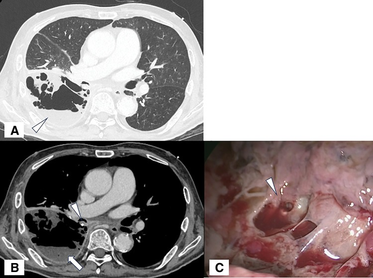
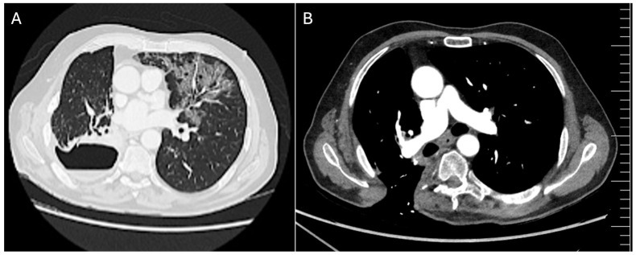
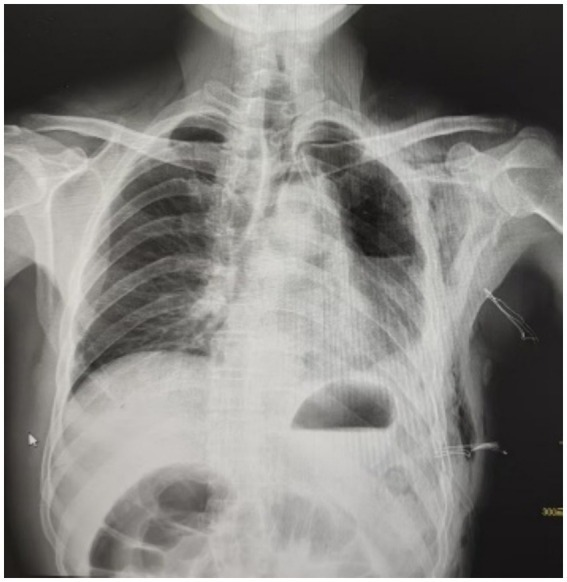
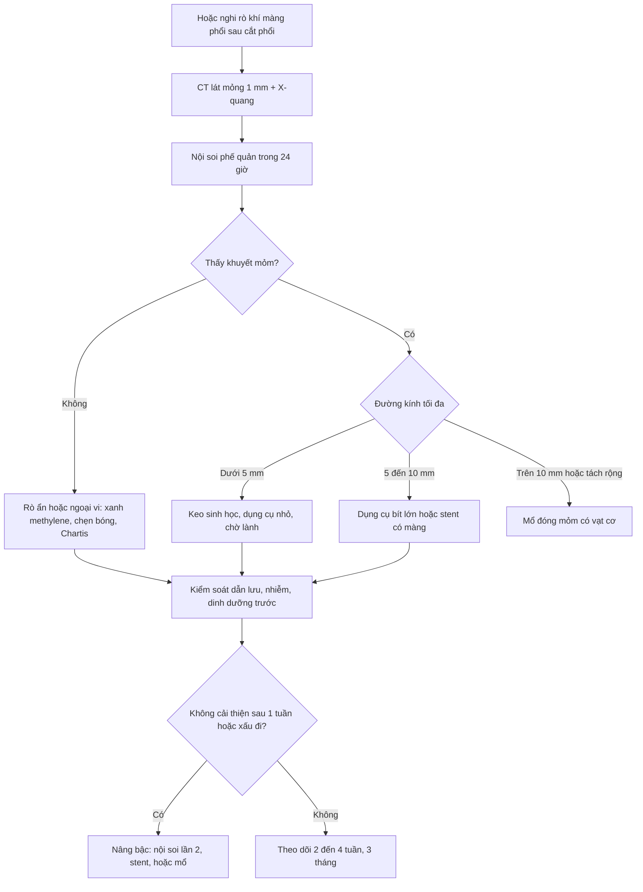
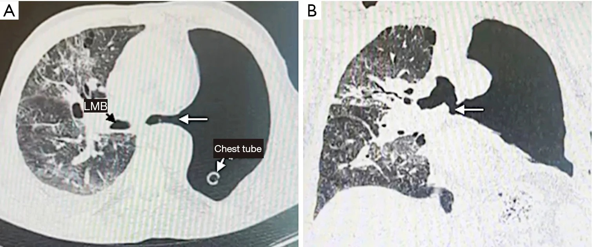
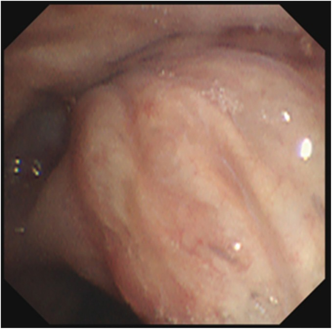

# 3108 — Vỡ mỏm phế quản sau cắt phổi: rò khí – màng phổi / Bronchial stump dehiscence & bronchopleural fistula

**Tags:** `pattern:ro` `pattern:ro-khi-manh-phoi` `pattern:tach-mom-phe-quan` `pattern:hoai-tu-mom` `pattern:tran-khi` `vung:phe-quan` `vung:mang-phoi` `vung:phoi` `protocol:CT-nguc-lat-mong` `protocol:noi-soi-phe-quan`

**Mức chắc chắn (certainty):** tổng hợp y văn (literature synthesis) — số liệu chính lấy từ **đồng thuận chuyên gia 2026 về rò khí – màng phổi sau cắt phổi** (29 khuyến cáo, Delphi 46 chuyên gia; PMC13559298), **tổng quan chiến lược mổ 2026** (PMC13559394), **ca lâm sàng có ảnh CC BY** (PMC13301846, PMC12500380, PMC12683161, PMC13190457) và **tổng quan về tràn mủ khoang màng phổi sau cắt phổi** (PMC13740711, chỉ dùng số liệu). Không có bệnh nhân của nhóm; mọi ngưỡng đều ghi kèm nguồn, chỗ chưa có số liệu ghi **"chưa rõ"**.

> **Câu chốt:** vỡ mỏm phế quản là **thất bại của quá trình liền vết khâu**, không phải "hở một lỗ trên phim". Ba con số quyết định: **(1)** tần suất **0,8–12,5% sau cắt toàn bộ phổi (pneumonectomy)** nhưng chỉ **0,44–4,0% sau cắt thùy (lobectomy)** — và **10,98% ở phổi phải so với 5,32% ở phổi trái** (P = 0,026); **(2)** thời điểm: **≤ 7 ngày = thể sớm (sớm nhất là lỗi kỹ thuật cơ học, phải tính mổ lại)**, **8–30 ngày = thể trung gian**, **> 30 ngày = thể muộn (thiếu máu – nhiễm – xơ)**; **(3)** **≥ 5 mm là ngưỡng đổi chiến lược** — dưới 5 mm có thể bít bằng keo/dụng cụ nhỏ, từ 5 mm phải tính dụng cụ bít lớn/đặt stent, **> 10 mm hoặc tách rộng thì gần như phải mổ**.

## 1. Tổng quan bệnh học – cơ chế hình ảnh: TẠI SAO mỏm phế quản vỡ

### 1.1 Mỏm phế quản liền nhờ gì — và vì sao nó dễ vỡ

- **Giải phẫu:** mỏm phế quản là **đoạn sụn – niêm mạc không có mạch máu nuôi trực tiếp tại chỗ**. Sụn phế quản **không có mao mạch**; niêm mạc sống nhờ **đám rối dưới niêm mạc** và các **nhánh động mạch phế quản** nhỏ đi theo vỏ phế quản. Khi phẫu tích rốn phổi, các nhánh này **bị cắt hoặc huyết khối hóa**, nên mỏm khâu chỉ sống nhờ **dòng thấm từ mô trung thất xung quanh** trong **7–10 ngày đầu** — đúng giai đoạn vết khâu yếu nhất.
- **Trình tự mô bệnh:** **thiếu máu → hoại tử niêm mạc/sụn → bung chỉ/đứt đường khâu → rò khí → khoang màng phổi nhiễm mủ**. Vì thế **thể sớm (≤ 7 ngày)** hầu như luôn là **thất bại cơ học** (chỉ bị tuột, mỏm quá ngắn, mô kẹp vào stapler), còn **thể muộn (> 30 ngày)** là **thiếu máu tiến triển + nhiễm trùng khoang màng phổi + xơ hóa** (PMC13559394).
- **TẠI SAO phổi phải nguy hiểm hơn:** **phế quản gốc phải ngắn** (< 15 mm ở người lớn), **không có phủ trung thất** như bên trái (bên trái được **động mạch chủ và thực quản** che phủ), và **mô quanh phế quản thưa** → mỏm khâu ít được nuôi dưỡng và dễ bị "trần trụi" trong khoang màng phổi. Đây là lý do **10,98% vs 5,32%** ở loạt 455 ca cắt toàn bộ phổi (P = 0,026; PMC13559394).
- **TẠI SAO cắt toàn bộ phổi nguy hiểm hơn cắt thùy:** mỏm **lớn hơn**, **khoang màng phổi rỗng lớn** tồn tại nhiều tháng, **áp lực trong khoang và nhiễm khuẩn** tác động trực tiếp lên mỏm, và **không còn nhu mô phổi che phủ**. Tần suất **0,8–12,5%** so với **0,44–4,0%** (PMC13559394).

### 1.2 Vật lý hình ảnh: vì sao CT thấy được — và vì sao CT hay bỏ sót

- **Khí = −1.000 HU**, **dịch màng phổi = 0–20 HU** (dịch nhiễm có thể **20–40 HU** do protein/tế bào), **mỡ −40 đến −120 HU**. Mức **khí – dịch** là mặt phẳng **ngang** vì khí nhẹ hơn dịch — trên CT axial, mặt phẳng này **luôn song song với mặt đất**, không phụ thuộc tư thế bệnh nhân.
- **Đường rò** là một **dải khí mỏng** chạy từ lòng phế quản ra khoang màng phổi; muốn thấy phải **lát mỏng ≤ 1–1,25 mm** và **đúng mặt phẳng chứa đường rò** (thường **chéo**, nên CT axial đơn thuần bỏ sót). Vì thế đồng thuận 2026 yêu cầu **CT lát mỏng/HRCT** cho mọi ca nghi ngờ, kèm **tái tạo coronal/sagittal** (PMC13559298).
- **Dấu hiệu gián tiếp mạnh hơn dấu hiệu trực tiếp:** sau cắt toàn bộ phổi, khoang màng phổi **bình thường có mức khí – dịch** rồi **dịch dâng dần** trong nhiều tuần. Vì vậy dấu hiệu gợi ý là **mức dịch TỤT xuống hoặc khí TĂNG lên sau giai đoạn ổn định**, **khí – dịch đổi mức sau khi ho** (dấu lâm sàng "air-fluid change after cough" trong đồng thuận), **khí mới quanh mỏm trung thất**, và **đông đặc/aspiration ở phổi đối diện** (PMC13559298; PMC13740711).
- **TẠI SAO có hơi trong mô mềm trung thất:** khí thoát từ mỏm đi theo **vỏ phế quản** vào trung thất (hiệu ứng Macklin) → **tràn khí trung thất**, **tràn khí dưới da**; đây là dấu **lan theo giải phẫu**, không phải "khí tự do" ngẫu nhiên.

### 1.3 Dịch tễ và kết cục (số liệu để quyết định độ hung hăng)

- **Tần suất:** cắt toàn bộ phổi **0,8–12,5%**; cắt thùy **0,44–4,0%**; **bung đường khâu (staple-line dehiscence) 1,5–3%** (PMC13559394; PMC13190457).
- **Đoàn hệ 4.794 ca cắt phổi giải phẫu liên tiếp:** **32 ca rò (0,67%)**; yếu tố dự báo độc lập: **nam**, **cắt thùy dưới phải**, **cắt hai thùy giữa – dưới phải**, **cắt toàn bộ phổi phải** (PMC13559394).
- **Tử vong:** trong đoàn hệ **514 ca cắt toàn bộ phổi**, tử vong 30 ngày **4,3%** toàn nhóm, và rò khí – màng phổi **làm tăng nguy cơ tử vong độc lập, HR = 5,128**; ở các loạt **rò sau cắt thùy**, tử vong **14–18,2%** (PMC13559394). Một đoàn hệ 2026 sau cắt thùy ghi tử vong 90 ngày **29,2% khi chỉ điều trị bảo tồn** so với **10,5% khi can thiệp nội soi/mổ** — nhưng đây là so sánh hồi cứu, **không chứng minh nhân quả** (chọn bệnh nhân nặng vào nhóm bảo tồn).
- **Chỉ số dinh dưỡng là yếu tố tiên lượng:** đồng thuận đặt ngưỡng can thiệp dinh dưỡng khi **NRS 2002 ≥ 3**, **sụt cân > 10%**, **BMI < 18,5 kg/m²**, hoặc **albumin < 30 g/L**; dữ liệu đa trung tâm 81 ca rò sau mổ xác định **hạ albumin và thiếu máu tại thời điểm rò là yếu tố dự báo độc lập của thất bại điều trị** (PMC13559298; PMC13559394).
- **Yếu tố nguy cơ khác:** **đái tháo đường**, **COPD**, **hút thuốc**, **tuổi cao**, **corticoid kéo dài**, **xạ trị ngực trước mổ**, **di chứng ung thư tại mỏm**, **thông khí cơ học sau mổ**, **mỏm quá dài/thiếu mạch**, **suy dinh dưỡng** (PMC13559394).

## 2. Mẫu hình + chẩn đoán phân biệt theo vị trí và thời gian (gamut)

### 2.1 Theo giải phẫu: trung tâm hay ngoại vi — câu hỏi đầu tiên

- **Rò trung tâm (central BPF):** thất bại liền **mỏm phế quản hoặc miệng nối** sau cắt phổi giải phẫu; **nhìn thấy trực tiếp bằng nội soi phế quản**; thường **lớn**, có **mủ khoang màng phổi**, và là thể **nguy hiểm nhất** (nguy cơ **sặc mủ sang phổi đối diện**, **ho ra máu do ăn mòn mạch lớn**).
- **Rò ngoại vi (peripheral BPF / alveolopleural fistula):** sau **cắt không giải phẫu (wedge/segment)** hoặc tổn thương nhu mô; **thường không thấy được bằng nội soi**, chẩn đoán bằng **rò khí kéo dài + bằng chứng màng phổi**; cần **định vị bằng bóng chẹn từng phân thùy (segmental balloon occlusion)**, **xanh methylene bơm qua ống dẫn lưu**, hoặc **Chartis/digital drainage** (PMC13559298).
- **Rò ống ngực – màng phổi / rò thực quản – màng phổi:** không phải rò khí; **dịch dưỡng chấp** (triglyceride > 110 mg/dL) hoặc **dịch tiêu hóa/pH thấp**, **không có đường khí từ phế quản**. Phân biệt bằng **tính chất dịch**, không bằng hình ảnh.

*CT ngực sau cắt thùy dưới phải (A: cửa sổ phổi; B: cửa sổ trung thất): **xẹp phổi + tràn dịch màng phổi**, và **đường rò từ mỏm phế quản** vào khoang màng phổi. Nguồn: Surg Case Rep 2025 (PMC12500380), CC BY 4.0.*

### 2.2 Theo thời gian: mốc thời gian đổi cả nguyên nhân lẫn cách xử trí

- **Sớm ≤ 7 ngày:** **thất bại cơ học** của đường khâu (tuột chỉ, mỏm ngắn, stapler bắn lệch, mô kẹp). Biểu hiện **đột ngột**: khó thở, **tràn khí – dịch cấp**, **ho ra nước**, **sốc** nếu căng thẳng. Đồng thuận khuyến cáo **bàn mổ sớm song song với nội soi**, không chờ (PMC13559298).
- **Trung gian 8–30 ngày:** **hoại tử thiếu máu** tiến triển + **nhiễm khoang màng phổi**; thường biểu hiện **sốt, mủ qua ống dẫn lưu, mức dịch tụt**.
- **Muộn > 30 ngày:** **mỏm xơ – nhiễm mạn – di chứng ung thư**, thường kèm **tràn mủ mạn (empyema)**; điều trị chủ yếu là **kiểm soát nhiễm + dẫn lưu + đóng mỏm có vạt cơ**, hoặc **mở cửa sổ lồng ngực (open-window thoracostomy)** rồi đóng thì hai (Clagett cải tiến).

### 2.3 Gamut chẩn đoán phân biệt (cái gì còn lại nếu KHÔNG phải rò)

| Bệnh cảnh | Vì sao dễ nhầm | Điểm khác cốt lõi |
|---|---|---|
| **Nhiễm khoang màng phổi đơn thuần (không rò)** | Cùng sốt, mủ, dịch tăng | **Không có khí mới** trong khoang kín, **không có đường rò**; nội soi mỏm **nguyên vẹn** |
| **Tràn khí màng phổi do dò khí nhu mô (air leak)** | Cùng rò khí kéo dài | Rò **từ nhu mô**, **không có khuyết mỏm**; khí ít, **không mủ**, **không tụt mức dịch** |
| **Hẹp miệng nối phế quản (bài 023)** | Cùng khó thở, cùng tiền sử ghép phổi | **Hẹp lòng**, **không có khí trong khoang màng phổi**; CT thì **thở ra** mới lộ |
| **Rò thực quản – màng phổi** | Cùng tràn dịch – khí, cùng sốt | **Dịch có pH thấp/thức ăn**, **không có đường khí từ phế quản**; nội soi thực quản chốt |
| **Áp-xe phổi hoại tử vỡ vào màng phổi** | Cùng mức khí – dịch | **Hang trong nhu mô** + mức khí – dịch **trong hang**, không phải trong khoang màng phổi tự do |
| **Rò phế quản – màng phổi do u ăn mòn** | Cùng rò khí | **Khối u/hoại tử trung tâm**, không có tiền sử cắt phổi; **nội soi thấy u** |

## 3. Bảng so sánh phân biệt (ma trận đối chiếu)

| Thực thể | Hình ảnh điển hình (CT lát mỏng) | Chốt vào (rule-in) | Chốt loại (rule-out) | Gợi ý xác nhận |
|---|---|---|---|---|
| **Rò trung tâm sớm ≤ 7 ngày** | **Khuyết mỏm phế quản** + khí trong khoang + mức khí – dịch mới; trung thất khí | **Khuyết thành phế quản thấy trên ≥ 2 mặt phẳng** + **thay đổi mức khí – dịch sau ho** | Mỏm liền, không khí mới → không phải rò sớm | Nội soi phế quản ≤ 24 giờ; mổ sớm nếu tách rộng |
| **Rò trung tâm muộn > 30 ngày** | **Mỏm co rúm, xơ, mất liên tục**, khoang màng phổi **dày thành, vôi hóa**, mủ | **Mủ qua ống dẫn lưu + khuyết mỏm + khoang màng phổi mạn** | Khoang sạch, không khí, không mủ → không rò | Nội soi + cấy mủ; CT có cản quang đánh giá vạt cơ |
| **Rò ngoại vi / air leak kéo dài** | **Không thấy khuyết mỏm**; khí **quanh vùng khâu nhu mô**, ít dịch | **Rò khí > 5 ngày, giảm dần**, **không mủ**, **không tụt mức dịch** | Có khuyết mỏm + mức dịch tụt → rò trung tâm | Bóng chẹn phân thùy; Chartis; xanh methylene |
| **Nhiễm khoang màng phổi không rò** | Dịch **vách hóa**, **khí trong ổ kín** (vi khuẩn sinh hơi), không đường rò | **Cấy mủ dương tính**, **mỏm nguyên vẹn** | Khí di chuyển theo tư thế + đường rò → rò thật | Nội soi mỏm; theo dõi mức dịch |
| **Rò thực quản – màng phổi** | Tràn dịch – khí **bên trái**, trung thất khí, **không khuyết mỏm** | **Dịch pH < 6 hoặc có thức ăn**, nội soi thực quản thấy lỗ | Đường khí từ phế quản → rò phế quản | Nội soi tiêu hóa; nuốt cản quang |
| **Hẹp miệng nối phế quản (bài 023)** | **Giảm > 50% diện tích lòng** tại miệng nối, không khí màng phổi | **Hẹp tại miệng nối + không rò khí** | Khuyết thành + khí khoang → rò | Nội soi + CT 2 thì hít vào – thở ra |

*CT ngực sau cắt thùy trên bệnh nhân ung thư biểu mô tuyến: mức khí – dịch trong khoang màng phổi phải + tổn thương nhiễm trùng phổi đối diện. Ảnh nguyên bản, không crop. Nguồn: J Clin Med 2026 (PMC13301846), CC BY 4.0.*

## 4. Protocol chụp + phân tầng và ngưỡng xử trí

### 4.1 Protocol hình ảnh và xác nhận

- **X-quang ngực tại giường:** dấu hiệu **mức dịch tụt**, **khí tăng**, **tràn khí – dịch mới**, **khí trung thất**. Nhạy thấp, **không loại trừ** — dùng để theo dõi hàng ngày ở bệnh nhân có ống dẫn lưu.
- **CT ngực lát mỏng ≤ 1–1,25 mm, không cản quang là đủ** để tìm khuyết mỏm + đường rò + mức khí – dịch; **cản quang tĩnh mạch** khi cần đánh giá **mủ vách hóa, vạt cơ, mạch lớn bị ăn mòn**. Tái tạo **coronal + sagittal** và **MIP** dọc phế quản.
- **Nội soi phế quản (bronchoscopy) = tiêu chuẩn vàng**: thấy **khuyết mỏm**, **chỉ khâu lộ**, **mủ từ lòng phế quản**, đánh giá **kích thước lỗ (mm)**. Đồng thuận 2026 chia **nhìn thấy (visible) vs ẩn (occult)** ngay lần soi đầu — quyết định toàn bộ chiến lược.

*X-quang ngực lần nhập viện thứ hai sau cắt thùy trên trái: **xẹp 40% phổi trái, tràn khí + tràn dịch màng phổi**. X-quang chỉ gợi ý — chẩn đoán vẫn cần CT lát mỏng + nội soi. Nguồn: Front Med 2026 (PMC13190457), CC BY 4.0.*
- **Định vị khi ẩn/ngoại vi:** bơm **xanh methylene pha loãng qua ống dẫn lưu** dưới nội soi; **chẹn bóng từng phân thùy** xem rò khí giảm; **Chartis/digital drainage**; **thoracoscopy** khi cần (PMC13559298).

### 4.2 Ba trục phân loại và ngưỡng (đồng thuận 2026)

- **Trục 1 — vị trí:** **trung tâm** (mỏm/miệng nối, soi thấy) vs **ngoại vi** (nhu mô, thường ẩn).
- **Trục 2 — kích thước tối đa:** **nhỏ < 5 mm** vs **lớn ≥ 5 mm**; **> 10 mm hoặc tách rộng** là vùng **không thể bít bằng keo**, phải **stent có màng hoặc mổ**.
- **Trục 3 — thời gian:** **sớm ≤ 7 ngày**, **trung gian 8–30 ngày**, **muộn > 30 ngày**.

### 4.3 Ngưỡng thất bại của điều trị bảo tồn (khi nào phải đổi chiến lược)

Đồng thuận 2026 định nghĩa **bảo tồn thất bại** khi có **một trong các điều kiện** (PMC13559298):
- **Rò khí kéo dài ≥ 1 tuần** không có xu hướng giảm rõ rệt dù đã dẫn lưu đủ và điều trị chuẩn.
- **Hình ảnh sau ~1 tuần**: khoang màng phổi **không nhỏ đi**, **to lên**, hoặc **vách hóa**.
- **Dịch dẫn lưu vẫn mủ**, **sốt kéo dài**, **CRP/BC không giảm**, **cấy còn dương tính**.
- **Bất kỳ dấu hiệu nhiễm khuẩn huyết/suy hô hấp** → nâng bậc **ngay**, không chờ mốc thời gian.

### 4.4 Điều trị theo tầng (kèm kết quả định lượng)

- **Bước 0 — luôn làm trước khi đóng:** **dẫn lưu khoang màng phổi đủ**, **kiểm soát nhiễm** (cấy mủ + kháng sinh theo kháng sinh đồ, xem lại sau **48–72 giờ**), **nuôi dưỡng** (ngưỡng như mục 1.3), **hỗ trợ hô hấp**.
- **Rò nhỏ < 5 mm:** **keo fibrin/dung dịch bít**, **dụng cụ nhỏ**, hoặc **chờ lành**. Tỷ lệ thành công bít qua nội soi **73,1–90%** ở nhóm chọn lọc (PMC13559394).
- **Rò ≥ 5 mm, trung tâm:** **dụng cụ bít (Amplatzer) hoặc stent có màng**. Meta-phân tích **van nội phế quản một chiều (endobronchial valve)** cho rò khí dai dẳng: **thành công gộp 82%**, **biến chứng 9,1%** (PMC13559298). Loạt **83 dụng cụ Amplatzer ở 72 bệnh nhân**: **không tử vong/thủ thuật**, **8,4% phải tháo dụng cụ trong 6 tháng**, nhưng **tử vong liên quan rò 15,3%** trong nhóm nguy cơ cao (PMC13559394). **Stent có màng** ở mỏm cắt toàn bộ phổi: đóng kín ngay, **tháo stent sau 71–123 ngày** (PMC13559394).
- **Rò > 10 mm, tách rộng, hoại tử bờ, nhiễm không kiểm soát:** **mổ đóng mỏm** ± **vạt cơ có cuống** (cơ liên sườn, cơ ngực, mỡ màng tim, mạc treo lớn). Đóng mỏm thì đầu **thành công 59% (23/39)** trong loạt hiện đại, mổ **trung vị 28 ngày** sau mổ đầu; **cắt toàn bộ phổi bổ sung** sau cắt thùy có tử vong **8,3% (30 ngày) và 16,6% (90 ngày)** (PMC13559394).
- **Rò muộn + tràn mủ mạn:** **mở cửa sổ lồng ngực** (open-window thoracostomy) → kiểm soát nhiễm → **đóng thì hai kiểu Clagett** với **vạt cơ**. Loạt Clagett cải tiến **84 bệnh nhân (55 có rò)**: **tử vong mổ 7,1%**, **81% lành thành ngực không tái nhiễm**; loạt **47 ca** dùng **vách cơ + bít khoang**: **93,6% khỏi** (PMC13559394).
- **Dự phòng:** **che phủ mỏm có chọn lọc** (vạt cơ liên sườn/mỡ màng tim) cho **cắt toàn bộ phổi phải, xạ trị tân hỗ trợ, di chứng u tại mỏm, đái tháo đường**; meta-phân tích cho thấy nhóm được che phủ **6,3%** so với nhóm không che phủ **4,0%** — nhưng đây là **thiên lệch chọn bệnh nhân** (nhóm nguy cơ cao mới được che phủ), không phải bằng chứng che phủ có hại (PMC13559394).

## 5. Biến thể bình thường và cạm bẫy

- **Mức khí – dịch sau cắt toàn bộ phổi là BÌNH THƯỜNG** trong những tuần đầu: khoang chứa khí rồi dịch dâng dần. Vì thế **không đọc "có mức khí – dịch" là rò** — phải so **chuỗi phim** và tìm **mức dịch tụt/khí tăng** sau giai đoạn ổn định.
- **Khí trong khoang màng phổi 1–3 ngày đầu sau mổ** là tàn lưu bình thường; **khí mới xuất hiện sau ngày 5–7** mới đáng lo.
- **Stapler gây giả ảnh kim loại** che mất mỏm trên CT: dùng **lát mỏng + tái tạo đa mặt phẳng**, hoặc **nội soi** thay vì cố đọc trên axial.
- **Satisfaction of search:** thấy **tràn dịch/đông đặc phổi đối diện** rồi dừng lại — đây có thể là **hậu quả của sặc mủ từ rò**, không phải "viêm phổi mới"; luôn quay lại **mỏm phế quản**.
- **Rò khí qua ống dẫn lưu bị bịt kín** (ống gập, bịt đầu) làm **mất dấu rò khí** — kiểm tra ống trước khi kết luận "đã lành".
- **Bong vảy fibrin/niêm mạc trên mỏm** trông như "khuyết mỏm" khi soi — cần **đánh giá kích thước thật** và **bơm khí/nghiệm pháp** trước khi can thiệp.
- **Đừng nhầm "ho ra chỉ khâu"** với rò thật: bệnh nhân có thể khạc ra **vật liệu khâu** khi đường khâu bung, nhưng **rò khí chỉ xác định bằng nội soi/khí khoang màng phổi**.

## 6. Tự lượng giá — Blind Quiz

**Ca 1 — Nam 65 tuổi, cắt thùy trên phổi phải vì ung thư 12 ngày trước, nay sốt 38,8°C, khó thở, dịch dẫn lưu đục và ít hơn hẳn hôm qua. Nhìn CT trước, mô tả trước khi mở đáp án.**

- Gợi ý lâm sàng: sau cắt thùy, **sốt + dịch mủ + lượng dịch tụt**.
- Câu hỏi: (1) Dấu hiệu chính trên CT? (2) Ba chẩn đoán phân biệt? (3) Dấu hiệu nào chốt chẩn đoán?

<b>Bấm để hiện đáp án (findings + chẩn đoán)</b>

- **Dấu hiệu:** **mức khí – dịch** trong khoang màng phổi phải + **đông đặc/nốt viêm phổi ở phổi đối diện** (dấu sặc mủ). Khoang màng phổi không còn "đầy dịch" như trước → **mức dịch tụt**.
- **Chẩn đoán:** **rò khí – màng phổi trung tâm sau cắt thùy** — dịch tụt vì dịch thoát qua đường rò vào phế quản, đồng thời mủ tràn sang phổi đối diện gây đông đặc.
- **Chốt:** **nội soi phế quản** thấy khuyết mỏm; đo **đường kính lỗ (mm)** để chọn tầng điều trị.
- **Phản biện:** ảnh này từ ca **rò muộn sau cắt thùy có nhiễm Aspergillus** (PMC13301846) — không điển hình cho rò sớm do lỗi kỹ thuật, nhưng **hình thái khoang – mức khí dịch – tổn thương đối diện** giống nhau; nguyên nhân nhiễm nấm là chi tiết của ca, không phải quy luật.
- Nguồn: J Clin Med 2026 (PMC13301846), CC BY 4.0.

**Ca 2 — Bệnh nhân cắt toàn bộ phổi trái 9 ngày trước, đau ngực, tràn khí dưới da. CT có 2 mặt phẳng dưới đây.**

- Gợi ý: **tràn khí dưới da** sau cắt toàn bộ phổi = khí đi theo vỏ phế quản vào trung thất.
- Câu hỏi: (1) Vị trí khuyết? (2) Vì sao đây là thể "sớm" và nguy hiểm? (3) Hai lựa chọn điều trị đầu tay?

<b>Bấm để hiện đáp án (findings + chẩn đoán)</b>

- **Dấu hiệu:** **khuyết/thành mỏm phế quản gốc trái** với **đường rò** nối mỏm vào khoang màng phổi (mũi tên), thấy rõ trên **cả axial và coronal**; kèm thâm nhiễm viêm phổi đối diện.
- **Chẩn đoán:** **tách mỏm phế quản gốc trái ngày thứ 9** — thể **trung gian (8–30 ngày)**, cơ chế **thiếu máu/hoại tử mỏm** hơn là lỗi kỹ thuật thuần túy.
- **Vì sao nguy hiểm:** mỏm gốc lớn + khoang màng phổi rộng → **sặc mủ sang phổi đối diện**, **suy hô hấp**, nguy cơ **ăn mòn mạch lớn**; tử vong trong loạt rò sau cắt toàn bộ phổi tăng **HR 5,128**.
- **Điều trị:** **dẫn lưu + kháng sinh + dinh dưỡng**, rồi **bít bằng stent có màng/dụng cụ** hoặc **mổ đóng mỏm có vạt cơ**; nếu tách rộng/hoại tử bờ → **mổ sớm**.
- Nguồn: J Thorac Dis 2026 (PMC13559394), **CC BY-NC-ND 4.0** — ảnh **nguyên bản, không crop, không ghép**.

**Ca 3 — Bệnh nhân cắt thùy trên trái, rò khí kéo dài 3 tuần, không sốt, dịch trong. Nội soi phế quản 60 ngày sau mổ:**

<b>Bấm để hiện đáp án</b>

- **Dấu hiệu:** niêm mạc mỏm **hồng, không hoại tử**, **lỗ rò gần như đã đóng**; không còn rò khí.
- **Chẩn đoán:** **rò khí – màng phổi tự đóng** — có thể gặp dù **tách toàn bộ mỏm**, nhưng **hiếm**; điều trị chủ yếu là **dẫn lưu + dinh dưỡng + kiên nhẫn**.
- **Bài học:** **không phải mọi rò đều phải mổ**: rò nhỏ, bệnh nhân ổn định, không nhiễm → **theo dõi có mốc thời gian** (đồng thuận: đánh giá lại sau **2–4 tuần**).
- Nguồn: Surg Case Rep 2025 (PMC12683161), CC BY 4.0.

## Bài liên quan chéo

- [001 – Tổng quan hệ Ngực](../001-tong-quan-he-nguc/lesson.md)
- [023 – Hẹp miệng nối phế quản sau ghép phổi](../023-hep-mieng-noi-phe-quan-sau-ghep-phoi/lesson.md)
- [040 – Tràn dịch màng phổi](../040-tran-dich-mang-phoi/lesson.md) (tràn mủ, vách hóa)
- [049 – Theo dõi sau cắt thùy phổi bẩm sinh ở trẻ](../049-theo-doi-sau-cat-thuy-phoi-bam-sinh/lesson.md)
- [086 – Rò động mạch chủ – phế quản](../086-ro-dong-mach-chu-phe-quan/lesson.md) (ho ra máu, ăn mòn mạch lớn)
- [098 – Barotrauma & tràn khí màng phổi áp lực](../098-barotrauma-tran-khi-ap-luc-tho-may/lesson.md)
- [3083 – Chấn thương khí phế quản do lực tù](../3083-chan-thuong-khi-phe-quan-do-luc-tu/lesson.md) (rò khí sau chấn thương, không do mổ)

> Không dùng để chẩn đoán độc lập khi chưa có người hướng dẫn.
