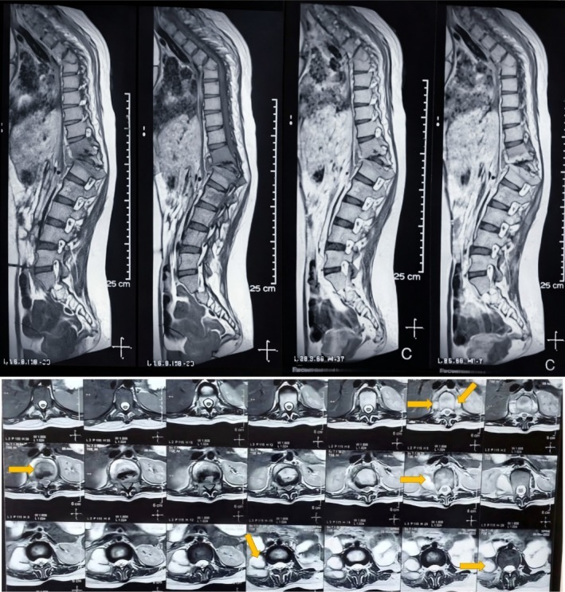
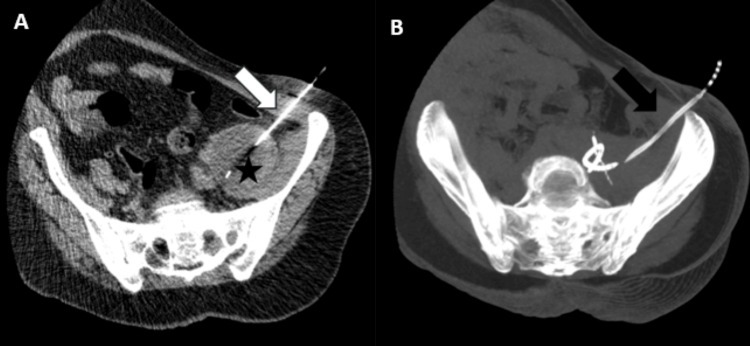
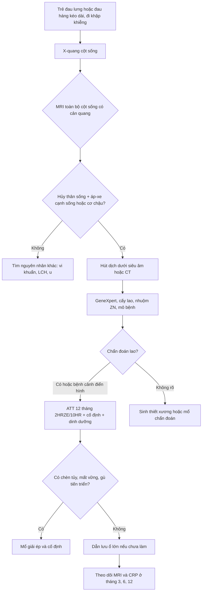
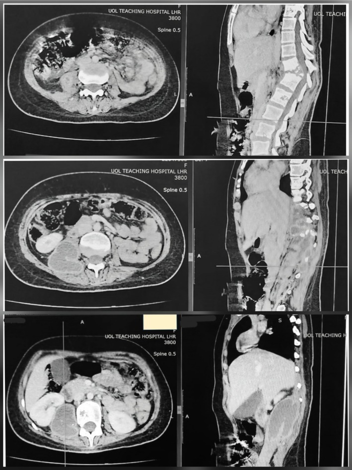
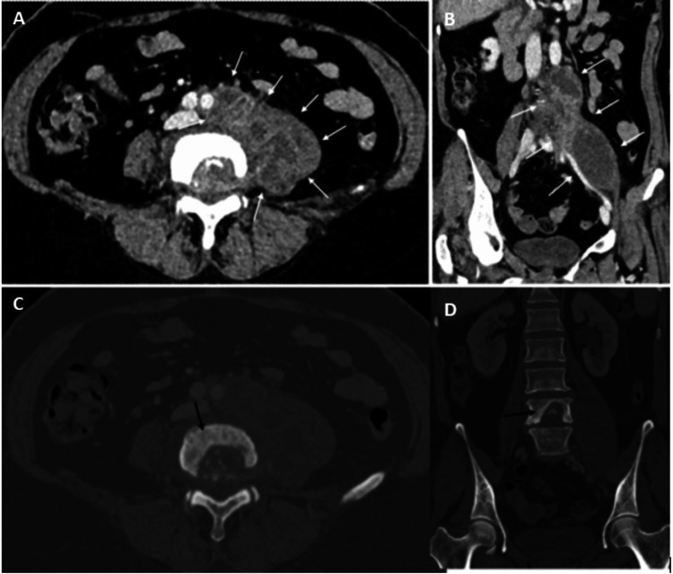

# 3109 — Lao cột sống (Pott) với áp-xe cơ chậu lạnh ở trẻ / Tuberculous spondylitis with cold psoas abscess

**Tags:** `pattern:ap-xe` `pattern:ap-xe-lanh` `pattern:hoai-tu-xuong` `pattern:phu-tuy-xuong` `pattern:mat-duong-vien-co-chau` `pattern:gibbus` `vung:cot-song` `vung:co-chau` `vung:sau-phuc-mac` `protocol:MRI-cot-song` `protocol:CT-co-xuong` `protocol:PCR-lao`

**Mức chắc chắn (certainty):** tổng hợp y văn (literature synthesis) — số liệu chính từ **tổng quan hệ thống 64 ca Pott ở trẻ 0–17 tuổi** (PMC13610089), **loạt 37 trẻ lao cột sống** (PMC3031051), **nghiên cứu 100 ca lao cột sống theo dõi bằng MRI** (PMC12720259), **loạt 28 trẻ áp-xe cơ chậu 20 năm** (PMC13621494, chỉ dùng số liệu nền) và **các ca có ảnh CC BY** (PMC12928113, PMC12720216, PMC12822259). Bài **không lặp lại** phần áp-xe cơ chậu chung (bài 3081) mà tập trung vào **thể lao** — khác tác nhân, khác thời gian điều trị, khác ngưỡng mổ.

> **Câu chốt:** áp-xe cơ chậu ở trẻ **có thể là dấu hiệu ĐẦU TIÊN** của lao cột sống, và thể lao khác vi khuẩn thường ở **bốn điểm quyết định**: **(1)** bệnh cảnh **"lạnh"** — **không sốt** hoặc sốt nhẹ, không nóng đỏ, nhưng **đau lưng/đi khập khiễng kéo dài hàng tháng** (trễ chẩn đoán trung bình **141,4 ngày**); **(2)** hình ảnh **hủy thân sống + áp-xe cạnh sống/cơ chậu RẤT lớn so với mức hủy xương**, **đĩa đệm còn tương đối** ở giai đoạn sớm; **(3)** chẩn đoán vi sinh bằng **GeneXpert/PCR trên dịch hút** (dương tính **79,3%** trong loạt trẻ) — **cấy lao chậm 4–8 tuần**, không chờ; **(4)** điều trị **ATT 12 tháng (2HRZE/10HR)** + **dẫn lưu ổ lớn**, và **tuyệt đối không ngừng thuốc ở tháng 6 chỉ vì trẻ hết đau** — MRI chỉ lành hoàn toàn **30% ở tháng 6** nhưng **80% ở tháng 12**.

## 1. Tổng quan bệnh học – cơ chế hình ảnh: TẠI SAO lao "lạnh" và tại sao đĩa đệm không mất sớm

### 1.1 Dịch tễ và đường lan

- **Lao xương khớp chiếm 10–20% lao ngoài phổi**; **lao cột sống chiếm ~50% lao xương** — thể hay gặp nhất ở trẻ và người trẻ (PMC3031051; PMC13610089).
- **Đường lan:** **lan theo máu qua đám rối tĩnh mạch Batson** (không có van) và **động mạch phân đoạn** → tổn thương bắt đầu ở **thân sống trước – sát đĩa đệm**, lan **dưới dây chằng dọc trước/sau (subligamentous spread)** sang thân sống kề bên, rồi **ra mô cạnh sống**. Từ đó mủ đi theo **bao cơ chậu (psoas fascia)** xuống **hố chậu, bẹn, khớp háng** — vì thế trẻ có thể đến khám vì **khối bẹn/đau háng**, không phải đau lưng.
- **TẠI SAO gọi là "áp-xe lạnh" (cold abscess):** mủ lao **ít men tiêu protein và ít phản ứng viêm cấp**, nên **không nóng, không đỏ, không đau dữ dội**, thành ổ **dày, xơ**, dịch **đặc, hoại tử bã đậu (caseous)**. Vì vậy **không có sốt cao không loại trừ lao**: trong loạt 28 trẻ áp-xe cơ chậu, **sốt chỉ gặp 16,7% ca nguyên phát** so với **54,5% ca thứ phát** (PMC13621494).
- **TẠI SAO trẻ chậm chẩn đoán:** đau lưng ở trẻ **khó khai thác**, hay bị quy cho **chấn thương nhẹ, vẹo tư thế, tăng trưởng**; trong 64 ca trẻ, **trễ chẩn đoán trung bình 141,4 ngày** (khoảng 4,7 tháng) (PMC13610089). Loạt 37 trẻ khác ghi **trung vị 9 tháng** từ lúc có triệu chứng đến lúc nhập viện (PMC3031051).

### 1.2 Vật lý hình ảnh: vì sao MRI là chìa khóa, X-quang dễ bỏ sót

- **X-quang:** chỉ thấy khi đã mất **30–50% khoáng chất thân sống** → **hẹp khe đĩa, lõm thân sống, gù (gibbus), bóng cơ chậu mất hoặc phồng**. Trong loạt trẻ, **X-quang được dùng 81%** nhưng **không đủ để chẩn đoán sớm**; X-quang bình thường **không loại trừ** (PMC13610089).
- **CT:** thấy rõ **hủy xương, mảnh xương chết (sequestrum), vôi hóa trong ổ mủ**, và **ổ dịch cạnh sống/cơ chậu 0–20 HU có viền ngấm thuốc**; là đường dẫn **sinh thiết/dẫn lưu**. Nhưng CT **kém nhạy với phù tủy xương và lan ngoài màng cứng**.
- **MRI (chuỗi xung chuẩn):** **T1W giảm tín hiệu** (thay tủy mỡ bằng mô viêm/dịch), **T2W/STIR tăng tín hiệu** ở **thân sống + đĩa đệm + mô cạnh sống**; **ổ mủ T2 rất sáng** (nước tự do), **viền ngấm thuốc** sau tiêm; **DWI hạn chế khuếch tán** (sáng DWI, tối ADC) do dịch **nhớt, giàu tế bào**. MRI thấy **lan ngoài màng cứng, chèn tủy, phù tủy xương, áp-xe cơ chậu** — những thứ quyết định **có mổ hay không**.
- **TẠI SAO đĩa đệm còn tương đối ở giai đoạn sớm (khác vi khuẩn thường):** vi khuẩn sinh mủ (Staphylococcus) tiết **protease phân hủy đĩa** nhanh; **Mycobacterium tuberculosis không có men này**, lan **dưới dây chằng** và phá xương **chậm** → hình ảnh kinh điển là **hủy thân sống nhiều, hẹp đĩa đệm ít** ở giai đoạn đầu, đĩa đệm mất **muộn**. Đây là điểm phân biệt sống còn trên MRI (mục 3).
- **TẠI SAO vôi hóa gặp ở thể mạn:** hoại tử bã đậu lâu ngày **lắng đọng calci** trong ổ mủ xơ → **nốt vôi hóa trong áp-xe cạnh sống/cơ chậu**; gặp ở **thể tiến triển chậm**, không phải dấu hiệu đặc hiệu.

### 1.3 Số liệu định lượng để tư vấn và theo dõi

- **64 ca trẻ (0–17 tuổi, 2000–2025):** tuổi trung bình **8,58** (0,7–17), trung vị **10**; **đau lưng 79,7%**, **đi lại khó 68,4%**, **sốt 55%**, **sụt cân 55,8%**; **cột sống ngực 60,3%**; **trễ chẩn đoán trung bình 141,4 ngày**; **58% phải mổ** (dẫn lưu áp-xe cạnh sống là phổ biến nhất); **hồi phục lâm sàng 96,9%**; **dị cảm 46%**, **yếu vận động 68,4%**, **di chứng vận động vĩnh viễn 8,1%**, **gù tồn tại 14,5%** (PMC13610089).
- **Hiệu suất xét nghiệm ở trẻ:** **PCR/GeneXpert 79,3%**, **cấy lao 76,9%**, **nhuộm Ziehl–Neelsen 56,5%** (PMC13610089). Ở loạt 100 ca người lớn: **mô bệnh học 50%**, **GeneXpert 48%**, **soi 30%**, **cấy 28%** — cho thấy **không xét nghiệm nào một mình đủ**, phải **kết hợp mô bệnh + PCR + cấy** (PMC12720259).
- **Thời gian lành trên MRI (100 ca):** **lành hoàn toàn 30% ở tháng 6**, **80% ở tháng 12**, hồi phục lâm sàng **89%** / huyết học **82%** / hình ảnh **88%** ở tháng 18 (PMC12720259). Đây là cơ sở để **không rút ngắn ATT xuống 6 tháng** ở lao cột sống.
- **Liều và thời gian (WHO 2025, dùng trong ca trẻ):** **H 10 – R 15 – Z 35 – E 20 mg/kg/ngày**, **2 tháng HRZE + 10 tháng HR = 12 tháng** cho thể **xương khớp và thần kinh trung ương** (PMC13610089). **ATS/CDC** cũng khuyến cáo **tối thiểu 12 tháng** cho lao xương khớp (PMC3031051).

## 2. Mẫu hình + chẩn đoán phân biệt theo vị trí (gamut)

### 2.1 Theo vị trí tổn thương

- **Thân sống trước (điển hình):** hủy xương + **phù tủy**, lan **dưới dây chằng** sang thân kề; **gù** khi nhiều tầng.
- **Cạnh sống (paravertebral):** ổ mủ hình **thoi** dọc hai bên sống, **"tổ chim"** trên CT; có thể **vôi hóa**.
- **Cơ chậu (psoas):** ổ mủ **dọc cơ**, lan xuống **hố chậu/bẹn**; trẻ **đau háng, đi khập khiễng**, dễ nhầm **viêm khớp háng/viêm ruột thừa** (PMC12720216).
- **Ngoài màng cứng (epidural):** chèn tủy → **yếu chi, rối loạn cơ vòng**; là **chỉ định mổ/giải ép**.
- **Lan vào trung thất/phổi:** thể **ngực** có áp-xe trung thất, **khó thở**.
- **Đa ổ:** **lao cột sống nhiều tầng** (ca PMC12928113: **D5–D12**), gặp ở trẻ suy dinh dưỡng/BCG kém.

### 2.2 Gamut phân biệt (theo hình thái và bối cảnh)

| Bệnh cảnh | Điểm giống | Điểm khác cốt lõi |
|---|---|---|
| **Viêm đĩa đệm – thân sống do vi khuẩn (pyogenic)** | Hủy thân sống, phù tủy, ổ cạnh sống | **Sốt cao, khởi phát ngày–tuần**, **phá đĩa đệm SỚM**, ổ mủ **nhỏ**, **không vôi hóa** (bài 6163) |
| **Brucella spondylitis** | Hủy thân sống, đau lưng mạn | Vùng **thắt lưng**, **mọc xương mỏ vẹt (parrot beak)**, **ít phá hủy**, tiền sử **chăn nuôi/sữa chưa tiệt trùng** |
| **U hạt bào Langerhans (vertebra plana)** | Trẻ, **thân sống xẹp phẳng**, đau lưng | **Không có ổ mủ cạnh sống**, **đĩa đệm nguyên**, xẹp **đối xứng** như đồng xu |
| **Di căn u nguyên bào thần kinh** | Trẻ, đau lưng, khối cạnh sống | **Khối đặc**, **vôi hóa thô**, tổn thương **nhiều xương**, **không có mủ**; catecholamine niệu |
| **Áp-xe cơ chậu do vi khuẩn (bài 3081)** | Đau háng, đi khập khiễng, ổ dịch trong cơ chậu | **Sốt cao hơn**, **Staphylococcus**, **không hủy thân sống** (trừ khi lan từ sống), đáp ứng kháng sinh thường |
| **Viêm khớp háng nhiễm khuẩn** | Đau háng, từ chối tì chân | Ổ dịch **trong khớp**, **hẹp khe khớp**, không có ổ trong cơ chậu |
| **Viêm ruột thừa/áp-xe ruột thừa** | Đau bụng dưới phải, sốt nhẹ | Ổ dịch **quanh manh tràng**, **không hủy thân sống**; nhưng **áp-xe cơ chậu có thể bắt chước viêm ruột thừa** (PMC12720216) |

## 3. Bảng so sánh phân biệt (ma trận đối chiếu)

| Thực thể | Hình ảnh điển hình (MRI/CT) | Chốt vào (rule-in) | Chốt loại (rule-out) | Gợi ý xác nhận |
|---|---|---|---|---|
| **Lao cột sống (Pott) trẻ** | **Hủy thân sống trước**, phù tủy lan dưới dây chằng, **đĩa đệm còn tương đối**, **áp-xe cạnh sống/cơ chậu lớn**, ± vôi hóa | **Áp-xe lớn không tương xứng với hủy xương + tiền sử tiếp xúc/lao phổi + GeneXpert dương** | **Sốt cao cấp tính + phá đĩa đệm sớm** → nghĩ vi khuẩn thường | **GeneXpert trên dịch hút/sinh thiết**, cấy lao, mô bệnh (u hạt bã đậu) |
| **Viêm đĩa đệm – thân sống do vi khuẩn** | **Hẹp đĩa đệm sớm**, phù tủy, ổ mủ nhỏ, **ngấm thuốc mạnh**, không vôi hóa | **Sốt cao + đau cấp + cấy máu/dịch dương tính** | **Tiến triển chậm hàng tháng + ổ mủ lớn + đĩa đệm còn** → nghĩ lao | Cấy máu, cấy dịch đĩa; kháng sinh theo kháng sinh đồ |
| **Brucella** | Thắt lưng, **mọc xương mỏ vẹt**, hủy xương ít, đĩa đệm tổn thương muộn | **Tiền sử chăn nuôi + huyết thanh Brucella dương** | **Áp-xe cơ chậu lớn, hủy nhiều tầng** → không điển hình Brucella | Huyết thanh học, cấy Brucella |
| **U hạt bào Langerhans** | **Vertebra plana**, đĩa đệm nguyên, **không ổ mủ** | **Xẹp phẳng đối xứng một thân sống + không viêm** | **Có ổ mủ cạnh sống/cơ chậu** → không phải LCH đơn thuần | Mô bệnh (tế bào Langerhans, CD1a), PET |
| **Áp-xe cơ chậu đơn thuần (bài 3081)** | Ổ dịch trong cơ chậu **có viền**, cơ to, mất dải mỡ | **Ổ dịch + cơ chậu to + không hủy xương** | **Hủy thân sống + đĩa tổn thương** → phải tìm lao cột sống | Siêu âm/CT dẫn lưu + cấy; MRI cột sống khi nghi |
| **Di căn u nguyên bào thần kinh** | Khối **đặc** cạnh sống, vôi hóa thô, nhiều ổ xương | **Khối đặc + catecholamine niệu + tuổi nhỏ** | **Ổ dịch có viền, không có khối đặc** → không phải u | MIBG, catecholamine, sinh thiết |

*MRI cột sống ở trẻ bị Pott: **hủy thân sống** + **tổn thương mô mềm cạnh sống**, phù hợp lao cột sống. Nguồn: Clin Case Rep 2026 (PMC12928113), CC BY 4.0.*

## 4. Protocol chụp + phân tầng điều trị

### 4.1 Trình tự chẩn đoán (không chờ cấy)

- **Bước 1 — X-quang cột sống thẳng/nghiêng:** tìm **hẹp khe đĩa, lõm thân sống, gù, bóng cơ chậu mất**. **Bình thường không loại trừ.**
- **Bước 2 — MRI toàn bộ cột sống có cản quang** (T1W, T2W/STIR, T1W fat-sat sau tiêm, ± DWI): xác định **số tầng, mức chèn tủy, ổ cạnh sống/cơ chậu, lan ngoài màng cứng**. Đây là **chuẩn chẩn đoán hình ảnh** và là **cơ sở theo dõi ATT**.
- **Bước 3 — CT có cản quang** khi cần **đánh giá xương chi tiết, vôi hóa, mảnh xương chết**, hoặc **lập kế hoạch dẫn lưu/sinh thiết**.
- **Bước 4 — lấy bệnh phẩm (bắt buộc trước khi kết luận):** **hút dịch ổ cạnh sống/cơ chậu dưới siêu âm hoặc CT** → gửi **GeneXpert MTB/RIF**, **cấy lao**, **nhuộm ZN**, **mô bệnh học**. GeneXpert dương tính **79,3%** trong loạt trẻ; **cấy lao cần 4–8 tuần** — **không chờ cấy mới điều trị** khi bệnh cảnh điển hình.
- **Xét nghiệm kèm:** **ESR/CRP** (theo dõi đáp ứng), **HIV**, **lao phổi (X-quang/CT ngực, GeneXpert đờm/dịch dạ dày)**, **tiếp xúc nguồn lây**, **đánh giá dinh dưỡng**.

### 4.2 Phân tầng điều trị

- **Luôn có:** **ATT 12 tháng** theo WHO 2025 (**2HRZE/10HR**; liều theo cân nặng ở mục 1.3) + **bổ sung pyridoxine** khi dùng isoniazid + **nẹp/cố định cột sống** khi đau nhiều hoặc mất vững + **dinh dưỡng**.
- **Dẫn lưu ổ mủ (không mổ hở):** chỉ định khi **ổ lớn (≥ 3 cm theo ngưỡng áp-xe cơ chậu bài 3081), ổ chèn ép, đau nhiều, không đáp ứng sau 2–4 tuần, hoặc cần chẩn đoán vi sinh**. Dùng **pigtail dưới siêu âm/CT** — ít xâm lấn, lấy được mủ để **GeneXpert**.

*CT dưới hướng dẫn: (A) **kim** vào ổ mủ cơ chậu trái; (B) **catheter pigtail** đã đặt trong ổ (MIP). Mủ lấy được dùng cho **GeneXpert/cấy lao** — vừa điều trị vừa chẩn đoán. Nguồn: Cureus 2025 (PMC12720216), CC BY 4.0.*
- **Mổ:** **chèn ép tủy/yếu chi tiến triển**, **mất vững cột sống (SINS)**, **gù tiến triển hoặc gù > 30°**, **áp-xe lớn không dẫn lưu được**, **chẩn đoán không rõ**, hoặc **thất bại điều trị nội sau 3–4 tuần**. Trong 64 ca trẻ, **58% phải mổ**, hay gặp nhất là **dẫn lưu áp-xe cạnh sống** (PMC13610089).
- **Theo dõi:** **MRI + ESR/CRP ở tháng 3, 6, 12**; đánh giá **gù, chiều cao, thần kinh**. **Không ngừng ATT ở tháng 6 chỉ vì hết đau**: MRI lành hoàn toàn chỉ **30% ở tháng 6**, **80% ở tháng 12** (PMC12720259).

## 5. Biến thể bình thường và cạm bẫy

- **X-quang bình thường ở giai đoạn sớm** — mất xương phải **30–50%** mới thấy; **không được dừng lại** khi trẻ đau lưng kéo dài.
- **Áp-xe cơ chậu "xa" cột sống:** trẻ đến khám vì **khối bẹn/đau háng**, không đau lưng; nếu chỉ dẫn lưu ổ mủ mà **không chụp cột sống**, sẽ **bỏ sót Pott** và tái phát. Ngược lại, **chẩn đoán Pott mà không tìm áp-xe cơ chậu** sẽ bỏ sót ổ cần dẫn lưu (PMC12720216).
- **Phản ứng nghịch thường (paradoxical reaction/IRIS):** sau khi bắt đầu ATT, **ổ mủ có thể TO LÊN và sốt tăng trong 1–3 tháng** (ca PMC13610089: ổ cạnh sống **to ra ở tháng 3**). Đây **không phải thất bại điều trị** nếu trẻ vẫn ăn ngủ tốt, CRP giảm dần; **không đổi phác đồ/không kết luận kháng thuốc** ngay — nhưng phải **loại trừ bệnh nhân không tuân thủ và kháng thuốc thật** bằng GeneXpert RIF.
- **Vôi hóa trong ổ mủ** không đồng nghĩa "lao cũ đã ổn": vẫn có thể **hoạt động**; dựa vào **phù tủy, ngấm thuốc, CRP** để đánh giá.
- **BCG ở trẻ nhỏ:** **viêm xương do BCG** có thể gây hủy xương, nhưng thường ở **đầu xương dài**, **không có áp-xe cơ chậu lớn**; vẫn cần **PCR/cấy** để phân biệt **M. bovis BCG** với **M. tuberculosis** (khác phác đồ kháng thuốc).
- **Đừng nhầm với "áp-xe cơ chậu do vi khuẩn"** (bài 3081): nếu dẫn lưu + kháng sinh 48–72 giờ **không cải thiện**, hoặc ổ **tái phát**, phải **nghĩ lao** và **chụp MRI cột sống**.
- **Satisfaction of search:** thấy **lao phổi** trên X-quang ngực rồi dừng — vẫn phải **khám cột sống** ở trẻ đau lưng (lao phổi + Pott là cặp thường gặp).

## 6. Tự lượng giá — Blind Quiz

**Ca 1 — Bé trai 11 tuổi, đau lưng 4 tháng, đi khập khiễng, không sốt, gù nhẹ. X-quang "không bất thường". MRI dưới đây.**

- Gợi ý: **không sốt**, **trễ chẩn đoán nhiều tháng**, **gù nhẹ**.
- Câu hỏi: (1) Dấu hiệu chính? (2) Ba chẩn đoán phân biệt? (3) Xét nghiệm nào chốt căn nguyên?

<b>Bấm để hiện đáp án (findings + chẩn đoán)</b>

- **Dấu hiệu:** **hủy thân sống** + **tổn thương mô mềm cạnh sống** (áp-xe), phù tủy lan; đĩa đệm chưa mất hoàn toàn.
- **Chẩn đoán:** **lao cột sống (Pott) ở trẻ** — bệnh cảnh **"lạnh"** (không sốt) + **trễ chẩn đoán** + **hủy xương kèm áp-xe cạnh sống**.
- **Chốt căn nguyên:** **hút dịch cạnh sống → GeneXpert MTB/RIF + cấy lao + mô bệnh** (PCR dương **79,3%**, cấy **76,9%** ở loạt trẻ).
- **Phản biện:** ca gốc có tổn thương **D5–D12 nhiều tầng** và **không sinh thiết trong mổ** — chẩn đoán dựa trên **lâm sàng + hình ảnh**; đây là điểm yếu cần tránh, vì **không có bằng chứng vi sinh** thì không loại trừ được vi khuẩn thường/kháng thuốc.
- Nguồn: Clin Case Rep 2026 (PMC12928113), CC BY 4.0.

**Ca 2 — Bé gái 8 tuổi, đau bụng dưới phải + đau háng 3 tuần, sốt nhẹ 37,8°C. Siêu âm bụng "không thấy gì". CECT bụng dưới đây.**

- Gợi ý: đau bụng + đau háng, **sốt nhẹ**, siêu âm bụng âm tính.
- Câu hỏi: (1) Ổ dịch nằm ở đâu? (2) Vì sao siêu âm bụng dễ bỏ sót? (3) Bước tiếp theo?

<b>Bấm để hiện đáp án</b>

- **Dấu hiệu:** **hủy nhiều thân sống ngực–thắt lưng** + **áp-xe cạnh sống** + **áp-xe cơ chậu phải**; ổ dịch **giảm đậm độ, có viền**.
- **Vì sao siêu âm bỏ sót:** ổ nằm **sau phúc mạc, trong bao cơ chậu**, bị **hơi ruột và xương che**; siêu âm **không phải lúc nào cũng thấy** áp-xe cơ chậu (PMC13621494) → cần **CT/MRI**.
- **Bước tiếp theo:** **MRI cột sống** để đánh giá chèn tủy + **hút dịch dưới CT/siêu âm** gửi **GeneXpert/cấy lao**; bắt đầu **ATT** khi bệnh cảnh phù hợp, không chờ cấy.
- Nguồn: Clin Case Rep 2026 (PMC12928113), CC BY 4.0.

**Ca 3 — Nam 32 tuổi (ca người lớn, để so sánh hình thái): sốt 38°C, đau lưng 6 tuần, CT bụng vì nghi viêm ruột thừa.**

- Gợi ý: **đau bụng giả viêm ruột thừa** nhưng ổ dịch ở **cơ chậu trái**.
- Câu hỏi: (1) Dấu hiệu CT? (2) Vì sao không được chỉ dẫn lưu rồi cho về? (3) Xét nghiệm trên mủ?

<b>Bấm để hiện đáp án</b>

- **Dấu hiệu:** **áp-xe cơ chậu trái lớn** (mũi tên trắng) + **tổn thương hủy thân sống L4** (mũi tên đen), rõ hơn trên **cửa sổ xương**; ổ dịch lan dọc cơ chậu.
- **Vì sao không chỉ dẫn lưu:** ổ mủ là **phần nổi của lao cột sống**; nếu không điều trị lao, **ổ tái phát và xương tiếp tục hủy** → gù, chèn tủy. Phải **chụp MRI cột sống + ATT**.
- **Xét nghiệm trên mủ:** **GeneXpert MTB/RIF**, **cấy lao**, **nhuộm ZN**, tế bào/mô bệnh.
- Nguồn: Cureus 2025 (PMC12720216), CC BY 4.0.

## Bài liên quan chéo

- [3081 – Áp-xe cơ chậu ở trẻ (thể vi khuẩn thường)](../3081-ap-xe-co-chau-tre/lesson.md)
- [1928 – Áp-xe cơ chậu ở thai phụ](../1928-ap-xe-co-chau-thai-ky/lesson.md)
- [600 – Tổng quan Nhi khoa](../600-tong-quan-nhi-khoa/lesson.md)
- [250 – Lao nội tủy và lao màng tủy](../250-lao-noi-tuy-va-lao-mang-tuy/lesson.md) (lao thần kinh trung ương)
- [1674 – Viêm tuyến vú do lao](../1674-viem-tuyen-vu-do-lao/lesson.md) (lao ngoài phổi, chẩn đoán mô học/PCR)
- [6163 – Viêm đĩa đệm – thân sống và phình ĐMC nhiễm khuẩn](../6163-viem-dia-dem-than-song-va-phinh-dmc-nhiem-khuan/lesson.md) (thể vi khuẩn thường)

> Không dùng để chẩn đoán độc lập khi chưa có người hướng dẫn.
