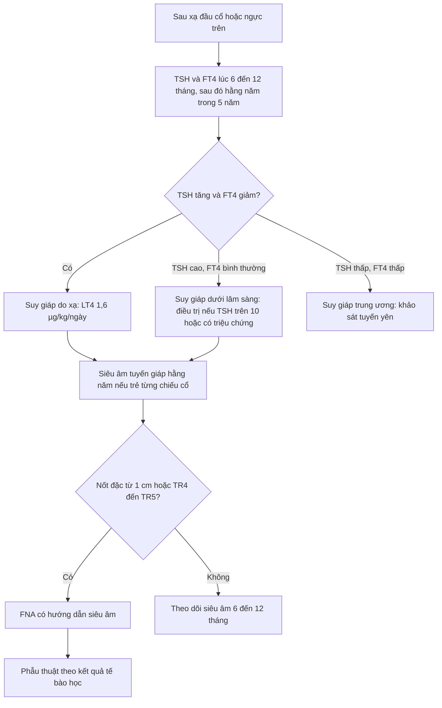
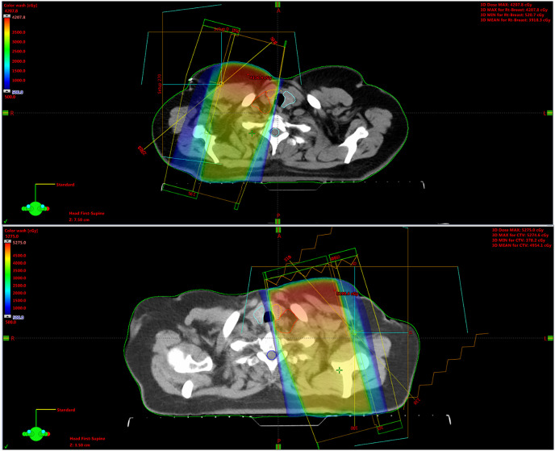
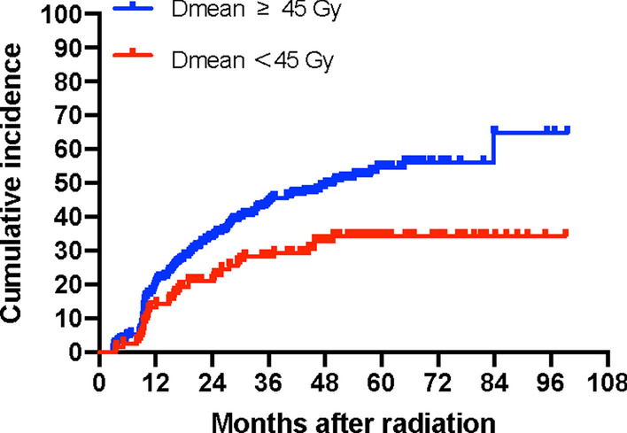

# 3110 — Suy giáp & ung thư tuyến giáp thứ phát sau xạ đầu cổ / Radiation-induced hypothyroidism & secondary thyroid cancer

**Tags:** `pattern:suy-giap` `pattern:teo-tuyen-giap` `pattern:not-tuyen-giap` `vung:tuyen-giap` `vung:dau-co` `protocol:TSH` `protocol:SA-tuyen-giap` `score:TIRADS` `score:Dmean`

**Mức chắc chắn (certainty):** tổng hợp y văn (literature synthesis) — số liệu lấy từ **một tổng quan hệ thống 111 bài** (Cancers 2023 — PMC10486996), **ba đoàn hệ có liều–thể tích** (404 ca NPC, Radiat Oncol 2022 — PMC8935811; 116 ca, J Radiat Res 2015 — PMC4426930; 64 ca, Rep Pract Oncol Radiother 2022 — PMC9518783), **một đoàn hệ xác nhận ngoài 108 ca** (Cancers 2020 — PMC7563778) và **một đoàn hệ trẻ sống sót ung thư** (Support Care Cancer 2020 — PMID 32043175). Không có thử nghiệm ngẫu nhiên về ngưỡng theo dõi; chỗ suy luận được ghi rõ.

> **Câu chốt:** tuyến giáp nằm **ngay trong trường chiếu cổ**, nên sau xạ đầu cổ có **hai** bệnh riêng biệt cần theo dõi: **(1)** suy giáp do xạ — **23–53%** theo tổng quan hệ thống, các nghiên cứu lớn gần đây **~40–50%**, khởi phát **trung vị 15,4 tháng**, **Dmean > 28–30 Gy** là ngưỡng nguy cơ; **(2)** ung thư giáp thứ phát — ở trẻ sống sót sau xạ đầu–cổ–ngực, **7,1% (16/225)** phát triển ung thư giáp sau **trung bình 9,7 năm**, và **siêu âm phát hiện 100%** trong khi **sờ thấy chỉ 12,5%**. Câu bẫy: **mệt – tăng cân – chậm chạp sau xạ là suy giáp cho tới khi chứng minh khác**, không phải "tái phát u".

## 1. Tổng quan bệnh học – cơ chế hình ảnh (TẠI SAO)

### 1.1 Bệnh học: nang giáp là cấu trúc nhạy xạ nhất trong vùng cổ

- Tuyến giáp gồm các **nang tuyến (follicle)** chứa colloid, chiếm **vị trí trước khí quản, ngang C5–T1**, không có hàng rào mô đệm che chắn — nên nằm **trong trường chiếu của gần như mọi phác đồ đầu cổ** (vòm họng, hầu, thanh quản, hạ họng) và cả **xạ vùng cổ trên trong ung thư vú**.
- Cơ chế tổn thương **hai lớp**: (a) **phá hủy trực tiếp DNA tế bào nang** (tế bào phân bào chậm nhưng nhạy xạ) → giảm số nang, giảm dự trữ hormone; (b) **tổn thương vi mạch nội tuyến** → thiếu máu cục bộ, xơ hóa mô kẽ. Hệ quả là **teo tuyến + xơ hóa**, không phải viêm cấp.
- **Bù trừ:** TSH tăng sớm để kích thích tuyến còn lại → **suy giáp dưới lâm sàng (TSH cao, FT4 bình thường)** xuất hiện trước, sau đó mới **suy giáp thật** khi dự trữ cạn. Đây là lý do **chỉ TSH là đủ để sàng lọc bước 1**.
- **Thời gian:** tổng quan hệ thống ghi tỷ lệ mắc tăng dần theo thời gian theo dõi; đoàn hệ NPC: khởi phát **trung vị 15,4 tháng (2,9–83,8)** cho suy giáp nguyên phát, **29,9 tháng (19,8–93,6)** cho suy giáp trung ương (trục tuyến yên–giáp cũng bị chiếu). Vì vậy **theo dõi ≥ 5 năm**, không phải 1 năm.

### 1.2 TẠI SAO hình ảnh thay đổi: teo, giảm echo, và mỡ thay

- **Siêu âm:** tuyến giáp bị chiếu xạ **giảm thể tích** và **giảm hồi âm (hypoechoic)**, bờ có thể không đều, mô đệm xơ tăng echo — những thay đổi này có thể xuất hiện **ngay trong đợt xạ**, trước khi TSH bất thường (Int J Radiat Oncol Biol Phys 2012, 50 ca theo dõi trong xạ). Vì vậy **siêu âm bất thường không đồng nghĩa suy giáp**, và ngược lại.
- **CT:** tuyến **nhỏ, giảm đậm độ**, đôi khi chỉ còn một dải mô mỏng trước khí quản — dễ bị đọc là "bình thường" nếu không so với **thời điểm trước xạ**. Trên CT sau xạ, mô xơ quanh tuyến làm **bờ tuyến dính vào cơ trước khí quản**, khó phân biệt với **u xâm lấn** nếu chỉ một thì.
- **MRI:** tuyến bình thường **T1 trung tính, T2 sáng hơn cơ**; sau xạ mô xơ **T2 giảm**, ngấm thuốc thì muộn. **Nốt ung thư** ngấm thuốc sớm và **hạn chế khuếch tán (ADC thấp)** — điểm khác biệt cần khi CT/US không kết luận.
- **TẠI SAO tuyến giáp "sáng" trên PET/FDG:** viêm giáp do xạ và suy giáp bù trừ làm tăng **FDG** lan tỏa, đối xứng hai thùy → **không phải di căn**; ngược lại **nốt FDG khu trú** trong tuyến đã chiếu xạ cần siêu âm + FNA (nguy cơ ác cao hơn dân số chung).

### 1.3 Ngưỡng định lượng: liều–thể tích quyết định

| Thông số | Ngưỡng / giá trị | Nguồn |
|---|---|---|
| Tỷ lệ suy giáp do xạ | **23–53%** (tổng quan hệ thống); nghiên cứu lớn gần đây **~40–50%** | Radiother Oncol 2011 (5 bài); Cancers 2023 (111 bài) |
| Tỷ lệ tích lũy (NPC, IMRT) | **39,4% / 49,1% / 54,7%** ở **3 / 5 / 7 năm** | Radiat Oncol 2022 (404 ca) |
| Thời điểm khởi phát | trung vị **15,4 tháng** (2,9–83,8) | Radiat Oncol 2022 |
| Ngưỡng liều trung bình | **Dmean > 28 Gy** (40% suy giáp) và **> 30 Gy** (36,4% ở 2 năm) | Asian Pac J Cancer Prev 2023 (120 ca); J Radiat Res 2015 (116 ca) |
| V40 tuyến giáp | **V40 > 49%** là yếu tố nguy cơ độc lập | Asian Pac J Cancer Prev 2023 |
| Thể tích được bảo tồn | **VS40 < 2,12 cm³** dự báo suy giáp; **VS50 > 5 cm³** giảm nguy cơ | APJCP 2023; Rep Pract Oncol Radiother 2022 |
| Với NPC (liều cao hơn) | đường cong tách rõ ở **Dmean 45 Gy** | Radiat Oncol 2022 |
| Mỗi 1 Gy tăng | **OR 1,11** (95% CI 1,03–1,19) cho suy giáp | Cancers 2020 (108 ca) |
| Thể tích tuyến lớn | **OR 0,87** (95% CI 0,81–0,93) — thể tích lớn là yếu tố bảo vệ | Cancers 2020 |

- **Đọc bảng này đúng cách:** ngưỡng **28–30 Gy** đến từ phác đồ **3D-CRT** đầu cổ nói chung; với **IMRT vòm họng** (liều cao, thể tích lớn) ngưỡng thực dụng cao hơn (**45 Gy**) và **thể tích được bảo tồn (VS)** dự báo tốt hơn liều trung bình. Đừng áp một con số cho mọi phác đồ.

## 2. Mẫu hình + chẩn đoán phân biệt theo vị trí (gamut)

**Mẫu hình 1 — tuyến giáp teo, không nốt:** bệnh nhân sau xạ 6–24 tháng, mệt, tăng cân, táo bón, TSH cao. Hình ảnh: tuyến nhỏ, giảm echo, **không có nốt đặc**. Chẩn đoán là **bệnh nội tiết**, hình ảnh chỉ để **loại trừ nốt**.

**Mẫu hình 2 — nốt trong tuyến đã chiếu xạ:** nốt đặc, giảm echo, **vi vôi hóa**, bờ không đều, **cao hơn rộng**; hạch cổ cùng bên. Chẩn đoán là **ung thư giáp thứ phát cho tới khi FNA loại trừ**.

Gamut theo **vị trí tổn thương**:

| Vị trí | Thực thể | Dấu hiệu phân biệt chính |
|---|---|---|
| **Trong tuyến** | Ung thư giáp thứ phát (chủ yếu nhú) | Nốt đặc giảm echo + vi vôi hóa + bờ tua; hạch cổ |
| **Trong tuyến** | Nốt lành / bướu đa nhân | Nốt đồng echo, bờ nhẵn, không vôi hóa vi mô |
| **Trong tuyến** | Viêm giáp do xạ / viêm Hashimoto | Tuyến **teo lan tỏa, echo không đều**, không nốt; anti-TPO |
| **Trong tuyến** | Tuyến còn lại sau cắt bán phần | Mô tuyến **tăng sinh bù**, có thể giả nốt |
| **Ngoài tuyến, tầng sâu** | Tái phát u đầu cổ xâm lấn tuyến | Khối liên tục với u nguyên phát, **xóa mặt phẳng mỡ** với khí quản |
| **Tầng VI** | Hạch di căn trước khí quản | Hạch **tròn, mất rốn echo, vi vôi hóa** |

## 3. Bảng so sánh phân biệt (ma trận đối chiếu)

| Thực thể (entity) | Hình ảnh điển hình | Chốt vào (rule-in) | Chốt loại (rule-out) | Gợi ý xác nhận |
|---|---|---|---|---|
| **Suy giáp do xạ (nguyên phát)** | Tuyến **teo, giảm echo lan tỏa**, không nốt; CT: tuyến nhỏ giảm đậm độ | **TSH ↑ + FT4 ↓ (hoặc FT4 bình thường = dưới lâm sàng) + tiền sử chiếu cổ ≥ 28 Gy** | Tuyến phì đại có nốt nóng, TSH bình thường → không phải suy giáp do xạ | TSH, FT4, anti-TPO; liều Dmean từ kế hoạch xạ |
| **Suy giáp trung ương sau xạ sọ–mặt** | Tuyến **bình thường hoặc teo nhẹ**, không nốt | **TSH thấp/không tăng + FT4 thấp** (trục tuyến yên) | TSH cao → nguyên phát, không phải trung ương | FT4 + TSH + MRI tuyến yên nếu cần |
| **Ung thư giáp thứ phát** | Nốt đặc **giảm echo, vi vôi hóa, cao > rộng**, bờ tua; hạch cổ | **Nốt ≥ 1 cm nguy cơ cao trên nền chiếu xạ**, hoặc hạch nghi | Nốt đơn thuần đồng echo, không vôi hóa, ổn định ≥ 2 năm | Siêu âm + **FNA có hướng dẫn siêu âm**; Tg không dùng để chẩn đoán |
| **Viêm giáp Hashimoto/do xạ** | Tuyến **không đều, giảm echo dạng "vảy cá"**, không nốt | **Anti-TPO dương + echo không đều lan tỏa** | Nốt khu trú đơn độc → nghi u, không phải viêm | Anti-TPO, anti-Tg; FNA nếu có nốt |
| **Tái phát u đầu cổ xâm lấn** | Khối **liên tục với u cũ**, xóa mặt phẳng mỡ với khí quản/thực quản | **Khối > 1 cm, ngấm thuốc, phát triển theo thời gian** | Tuyến teo đối xứng, không khối → không phải tái phát | CT/MRI có cản quang + PET-CT; sinh thiết |

## 4. Protocol theo dõi + hệ phân độ / thuật toán

### 4.1 Lịch theo dõi (không dùng hình ảnh thay xét nghiệm)

- **TSH + FT4:** nền trước xạ → **6–12 tháng** sau xạ → hằng năm **≥ 5 năm** (nguy cơ tiếp tục tăng tới 7 năm: **54,7%**). Có triệu chứng thì kiểm tra sớm bất kể lịch.
- **Siêu âm tuyến giáp:** với **trẻ sống sót sau xạ đầu–cổ–ngực** → **hằng năm** (siêu âm phát hiện **100%** ung thư giáp thứ phát so với sờ **12,5%**; AUC **0,87 vs 0,56**). Với người lớn sau xạ đầu cổ, siêu âm **khi có nốt sờ thấy, bất thường trên CT/PET, hoặc ≥ 5 năm sau xạ** — chưa có bằng chứng RCT cho sàng lọc siêu âm đại trà ở người lớn.
- **CT/MRI cổ:** không dùng để sàng lọc; dùng khi nghi tái phát u hoặc khi siêu âm không tới được vùng sau xương ức.

### 4.2 Phân tầng nốt sau xạ (ACR TI-RADS 2017)

| TI-RADS | Đặc điểm | Ngưỡng FNA | Ngưỡng theo dõi |
|---|---|---|---|
| TR1–TR2 | Nang đơn thuần / nốt lành | Không FNA | Không cần |
| TR3 | Nốt đồng echo, bờ đều | **≥ 2,5 cm** | ≥ 1,5 cm |
| TR4 | Giảm echo, bờ không đều, cao > rộng | **≥ 1,5 cm** | ≥ 1,0 cm |
| TR5 | **Vi vôi hóa + giảm echo + cao > rộng** | **≥ 1,0 cm** | ≥ 0,5 cm |

- **Riêng tuyến đã chiếu xạ:** ngưỡng FNA nên lấy **thấp hơn (TR4–TR5 ≥ 1 cm)** vì **tiền sử xạ là yếu tố nguy cơ độc lập**; nhưng **không FNA nốt < 1 cm không có dấu hiệu nguy cơ** (nguy cơ phẫu thuật oan và suy giáp nặng thêm).

### 4.3 Thuật toán một trang

### 4.4 Điều trị thay thế & con số cần nhớ

- **Levothyroxine 1,6 µg/kg/ngày** (người trẻ, không bệnh mạch vành); người già/bệnh mạch vành khởi đầu **25–50 µg/ngày**, tăng mỗi 6–8 tuần.
- Đích **TSH 0,5–2,5 mIU/L** với suy giáp nguyên phát thông thường; **không hạ TSH quá thấp** ở người có loãng xương/rung nhĩ.
- **Kiểm tra lại TSH sau 6–8 tuần** mỗi lần đổi liều (thời gian bán hủy T4 ~7 ngày, cần 5–6 tuần để cân bằng).
- Suy giáp do xạ thường **tiến triển và vĩnh viễn** — không "thử ngừng thuốc" tùy tiện; ngừng thử chỉ khi nghi nguyên nhân thoáng qua và có theo dõi TSH.

*Phân bố liều (color-wash) trên CT trục vùng cổ–ngực trên: thùy giáp cùng bên nằm trong vùng **liều cao (đỏ/cam)** sát trường chiếu — giải thích vì sao Dmean và V40 của tuyến quyết định nguy cơ. Nguồn: PLoS One 2026 — PMC13278451, Fig. 2; giấy phép **CC BY 4.0**.*

## 5. Biến thể bình thường và cạm bẫy

- **TSH "nhảy" trong đợt xạ không dự báo suy giáp muộn:** trong đoàn hệ 108 ca, thay đổi TSH ngắn hạn sau xạ **không** liên quan suy giáp về sau (OR 0,96; 95% CI 0,65–1,42) — nên **không được kết luận sớm**, và cũng **không được bỏ theo dõi dài hạn** vì TSH lúc đó bình thường.
- **Tuyến teo sau xạ ≠ teo do tuổi:** teo sinh lý giảm chậm, đối xứng; teo do xạ **nhanh, kèm giảm echo và xơ quanh tuyến**, và **giới hạn đúng trong trường chiếu** (một thùy teo nhiều hơn nếu chỉ một bên nằm trong trường).
- **PET/CT dương tính lan tỏa:** FDG tăng đối xứng hai thùy sau xạ là **viêm/bù trừ**, không phải di căn; chỉ **nốt khu trú** mới cần FNA.
- **Ung thư giáp thứ phát — đừng hứa "chỉ sau 10–20 năm":** trong đoàn hệ trẻ sống sót, thời gian phát hiện **trung bình 9,7 năm**; ở người lớn có HNSCC tiền sử, phân tích SEER 60.323 ca cho **SIR 1,58** nhưng **SIR cao nhất 3,05 trong 5 năm đầu** và **7,11 ở 2–11 tháng** — phần lớn là **phát hiện sớm do chụp nhiều (detection bias)**, không phải sinh bệnh học. Hệ quả thực hành: **không được gọi mọi nốt nhỏ phát hiện sớm là "di căn/tái phát"**, nhưng cũng **không bỏ qua** nốt nguy cơ cao.
- **Suy giáp làm tăng giả nốt:** tuyến bù trừ có thể có **nốt tăng sinh**; điều trị LT4 đủ liều rồi siêu âm lại sau 6–12 tháng giúp tránh FNA không cần thiết.

## 6. Tự lượng giá — Blind Quiz (bấm để hiện đáp án)

**Ca 1 — Nữ 48 tuổi, xạ hóa trị ung thư vòm họng 2 năm trước, mệt và tăng 6 kg; TSH 9,8 mIU/L, FT4 bình thường thấp.**

- Câu hỏi: (1) Tuyến giáp nằm ở vùng liều nào? (2) Chẩn đoán và mức độ? (3) Cần làm gì tiếp theo và theo dõi bao lâu?

<b>Bấm để hiện đáp án (findings + chẩn đoán)</b>

- **Findings:** thùy giáp cùng bên nằm trong vùng **liều cao (đỏ/cam)** của trường chiếu cổ — tương ứng **Dmean vượt ngưỡng 28–45 Gy** tùy phác đồ.
- **Chẩn đoán:** **suy giáp dưới lâm sàng do xạ** (TSH 9,8 với FT4 còn trong ngưỡng); nguy cơ tích lũy **49,1% ở 5 năm** với NPC.
- **Xử trí:** FT4 + anti-TPO, bắt đầu **LT4 1,6 µg/kg/ngày** nếu TSH > 10 hoặc có triệu chứng; kiểm tra TSH sau **6–8 tuần**; theo dõi **hằng năm ≥ 5 năm**; siêu âm tuyến nếu có nốt.
- **Nguồn ảnh:** PLoS One 2026, PMC13278451 Fig. 2 — CC BY 4.0.

**Ca 2 — Đường cong tích lũy suy giáp sau xạ theo liều trung bình tuyến giáp.**

- Câu hỏi: (1) Hai đường cong khác nhau ở đâu? (2) Ngưỡng liều nào tách đường cong? (3) Vì sao vẫn phải theo dõi bệnh nhân ở nhóm liều thấp?

<b>Bấm để hiện đáp án</b>

- **Findings:** nhóm **Dmean ≥ 45 Gy** có tỷ lệ tích lũy suy giáp cao hơn rõ rệt và **tăng nhanh trong 24–36 tháng đầu**; nhóm **< 45 Gy** vẫn tăng tới ~35% sau 60 tháng.
- **Chẩn đoán:** quan hệ **liều–đáp ứng** của suy giáp do xạ; ngưỡng thực dụng **45 Gy** với IMRT vòm họng (28–30 Gy với phác đồ đầu cổ liều thấp hơn).
- **Vì sao vẫn theo dõi nhóm thấp:** đường cong **< 45 Gy vẫn đạt ~35%** — không có ngưỡng "an toàn tuyệt đối"; và **thể tích tuyến được bảo tồn (VS)** quan trọng không kém liều trung bình.
- **Nguồn ảnh:** Radiat Oncol 2022, PMC8935811 Fig. 4 — CC BY 4.0.

## Bài liên quan chéo
- [230 – Tuyến giáp & hạch cổ](../230-tuyen-giap-hach-co/lesson.md)
- [1765 – Hạ thiết sau xạ trị đầu cổ](../1765-ha-thiet-sau-xa-tri-dau-co/lesson.md)
- [1874 – Hạ calci sau cắt tuyến giáp](../1874-ha-calci-mau-sau-cat-tuyen-giap/lesson.md)
- [1899 – Bướu giáp lạc chỗ ở đáy lưỡi](../1899-buou-giap-lac-cho-lingual-thyroid/lesson.md)
- [1450 – Glôcôm sau xạ trị ở trẻ](../1450-glaucom-sau-xa-tri-o-tre/lesson.md)

## Ảnh
- `images/3110_suy-giap_Xa-tri-PMC13278451.jpg` — bản đồ liều, CC BY 4.0.
- `images/3110_suy-giap_BieuDo-PMC8935811.jpg` — đường cong tích lũy, CC BY 4.0.
- Nguồn + giấy phép từng ảnh: `images/CREDITS.md`.

> Không dùng để chẩn đoán độc lập khi chưa có người hướng dẫn.
