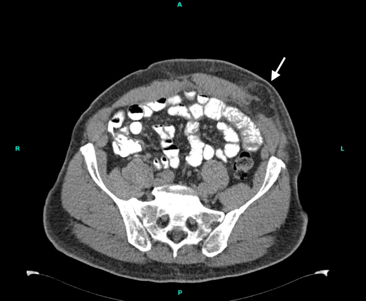
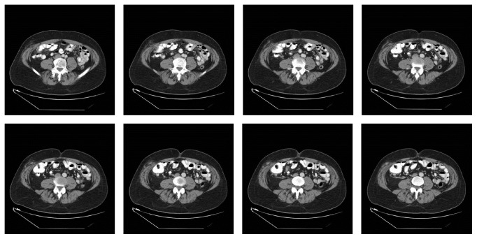
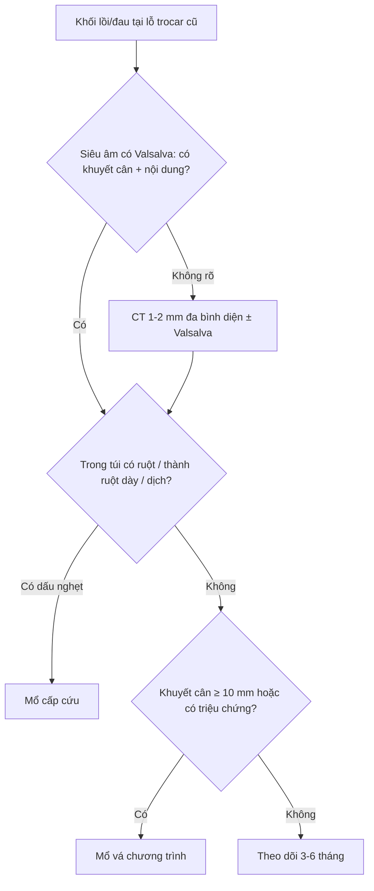
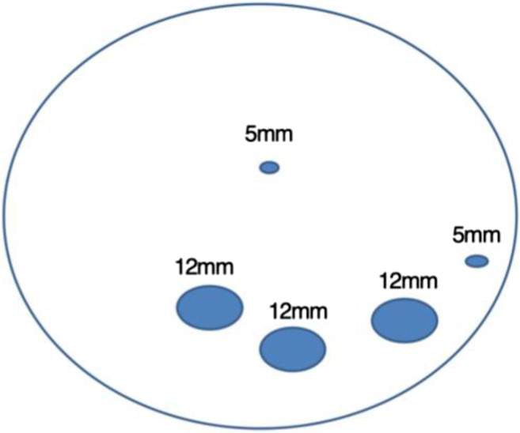

# 3111 — Thoát vị lỗ trocar sau nội soi: khối lồi mới ở lỗ trocar là thoát vị, tụ dịch hay di căn?

**Tags:** `pattern:thoat-vi` `pattern:khuyet-can` `pattern:not` `pattern:ap-xe-sau-mo` `vung:thanh-bung` `vung:o-bung` `anatomy:thanh-bung` `protocol:CT-bung` `protocol:sieu-am-tai-cho` `protocol:Valsalva` `incidentaloma:not-thanh-bung`
**Mức chắc chắn (certainty):** tổng hợp y văn (literature synthesis) — ghép **phân tích gộp 22 nghiên cứu / 70.346 bệnh nhân về thoát vị lỗ trocar trong phẫu thuật phụ khoa nội soi** (2026, PMC13125361), **nghiên cứu thuần tập 365 bệnh nhân sau mổ béo phì có siêu âm chủ động (HERBALS, Obes Surg 2020, PMC7242489)**, **thuần tập 2.377 ca cắt túi mật nội soi** (2025, PMC12062153), **tổng quan tự sự 2022 về phòng ngừa** (PMC10831692) và **3 ca nguyên văn có ảnh** (Cureus 2026 PMC13387625; Case Rep Surg 2016 PMC5018338; 2026 PMC13271838). Không có ca do nhóm tự chụp.

> **Câu hỏi thực hành:** nam **69 tuổi**, BMI **28,8 kg/m²**, mổ **nội soi robot vá thoát vị vết mổ** 2 tuần trước, ba cổng **8 mm** ở bên trái **không khâu cân**. Bệnh nhân sờ thấy **khối lồi mới ở lỗ trocar dưới bên trái**, không sốt, còn đau nhẹ. Câu hỏi: **khối này là tụ máu/seroma lành tính hay thoát vị lỗ trocar — và có phải mổ lại ngay không?**
> Bài chốt **ba quyết định**: **(1) mọi khối lồi ở đúng đường trocar cũ, xuất hiện trong 30 ngày đầu, phải được coi là thoát vị cho tới khi chứng minh ngược — kể cả khi cổng chỉ 8 mm và cân đã được khâu; (2) siêu âm động có nghiệm pháp Valsalva là bước đầu, CT 1–2 mm đa bình diện có Valsalva là bước chốt: đo **khuyết cân (fascial defect)** theo mm, xác định **túi thoát vị chứa gì** (mỡ, mạc nối, ruột non, ruột thừa) và tìm dấu **nghẹt**; (3) khuyết cân **≥ 10 mm** hoặc có triệu chứng → mổ vá; có **nghẹt/thắt/ruột thừa/túi thừa Meckel** trong túi → **mổ cấp cứu**, không nắn thử rồi cho về.** Nối [3061 – Di căn lỗ trocar](../3061-di-can-lo-trocar-sau-pipac-va-noi-soi/lesson.md), [1905 – Biến chứng & an toàn PIPAC](../1905-bien-chung-va-an-toan-thu-thuat-pipac/lesson.md), [1872 – Thoát vị Littre](../1872-thoat-vi-littre-tui-thua-meckel-trong-tui-thoat-vi/lesson.md), [1936 – Tụ máu bao cơ thẳng bụng](../1936-tu-mau-bao-co-thang-bung/lesson.md), [1967 – ACNES](../1967-acnes-dau-thanh-bung-sau-mo/lesson.md).

## 1. Tổng quan bệnh học – cơ chế hình ảnh: vì sao một lỗ 8 mm lại thành túi thoát vị

- **Định nghĩa – vị trí chính xác:** thoát vị lỗ trocar (port-site hernia, PSH; trocar-site hernia, TSH) là **thoát vị vết mổ xuyên đúng đường trocar**, từ **phúc mạc → cân/cơ → mô dưới da**. Vì là kênh xuyên toàn thành, túi thoát vị có thể nằm **dưới da**, **giữa các lớp cơ** (thoát vị trong cơ) hoặc **sát phúc mạc**; nội dung có thể là **mỡ tiền phúc mạc, mạc nối, ruột non, đại tràng, ruột thừa, túi thừa Meckel**.
- **Tần suất — ba con số "không khớp nhau" và lý do:** phân tích gộp **22 nghiên cứu / 70.346 bệnh nhân** phẫu thuật phụ khoa nội soi cho tỷ lệ gộp **0,29%** (KTC 95% báo cáo 0,00–0,02; **I² = 99,3%** — dị biệt rất lớn vì cách phát hiện khác nhau) (PMC13125361). Ở **cắt túi mật nội soi**, tỷ lệ **phải mổ vá** là **2,1% (36/1.756)**, trong đó **lỗ rốn 3,2%** so với **lỗ thượng vị 0,7%** (p < 0,001) (PMC12062153). Ngược lại, **siêu âm chủ động** ở 365 bệnh nhân sau mổ béo phì phát hiện **34%** có khuyết thành bụng — phần lớn **không triệu chứng** (HERBALS, PMC7242489). Còn **CT** ở 244 bệnh nhân với **732 cổng 11–12 mm** chỉ thấy **2 khuyết cân**, đều không sờ thấy, không triệu chứng, được mỡ bịt (PMC10831692).
- **Bài học đo lường:** **"0,29% – 2,1% – 34%" không phải ba bệnh khác nhau, mà là ba cách đo**: (a) thoát vị **được mổ**; (b) thoát vị **có triệu chứng/phải sửa**; (c) **khuyết cân** phát hiện bằng siêu âm/CT có động tác tăng áp lực. Vì vậy **tỷ lệ thật phụ thuộc protocol chẩn đoán**, và **không được dùng "tỷ lệ thấp" để trấn an một khối lồi đang to lên**.
- **Yếu tố quyết định — kích thước cổng và cách đóng cân:** trong 760 ca, **15/16 thoát vị nằm ở cổng camera 10–12 mm**; **12 mm > 10 mm** (p < 0,01); **để hở cân ở cổng 12 mm làm tăng tỷ lệ** (p = 0,021); vẫn có **ca ở cổng 5 mm**, và **phẫu thuật một lỗ (single-port) với đường rạch 25–40 mm** tạo khuyết lớn nhất (PMC13125361). Nhóm đồng thuận quốc tế **86,8%** đồng ý **đóng cân cho mọi cổng 15 mm**; thực hành chung là **đóng cân từ 10 mm trở lên**, còn **8 mm ở robot** còn tranh luận (PMC10831692).
- **Ca nguyên văn cho thấy giới hạn của "quy tắc 10 mm":** ba cổng **8 mm** ở robot, **không khâu cân**, xuất hiện **3 thoát vị cùng lúc** với khuyết **5 mm, 5 mm và 20 mm**; mạc nối nằm trong cả ba, **nghẹt ở lỗ dưới**; triệu chứng lúc **2 tuần**, mổ lại ngày **32** (PMC13387625). Và thoát vị **trong cơ** vẫn xảy ra **dù đã khâu cân bằng một mũi chỉ**: khối ruột non chèn **giữa cơ chéo ngoài và chéo trong**, không rách cân, phải **cắt đoạn ruột** (PMC13271838).
- **Thời điểm:** **đa số trong 10 ngày đầu**, cá biệt **1 năm**; thể muộn chính là **thoát vị vết mổ** thật sự (PMC13125361). Vì vậy khung thời gian **không dùng để loại trừ** — khối lồi ở lỗ trocar **2 tuần** hay **2 năm** đều phải đọc cùng một quy trình.
- **TẠI SAO hình thành — cơ học đơn giản:** sau khi rút trocar, **áp lực trong ổ bụng (10–15 mmHg khi bơm, 20–40 mmHg khi ho)** đẩy **mỡ tiền phúc mạc** vào lỗ cân; mỡ lấp lỗ tạo "nút" nhưng không có **màng phúc mạc** che, nên khi lỗ **không liền** thì **mạc nối** rồi **ruột** đi theo. Theo **Laplace (sức căng thành T = P × r)**, cùng một áp lực P, **cổ nhỏ (r nhỏ) chịu sức căng thấp hơn** nhưng **nghẹt dễ hơn** vì **cổ xơ cứng, ít đàn hồi** — đây là lý do **khuyết 5 mm vẫn nghẹt mạc nối** trong ca Cureus 2026.
- **TẠI SAO nghẹt nhanh và "im lặng":** ở **thoát vị Richter**, chỉ **một phần chu vi ruột** (thường bờ đối mạc treo) chui vào cổ hẹp; lòng ruột **chưa tắc** nên **không nôn, vẫn trung tiện** — nhưng **tĩnh mạch bị chèn trước, động mạch sau**, dẫn tới **phù → thiếu máu → hoại tử trong vài giờ**. Vì vậy **không có dấu tắc ruột không loại trừ nghẹt**.
- **TẠI SAO CT thấy rõ hơn siêu âm — vật lý và tư thế:** CT đo trực tiếp **kích thước khuyết cân** (đơn vị mm) trên **mặt phẳng ngang và dọc**, phân biệt **mỡ (−40 đến −120 HU)**, **dịch (0–20 HU)**, **máu tụ cấp (50–80 HU)**, **ruột có hơi (−1.000 HU)** và **vôi hóa (> 200 HU)**; siêu âm phụ thuộc **đầu dò, người làm và lượng hơi ruột**, và khuyết cân **có thể xẹp dưới 5 mm khi nằm ngửa**. Vì vậy **siêu âm bình thường khi nằm không loại trừ** — phải làm **Valsalva** và/hoặc **đứng**.
- **TẠI SAO "trong cơ" lại khó:** cổng robot bị **xoay nhiều hướng quanh điểm tựa (remote center)**, tách **mặt phẳng giữa cơ chéo ngoài – chéo trong**; khi cân đã khâu, ruột vẫn có thể chui vào **khoang giữa hai cơ** và **không có khuyết cân trên CT** nếu chỉ nhìn đường trắng giữa (PMC13271838).

## 2. Mẫu hình + chẩn đoán phân biệt theo vị trí và thời điểm (Gamut)

- **Mẫu hình cốt lõi:** **khối lồi ± đau tại đúng vị trí cổng cũ**, **to lên khi ho/đứng/nâng vật**, **mềm, đẩy vào được** (nếu chưa nghẹt); trên CT là **khuyết cân thành bụng có mỡ/ruột đi qua**, bờ khuyết **nhẵn, đo được**.
- **Theo thời điểm — quyết định mức khẩn:**
  - **≤ 30 ngày:** **thoát vị sớm**, **tụ máu**, **seroma**, **áp-xe**, **thoát vị trong cơ**, và **evisceration** (ruột ra ngoài da — cấp cứu).
  - **1–12 tháng:** thoát vị, **u hạt chỉ khâu**, **lạc nội mạc trong sẹo mổ**, áp-xe mạn.
  - **> 12 tháng:** **thoát vị vết mổ muộn**, **di căn lỗ trocar** (bài 3061), **u mô đệm (desmoid)**, lạc nội mạc.
- **Theo nội dung túi (CT):**
  - **Chỉ mỡ/mạc nối:** hay gặp nhất, thường **không triệu chứng** hoặc chỉ nặng tức.
  - **Ruột non:** nguy cơ **nghẹt/tắc**; tìm **quai ruột dạng "target"** trong túi.
  - **Ruột thừa / túi thừa Meckel:** nghẹt **kiểu Richter**, dễ bỏ sót vì **không tắc ruột** (ca PMC5018338; bài 1872).
  - **Đại tràng:** khuyết thường **lớn**, ít nghẹt hơn nhưng **hay tái phát**.
  - **Dịch:** seroma (vỏ mỏng, không mạch), máu tụ (HU cao, không ngấm), áp-xe (vỏ dày ngấm thuốc + khí).
- **Theo vị trí cổng:** **rốn/đường trắng giữa** (nhiều nhất, đặc biệt khi lỗ được **nới để lấy bệnh phẩm**), **cổng 10–12 mm**, **single-port 25–40 mm**, **lỗ dẫn lưu**, **cổng robot 8 mm** (vẫn có), **cổng trong cơ không rách cân**.
- **Gamut "khối sau mổ" cần loại trừ song song:** **di căn lỗ trocar** (nốt đặc ngấm thuốc, **không có khuyết cân**, lớn dần — bài 3061), **u hạt chỉ khâu** (nốt nhỏ, quanh chỉ, không thay đổi), **lạc nội mạc** (T1 sáng, đau theo chu kỳ), **desmoid** (T2 dải tối, ngấm thuốc muộn), **diastasis recti** (không có túi, không có cổ).

## 3. Bảng so sánh phân biệt (ma trận đối chiếu)

| Thực thể (entity) | Hình ảnh điển hình (US/CT) | Chốt vào (rule-in) | Chốt loại (rule-out) | Gợi ý xác nhận |
|---|---|---|---|---|
| Thoát vị lỗ trocar — mỡ/mạc nối | Khuyết cân **đo được bằng mm**, túi chứa **mỡ (−40 đến −120 HU)** hoặc mạc nối có mạch, **rộng ra khi Valsalva** | **Khuyết cân + nội dung đi qua cổ**, thấy rõ hơn khi **Valsalva/đứng** | Không có khuyết cân, chỉ có dịch → seroma/máu tụ | Siêu âm động + CT 1–2 mm; so sánh 2 tư thế |
| Thoát vị nghẹt / Richter | Túi chứa **một phần chu vi ruột**, cổ hẹp, **thành ruột dày, mạch mạc treo mờ**, dịch trong túi | **Cổ hẹp + thành ruột dày + dịch + đau chói**, có thể **không tắc ruột** | Quai ruột thành mỏng, ngấm thuốc đều, không dịch → chưa nghẹt | CT có cản quang; mổ cấp cứu nếu nghi |
| Thoát vị trong cơ (intramuscular) | Ruột/mỡ **giữa cơ chéo ngoài và chéo trong**, **cân không rách**, khối trong thành bụng | **Nội dung nằm trong lớp cơ**, di động theo Valsalva | Khuyết cân rõ + túi dưới da → thoát vị thường | CT/MRI đa bình diện, đọc **từng lớp cơ** |
| Tụ máu (hematoma) | Khối **50–80 HU**, **không ngấm thuốc**, hình đa cung, bờ theo cân | **HU cao + không ngấm + tiền sử chọc/khâu** | Ngấm thuốc + có khuyết cân → thoát vị | CT không cản quang; theo dõi 2–4 tuần |
| Seroma | Dịch **0–20 HU**, vỏ mỏng **không ngấm**, hình thấu kính dưới da | **Dịch thuần, không có cổ/cuống** | Có quai ruột/mỡ đi qua cổ → thoát vị | Siêu âm: không mạch, đẩy được; CT |
| Áp-xe | Ổ dịch **vỏ dày ngấm thuốc**, **khí trong ổ**, mô mỡ quanh tăng đậm | **Vỏ ngấm + khí + sốt/đau** | Không khuyết cân, không quai ruột | Chọc hút/cấy; CT có cản quang |
| Di căn lỗ trocar (bài 3061) | **Nốt đặc ngấm thuốc** dọc đường trocar, **không có khuyết cân**, lớn dần | **Nốt đặc + tiền sử ung thư phúc mạc** | Có khuyết cân + nội dung thoát vị → PSH | MRI/DWI, PET/CT; sinh thiết |
| U hạt chỉ khâu / lạc nội mạc | Nốt nhỏ quanh chỉ, **T1 sáng** (máu cũ), đau theo chu kỳ | **T1 sáng + chu kỳ đau** (lạc nội mạc) | Không khuyết cân, không lớn nhanh | MRI T1/T2 fat-sat; hỏi chu kỳ |
| Diastasis recti | **Khoảng cách hai bờ cơ thẳng rộng**, không có túi/cổ | **Không có túi**, chỉ hở đường trắng | Có túi + cổ hẹp → thoát vị thật | Siêu âm/CT, đo mm đường trắng |

*Trái: CT không cản quang sau mổ robot — khuyết cân ở cổng 8 mm, mỡ/mạc nối lồi ra dưới da (mũi tên trắng). Nguồn: Cureus 2026 (PMC13387625), CC BY 4.0, nguyên bản.*

### Dấu hiệu "khuyết cân + nội dung" — đọc theo 3 câu hỏi
- **Câu 1 — có khuyết cân thật không?** Đo **đường kính lớn nhất của khuyết trên mặt phẳng ngang** và **chiều cao túi trên mặt phẳng dọc**; ghi **mm**. Khuyết **< 5 mm** vẫn có thể nghẹt mạc nối; khuyết **≥ 10 mm** là ngưỡng can thiệp thực hành.
- **Câu 2 — trong túi là gì?** Mỡ **−40 đến −120 HU**; mạc nối **có mạch, ngấm thuốc**; ruột non **thành 1–2 mm, có hơi/dịch**; ruột thừa **cấu trúc hình ống mù tận, < 6 mm khi bình thường**; máu tụ **50–80 HU không ngấm**.
- **Câu 3 — có dấu nghẹt chưa?** **Thành ruột dày > 3 mm**, **mất ngấm thuốc thành ruột**, **dịch trong túi**, **mạch mạc treo phù**, **khí trong thành (pneumatosis)**; kèm **quai giãn > 3 cm** nếu tắc. Có **bất kỳ** dấu nào → **mổ cấp cứu**, không chờ.
- **Ảnh thứ hai — ruột thừa trong túi thoát vị:** CT sau mổ nội soi cắt tiền liệt tuyến, cổng **12 mm** hố chậu phải; chuỗi ảnh ngang cho thấy **ruột thừa bị giam trong túi** — thể **Richter điển hình**: bệnh nhân **không tắc ruột**, chỉ đau khu trú (Case Rep Surg 2016, PMC5018338, CC BY 4.0).

*Nguồn: Case Reports in Surgery 2016 (PMC5018338), CC BY 4.0, nguyên bản (8 lát cắt liên tiếp, không crop).*

## 4. Protocol chụp + phân loại và ngưỡng xử trí

- **Dự phòng ngay trong mổ (quyết định trước khi có hình ảnh):** đóng cân **mọi cổng ≥ 10 mm** (đồng thuận **86,8%** cho cổng **15 mm**; **8 mm robot** còn bàn — nhưng ca 3 thoát vị ở cổng 8 mm gợi ý **đóng tất cả ở bệnh nhân có tiền sử thoát vị tái phát/nhiều lần**) (PMC10831692; PMC13387625). Không **nới lỗ trocar** để lấy bệnh phẩm nếu có thể **mở đường lấy riêng**; ghi **kích thước từng cổng** vào biên bản để lần chụp sau đối chiếu.
- **Siêu âm (bước 1, tại giường):** đầu dò thẳng **9–15 MHz**, khảo sát **nằm ngửa và đứng**, **Valsalva 10 giây**; đo **khuyết cân 2 bình diện (mm)**, xác định nội dung (mỡ/ruột), bấm Doppler xem **mạch trong nội dung**; so **bên đối diện**. Siêu âm **bình thường khi nằm ngửa không loại trừ**.
- **CT (bước chốt):** **không cản quang** nếu chỉ tìm khuyết; **có cản quang thì tĩnh mạch** nếu nghi **nghẹt/áp-xe**; lát **1–2 mm**, **đa bình diện**, thêm **nghiệm pháp Valsalva** khi bệnh nhân hợp tác; đọc **cửa sổ mô mềm + xương** (vôi hóa, mảnh kim loại), so **phim nền** nếu có.
- **MRI (khi còn lưỡng lự):** T2 + T1 fat-sat + **DWI**, có/không Valsalva; phân biệt **lạc nội mạc (T1 sáng)**, **u hạt**, **di căn** và **mô xơ**.
- **Phân loại (dùng để giao tiếp, không thay quyết định):**
  - **Theo thời gian (Tonouchi 2004, Arch Surg):** thể **sớm** (ngay sau mổ, ruột vào mô dưới da), **trung gian** (có túi phúc mạc), **muộn** (thoát vị vết mổ thật). Chi tiết tiêu chí từng thể **chưa đối chiếu toàn văn trong lượt này — cần tra** nếu dùng để nghiên cứu.
  - **Theo kích thước khuyết (EHS, thoát vị vết mổ):** **nhỏ < 4 cm**, **trung bình 4–10 cm**, **lớn > 10 cm** — ảnh hưởng chọn **vá cân trực tiếp hay đặt lưới**.
  - **Theo nội dung:** mỡ/mạc nối, ruột non, đại tràng, **Richter** (một phần chu vi), **Littre** (túi thừa Meckel — bài 1872).
- **Ngưỡng xử trí thực hành:** khuyết **≥ 10 mm** hoặc **có triệu chứng** → **mổ vá** (khâu cân ± lưới); **nghẹt/thắt/evisceration** → **mổ cấp cứu**; khuyết **< 10 mm, không triệu chứng, chỉ mỡ** → **theo dõi** với siêu âm 3–6 tháng, dặn tái khám ngay nếu đau chói/nôn.
- **Cạm bẫy "nhiều ổ":** một bệnh nhân có thể có **nhiều thoát vị cùng lúc** ở **tất cả cổng** — ca Cureus 2026 có **3 ổ** (5 mm, 5 mm, 20 mm). Phải **khảo sát từng cổng**, không dừng ở ổ gây triệu chứng.

## 5. Biến thể bình thường và cạm bẫy

- **"Nút mỡ" không triệu chứng:** khuyết nhỏ **< 10 mm** được **mỡ bịt**, không túi, không nội dung — gặp tới **2/732 cổng** trên CT và **34%** trên siêu âm chủ động; **không phải mọi khuyết đều cần mổ**.
- **Diastasis recti giả thoát vị:** đường trắng giữa rộng, **không có túi/cổ**; bệnh nhân thấy "khối" khi gồng bụng. Đo **khoảng cách hai bờ cơ thẳng** thay vì gọi thoát vị.
- **Seroma sau rút dẫn lưu:** dịch **0–20 HU**, vỏ mỏng; **không có cổ**; đừng chọc dẫn lưu "cho xẹp" nếu chưa loại trừ thoát vị — chọc vào **quai ruột trong túi** là tai biến.
- **Thoát vị trong cơ:** khuyết cân **không thấy** nếu chỉ đọc lát ngang qua đường trắng giữa; phải xem **toàn bộ thành bụng** và **các lớp cơ**; ca PMC13271838 xảy ra **dù đã khâu cân**, tổn thương **giữa cơ chéo ngoài – chéo trong**.
- **Richter "im lặng":** **không nôn, vẫn trung tiện**, đau khu trú; thiếu máu ruột tiến triển **trong vài giờ**; đừng chờ dấu tắc ruột.
- **Bỏ sót ổ thứ hai (satisfaction of search):** đã tìm thấy một thoát vị vẫn phải **đọc tiếp mọi cổng**; ca 3 ổ ở cổng 8 mm là ví dụ.
- **Di căn lỗ trocar (3061):** nốt **đặc, ngấm thuốc, lớn dần**, **không có khuyết cân**; ở bệnh nhân ung thư phúc mạc, **không được mặc định là "thoát vị"** chỉ vì nằm đúng lỗ trocar.
- **Lạc nội mạc trong sẹo mổ:** đau **theo chu kỳ**, **T1 sáng**; gặp sau mổ phụ khoa — hỏi chu kỳ trước khi kết luận.
- **Evisceration:** ruột **ra ngoài da** — **không đẩy vào**, che **gạc ẩm vô khuẩn**, **mổ ngay**; đây là biến chứng của chính thoát vị, không phải "vết mổ toác".

## 6. Tự lượng giá — Blind Quiz

**Ca 1 — Nam 69 tuổi, 2 tuần sau mổ robot vá thoát vị vết mổ; khối lồi ở cổng dưới bên trái. Nhìn ảnh, mô tả trước.**

- Gợi ý lâm sàng: BMI **28,8 kg/m²**, ba cổng **8 mm** không khâu cân, không sốt.
- Câu hỏi: Dấu hiệu chính nằm ở lớp nào của thành bụng? Nội dung trong túi là gì? Có cần mổ ngay không?

<b>Bấm để hiện đáp án (findings + chẩn đoán)</b>

- Dấu hiệu: **khuyết cân thành bụng bên trái**, **mỡ/mạc nối** lồi qua khuyết ra mô dưới da (mũi tên trắng); không có quai ruột, không dịch, không khí tự do.
- Chẩn đoán: **thoát vị lỗ trocar ở cổng 8 mm** — mổ lại ngày 32 phát hiện **3 ổ** với khuyết **5 mm, 5 mm và 20 mm**, mạc nối **nghẹt ở ổ dưới**.
- Vì sao: cổng robot bị **xoay nhiều hướng quanh điểm tựa**, mô mỡ bị đẩy vào đường trocar; **không khâu cân** là yếu tố thuận lợi rõ.
- Nguồn: Cureus 2026 (PMC13387625), CC BY 4.0.

**Ca 2 — Nam sau mổ nội soi cắt tiền liệt tuyến, đau hố chậu phải, không nôn, vẫn trung tiện. CT có cản quang:**

- Câu hỏi: Cấu trúc nào nằm trong túi? Vì sao bệnh nhân **không tắc ruột** mà vẫn là cấp cứu?

<b>Bấm để hiện đáp án</b>

- Dấu hiệu: **ruột thừa** (cấu trúc hình ống mù tận) bị giam trong túi thoát vị tại **cổng 12 mm hố chậu phải**; mỡ quanh túi tăng đậm.
- Chẩn đoán: **thoát vị lỗ trocar chứa ruột thừa** — thể **Richter**: chỉ một phần chu vi/ruột thừa chui vào cổ hẹp nên **lòng ruột chưa tắc**, nhưng **nghẹt mạch** đang tiến triển.
- Xử trí: **mổ cấp cứu** cắt ruột thừa + vá cân (ca nguyên văn đã làm vậy, hồi phục không biến chứng).
- Nguồn: Case Rep Surg 2016 (PMC5018338), CC BY 4.0.

**Ca 3 — Bệnh nhân sau nội soi ổ bụng, bạn được hỏi "cổng nào cần đóng cân?".**

- Câu hỏi: Trong sơ đồ, cổng nào **bắt buộc** đóng cân theo thực hành hiện nay? Vì sao cổng **5 mm** vẫn có thể gây thoát vị?

<b>Bấm để hiện đáp án</b>

- Trả lời: đóng cân **các cổng 12 mm** (và mọi cổng **≥ 10 mm**); đồng thuận quốc tế **86,8%** cho **15 mm**; cổng **5 mm** thường không cần nhưng **đã có ca thoát vị** — đóng khi **có nới rộng, lấy bệnh phẩm hoặc bệnh nhân nguy cơ cao**.
- Vì sao 5 mm vẫn thoát vị: **cổ nhỏ, bờ xơ cứng** làm **nghẹt dễ** dù lực đẩy nhỏ; yếu tố bệnh nhân (BMI, đái tháo đường, tuổi) và **tăng áp lực ổ bụng** quyết định.
- Nguồn sơ đồ: Obes Surg 2020 (PMC7242489), CC BY 4.0.

## Bài liên quan chéo
- [3061 – Di căn lỗ trocar sau PIPAC & nội soi](../3061-di-can-lo-trocar-sau-pipac-va-noi-soi/lesson.md)
- [1905 – Biến chứng & an toàn thủ thuật PIPAC](../1905-bien-chung-va-an-toan-thu-thuat-pipac/lesson.md)
- [1872 – Thoát vị Littre (túi thừa Meckel trong túi thoát vị)](../1872-thoat-vi-littre-tui-thua-meckel-trong-tui-thoat-vi/lesson.md)
- [1936 – Tụ máu bao cơ thẳng bụng](../1936-tu-mau-bao-co-thang-bung/lesson.md)
- [1967 – ACNES: đau thành bụng sau mổ](../1967-acnes-dau-thanh-bung-sau-mo/lesson.md)
- [160 – Bụng cấp & tắc ruột non](../160-bung-cap-GI/lesson.md)

## Ảnh
- `images/3111_thoat-vi-lo-trocar_CT_Cureus2026-PMC13387625.jpg` — Cureus 2026 (PMC13387625), CC BY 4.0.
- `images/3111_thoat-vi-lo-trocar_CT_CaseRepSurg2016-PMC5018338.jpg` — Case Rep Surg 2016 (PMC5018338), CC BY 4.0.
- `images/3111_so-do-lo-trocar_ObesSurg2020-PMC7242489.jpg` — Obes Surg 2020 (PMC7242489), CC BY 4.0.
- Nguồn, giấy phép và ghi chú phái sinh từng ảnh: `images/CREDITS.md`.

> Không dùng để chẩn đoán độc lập khi chưa có người hướng dẫn.
