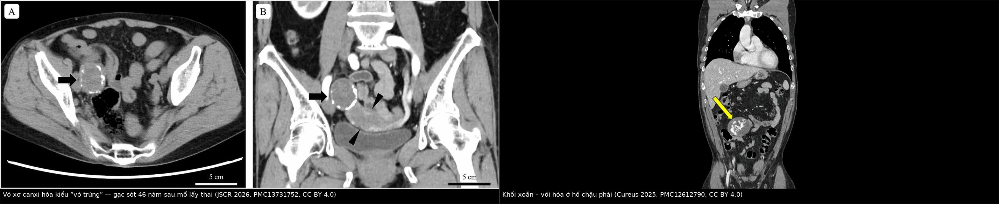
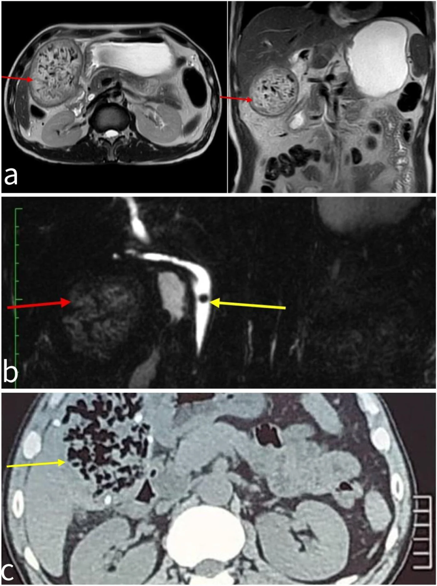
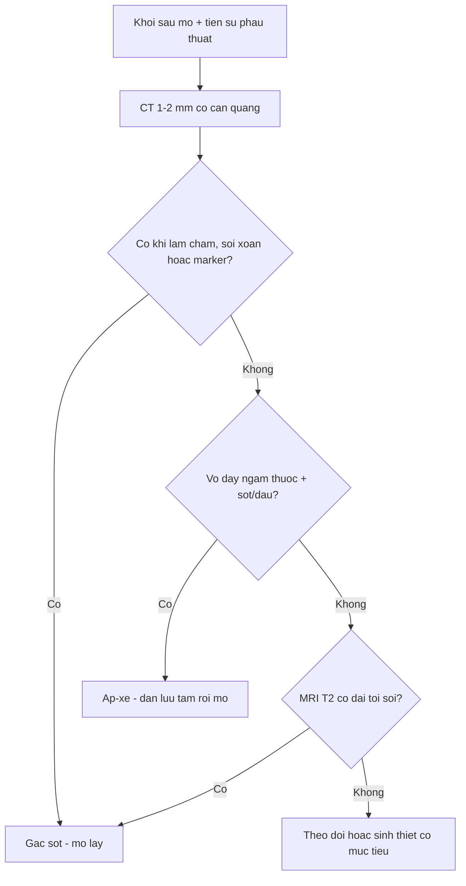
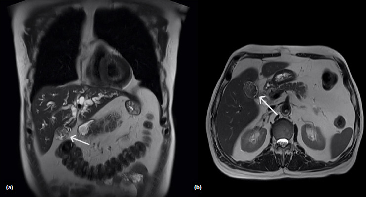
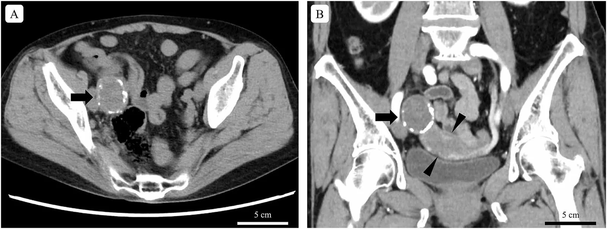

# 3112 — Gạc sót sau mổ (gossypiboma): khối "giả u" có khí, vôi hóa và dấu xoắn — đừng chọc dẫn lưu, đừng cắt nhầm

**Tags:** `pattern:di-vat` `pattern:khoi-sau-mo` `pattern:voi-hoa` `pattern:khong-ngam-thuoc` `pattern:ap-xe-sau-mo` `vung:o-bung` `vung:tieu-khung` `vung:thanh-bung` `anatomy:phuc-mac` `protocol:CT-bung-co-can-quang` `protocol:XR-bung` `protocol:MRI-bung` `incidentaloma:khoi-sau-mo`
**Mức chắc chắn (certainty):** tổng hợp y văn (literature synthesis) — ghép **loạt 14 ca gạc sót được xác nhận phẫu thuật trong 15.120 ca mổ** (Cureus 2024, PMC11297663), **ca gạc sót canxi hóa tồn tại 46 năm** (JSCR 2026, PMC13731752), **ca gạc sót gây hẹp đường mật sau cắt túi mật nội soi** (TJTES 2026, PMC13478480), **ca gạc sót dưới gan có khí trong ổ** (IJSCR 2026, PMC13652485) và các báo cáo về **di trú xuyên thành ruột**. Không có ca do nhóm tự chụp.

> **Câu hỏi thực hành:** nữ **74 tuổi**, đang chụp CT phân giai đoạn ung thư manh tràng, phát hiện **khối 4 cm ở tiểu khung**, **vôi hóa viền kiểu "vỏ trứng"**, nằm cạnh đáy tử cung. Tiền sử **mổ lấy thai 46 năm trước**. Bác sĩ siêu âm gọi là "u xơ tử cung thoái hóa". Câu hỏi: **có phải u thật không, và nếu là gạc sót thì xử trí thế nào?**
> Bài chốt **ba quyết định**: **(1) mọi khối "giả u" sau mổ — đặc, có khí, có vôi hóa viền, không ngấm thuốc, hoặc có cấu trúc xoắn — phải đặt gạc sót vào chẩn đoán phân biệt, bất kể đã mổ bao nhiêu năm; (2) CT 1–2 mm có cản quang là chuẩn (chẩn đoán đúng 10/11 ca trong loạt 14 ca), X-quang chỉ thấy marker và bỏ sót tới 36,4%, siêu âm bỏ sót 38,5%; (3) **không chọc hút/dẫn lưu qua da để "điều trị"** — gạc sót phải **lấy ra bằng mổ**, dẫn lưu đơn thuần tạo rò mạn và nhiễm khuẩn; áp-xe quanh gạc chỉ dẫn lưu **tạm** rồi mổ.**

## 1. Tổng quan bệnh học – cơ chế hình ảnh: vì sao một miếng gạc lại thành "khối u có khí"

- **Định nghĩa:** gossypiboma (textiloma, gauzoma) là **vật liệu dệt y tế sót lại** trong cơ thể sau mổ, thường là **gạc/gạc bụng (laparotomy sponge)**. Cơ thể phản ứng theo **hai con đường** (PMC11297663):
  1. **Thể tiết dịch – viêm mủ (exudative):** phản ứng viêm cấp, tạo **áp-xe**, có thể **rò ra da, vào ruột hoặc bàng quang**; hình ảnh là **ổ dịch vỏ dày ngấm thuốc ± khí**.
  2. **Thể xơ – tạo bao (fibrinous):** phản ứng hạt mạn, **bao xơ hóa** quanh gạc, thành **khối giả u** không triệu chứng; theo thời gian **vôi hóa** thành **viền "vỏ trứng"** hoặc **vôi hóa lấm chấm**.
- **Tần suất — bốn con số định lượng:**
  - **0,09% (14/15.120 ca mổ)** trong loạt 7 năm tại Yemen; **50% sau mổ phụ khoa**, tuổi trung bình **32,5 ± 17,0**, **71,4% nữ**; **trung vị 37 ngày** từ mổ tới khi có triệu chứng (PMC11297663).
  - Ước tính chung **1/1.000 – 1/1.500 ca mổ trong ổ bụng** (PMC13499996).
  - **Tiểu khung là vị trí hay gặp nhất (56%)** (PMC13456777).
  - **~50% các vụ kiện y khoa về "dị vật sót"** liên quan tới gạc sót (PMC13253992).
- **Thời gian — "không có giới hạn":** trung vị **37 ngày**, nhưng đã báo cáo **46 năm** (ca canxi hóa tiểu khung, PMC13731752), **35 năm** (Cureus 2025, PMC12612790), **15 năm** (di trú vào ruột non). Vì vậy **"mổ cách đây 40 năm" không loại trừ**.
- **Yếu tố nguy cơ — đo được, không phải "sơ suất cá nhân":** mổ **cấp cứu + kéo dài > 1 giờ** (50%), **nhiều kíp phẫu thuật / thay ca điều dưỡng giữa cuộc mổ** (35,7%), **BMI cao**, mổ **phụ khoa**, **chảy máu nhiều** (PMC11297663). Đếm gạc **đúng** vẫn có thể sót — nên hướng dẫn an toàn khuyến cáo **gạc có cản quang**, **đếm thành tiếng + ghi bảng**, **chụp X-quang khi nguy cơ cao**.
- **Hiệu năng chẩn đoán — vì sao CT là "cửa chốt":** trong loạt 14 ca, **CT đúng 10/11 ca (90,9% các ca được chụp CT)**, **X-quang không chẩn đoán được 4/11 (36,4%)**, **siêu âm không chẩn đoán được 5/13 (38,5%)** (PMC11297663). Nói cách khác: **X-quang chỉ thấy marker** (và nhiều gạc không có marker, hoặc marker bị bỏ qua), **siêu âm bị hơi ruột che**, còn **CT nhìn được cấu trúc bên trong khối**.
- **TẠI SAO CT thấy "spongiform" — vật lý của sợi cotton và khí:**
  - Gạc là **sợi cellulose khô, giữ nhiều khí giữa các sợi** → trên CT là **cấu trúc lấm chấm khí (mottled gas, gần −1.000 HU)** xen **sợi mảnh đậm hơn**, tạo hình **"bọt biển"/"tổ ong"**. Khí này có thể do **không khí bị giữ trong gạc** hoặc do **vi khuẩn sinh hơi/đường rò từ ruột**.
  - **Chỉ cản quang trong gạc (radiopaque marker)** cho **đường đậm, mảnh, uốn lượn ("serpiginous")** — đôi khi bị nhầm là **kim loại/dụng cụ** hoặc **mảnh xương**.
  - **Bao xơ** quanh gạc: mô xơ **ngấm thuốc chậm ở thì muộn**, dày **vài mm**, có thể **vôi hóa viền** sau nhiều năm (HU > 200). Khối **không ngấm thuốc ở trung tâm** vì bên trong là **gạc, không có mạch**.
  - **Dấu "xoắn/whirl"** (nếp gạc cuộn) và **dấu "vỏ trứng"** (canxi hóa viền) là hai mẫu hình hay gặp ở thể xơ mạn (PMC12612790, PMC13731752).
- **TẠI SAO MRI khác CT — và khi nào MRI hơn:**
  - Sợi cotton **rất ít proton linh động** → trên T2 tạo **dải/tuyến tín hiệu THẤP** (đường đen mảnh) trên nền **tín hiệu trung bình–cao** của dịch/viêm; hình **"reticular"/"mesh-like"** này thấy rõ ở ca IJSCR 2026 (Hình a: ổ tín hiệu trung bình–cao có **khí bên trong**, viền sợi tối).
  - **Bao xơ** T2 thấp, ngấm thuốc muộn; **thể tiết dịch** T2 rất cao, viền ngấm mạnh.
  - **DWI:** **mủ** hạn chế khuếch tán (ADC thấp) còn **khối xơ/gạc** thì **không** — vì vậy DWI giúp phân biệt **thể áp-xe** với **thể xơ**, **không** giúp phân biệt với **u**.
- **TẠI SAO dễ bị gọi là ung thư/tái phát:** khối **đặc, bờ không đều, dính, có thể tăng FDG do viêm hạt**; bệnh nhân lại **có tiền sử ung thư** → bác sĩ nghĩ **tái phát/di căn** và **cắt bỏ** (đã có ca **cắt phân thùy gan** vì tưởng u, PMC12309357). Chỉ **tiền sử mổ + mẫu hình trong khối** mới cứu được bệnh nhân khỏi phẫu thuật lớn không cần thiết.

## 2. Mẫu hình + chẩn đoán phân biệt theo vị trí và phản ứng mô (Gamut)

- **Mẫu hình cốt lõi:** **khối sau mổ**, bờ tròn/oval, **có khí lấm chấm hoặc cấu trúc xoắn**, **không ngấm thuốc trung tâm**, **vỏ xơ ngấm chậm ± vôi hóa viền**; bệnh nhân có thể **hoàn toàn không triệu chứng** hoặc chỉ **đau âm ỉ/táo bón**.
- **Theo phản ứng mô:**
  - **Thể xơ (fibrinous):** khối đặc, vỏ dày, **không triệu chứng**, phát hiện tình cờ; **vôi hóa sau nhiều năm**; dễ nhầm **u xơ, teratoma, u tái phát**.
  - **Thể tiết dịch (exudative):** **áp-xe**, sốt, đau, **rò ra da/ruột/bàng quang**; hình ảnh **ổ dịch vỏ dày + khí**, có thể **dò vào lòng ruột**.
- **Theo vị trí (quyết định đường mổ):**
  - **Tiểu khung (56%)** — sau mổ phụ khoa/sản khoa; dễ nhầm **u xơ tử cung thoái hóa, u buồng trứng, nang cùng đồ**.
  - **Dưới gan / gan** — sau cắt túi mật; có thể gây **hẹp đường mật, vàng da** (PMC13478480) và bị gọi là **u gan**.
  - **Lòng ruột non** — do **di trú xuyên thành**; biểu hiện **tắc ruột**, đôi khi **không có dấu thủng** vì ruột tự bịt; dễ nhầm **bã thức ăn (bezoar)**.
  - **Bàng quang** — gạc **đóng cặn** thành "sỏi bàng quang", **đái máu, đái buốt**.
  - **Thành bụng / vết mổ** — khối dưới da, dễ nhầm **u hạt, áp-xe, di căn** (nối bài 3111).
  - **Trung thất/ngực** — sau mổ tim–lồng ngực, hiếm.
- **Gamut "khối giả u sau mổ":** gạc sót (2 thể), **áp-xe**, **máu tụ**, **seroma/nang bạch huyết**, **u tái phát/di căn**, **u mô đệm (desmoid)**, **lạc nội mạc**, **vật liệu cầm máu (Surgicel/Spongostan) chưa tiêu**, **u xơ tử cung thoái hóa/vôi hóa**, **teratoma**, **nang ký sinh trùng (hydatid) vôi hóa**.
- **Ba câu hỏi đọc ảnh:** **(1) có tiền sử mổ đúng vùng này không? (2) trong khối có khí/sợi/marker/xoắn không? (3) vỏ có ngấm thuốc muộn và vôi hóa viền không?** Trả lời "có" cho (1) + bất kỳ ý nào của (2)/(3) → **đặt gạc sót lên đầu**.

## 3. Bảng so sánh phân biệt (ma trận đối chiếu)

| Thực thể (entity) | Hình ảnh điển hình (CT/MRI) | Chốt vào (rule-in) | Chốt loại (rule-out) | Gợi ý xác nhận |
|---|---|---|---|---|
| Gạc sót thể xơ (fibrinous) | Khối bờ rõ, **vỏ xơ dày ngấm thuốc muộn**, **trung tâm không ngấm**, **khí lấm chấm/xoắn**, **vôi hóa viền** | **Tiền sử mổ + cấu trúc xoắn/spongiform + vỏ xơ** | Ngấm thuốc đều toàn khối, không khí, không sợi → nghĩ u | CT 1–2 mm + cửa sổ xương; MRI T2 dải tối |
| Gạc sót thể tiết dịch (áp-xe) | **Ổ dịch vỏ dày ngấm**, **khí trong ổ**, mô mỡ quanh tăng đậm, có thể **rò vào ruột/da** | **Vỏ ngấm + khí + sốt/đau + tiền sử mổ** | Dịch thuần, vỏ mỏng, không khí → seroma | Chọc hút (cấy) chỉ để chẩn đoán; **không dẫn lưu triệt để** |
| Gạc sót di trú trong lòng ruột | Khối trong lòng ruột, **spongiform ± marker**, **tắc ruột**, **không có khí tự do** (ruột tự bịt) | **Khối trong lòng + tiền sử mổ + tắc ruột** | Bã thức ăn không có marker/sợi; không tiền sử mổ | CT đa bình diện; mổ nội soi/tháo lấy |
| Áp-xe sau mổ (không có gạc) | Ổ dịch vỏ dày, khí, có thể **vách hóa**, phản ứng mô mỡ | **Hội chứng nhiễm trùng + ổ dịch ngấm viền** | **Không có cấu trúc sợi/xoắn/marker**, không vôi hóa viền | Cấy dịch; kháng sinh + dẫn lưu |
| Máu tụ | **50–80 HU**, không ngấm, hình đa cung, **giảm đậm dần theo tuần** | **HU cao + không ngấm + sau chọc/mổ** | Ngấm thuốc + khí + sợi → gạc/áp-xe | CT không cản quang; theo dõi |
| U tái phát / di căn | Nốt/khối **đặc ngấm thuốc**, **DWI sáng/ADC thấp**, lớn dần, có thể **xâm lấn** | **Ngấm thuốc + DWI hạn chế + lớn dần** | **Không ngấm trung tâm + khí/xoắn** → gạc | MRI DWI, PET/CT (cẩn thận dương tính giả) |
| U mô đệm (desmoid) | Khối **dải tín hiệu thấp T2**, ngấm thuốc, **bám cân**, tái phát sau cắt | **Dải tối T2 + bám cân + tiền sử đa u xơ** | Khí/sợi/marker → không phải desmoid | MRI; sinh thiết khi cần |
| Seroma / nang bạch huyết | Dịch **0–20 HU**, vỏ mỏng **không ngấm**, hình thấu kính, giảm dần | **Dịch thuần, vỏ mỏng, không khí** | Vỏ dày ngấm + khí → áp-xe/gạc | Siêu âm; CT |
| Vật liệu cầm máu chưa tiêu (Surgicel) | Khối **tăng đậm nhẹ**, có thể **khí**, **không marker**, teo dần theo tháng | **Tiền sử dùng vật liệu + khối teo dần** | Không teo, có sợi/xoắn, vôi hóa → gạc | Theo dõi 3–6 tháng; MRI |
| U xơ tử cung thoái hóa / vôi hóa | Khối **canxi hóa viền/lấm chấm**, **liên tục với tử cung**, ngấm thuốc như cơ tử cung | **Liên tục với tử cung, không có sợi/khí** | **Tách khỏi tử cung + xoắn/sợi** → gạc | MRI T2; siêu âm |

*Trái: khối tiểu khung 4 cm, **vôi hóa viền kiểu vỏ trứng**, tồn tại **46 năm** sau mổ lấy thai (JSCR 2026, PMC13731752, CC BY 4.0). Phải: khối **xoắn – vôi hóa** ở hố chậu phải, 35 năm sau mổ (Cureus 2025, PMC12612790, CC BY 4.0). Ảnh ghép letterbox, giữ nguyên khung và mũi tên của tác giả.*

### Ba mẫu hình cần nhớ (đọc trên ảnh gốc)
- **"Spongiform" trên CT:** lấm chấm khí trong khối đặc, kèm **đường đậm uốn lượn** (marker) — ca IJSCR 2026 (Hình c) cho thấy rõ **cấu trúc bọt biển + đường viền đậm** ở dưới gan.
- **Dải sợi tối trên T2:** ca IJSCR 2026 (Hình a) — **ổ tín hiệu trung bình–cao** với **khí bên trong** và **các sợi tối**; đây là "chữ ký" MRI của gạc, khác với **u đặc ngấm thuốc đồng nhất**.
- **Vôi hóa viền "vỏ trứng":** gặp ở thể xơ mạn, **không đặc hiệu** (u xơ thoái hóa cũng có) — nhưng khi khối **tách khỏi tử cung** và có **tiền sử mổ**, phải nghĩ gạc.

*(a) MRI T2 ngang và dọc: ổ tín hiệu trung bình–cao, **khí bên trong** (mũi tên đỏ), cấu trúc sợi; (b) MRCP: **sỏi ống mật chủ xa** (mũi tên vàng) + gạc sót (đỏ); (c) CT có cản quang: **cấu trúc spongiform với đường viền đậm**. Nguồn: IJSCR 2026 (PMC13652485), **CC BY-NC-ND 4.0** — hiển thị nguyên bản, không crop/ghép.*

## 4. Protocol chụp + ngưỡng xử trí

- **Bước 1 — X-quang bụng (chỉ để tìm marker):** rẻ, nhanh, nhưng **không chẩn đoán được 36,4%** ca trong loạt 14 ca; **X-quang bình thường không loại trừ** (gạc không marker, marker bị che). Dùng khi **chưa có CT** hoặc **kiểm tra ngay sau mổ nguy cơ cao**.
- **Bước 2 — Siêu âm:** khối **tăng âm hình cung, có bóng lưng**, đôi khi thấy **khí trong khối**; bị hơi ruột che, **bỏ sót 38,5%**; dùng để **hướng dẫn chọc hút chẩn đoán** (không phải điều trị).
- **Bước 3 — CT bụng–tiểu khung có cản quang, lát 1–2 mm, đa bình diện (chuẩn):** đọc **3 thì** (động mạch/tĩnh mạch/muộn) để thấy **vỏ xơ ngấm muộn**; **cửa sổ xương** để tìm **marker/vôi hóa**; đo **kích thước 3 chiều (mm)**, mô tả **khí, xoắn, vôi hóa viền**, tìm **rò vào ruột/bàng quang**, **tắc ruột**, **hạch**.
- **Bước 4 — MRI (khi CT chưa chốt, hoặc cần phân biệt u):** **T2 + T1 fat-sat + DWI + ngấm thuốc muộn**; tìm **dải tối sợi**, **vỏ xơ**, **khí (trống tín hiệu)**; **MRCP** nếu vàng da/giãn đường mật.
- **Bước 5 — PET/CT: KHÔNG dùng để chẩn đoán.** Sau mổ, **viêm hạt và mô hạt có thể tăng FDG** — dương tính giả rất thường gặp trong bối cảnh hậu phẫu (pictorial essay FDG sau mổ, PMC8481839). PET chỉ dùng **phân giai đoạn ung thư nền**, không dùng để loại trừ gạc sót.
- **Ngưỡng và nguyên tắc xử trí:**
  - **Mọi gạc sót đã chẩn đoán đều phải lấy ra**, kể cả **không triệu chứng** — vì nguy cơ **rò, áp-xe, di trú, và ung thư hóa mô xơ (cực hiếm)**; phẫu thuật **nội soi** nếu khối **nhỏ, không rò, không dính**; **mở** nếu **dính nhiều, có rò, hoặc đã mổ nhiều lần**.
  - **Không dẫn lưu qua da đơn thuần:** dẫn lưu chỉ **giải áp tạm** khi áp-xe lớn/nhiễm trùng nặng, sau đó **vẫn phải mổ lấy gạc**; dẫn lưu để lại **rò mạn, nhiễm khuẩn tái diễn**.
  - **Không sinh thiết mù rồi cắt lớn** khi chưa loại trừ gạc sót: hỏi **tiền sử mổ**, xem **cấu trúc trong khối**, **so phim cũ**.
  - **Phòng ngừa (chuẩn bắt buộc):** đếm gạc **thành tiếng + ghi bảng**, **gạc có cản quang**, **checklist WHO**, **X-quang ngay tại phòng mổ** khi **mổ cấp cứu, > 1 giờ, thay kíp, BMI cao, chảy máu nhiều**.
- **Theo dõi sau lấy gạc:** CT/MRI lại **3–6 tháng** nếu có **rò hoặc áp-xe**; theo dõi **nhiễm khuẩn vết mổ**, **hẹp đường mật** (nếu ở dưới gan), **tắc ruột** (nếu di trú).

## 5. Biến thể bình thường và cạm bẫy

- **"Đếm gạc đúng" vẫn sót:** đếm sai không phải điều kiện bắt buộc; **thay ca, mổ cấp cứu, chảy máu** làm đếm không đáng tin — đừng bỏ qua vì "sổ ghi đủ".
- **X-quang âm tính:** nhiều gạc **không có marker**, hoặc marker **bị xương/túi mật che**; X-quang **không loại trừ**.
- **Chọc hút/dẫn lưu "chữa khỏi":** dịch ra nhiều, bệnh nhân đỡ đau → tưởng thành công; sau đó **rò mạn, nhiễm khuẩn, khối không mất**; **dẫn lưu không lấy được gạc**.
- **Gọi là u và cắt lớn:** ca **cắt phân thùy gan** vì tưởng u (PMC12309357); ca **cắt tử cung/buồng trứng** vì tưởng u xơ/u ác — luôn hỏi **tiền sử mổ** và **so phim cũ**.
- **Vôi hóa ở người già:** "vôi hóa là lành" — sai; gạc sót **46 năm** vẫn là gạc sót và vẫn có thể gây biến chứng.
- **Di trú trong lòng ruột:** hình ảnh giống **bezoar**; nếu không có marker, **không loại trừ** — hỏi tiền sử mổ, tìm **tắc ruột**, **không có khí tự do** vì ruột tự bịt.
- **Gạc đóng cặn trong bàng quang:** giống **sỏi bàng quang**; bệnh nhân **đái máu tái diễn**, tiền sử mổ **phụ khoa/sa bàng quang**.
- **PET/CT dương tính giả:** viêm hạt sau mổ **tăng FDG**; **không dùng PET để loại trừ**, và **không đổi chẩn đoán** chỉ vì PET dương.
- **Vật liệu cầm máu (Surgicel) — bắt chước gạc:** khối **teo dần** theo tháng, **không có sợi/marker**; theo dõi thay vì mổ ngay (PMC13544675).
- **Bỏ sót thứ hai (satisfaction of search):** đã thấy một khối vẫn phải **đọc toàn ổ bụng** — gạc có thể **nhiều miếng** hoặc kèm **áp-xe thứ phát**.

## 6. Tự lượng giá — Blind Quiz

**Ca 1 — Nam 64 tuổi, vàng da 9 tháng sau cắt túi mật nội soi. Nhìn ảnh trước, mô tả sau.**

- Gợi ý lâm sàng: đau tái diễn, buồn nôn; bilirubin toàn phần **11,66 mg/dL**, GGT **930 U/L**.
- Câu hỏi: Dấu hiệu chính trong và cạnh khối? Chẩn đoán nào giải thích **cả khối và vàng da**?

<b>Bấm để hiện đáp án</b>

- Dấu hiệu: **khối 32 × 25 mm** dưới gan, tín hiệu **hỗn hợp có cấu trúc sợi**, kèm **giãn đường mật trong gan**; bờ khối sát mỏ kẹp kim loại.
- Chẩn đoán: **gạc sót gây hẹp đường mật lành tính muộn** sau cắt túi mật; mổ mở lấy gạc + **nối mật–ruột Roux-en-Y**.
- Vì sao: vỏ xơ quanh gạc co kéo → hẹp ống mật chủ; **không phải u đường mật** dù hình ảnh giống.
- Nguồn: TJTES 2026 (PMC13478480), CC BY-NC 4.0.

**Ca 2 — Nữ 74 tuổi, khối tiểu khung 4 cm tình cờ, tiền sử mổ lấy thai 46 năm trước.**

- Câu hỏi: Vì sao **không thể gọi là u xơ thoái hóa** chỉ dựa vào vôi hóa? Dấu hiệu nào trên CT gợi ý gạc?

<b>Bấm để hiện đáp án</b>

- Dấu hiệu: khối **bờ rõ, vôi hóa viền "vỏ trứng"**, **không ngấm thuốc**, nằm **cạnh – tách khỏi tử cung**; không có cấu trúc sợi rõ.
- Chẩn đoán: **gạc sót canxi hóa 46 năm** — mô bệnh + **kính phân cực** xác nhận sợi ngoại lai; mổ cắt cùng đoạn hồi manh tràng.
- Vì sao: vôi hóa viền gặp ở **cả** u xơ thoái hóa và gạc sót; **tiền sử mổ + vị trí tách khỏi tử cung + trung tâm không ngấm** là chốt.
- Nguồn: JSCR 2026 (PMC13731752), CC BY 4.0.

**Ca 3 — Bệnh nhân có khối dưới gan 2 năm sau cắt túi mật, CT thấy cấu trúc bọt biển + đường đậm uốn lượn; bác sĩ đề nghị "chọc dẫn lưu cho xẹp".**

- Câu hỏi: Bạn đồng ý hay không? Nêu **3 lý do** và **bước tiếp theo**.

<b>Bấm để hiện đáp án</b>

- **Không đồng ý dẫn lưu đơn thuần.** Lý do: (1) đây là **gạc sót**, không phải ổ dịch đơn thuần — dẫn lưu **không lấy được gạc**; (2) dẫn lưu tạo **rò mạn/nhiễm khuẩn**, có thể **làm vỡ khối** và lan nhiễm; (3) bỏ sót **di trú vào ruột/đường mật**.
- Bước tiếp theo: **CT 1–2 mm có cản quang + MRI T2/DWI** nếu cần; **mổ nội soi lấy gạc** (mở nếu dính nhiều); nếu có áp-xe lớn → **dẫn lưu tạm + kháng sinh rồi mổ**.
- Nguồn mẫu hình ảnh: IJSCR 2026 (PMC13652485), CC BY-NC-ND 4.0.

## Bài liên quan chéo
- [3111 – Thoát vị lỗ trocar sau nội soi](../3111-thoat-vi-lo-trocar-sau-noi-soi/lesson.md)
- [3061 – Di căn lỗ trocar sau PIPAC & nội soi](../3061-di-can-lo-trocar-sau-pipac-va-noi-soi/lesson.md)
- [1936 – Tụ máu bao cơ thẳng bụng](../1936-tu-mau-bao-co-thang-bung/lesson.md)
- [141 – Phúc mạc: cổ trướng & carcinomatosis](../141-phuc-mac/lesson.md)
- [160 – Bụng cấp & tắc ruột non](../160-bung-cap-GI/lesson.md)
- [910 – Dẫn lưu áp-xe qua da](../910-abscess-biliary-nephrostomy/lesson.md)

## Ảnh
- `images/composite_gossypiboma.jpg` — ghép từ PMC13731752 và PMC12612790 (cả hai CC BY 4.0).
- `images/3112_gossypiboma_CT-JSCR2026-PMC13731752.jpg` — JSCR 2026 (PMC13731752), CC BY 4.0.
- `images/3112_gossypiboma_CT-Cureus2025-PMC12612790.jpg` — Cureus 2025 (PMC12612790), CC BY 4.0.
- `images/3112_gossypiboma_MRI-CECT_IJSCR2026-PMC13652485.webp` — IJSCR 2026 (PMC13652485), CC BY-NC-ND 4.0 (nguyên bản).
- `images/3112_gossypiboma_MRI-TJTES2026-PMC13478480.jpg` — TJTES 2026 (PMC13478480), CC BY-NC 4.0.
- Nguồn, giấy phép và ghi chú phái sinh từng ảnh: `images/CREDITS.md`.

> Không dùng để chẩn đoán độc lập khi chưa có người hướng dẫn.
