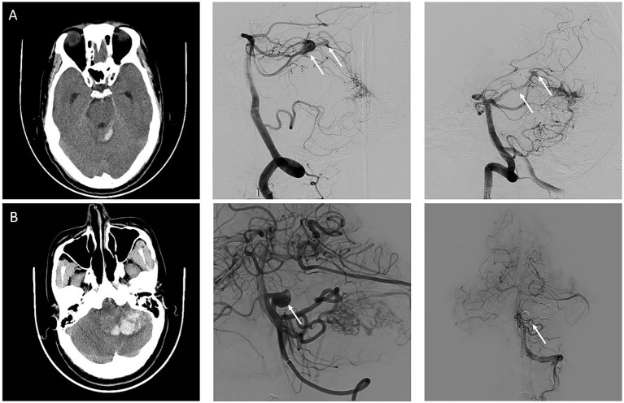
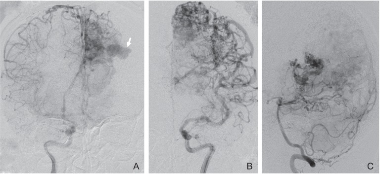
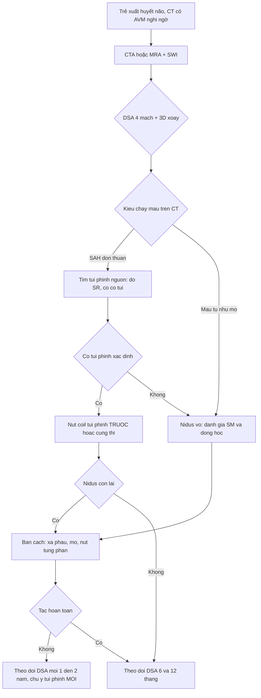
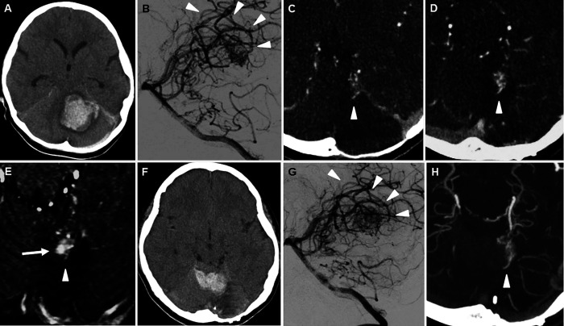
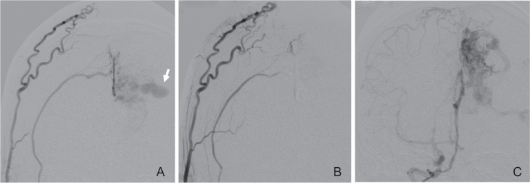
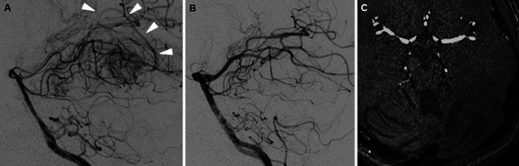

# 3113 — Túi phình kèm theo AVM não ở trẻ: liên quan dòng chảy & trong nidus / AVM-associated aneurysms in children

**Tags:** `pattern:tui-phinh` `pattern:nidus` `pattern:flow-void` `pattern:xuat-huyet-duoi-nhen` `pattern:shunt-toc-do-cao` `vung:nao` `vung:mach-nao` `score:Spetzler-Martin` `score:size-ratio` `protocol:DSA-3D` `protocol:CTA` `protocol:MRA` `protocol:SWI`

**Mức chắc chắn (certainty):** tổng hợp y văn (literature synthesis) — đoàn hệ **238 trẻ AVM** của Children's Hospital of Pittsburgh 1988–2023 (*J Neurosurg Pediatr* 2025, **PMID 39423430**, không open access: chỉ dùng số từ abstract); đoàn hệ **284 AVM / 37 AVM hố sau có túi phình liên quan dòng chảy** đa trung tâm Trung Quốc (*Front Neurol* 2025, **PMC12682677**, CC BY); loạt **2 trẻ AVM vỡ tái phát có túi phình MỚI** sau xạ phẫu (*J Neurosurg Case Lessons* 2022, **PMC9624159**, CC BY-NC-ND); ca **nút mạch đích túi phình trong nidus** (*J Cerebrovasc Endovasc Neurosurg* 2015, **PMC4663032**, CC BY-NC-ND). Nhóm **không có bệnh nhân của mình**; dữ liệu nguy cơ vỡ **chủ yếu từ người lớn**, phần nhi khoa mới ở mức đoàn hệ hồi cứu, **không có thử nghiệm ngẫu nhiên**.

> **Câu chốt:** Khoảng **1/5 trẻ có AVM mang kèm ít nhất một túi phình** (18,5%), và **một nửa số ca "AVM vỡ" thực ra là túi phình vỡ** — nên câu hỏi không phải "có AVM không" mà là **"túi phình này nằm ở đâu và ai chịu trách nhiệm chảy máu?"**. Bốn vị trí phải phân biệt trước khi can thiệp: **trên cuống nuôi (feeding artery, typ II)**, **trong nidus (intranidal, typ III)**, **trên tĩnh mạch dẫn lưu (postnidal)** và **túi phình không liên quan (typ I)** — vì **cách xử lý và thứ tự xử lý khác nhau**, và **túi phình postnidal ở trẻ lại KHÔNG làm tăng xuất huyết** (OR 0,36).

## 1. Tổng quan bệnh học – cơ chế hình ảnh (TẠI SAO)

### 1.1 Phân loại: vì sao "túi phình cạnh AVM" không phải một bệnh

- **Typ I — không liên quan (unrelated):** túi phình nằm trên mạch **không nuôi** nidus, là bệnh túi phình thông thường tình cờ gặp cùng AVM.
- **Typ II — liên quan dòng chảy (flow-related):** nằm trên **đoạn gần của động mạch nuôi**, phía trước nidus. Sinh lý: **lưu lượng qua nidus rất lớn** làm **ứng suất cắt thành mạch (wall shear stress)** tăng ở đoạn mạch nuôi → tái cấu trúc thành, giãn và phình. Đây là túi phình **hệ quả của AVM**, và khi AVM được chữa khỏi thì một số túi **có thể tự thoái triển** (cơ sở của chiến lược "theo dõi túi nhỏ sau khi chữa AVM").
- **Typ III — trong nidus (intranidal):** túi nằm **trong búi mạch**, thường rất khó thấy trên CTA vì bị nidus và máu tụ che; là **điểm yếu thành mạch áp lực cao nhất**.
- **Postnidal — trên tĩnh mạch dẫn lưu:** túi/giãn tĩnh mạch (venous varix) trên đường thoát. Áp lực thấp hơn nhiều so với phía động mạch.
- **Bằng chứng định nghĩa:** mọi phân loại trên đều dựa vào **DSA (chụp mạch số hoá xoá nền)**; đoàn hệ Pittsburgh phân bố **49 túi phình ở 44 trẻ**: **19 (38,8%) feeding artery**, **8 (16,3%) intranidal**, **21 (42,9%) postnidal**, **1 (2,0%) không liên quan**; thêm **5 trẻ có giãn tĩnh mạch (varix)** (**PMID 39423430**).

### 1.2 TẠI SAO trẻ có túi phình và TẠI SAO nó vỡ

- **Cơ chế huyết động:** định luật Laplace cho thành mạch **σ = P·r / (2t)** — khi **bán kính (r) tăng** và **thành mỏng (t giảm)** thì **ứng suất thành tăng theo cấp số nhân với bán kính**. Vì vậy **túi phình to ra là tự làm yếu thêm**, và **tỉ lệ kích thước túi / đường kính mạch mẹ (size ratio, SR)** mô tả đúng "độ căng tương đối" đó.
- **Ngưỡng định lượng (người lớn, AVM hố sau — PMC12682677, n = 37 bệnh nhân / 50 túi phình):**

| Biến số | Túi phình ĐÃ vỡ (n = 22) | Túi phình CHƯA vỡ (n = 28) | p |
|---|---|---|---|
| Đường kính túi, trung vị (IQR) | **4,55 mm (3,20–7,55)** | **3,00 mm (2,40–5,00)** | 0,009 |
| Size ratio (SR, túi/mạch mẹ) | **2,72 (1,95–4,12)** | **2,23 (1,10–2,87)** | 0,021 |
| Relative size ratio (RSR, túi/nidus) | **0,24 (0,137–0,358)** | **0,096 (0,063–0,129)** | < 0,001 |
| Kích thước nidus AVM | **2,41 ± 1,02 cm** | **3,93 ± 2,68 cm** | 0,001 |
| Spetzler–Martin I–II | **81,8%** (18/22) | **33,3%** (5/15) | 0,013 |

- **Hồi quy đa biến (PMC12682677):** chỉ còn **kích thước AVM — OR 0,92 (95% CI 0,84–0,99), p = 0,039** và **size ratio — OR 1,66 (95% CI 1,07–2,59), p = 0,024**. Nghĩa là **AVM NHỎ + túi phình TO so với mạch mẹ** là tổ hợp dễ vỡ — nghịch lý "AVM nhỏ nguy hiểm hơn AVM lớn" giải thích bằng **tỉ lệ lưu lượng trên thể tích nidus cao hơn**.
- **Tỉ lệ chảy máu do túi phình:** trong AVM có túi phình kèm theo, **~49,2% ca xuất huyết là do túi phình vỡ** (dữ liệu tổng hợp người lớn, dẫn trong PMC12682677); trong nhóm AVM hố sau có túi phình liên quan dòng chảy, **22/37 = 59,4%** ca nhập viện vì chảy máu **do chính túi phình vỡ**.
- **NHƯNG ở trẻ, bức tranh ngược lại một phần:** trong **238 trẻ**, **47,7% (21/44)** trẻ **có** túi phình nhập viện vì xuất huyết, so với **61,3% (119/194)** trẻ **không** có túi phình (**p = 0,10** — không khác biệt có ý nghĩa). Hồi quy đa biến: **túi phình postnidal làm GIẢM khả năng xuất huyết — OR 0,36 (p = 0,037)**; **nhiều tĩnh mạch dẫn lưu hơn** cũng giảm (**OR 0,66 mỗi tĩnh mạch, p = 0,049**); trong khi **dẫn lưu tĩnh mạch sâu làm TĂNG xuất huyết — OR 2,25 (p = 0,0045)** (**PMID 39423430**). Kết luận thực dụng: **ở trẻ, sự hiện diện của túi phình không tự nó là chỉ định can thiệp**; phải xem **loại túi phình + dẫn lưu sâu + kích thước nidus**.

### 1.3 TẠI SAO hình ảnh trông như vậy (vật lý từng phương thức)

- **CT không cản quang:** **máu dưới nhện (SAH) đơn thuần, KHÔNG kèm máu tụ nhu mô** là kiểu chảy máu gợi ý **túi phình vỡ**; ngược lại **máu tụ nhu mô ± máu não thất** gợi ý **nidus vỡ**. Đây chính là tiêu chuẩn mà nghiên cứu PMC12682677 dùng để quy kết nguồn chảy máu, và là **dấu hiệu định vị đầu tiên trên CT** — trước cả DSA.
- **CTA:** nidus, động mạch nuôi giãn và **tĩnh mạch dẫn lưu hiện sớm ở thì động mạch**; nhưng **độ phân giải không gian xấp xỉ 0,5–0,6 mm** và **máu tụ cạnh nidus che tổn thương** → **CTA âm KHÔNG loại trừ** túi phình nhỏ/intranidal.
- **MRI/MRA:** **flow void** trên T2 (máu chảy nhanh rời mặt cắt), **SWI/T2\*** thấy **hemosiderin** của máu cũ (dấu hiệu chảy máu trước đó nhiều đợt), **MRA** thấy cuống nuôi và túi lớn; MRA **không đủ** để loại trừ túi phình < 3 mm.
- **DSA + 3D xoay:** chuẩn vàng, **độ phân giải xấp xỉ 0,2 mm**, thấy **túi phình nhỏ, cổ túi, và mạch nuôi của riêng túi** — điều kiện để **nút mạch "đích" (targeted embolization)** mà không làm tắc nidus.
- **TẠI SAO phải chụp nhiều thì:** túi phình liên quan dòng chảy **đổ đầy sớm và rửa nhanh** (high flow), còn **giãn tĩnh mạch** chỉ hiện ở **thì tĩnh mạch** — chụp một thì dễ **gọi giãn tĩnh mạch là túi phình** hoặc bỏ sót túi phình thật.

## 2. Mẫu hình + chẩn đoán phân biệt theo vị trí (gamut)

- **Túi phình trên cuống nuôi (feeding artery, typ II):** nằm **đoạn gần, thường ở chỗ chia nhánh hoặc góc gập** của động mạch nuôi; bờ đều, cổ rõ, **rửa nhanh**; thường **một vài túi** trên cùng hệ nuôi.
- **Túi phình trong nidus (intranidal, typ III):** **ổ đậm thuốc tròn nằm TRONG búi mạch**, không tách khỏi nidus trên 2 bình diện; **không thấy trên CTA** ở nhiều ca; là **nguồn chảy máu khi nidus vỡ**.
- **Giãn tĩnh mạch / túi postnidal:** **cấu trúc đậm thuốc hình túi hoặc hình thoi trên tĩnh mạch dẫn lưu**, hiện **thì tĩnh mạch**, kích thước lớn hơn động mạch; **không có cổ túi**; **không phải túi phình thật**.
- **Túi phình không liên quan (typ I):** nằm trên mạch **khác hệ nuôi**, hình dạng điển hình của túi phình thường; **quyết định điều trị theo tiêu chuẩn túi phình**, không theo AVM.
- **Gamut theo bối cảnh — "ổ đậm thuốc tròn cạnh AVM" gồm:** (1) túi phình typ I/II/III; (2) giãn tĩnh mạch postnidal; (3) **phình mạch (infundibulum)** ở gốc nhánh — biến thể bình thường, **< 3 mm, hình phễu, không có cổ**; (4) **giả phình do chấn thương** (bờ không đều, tiền sử chấn thương); (5) **túi phình nhiễm khuẩn (mycotic)** — bờ mờ, nhiều ổ, có nhiễm trùng huyết; (6) **búi mạch dural AVF** đổ vào xoang — khác nguồn nuôi (động mạch màng não).
- **Câu hỏi định vị (4 bước):** (1) **túi đổ đầy ở thì nào?** (2) **có cổ túi không?** (3) **mạch nuôi túi có nuôi nidus không?** (4) **kiểu chảy máu trên CT là SAH hay máu tụ nhu mô?**

## 3. Bảng so sánh phân biệt (ma trận đối chiếu)

| Thực thể (entity) | Hình ảnh điển hình | Chốt vào (rule-in) | Chốt loại (rule-out) | Gợi ý xác nhận |
|---|---|---|---|---|
| Túi phình liên quan dòng chảy (typ II) | Túi trên **đoạn gần động mạch nuôi**, cổ rõ, rửa nhanh; thường kèm **SAH đơn thuần** trên CT | **Có cổ túi + mạch nuôi đi vào nidus + size ratio cao** | Túi không có cổ, hiện thì tĩnh mạch → không phải túi phình | DSA 3D xoay, đo SR = túi/mạch mẹ |
| Túi phình trong nidus (typ III) | Ổ đậm thuốc tròn **trong búi mạch**, không tách khỏi nidus | **Thấy trên DSA khi bơm chọn lọc cuống nuôi; kích thước không đổi theo thì** | CTA âm **không** loại trừ; nếu chỉ thấy trên MRA thì chưa đủ | DSA chọn lọc (superselective) + 3D |
| Giãn tĩnh mạch / postnidal | Túi/trục giãn trên **tĩnh mạch dẫn lưu**, không cổ, hiện **thì tĩnh mạch** | **Nối liền với tĩnh mạch dẫn lưu, không có cổ, đổ đầy muộn** | Có cổ + đổ đầy thì động mạch → là túi phình | DSA thì tĩnh mạch, MRA |
| Túi phình không liên quan (typ I) | Túi điển hình trên **mạch không nuôi nidus** | **Mạch mang túi không liên hệ nidus trên DSA 3D** | Nằm trên cuống nuôi → typ II, xử trí khác | DSA 4 mạch đầy đủ, không chỉ bơm hệ nuôi |
| Phình mạch (infundibulum) | Hình **phễu < 3 mm** ở gốc nhánh, không cổ | **Không có cổ, không lớn dần theo thời gian** | Lớn dần, có cổ, hình cầu → túi phình thật | So sánh DSA các lần, đo mm |
| Búi mạch màng não (dural AVF) | Nidus mỏng **trong màng não**, nuôi bởi **động mạch màng não**, đổ vào xoang | **Nguồn nuôi từ động mạch màng não + đổ vào xoang** | Nguồn nuôi là động mạch não (pial) → AVM | DSA động mạch cảnh ngoài, CTA |
| AVM có varix lớn | Nidus + **tĩnh mạch dẫn lưu giãn khổng lồ** | **Nidus thấy rõ + varix đổ đầy muộn** | Không có nidus → giãn tĩnh mạch đơn thuần | DSA, MRI T2 |

*Hình nguyên bản *Front Neurol* 2025 (**PMC12682677**, CC BY 4.0): **(A)** người lớn đau đầu đột ngột — CT có **máu dưới nhện đơn thuần**, DSA thấy AVM nuôi bởi động mạch tiểu não trên trái **kèm hai túi phình liên quan dòng chảy** (mũi tên trắng); túi lớn **10 mm** là nguồn chảy máu và **được nút coil trước**. **(B)** CT có **máu tụ nhu mô tiểu não**, DSA thấy túi phình liên quan dòng chảy trên **động mạch tiểu não trước dưới**; túi và nidus **được xử lý cùng một thì** (coil + Onyx).*

### Dấu hiệu cần đọc đúng trên từng phương thức

- **CT:** phân biệt **SAH đơn thuần** (nghi túi phình) với **máu tụ nhu mô ± IVH** (nghi nidus); đo **thể tích máu tụ** và **đường giữa** để quyết định mổ giải ép.
- **DSA:** **4 mạch + 3D xoay**, bơm **chọn lọc từng cuống** (không chỉ bơm thân chính) để phát hiện túi intranidal; đo **SR = đường kính túi / đường kính trung bình mạch mẹ** — ngưỡng **≥ 2** là vùng nguy cơ trong dữ liệu người lớn.
- **MRI/SWI:** đếm **ổ hemosiderin** — nhiều ổ = **chảy máu tái diễn nhiều đợt**, làm thay đổi chỉ định điều trị ngay cả khi lâm sàng "ổn định".

*Hình nguyên bản *J Cerebrovasc Endovasc Neurosurg* 2015 (**PMC4663032**, CC BY-NC-ND 4.0): DSA động mạch cảnh trong phải (A), trái (B) và động mạch đốt sống trái (C) ở AVM thuỳ đỉnh–chẩm trái — **túi phình trong nidus** (mũi tên) là **ổ đậm thuốc tròn nằm trong búi mạch**, không tách khỏi nidus trên bất kỳ bình diện nào. Đây là tổn thương **không thấy trên CTA** ở nhiều ca.*

## 4. Protocol chụp + phân độ + thuật toán xử lý

### 4.1 Trình tự chẩn đoán

- **Bước 1 — CT không cản quang** ngay khi trẻ đau đầu/co giật/rối loạn ý thức: trả lời **có máu không, kiểu máu nào, có thoát vị không**.
- **Bước 2 — CTA (hoặc MRA nếu trẻ hợp tác/không cần gây mê)** để tìm nidus và mạch nuôi; **không dừng lại ở CTA âm** khi CT có SAH.
- **Bước 3 — DSA 4 mạch + 3D xoay** khi đã có AVM hoặc SAH không rõ nguồn: đây là bước **duy nhất** phân loại được typ I–III và postnidal.
- **Bước 4 — đánh giá chức năng thần kinh + phân độ** Spetzler–Martin (kích thước **< 3 / 3–6 / > 6 cm**, vùng chức năng, dẫn lưu tĩnh mạch sâu) và **phân độ bổ sung cho trẻ** (tuổi **< 20 = 1 điểm**, tính lan toả nidus, có chảy máu) — vì AVM trẻ thường **nhỏ nhưng sâu**.

### 4.2 Thứ tự xử lý: túi phình trước hay nidus trước?

- **Nguyên tắc 1 — nguồn chảy máu được xử lý trước.** Nếu CT là **SAH đơn thuần** và DSA quy được **một túi phình cụ thể** → **nút/coil túi phình trước** (đúng cách ca (A) trong hình trên được xử lý: coil túi 10 mm trước), rồi mới bàn nidus.
- **Nguyên tắc 2 — nút "đích" (targeted) khi túi và nidus cùng một cuống:** bơm **chọn lọc cuống chỉ nuôi túi** (ví dụ nhánh **động mạch màng não giữa qua liềm** trong ca PMC4663032) để **tắc túi mà không tắc nidus** — giữ khả năng xạ phẫu/mổ sau đó.
- **Nguyên tắc 3 — xử lý cùng một thì khi thuận lợi:** ca (B) trong hình trên **coil túi + Onyx nidus cùng một thì** vì cùng một vùng chạm tới được và trẻ đã được gây mê.
- **Nguyên tắc 4 — túi postnidal không tự động can thiệp:** ở trẻ, túi postnidal **giảm** khả năng xuất huyết (OR 0,36) → **theo dõi** là lựa chọn hợp lý nếu không có dấu hiệu khác (**PMID 39423430**).
- **Nguyên tắc 5 — trẻ có AVM chưa tắc hoàn toàn phải theo dõi DSA dài hạn:** trong loạt 2 ca, **túi phình MỚI xuất hiện 21 năm** và **6 năm 7 tháng** sau xạ phẫu, và **tái chảy máu 8 tháng / 2 ngày** sau khi phát hiện túi mới → **túi phình mới + nidus tái phát là dấu hiệu báo trước tái chảy máu** (**PMC9624159**).

### 4.3 Phân độ và ngưỡng định lượng dùng trong quyết định

| Thông số | Ngưỡng / giá trị | Ý nghĩa thực hành |
|---|---|---|
| Kích thước nidus | **< 3 cm** = 1 điểm Spetzler–Martin | AVM nhỏ + túi phình to = tổ hợp dễ vỡ (OR 0,92 mỗi cm) |
| Size ratio (SR) | **≥ 2** (vỡ: trung vị **2,72**; chưa vỡ: **2,23**) | SR cao = chỉ định xử lý túi mạnh hơn |
| Relative size ratio (RSR) | **0,24** (vỡ) vs **0,096** (chưa vỡ) | Túi lớn so với nidus = nguy cơ |
| Đường kính túi | **4,55 mm** (vỡ) vs **3,00 mm** (chưa vỡ) | Không có ngưỡng tuyệt đối an toàn ở trẻ |
| Dẫn lưu tĩnh mạch sâu | **OR 2,25** cho xuất huyết | Ưu tiên điều trị khi có |
| Túi postnidal | **OR 0,36** | Có thể theo dõi |
| Tuổi trong phân độ bổ sung | **< 20 tuổi = 1 điểm** | Trẻ có "điểm tuổi" thấp nhưng nguy cơ tích luỹ dài |

## 5. Biến thể bình thường và cạm bẫy

- **Cạm bẫy 1 — gọi giãn tĩnh mạch là "túi phình khổng lồ":** varix **không có cổ**, đổ đầy **thì tĩnh mạch**; nút coil một varix không có cổ làm **tắc đường thoát duy nhất** của AVM → **chảy máu hoặc nhồi máu**. Luôn chụp **đủ thì** trước khi gọi tên.
- **Cạm bẫy 2 — tin CTA âm:** túi **intranidal 2–4 mm** thường **không thấy trên CTA**; bỏ sót dẫn tới **nút nidus mà để lại túi** — đúng nguồn chảy máu ban đầu.
- **Cạm bẫy 3 — "có túi phình thì phải nút":** ở trẻ, **sự hiện diện của túi phình không làm tăng tỉ lệ xuất huyết** (47,7% vs 61,3%, p = 0,10), và **túi postnidal giảm** nguy cơ (**PMID 39423430**). Chỉ định dựa trên **loại túi + SR + dẫn lưu sâu + nidus nhỏ**, không dựa vào "có/không".
- **Cạm bẫy 4 — bỏ theo dõi sau "chữa khỏi":** trẻ có AVM **tái phát 10,4–16,7%** sau khi được coi là tắc hoàn toàn (tổng quan 20 đoàn hệ, **PMC13216134** — xem bài 1787), và **túi phình mới** có thể xuất hiện **21 năm** sau xạ phẫu, với **tái chảy máu 8 tháng** sau đó (**PMC9624159**). Trẻ **phải theo dõi tới tuổi trưởng thành**, không dừng ở 18 tuổi.
- **Cạm bẫy 5 — chụp DSA quá sớm rồi kết luận "không có túi phình":** trong ca thứ hai của loạt trên, **DSA 1 ngày và CTA 3 ngày sau tái chảy máu đều không thấy túi phình**; túi chỉ hiện **6 ngày** sau chảy máu (**PMC9624159**). Khi lâm sàng và kiểu chảy máu gợi ý túi phình, **chụp lại sau vài ngày** thay vì loại trừ.
- **Cạm bẫy 6 — bỏ sót nguyên nhân khác của SAH ở trẻ:** **túi phình nhiễm khuẩn (mycotic)**, **bóc tách động mạch**, **bệnh Moyamoya**, **u mạch máu** — mỗi thứ có hình ảnh và điều trị riêng; SAH ở trẻ **luôn cần DSA**, không suy luận từ AVM đã biết.
- **Biến thể bình thường:** **phình mạch (infundibulum) < 3 mm** ở gốc nhánh là biến thể; **không can thiệp**, chỉ **theo dõi kích thước** nếu có AVM kèm theo.

## 6. Tự lượng giá — Blind Quiz

**Ca 1 — Trẻ 9 tuổi, đau đầu dữ dội đột ngột, CT có máu dưới nhện, không có máu tụ nhu mô.**

- Hỏi: kiểu chảy máu trên CT gợi ý nguồn nào? Trên DSA có mấy túi phình, nằm ở đâu? Vì sao túi lớn được xử lý trước?

<b>Bấm để hiện đáp án</b>

- **(A) CT:** **máu dưới nhện đơn thuần**, không có máu tụ nhu mô → theo cách quy kết của nghiên cứu, **nguồn chảy máu là túi phình**, không phải nidus.
- **DSA:** AVM nuôi bởi **động mạch tiểu não trên trái**, kèm **hai túi phình liên quan dòng chảy** trên cuống nuôi (mũi tên trắng; túi lớn **10 mm**).
- **Xử lý:** **nút coil túi lớn trước** vì đây là nguồn chảy máu và là điểm yếu chịu áp lực cao nhất; nidus xử lý sau theo phân độ.
- Lưu ý trung thực nguồn: hình này là **bệnh nhân người lớn** trong bài về AVM hố sau — dùng để dạy **nguyên lý**, không phải ca nhi.
- Nguồn ảnh: *Front Neurol* 2025 (**PMC12682677**, CC BY 4.0).

**Ca 2 — Bé trai 5 tuổi, xuất huyết tiểu não trái; AVM được xạ phẫu nhưng không tắc hoàn toàn. Chụp lại nhiều năm sau.**

- Hỏi: đọc lần lượt A→H. Ở hình nào xuất hiện **túi phình mới**? Túi phình mới xuất hiện sau bao lâu, và nó dự báo gì?

<b>Bấm để hiện đáp án</b>

- **A:** CT máu tụ tiểu não trái (vỡ lần đầu). **B:** DSA sau xạ phẫu 2 năm — **nidus còn lại**, mũi tên nhọn chỉ **tĩnh mạch dẫn lưu**.
- **C–D:** CTA sau **3 năm 8 tháng** rồi **6 năm 7 tháng** — nidus **tái phát và lớn dần**. **E:** **túi phình MỚI** (mũi tên) ở nidus còn lại, phát hiện **7 năm** sau xạ phẫu. **F:** CT tái chảy máu. **G–H:** DSA/CTA **1 ngày và 3 ngày sau tái chảy máu KHÔNG thấy túi phình**; túi chỉ hiện trên DSA **6 ngày** sau chảy máu (hình 4A trong bài).
- **Bài học:** **túi phình mới + nidus tái phát = dấu hiệu báo trước tái chảy máu** (ca này tái chảy máu **5 tháng** sau khi phát hiện túi mới; ca thứ nhất trong loạt có túi mới **21 năm** sau xạ phẫu và tái chảy máu **8 tháng** sau đó). **DSA âm ngay sau chảy máu KHÔNG loại trừ túi phình** — túi có thể bị máu tụ/nidus che và chỉ hiện khi chụp lại muộn hơn.
- Nếu không tắc hoàn toàn → **theo dõi DSA dài hạn, kể cả khi đã trưởng thành**.
- Nguồn ảnh: *J Neurosurg Case Lessons* 2022 (**PMC9624159**, CC BY-NC-ND 4.0), ảnh nguyên bản.

**Ca 3 — Trẻ 7 tuổi, AVM thuỳ đỉnh–chẩm trái, có một ổ đậm thuốc tròn nằm TRONG búi mạch.**

- Hỏi: ổ đậm thuốc đó là túi phình loại nào? Vì sao không nút cả nidus mà chỉ nút "đích"? Hình B–C khác A ở đâu?

<b>Bấm để hiện đáp án</b>

- Ổ tròn nằm **trong búi mạch**, không tách khỏi nidus → **túi phình trong nidus (intranidal, typ III)** — điểm yếu thành mạch chịu áp lực cao nhất.
- **Nút đích:** ca này túi được nuôi chủ yếu bởi **động mạch màng não giữa qua liềm** — bơm chọn lọc nhánh đó để **tắc túi mà vẫn giữ nguyên nidus** cho xạ phẫu/mổ sau. Nút toàn bộ nidus bằng một lần sẽ **mất đường tiếp cận** và tăng nguy cơ biến chứng.
- **B–C:** sau nút, **túi không còn đổ đầy** trên cả bơm động mạch cảnh ngoài và cảnh trong; **nidus vẫn còn** — đúng mục tiêu "kiểm soát nguồn chảy máu trước".
- Nguồn ảnh: *J Cerebrovasc Endovasc Neurosurg* 2015 (**PMC4663032**, CC BY-NC-ND 4.0), ảnh nguyên bản.

**Ca 4 — Trẻ 12 tuổi, AVM đã nút một phần; DSA 6 tháng sau cho thấy nidus còn lại nhỏ, không có túi phình.**

- Hỏi: có cần xử lý tiếp ngay không? Nếu chọn theo dõi thì mốc chụp lại là bao lâu, và theo dõi cái gì?

<b>Bấm để hiện đáp án</b>

- Nidus còn lại **không có túi phình** và trẻ không triệu chứng: có thể **theo dõi** hoặc **xạ phẫu/mổ** tuỳ vị trí và phân độ — nhưng **phải chụp lại**, vì AVM trẻ **tái phát 10,4–16,7%** sau khi được coi là tắc hoàn toàn.
- **Mốc:** DSA **6 và 12 tháng** sau điều trị, sau đó **mỗi 1–2 năm** nếu còn nidus; **theo dõi tới tuổi trưởng thành**. Mỗi lần chụp phải trả lời **2 câu: nidus có lớn lên không? có túi phình MỚI không?**
- Hình B–C: sau nút, nidus **mờ đi rõ**; MRA sau mổ **không còn nidus** — nhưng vẫn cần DSA xác nhận vì MRA bỏ sót tổn thương nhỏ.
- Nguồn ảnh: *J Neurosurg Case Lessons* 2022 (**PMC9624159**, CC BY-NC-ND 4.0), ảnh nguyên bản.

## Bài liên quan chéo
- [1787 – AVM não ở trẻ đã vỡ](../1787-avm-nao-tre-da-vo/lesson.md) — phân tầng cấp cứu, Spetzler–Martin, tái xuất huyết
- [257 – Theo dõi tái phát sau can thiệp túi phình](../257-theo-doi-tai-phat-sau-can-thiep-tui-phinh/lesson.md) — lịch chụp lại sau can thiệp
- [216 – Dị dạng mạch CVST](../216-di-dang-mach-CVST/lesson.md) — bối cảnh mạch máu não trẻ
- [746 – CM-AVM (RASA1/EPHB4)](../746-cm-avm-rasa1-ephb4/lesson.md) — AVM đa ổ, hội chứng di truyền
- [745 – HHT ở trẻ: tầm soát AVM phổi–não](../745-hht-o-tre-tam-soat-avm-phoi-nao/lesson.md) — tầm soát AVM đa hệ
- [200 – Tổng quan hệ Thần kinh](../200-tong-quan-he-than-kinh/lesson.md) — bản đồ hệ và cách đọc

## Ảnh
- Nguồn và giấy phép từng ảnh: `images/CREDITS.md`. Ba ảnh **CC BY-NC-ND** dùng **nguyên bản, không cắt/không ghép**; một ảnh **CC BY** dùng nguyên bản.

> Không dùng để chẩn đoán độc lập khi chưa có người hướng dẫn.
