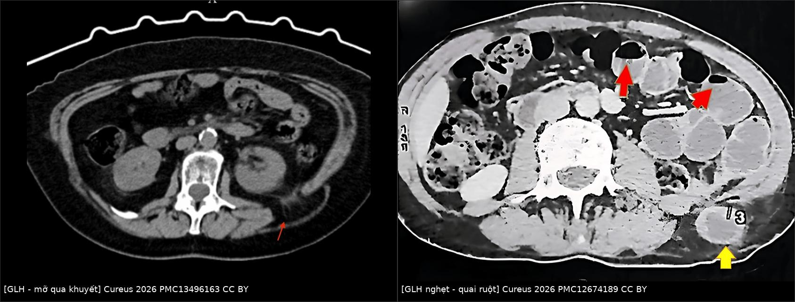
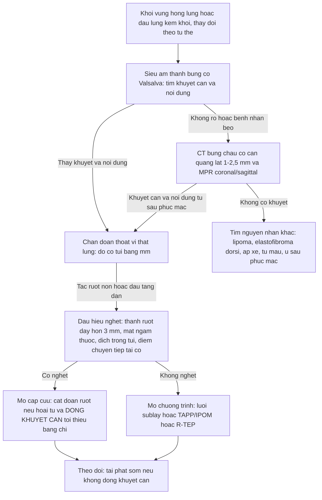
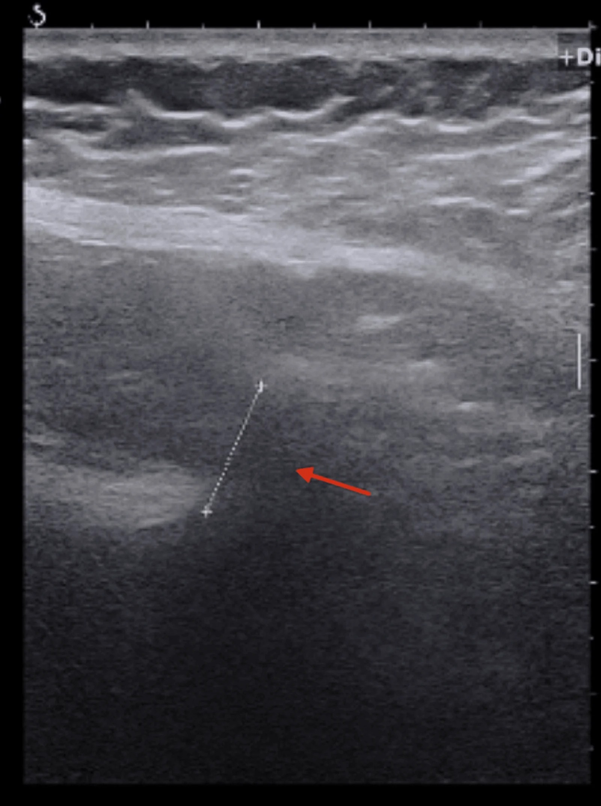
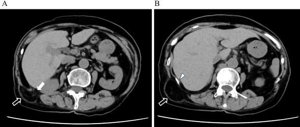
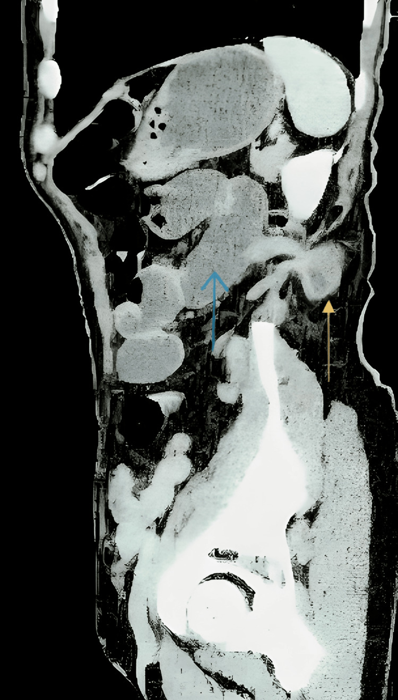
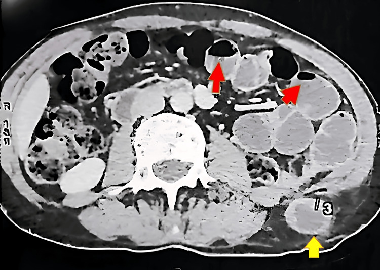
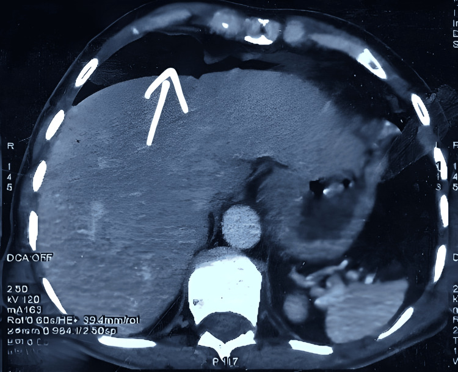

# 3114 — Thoát vị thắt lưng: tam giác Grynfeltt–Lesshaft ở trên, Petit ở dưới — dưới 2% thoát vị thành bụng nhưng 25% đã nghẹt, và sai lầm chừa lại khuyết cân sau mổ cấp cứu / Lumbar hernia (Grynfeltt–Lesshaft & Petit)

**Tags:** `pattern:thoat-vi` `pattern:khuyet-can` `pattern:khoi-thanh-bung` `pattern:tac-ruot-non` `vung:thanh-bung` `vung:o-bung` `vung:hau-phuc-mac` `protocol:CT-bung-co-can-quang` `protocol:sieu-am-Valsalva` `score:EHS`
**Mức chắc chắn (certainty):** tổng hợp y văn (literature synthesis) — ghép **ca thoát vị tam giác trên không biến chứng có siêu âm + CT + mổ mở đặt lưới** (Cureus 2026, PMC13496163, CC BY 4.0), **ca nghẹt ruột non có CT, rồi hoại tử đại tràng vì không đóng khuyết cân** (Cureus 2025, PMC12674189, CC BY 4.0), **ca 82 tuổi được theo dõi bảo tồn 18 tháng** (JMA J 2026, PMC12889170, CC BY 4.0), **tổng quan 41 bệnh nhân từ 37 ca báo cáo** (Cureus 2026, PMC13332808, CC BY 4.0) và **3 ca mổ nội soi sau phúc mạc toàn bộ (R-TEP)** (Sci Rep 2023, PMC10676431, CC BY 4.0). Số nào nguồn không nêu ghi "chưa rõ".

> **Câu chốt:** thoát vị thắt lưng chiếm **< 2%** thoát vị thành bụng và cả y văn chỉ có **~300 ca** (PMC13496163, PMC13332808), nhưng **~25% đã nghẹt** khi phát hiện (PMC13332808) — và một **khuyết cân 17 mm** đủ gây **tắc ruột non hoàn toàn** (PMC12674189). Vì tam giác thắt lưng nằm **sau cơ lưng rộng, dưới lớp mỡ dày**, túi thường chỉ chứa **mỡ sau phúc mạc** nên bị gọi là **lipoma** hoặc "mỡ vùng lưng" hàng tháng trời; chốt chẩn đoán trên hình ảnh không phải "khối mỡ" mà là **dải mỡ liên tục từ khoang sau phúc mạc xuyên qua khuyết cân ra mô dưới da**, và dấu hiệu sống còn là **chiều rộng cổ túi**. Bài này cũng ghi lại một sai lầm có thật: mổ cấp cứu **gỡ quai ruột nhưng không đóng khuyết cân** → **3 ngày sau đại tràng nghẹt, hoại tử, thủng** (PMC12674189).

## 1. Tổng quan bệnh học – cơ chế hình ảnh

### 1.1 Giải phẫu: vì sao đúng chỗ đó mới thoát vị (TẠI SAO)

- **Vùng thắt lưng** là dải thành bụng sau bên giữa **bờ dưới xương sườn 12** và **mào chậu**, nơi thành bụng chỉ còn **cân – cơ mỏng** thay vì các lớp cơ bụng trước. Có hai "cửa yếu" kinh điển:
  - **Tam giác thắt lưng trên (superior lumbar triangle, Grynfeltt–Lesshaft):** tam giác ngược, **trên = bờ dưới xương sườn 12**, **trong = cơ dựng gai/cơ vuông thắt lưng**, **ngoài = bờ sau cơ chéo bụng trong**; **sàn = cân ngang (transversalis fascia)**, **mái = cơ lưng rộng (latissimus dorsi)** (PMC13496163, PMC10676431). Nguồn mô tả bờ trong hơi khác nhau (cơ dựng gai so với cơ vuông thắt lưng) — thực hành: tìm khuyết **ngay dưới xương sườn 12, ngoài khối cơ cạnh sống**.
  - **Tam giác thắt lưng dưới (inferior lumbar triangle, Petit):** **đáy = mào chậu**, **sau = cơ lưng rộng**, **trước = cơ chéo bụng ngoài**, **sàn = cơ chéo bụng trong/cân thắt lưng sâu** (PMC10676431).
- **Vì sao tam giác TRÊN hay thoát vị hơn:** tam giác trên **rộng hơn** và **không được cơ che phủ hoàn toàn** (sàn chỉ là cân ngang), trong khi tam giác dưới **có cơ chéo bụng trong làm sàn** (PMC10676431). Vì vậy **thoát vị Grynfeltt–Lesshaft là thể hay gặp nhất** của thoát vị thắt lưng nguyên phát (PMC13496163).
- **Ba điểm yếu vi mô trong tam giác trên** (giải thích vì sao thoát vị hay xảy ra sát xương sườn 12): (1) vùng **ngay dưới xương sườn 12** nơi **cân ngang không được cơ chéo bụng ngoài phủ**; (2) nơi **cuống mạch–thần kinh gian sườn 12 xuyên qua**; (3) khe giữa **bờ dưới xương sườn** và **dây chằng Henle** (PMC12674189).
- **Vì sao khó thấy và khó sờ:** túi nằm **sau cơ lưng rộng**, dưới lớp mỡ dày vùng hông lưng; khi túi chỉ chứa **mỡ sau phúc mạc** thì khối **mềm, không đau, không có dấu hiệu tiêu hóa** → rất giống **lipoma** (PMC12889170, PMC13496163). Đây là lý do chẩn đoán thường **muộn hàng tháng** và bệnh nhân hay được chụp **cột sống thắt lưng** trước tiên vì "đau lưng".
- **Căn nguyên:** **20% bẩm sinh**, **80% mắc phải**; trong nhóm mắc phải, **55% nguyên phát (tự phát)**, **25% thứ phát** sau **chấn thương – mổ – viêm** (phần còn lại nguồn không tách rõ) (PMC13332808, PMC12674189). Thoát vị thứ phát hay gặp sau **chấn thương** (tai nạn xe máy/ô tô **29,2%** trong tổng quan) và sau **lấy xương ghép mào chậu** (**14,6%**) (PMC13332808).
- **Vì sao nguy hiểm:** cổ túi là **khuyết cân xơ, kích thước cố định**; quai ruột vào rồi **phù nề** không ra được → **nghẹt ~25%** (PMC13332808). Vì **khuyết nhỏ vẫn đủ gây nghẹt** (17 mm trong ca chỉ điểm), **kích thước khối không dùng để loại trừ** (PMC12674189).

### 1.2 Vì sao nhìn thấy — vật lý từng phương thức

- **Siêu âm (bước 1, động):** mỡ **tăng hồi âm** đồng nhất, không có tín hiệu dòng chảy bên trong; **dải cân** là đường hồi âm dày, khi mất liên tục tạo **khuyết** thấy được. Chốt chẩn đoán là **khuyết cân + mỡ đi qua**, và **khuyết rộng ra khi Valsalva/đứng** — đây là điểm mạnh duy nhất của siêu âm so với CT tĩnh (PMC12889170: khuyết **2 cm**, khối mỡ **55,5 × 17,3 mm**; PMC13496163: khuyết **4 cm**). Hạn chế: **béo, khí ruột, đau**, và người khám không quen vùng hông lưng.
- **CT (bước 2, chuẩn thực hành):** mỡ và cơ chênh nhau rất rõ trên cửa sổ mô mềm, nên CT thấy **khuyết cân như chỗ mất liên tục của lớp cân**, kèm **nội dung đi qua cổ**. Vật lý đậm độ dùng để định danh nội dung: **mỡ −40 đến −120 HU**, **dịch 0–20 HU**, **máu tụ 45–85 HU**, **khí trong ruột −1.000 HU**. Điểm cốt tử là **dải mỡ liên tục** từ **khoang sau phúc mạc** (sau thận, cạnh cơ vuông thắt lưng) **xuyên qua tam giác** ra **mô dưới da** — trên **lát ngang đơn thuần** dải này chỉ là một "vệt mỡ" dễ bỏ qua, nên **bắt buộc dựng MPR coronal/sagittal** (PMC12889170, PMC13496163). Cản quang giúp đánh giá **thành ruột ngấm thuốc** và **điểm chuyển tiếp** khi nghẹt.
- **MRI:** mỡ **T1 sáng, T2 sáng, mất tín hiệu trên fat-sat**; dịch **T2 rất sáng**; tổ chức xơ **T2 tối**. Chỉ định: **thai phụ**, trẻ nhỏ (giảm liều xạ), hoặc khi cần phân biệt **elastofibroma dorsi/u mô mềm** với thoát vị.
- **X-quang bụng:** **không thấy khuyết cân**. Chỉ thấy hệ quả: **quai ruột giãn, mức nước–hơi**, hoặc **một quai khí nằm lệch ra ngoài khung ruột** ở vùng hông lưng. Vì thế X-quang **không loại trừ** thoát vị thắt lưng.

### 1.3 Ngưỡng định lượng nằm lòng

| Đại lượng | Ngưỡng / con số | Ý nghĩa thực hành | Nguồn |
|---|---|---|---|
| Tỷ lệ | **< 2%** thoát vị thành bụng; **~300 ca** trong y văn | Bệnh hiếm nhưng **không được bỏ** khi có khối hông lưng | PMC13496163, PMC13332808 |
| Căn nguyên | **20% bẩm sinh / 80% mắc phải** (55% nguyên phát, 25% thứ phát) | Hỏi **chấn thương, mổ lấy xương ghép mào chậu, vạt cơ lưng** | PMC13332808, PMC12674189 |
| Vị trí | Tam giác **trên (Grynfeltt–Lesshaft)** hay hơn **dưới (Petit)** | Tam giác trên rộng hơn, sàn chỉ có cân ngang | PMC10676431, PMC13496163 |
| Nghẹt | **~25%** | Lý do **mổ chương trình** cho ca đã chẩn đoán | PMC13332808 |
| Kích thước khuyết | **17 mm** đã gây **tắc ruột non hoàn toàn**; khuyết **2–4 cm** có ca không biến chứng | **Khuyết nhỏ không phải yên tâm** | PMC12674189, PMC13496163, PMC12889170 |
| Biến chứng sau mổ (41 ca) | **26,8%** (11/41); **tái phát 17,1%** (7/41) | Tư vấn trước mổ; theo dõi dài | PMC13332808 |
| Nội soi vs mở | Biến chứng **19,5% vs 9,7%**; nằm viện **1,46 vs 1,67 ngày** | Số liệu **có thiên lệch chọn bệnh** — không phải RCT | PMC13332808 |
| Nguyên nhân chấn thương | Tai nạn giao thông **29,2%**, lấy xương ghép mào chậu **14,6%** | Hỏi tiền sử **ghép xương mào chậu** khi thấy khối hông lưng | PMC13332808 |
| Mổ nội soi sau phúc mạc (R-TEP) | 3 ca, khuyết **3 cm**, ra viện **ngày 2–3**, không tái phát **10–24 tháng** | Lựa chọn khi khuyết vừa, không nghẹt | PMC10676431 |
| Ca bảo tồn | 82 tuổi, lỗ **2,5 cm**, theo dõi **18 tháng** ổn định | **Không phải mọi ca đều mổ ngay** — cá thể hóa | PMC12889170 |

## 2. Mẫu hình + chẩn đoán phân biệt theo vị trí (gamut)

- **Mẫu hình cốt lõi:** **khuyết cân ở thành bụng sau bên, dưới xương sườn 12 và trên mào chậu**, có **mỡ sau phúc mạc (hoặc quai ruột) đi qua cổ**; khối **to lên khi đứng/gồng bụng** và **xẹp khi nằm ngửa** (PMC12889170, PMC13496163).
- **Theo vị trí (location gamut):**
  - **Tam giác trên (Grynfeltt–Lesshaft):** thể điển hình, hay chứa **mỡ sau phúc mạc**, **đại tràng**, **ruột non**, đôi khi **thận**.
  - **Tam giác dưới (Petit):** hiếm hơn; khối **thấp hơn, sát mào chậu**; dễ nhầm **thoát vị bẹn/đùi** hoặc **u mỡ vùng mào chậu**.
  - **Thoát vị lan tỏa/thứ phát:** sau **chấn thương**, sau **lấy xương ghép mào chậu**, sau **vạt cơ lưng rộng**, sau **dẫn lưu áp-xe sau phúc mạc**; khuyết có thể **nhiều ổ, bờ không đều**.
  - **Bẩm sinh (trẻ):** có thể kèm **hội chứng thắt lưng–sườn–đốt sống (lumbo-costo-vertebral syndrome)** và **bất sản thận cùng bên** — khi thấy thoát vị thắt lưng ở trẻ phải **siêu âm thận và cột sống**.
- **Theo nội dung túi (content gamut):** **mỡ sau phúc mạc** (hay nhất, không triệu chứng tiêu hóa) · **đại tràng** (tắc, dễ nhầm viêm túi thừa) · **ruột non** (tắc, nghẹt) · **thận** (hiếm, khối đặc trong túi) · **mạc nối** · **ruột thừa** · **buồng trứng** · **lách/dạ dày** (ca lẻ) (PMC13332808).
- **Bắt chước (mimic) hay gặp:** **lipoma** (thể hay bị chẩn đoán nhầm nhất) · **elastofibroma dorsi** · **áp-xe/tụ máu/seroma vùng lưng** · **u sau phúc mạc (sarcoma, u thận, u thượng thận)** · **di căn mô mềm** · **lạc nội mạc thành bụng** · **thoát vị lỗ trocar vùng hông lưng** · **ACNES/đau cơ học** (đau nhưng không khối).

## 3. Bảng so sánh phân biệt (ma trận đối chiếu)

| Thực thể (entity) | Hình ảnh điển hình (US/CT/MRI) | Chốt vào (rule-in) | Chốt loại (rule-out) | Gợi ý xác nhận |
|---|---|---|---|---|
| **Thoát vị Grynfeltt–Lesshaft (tam giác trên)** | Khuyết cân dưới xương sườn 12, ngoài cơ cạnh sống; dải mỡ **liên tục** từ sau phúc mạc ra dưới da; khuyết rộng khi Valsalva | **Mất liên tục cân ngang + nội dung qua cổ**, thấy rõ trên **MPR coronal/sagittal** | **Cân liên tục**, khối mỡ **nằm hoàn toàn dưới da**, không có cổ | Siêu âm động + CT có cản quang; đo cổ túi (mm) |
| **Thoát vị Petit (tam giác dưới)** | Khuyết sát **mào chậu**, giữa cơ lưng rộng và cơ chéo bụng ngoài | **Khuyết cân + nội dung**, khối thấp hơn tam giác trên | Khuyết ở trên xương sườn 12 = không phải Petit | CT dựng MPR; đối chiếu mốc xương |
| **Thoát vị thắt lưng thứ phát (sau chấn thương/mổ/vạt)** | Khuyết **nhiều ổ, bờ xơ**, sẹo mổ/vạt cơ lưng rộng; mỡ ± ruột | **Tiền sử chấn thương/lấy xương ghép/vạt + khuyết tại đúng vị trí** | Không tiền sử, khuyết đơn độc điển hình | CT; so phim cũ; hỏi vị trí lấy xương ghép |
| **Lipoma dưới da** | Khối mỡ **−40…−120 HU**, **không có cổ**, cân nằm trên khối nguyên vẹn | Mỡ **dưới cân**, **không thay đổi theo Valsalva/tư thế** | **Có cổ xuyên cân = loại lipoma** | Siêu âm động; CT |
| **Elastofibroma dorsi** | Khối **dưới cơ (subscapular/infraserratus)**, **T1/T2 tín hiệu thấp–trung bình** xen kẽ mỡ, bờ không rõ | **Vị trí dưới cơ, cấu trúc sợi–mỡ đặc trưng**, không có khuyết cân | **Có khuyết cân + nội dung ổ bụng = loại** | MRI; sinh thiết nếu không chắc |
| **Áp-xe / tụ máu / seroma vùng lưng** | Ổ dịch **0–20 HU** (áp-xe có viền ngấm thuốc, khí), máu **45–85 HU**; mô mềm quanh phù nề | **Sốt/đau cấp, viền ngấm thuốc, không có cổ cân** | **Không có khuyết cân**, nội dung không phải mỡ/ruột | CT có cản quang; siêu âm; chọc hút khi cần |
| **U sau phúc mạc / u thận / u thượng thận** | Khối **đặc, ngấm thuốc**, đẩy thận/tá tràng; có thể hoại tử, vôi hóa | **Khối đặc ngấm thuốc, không đi qua khuyết cân** | **Cấu trúc mỡ/ruột đi qua cổ = loại u** | CT 3 thì; MRI; sinh thiết |
| **Thoát vị lỗ trocar vùng hông lưng** | Khuyết cân đúng trục cổng cũ, mỡ/ruột ± Richter | **Tiền sử cổng ≥ 10 mm + khuyết đúng trục trocar** | Không tiền sử trocar, khuyết ở tam giác thắt lưng | CT; đối chiếu biên bản mổ |
| **Đau lưng cơ học / ACNES** | **Không có khuyết cân**, không khối; cơ cạnh sống có thể teo | **Đau khu trú, Carnett dương, hình ảnh bình thường** | **Có khuyết cân = có tổn thương thực thể** | Khám lâm sàng; block chẩn đoán |

## 4. Protocol chụp + hệ phân độ/điểm chuẩn hóa

### 4.1 Trình tự hình ảnh

1. **Siêu âm thành bụng sau bên có Valsalva (bước 1):** đầu dò thẳng **7–12 MHz**, quét **dọc và ngang** từ xương sườn 12 xuống mào chậu, **hai bên để so sánh**; đo **chiều rộng khuyết (mm)** khi nghỉ và khi gồng; ghi **nội dung** (mỡ/quai ruột/dịch), **có giảm hồi âm thành ruột**, **có phổ Doppler** thành ruột.
2. **CT bụng–chậu có cản quang (bước 2, chuẩn):** lát **1–2,5 mm**, cửa sổ mô mềm; **bắt buộc dựng coronal + sagittal** dọc tam giác thắt lưng (vì trên lát ngang đơn thuần dải mỡ rất dễ bị bỏ qua); đo **cổ túi** và **kích thước khuyết**; đọc **điểm chuyển tiếp**, **thành ruột > 3 mm**, **mất ngấm thuốc**, **dịch trong túi**, **khí trong thành**.
3. **X-quang bụng đứng:** chỉ để đánh giá **tắc ruột** — không dùng để chẩn đoán thoát vị.
4. **MRI:** khi **thai phụ**, trẻ nhỏ, hoặc nghi **u mô mềm/elastofibroma**; **T2 fat-sat** là chuỗi quyết định.

### 4.2 Phân độ và ngưỡng xử trí

- **Phân loại EHS 2009 (Muysoms):** thoát vị thành bụng nguyên phát xếp theo **vị trí** — đường giữa **M1–M5**, thành bụng bên **L1–L4** (dưới sườn, mào chậu, **thắt lưng**, lan tỏa); theo **kích thước khuyết** — **nhỏ < 2 cm**, **trung bình 2–4 cm**, **lớn > 4 cm** (Hernia 2009, DOI 10.1007/s10029-009-0518-x). Thoát vị thắt lưng thuộc **L3**; EHS **không có mã riêng** cho Grynfeltt/Petit và **không có tiêu chí nguy cơ nghẹt theo cổ túi** — đây là khoảng trống thực hành (xem mục 7).
- **Chỉ định mổ:** ca **có triệu chứng**, **có quai ruột trong túi**, **khuyết lớn/tăng dần**, hoặc **nghẹt/tắc ruột** → mổ. Ca **chỉ chứa mỡ, không triệu chứng, người cao tuổi nhiều bệnh** có thể **theo dõi** — ca 82 tuổi với lỗ **2,5 cm** ổn định **18 tháng** là ví dụ, nhưng **không có dữ liệu dài hạn** về tỷ lệ nghẹt muộn ở nhóm này (PMC12889170).
- **Kỹ thuật:** **mở đặt lưới dưới cân (sublay/onlay)** — ca chỉ điểm cố định lưới vào **màng xương sườn 12, cân ngang, cơ vuông thắt lưng, cơ chéo trong**, không tái phát **1 năm** (PMC13496163); **nội soi ổ bụng TAPP/IPOM**; **nội soi sau phúc mạc toàn bộ (R-TEP)** — 3 ca, khuyết **3 cm**, ra viện **ngày 2–3**, không tái phát **10–24 tháng** (PMC10676431). **Không có RCT** so sánh các đường mổ.
- **Cấp cứu:** ưu tiên **xử lý ruột hoại tử** (cắt đoạn, rửa), nhưng **phải đóng khuyết cân** — tối thiểu **khâu cân nguyên phát**, tốt hơn là **lưới** khi ổ bụng sạch. Đây là kết luận trực tiếp từ ca **gỡ ruột mà chừa khuyết cân** → **3 ngày sau đại tràng nghẹt, hoại tử, thủng** (PMC12674189).
- **Theo dõi:** khám lại **1 tháng, 6 tháng, 12 tháng**; CT khi **khối tái xuất hiện** hoặc **đau tăng**; tư vấn **giảm cân, tránh nâng nặng, điều trị ho mạn/táo bón**.

## 5. Biến thể bình thường và cạm bẫy

- **Biến thể bình thường — mỡ quanh thận lồi nhẹ qua tam giác thắt lưng:** người gầy, lớn tuổi có thể có **dải mỡ mỏng, không rộng ra khi Valsalva**, **không có khối sờ thấy**; chỉ gọi thoát vị khi có **cổ rõ + nội dung di động** hoặc **triệu chứng khu trú** (PMC12889170).
- **Biến thể bình thường — bất đối xứng cơ cạnh sống:** teo cơ cạnh sống một bên (đau lưng mạn, sau mổ) làm **vùng hông lưng bên đó lõm hơn**, dễ bị đọc thành "khuyết cân". Phải **so sánh hai bên trên cùng mặt phẳng** và **truy vết nhiều lát**.
- **Cạm bẫy 1 — "lipoma"** (thể hay bị chẩn đoán nhầm nhất): khối mỡ **có cổ xuyên cân** là thoát vị; khối mỡ **không có cổ, không đổi theo tư thế** là lipoma. Ca 82 tuổi bị nghi lipoma **4 tháng**, chỉ siêu âm tại giường mới phát hiện khuyết **2 cm** (PMC12889170). Hỏi đúng 1 câu: **"khối có xẹp khi nằm và to khi đứng/gồng không?"**
- **Cạm bẫy 2 — chỉ đọc lát ngang:** khuyết **17 mm** trong ca nghẹt chỉ thấy rõ trên **lát đứng dọc**; trên lát ngang, dải mỡ sau phúc mạc và mỡ dưới da **trông như một khối mỡ liền** (PMC12674189). Luôn dựng **MPR** và **đo cổ túi**.
- **Cạm bẫy 3 — "chỉ có mỡ nên lành":** ca **82 tuổi, chỉ mỡ, theo dõi được** không chứng minh mọi ca chỉ mỡ đều an toàn; **~25%** thoát vị thắt lưng đã nghẹt khi phát hiện, và **khuyết nhỏ** vẫn gây **tắc hoàn toàn** (PMC13332808, PMC12674189). Quyết định theo **triệu chứng, nội dung túi, cổ túi, tuổi, bệnh nền**.
- **Cạm bẫy 4 — mổ cấp cứu chỉ gỡ ruột, chừa khuyết cân:** đây là cạm bẫy **nguy hiểm nhất** trong bài. Ca chỉ điểm: gỡ quai hỗng tràng còn sống, khâu rách thanh mạc, **không sửa khuyết** → **ngày 3** đại tràng góc lách nghẹt, **hoại tử, thủng, viêm phúc mạc phân** → cắt đoạn + nối; **5 tuần sau** áp-xe **20 × 200 mm**, rò da, **rò miệng nối**, phải **đưa hậu môn nhân tạo** (PMC12674189). Tác giả kết luận: **phải xử lý khuyết cân tối thiểu bằng khâu nguyên phát**.
- **Cạm bẫy 5 — tắc ruột non "không rõ nguyên nhân":** phải **nhìn lại thành bụng sau bên** trên CT; ca nghẹt có **tắc hoàn toàn** mà nguyên nhân nằm ở **hông lưng**, không phải ổ bụng giữa (PMC12674189). Đây là **satisfaction of search** kinh điển khi chỉ tập trung vào quai giãn.
- **Cạm bẫy 6 — bỏ qua tiền sử lấy xương ghép mào chậu:** **14,6%** thoát vị thắt lưng do chấn thương trong tổng quan liên quan **lấy xương ghép mào chậu**; khối hông lưng xuất hiện sau mổ ghép xương = **thoát vị lỗ lấy xương** cho tới khi loại trừ (PMC13332808).
- **Cạm bẫy 7 — elastofibroma dorsi:** khối **dưới cơ, sát bờ trong xương bả vai**, **T2 tín hiệu thấp** xen mỡ, **không có khuyết cân**; mổ "thoát vị" ở đây là **mổ oan** (mô tả hình ảnh, không có số liệu trong các nguồn của bài).

## 6. Tự lượng giá — Blind Quiz ngay trên trang tĩnh

**Ca 1 — Nữ 71 tuổi, khối vùng hông lưng trái 3 tháng, to lên khi gắng sức**

- Gợi ý lâm sàng (clinical context): khối **mềm, ấn lên được, không đau**, không triệu chứng tiêu hóa; bệnh nhân được giới thiệu vì "u mỡ vùng lưng".
- Câu hỏi: Khối **tăng hồi âm** là mô gì? Dấu hiệu nào trên siêu âm **loại lipoma**? Bước tiếp theo và thái độ xử trí?

<b>Bấm để hiện đáp án (findings + chẩn đoán)</b>

- Dấu hiệu (findings): **khối tăng hồi âm đồng nhất** (mỡ) đi qua **khuyết cân rộng ~4 cm** ở **tam giác thắt lưng trên trái**; thước đo trên ảnh đánh dấu **đường kính khuyết**; **không có quai ruột**, không dịch.
- Chẩn đoán (diagnosis): **thoát vị Grynfeltt–Lesshaft nguyên phát, chỉ chứa mỡ sau phúc mạc**. Chốt: **dải mỡ liên tục qua khuyết cân**, không phải khối mỡ nằm dưới da. Ca gốc: CT không cản quang xác nhận, **mổ mở đặt lưới polypropylene dưới cân**, cố định vào **màng xương sườn 12, cân ngang, cơ vuông thắt lưng, cơ chéo trong**; **1 năm không tái phát**.
- Nguồn ảnh: Cureus 2026 (PMC13496163), Figure 1 — CC BY 4.0.

**Ca 2 — Nữ 82 tuổi, khối lưng phải 4 tháng, "biến mất khi nằm"**

- Gợi ý lâm sàng: khối **4 cm, mềm, không đau**; không sốt, không sụt cân; tiền sử viêm khớp dạng thấp.
- Câu hỏi: Mũi tên chỉ **mỡ ở khoang nào** và **đi đâu**? Vì sao **không có quai ruột** lại quan trọng cho quyết định? Có nhất thiết mổ ngay không?

<b>Bấm để hiện đáp án (findings + chẩn đoán)</b>

- Dấu hiệu (findings): **(A)** mỡ sau phúc mạc (mũi tên rỗng) **sau thận phải**, đi qua **lỗ thoát vị** (mũi tên đặc) ra **mô dưới da** ở tam giác thắt lưng trên; **(B)** lát cao hơn: mũi tên nhỏ chỉ **xương sườn 12**, chứng tỏ dải mỡ **đi lên sát bờ sườn**; **không có quai ruột, không dịch**.
- Chẩn đoán (diagnosis): **thoát vị thắt lưng trên phải, chỉ chứa mỡ**; siêu âm trước đó đo khuyết **2 cm**, CT đo **lỗ 2,5 cm**. Vì **không có tạng, không nghẹt, bệnh nhân 82 tuổi**, ê-kíp chọn **theo dõi bảo tồn**; sau **18 tháng** khối **không thay đổi**. Đây là **ngoại lệ có cân nhắc**, không phải chuẩn cho mọi ca.
- Nguồn ảnh: JMA Journal 2026 (PMC12889170), Figure 3 — CC BY 4.0.

**Ca 3 — Nam 67 tuổi, khối hông lưng trái 3 năm, nay táo bón tuyệt đối 3 ngày, nôn**

- Gợi ý lâm sàng: bụng chướng, gõ trong; khối hông lưng trái **cố định, ấn đau nhẹ, không ấn lên được**; cơ cạnh sống **teo**.
- Câu hỏi: Quai ruột đi qua **đâu**, và **vì sao khối không tăng khi ho**? Dấu hiệu nào nói **nghẹt**? Nếu mổ cấp cứu, **phải làm gì với khuyết cân**?

<b>Bấm để hiện đáp án (findings + chẩn đoán)</b>

- Dấu hiệu (findings): **quai ruột non giãn** (mũi tên xanh) dẫn vào **một quai nghẹt xuyên khuyết cân sau bên** (mũi tên vàng); trên lát ngang, **mức nước–hơi** trong các quai giãn (mũi tên đỏ) và **quai nghẹt thành dày** ở thành bụng trái (mũi tên vàng). Khuyết đo **17 mm**; quai nghẹt giãn **30 mm**, **thành dày 8 mm**.
  
- Chẩn đoán (diagnosis): **thoát vị Grynfeltt–Lesshaft nghẹt gây tắc ruột non hoàn toàn**. Khối **không tăng khi ho** vì **cổ túi đã bị bít kín**. Mổ mở gỡ **quai hỗng tràng cách dây chằng Treitz 40 cm** (còn sống), khâu rách thanh mạc — **nhưng khuyết cân không được sửa**. **Ngày 3** bệnh nhân viêm phúc mạc; CT có **khí tự do**:
  
  Mổ lại: **đại tràng góc lách nghẹt, hoại tử, thủng** → cắt đoạn + nối, rửa ổ bụng, **đóng cân bằng polypropylene 1/0 khâu chữ X**; ra viện ngày 5; **5 tuần sau** áp-xe **20 × 200 mm** + rò da + **rò miệng nối**, phải **hậu môn nhân tạo**. Kết luận: trong cấp cứu **vẫn phải đóng khuyết cân tối thiểu bằng khâu**.
- Nguồn ảnh: Cureus 2025 (PMC12674189), Figure 1–3 — CC BY 4.0.

## 7. Câu hỏi nghiên cứu & điểm chưa đồng thuận (tính đến 11/2026)

1. **[Tranh cãi] Ở người ≥ 80 tuổi, thoát vị thắt lưng chỉ chứa mỡ, không triệu chứng: theo dõi bảo tồn có an toàn hơn mổ chương trình?**
   - **Đã biết:** khuyến cáo chung là **mổ mọi ca đã chẩn đoán** vì **~25% nghẹt**; nhưng có ca **82 tuổi, lỗ 2,5 cm, theo dõi 18 tháng ổn định** (PMC13332808, PMC12889170).
   - **Chưa rõ:** tỷ lệ nghẹt **tích lũy theo thời gian** ở nhóm chỉ có mỡ, và **ngưỡng cổ túi** khiến theo dõi trở nên nguy hiểm.
   - **Hướng nghiên cứu:** registry theo dõi dọc, phân tầng theo **kích thước cổ, nội dung túi, tuổi, ASA**, với biến cố **nghẹt/mổ cấp**.
   - **Nguồn:** PMC13332808; PMC12889170.
2. **[Tranh cãi] Đường mổ nào tốt nhất cho thoát vị thắt lưng nguyên phát: mở đặt lưới, TAPP/IPOM hay nội soi sau phúc mạc (R-TEP)?**
   - **Đã biết:** tổng quan **41 ca** ghi **biến chứng nội soi 19,5% vs mở 9,7%**, nhưng **chọn bệnh thiên lệch** và **cỡ mẫu nhỏ**; **R-TEP 3 ca** ra viện **2–3 ngày**, không tái phát **10–24 tháng** (PMC13332808, PMC10676431).
   - **Chưa rõ:** **tái phát và đau mạn** so sánh trực tiếp; ảnh hưởng của **kinh nghiệm phẫu thuật viên** (bệnh hiếm, mỗi phẫu thuật viên gặp ~1 ca/đời).
   - **Hướng nghiên cứu:** nghiên cứu đoàn hệ đa trung tâm có **video/kiểm toán kỹ thuật**, chung một định nghĩa tái phát trên CT.
   - **Nguồn:** PMC13332808; PMC10676431.
3. **[Khoảng trống] Chưa có phân độ riêng cho thoát vị thắt lưng, và chưa có tiêu chí nguy cơ nghẹt theo cổ túi**
   - **Đã biết:** EHS 2009 chỉ xếp thoát vị thắt lưng vào **L3** với **kích thước khuyết < 2 / 2–4 / > 4 cm**, không phân biệt **Grynfeltt/Petit**, **nội dung túi**, hay **chiều rộng cổ** (DOI 10.1007/s10029-009-0518-x); ca **17 mm** đã nghẹt hoàn toàn (PMC12674189) chứng tỏ kích thước khuyết **không đủ** để tiên lượng.
   - **Chưa rõ:** biến số hình ảnh nào (**cổ túi, tỷ lệ nội dung/cổ, mỡ mạc treo, góc**) dự báo nghẹt; và **hiệu quả dự phòng** thoát vị lỗ lấy xương ghép mào chậu (**14,6%** nguyên nhân chấn thương).
   - **Hướng nghiên cứu:** phân độ mới dựa trên **CT + triệu chứng**, kiểm định tiên lượng; thử nghiệm kỹ thuật đóng lỗ lấy xương ghép.
   - **Nguồn:** DOI 10.1007/s10029-009-0518-x; PMC13332808; PMC12674189.

## Bài liên quan chéo
- [3106 – Thoát vị lỗ bịt: tắc ruột non ở nữ cao tuổi gầy, không sờ thấy khối](../3106-thoat-vi-lo-bit/lesson.md)
- [1973 – Thoát vị Spigelian: khuyết cân ở đường bán nguyệt](../1973-thoat-vi-spigelian/lesson.md)
- [3111 – Thoát vị lỗ trocar sau nội soi](../3111-thoat-vi-lo-trocar-sau-noi-soi/lesson.md)
- [1936 – Tụ máu bao cơ thẳng bụng](../1936-tu-mau-bao-co-thang-bung/lesson.md)
- [160 – Bụng cấp hố chậu & tắc ruột non](../160-bung-cap-GI/lesson.md)
- [162 – Tắc ruột non/già, quai kín & thiếu máu mạc treo](../162-tac-ruot/lesson.md)
- [100 – Tổng quan hệ Bụng: bản đồ chẩn đoán phân biệt](../100-tong-quan-he-bung/lesson.md)

## Ảnh
- 7 ảnh gốc + 1 ảnh ghép, **tất cả CC BY 4.0** — chi tiết Fig/PMCID trong `images/CREDITS.md`; ảnh ghép tạo bằng `tools/make_composite.py` (letterbox nền đen, không crop/kéo giãn).
- Không dùng ảnh từ bài **CC BY-NC-ND** (PMC13735169) — chỉ dùng số liệu.

> Không dùng để chẩn đoán độc lập khi chưa có người hướng dẫn.
