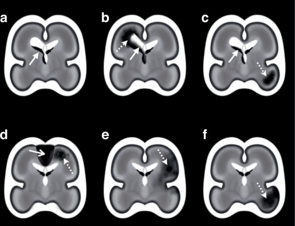
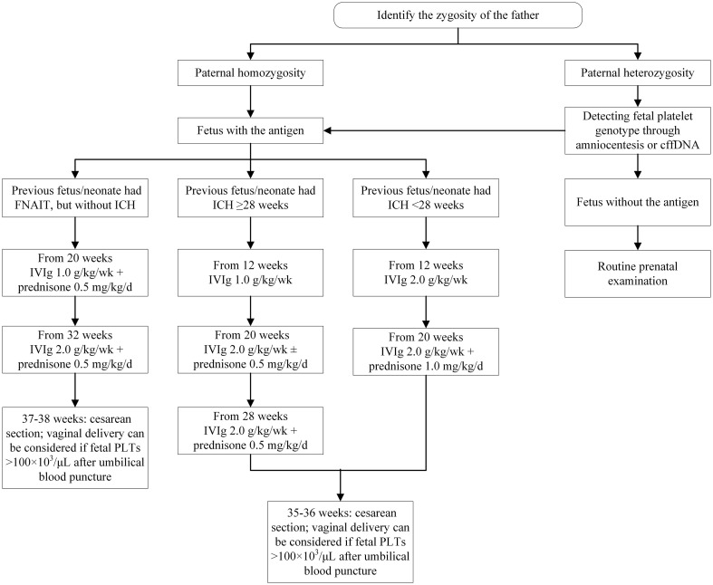
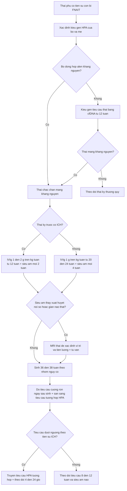
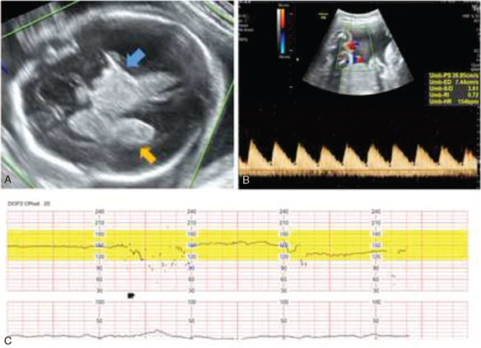

# 3115 — Giảm tiểu cầu thai miễn dịch (NAIT/FNAIT): xuất huyết nội sọ thai nhi và ngưỡng truyền tiểu cầu / Fetal and neonatal alloimmune thrombocytopenia with fetal intracranial hemorrhage

**Tags:** `pattern:xuat-huyet-noi-so-thai` `pattern:gian-nao-that` `pattern:o-tang-am-nao-thai` `pattern:giam-tieu-cau` `vung:thai` `vung:nao` `vung:buong-oi` `protocol:sieu-am-thai` `protocol:MRI-thai` `protocol:doppler-MCA-PSV` `score:nguong-tieu-cau`

**Mức chắc chắn (certainty):** tổng hợp y văn (literature synthesis) — số liệu lấy từ **một cập nhật tổng quan 2025 về chẩn đoán–điều trị FNAIT** (PMC12517676, *Transfusion Medicine and Hemotherapy*, CC BY-NC), **một đồng thuận phân loại xuất huyết nội sọ thai nhi** (PMC12602359, *Pediatric Research* 2025, CC BY 4.0), **một phác đồ điều trị theo nguy cơ** (PMC13079021, *Front Immunol* 2026, CC BY 4.0) và **một ca nguyên văn siêu âm thai** (PMC8735806, *Medicine* 2022, CC BY 4.0). Không có thử nghiệm ngẫu nhiên nào về **ngưỡng truyền tiểu cầu của thai**; mọi ngưỡng đều từ **ý kiến chuyên gia/đồng thuận**, đã ghi rõ.

> **Câu chốt:** FNAIT là nguyên nhân **giảm tiểu cầu nặng phổ biến nhất ở trẻ sơ sinh khỏe mạnh** — **1:2.500** trẻ sinh sống — nhưng **không có xét nghiệm không xâm lấn nào đo được tiểu cầu thai**. Ba con số quyết định: **(1)** xuất huyết nội sọ (ICH) xảy ra ở **10–25%** ca giảm tiểu cầu nặng (< 50 × 10⁹/L) và **60–75%** ICH thai xuất hiện **ngay trong thai kỳ đầu**, bắt đầu **từ khoảng 18 tuần**; **(2)** ở thai **không chọn lọc**, ICH do FNAIT chỉ chiếm **~2,9%** — nguyên nhân hàng đầu là **di truyền (COL4A1/COL4A2 19%**, đột biến **de novo 70%**); **(3)** chẩn đoán hình ảnh **không định lượng được tiểu cầu**: **MCA-PSV** đánh giá **thiếu máu**, không đánh giá tiểu cầu — dùng nó để quyết định truyền tiểu cầu là sai nguyên lý.

## 1. Tổng quan bệnh học – cơ chế hình ảnh (TẠI SAO)

### 1.1 Sinh bệnh: kháng thể mẹ đánh vào tiểu cầu thai

- Mẹ **đồng hợp alen hiếm HPA-1bb** (kiểu hình **~2%** người da trắng) sinh **kháng thể anti-HPA-1a**; thai nhận **HPA-1a từ bố** nên **luôn dị hợp HPA-1ab** → kháng thể IgG mẹ **qua FcRn ở nguyên bào nuôi** vào tuần hoàn thai.
- **Vì sao IgG vào được từ rất sớm:** vận chuyển IgG khởi đầu **từ tuần 13**, đạt **50% nồng độ mẹ ở 28–32 tuần**, rồi tăng dốc sau 36 tuần. Hệ quả lâm sàng: **thai kỳ đầu vẫn có thể xuất huyết** vì đỉnh kháng thể đến muộn nhưng **quá trình hủy tiểu cầu đã bắt đầu từ tam cá nguyệt II**.
- **Cơ chế xuất huyết:** kháng thể gây **hủy tiểu cầu + ức chế sinh tiểu cầu** (giảm megakaryocyte) → tiểu cầu < 50 × 10⁹/L; **mầm mạch dưới màng nội tủy (germinal matrix)** ở thai 18–32 tuần là **mạng mạch mỏng, thành chỉ một lớp nội mô, thiếu lớp cơ** → **vỡ khi huyết áp dao động** (co thắt tử cung, chuyển dạ, thủ thuật).
- **Vì sao tổn thương hay ở mầm mạch/nội thất và dưới vỏ:** đó là nơi **mao mạch non nhất, áp lực mao mạch cao nhất** và **không có đệm mô đệm**; xuất huyết lan vào não thất → **não úng thủy sau xuất huyết**, hoặc vào nhu mô → **ổ khuyết/porencephaly**.

### 1.2 Cơ chế hình ảnh: đọc được "tuổi" của máu

- **Siêu âm:** cục máu tươi **tăng âm** (mặt phân cách âm mạnh giữa huyết khối fibrin và dịch não tủy); sau **1–2 tuần** trung tâm **giảm âm** rồi thành **nang** (dịch trong); **não thất giãn** là dấu **gián tiếp, xuất hiện muộn**.
- **Vì sao MRI hơn siêu âm:** MRI **nhạy hơn với máu mới (< 6 giờ)**, máu **ngoài não (dưới màng cứng, dưới nhện)**, và tổn thương **hố sau** (tiểu não) — những vùng siêu âm thai khó tiếp cận (PMC12517676).
- **T1/T2 theo tuổi máu:** **tối cấp–cấp** → T1 đồng tín hiệu, **T2 giảm mạnh** (deoxyhemoglobin); **bán cấp** → **T1 tăng** (methemoglobin), T2 giảm rồi tăng; **mạn** → **T2*/SWI giảm do hemosiderin** (viền giảm tín hiệu tồn tại nhiều năm). Trên thực tế, **T1 tăng là chuỗi xung "nhìn thấy máu" tốt nhất** trên MRI thai.
- **Ngưỡng hình ảnh cần đo:** **sừng chẩm não thất bên ≥ 10 mm** = giãn não thất; **đo chiều dày vỏ não, bể lớn, tiểu não** vì ICH hố sau làm **giảm sản tiểu não**; **không có ngưỡng kích thước ổ máu** quyết định điều trị — quyết định dựa vào **vị trí + tiến triển + tình trạng thai**.

### 1.3 Dịch tễ và các con số nền

| Chỉ số | Số liệu | Nguồn |
|---|---|---|
| Đồng miễn dịch anti-HPA-1a | **200/100.000** thai kỳ (**1:500**) | PMC12517676 |
| Giảm tiểu cầu nặng (< 50 × 10⁹/L) ở trẻ sơ sinh không chọn lọc | **150/100.000** (**1:666**); FNAIT chiếm **27%** → **~40/100.000 (1:2.500)** | PMC12517676 |
| FNAIT **có ICH** | **10/100.000** trẻ sinh sống (**1:10.000**) | PMC12517676 |
| ICH trong ca giảm tiểu cầu nặng | **10–25%** | PMC12517676 |
| Thai kỳ đầu | **40–60%** ca FNAIT có triệu chứng khởi phát ở thai kỳ đầu; **60–75%** ICH thai xảy ra ở thai kỳ đầu, **từ ~18 tuần** | PMC12517676 |
| Kháng thể thường gặp (da trắng) | **anti-HPA-1a 75–80%**; **anti-HPA-5b 10–15%**; người Nhật: **anti-HPA-4b** | PMC12517676 |
| Yếu tố nguy cơ di truyền | **HLA-DRB3*01:01**: PPV **26,9%**, NPV **98,3%**; **99/101** mẹ FNAIT có triệu chứng dương tính; **64/64** ca giảm tiểu cầu nặng và **3/3** ca ICH nằm trong nhóm dương tính | PMC12517676 |
| Tần suất ICH thai nói chung | **0,1–1/1.000** thai kỳ; tỷ lệ mắc khi sinh **0,17–0,35/1.000** trẻ sinh sống | PMC12602359 |
| Nguyên nhân ICH thai (đoàn hệ Pháp 194 ca) | **COL4A1/COL4A2 19%** (de novo **70%**); **MPL/MECOM** 2 gia đình; exome thêm **8%** | PMC12517676 |
| ICH "tình cờ" ở thai không chọn lọc | Giảm tiểu cầu nặng chỉ gây **8,5%**; **kháng thể kháng tiểu cầu 2,9%** (sổ Thụy Điển) | PMC12517676 |

## 2. Mẫu hình + chẩn đoán phân biệt theo vị trí (Gamut)

- **Mầm mạch – nội thất (GMH-IVH):** ổ **tăng âm ở đáy não thất/cađô-đồi thị**, có thể lấp đầy não thất; **giãn não thất** xuất hiện sau **1–3 tuần**; hay gặp ở **thai 18–32 tuần** và ở **thai thiếu tiểu cầu**.
- **Nhồi máu tĩnh mạch quanh não thất (PVHI):** ổ **nhu mô quanh não thất** đi kèm IVH, **lan theo vùng dẫn lưu tĩnh mạch**, tiên lượng xấu hơn IVH đơn thuần.
- **Xuất huyết nhu mô nguyên phát (IPH) không thông với não thất:** ổ **trong nhu mô**, thường **thùy não**; phân biệt **nhồi máu tĩnh mạch** (kèm huyết khối xoang) với **biến chứng xuất huyết của nhồi máu động mạch (FAIS)** và **IPH vô căn (FHS)** — phân loại đồng thuận 2025 (PMC12602359, Fig. 1–2).
- **Dưới màng cứng/dưới nhện/dưới màng mềm:** máu **ngoài nhu mô**, dễ bỏ sót trên siêu âm; **MRI nhạy hơn** — đặc biệt **dưới màng cứng hố sau** và **dưới màng mềm** (dấu "âm dương").
- **Tiểu não:** ổ máu/giảm sản tiểu não — **nguyên nhân hay gặp là parvovirus B19 và FNAIT**, ít gặp nguyên nhân di truyền (PMC12602359).
- **Gamut "giãn não thất thai nhi + ổ tăng âm trong não thất":** FNAIT · nhiễm CMV/parvovirus B19 · **COL4A1/COL4A2** · huyết khối xoang/tĩnh mạch tủy sâu · rối loạn đông máu (yếu tố X, von Willebrand, **MPL** gây giảm tiểu cầu bẩm sinh) · chấn thương mẹ · dị dạng mạch (VGAM).
- **Gamut "thai phù/thiếu máu + ổ máu nội sọ":** **FNAIT** (không gây thiếu máu điển hình — khác HDN) · **parvovirus B19** · truyền máu trong tử cung trước đó · **huyết khối tĩnh mạch** (bài 1965).

## 3. Ma trận đối chiếu (Chốt vào / Chốt loại)

| Thực thể | Hình ảnh điển hình | Chốt vào (rule-in) | Chốt loại (rule-out) | Gợi ý xác nhận |
|---|---|---|---|---|
| **FNAIT có ICH** | Ổ **tăng âm mầm mạch/nội thất** ± giãn não thất; **T1 tăng** khi máu bán cấp; thai **khỏe, mẹ khỏe** | **Tiểu cầu mẹ/thai < 50 × 10⁹/L + kháng thể anti-HPA (anti-HPA-1a) + ICH không giải thích được** | Không có kháng thể anti-HPA và tiểu cầu bình thường → **không phải FNAIT** | HPA genotyping mẹ–bố–thai; cfDNA từ **12 tuần** |
| **Nhiễm CMV bẩm sinh** | **Vôi hóa quanh não thất**, nang dưới màng nội tủy, **giãn não thất**, chậm phát triển | **Vôi hóa + nang + giãn não thất, không có ổ máu tươi** | Chỉ có ổ máu đơn thuần, không vôi hóa/nang → ít nghĩ CMV | PCR CMV nước tiểu/máu sau sinh; MRI thai |
| **Đột biến COL4A1/COL4A2** | **ICH tái phát nhiều ổ**, **porencephaly**, **hội chứng HANAC** ở người lớn trong gia đình | **Tiền sử gia đình đột quỵ/porencephaly + nhiều ổ máu ở các lần siêu âm khác nhau** | Một ổ máu đơn độc, không tiền sử gia đình → ít nghĩ | Exome/panel; tư vấn di truyền (de novo **70%**) |
| **Nhồi máu động mạch thai (FAIS)** | Ổ **theo lãnh thổ động mạch**, thường **một bên**, có thể **xuất huyết chuyển dạng** | **Hình nêm theo lãnh thổ MCA + hạn chế khuếch tán** | Tổn thương **hai bên mầm mạch** → nghĩ xuất huyết, không phải nhồi máu | MRI thai (DWI/EPI) + siêu âm Doppler |
| **Giảm tiểu cầu bẩm sinh do MPL/MECOM** | ICH **giống hệt FNAIT**, nhưng **không có kháng thể** | **Tiểu cầu thấp kéo dài sau sinh, không đáp ứng truyền tiểu cầu, không có anti-HPA** | Có anti-HPA + đáp ứng truyền → FNAIT | Panel gen tiểu cầu; huyết học nhi |
| **Huyết khối xoang tĩnh mạch thai** | **Mất tín hiệu dòng xoang** trên MRV; **tổn thương đồi thị hai bên** | **Huyết khối trong lòng xoang + tổn thương đồi thị hai bên** | Không có huyết khối, chỉ có máu mầm mạch → không phải | MRV/MRI thai (bài 1965) |

*Sơ đồ giải phẫu (~25 tuần): (a) **GMH-IVH** đơn độc; (b) IVH + **nhồi máu xuất huyết quanh não thất (PVHI)**; (c) IVH + ổ nhu mô riêng; (d) IPH kèm **huyết khối xoang màng não (CSVT)**; (e) IPH **theo lãnh thổ động mạch** (nhồi máu động mạch có chuyển dạng xuất huyết); (f) IPH **vô căn**. Nguồn: Pediatric Research 2025, **PMC12602359**, Fig. 1, CC BY 4.0.*

## 4. Protocol chụp + ngưỡng xử trí

### 4.1 Siêu âm thai — công cụ duy nhất phổ quát, nhưng phải đúng lịch

- **Lịch:** siêu âm hình thái **tam cá nguyệt I** → **18–22 tuần** (đo **sừng chẩm não thất**, xem **mầm mạch**, tiểu não, bể lớn) → với thai **có nguy cơ FNAIT**: lặp **mỗi 4 tuần**, **nguy cơ cao mỗi 2 tuần** (đề xuất trong PMC12517676 — **chưa có khuyến cáo chính thức**, ghi rõ là *gợi ý*).
- **Ngưỡng đo:** **sừng chẩm ≥ 10 mm** = giãn não thất; **≥ 12 mm** = nặng; đo **cả hai bên** vì tổn thương có thể một bên. Với nghi xuất huyết: đo **đường kính ổ máu 3 chiều**, **độ dày vỏ não**, **đường kính tiểu não** (giảm sản sau xuất huyết hố sau).
- **Doppler:** **MCA-PSV** dùng cho **thiếu máu** (ngưỡng **> 1,5 MoM**, xem bài 1673/1961) — **KHÔNG dùng để ước lượng tiểu cầu**; **không có phương pháp không xâm lấn nào đo tiểu cầu thai** (PMC12517676).

### 4.2 MRI thai — khi siêu âm mờ hoặc cần tiên lượng

- **Chỉ định:** siêu âm nghi ICH nhưng không rõ **vị trí/mức**, cần đánh giá **hố sau, dưới màng cứng, tổn thương vỏ–chất trắng**, hoặc tư vấn tiên lượng.
- **Chuỗi xung:** **SSFSE/HASTE T2** (giải phẫu), **T1** (máu bán cấp), **EPI/T2*/SWI** (hemosiderin, máu mới), **DWI/EPI** (nhồi máu); từ **18–20 tuần** trở đi mới đủ độ phân giải; **không cần an thần mẹ** (không dùng thuốc giãn cơ).
- **Giới hạn:** chuyển động thai, **máu rất mới (< 6 giờ) có thể chưa thấy trên siêu âm**, còn MRI cũng có thể bỏ sót ổ nhỏ ở vỏ.

### 4.3 Ngưỡng xử trí (số cụ thể)

| Tình huống | Ngưỡng / hành động | Nguồn |
|---|---|---|
| Truyền tiểu cầu sơ sinh, **thai kỳ trước KHÔNG có ICH** | Truyền khi tiểu cầu **< 25 × 10⁹/L** | PMC12517676 (đồng thuận) |
| Truyền tiểu cầu sơ sinh, **thai kỳ trước CÓ ICH** | Truyền khi **< 50 × 10⁹/L** | PMC12517676 |
| **Chảy máu đe dọa tính mạng** (ICH, tiêu hóa) | Đưa lên **≥ 100 × 10⁹/L**, giữ **≥ 50 × 10⁹/L trong ~1 tuần** | PMC12517676 |
| Đa số sơ sinh có ICH do FNAIT | **24/29** ca có tiểu cầu **< 30 × 10⁹/L** | PMC12517676 |
| **IVIg dự phòng cho mẹ** | **1 g/kg/tuần** (dải **0,4–2**); bắt đầu **12–16 tuần** nếu thai kỳ trước có ICH, **20–24 tuần** nếu không | PMC12517676, PMC13079021 |
| Hiệu quả IVIg đơn thuần | Thành công **98,7%**; ICH chỉ **4/315** thai kỳ | PMC12517676 |
| Chiến lược xâm lấn (FBS/IUPT) | Biến chứng chung **11%** (hay gặp nhất: mổ lấy thai cấp cứu); sảy thai **6%/thai kỳ** | PMC12517676 |
| **Thời điểm sinh** | Nguy cơ cao: **36–37 tuần** (mổ lấy thai chủ động); nguy cơ chuẩn: **37–38 tuần** | PMC12517676 |
| Tránh khi chuyển dạ | **Forceps/giác hút, điện cực da đầu, lấy máu da đầu thai** | PMC12517676 |
| Theo dõi sau sinh | Đếm tiểu cầu **mỗi 4–24 giờ** đến khi ổn định; giảm tiểu cầu có thể **kéo dài 8–12 tuần** | PMC12517676 |
| Tương hợp HPA | Đơn vị tiểu cầu **HPA-1a/5b âm** tương hợp **> 90%** người da trắng | PMC12517676 |

*Xác định **kiểu gen (zygosity) của bố** → nếu **đồng hợp** alen sinh kháng nguyên: thai chắc chắn mang kháng nguyên; nếu **dị hợp**: xác định kiểu gen tiểu cầu thai bằng **chọc ối hoặc cfDNA**. Nhánh trái: thai kỳ trước **không ICH** → IVIg **1 g/kg/tuần từ 20 tuần** (+ prednison **0,5 mg/kg/ngày** từ 20 tuần; IVIg **2 g/kg/tuần** từ 32 tuần). Nhánh giữa/phải: **có ICH** → bắt đầu **12 tuần**, IVIg **1–2 g/kg/tuần**, sinh **35–36 tuần**. Nguồn: Front Immunol 2026, **PMC13079021**, Fig. 2, CC BY 4.0.*

## 5. Biến thể bình thường và cạm bẫy

- **"Đốm tăng âm" trong não thất có thể là đám rối mạch mạc (choroid plexus)** — đối xứng, bờ đều, không giãn não thất; **đừng gọi là IVH** khi chỉ có một đốm đơn độc không thay đổi qua các lần.
- **MCA-PSV bình thường KHÔNG loại trừ giảm tiểu cầu** — nó đo **hematocrit/độ nhớt**, không đo tiểu cầu; đây là cạm bẫy hay gặp nhất khi theo dõi thai FNAIT.
- **Siêu âm bình thường ở 20 tuần không loại trừ ICH muộn**: 60–75% ICH xảy ra ở thai kỳ đầu nhưng có thể **sau 20 tuần**; thai nguy cơ cao cần **lặp lại mỗi 2 tuần**.
- **Chẩn đoán FNAIT bằng chọc ối/CVS để lấy DNA là sai hướng hiện nay** — **cfDNA từ 12 tuần** thay thế, vì **amniocentesis/CVS làm tăng nguy cơ đồng miễn dịch hóa mẹ** (PMC12517676).
- **Chọc dò cuống rốn không phải xét nghiệm thường quy**: ở thai giảm tiểu cầu nặng, **FBS có nguy cơ chảy máu cao**, biến chứng chiến lược xâm lấn **11%**; chỉ dùng trong ca đặc biệt.
- **Đừng quy mọi ICH thai cho FNAIT**: ở thai không chọn lọc, **kháng thể kháng tiểu cầu chỉ 2,9%**; phải tầm soát **nhiễm trùng bẩm sinh + di truyền (COL4A1/2)** trước khi kết luận.
- **Tránh "điều trị bằng hình ảnh"**: thấy ổ máu nhỏ, không giãn não thất, thai ổn định → **không tự động mổ lấy thai ngay**; quyết định dựa vào **tiến triển + tiểu cầu + tuổi thai**, vì sinh non có giá trị riêng.

## 6. Tự lượng giá — Blind Quiz

**Ca 1 — thai 29 tuần, siêu âm thấy não thất giãn và ổ tăng âm**

- Gợi ý lâm sàng: mẹ không bệnh, thai phát triển bình thường, siêu âm định kỳ phát hiện bất thường não; Doppler rốn bình thường.
- Câu hỏi: (1) Mô tả 2 ổ bất thường trên siêu âm (A)? (2) Ba nguyên nhân hàng đầu của ICH thai ở thai không chọn lọc? (3) Xét nghiệm nào **không** được dùng để ước lượng tiểu cầu thai?

Đáp án ca 1

- **Dấu hiệu:** (A) **ổ tăng âm trong não thất** (máu trong não thất) và **ổ tăng âm vùng đồi thị** (xuất huyết nhu mô/đồi thị); (B) Doppler động mạch rốn, (C) monitor sản khoa — trong ca gốc dùng để đánh giá tình trạng thai.
- **Nguyên nhân hàng đầu ở thai không chọn lọc:** **di truyền (COL4A1/COL4A2 19%)**, **nhiễm trùng bẩm sinh (CMV, parvovirus B19)**, **nhồi máu thiếu máu cục bộ**, chấn thương; **FNAIT chỉ ~2,9%** — nhưng vẫn phải loại trừ vì **điều trị được và tái phát ở thai kỳ sau**.
- **Không dùng:** **MCA-PSV** (đánh giá thiếu máu, không đánh giá tiểu cầu). Chẩn đoán FNAIT dựa vào **kháng thể anti-HPA của mẹ + kiểu gen HPA của bố/thai (cfDNA)**.
- Nguồn: PMC8735806, Fig. 1; số liệu PMC12517676.

**Ca 2 — thai 24 tuần, mẹ có tiền sử con trước bị xuất huyết nội sọ do FNAIT**

- Gợi ý lâm sàng: con trước chào đời khỏe nhưng **xuất huyết nội sọ ngày 2**, tiểu cầu 18 × 10⁹/L; mẹ HPA-1bb, bố chưa xét nghiệm.
- Câu hỏi: (1) Đây là nhóm **nguy cơ chuẩn** hay **nguy cơ cao**? (2) Khi nào bắt đầu IVIg và liều? (3) Sinh ở tuổi thai nào và bằng đường nào?

Đáp án ca 2

- **Nguy cơ cao** vì **thai kỳ trước đã có ICH** → nguy cơ ICH tái phát khi không điều trị **29–85%** (tùy nguồn).
- **IVIg 1–2 g/kg/tuần, bắt đầu từ 12–16 tuần** (phác đồ: từ **12 tuần**, IVIg **1 g/kg/tuần** nếu ICH ≥ 28 tuần, **2 g/kg/tuần** nếu ICH < 28 tuần; ± prednison); siêu âm **mỗi 2 tuần**.
- **Sinh 36–37 tuần, mổ lấy thai chủ động**; tránh forceps/giác hút, điện cực da đầu; **đơn vị tiểu cầu HPA tương hợp phải sẵn sàng** ngay khi sinh.
- Nguồn: PMC12517676, PMC13079021.

**Ca 3 — sơ sinh 1 ngày, chấm xuất huyết rải rác, tiểu cầu 22 × 10⁹/L, không sốt**

- Gợi ý lâm sàng: sinh đủ tháng, khỏe, mẹ khỏe; không có ban trước sinh; bé bú tốt.
- Câu hỏi: (1) Chẩn đoán nghĩ đến đầu tiên và vì sao? (2) Có cần chụp não **ngay** không, kể cả khi chưa có triệu chứng thần kinh? (3) Ngưỡng truyền tiểu cầu nếu **không** có tiền sử ICH ở thai kỳ trước?

Đáp án ca 3

- **FNAIT** — nguyên nhân **giảm tiểu cầu nặng phổ biến nhất ở sơ sinh khỏe mạnh không sốt** (chiếm ~30% ca < 50 × 10⁹/L; **1:2.500**), khác với nhiễm khuẩn sơ sinh (thường có sốt/CRP tăng) và bất đồng ABO (thường thiếu máu).
- **Có** — mọi trẻ nghi FNAIT phải được **tầm soát ICH ngay**, bất kể số lượng tiểu cầu; **siêu âm qua thóp** (kể cả cửa sổ xuyên chũm) + **MRI** khi siêu âm mờ; nếu nghi ICH trên lâm sàng thì **truyền tiểu cầu trước khi có kết quả hình ảnh**.
- Ngưỡng: **< 25 × 10⁹/L** truyền (nếu thai kỳ trước **không** ICH); **< 50 × 10⁹/L** nếu thai kỳ trước **có** ICH; chảy máu đe dọa tính mạng → đích **≥ 100 × 10⁹/L** rồi **≥ 50** trong ~1 tuần.
- Nguồn: PMC12517676.

## Bài liên quan

- [1965 – Huyết khối xoang tĩnh mạch não ở trẻ sơ sinh](../1965-huyet-khoi-xoang-tm-nao-so-sinh/lesson.md) — nguyên nhân ICH **do tắc tĩnh mạch**, khác FNAIT nhưng cùng hình ảnh đồi thị hai bên.
- [1989 – Chọc dò cuống rốn (cordocentesis)](../1989-choc-do-cuong-ron/lesson.md) — vì sao **không** dùng thường quy để đo tiểu cầu thai.
- [1954 – Chọc ối & sinh thiết gai nhau: biến chứng](../1954-choc-oi-sinh-thiet-gai-nhau/lesson.md) — và vì sao **cfDNA** thay thế khi cần kiểu gen thai.
- [1673 – Truyền máu trong tử cung](../1673-truyen-mau-trong-tu-cung/lesson.md) — cùng nguyên lý can thiệp thai, khác đích (hồng cầu).
- [1961 – Phù thai không do miễn dịch](../1961-phu-thai-khong-do-mien-dich/lesson.md) — gamut chẩn đoán phân biệt khi thai phù.
- [1747 – Xuất huyết thai–mẹ](../1747-xuat-huyet-thai-me/lesson.md) — bối cảnh chảy máu thai khác nguồn.

> **Disclaimer y tế:** Bài viết phục vụ học tập và tra cứu, **không dùng để chẩn đoán độc lập** khi chưa có người hướng dẫn. Mọi ngưỡng truyền tiểu cầu thai/sơ sinh phải cá thể hóa theo **tiền sử ICH, tuổi thai, mức chảy máu và khả năng cung ứng tiểu cầu tương hợp HPA**.
