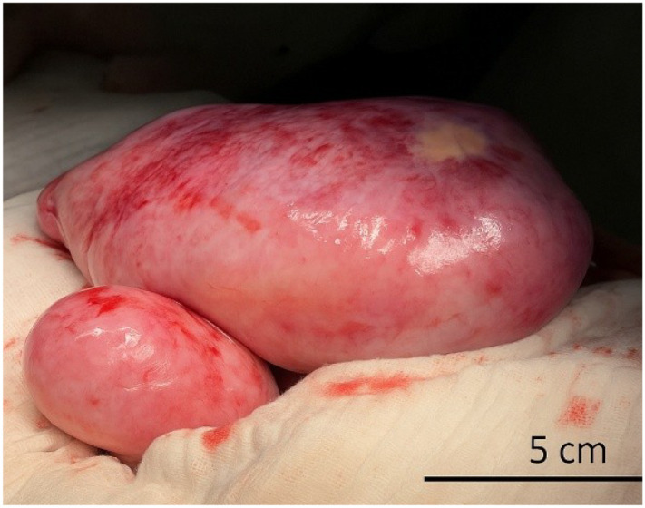
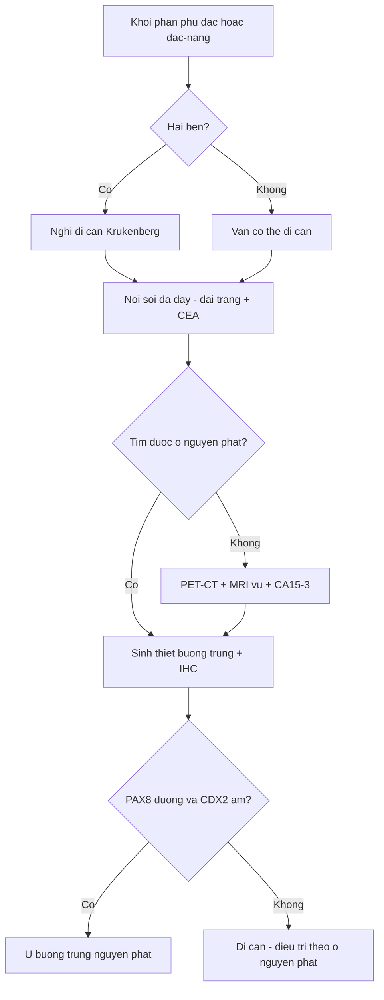
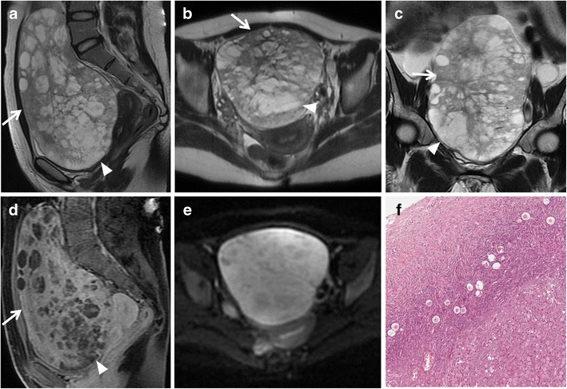
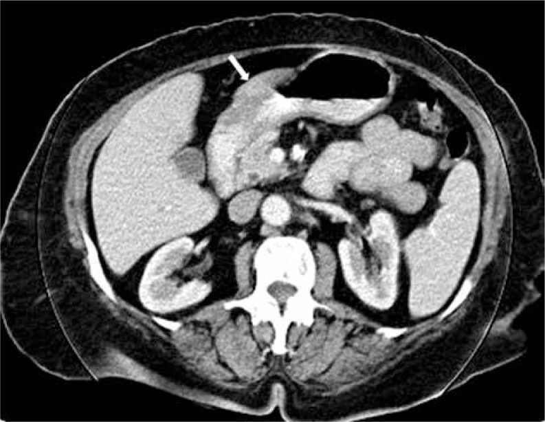
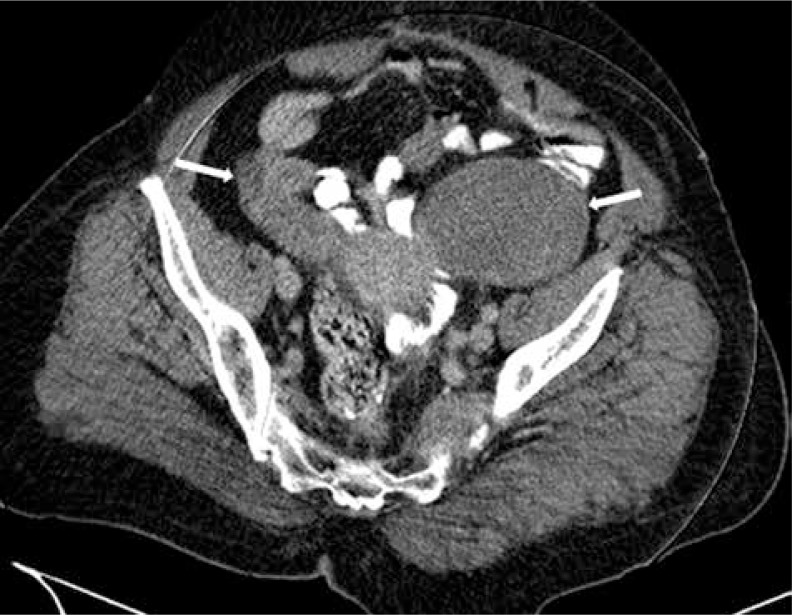
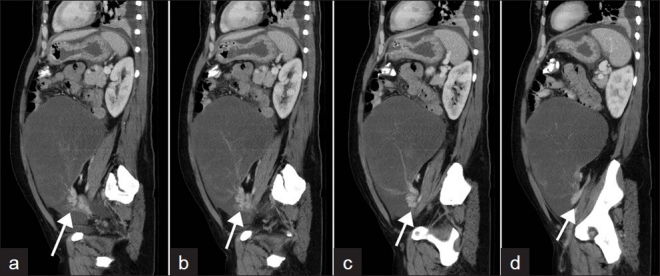
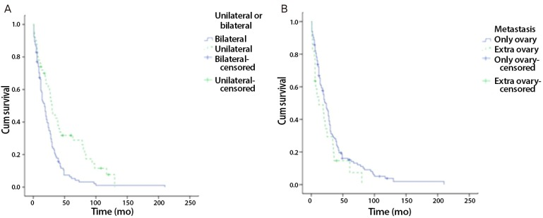

# 3116 — Di căn buồng trứng Krukenberg: khối hai bên, T2 tối, và cái bẫy "u buồng trứng nguyên phát" / Krukenberg tumour

**Tags:** `pattern:di-can` `pattern:khoi-dac-hai-ben` `pattern:nang-trong-dac` `vung:buong-trung` `vung:da-day` `score:O-RADS` `score:PCI` `protocol:MRI-chau` `protocol:CT-bung` `protocol:PET-CT`

**Mức chắc chắn (certainty):** tổng hợp y văn (literature synthesis) — ghép **tổng quan chọn bệnh nhân mổ 2024** (Nistor & Soleymani Majd, *Transl Cancer Res*, **PMC11543025**), **đoàn hệ 156 ca có sống thực** (Jeung et al., *Obstet Gynecol Sci* 2015, **PMC4303750**), **ca nguyên văn MRI 23 tuổi có ảnh** (Foti et al., *Insights Imaging* 2016, **PMC4729709**), **ca 18 tuổi hai bên có ảnh CT/đại thể** (Boiangiu et al., *Front Oncol* 2026, **PMC12971399**), **ca xoắn buồng trứng có ảnh CT** (Sandhu et al., *J Clin Imaging Sci* 2012, **PMC3307215**), **loạt 8 ca có ảnh CT** (Uyeturk et al., *Contemp Oncol* 2013, **PMC3934036**) và **so sánh MRI định lượng di căn ruột thừa vs u nhầy nguyên phát** (Kawaguchi et al., *Jpn J Radiol* 2026, **PMC13400669**). Nhóm **không có bệnh nhân của mình**; mọi tỷ lệ dưới đây là của các loạt hồi cứu, không phải ước lượng chắc chắn.

> **Câu chốt:** Krukenberg là **di căn buồng trứng từ ống tiêu hóa**, mô học đặc trưng là **tế bào nhẫn (signet-ring cell) chứa nhầy + tăng sinh mô đệm buồng trứng**. Trên hình ảnh, chốt không phải "khối to" mà là **HAI BÊN (67,3–80%) + phần đặc T2 trung–thấp do xơ hóa mô đệm + DWI sáng**, và **ổ nguyên phát chỉ được biết trước ở 20–30% ca**. Điều trị **khác hẳn** u buồng trứng nguyên phát: **không cắt tử cung + hai phần phụ theo phác đồ HGSOC**, mà là **cắt phần phụ ± mổ triệt căn ổ nguyên phát + hóa trị toàn thân**; **chỉ R0 mới kéo dài sống** (**11 vs 10 tháng** so với còn u đại thể).

## 1. Tổng quan bệnh học – cơ chế hình ảnh (TẠI SAO)

### 1.1 Định nghĩa và đường lan
- **Định nghĩa mô học (Krukenberg 1896):** di căn buồng trứng gồm **tế bào nhẫn chứa nhầy** nằm trong **mô đệm buồng trứng tăng sinh**. Trong thực hành, tên này được dùng rộng cho **di căn buồng trứng từ đường tiêu hóa** (chủ yếu dạ dày, đại tràng, ruột thừa), và đôi khi cả từ đường mật – tụy.
- **Đường lan:** chủ yếu **bạch huyết ngược dòng theo trục dạ dày – buồng trứng**, ngoài ra **gieo rắc phúc mạc (transcoelomic)** và **đường máu**. Buồng trứng là "đất tốt": mạng mạch – bạch mạch phong phú, mô đệm đáp ứng nội tiết → tế bào u **sống và kích thích mô đệm xơ hóa**.
- **Vì sao ung thư dạ dày thể tế bào nhẫn "thích" buồng trứng:** tế bào mất liên kết (mất E-cadherin), di chuyển rời rạc, tiết nhầy; nhầy vừa là **ổ chứa tín hiệu T2 cao**, vừa là **vật liệu kích thích xơ** → khối có **hai thành phần tương phản** trên MRI.
- **Vì sao chẩn đoán muộn:** **chỉ 20–30%** ca có tiền sử u nguyên phát đã biết khi khối buồng trứng xuất hiện; u dạ dày nguyên phát có thể **nhỏ, chỉ dày thành 9–11 mm** và **không gây triệu chứng** (ca 18 tuổi: thành hang vị **9 mm**, bờ cong lớn **11 mm**).

### 1.2 Vật lý hình ảnh — T2, DWI/ADC và HU
- **T2 tối = collagen, không phải sắt/máu:** mô đệm xơ – desmoplastic có **collagen liên kết chặt, ít proton tự do** → **T2 ngắn, tín hiệu thấp**. Phần **nhầy (mucin)** ngoại bào giữ nước → **T2 rất cao**. Vì vậy Krukenberg điển hình có **"đảo đặc tối" nằm trong "hồ nang sáng"**, không phải một khối đồng nhất.
- **Cảnh báo đọc đúng:** "T2 tối" là **tương đối so với nước/mỡ**; so với **cơ**, phần đặc vẫn có thể sáng hơn (trong loạt di căn ruột thừa: tỷ số tín hiệu T2 của phần đặc **4,15** lần cơ). Đừng lấy "tối hơn cơ" làm tiêu chuẩn — sẽ bỏ sót.
- **DWI/ADC:** phần đặc giàu tế bào → **b=800–1000 sáng, ADC thấp**. Nhưng **nhầy làm ADC tăng** (hiệu ứng T2 shine-through): trong so sánh trực tiếp, **ADC phần đặc của di căn 1,45 [1,26–1,49]** vs **u nhầy buồng trứng nguyên phát 1,09 [1,05–1,36] ×10⁻³ mm²/s** (p = 0,052) — **ADC không phân biệt được**, và chiều cao hơn ở di căn là **ngược trực giác**. Vì vậy **không dùng ADC một mình để chốt lành/ác hay nguyên phát/di căn**.
- **HU trên CT:** phần nang nhầy đo được **8–14 HU** (ca 2012) — gần nước, **không phải mỡ** (mỡ **−40 đến −120 HU**) và **không phải máu** (35–70 HU). Phần đặc có **vỏ/vách ngấm thuốc**; mức ngấm thường **thấp hơn nhu mô buồng trứng bình thường** vì khối nghèo mạch, xơ nhiều.
- **TẠI SAO hai bên lại quan trọng:** gieo rắc qua **bạch huyết và phúc mạc** không chừa một bên; u **nguyên phát** biểu mô buồng trứng thường **một bên** (trừ HGSOC di truyền). Nhưng **một bên không loại trừ** di căn: **32,7%** Krukenberg trong đoàn hệ 156 ca là một bên.

### 1.3 Số liệu trụ cột (bắt buộc nhớ)

| Chỉ số | Số liệu | Nguồn |
|---|---|---|
| Tần suất di căn trong u buồng trứng | **1–2%** ở phương Tây; **tới 17%** ở Nhật (nơi ung thư dạ dày phổ biến) | PMC11543025 |
| Ung thư dạ dày di căn buồng trứng | **0,3–6,7%** | PMC11543025 |
| Ổ nguyên phát hay gặp nhất | **dạ dày ~70%**; loạt gần đây: đại tràng **45,31%** vs dạ dày **32,03%** | PMC12971399 |
| Hai bên | **80%** (tổng quan) · **67,3%** (156 ca) · **~75%** (di căn từ vú) | PMC11543025 · PMC4303750 · PMC12002769 |
| Tuổi | trung bình **45,8**; **67,3%** tiền mãn kinh | PMC4303750 |
| Sống toàn bộ trung vị | **9–50 tháng** (tổng quan) · **22,7 tháng** (156 ca) | PMC11543025 · PMC4303750 |
| Theo ổ nguyên phát | vú **31** · đại tràng **21,5** · dạ dày **11 tháng** | PMC12971399 |
| Một bên vs hai bên | **31,7 vs 19,3 tháng** (p = 0,001) | PMC4303750 |
| Dịch ổ bụng | **59%** ca; HR tử vong **4,82** khi có dịch | PMC4303750 · PMC11543025 |
| Mổ R0 vs còn u | **11 vs 10 tháng** (R1/R2 không hơn không mổ) | PMC11543025 |

*Hai buồng trứng bị thay hoàn toàn bởi khối u nhẵn, nhiều múi (phải ~25 × 10 cm, trái ~10 × 8 cm) ở bệnh nhân 18 tuổi ung thư dạ dày tế bào nhấn. Bề mặt nhẵn, ít dính là điểm **khác với u buồng trứng nguyên phát gieo mạc nối**. Boiangiu A et al., Front Oncol 2026 (PMC12971399), Fig. 3, **CC BY 4.0** — nguyên bản.*

## 2. Mẫu hình + chẩn đoán phân biệt theo vị trí (Gamut)

- **Khuôn 1 — Nữ 30–60 tuổi, khối phần phụ HAI BÊN, đặc hoặc đặc–nang, giữ hình dạng buồng trứng, ± dịch ổ bụng.** Gamut theo ổ nguyên phát: **dạ dày** (tế bào nhẫn, hay gặp nhất) → **đại tràng/ruột thừa** → **vú (thể tiểu thùy)** → **đường mật, tụy, ruột non, cổ tử cung, bàng quang/ống niệu rốn**.
- **Khuôn 2 — Khối một bên rất lớn, nhiều nang nhầy, "ô kính màu" trên T1.** Gamut nghiêng **u nhầy buồng trứng nguyên phát/biên (mucinous borderline)** hoặc **di căn ruột thừa (LAMN)** — phân biệt bằng **kích thước (di căn nhỏ hơn), vách mờ, CEA** (bài 134).
- **Khuôn 3 — Khối phần phụ + đau bụng cấp + dấu "xoáy nước" (swirl sign) ở cuống.** Chẩn đoán là **xoắn buồng trứng** trên nền khối u — Krukenberg to, nặng (2.475 g trong ca 2012) là **điểm tựa xoắn**; xoắn không loại trừ ác tính và không làm mất chỉ định mô học.
- **Mnemonic "KOPF":** **K**rukenberg (dạ dày) · **O**vary giữ dạng · **P**eritoneal deposits (gieo phúc mạc) · **F**ibrotic stroma (T2 tối). Dùng để nhớ 4 trục: ổ nguyên phát, hình dạng, lan phúc mạc, mô đệm xơ.
- **Vị trí "giữ hình dạng buồng trứng" quan trọng thế nào:** tế bào u **thấm vào mô đệm buồng trứng** thay vì phá vỡ vỏ → khối vẫn **hình bầu dục/múi như buồng trứng to**, khác u biểu mô nguyên phát thường **phá vỏ, có nhú trong nang, dính và gieo mạc nối sớm**.

## 3. Bảng so sánh phân biệt (ma trận đối chiếu)

| Thực thể (entity) | Hình ảnh điển hình | Chốt vào (rule-in) | Chốt loại (rule-out) | Gợi ý xác nhận |
|---|---|---|---|---|
| **Krukenberg dạ dày – đại tràng** | Hai bên, đặc/đặc–nang, **giữ dạng buồng trứng**, phần đặc **T2 trung–thấp**, DWI sáng, **vách/vỏ ngấm thuốc** | **Hai bên + giữ dạng + T2 tối + CEA tăng + ổ tiêu hóa** | **Một bên, thuần nang, "ô kính màu" T1** → nghĩ u nhầy nguyên phát | Nội soi tiêu hóa + sinh thiết; IHC **CK20+/CDX2+/PAX8−** |
| **Di căn vú thể tiểu thùy** | Hai bên, đặc, **giảm mạch**, ± bánh mạc nối; có thể **buồng trứng không to** | **Tiền sử ILC + hai bên + ER/PR dương** | **Không có tiền sử, một bên, HGSOC điển hình** | IHC **GATA3+, ER+, PAX8±**, mất E-cadherin (bài 1649) |
| **U nhầy buồng trứng nguyên phát (POMC)** | Một bên, **rất lớn** (trung vị **182 mm**), nhiều ngăn, **"ô kính màu" 72%**, T1 sáng | **Kích thước > 152 mm + ô kính màu + CA19-9** | **Hai bên, vách mờ > 50%, CEA cao** → nghĩ di căn | Cắt u + IHC; **không mổ như HGSOC khi chưa loại trừ di căn** |
| **Di căn ruột thừa (LAMN/OMAT)** | Hai bên **29%**, nhỏ hơn (**129 mm**), **vách mờ 94%**, **CEA 22 ng/mL**, ADC **1,45** | **Vách mờ + CEA cao + dịch nhầy phúc mạc** | **Ô kính màu + T1 sáng + CA19-9 cao** → POMC | Nội soi/CT đại tràng, sinh thiết ruột thừa (bài 134) |
| **HGSOC nguyên phát** | Hai bên được (di truyền), **đặc–nang có nhú**, dịch ổ bụng nhiều, gieo mạc nối | **Nhú trong nang + CA-125 rất cao + gieo mạc nối** | **Giữ dạng buồng trứng + T2 tối + ổ tiêu hóa** → Krukenberg | IHC **PAX8+/WT1+/CK7+**, **CDX2−**; CA-125 không phân biệt được |
| **U xơ – u tế bào hạt (fibroma/fibrothecoma)** | Đặc, **T2 rất tối**, DWI tối, **ngấm thuốc chậm** | **T2 tối + DWI tối + không hạn chế khuếch tán** | **DWI sáng + ADC thấp + hai bên tiến triển** → ác/di căn | O-RADS MRI **2** khi T2 tối + DWI tối; theo dõi |
| **Xoắn buồng trứng trên khối u** | Khối lớn + **swirl sign** cuống, thành dày, **không ngấm thuốc** vùng xoắn | **Swirl sign + đau cấp + khối lớn** | **Swirl âm tính không loại trừ** xoắn từng lúc | Siêu âm Doppler + CT/MRI; mổ cấp (bài 1742) |

- **Ba con số phân biệt hữu ích (từ so sánh MRI định lượng):** kích thước **129 vs 182 mm** (AUC **0,77**; cutoff **≤ 152 mm** cho sens **78%**, spec **81%**); **CEA 22 vs 6,5 ng/mL** (p < 0,001); **CA-125 157 vs 64 U/mL** (p = 0,33 — **không phân biệt**). Nghĩa là: **CEA và kích thước hữu ích, CA-125 thì không**.

## 4. Protocol chụp + phân độ/điểm chuẩn hóa

- **CT bụng – châu có cản quang (thì tĩnh mạch cửa), lát ≤ 1 mm:** đánh giá **thành dạ dày** (bình thường khi bụng căng **< 5 mm**; ca bệnh đo **9 mm** và **11 mm**), hạch, gieo phúc mạc, **PCI**. Uống nước làm căng dạ dày trước chụp — không có nước, thành dày giả.
- **MRI tiểu khung (chuẩn vàng cho khối phần phụ):** T2 FSE **3 bình diện** + T1 + **T1 fat-sat** + **DWI b = 0/800–1000 + ADC** + **T1 fat-sat sau tiêm động học (DCE)**; thuốc chống nhu động. Đo **phần đặc** (bỏ vùng hoại tử/nang) để lấy ADC; ghi **kích thước, số nang, vách, tín hiệu T1 của nang lớn nhất**.
- **T1 fat-sat là bắt buộc:** phân biệt **máu/mỡ** (T1 sáng, không mất tín hiệu) với **nhầy** (T1 trung–thấp) — quyết định hướng **u nhầy nguyên phát** hay **di căn**.
- **PET-CT FDG:** tìm **ổ nguyên phát ẩn** và di căn ngoài phúc mạc khi CT/MRI âm tính; **không thay thế** nội soi + mô học; giá trị thấp với u nhầy (FDG kém).
- **Xét nghiệm – mô học:** **CEA** (hữu ích), **CA19-9**, **CA-125** (không phân biệt), **CA15-3** nếu nghi vú; **nội soi dạ dày – đại tràng** ở mọi khối buồng trứng đặc/nhầy không rõ nguồn; IHC **CK7, CK20, CDX2, PAX8, SATB2, ER/PR, GATA3**.
- **Phân độ:** **O-RADS MRI (ACR)** — khối có **thành phần đặc ngấm thuốc** thuộc nhóm **nguy cơ cao (O-RADS 5)**, chuyển **hội chẩn ung thư phụ khoa**, không mổ cấp cứu trừ khi xoắn/vỡ. Với ung thư dạ dày – đại tràng lan phúc mạc, dùng **PCI (Peritoneal Cancer Index)**: **PCI ≥ 16** là yếu tố tiên lượng xấu trong tổng quan.

## 5. Biến thể bình thường và cạm bẫy

- **"Khối hai bên" không đồng nghĩa Krukenberg:** u tế bào hạt, lymphoma, lao phúc mạc, HGSOC di truyền cũng hai bên. Chốt bằng **mô học + IHC**, không bằng hình thái.
- **Cạm bẫy ADC:** nhầy làm **ADC cao**; một khối "ADC không thấp" vẫn có thể là di căn nhầy. Trong so sánh trực tiếp, ADC di căn **cao hơn** u nhầy nguyên phát (1,45 vs 1,09) — **đừng dùng ADC để loại di căn**.
- **Cạm bẫy "một bên":** **32,7%** Krukenberg một bên; **không** loại trừ chỉ vì một bên.
- **Cạm bẫy "tiền sử":** **70–80%** ca **không có** tiền sử u nguyên phát khi khối buồng trứng được phát hiện; thiếu tiền sử **không** cho phép mặc định nguyên phát.
- **Cạm bẫy "buồng trứng bình thường":** ở di căn vú thể tiểu thùy, tế bào u **nằm trong mô đệm** nên buồng trứng có thể **không to**; siêu âm/CT âm tính **không loại trừ** (bài 1649).
- **Cạm bẫy mổ oan:** gọi Krukenberg là "u buồng trứng nguyên phát" dẫn tới **cắt tử cung + hai phần phụ + mạc nối** theo phác đồ HGSOC trong khi bệnh là **di căn giai đoạn IV** — mổ lớn không kéo dài sống nếu **không đạt R0** (R1/R2 = **10 tháng**, tương đương không mổ: **11 tháng**).
- **Cạm bẫy "satisfaction of search":** thấy khối buồng trứng to rồi dừng, **bỏ sót thành dạ dày dày 9 mm**. Đọc CT phải **cuộn hết dạ dày – đại tràng** và ghi độ dày thành.
- **Cạm bẫy xoắn:** khối Krukenberg lớn, nặng dễ xoắn; **swirl sign** chỉ thấy trên vài lát liên tiếp — phải xem **nhiều mặt cắt qua cuống**, không chỉ một lát.

## 6. Tự lượng giá — Blind Quiz

**Ca 1 — Nữ 23 tuổi, bụng to 3 tháng, chưa biết u nguyên phát. Xem MRI trước, mô tả tín hiệu.**

- Hỏi: (1) Phần đặc và phần nang có tín hiệu T2 gì? Vì sao khác nhau? (2) DWI nói gì? (3) Ba chẩn đoán phân biệt và bước tiếp theo?

<b>Bấm để hiện đáp án (findings + chẩn đoán)</b>

- **Findings:** khối lớn nhiều múi thay gần hết buồng trứng; **phần đặc/vách T2 trung–thấp** (mũi tên trắng) xen **các ổ nang T2 rất cao** (đầu mũi tên); T1 sau tiêm fat-sat: **phần đặc ngấm thuốc**; **DWI b = 800 sáng** ở phần đặc; mô học: **tế bào nhẫn chứa nhầy** trong mô đệm.
- **Chẩn đoán:** **Krukenberg từ ung thư dạ dày**. Giải thích: mô đệm xơ → T2 tối; hồ nhầy → T2 sáng; tế bào đặc → DWI sáng.
- **Phân biệt:** u nhầy buồng trứng nguyên phát (một bên, rất lớn, "ô kính màu" T1), HGSOC (nhú trong nang, CA-125 rất cao), lymphoma/lao phúc mạc.
- **Bước tiếp:** nội soi dạ dày + sinh thiết, CEA, IHC **CK20/CDX2/PAX8** — **không mổ như u nguyên phát** khi chưa loại trừ di căn.
- **Nguồn ảnh:** Foti PV et al., *Insights Imaging* 2016 (PMC4729709), Fig. 9, **CC BY 4.0** — nguyên bản, không crop/ghép.

**Ca 2 — Nữ 52 tuổi, đau bụng âm ỉ, CT bụng–châu có cản quang. Hai ảnh: bụng trên và tiểu khung.**

- Hỏi: ổ nguyên phát nằm ở đâu? Vì sao hai khối tiểu khung có tỷ trọng thấp? Cần đo gì trên CT?

<b>Bấm để hiện đáp án</b>

- **Findings:** (a) **thành dạ dày dày không đều, bờ trong nham nhở** ở bờ cong nhỏ/hang vị (mũi tên) — nghi ung thư dạ dày; (b) **hai khối phần phụ đối xứng**, tỷ trọng thấp, bờ đều, **vách/vỏ mỏng ngấm thuốc** (mũi tên).
- **Chẩn đoán:** **ung thư dạ dày di căn buồng trứng hai bên (Krukenberg)**. Tỷ trọng thấp 8–14 HU = **nhầy**, không phải mỡ (−40 đến −120 HU) hay máu (35–70 HU).
- **Cần đo:** **độ dày thành dạ dày** (bình thường < 5 mm khi căng; ca này dày bất thường), kích thước khối, hạch, dịch ổ bụng, **PCI**.
- **Nguồn ảnh:** Uyeturk U et al., *Contemp Oncol* 2013 (PMC3934036), Fig. 1–2, **CC BY-NC-ND 3.0** — nguyên bản.

**Ca 3 — Nữ 41 tuổi, khối bụng rất lớn, đau cấp. CT bụng–châu: bốn lát sagittal liên tiếp.**

- Hỏi: dấu hiệu ở cuống là gì? Nó thay đổi xử trí thế nào? Khối nang 21,6 cm này có thể là gì?

<b>Bấm để hiện đáp án</b>

- **Findings:** **dấu "xoáy nước" (swirl sign)** — mạch máu/mô mỡ cuống buồng trứng xoắn thành hình xoáy (mũi tên trắng) trên các lát liên tiếp; khối nang lớn, thành mỏng, nhiều vách, tỷ trọng **8–14 HU**.
- **Chẩn đoán:** **xoắn buồng trứng trên khối Krukenberg** (ca gốc: khối trái 21,6 × 11,7 × 22,8 cm; khối phải đặc 5,3 × 6,5 × 5,4 cm có vỏ ngấm thuốc; u dạ dày nguyên phát; buồng trứng cắt nặng **2.475 g**).
- **Xử trí:** **mổ cấp** vì xoắn, nhưng **vẫn phải lấy mô học** và **không mặc định lành** chỉ vì khối "chủ yếu nang".
- **Nguồn ảnh:** Sandhu S et al., *J Clin Imaging Sci* 2012 (PMC3307215), Fig. 5, **CC BY-NC-SA 3.0** — nguyên bản.

**Ca 4 — Nhìn biểu đồ sống thực, trả lời trước khi mở đáp án.**

- Hỏi: đường nào là **hai bên**? Hai bên làm tiên lượng xấu hơn bao nhiêu? Điều này có làm thay đổi chỉ định mổ không?

<b>Bấm để hiện đáp án</b>

- **Findings:** đường **hai bên (bilateral)** tụt nhanh hơn rõ rệt; **sống trung bình 19,3 tháng** so với **31,7 tháng** ở một bên (p = 0,001).
- **Ý nghĩa:** hai bên là **yếu tố tiên lượng xấu**, nhưng **không phải chống chỉ định mổ**: chỉ định dựa trên **khả năng đạt R0** và **tình trạng toàn thân**, không dựa trên số bên.
- **Nguồn ảnh:** Jeung YJ et al., *Obstet Gynecol Sci* 2015 (PMC4303750), Fig. 4, **CC BY-NC 3.0** — nguyên bản.

## Bài liên quan chéo
- [535 – Ung thư buồng trứng, gieo rắc phúc mạc & u Krukenberg](../535-ung-thu-buong-trung-phuc-mac-krukenberg/lesson.md) (bài tổng quan hệ: FIGO, PCI, bánh mạc nối)
- [1649 – Di căn buồng trứng của ung thư vú](../1649-di-can-buong-trung-ung-thu-vu/lesson.md) (thể tiểu thùy, buồng trứng không to, "black scrunchie")
- [134 – U nhầy ruột thừa chưa vỡ & di căn buồng trứng](../134-u-nhay-ruot-thua-chua-vo/lesson.md) (LAMN vs u nhầy nguyên phát)
- [539 – Pseudomyxoma peritonei](../539-pseudomyxoma-peritonei/lesson.md) (dịch nhầy phúc mạc, PCI)
- [1742 – Xoắn buồng trứng & OHSS](../1742-xoan-buong-trung-ohss/lesson.md) (swirl sign, chỉ định mổ)
- [1950 – Cố định buồng trứng sau tháo xoắn](../1950-co-dinh-buong-trung-sau-thao-xoan/lesson.md)
- [577 – Theo dõi tái phát ung thư phụ khoa](../577-theo-doi-tai-phat-ung-thu-phu-khoa/lesson.md)

## Ảnh
- `3116_krukenberg_MRI_PMC4729709-Fig9.jpg` — MRI 6 ô (T2 sagittal/axial/coronal, T1 sau tiêm, DWI, mô học), **CC BY 4.0**.
- `3116_nguyen-phat-da-day_CT_PMC3934036-Fig1.jpg` — CT dạ dày nguyên phát, **CC BY-NC-ND 3.0**.
- `3116_krukenberg_CT_PMC3934036-Fig2.jpg` — CT hai khối phần phụ, **CC BY-NC-ND 3.0**.
- `3116_xoan-vong-buong-trung_CT_PMC3307215-Fig5.jpg` — swirl sign, **CC BY-NC-SA 3.0**.
- `3116_hai-ben-dai-the_Intraop_PMC12971399-Fig3.jpg` — đại thể hai bên, **CC BY 4.0**.
- `3116_song-thon_Chart_PMC4303750-Fig4.jpg` — Kaplan–Meier, **CC BY-NC 3.0**.
- Nguồn + giấy phép từng ảnh: `images/CREDITS.md`.

> Không dùng để chẩn đoán độc lập khi chưa có người hướng dẫn.
