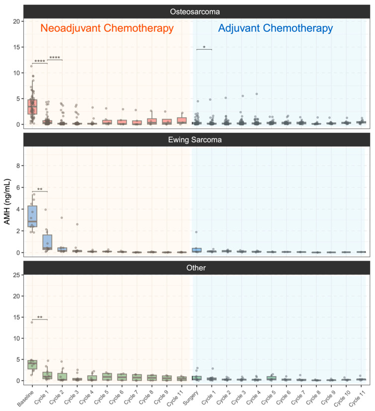
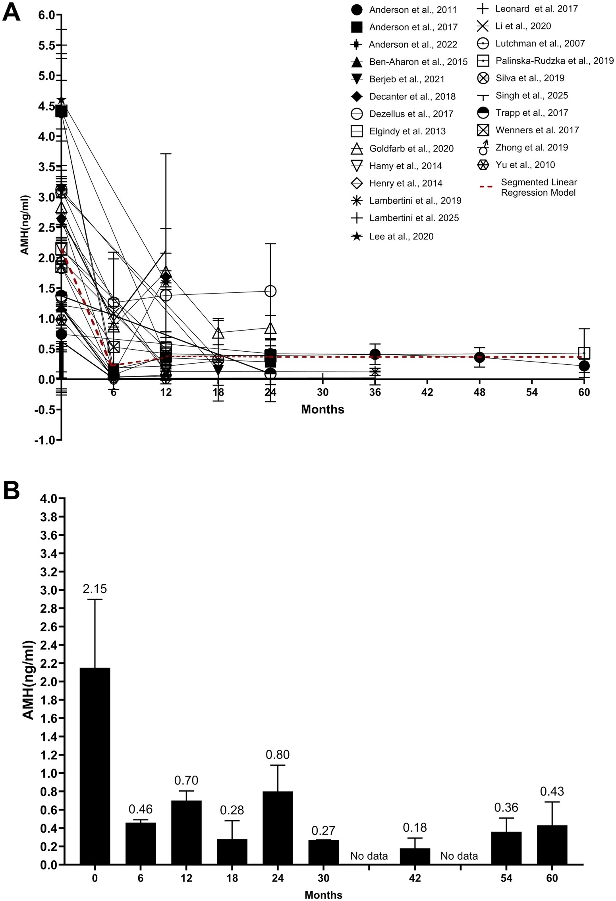
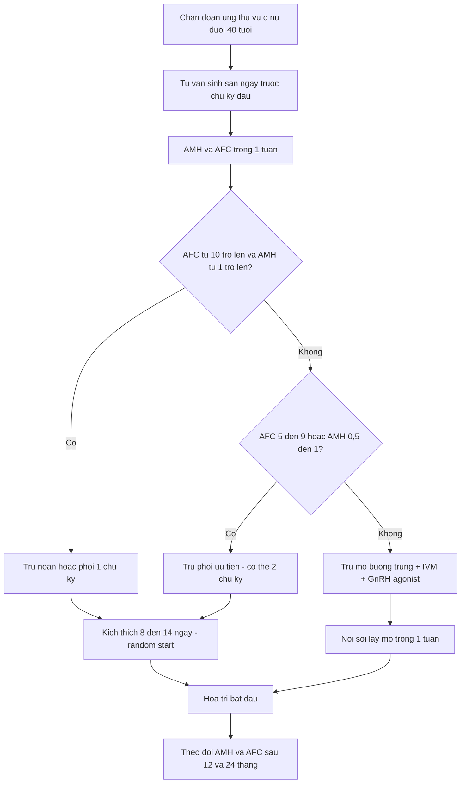
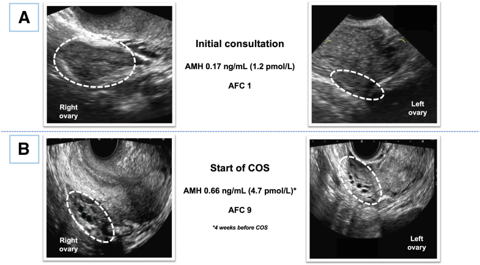
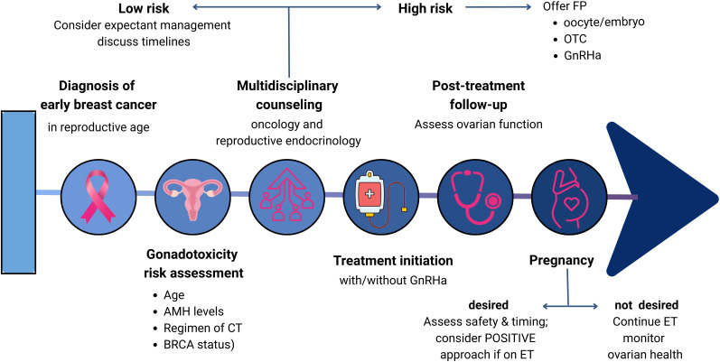

# 3117 — Bảo tồn sinh sản trước hóa trị ung thư vú: AMH, AFC và "cửa sổ thời gian" bác sĩ CĐHA không được làm chậm / Oncofertility before breast-cancer chemotherapy

**Tags:** `pattern:buong-trung-nho` `pattern:it-nang-noan` `vung:buong-trung` `vung:vu` `score:AFC` `protocol:sieu-am-dau-do` `protocol:MRI-tieu-khung` `protocol:du-tru-noan`

**Mức chắc chắn (certainty):** tổng hợp y văn (literature synthesis) — ghép **phân tích tổng hợp AMH sau điều trị ung thư** (*Hum Reprod Update* 2026, **PMC13731750**), **tổng quan hệ thống bảo tồn sinh sản theo thể ung thư vú** (*Cancers* 2026, **PMC13297560**), **tổng quan hiệu quả bảo tồn sinh sản ở vú** (*Ann Transl Med* 2026, **PMC13184393**), **đoàn hệ AMH ở sarcoma** (*Cancers* 2026, **PMC13256773**), **tổng quan độc tính buồng trứng của hóa trị** (*Gynecol Oncol Rep* 2024, **PMC11021951**), **phác đồ quyết định bảo tồn sinh sản** (*Front Endocrinol* 2025, **PMC12812656**) và **ca siêu âm buồng trứng "yên lặng"** (*F S Rep* 2025, **PMC12746883**). Nhóm **không có bệnh nhân của mình**; mọi tỷ lệ là của từng nghiên cứu.

> **Câu chốt:** tổn thương dự trữ noãn xảy ra **ngay trong 1–2 chu kỳ đầu** — AMH ở bệnh nhân sarcoma giảm từ **3,46 → 0,39 ng/mL sau chu kỳ 1 (−88,7%)** và **0,15 ng/mL sau chu kỳ 2** (PMC13256773); ở ung thư vú, AMH **giảm 76,4% tại 12 tháng** (24 nghiên cứu, n = 2.259; PMC13731750). Nghĩa là **tư vấn và trữ noãn/phôi phải xong trước chu kỳ đầu**, và mọi bước **chẩn đoán hình ảnh** (MRI vú, CT phân giai đoạn, xạ hình) phải được **dồn lên trước** hoặc chạy **song song** với kích thích buồng trứng — vì **chậm 2 tuần không chỉ là 2 tuần**: đó có thể là mất luôn cơ hội trữ noãn.

## 1. Tổng quan bệnh học – cơ chế hình ảnh (TẠI SAO)

### 1.1 Sinh lý bệnh của "đồng hồ bị đốt"
- **Dự trữ noãn là hằng số từ khi sinh** và chỉ giảm dần. Hóa trị không "tạm dừng" buồng trứng — nó **phá các nang đang phát triển** (nhạy nhất) và **khởi động apoptosis ở nang nguyên thủy** qua stress oxy hóa; **tác nhân alkyl hóa (cyclophosphamide)** độc nhất, gây tổn thương **không hồi phục**.
- **Tuổi là yếu tố quyết định mạnh nhất:** cùng một phác đồ, phụ nữ **> 35–40 tuổi** mất dự trữ nhanh hơn nhiều vì số nang còn lại ít. Ước lượng theo nhóm thuốc: **nhóm alkyl hóa → suy buồng trứng 42,2%**; **anthracycline + paclitaxel → 85% đủ tiêu chuẩn suy buồng trứng ngay cuối điều trị**, và **32,4%** trong số không đủ tiêu chuẩn vẫn có **AMH thấp** (PMC11021951).
- **Vì sao phải đo trước khi điều trị, không phải sau:** AMH **giảm sâu ngay sau chu kỳ đầu** (sarcoma: **−88,7%**; PMC13256773) — sau đó mới **hồi phục một phần** giữa 12–24 tháng. Một AMH đo "sau khi xong hóa trị" **không cho biết dự trữ ban đầu**, nên không dùng để tư vấn tiên lượng sinh sản.

*Từng bước điều trị: đường trung vị rơi dốc nhất **giữa nền và sau chu kỳ 1** (3,46 → 0,39 ng/mL, **−88,7%**), tiếp tục xuống **0,15 ng/mL** sau chu kỳ 2. Đây là lý do "trữ noãn trước chu kỳ 1" không phải khẩu hiệu. Wang B et al., Cancers 2026 (PMC13256773), Fig. 1, **CC BY 4.0** — nguyên bản.*

### 1.2 Vật lý/kỹ thuật đo: tại sao AFC và AMH lại bổ sung nhau
- **AFC (antral follicle count)** đếm **nang noãn có đường kính 2–10 mm** trên siêu âm đầu dòng (**ngày 2–5 chu kỳ** nếu chu kỳ đều). Đây là **quan sát trực tiếp** các nang đã thoát khỏi trạng thái ngủ: **mỗi nang = một noãn tiềm năng** cho chu kỳ kích thích. Vì thế AFC dự báo **số noãn thu được**, chứ không chỉ "còn bao nhiêu tuổi sinh sản".
- **AMH** do **tế bào hạt của nang nhỏ (< 8 mm)** tiết ra; nồng độ tỷ lệ với **số nang đang phát triển** → phản ánh **kích thước kho dự trữ**, **dao động ít giữa các chu kỳ**, đo được cả khi đang dùng thuốc tránh thai.
- **TẠI SAO hai chỉ số lệch nhau:** AFC là **đếm cấu trúc** (phụ thuộc người quét, độ phân giải, nang 2–10 mm), AMH là **nồng độ hormone** (phụ thuộc assay, không phụ thuộc chu kỳ). Trong một ca, **AFC = 1 và AMH = 0,17 ng/mL** lúc tư vấn, nhưng **4 tuần sau AFC = 9 và AMH = 0,66 ng/mL** — nghĩa là **một lần đo thấp không phải bản án** (PMC12746883).
- **TẠI SAO hình ảnh lại quan trọng với "cửa sổ thời gian":** trữ noãn/phôi cần **kích thích buồng trứng 8–14 ngày** (có thể **khởi động bất kỳ pha nào của chu kỳ — "random start"**), trữ mô buồng trứng cần **mổ nội soi**. Các bước này **cạnh tranh thời gian** với MRI vú, CT phân giai đoạn, siêu âm hạch, PET. Nếu bác sĩ CĐHA hẹn MRI vú "2–3 tuần nữa" mà không biết bệnh nhân đang chờ trữ noãn, cả hai bên cùng chậm.

### 1.3 Số liệu trụ cột (bắt buộc nhớ)

| Chỉ số | Số liệu | Nguồn |
|---|---|---|
| AMH sau hóa trị ung thư vú | **−76,4% tại 12 tháng** (95% CI −93,5 đến −55,7; **24 nghiên cứu, n = 2.259**, tuổi trung vị 37,8) | PMC13731750 |
| Tốc độ tổn thương | **−88,7% sau chu kỳ 1**; **−95,7% sau chu kỳ 2** (sarcoma, AMH 3,46 → 0,39 → 0,15 ng/mL) | PMC13256773 |
| Suy buồng trứng theo nhóm thuốc | alkyl hóa **42,2%**; anthracycline + paclitaxel **85%** cuối điều trị | PMC11021951 |
| Kích thích buồng trứng bằng letrozole/tamoxifen | **8–14 noãn trưởng thành/chu kỳ**, estradiol thấp hơn | PMC13297560 |
| Sống 5 năm ung thư vú giai đoạn sớm | **> 90%** → số người sống sót trẻ tăng nhanh | PMC13297560 |
| Thai kỳ ở người sống sót ung thư vú | **thấp hơn ~67%** so với dân số chung (đã hiệu chỉnh tuổi/học vấn/số con) | PMC13184393 |
| Hồi phục | **97% có kinh trở lại**; **70% có AMH > 1 ng/mL tại 12 tháng** (một nghiên cứu quan sát) | PMC13297560 |
| AFC/AMH một ca "yên lặng" | AFC **1 → 9**, AMH **0,17 → 0,66 ng/mL** trong **4 tuần** | PMC12746883 |

*(A) Từng nghiên cứu: AMH **rơi mạnh trong 6 tháng đầu** rồi chững quanh **0,3–0,5 ng/mL** tới 60 tháng. (B) Trung bình gộp: **2,15 → 0,46 (6 tháng) → 0,70 (12 tháng) → 0,28 (18 tháng) → 0,80 (24 tháng)** ng/mL. Đường đỏ đứt = mô hình hồi quy từng đoạn. Balachandren N et al., Hum Reprod Update 2026 (PMC13731750), Fig. 2, **CC BY 4.0** — nguyên bản.*

## 2. Mẫu hình + chẩn đoán phân biệt theo vị trí (Gamut)

- **Khuôn 1 — Nữ < 40 tuổi, vừa chẩn đoán ung thư vú, buồng trứng "bình thường" trên siêu âm.** Câu hỏi không phải "có u không" mà là **đếm nang**: AFC **≥ 10** = dự trữ tốt; **5–9** = trung bình; **< 5** = thấp. Ghi **AFC hai bên + thể tích buồng trứng** trong báo cáo, vì đây là **mốc nền** cho mọi so sánh sau này.
- **Khuôn 2 — Buồng trứng nhỏ, không thấy nang, AMH thấp ở người trẻ.** Gamut: **suy buồng trứng sớm (POI)** · **đang dùng GnRH agonist/ức chế trục** (thuốc làm nang ngừng phát triển) · **sau hóa trị** · **buồng trứng đa nang đã bị "làm phẳng" do thuốc** · **lỗi kỹ thuật/đầu dò**. Chốt bằng **hỏi thuốc + AMH**, không bằng một lần siêu âm.
- **Khuôn 3 — Buồng trứng nhiều nang nhỏ (≥ 12 nang 2–9 mm/buồng trứng).** Gamut: **buồng trứng đa nang (PCOM)** · **dự trữ tốt ở người trẻ** · **OHSS sớm sau kích thích** · **buồng trứng đa nang do GnRH antagonist**. Phân biệt bằng **bối cảnh kích thích** và **AMH rất cao**, không bằng hình thái đơn thuần.
- **Khuôn 4 — Theo dõi mô buồng trứng ghép lại (sau trữ mô).** Mẫu hình: **mảnh mô tăng âm, có nang nhỏ xuất hiện sau 3–6 tháng**, **Doppler thấy dòng**. Đây là dấu hiệu **mảnh ghép sống** — không phải "u tái phát" (bài 1632).
- **Khuôn 5 — Bệnh nhân đã xong điều trị, hỏi "còn sinh được không".** Không có hình ảnh nào trả lời trực tiếp; **AFC + AMH + tuổi** cho ước lượng, và **không có ngưỡng nào loại trừ khả năng có thai tự nhiên**.

## 3. Bảng so sánh phân biệt (ma trận đối chiếu)

| Thực thể (entity) | Hình ảnh/định lượng điển hình | Chốt vào (rule-in) | Chốt loại (rule-out) | Gợi ý xác nhận |
|---|---|---|---|---|
| **Dự trữ bình thường** | AFC **≥ 10**; thể tích buồng trứng **3–8 cm³**; AMH **1–4 ng/mL** | **AFC ≥ 10 + AMH ≥ 1 ng/mL + tuổi < 35** | **AFC < 5 hoặc AMH < 0,5** → không phải bình thường | Siêu âm ngày 2–5; AMH cùng ngày |
| **Dự trữ thấp (DOR)** | AFC **< 5–7**; buồng trứng nhỏ; AMH **< 1 ng/mL** | **AFC < 5 + AMH < 1**; đáp ứng kém với kích thích | **AFC thấp một lần nhưng AMH bình thường** → đo lại, đừng kết luận | Lặp siêu âm 4 tuần (ca PMC12746883) |
| **Suy buồng trứng sớm (POI)** | Không nang; **FSH > 25 IU/L** hai lần; AMH **< 0,1 ng/mL** | **Vô kinh ≥ 4 tháng + FSH > 25** ở tuổi < 40 | **Có kinh + AFC ≥ 5** → không phải POI | FSH/estradiol; mật độ xương |
| **Buồng trứng bị ức chế do GnRH agonist** | Buồng trứng nhỏ, **không nang**, AMH **giảm giả tạo** | **Đang tiêm GnRHa + không nang + AMH thấp** | **AFC ≥ 10** → chỉ là ức chế, không phải mất dự trữ | Ngừng thuốc/đo lại; **không dùng AMH khi đang GnRHa để tiên lượng** |
| **PCOM/PCOS** | **≥ 12 nang 2–9 mm** một buồng trứng hoặc thể tích **> 10 cm³**; AMH cao | **≥ 12 nang + AMH cao + bối cảnh kinh thưa** | **Nang > 10 mm chiếm ưu thế** → nang noãn/hoàng thể, không phải PCOM | AMH; testosterone; siêu âm ngày 2–5 |
| **Mảnh mô buồng trứng ghép** | Mô **tăng âm**, nang nhỏ xuất hiện **3–6 tháng** sau ghép; **có dòng Doppler** | **Nang mới + Doppler dương trong mô ghép** | **Mô không thay đổi + không dòng sau 6 tháng** → mảnh ghép không sống | Siêu âm 3 tháng/lần; FSH/estradiol |
| **OHSS sớm sau kích thích** | Buồng trứng **rất to, nhiều nang**, dịch ổ bụng, tràn dịch màng phổi | **Bối cảnh 3–10 ngày sau trigger + buồng trứng to + dịch** | **Buồng trứng to nhưng không dịch, không bối cảnh kích thích** → nghĩ khác | Siêu âm + cân nặng + Hct |

- **Ba con số dùng để tư vấn:** (1) **AMH mất 76,4% sau 12 tháng** ở ung thư vú — đừng hứa "sẽ hồi phục như cũ"; (2) **8–14 noãn/chu kỳ** với phác đồ letrozole/tamoxifen — con số thực tế để bệnh nhân quyết định; (3) **AFC 1 → 9 trong 4 tuần** — một lần đo thấp **không** phải chống chỉ định.

## 4. Protocol chụp + phân độ/điểm chuẩn hóa

- **Siêu âm đầu dòng qua ngã âm đạo (chuẩn để đếm AFC):** đầu dò **5–9 MHz**, **ngày 2–5 chu kỳ** (nếu chu kỳ đều; **bất kỳ ngày nào nếu đang chờ hóa trị** — không được chờ chu kỳ), quét **hai bình diện** mỗi buồng trứng, đếm **tất cả nang 2–10 mm**, ghi **AFC từng bên + tổng + thể tích buồng trứng (công thức ellipsoid 0,523 × D1 × D2 × D3)**. Với buồng trứng khó thấy: **siêu âm đầu dò bụng bàng quang đầy** hoặc **MRI** (không cần cản quang).
- **MRI tiểu khung:** chỉ khi siêu âm không thấy buồng trứng (mô mỡ nhiều, buồng trứng sau tử cung, đang có vòng) hoặc cần đánh giá mô ghép; chuỗi **T2 FSE 3 bình diện**, lớp **3 mm**, không cần DWI cho mục đích đếm nang.
- **Không chụp gì thêm để "đo dự trữ":** **không** có chỉ định CT tiểu khung, không PET cho mục đích này — mỗi lần chụp thêm là **chậm trữ noãn** và **thêm liều**.
- **Phân tầng và ngưỡng xử trí (theo hình + AMH):**
  - **AFC ≥ 10 và AMH ≥ 1 ng/mL:** dự trữ tốt → trữ noãn/phôi nếu bệnh nhân muốn; **1 chu kỳ** thường đủ.
  - **AFC 5–9 hoặc AMH 0,5–1:** dự trữ trung bình → có thể cần **2 chu kỳ**; cân nhắc **trữ phôi** (hiệu quả cao hơn trữ noãn) hoặc **trữ mô** nếu không đủ thời gian.
  - **AFC < 5 hoặc AMH < 0,5:** dự trữ thấp → **không hứa kết quả**, thảo luận **trữ mô buồng trứng** (bài 1632), **IVM**, **GnRH agonist** đồng thời, và **phương án mang thai hộ/dùng noãn cho**.
  - **Không có ngưỡng nào là chống chỉ định tuyệt đối** — quyết định dựa trên tuổi, loại u, thời gian có thể trì hoãn điều trị.
- **Ngân sách thời gian (quan trọng nhất với CĐHA):** toàn bộ **chẩn đoán hình ảnh phân giai đoạn + trữ noãn** nên xong trong **~2–3 tuần**; **random-start COS** cho phép bắt đầu ngay bất kỳ pha chu kỳ, nên **không được hoãn vì "chờ ngày 2"**.

## 5. Biến thể bình thường và cạm bẫy

- **Biến thể bình thường:** buồng trứng **một bên khó thấy** do ruột/tử cung che — **không** đồng nghĩa mất buồng trứng; **nang < 2 mm** không tính vào AFC; **nang > 10 mm** là nang đang phát triển, **không** tính.
- **Cạm bẫy 1 — "AMH thấp = không còn cơ hội":** ca PMC12746883 có **AMH 0,17 ng/mL và AFC 1** lúc tư vấn, **4 tuần sau AFC 9** và vẫn thu được noãn. Một lần đo **không** đủ để từ chối bệnh nhân.
- **Cạm bẫy 2 — đo AMH khi đang GnRH agonist:** thuốc **ức chế trục**, AMH **giảm giả tạo**; kết luận "dự trữ kém" lúc này là sai. Ghi rõ **thuốc đang dùng** trong báo cáo.
- **Cạm bẫy 3 — AFC phụ thuộc người quét:** sai lệch giữa hai người có thể **2–3 nang**; nếu theo dõi, nên **cùng người quét/cùng máy**, và ghi **điều kiện quét**.
- **Cạm bẫy 4 — bỏ sót OHSS khi đếm nang:** buồng trứng **rất to + nhiều nang + dịch ổ bụng** sau trigger là **OHSS**, không phải "đáp ứng tốt"; cần theo dõi, không đếm thêm.
- **Cạm bẫy 5 — hình ảnh làm chậm điều trị:** hẹn MRI vú/PET "2 tuần nữa" mà không hỏi về trữ noãn có thể **đẩy bệnh nhân qua chu kỳ đầu** — và tổn thương dự trữ xảy ra **ngay chu kỳ 1**. Luôn hỏi: *"Bệnh nhân có đang trong quy trình trữ noãn không?"*
- **Cạm bẫy 6 — nhầm mô ghép với tái phát:** sau ghép mô buồng trứng, mô **tăng âm có nang nhỏ** là **dấu hiệu sống**, không phải u; đừng sinh thiết (bài 1632).

## 6. Tự lượng giá — Blind Quiz

**Ca 1 — Nữ 32 tuổi, ung thư vú giai đoạn sớm, được hỏi về trữ noãn. Siêu âm đầu dòng: hai buồng trứng.**

- Gợi ý lâm sàng: chưa hóa trị; AMH 0,17 ng/mL.
- Hỏi: (1) AFC là bao nhiêu? (2) Có nên kết luận "không còn cơ hội trữ noãn"? (3) Bạn làm gì tiếp theo?

<b>Bấm để hiện đáp án (findings + chẩn đoán)</b>

- **Findings:** (A) lúc tư vấn: buồng trứng phải **1 nang** (AFC 1), trái khó thấy; **AMH 0,17 ng/mL (1,2 pmol/L)**. (B) **4 tuần sau**: phải **AFC 9**, trái có vài nang; **AMH 0,66 ng/mL (4,7 pmol/L)**.
- **Chẩn đoán:** **dự trữ thấp thoáng qua, không phải suy buồng trứng**; AFC **thay đổi theo thời điểm**.
- **Vì sao:** AFC đếm nang **2–10 mm** — nang có thể "vào cửa sổ" muộn hơn; AMH phản ánh nang nhỏ và có thể tăng khi trục hồi phục.
- **Xử trí:** vẫn tiến hành **kích thích và trữ noãn**; không trì hoãn hóa trị quá **2–3 tuần**; đo lại AMH/AFC nếu kết quả quyết định phương án.
- **Nguồn ảnh:** *F S Rep* 2025 (PMC12746883), Fig. 1, **CC BY-NC-ND 4.0** — nguyên bản, không crop/ghép.

**Ca 2 — Bệnh nhân ung thư vú 38 tuổi: đọc biểu đồ AMH trước khi mở đáp án.**

- Hỏi: (1) AMH rơi vào lúc nào và sâu bao nhiêu? (2) Có hồi phục không? (3) Điều này thay đổi cách bạn tư vấn trước điều trị thế nào?

<b>Bấm để hiện đáp án</b>

- **Findings:** AMH trung bình **2,15 → 0,46 ng/mL lúc 6 tháng**, **0,70 lúc 12 tháng**, **0,28 lúc 18 tháng**, **0,80 lúc 24 tháng**; gộp 24 nghiên cứu: **−76,4% tại 12 tháng**.
- **Chẩn đoán:** **suy giảm dự trữ do hóa trị, hồi phục một phần nhưng không về nền**.
- **Tư vấn:** nói rõ **không có "bảo hiểm" nào đảm bảo sinh con**; trữ noãn/phôi **trước chu kỳ 1**; theo dõi AMH **12 và 24 tháng** nhưng **không dùng AMH để kết luận vô sinh**.
- **Nguồn ảnh:** Balachandren N et al., *Hum Reprod Update* 2026 (PMC13731750), Fig. 2, **CC BY 4.0** — nguyên bản.

**Ca 3 — Bác sĩ ung thư hỏi: "Bệnh nhân 29 tuổi, cần MRI vú và CT phân giai đoạn, có nên trì hoãn 3 tuần để trữ noãn?"**

- Hỏi: (1) Sơ đồ đặt **đánh giá độc tính** ở đâu? (2) Ba lựa chọn bảo tồn ghi trong sơ đồ? (3) Câu trả lời của bạn về 3 tuần?

<b>Bấm để hiện đáp án</b>

- **Findings:** sơ đồ: **chẩn đoán → tư vấn đa chuyên khoa → đánh giá độc tính (tuổi, AMH, phác đồ, BRCA) → bắt đầu điều trị ± GnRHa → theo dõi sau điều trị → mang thai (nếu muốn)**; nhánh nguy cơ cao → **trữ noãn/phôi, OTC, GnRHa**.
- **Trả lời:** **không cần hoãn 3 tuần** — **random-start COS** cho phép bắt đầu ngay; MRI/CT có thể chạy **song song**. Nếu buộc phải chọn, **trữ noãn 1 chu kỳ (~2 tuần)** thường chấp nhận được với ung thư vú giai đoạn sớm, nhưng quyết định thuộc **hội chẩn đa chuyên khoa**, không thuộc bác sĩ CĐHA.
- **Điểm cần nhớ:** tổn thương dự trữ xảy ra **ngay chu kỳ đầu** (−88,7% ở sarcoma) → **thời gian là dự trữ noãn**.
- **Nguồn ảnh:** *Front Endocrinol* 2025 (PMC12812656), Fig. 1, **CC BY 4.0** — nguyên bản.

## Bài liên quan chéo
- [500 – Tổng quan Vú & Sản Phụ khoa](../500-tong-quan-vu-san-phu-khoa/lesson.md) (bản đồ hệ, bảng DDx)
- [1632 – Trữ mô buồng trứng trước dậy thì và ghép lại](../1632-tru-mo-buong-trung-truoc-day-thi/lesson.md) (kỹ thuật OTC, MRD, kết cục sinh sản)
- [533 – Theo dõi & bảo tồn sinh sản sau u tế bào mầm buồng trứng](../533-theo-doi-va-bao-ton-sinh-san-sau-u-buong-trung/lesson.md) (bảo tồn trong ung thư phụ khoa)
- [1606 – Endometrioma tái phát & hiếm muộn](../1606-tai-phat-endometrioma-mo-lai-hay-ivf/lesson.md) (mổ làm AMH giảm 38%/6 tháng)
- [1742 – Xoắn buồng trứng & OHSS](../1742-xoan-buong-trung-ohss/lesson.md) (buồng trứng to sau kích thích)
- [1791 – Ung thư vú ở nam giới](../1791-ung-thu-vu-nam/lesson.md) (bối cảnh ung thư vú)
- [3116 – Di căn buồng trứng Krukenberg](../3116-di-can-buong-trung-krukenberg/lesson.md) (khối buồng trứng ở bệnh nhân ung thư)

## Ảnh
- `3117_phac-do_Flow_PMC12812656-Fig1.jpg` — sơ đồ quyết định bảo tồn sinh sản, **CC BY 4.0**.
- `3117_amh-vu_Chart_PMC13731750-Fig2.jpg` — AMH sau hóa trị ung thư vú, **CC BY 4.0**.
- `3117_amh-tung-dot_Chart_PMC13256773-Fig1.jpg` — AMH tụt từng chu kỳ (sarcoma), **CC BY 4.0**.
- `3117_sieu-am-noan_AFC_PMC12746883-Fig1.jpg` — siêu âm AFC trước/sau 4 tuần, **CC BY-NC-ND 4.0**.
- Nguồn + giấy phép từng ảnh: `images/CREDITS.md`.

> Không dùng để chẩn đoán độc lập khi chưa có người hướng dẫn.
