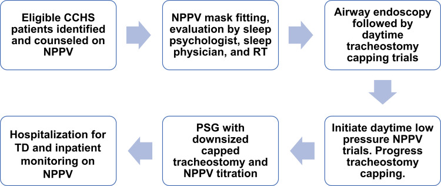
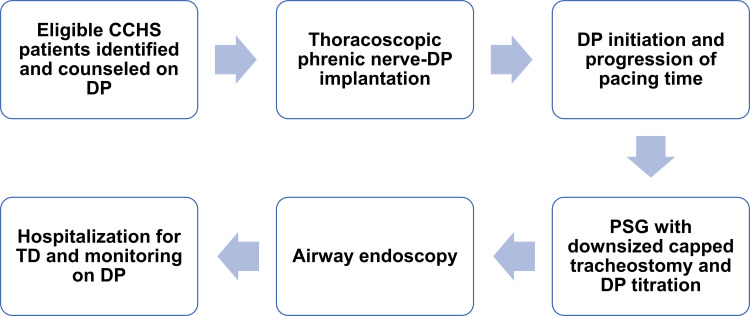
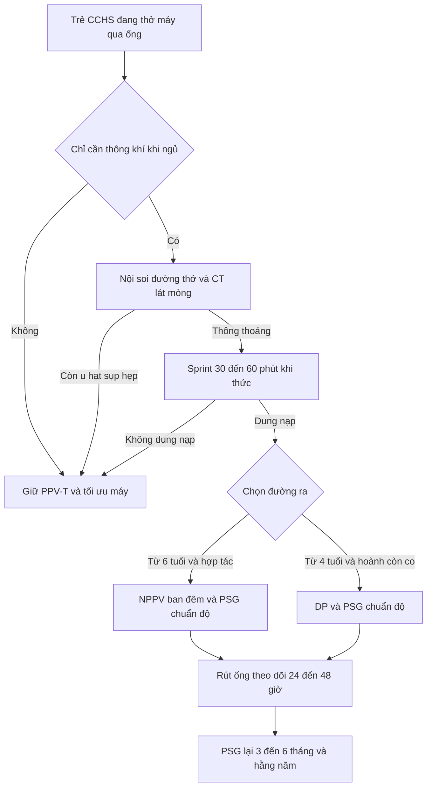

# 3118 — Cai ống mở khí quản ở trẻ CCHS: chuyển sang NPPV hay kích thích cơ hoành?

**Tags:** `pattern:phu-thuoc-thong-khi` `pattern:giam-thong-khi-trung-uong` `vung:duong-tho-nhi` `vung:than-nao` `vung:co-hoanh` `anatomy:co-hoanh` `protocol:PSG` `protocol:chup-hoanh` `protocol:noi-soi-duong-tho` `score:AASM-hypoventilation`
**Mức chắc chắn (certainty):** tổng hợp y văn (literature synthesis) — ghép **thuật toán cai ống sang NPPV và sang kích thích cơ hoành** (Kasi AS và cs., *J Multidiscip Healthc* 2022, PMC8963195), **đoàn hệ 30 trẻ theo dõi 25 năm** (Fain ME và cs., *Clin Med Insights Pediatr* 2023, PMC10226304), **đoàn hệ 23 trẻ đặt máy kích thích cơ hoành** (Tsolakis N và cs., *Acta Paediatr* 2022, PMC9305551), **đoàn hệ 22 trẻ của một trung tâm** (Porcaro F và cs., *Front Pediatr* 2021, PMC8039127) và **hướng dẫn CCHS 2020** (Trang H và cs., *Orphanet J Rare Dis* 2020, PMC7503443). Không có ca do nhóm tự chụp.

> **Câu hỏi thực hành:** trẻ **CCHS 8 tuổi**, đang thở máy qua ống mở khí quản, **chỉ cần hỗ trợ khi ngủ**, ban ngày tự thở và đi học bình thường. Gia đình hỏi: **"Bỏ ống được chưa, và bỏ thì thở bằng gì?"** Câu trả lời không phải "rút ống rồi xem sao" — mà là **chứng minh bằng PSG rằng trẻ chỉ cần thông khí khi ngủ**, rồi chọn **mặt nạ (NPPV)** hay **máy kích thích cơ hoành (diaphragm pacing, DP)**, và **chỉ rút ống khi đã chuẩn độ xong phương án thay thế**.

## 1. Tổng quan bệnh học – cơ chế hình ảnh: vì sao "cai ống" ở CCHS là bài toán đo lường, không phải bài toán đường thở

- **Bản chất:** CCHS là **giảm thông khí trung ương bẩm sinh** do đột biến **PHOX2B** — trẻ không "cảm" được CO₂ tăng và O₂ giảm, nên **không có dấu hiệu khó thở** (không thở nhanh, không co kéo). Vì vậy mọi quyết định cai ống phải dựa trên **đo khách quan** (PSG có CO₂, EtCO₂ qua đêm), không dựa vào vẻ ngoài của trẻ.
- **Vì sao không thể suy từ "ban ngày trẻ tỉnh táo":** giảm thông khí nặng nhất ở **ngủ NREM**, khi điều khiển tự động theo CO₂ chiếm gần như toàn bộ. Ban ngày bình thường **không dự báo** đêm an toàn.
- **Vì sao X-quang/CT vẫn cần trước khi cai ống:** cai ống thất bại vì **đường thở** (u hạt, sụp trên lỗ mở, hẹp dưới thanh môn) khác hoàn toàn với thất bại vì **trung tâm hô hấp**. Phải loại trừ nguyên nhân cơ học **trước**, nếu không sẽ quy sai cho "bệnh CCHS nặng lên" và bỏ sót tổn thương chữa được (xem [6100](../6100-cham-soc-va-cai-ong-mo-khi-quan-tre/lesson.md)).
- **Vì sao DP gây tắc nghẽn đường thở trên (OSA):** DP co cơ hoành **theo nhịp máy**, nhưng **không đồng bộ với cơ mở hầu** (genioglossus, cơ khẩu cái). Khi cơ hoành kéo xuống tạo áp lực âm, hầu **sụp** nếu cơ mở hầu chưa kịp co — trẻ nhỏ càng nhạy vì đường thở mềm, tuân thủ cao. Đây là lý do **PSG chuẩn độ DP** phải trả lời cả **thông khí** và **OSA**, và vì sao đôi khi **giảm biên độ DP** lại cải thiện OSA.
- **Vì sao DP bị giới hạn giờ/ngày ở trẻ:** cơ hoành là cơ vân — kích thích liên tục ở biên độ cao gây **mỏi cơ** (đường cong lực–tần số), biểu hiện **thể tích khí lưu thông giảm dần trong ngày**. Vì vậy trẻ dùng DP **tối đa 12–14 giờ/ngày**, khởi đầu **60–90 phút/ngày**, tăng **30 phút/ngày mỗi tuần** để "tập luyện hiếu khí" cho sợi cơ hoành.
- **Vì sao béo phì làm DP thất bại:** hệ thống truyền **năng lượng qua da bằng sóng radio** tới bộ nhận dưới da; mô mỡ dày làm **suy hao tín hiệu** và tăng trở kháng, nên **béo phì là tiêu chí loại** khi chọn DP.
- **Vì sao đã đặt máy DP thì không chụp MRI:** điện cực và bộ nhận cấy ghép là **kim loại dẫn điện** — trong từ trường MRI chúng hấp thụ năng lượng RF và nóng lên (hiệu ứng ăng-ten), nên **MRI là chống chỉ định** sau cấy DP; cần ghi rõ trong hồ sơ để không đặt lịch MRI nhầm.
- **Ngưỡng và số liệu phải thuộc:**

| Biến số | Số liệu | Nguồn |
|---|---|---|
| Mục tiêu thông khí khi dùng máy | **SpO₂ ≥ 95%**, **EtCO₂ 35–40 mmHg** | PMC8963195 |
| Trẻ đạt "chỉ cần thông khí khi ngủ" | **26/30 (87%)**, tuổi trung vị **9 tháng** (IQR 6–14) | PMC10226304 |
| Cai ống thành công trong nhóm đó | **9/26 (35%)**, tuổi trung vị **11,2 năm** (IQR 5,9–15,7) | PMC10226304 |
| Trước 2010 so với sau 2010 | **59%** trẻ phải mở khí quản trong những tháng đầu ở đoàn hệ 22 trẻ; sau 2010 ưu tiên **NIV**, cai ống được **3 ca** từng thở máy xâm nhập | PMC8039127 |
| Chuyển sang DP | **20/23 (87%)** thành công; **3** tiếp tục NIV | PMC9305551 |
| Cai ống sau DP | **5/5** trẻ có ống đều cai được: **1 trong 3 tháng**, **4 trong 3–6 tháng** | PMC9305551 |
| Tuổi đặt DP | trung bình **9,1 năm** (2,9–31,2); tuổi cai ống trung bình **6,2 năm** (3,8–13,2) | PMC9305551 |

## 2. Mẫu hình + chẩn đoán phân biệt theo vị trí (gamut)

- **Mẫu hình cốt lõi:** trẻ **đã có ống mở khí quản**, **thở máy ổn định**, **chỉ phụ thuộc máy khi ngủ**, không bệnh phổi tiến triển — câu hỏi là **"đường ra nào"**, không phải "có bệnh gì".
- **Gamut theo tầng quyết định:**
  - **Tầng trung tâm (CCHS, ROHHAD):** chỉ cai được nếu **chứng minh tự thở đủ khi thức** và **có phương án thay thế khi ngủ** — không bao giờ "bỏ máy hoàn toàn".
  - **Tầng đường thở (thanh môn – dưới thanh môn – lỗ mở):** u hạt, sụp trên lỗ mở, hẹp, rò khí–da — **chữa được**, phải xử lý trước khi tính chuyện cai.
  - **Tầng cơ hoành – dây hoành:** liệt/mất chức năng hoành là **chống chỉ định DP**; cần chứng minh hoành còn co khi ngắt máy.
  - **Tầng hầu (OSA khi DP):** hẹp mũi, amidan/VA to, béo phì — làm DP thất bại dù hoành tốt.
- **Ba lựa chọn thay thế ống — không có lựa chọn "không hỗ trợ":**

| Đường ra | Điều kiện chọn | Điểm mạnh | Điểm yếu |
|---|---|---|---|
| **NPPV** (mặt nạ/mũi) | Hợp tác, **thường ≥ 6 tuổi**, chỉ cần khi ngủ, bệnh ổn định | Không mổ, không kim loại cấy ghép, MRI vẫn làm được | Hở miệng/mặt nạ, **hẹp mặt – lệch khớp cắn**, loét da, tụt mặt nạ là nguy hiểm |
| **DP** (kích thích dây hoành) | **≥ 4 tuổi**, chỉ cần khi ngủ, phổi lành, **không béo**, hoành còn chức năng | Không dây máy, đi học/vận động tốt, có ca dùng **30 năm** không phải thay điện cực | Mổ lồng ngực, **OSA**, giới hạn **12–14 giờ/ngày**, **chống chỉ định MRI** |
| **PPV-T** (giữ ống) | Không đủ điều kiện hai phương án trên | An toàn, quen thuộc | Nhiễm trùng, u hạt, tắc ống, rơi ống, chậm nói |

## 3. Bảng so sánh phân biệt (ma trận đối chiếu)

| Thực thể (entity) | Hình ảnh / thăm dò điển hình | Chốt vào (rule-in) | Chốt loại (rule-out) | Gợi ý xác nhận |
|---|---|---|---|---|
| **Đủ điều kiện cai ống sang NPPV** | PSG khi **bịt ống + hạ cỡ ống**, chuẩn độ NPPV bằng mặt nạ của trẻ | **Bịt ống được cả ngày khi thức** + **PSG ban đêm đạt SpO₂/EtCO₂ mục tiêu** | Còn **u hạt/sụp/hẹp** trên nội soi, hoặc **không chịu mặt nạ** | Nội soi đường thở + PSG chuẩn độ (Hình 1) |
| **Đủ điều kiện cai ống sang DP** | **Huỳnh quang/siêu âm cơ hoành khi ngắt máy**: hoành còn di động; X-quang ngực trước mổ | **Hoành di động khi ngắt máy** + **≥ 4 tuổi** + **chỉ cần khi ngủ** + **không béo** | **Hoành bất động** (liệt hoành), béo phì, phổi bệnh nặng, không hợp tác | Soi huỳnh quang/siêu âm + PSG chuẩn độ DP (Hình 2) |
| **Thất bại vì tầng trung tâm** | PSG: **PCO₂ > 50 mmHg trong > 25% thời gian ngủ** dù đã chỉnh máy | **CO₂ tăng khi ngủ** dù đủ nhịp máy, không có tắc nghẽn | Tắc nghẽn đường thở trên (thấy **dòng–thời gian dẹt**, không phải giảm biên độ đều) | PSG có CO₂ + nội soi khi ngủ |
| **Thất bại vì tầng đường thở** | CT cổ–ngực **≤ 1 mm**, nội soi ống mềm | **U hạt/sụp/hẹp** thấy được, **hồi phục sau khi xử lý** | Đường thở thông thoáng mọi thì | CT + nội soi (bài 6100) |
| **OSA do DP** | PSG: **ngưng thở tắc nghẽn** xuất hiện khi bật DP, giảm khi **hạ biên độ DP** | **Ngưng thở tắc nghẽn chỉ khi DP** + **giảm khi chỉnh thông số** | Ngưng thở trung ương (không có cố gắng thở) | PSG chuẩn độ DP; cân nhắc nạo VA/amidan + nội soi khi ngủ |
| **Cần quay lại mở khí quản** | Diễn tiến: **OSA nặng không chỉnh được**, hít sặc tái diễn, **mặt nạ tụt ban đêm** | **Thất bại phương án thay thế dù đã chuẩn độ** | Thất bại do **kỹ thuật/thời điểm** (chưa đủ 3 tháng DP) | Đánh giá lại toàn bộ + PSG |

*Sáu bước: xác định trẻ đủ điều kiện → lắp mặt nạ và đánh giá bởi tâm lý giấc ngủ/bác sĩ giấc ngủ/kỹ thuật viên hô hấp → nội soi đường thở + bịt ống ban ngày → tập NPPV áp lực thấp ban ngày → **PSG với ống hạ cỡ đã bịt + chuẩn độ NPPV** → nhập viện rút ống và theo dõi trên NPPV. Nguồn: Kasi AS và cs., *J Multidiscip Healthc* 2022 (PMC8963195), Fig. 3 — CC BY-NC 3.0, nguyên bản.*

*Sáu bước: xác định trẻ đủ điều kiện → **cấy điện cực lên dây hoành qua nội soi lồng ngực** → khởi động và tăng dần thời gian DP → **PSG với ống hạ cỡ đã bịt + chuẩn độ DP** → nội soi đường thở → nhập viện rút ống và theo dõi trên DP. Nguồn: Kasi AS và cs., *J Multidiscip Healthc* 2022 (PMC8963195), Fig. 5 — CC BY-NC 3.0, nguyên bản.*

## 4. Protocol chụp/theo dõi + hệ phân độ và ngưỡng xử trí

- **Bước 0 — loại trừ nguyên nhân cơ học:** **CT cổ–ngực xoắn ốc, lát ≤ 1 mm, không cản quang** khi nghi hẹp/u hạt/sụp; **nội soi ống mềm** là chuẩn (xem bài 6100). Không đặt lịch cai ống khi chưa soi.
- **Bước 1 — chứng minh "chỉ cần khi ngủ":** **sprint weaning** ban ngày, **30–60 phút** ngắt máy, theo dõi **SpO₂ + EtCO₂**; dung nạp thì tăng dần thời gian ban ngày. **Luôn dùng máy khi ngủ** trong giai đoạn này.
- **Bước 2 — PSG là chuẩn tham chiếu:** PSG với **ống hạ cỡ đã bịt** (NPPV) hoặc **ống không bịt** (DP), chuẩn độ trên **chính mặt nạ/máy của trẻ**; đọc cả **thông khí (CO₂)**, **tắc nghẽn (oAHI)**, **oxy**. Ngưỡng "chưa đạt": **PCO₂ > 50 mmHg trong > 25% thời gian ngủ** (AASM 2012, theo hướng dẫn 2020) hoặc **EtCO₂ đỉnh cao** kèm SpO₂ tụt.
- **Bước 3 — trước DP, chứng minh hoành còn chức năng:** **soi huỳnh quang (sniff test) hoặc siêu âm cơ hoành khi ngắt máy thở** — phải thấy **cơ hoành di động**; hoành bất động là chốt loại DP.
- **Bước 4 — sau cấy DP:** khởi động **khoảng 4 tuần sau mổ** (chờ liền vết mổ và ổn định mô quanh điện cực), khởi đầu **60–90 phút/ngày**, tăng **30 phút/ngày mỗi tuần**, tối đa **12–14 giờ/ngày** ở trẻ.
- **Bước 5 — rút ống:** với DP, chỉ rút sau **≥ 3 tháng dùng DP qua đêm với ống không bịt** và **PSG chuẩn độ đạt**; sau rút, **PSG lại sau 3–6 tháng rồi hằng năm** (NPPV cũng cần PSG hằng năm vì trẻ lớn lên).
- **Theo dõi tại nhà:** báo động **mất kết nối mạch, áp lực cao/thấp, thể tích** trên máy; **SpO₂ có báo động**; người chăm sóc được huấn luyện **xử trí tụt mặt nạ** — đây là tai biến chết người hay gặp nhất sau rút ống.

## 5. Biến thể bình thường và cạm bẫy

- **"SpO₂ 98% khi thở oxy" không loại trừ giảm thông khí:** oxy bổ sung giữ SpO₂ cao trong khi **CO₂ vẫn tăng** — phải đọc **EtCO₂/CO₂ qua da**, không chỉ oximetry.
- **PSG bình thường trên ống cỡ đầy đủ:** ống lớn làm giảm sức cản và "che" hẹp trên lỗ mở; phải PSG với **ống hạ cỡ đã bịt** — nếu không, kết quả đẹp giả tạo và rút ống sẽ thất bại ngay đêm đầu.
- **Cai ống "thành công" nhưng trẻ vẫn giảm thông khí ban ngày:** một số trẻ CCHS có giảm thông khí cả khi thức; sprint 30–60 phút chỉ chứng minh được **khoảng thời gian đó**, không chứng minh cả ngày — cần theo dõi CO₂ ban ngày trước khi cho đi học không máy.
- **Bỏ qua OSA sau DP:** DP đạt thông khí nhưng **tắc nghẽn hầu** vẫn gây tụt SpO₂; giảm biên độ DP có thể cải thiện, nếu không phải xử lý **amidan/VA** hoặc trở lại ống.
- **Rò khí–da sau rút ống:** lỗ rò lớn làm **yếu ho, ứ đọng, viêm phổi** — không phải "chờ mãi sẽ đóng" (xem bài 6160 và 6100).
- **Sai lầm hệ thống hay gặp nhất:** coi "cai ống" là **đích** thay vì **phương tiện**. Với CCHS, đích là **thông khí đủ suốt đời**; nếu NPPV/DP không đạt, **giữ ống là quyết định đúng**, không phải thất bại.

## 6. Tự lượng giá — Blind Quiz ngay trên trang tĩnh

**Ca 1 — Trẻ CCHS 7 tuổi, chỉ cần máy khi ngủ, ban ngày tự thở. Nhìn hình và cho biết bước nào quyết định rút ống.**

- Gợi ý lâm sàng: trẻ hợp tác, đã bịt ống ban ngày được, gia đình muốn bỏ ống để đi học không vướng máy.
- Câu hỏi: Bước nào **không thể bỏ qua** trước khi rút ống? Vì sao phải hạ cỡ ống và bịt ống **trước** PSG?

<b>Bấm để hiện đáp án</b>

- Dấu hiệu (findings): thuật toán đòi **nội soi đường thở + bịt ống ban ngày**, rồi **PSG với ống hạ cỡ đã bịt và chuẩn độ NPPV trên mặt nạ của trẻ**, cuối cùng mới **nhập viện rút ống**.
- Chẩn đoán (diagnosis): đủ điều kiện cai ống sang **NPPV** — vì PSG trên ống cỡ đầy đủ **che mất hẹp trên lỗ mở** và không phản ánh đường thở thật khi đã rút.
- Nguồn ảnh: Kasi AS và cs., *J Multidiscip Healthc* 2022 (PMC8963195), Fig. 3 — CC BY-NC 3.0.

**Ca 2 — Trẻ CCHS 5 tuổi, hoành còn di động, chỉ cần hỗ trợ khi ngủ. Gia đình chọn máy kích thích cơ hoành. Hỏi: vì sao không được rút ống ngay sau mổ?**

- Gợi ý lâm sàng: trẻ vừa cấy điện cực lên dây hoành qua nội soi lồng ngực, vết mổ còn đau, chưa dùng DP.
- Câu hỏi: Mốc thời gian nào bắt buộc? Dấu hiệu nào trên PSG khiến **chưa được rút ống** dù DP đã chạy?

<b>Bấm để hiện đáp án</b>

- Dấu hiệu (findings): DP **khởi động khoảng 4 tuần sau mổ**, tăng dần **60–90 phút/ngày** rồi **+30 phút/ngày mỗi tuần**; rút ống chỉ sau **≥ 3 tháng dùng DP qua đêm với ống không bịt** và **PSG chuẩn độ đạt**.
- Chẩn đoán (diagnosis): chưa rút ống vì cơ hoành **chưa được "huấn luyện"** đủ và vì **OSA do DP** có thể xuất hiện — PSG còn ngưng thở tắc nghẽn hoặc CO₂ tăng là chống chỉ định rút.
- Nguồn ảnh: Kasi AS và cs., *J Multidiscip Healthc* 2022 (PMC8963195), Fig. 5 — CC BY-NC 3.0.

## Bài liên quan chéo
- [3079 – Hội chứng ngưng thở trung ương bẩm sinh (CCHS)](../3079-hoi-chung-ngung-tho-trung-uong-bam-sinh-tre/lesson.md)
- [6100 – Chăm sóc, biến chứng và cai ống mở khí quản ở trẻ](../6100-cham-soc-va-cai-ong-mo-khi-quan-tre/lesson.md)
- [6109 – Trẻ thông khí không xâm nhập tại nhà quanh mổ](../6109-niv-tai-nha-quanh-mo-o-tre/lesson.md)
- [6123 – Rối loạn nuốt và hít sặc ở trẻ mở khí quản](../6123-roi-loan-nuot-va-hit-sac-tre-mo-khi-quan/lesson.md)
- [6160 – Rối loạn nuốt sau cai ống mở khí quản ở trẻ](../6160-roi-loan-nuot-sau-cai-ong-mo-khi-quan-tre/lesson.md)

## Ảnh
- `images/3118_cai-ong-mo-khi-quan_CCHS-PMC8963195-f3.jpg` — thuật toán cai ống sang NPPV, Fig. 3, **CC BY-NC 3.0**, nguyên bản.
- `images/3118_cai-ong-mo-khi-quan_CCHS-PMC8963195-f5.jpg` — thuật toán cai ống sang DP, Fig. 5, **CC BY-NC 3.0**, nguyên bản.
- Nguồn + giấy phép từng ảnh: `images/CREDITS.md`.

> Không dùng để chẩn đoán độc lập khi chưa có người hướng dẫn.
