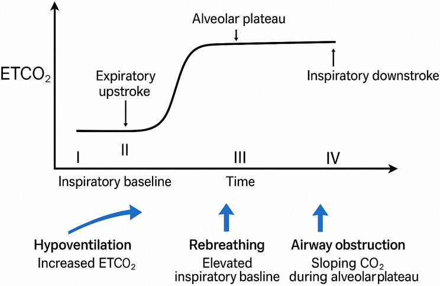
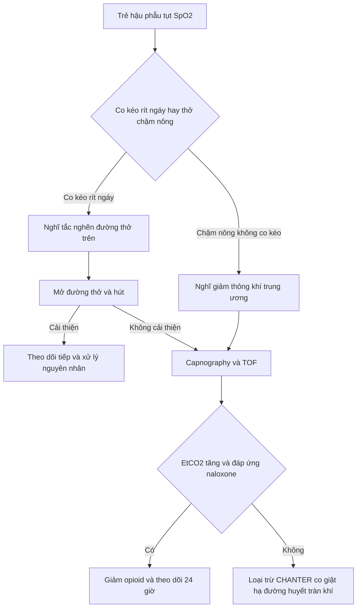
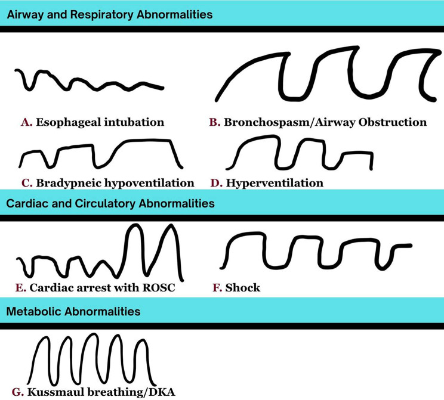

# 3119 — Giảm thông khí trung ương do opioid ở trẻ sau mổ: đọc capnogram trước khi đọc SpO₂

**Tags:** `pattern:giam-thong-khi-trung-uong` `pattern:giam-thong-khi-khi-thuc` `pattern:phe-quan-binh-thuong` `vung:than-nao` `vung:duong-tho` `vung:phoi` `protocol:capnography` `protocol:PSG` `protocol:XR-nguc` `score:AASM-hypoventilation` `score:RASS`
**Mức chắc chắn (certainty):** tổng hợp y văn (literature synthesis) — ghép **tổng quan capnography trong cấp cứu nhi** (Rath S và cs., *Int J Emerg Med* 2026, PMC12797510), **tổng quan hệ thống về ngưỡng SpO₂ trong ức chế hô hấp do opioid** (Manes A và cs., *West J Emerg Med* 2026, PMC13436640), **tổng quan 6 nghiên cứu về ức chế hô hấp do opioid ở trẻ bệnh nặng** (Mauritz MD và cs., *Children (Basel)* 2020, PMC7767476), **bài điểm về codeine/tramadol chu phẫu nhi** (Maisat W, Yuki K., *Transl Perioper Pain Med* 2025, PMC12007907), **hướng dẫn an thần nhi Hàn Quốc 2026** (Lee HM và cs., *Anesth Pain Med* 2026, PMC13444186) và **hướng dẫn hồi sinh nhi Hàn Quốc 2025** (Kim DK và cs., *Clin Exp Emerg Med* 2026, PMC13277418). Không có ca do nhóm tự chụp.

> **Câu hỏi thực hành:** bé trai **3 tuổi**, mổ **cắt amidan – nạo VA**, đêm đầu sau mổ **ngủ im, không co kéo, không rít**, **SpO₂ 99%** vì đang thở oxy 2 L/phút, **nhịp thở 10 lần/phút**. Điều dưỡng thấy "cháu ngủ ngoan". Bạn nghĩ **ổn**, **tắc nghẽn**, hay **giảm thông khí trung ương do opioid** — và **dấu hiệu nào xuất hiện trước SpO₂**?

## 1. Tổng quan bệnh học – cơ chế hình ảnh: vì sao trẻ "ngủ ngoan" lại là dấu hiệu xấu nhất

- **Bản chất:** opioid gắn thụ thể **µ** ở **phức hợp preBötzinger/Kölliker–Fuse và nhân parabrachial** — nơi tạo nhịp thở và cảm nhận CO₂ — làm **giảm độ dốc đáp ứng với CO₂** và **giảm tần số thở**, đồng thời **giảm trương lực cơ mở hầu**. Kết quả: **giảm thông khí phế nang** (CO₂ tăng) trước, **thiếu oxy** sau.
- **Vì sao SpO₂ là chỉ số đến muộn:** đường cong phân ly hemoglobin **hình chữ S** — SpO₂ còn **~90% khi PaO₂ chỉ còn ~60 mmHg**. Nghĩa là khi SpO₂ bắt đầu tụt, trẻ **đã giảm thông khí từ lâu**. Thêm vào đó, **oxy bổ sung giữ SpO₂ cao** dù thông khí rất kém (hiệu ứng "che" của oxy), nên **SpO₂ 99% không loại trừ gì**.
- **Vì sao capnogram phát hiện sớm hơn:** CO₂ đo được **từng nhịp**, tăng song song với giảm thông khí; capnography phát hiện **giảm thông khí sớm hơn oximetry vài phút**. Trong một tổng quan nhi, capnography **phát hiện toàn bộ cơn ngưng thở**, trong khi **hơn một nửa số cơn bị bỏ sót** bởi theo dõi thường quy (theo tổng quan PMC12797510 dẫn Langhan và cs.).
- **Vì sao trẻ nhỏ nguy hiểm hơn người lớn:** dự trữ oxy thấp, tiêu thụ O₂ cao, đường thở mềm dễ sụp, và **không tự báo** được triệu chứng. Vì vậy "ngủ im, thở chậm, không khó thở" ở trẻ sau mổ opioid là **hình thái điển hình của ức chế hô hấp**, không phải dấu hiệu an toàn.
- **Ngưỡng và số liệu phải thuộc:**

| Biến số | Số liệu | Nguồn |
|---|---|---|
| Ngưỡng SpO₂ dùng để định nghĩa ức chế hô hấp do opioid (OIRD) | **85–95%**, trung vị **92%** (IQR 90–95) | PMC13436640 |
| SpO₂ lúc sự cố trong 3 nghiên cứu có OIRD | tụt tới trung vị **80%** | PMC13436640 |
| Tỷ lệ biến cố trong 16 nghiên cứu (**N = 12.887**) | **14–40%**, gộp **~18%** | PMC13436640 |
| OIRD ở trẻ bệnh nặng dùng opioid (6 nghiên cứu) | **0,13–4,6%** | PMC7767476 |
| Biến cố codeine ở trẻ (FDA, 1969–2012) | **13 ca**, **10 tử vong**, **3 ức chế hô hấp nặng**; **8/13 sau cắt amidan/VA** | PMC12007907 |
| CYP2D6 | **10/100** người da trắng là chuyển hóa kém, **29/100** người Ethiopia là chuyển hóa cực nhanh; ức chế hô hấp tới **41%** nếu không tính kiểu gen | PMC12732015 |
| Naloxone | **1–5 µg/kg** chuẩn độ cho ức chế hô hấp do opioid điều trị; **< 5 tuổi hoặc < 20 kg: 0,1 mg/kg**; **≥ 5 tuổi hoặc ≥ 20 kg: 2 mg** | PMC13277418 |

## 2. Mẫu hình + chẩn đoán phân biệt theo vị trí (gamut)

- **Mẫu hình cốt lõi:** trẻ **hậu phẫu**, **giảm tần số thở + giảm biên độ**, **không co kéo**, **không rít**, thường **ngủ sâu khó đánh thức**; **EtCO₂ tăng** trước khi **SpO₂ tụt**.
- **Gamut theo cơ chế (đọc theo 4 tầng):**
  - **Trung tâm:** opioid (kể cả PCA, morphin tủy sống), benzodiazepine, propofol tồn lưu, clonidin/dexmedetomidine; **CHANTER** (phù tiểu não do opioid — bài 3101).
  - **Tắc nghẽn đường thở trên:** OSA chưa chẩn đoán, phù sau cắt amidan/VA, hẹp mũi, lưỡi lớn (Down), tụ máu cổ.
  - **Thần kinh – cơ:** **giãn cơ tồn lưu (TOF ratio < 0,9)**, bệnh cơ/thần kinh nền, lan thuốc tê tủy sống lên cao.
  - **Nhu mô – màng phổi:** xẹp phổi, hít sặc, viêm phổi, phù phổi do áp lực âm, tràn khí.
- **Phân biệt theo "thì" sau mổ:** ngay tại phòng hồi tỉnh (giãn cơ tồn lưu, tắc nghẽn) → **1–6 giờ** (opioid đỉnh, chảy máu) → **6–24 giờ** (codeine chuyển hóa chậm, PCA tích lũy, phù amidan) → **sau 24 giờ** (nhiễm trùng, hít sặc, CHANTER).

## 3. Bảng so sánh phân biệt (ma trận đối chiếu)

| Thực thể (entity) | Hình ảnh / thăm dò điển hình | Chốt vào (rule-in) | Chốt loại (rule-out) | Gợi ý xác nhận |
|---|---|---|---|---|
| **Giảm thông khí trung ương do opioid (OIRD)** | Capnogram: **nhịp thưa, biên độ thấp, EtCO₂ tăng**, không có dạng dẹt của tắc nghẽn | **Thở chậm nông + EtCO₂ tăng + đồng tử co + đáp ứng naloxone** | Co kéo/rít/ngáy rõ (gợi ý tắc nghẽn) hoặc TOF < 0,9 | Capnography + đáp ứng naloxone |
| **Giãn cơ tồn lưu** | TOF: **tỷ lệ T4/T1 < 0,9**; không có EtCO₂ tăng đơn thuần | **TOF < 0,9** + yếu cơ toàn thân + không đáp ứng naloxone | TOF ≥ 0,9 và capnogram kiểu giảm thông khí trung ương | TOF + đáp ứng thuốc giãi giãn cơ |
| **Tắc nghẽn đường thở trên** | Capnogram: **dạng dẹt/không có pha cao nguyên**, biên độ giảm nhưng nhịp có thể nhanh; ngáy, co kéo | **Ngáy/co kéo + dạng dẹt + cải thiện khi mở đường thở** | Capnogram vuông vắn, EtCO₂ tăng đều, không co kéo | Nghiệm pháp mở đường thở + nội soi khi ngủ |
| **CHANTER (phù tiểu não do opioid)** | MRI: **phù tiểu não hai bên**, có thể phù thân não; khởi phát chậm | **Hôn mê kéo dài sau opioid + MRI có phù tiểu não** | Tỉnh nhanh sau naloxone, MRI bình thường | MRI sọ (bài 3101) |
| **Xẹp phổi / hít sặc** | X-quang: **mờ kèm mất thể tích** (khe/trung thất lệch), đông đặc thùy dưới | **Mờ + mất thể tích + ran/giảm thông khí khí vào** | X-quang bình thường và capnogram đơn thuần giảm thông khí | X-quang ngực; CT khi không rõ |
| **Tràn khí màng phổi** | X-quang: **màng phổi tách, không có mạch máu ngoại vi**; siêu âm: mất trượt màng phổi | **Mất trượt màng phổi + tăng áp lực đường thở** | Trượt màng phổi còn, X-quang không có đường màng phổi | Siêu âm phổi đầu giường |

*Cấu trúc một capnogram bình thường: pha I (khoảng chết), II (lên dốc thì thở ra), III (cao nguyên phế nang = EtCO₂), IV (hít vào). Mũi tên xanh: **giảm thông khí làm tăng EtCO₂**, **thở lại (rebreathing) làm nâng đường nền hít vào**, **tắc nghẽn làm dốc pha III**. Nguồn: Rath S và cs., *Int J Emerg Med* 2026 (PMC12797510), Fig. 1 — CC BY-NC-ND 4.0, nguyên bản, không cắt/ghép.*

## 4. Protocol chụp/theo dõi + hệ phân độ và ngưỡng xử trí

- **Theo dõi tối thiểu ở trẻ dùng opioid sau mổ:** **SpO₂ liên tục + nhịp thở + thang an thần (RASS/pediatric sedation scale)**; **capnography** khi có nguy cơ cao hoặc khi an thần trung bình/sâu. Hướng dẫn an thần nhi 2026: **EtCO₂ được khuyến cáo mạnh ở an thần trung bình và bắt buộc ở an thần sâu** (PMC13444186).
- **Ngưỡng báo động thực hành:** **EtCO₂ > 50 mmHg**, hoặc **tăng > 10 mmHg so với nền**, hoặc **nhịp thở thấp hơn theo tuổi kèm biên độ giảm** → đánh thức, mở đường thở, giảm/ngừng opioid, đo khí máu nếu cần.
- **Naloxone — dùng liều chuẩn độ, không "đảo ngược toàn bộ":** khởi đầu **1–5 µg/kg** cho ức chế hô hấp do opioid điều trị; nếu cần đảo ngược đầy đủ: **< 5 tuổi hoặc < 20 kg: 0,1 mg/kg**, **≥ 5 tuổi hoặc ≥ 20 kg: 2 mg** (PMC13277418). Đảo ngược quá tay gây **đau dữ dội, tăng huyết áp, phù phổi** — vì vậy luôn chuẩn độ.
- **Nhóm nguy cơ cao cần theo dõi 24 giờ có capnography:** **OSA/Down**, béo phì, **< 6 tháng tuổi** (nguy cơ ngưng thở sau mổ), bệnh thần kinh–cơ, opioid-naive dùng liều cao, **PCA**, dùng kèm benzodiazepine, và **chuyển hóa cực nhanh CYP2D6**.
- **Codeine và tramadol:** **không dùng cho trẻ < 12 tuổi** (cảnh báo FDA sau 13 biến cố, 10 tử vong); đặc biệt **sau cắt amidan/VA** và khi có bệnh hô hấp (PMC12007907).
- **Chẩn đoán hình ảnh — vai trò và giới hạn:** **X-quang ngực** khi tụt SpO₂ kéo dài, nghi **xẹp/hít sặc/phù phổi** — nhưng **X-quang bình thường không loại trừ OIRD** (bệnh ở trung tâm hô hấp, không ở nhu mô). **MRI sọ** khi hôn mê kéo dài không tương xứng (tìm CHANTER, bài 3101).
- **Bàn giao — nơi hay đứt gãy nhất:** ghi rõ **loại opioid, liều tích lũy, thời điểm liều cuối, có PCA không, có OSA không**; đặt **báo động EtCO₂/SpO₂** và ngưỡng gọi bác sĩ bằng số, không bằng chữ "theo dõi sát".

## 5. Biến thể bình thường và cạm bẫy

- **"SpO₂ 99% đang thở oxy" là bẫy số một:** oxy làm phẳng đường cong, SpO₂ giữ cao trong khi PaCO₂ đã rất cao; phải đọc **EtCO₂** hoặc khí máu, và **giảm oxy về liều thấp** khi đánh giá.
- **Nhầm "ngủ ngoan" với "hết đau":** trẻ giảm thông khí **không kêu đau, không quấy** — đó là dấu hiệu **quá liều tương đối**, không phải dấu hiệu hồi phục; cho thêm opioid vì "vẫn còn đau" là vòng xoáy tử vong.
- **Capnogram dạng dẹt không chỉ do tắc nghẽn:** rò khí quanh ống, ống quá nhỏ, hoặc **mạch đập lên đường nền** cũng làm biến dạng; luôn đọc **cả hình dạng và con số**.
- **EtCO₂ thấp không loại trừ giảm thông khí:** sốc/giảm cung lượng phổi làm EtCO₂ thấp giả tạo dù PaCO₂ cao — **gradient EtCO₂–PaCO₂ tăng**; cần khí máu.
- **Codeine sau cắt amidan:** trẻ **chuyển hóa cực nhanh CYP2D6** có thể tử vong **dù liều "đúng"** — đây là lý do **cấm**, không phải "dùng liều thấp hơn".
- **Bỏ sót hít sặc:** giảm thông khí và hít sặc có thể cùng tồn tại; X-quang sớm có thể bình thường — nếu tụt SpO₂ không giải thích được, chụp lại **sau 6–12 giờ**.

## 6. Tự lượng giá — Blind Quiz ngay trên trang tĩnh

**Ca 1 — Bé 3 tuổi sau cắt amidan, đêm đầu: nhịp thở 10 lần/phút, không co kéo, SpO₂ 99% với oxy 2 L/phút. Nhìn dạng capnogram, bạn gọi tên kiểu bất thường nào?**

- Gợi ý lâm sàng: trẻ ngủ sâu, khó đánh thức, đồng tử co nhỏ, không ngáy.
- Câu hỏi: Hình nào ứng với ca này? Vì sao **không** phải tắc nghẽn? Dấu hiệu nào xuất hiện trước SpO₂?

<b>Bấm để hiện đáp án</b>

- Dấu hiệu (findings): hình **C — "Bradypneic hypoventilation"**: nhịp thưa, biên độ giảm, **pha cao nguyên vẫn giữ dạng vuông** (không dẹt như B — tắc nghẽn). EtCO₂ tăng dần là dấu hiệu xuất hiện **trước** khi SpO₂ tụt.
- Chẩn đoán (diagnosis): **giảm thông khí trung ương do opioid** — vì opioid làm giảm đáp ứng CO₂ và tần số thở, không tạo ra cản trở cơ học; xử trí: đánh thức, giảm/ngừng opioid, **naloxone 1–5 µg/kg** chuẩn độ, theo dõi capnography 24 giờ.
- Nguồn ảnh: Rath S và cs., *Int J Emerg Med* 2026 (PMC12797510), Fig. 2 — CC BY-NC-ND 4.0, nguyên bản.

**Ca 2 — Bé 5 tuổi sau mổ, thở chậm nông. Capnogram có EtCO₂ 58 mmHg, đường nền hít vào bình thường. Ba câu hỏi: (1) đây là giảm thông khí hay thở lại? (2) ngưỡng naloxone? (3) theo dõi bao lâu?**

- Gợi ý lâm sàng: trẻ dùng morphin PCA, không co kéo, không ngáy, không sốt.
- Câu hỏi: Phân biệt **thở lại** với **giảm thông khí** trên hình? Liều naloxone theo cân nặng? Khi nào được chuyển khỏi khu vực theo dõi liên tục?

<b>Bấm để hiện đáp án</b>

- Dấu hiệu (findings): **EtCO₂ tăng với pha III bình thường** = giảm thông khí; **thở lại** thì **đường nền hít vào bị nâng lên** (mũi tên giữa hình), không chỉ pha III cao.
- Chẩn đoán (diagnosis): **OIRD**; naloxone **1–5 µg/kg** chuẩn độ (đảo ngược đầy đủ ở trẻ ≥ 5 tuổi: **2 mg**); theo dõi **24 giờ** với capnography nếu thuộc nhóm nguy cơ cao, và chỉ ngừng theo dõi khi **thức tỉnh tốt, EtCO₂ về bình thường, không cần naloxone lặp lại**.
- Nguồn ảnh: Rath S và cs., *Int J Emerg Med* 2026 (PMC12797510), Fig. 1 — CC BY-NC-ND 4.0, nguyên bản.

## Bài liên quan chéo
- [3101 – Hội chứng CHANTER do opioid](../3101-hoi-chung-chanter-opioid/lesson.md)
- [3079 – Giảm thông khí trung ương bẩm sinh (CCHS)](../3079-hoi-chung-ngung-tho-trung-uong-bam-sinh-tre/lesson.md)
- [043 – Chăm sóc hô hấp quanh mổ ở trẻ](../043-cham-soc-ho-hap-quanh-mo-tis-eos/lesson.md)
- [6109 – Trẻ thông khí không xâm nhập tại nhà quanh mổ](../6109-niv-tai-nha-quanh-mo-o-tre/lesson.md)
- [6101 – Xẹp phổi tái diễn một bên ở trẻ BPD](../6101-xep-phoi-tai-dien-mot-ben-tre-bpd-tbm/lesson.md)

## Ảnh
- `images/3119_giam-thong-khi_Capnogram-PMC12797510-f1.jpg` — bốn pha capnogram + ba kiểu bất thường, Fig. 1, **CC BY-NC-ND 4.0**, nguyên bản (không cắt/ghép).
- `images/3119_giam-thong-khi_Capnogram-PMC12797510-f2.jpg` — bảng dạng sóng EtCO₂ theo bệnh cảnh, Fig. 2, **CC BY-NC-ND 4.0**, nguyên bản (không cắt/ghép).
- Nguồn + giấy phép từng ảnh: `images/CREDITS.md`.

> Không dùng để chẩn đoán độc lập khi chưa có người hướng dẫn.
