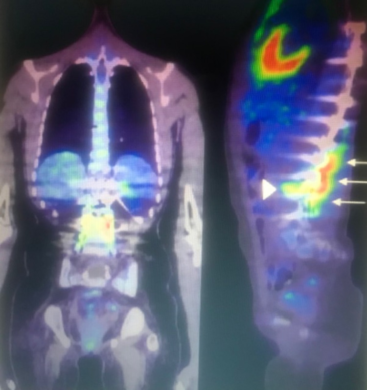
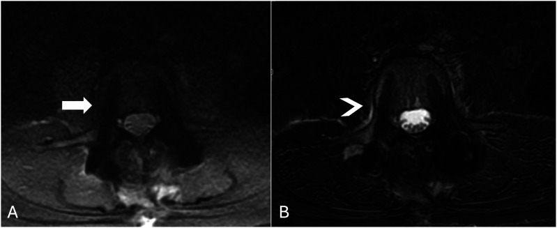
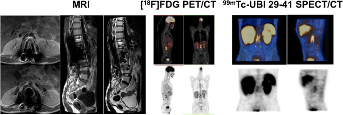
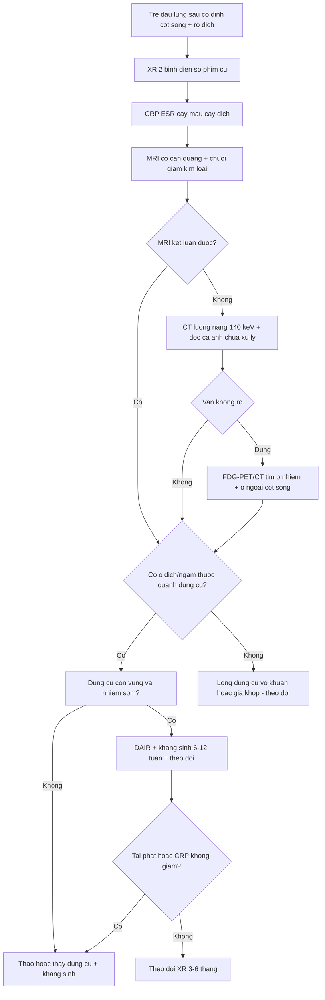

# 3121 — Nhiễm khuẩn mảnh ghép cột sống ở trẻ (spinal implant infection): "CRP bình thường" không loại trừ, và **giữ nẹp hay tháo nẹp**

**Tags:** `pattern:nhiem-manh-ghep` `pattern:o-dich-quanh-ven` `pattern:ngam-thuoc-vien` `pattern:khuyet-xuong` `pattern:long-dung-cu` `vung:cot-song` `protocol:MRI-co-can-quang` `protocol:CT-luong-nang` `protocol:FDG-PET-CT`
**Mức chắc chắn (certainty):** tổng hợp y văn (literature synthesis) — ghép **tổng quan hệ thống nhiễm khuẩn mảnh ghép cột sống** (Global Spine J 2022, PMC9210225), **nghiên cứu tiến cứu đa trung tâm so MRI – FDG-PET/CT – SPECT/CT** ở 63 bệnh nhân (Eur J Nucl Med Mol Imaging 2021, PMC8113215), **loạt 30 ca sửa dụng cụ sau mổ vẹo cột sống với 73% nhiễm khuẩn và 100% *Cutibacterium acnes*** (Spine Deform 2023, PMC9970938), **loạt trẻ hậu phẫu cột sống** (Healthcare 2025, PMC12692130), dữ liệu **MAVRIC-SL vs STIR** (Global Spine J 2026, PMC12611744) và **ca nhi 14 tuổi nhiễm dụng cụ ngực–thắt lưng trên FDG-PET/CT** (Cureus 2021, PMC8323075). Không có ca do nhóm tự chụp.

> **Câu hỏi thực hành:** bé gái **13 tuổi**, bại não, đã **cố định cột sống T2–L4** vì vẹo nặng **8 tháng trước**; nay **đau lưng tăng dần**, sốt nhẹ về chiều, **rò dịch ở vết mổ**, **CRP 6 mg/L**, bạch cầu bình thường. X-quang **không khác phim cũ**. MRI bị **vệt đen quanh vít** không đọc được. Câu hỏi: **nhiễm khuẩn mạn hay long dụng cụ vô khuẩn, và có phải tháo nẹp?**
> Bài chốt **ba quyết định**: **(1) CRP/ESR bình thường không loại trừ nhiễm khuẩn mạn** — ở loạt sửa dụng cụ sau mổ vẹo, **CRP > 10 mg/L chỉ nhạy 9,1%** dù đặc hiệu 100%; **(2) MRI có cản quang là chuẩn, nhưng phải có chuỗi giảm kim loại (MAVRIC/SEMAC) và CT lưỡng năng; khi MRI không kết luận → FDG-PET/CT**, vì **MRI + PET/CT cộng lại AUC 0,938** so với **0,78/0,80** từng phương thức; **(3) giữ nẹp chỉ khi dụng cụ còn vững, nhiễm sớm, vi khuẩn nhạy cảm, không có biến chứng thần kinh** — nhiễm muộn, dụng cụ mất vững, thất bại DAIR thì **phải tháo/thay**, nhưng ở trẻ **tháo nẹp = mất chỉnh hình và phải mổ lại**.

## 1. Tổng quan bệnh học – cơ chế hình ảnh: vì sao nhiễm khuẩn "ẩn" quanh một thanh titan

- **Sinh lý bệnh (pathophysiology):** vi khuẩn bám vào **bề mặt kim loại** và tạo **màng sinh học (biofilm)** — một lớp glycocalyx bảo vệ, làm kháng sinh **kém thấm** và làm **miễn dịch tại chỗ kém hiệu quả**. Vì vậy nhiễm khuẩn mảnh ghép **không tạo ổ mủ lớn** như áp-xe mô mềm, mà tiến triển **âm thầm** với **long dụng cụ, đau tăng dần, rò dịch, giả khớp**.
- **Hai khuôn mặt vi sinh — quyết định hình ảnh:**
  - **Sớm, độc lực cao:** *Staphylococcus aureus* (kể cả MRSA) → **sốt, sưng, chảy mủ, ổ dịch/áp-xe quanh nẹp**, hình ảnh rõ.
  - **Muộn, độc lực thấp:** **coagulase-negative staphylococci** và ***Cutibacterium acnes*** → **không sốt**, đau mơ hồ, **long dụng cụ ± rò**, hình ảnh **rất kín đáo**. Trong 30 ca sửa dụng cụ sau mổ vẹo cột sống: **22/30 (73%) nhiễm khuẩn mảnh ghép**, và ***C. acnes* phân lập được ở 100% ca nhiễm** (5 ca đa vi khuẩn) (PMC9970938).
- **Tần suất — bốn con số:**
  - Nhiễm khuẩn vết mổ sau phẫu thuật cột sống nói chung: **1,9% (0,1–22,6)** — 196 đoàn hệ, **425.180** bệnh nhân; sau **cố định dụng cụ**: **3,8% (0,4–20)** — 39 đoàn hệ, **28.628** bệnh nhân (PMC9210225).
  - Trẻ hậu phẫu cột sống: **0,9–3%** ở vẹo vô căn, **tới 8,7%** ở vẹo do bại não; **6,0% nhiễm sâu** trong loạt 46 trẻ/67 ca mổ (PMC12692130).
  - Nhiễm muộn/sâu sau cố định ở người lớn: **3,5%** (25/720) với **12% thất bại DAIR** (PMC13300865) — dùng làm mốc so sánh.
- **Vì sao **trẻ** khác người lớn — ba điểm thực hành:**
  1. **Thanh tăng trưởng (growing rods/MCGR, VEPTR):** dụng cụ phải **nong nhiều lần**, mỗi lần là một cửa vào nhiễm khuẩn; **tháo nẹp = mất kiểm soát đường cong** trong khi trẻ còn lớn.
  2. **Nhiều ca mổ lại** (sửa dụng cụ, thay thanh) → **mô sẹo, mất mốc giải phẫu**, khó đọc ảnh.
  3. **Ít mô mỡ, cột sống đang cốt hóa** → dễ đọc nhầm **vùng sáng sinh lý quanh vít** hoặc **nhân cốt hóa** thành tổn thương.
- **TẠI SAO MRI bị "vệt đen" — vật lý của dị vật kim loại:**
  - Kim loại làm **từ trường cục bộ không đồng nhất** → **mất tín hiệu (signal void)** + **tích tụ tín hiệu (pile-up)** quanh vít/thanh; mức độ tăng theo **thể tích kim loại**, **thép không gỉ > titan**, và **chuỗi xung nhạy cảm** (STIR, EPI) hơn chuỗi **spin-echo**.
  - **STIR đặc biệt dễ hỏng** vì xung đảo (inversion) **đặt sai thời điểm** khi từ trường bị méo → mỡ **không bị triệt** hoặc mô bị triệt oan → **giả tổn thương**.
  - **MAVRIC-SL/SEMAC** chia phổ tần số thành nhiều "bin" và ghép lại → **giảm vùng mất tín hiệu**. Đo trên 84 bệnh nhân có dụng cụ thắt lưng: **diện tích mất tín hiệu giảm 39,1%** (**0,809 ± 0,205 cm² vs 1,356 ± 0,266 cm²**, p < 0,001); **thấy lỗ liên hợp 96,4% vs 0%** (trục ngang) và **tủy sống 98,8% vs 14,3%** (trục dọc) (PMC12611744).
- **TẠI SAO CT có ích và cũng có bẫy:** CT thấy **giao diện xương–kim loại**, **khuyết xương quanh chốt**, **gãy vít/thanh**, **giả khớp**. Nhưng **hiện tượng cứng chùm tia (beam hardening)** và **thiếu photon** tạo **vệt sáng/tối**; **thuật toán giảm kim loại (iMAR) có thể tạo "vùng sáng giả" quanh vít giống hệt long dụng cụ** — một ca báo cáo cho thấy **khuyết sáng chỉ xuất hiện trên ảnh iMAR**, không có trên ảnh gốc (PMC11840993). Vì vậy: **luôn đọc cả ảnh chưa xử lý và ảnh đã xử lý**; **CT lưỡng năng ở 140 keV** giảm mạnh vệt kim loại (PMC9543003).
- **TẠI SAO FDG-PET/CT "nhìn xuyên" kim loại:** FDG tích tụ ở **đại thực bào/bạch cầu hoạt hóa** — không bị nhiễu từ trường; nhưng **mô hạt và viêm sau mổ cũng bắt FDG**, nên **thời điểm chụp quyết định giá trị**. Trong nghiên cứu tiến cứu 63 bệnh nhân nghi nhiễm sau mổ cột sống (**73% có dụng cụ kim loại, 48% nhiễm thật**): **MRI AUC 0,78** (95% CI 0,64–0,92), **FDG-PET/CT AUC 0,80** (0,64–0,98), **kết hợp hai phương thức AUC 0,938** (0,80–1,00); **SPECT/CT với 99mTc-UBI 29-41 kém** (nhạy 44% hoặc đặc hiệu 41%) (PMC8113215).
- **Nhưng FDG không phải "chân lý":** trong nhiễm khuẩn mạn do *C. acnes*, **độ chính xác của FDG-PET/CT chỉ 64%** và **xạ hình xương 3 pha 67%** (PMC9970938); ở 191 ca nghi viêm đĩa đệm–thân sống, **PET nhạy 56%**, **MRI nhạy 62%**, **kết hợp 74%**, nhưng **PET đặc hiệu 96%** (vs MRI 86%) và **phát hiện thêm ổ nhiễm ngoài cột sống ở 73%** bệnh nhân (PMC13224376). Đọc đúng: **PET giỏi "loại trừ" và tìm ổ xa, MRI giỏi "xác nhận" tổn thương tại chỗ**.

## 2. Mẫu hình + chẩn đoán phân biệt theo thời điểm và theo hình thái (Gamut)

- **Theo thời điểm (quyết định chiến lược):**
  - **Sớm (< 1 tháng):** sốt, sưng, chảy mủ; **ổ dịch quanh nẹp ± khí**, viêm mô mềm; tác nhân **S. aureus**. Điều trị **DAIR** (debridement + kháng sinh + giữ dụng cụ) có tỉ lệ thành công cao (**88%** trong loạt 25 ca) (PMC13300865).
  - **Trung gian (1–3 tháng):** hình ảnh mờ hơn, đau tăng dần, **ngấm thuốc dọc đường vít**; vẫn có thể **giữ nẹp**.
  - **Muộn (> 3 tháng, có khi nhiều năm):** **long dụng cụ, rò dịch, giả khớp**; tác nhân **C. acnes/CoNS**; **tháo/thay dụng cụ ở 25% ca muộn vs 11,1% ca sớm** (PMC13300865). **Đây là nhóm mà CRP bình thường và MRI bị nhiễu kim loại hay đánh lừa nhất.**
- **Theo hình thái trên ảnh:**
  - **Ổ dịch quanh dụng cụ (periprosthetic fluid):** dải dịch **T2/STIR tăng tín hiệu, viền ngấm thuốc**, dày **> 2–3 mm**, dọc theo vít/thanh; **không** thấy ở người lành sau mổ sau **4–6 tuần**.
  - **Viêm mô mềm quanh cột sống:** thâm nhiễm cơ cạnh sống, **áp-xe trong cơ thắt lưng**, hạch.
  - **Viêm đĩa đệm–thân sống quanh dụng cụ:** phù tủy xương **hai bên đĩa**, phá hủy bản tận, **ngấm thuốc đĩa**.
  - **Long dụng cụ:** **vùng sáng quanh chốt** (peri-screw lucency), **vít nghiêng/di trú**, **gãy thanh** — nhưng **không đặc hiệu** (xem cạm bẫy iMAR).
  - **Giả khớp (pseudarthrosis):** khe khớp **> 1 năm không cầu xương**, **vùng sáng hai bên lồng ghép**, **chuyển động trên phim gập–ưỡn**; **thường vô khuẩn**, nhưng **30–50% có nhiễm khuẩn mạn kèm** trong các loạt sửa dụng cụ.
- **Gamut "đau lưng sau cố định cột sống ở trẻ":** **nhiễm khuẩn mảnh ghép (sớm/muộn)**, **long dụng cụ vô khuẩn**, **giả khớp**, **bệnh tầng kề (adjacent segment disease)**, **gãy thanh/vít**, **mất chỉnh hình**, **seroma/máu tụ sau mổ**, **di căn/u nguyên phát** (nếu có bệnh nền), **viêm đĩa đệm do lao** (thể chậm, đa tầng).
- **Gợi nhớ IMPLANT:** **I**nfection (biofilm), **M**etal artifact (giới hạn MRI), **P**seudarthrosis, **L**oosening, **A**djacent segment, **N**euro deficit, **T**iming (sớm/muộn).

## 3. Bảng so sánh phân biệt (ma trận đối chiếu)

| Thực thể (entity) | Hình ảnh điển hình (XR/CT/MRI/PET) | Chốt vào (rule-in) | Chốt loại (rule-out) | Gợi ý xác nhận |
|---|---|---|---|---|
| **Nhiễm khuẩn mảnh ghép sớm (< 1 tháng)** | **Ổ dịch quanh nẹp ± khí**, viêm mô mềm, **ngấm thuốc viền**; sốt, chảy mủ | **Sốt + chảy mủ + ổ dịch ngấm viền quanh dụng cụ** | **Ổ dịch đơn thuần, không viền, không sốt** → seroma | Cấy dịch/vết mổ; **DAIR sớm** |
| **Nhiễm khuẩn mạn, độc lực thấp (*C. acnes*)** | **Vùng sáng quanh chốt ± dải dịch mỏng**, ngấm thuốc **dọc đường vít**, **rò dịch tái diễn**; **CRP thường bình thường** | **Rò tái diễn + long dụng cụ tiến triển + CRP bình thường** | **Không rò, không tiến triển 6–12 tháng** → nghĩ vô khuẩn | **Sinh thiết/sonication ≥ 50 CFU/mL**, 5 mẫu; **PCR/16S** |
| Long dụng cụ vô khuẩn (aseptic loosening) | Vùng sáng quanh chốt **mảnh, đều**, **không ngấm thuốc**, **không dịch**, không rò | **Sáng quanh chốt đều + không viêm mô mềm + không nhiễm** | **Dịch/ngấm thuốc/rò** → nghi nhiễm | So phim cũ; theo dõi 3–6 tháng |
| Giả khớp (pseudarthrosis) | **Khe khớp không cầu xương**, **vùng sáng hai bên lồng ghép**, chuyển động khi gập–ưỡn | **Không cầu xương sau 12 tháng + chuyển động** | **Cầu xương liên tục** → không giả khớp | CT đa bình diện; **X-quang động** |
| Seroma/máu tụ sau mổ | Ổ dịch **đồng nhất**, **vỏ mỏng không ngấm**, teo dần; không sốt | **Dịch thuần + teo dần 4–6 tuần** | **Vỏ dày ngấm + khí + sốt** → nhiễm | Siêu âm; theo dõi |
| Bệnh tầng kề (adjacent segment) | **Thoái hóa đĩa/mặt khớp tầng trên**, hẹp ống sống, **không dịch quanh dụng cụ** | **Thay đổi tầng kề + không viêm** | **Dịch/ngấm quanh dụng cụ** → nhiễm | MRI; so phim cũ |
| Viêm đĩa đệm–thân sống quanh dụng cụ | **Phù tủy hai bên đĩa**, phá hủy bản tận, **ngấm thuốc đĩa**, có thể **áp-xe ngoài màng cứng** | **Phù tủy + phá hủy bản tận + ngấm đĩa** | **Chỉ long dụng cụ, đĩa bình thường** → không phải đĩa đệm | MRI + sinh thiết; cấy máu |
| U/di căn cột sống | **Phá hủy thân sống, mất cuống**, ngấm thuốc mạnh, **không dịch quanh nẹp** | **Phá hủy xương ngoài vùng dụng cụ + bệnh nền** | **Ổ dịch/khí quanh dụng cụ** → nhiễm | MRI; PET/CT; sinh thiết |

*Bé **14 tuổi** sau cố định **T6–L4**: **(trái)** PET/CT trục trán toàn thân; **(phải)** PET/CT trục dọc — **tăng FDG lan tỏa ở xương và mô mềm sát dụng cụ từ T12 đến L4 (mũi tên)**, kèm **tăng FDG ở giao diện xương–vít chân cung L3 trái (đầu mũi tên)**. Đây là mẫu hình "nhiễm dọc đường dụng cụ" — khác ổ dịch khu trú. Nguồn: Cureus 2021 (PMC8323075), **CC BY 4.0**.*

### Ba mẫu hình cần nhớ
- **Tăng FDG "dọc thanh nẹp" nhiều tầng:** gợi ý **nhiễm lan theo màng sinh học**, không phải một ổ áp-xe — PET còn giúp tìm **ổ nhiễm ngoài cột sống** (73% ca trong loạt 191) (PMC13224376).
- **MRI: ưu tiên chuỗi giảm kim loại.** Cùng một tầng, **MAVRIC-SL** cho thấy rõ **lỗ liên hợp và tủy sống**, còn **STIR** chỉ là "vệt đen + quầng sáng giả" (ảnh dưới).

*(A) **MAVRIC-SL**: bờ vít và mô quanh vít rõ, mất tín hiệu tối thiểu (mũi tên trắng); (B) **STIR**: **vùng mất tín hiệu lan rộng + quầng sáng giả** (mũi tên) dễ bị đọc thành phù tổn thương. Diện tích mất tín hiệu giảm **39,1%** với MAVRIC-SL (**0,809 vs 1,356 cm²**). Nguồn: Global Spine J 2026 (PMC12611744), **CC BY-NC-ND 4.0** — nguyên bản, không crop.*

- **Ba phương thức trên cùng một bệnh nhân:** MRI, **FDG-PET/CT** và **SPECT/CT 99mTc-UBI**: PET dương rõ, SPECT/CT UBI **không đáng tin** (nhạy 44% hoặc đặc hiệu 41%) — đừng chọn UBI cho câu hỏi này (PMC8113215).

*Cùng một bệnh nhân: **MRI** (trái, T1/T2 + T1 sau tiêm), **FDG-PET/CT** (giữa, ảnh hợp nhất + MIP) và **SPECT/CT 99mTc-UBI 29-41** (phải). Ngấm thuốc/FDG quanh dụng cụ T12–L4; SPECT/CT UBI cho kết quả **kém tin cậy** trong bối cảnh hậu phẫu. Nguồn: Eur J Nucl Med Mol Imaging 2021 (PMC8113215), **CC BY 4.0**.*

## 4. Protocol chụp + ngưỡng và chiến lược "giữ hay tháo"

- **Bước 0 — lâm sàng + xét nghiệm trước khi chụp:** **cấy máu** (nếu sốt), **cấy dịch vết mổ**, **CRP/ESR**, **bạch cầu**. Ghi nhớ: **CRP < 5 mg/L không loại trừ**; trong nhiễm mạn *C. acnes*, **CRP > 10 mg/L chỉ nhạy 9,1%**, **ESR > 30 mm/h nhạy 9,1%** (PMC9970938) — **bình thường là chuyện thường gặp**, không phải bằng chứng vô khuẩn.
- **Bước 1 — X-quang cột sống (2 bình diện, so phim ngay sau mổ):** tìm **gãy thanh/vít**, **vít nghiêng**, **mất chỉnh hình**, **vùng sáng quanh chốt**, **giả khớp**. Rẻ, nhanh, nhưng **không loại trừ** nhiễm khuẩn.
- **Bước 2 — MRI có cản quang, bắt buộc có chuỗi giảm kim loại:** **1,5 T (hoặc 3 T)**, **MAVRIC-SL/SEMAC + STIR/T2 fat-sat + T1 + T1 sau tiêm fat-sat**; đọc **dịch quanh dụng cụ, ngấm thuốc viền, viêm mô mềm, áp-xe ngoài màng cứng, phù tủy hai bên đĩa**. **Tránh kết luận trong 4–6 tuần đầu sau mổ** vì **ngấm thuốc và dịch sau mổ là sinh lý**.
- **Bước 3 — CT (lưỡng năng nếu có):** **VMR 140 keV ± thuật toán giảm kim loại** để nhìn **giao diện xương–vít** (giảm mạnh vệt sáng/tối so với ảnh thường — PMC9543003); đánh giá **khuyết xương quanh chốt, vỡ xương, gãy dụng cụ, giả khớp**. **Luôn so ảnh chưa xử lý** vì **iMAR có thể tạo khuyết sáng giả** (PMC11840993).
- **Bước 4 — FDG-PET/CT:** chỉ định khi **MRI không kết luận** hoặc **nghi ngờ cao nhưng MRI âm**, hoặc cần **tìm ổ nhiễm ngoài cột sống**; nhớ **PET nhạy 56% / đặc hiệu 96%**, **MRI + PET cộng lại nhạy 74%** và **AUC 0,938** (PMC13224376, PMC8113215). **Không chụp PET quá sớm sau mổ** (viêm lành bắt FDG).
- **Bước 5 — sinh thiết/khẳng định vi sinh (trước kháng sinh):** **≥ 2–3 mẫu mô**, tốt nhất **5 mẫu** (xác suất phát hiện **tới 70%** so với **50%** với 2–3 mẫu); **sonication dịch dụng cụ ≥ 50 CFU/mL**; **mô bệnh học chỉ nhạy 51%** — **không dùng mô bệnh để loại trừ** (PMC9210225).
- **Ngưỡng và quyết định "giữ hay tháo":**
  - **Giữ dụng cụ (DAIR: debridement + kháng sinh + giữ nẹp):** dụng cụ **còn vững**, nhiễm **sớm (< 1 tháng)**, **không có biến chứng thần kinh**, **không có ổ áp-xe lớn cần cắt bỏ**, vi khuẩn **nhạy cảm** — thành công **88%** (22/25) trong loạt người lớn (PMC13300865).
  - **Tháo/thay dụng cụ:** **mất vững**, **gãy thanh/vít**, **biến chứng thần kinh**, **nhiễm muộn > 3 tháng có biofilm**, **thất bại DAIR sau 1–2 lần**, **rò dịch kéo dài**. Tỉ lệ tháo **25% ở nhiễm muộn vs 11,1% ở nhiễm sớm** (PMC13300865).
  - **Ở trẻ:** **cố gắng giữ cấu trúc tăng trưởng** nếu còn vững — tháo nẹp ở trẻ đang lớn **làm mất chỉnh hình và thường phải mổ lại**; nếu buộc tháo, cần **kế hoạch thay thế** (thanh tạm, nẹp mới sau khi sạch nhiễm).
  - **Kháng sinh:** không có đồng thuận — **6 tuần** (sau phẫu thuật) vs **12 tuần** (khi giữ dụng cụ/thay một thì) (PMC9210225); **luôn phối hợp phẫu thuật + kháng sinh**, không điều trị kháng sinh đơn thuần cho dụng cụ mất vững.
- **Theo dõi sau điều trị:** lâm sàng + **CRP/ESR** (xu hướng, không phải một điểm), **X-quang 3–6 tháng**; **MRI/CT lại khi đau tái phát hoặc CRP không giảm**; **không chụp PET lặp lại sớm** vì viêm lành còn bắt FDG.

## 5. Biến thể bình thường và cạm bẫy

- **"CRP bình thường = không nhiễm":** sai. **Nhạy 9,1%** ở nhiễm mạn *C. acnes*; **CRP < 5 mg/L không phải tiêu chuẩn loại trừ** (PMC9970938, PMC9210225). Ngược lại, **CRP tăng sau mổ 4–6 tuần** có thể do viêm lành.
- **Nhiễm khuẩn "ẩn" nhiều năm:** *Cutibacterium* có thể **biểu hiện 2–5 năm sau mổ** bằng **long dụng cụ + rò** — **không có mốc thời gian nào loại trừ**.
- **Bẫy iMAR:** **khuyết sáng quanh vít chỉ thấy trên ảnh đã xử lý** → đọc nhầm thành long nhiễm (PMC11840993). **Luôn xem ảnh gốc + ảnh xử lý**, và **so hai lần chụp**.
- **STIR/tín hiệu cao quanh vít:** có thể là **hiệu ứng kim loại** (nhất là thép không gỉ) chứ không phải phù — dùng **MAVRIC/SEMAC**, và **đối chiếu T1 sau tiêm** (viêm thật **ngấm thuốc**, artifact thì **không**).
- **"Một lần MRI sạch" sau mổ:** trong **4–6 tuần đầu**, dịch và ngấm thuốc quanh dụng cụ là **sinh lý**; kết luận nhiễm khuẩn cần **bối cảnh lâm sàng + vi sinh**.
- **PET dương sau mổ:** mô hạt và viêm lành **bắt FDG**; **PET nhạy 56%** nhưng **không đủ để chẩn đoán một mình**; giá trị lớn nhất là **khi MRI không kết luận** và **tìm ổ ngoài cột sống**.
- **Chỉ nhìn cột sống, bỏ sót ổ ngoài cột sống:** **73%** ca có **ổ nhiễm ngoài cột sống** được PET phát hiện (răng, tim, tiết niệu, catheter) — **sót ổ nguyên phát = tái phát**.
- **Bỏ sót tầng thứ hai:** nhiễm có thể **nhiều tầng (skip lesion)**; đọc **toàn bộ cột sống** trên MRI/PET, không dừng ở tầng đau.
- **Trẻ đang lớn — "vùng sáng" sinh lý:** **nhân cốt hóa chưa hợp nhất**, **sụn tiếp hợp**, **mô sẹo sau mổ** có thể giống khuyết xương; **so phim ngay sau mổ** là cách tránh overcall.
- **Tháo nẹp quá sớm ở trẻ:** mất chỉnh hình, cần mổ lớn lại — **quyết định tháo cần hội chẩn** (phẫu thuật cột sống + nhiễm + phục hồi chức năng).

## 6. Tự lượng giá — Blind Quiz

**Ca 1 — Bé trai 14 tuổi, cố định T6–L4 vì vẹo; 9 tháng sau đau lưng, sốt nhẹ, không rò dịch. Nhìn ảnh, mô tả trước.**

- Gợi ý lâm sàng: CRP **tăng nhẹ**, MRI bị nhiễu kim loại nặng, không thấy ổ dịch rõ.
- Câu hỏi: **(1)** Mẫu hình FDG gợi ý gì? **(2)** Vì sao không kết luận ngay "nhiễm khuẩn mảnh ghép"? **(3)** Bước tiếp theo để có bằng chứng vi sinh?

<b>Bấm để hiện đáp án</b>

- Dấu hiệu: **tăng FDG lan tỏa dọc dụng cụ T12–L4** ở xương và mô mềm sát nẹp, **tăng ở giao diện xương–vít L3 trái**.
- Chẩn đoán nghĩ đến: **nhiễm khuẩn mảnh ghép lan theo màng sinh học**; nhưng FDG cũng dương trong **viêm lành/mô hạt**, và **độ chính xác chỉ 64%** ở nhiễm mạn do *C. acnes*.
- Bước tiếp: **sinh thiết xuyên kim qua CT ≥ 2–3 mẫu (tốt nhất 5)**, **sonication** nếu tháo dụng cụ, **cấy máu**, và **hội chẩn giữ/tháo nẹp**.
- Nguồn ảnh: Cureus 2021 (PMC8323075), **CC BY 4.0**.

**Ca 2 — Cùng bệnh nhi, MRI bị vệt đen quanh vít. Chọn chuỗi nào và đọc ra sao?**

- Câu hỏi: **(1)** Vì sao **(B)** dễ đọc nhầm? **(2)** Chuỗi **(A)** cải thiện cái gì, bao nhiêu?

<b>Bấm để hiện đáp án</b>

- **(B) STIR**: xung đảo sai thời điểm do từ trường méo → **mất tín hiệu rộng + quầng sáng giả**, dễ gọi là "phù quanh vít".
- **(A) MAVRIC-SL**: **diện tích mất tín hiệu giảm 39,1%** (**0,809 vs 1,356 cm²**); **thấy lỗ liên hợp 96,4% vs 0%**, **tủy sống 98,8% vs 14,3%**.
- Cách đọc: chỉ gọi viêm khi có **ngấm thuốc thật trên T1 sau tiêm** + **dịch viền** + bối cảnh lâm sàng.
- Nguồn ảnh: Global Spine J 2026 (PMC12611744), **CC BY-NC-ND 4.0** (nguyên bản).

**Ca 3 — Bé gái 8 tuổi có thanh tăng trưởng (growing rod), 2 năm sau mổ: đau lưng, rò dịch tái diễn, CRP 4 mg/L, không sốt. Bạn làm gì?**

- Câu hỏi: **(1)** Ba chẩn đoán phân biệt? **(2)** Có nên tháo nẹp ngay không? **(3)** Xét nghiệm/ hình ảnh nào trước?

<b>Bấm để hiện đáp án</b>

- Phân biệt: **nhiễm khuẩn mạn do *C. acnes*/CoNS**, **long dụng cụ vô khuẩn**, **rò dịch do da/mô mềm** (nhiễm nông), **giả khớp**.
- **Không tháo nẹp ngay**: CRP bình thường **không loại trừ**, và tháo nẹp ở trẻ đang lớn **làm mất chỉnh hình**. Trước hết: **MRI có MAVRIC/SEMAC + cản quang** (hoặc **CT lưỡng năng** nếu MRI nhiễu), **cấy dịch rò + cấy máu**, **sinh thiết/sonication** khi can thiệp.
- Nếu **dụng cụ còn vững + nhiễm khuẩn khu trú + vi khuẩn nhạy**: **DAIR + kháng sinh 6–12 tuần**, theo dõi sát; **tháo/thay** khi **mất vững, thất bại DAIR, hoặc nhiễm lan tỏa**.
- Nguyên tắc: **chẩn đoán vi sinh trước, quyết định dụng cụ sau** — và quyết định này cần **hội chẩn đa chuyên khoa**.

## Bài liên quan chéo
- [6163 – Viêm đĩa đệm–thân sống & phình ĐMC nhiễm khuẩn](../6163-viem-dia-dem-than-song-va-phinh-dmc-nhiem-khuan/lesson.md)
- [171 – Bóc tách động mạch chủ bụng và IMH](../171-boc-tach-dong-mach-chu-bung-va-IMH/lesson.md)
- [148 – Nhiễm trùng mảnh ghép nội mạch ĐMC](../148-nhiem-trung-manh-ghep-noi-mach-dmc/lesson.md) (cùng nguyên lý biofilm trên vật liệu tổng hợp)
- [1986 – Viêm mô hoại tử ở trẻ](../1986-viem-mo-hoai-tu-o-tre/lesson.md)
- [3111 – Thoát vị lỗ trocar sau nội soi](../3111-thoat-vi-lo-trocar-sau-noi-soi/lesson.md)

## Ảnh
- `images/3121_nhiem-manh-ghep_PET-CT_Cureus2021-PMC8323075.jpg` — Cureus 2021 (PMC8323075), **CC BY 4.0**.
- `images/3121_nhiem-manh-ghep_MRI-PET-CT_EJNMMI2021-PMC8113215.jpg` — Eur J Nucl Med Mol Imaging 2021 (PMC8113215), **CC BY 4.0**.
- `images/3121_nhiem-manh-ghep_MRI_GSJ2026-PMC12611744.jpg` — Global Spine J 2026 (PMC12611744), **CC BY-NC-ND 4.0** (nguyên bản).
- Nguồn, giấy phép và ghi chú từng ảnh: `images/CREDITS.md`.

> Không dùng để chẩn đoán độc lập khi chưa có người hướng dẫn.
