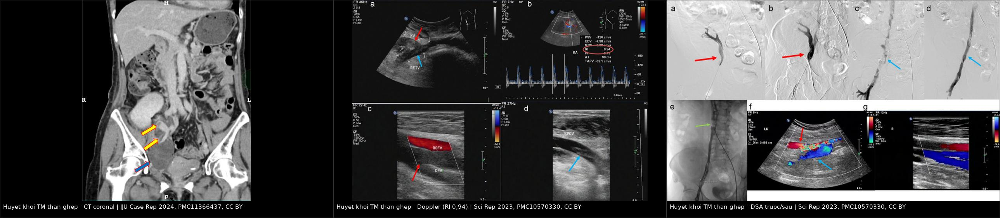
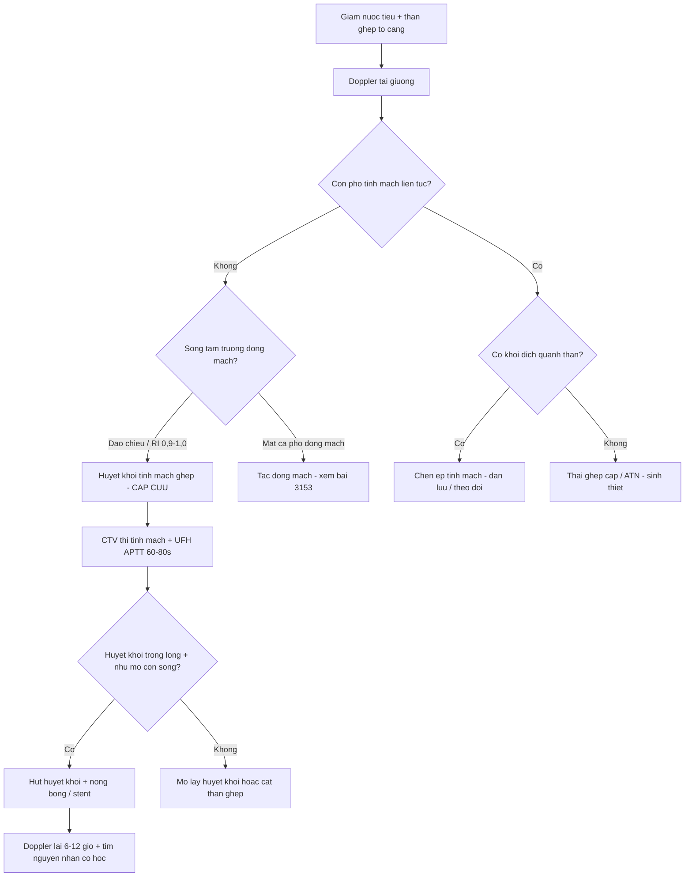
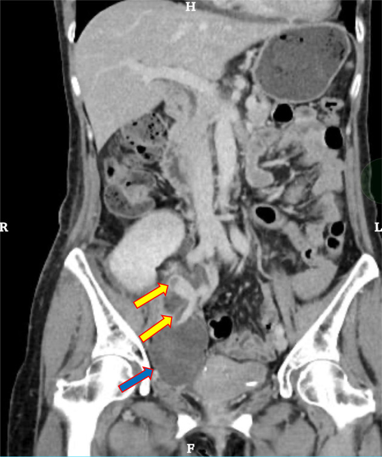
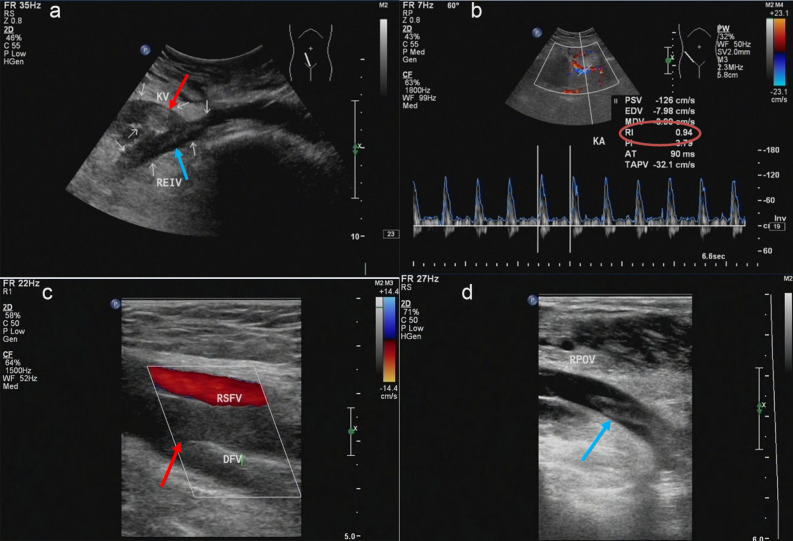
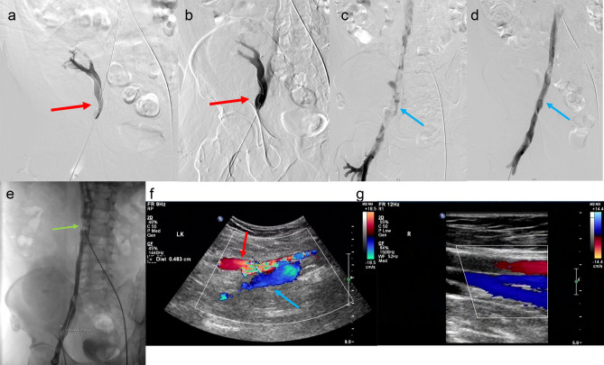

# 3122 — Huyết khối tĩnh mạch thận ghép CẤP: thận phù to + mất phổ tĩnh mạch + đảo dòng tâm trương

**Tags:** `pattern:mat-pho-tinh-mach` `pattern:dao-chieu-tam-truong` `pattern:phu-than-ghep` `pattern:khuyet-thuoc-long-mach` `vung:than-ghep` `vung:cuong-mach-ghep` `anatomy:tinh-mach-than-ghep` `anatomy:tinh-mach-chau` `protocol:sieu-am-Doppler` `protocol:CTV-bung` `score:RI`
**Mức chắc chắn (certainty):** tổng hợp y văn (literature synthesis) — ghép **ba ca nguyên văn có ảnh**: huyết khối tĩnh mạch ghép lan xuống tĩnh mạch chậu–đùi, cứu được bằng hút huyết khối cơ học + nong bóng (Sci Rep 2023, PMC10570330); huyết khối + hẹp miệng nối tĩnh mạch ngày 13, cứu bằng nong bóng (IJU Case Rep 2024, PMC11366437); huyết khối tái phát do hội chứng May–Thurner (Urol Case Rep 2026, PMC13320444); cộng **một tổng quan có số** (Diagnostics 2026, PMC13298574) và **một tổng quan kỹ thuật hình ảnh** (Abdom Radiol 2025, PMC12602614). Không có ca do nhóm tự chụp.

> **Câu hỏi thực hành:** nữ **56 tuổi**, ngày thứ **13** sau ghép thận, nước tiểu **giảm dần trong 24 giờ**, đau tức hố ghép, thận ghép **to và căng** khi sờ. Siêu âm tại giường: **không thấy phổ tĩnh mạch**, phổ động mạch **chỉ còn sóng tâm thu, mất sóng tâm trương**. Câu hỏi: **đây là thải ghép cấp, hay tắc tĩnh mạch — và còn cứu được thận không?**
> Bài chốt **ba quyết định**: **(1) mất phổ tĩnh mạch + đảo dòng tâm trương là dấu hiệu đặc hiệu của tắc tĩnh mạch**, không phải thải ghép; **(2) thận phù to + RI rất cao không loại trừ được gì** — RI là chỉ số **không đặc hiệu**, chỉ **có/không phổ tĩnh mạch** và **hướng sóng tâm trương** mới quyết định; **(3) huyết khối tĩnh mạch ghép 1–3% nhưng là một trong những nguyên nhân hàng đầu mất ghép sớm** — phải tìm **nguyên nhân cơ học** (chèn ép, hẹp miệng nối, May–Thurner) nếu không muốn tái phát sau khi đã cứu thận.

## 1. Tổng quan bệnh học – cơ chế hình ảnh: vì sao "tắc đường ra" làm thận chết nhanh

- **Giải phẫu quyết định hình ảnh:** thận ghép nằm **ngoài phúc mạc ở hố chậu**, **tĩnh mạch thận người cho nối tận–bên vào tĩnh mạch chậu ngoài**, **động mạch nối vào động mạch chậu ngoài**. Thận là tạng **một cuống mạch**, gần như **không có bàng hệ** — tắc tĩnh mạch = **máu vào được mà không ra**.
- **Tần suất — bốn con số cần nhớ:**
  - **Huyết khối tĩnh mạch thận ghép (TRVT) ~1–3%** các ca ghép, **phần lớn trong tuần đầu**, là **một trong những nguyên nhân thường gặp nhất của mất ghép sớm**; nếu mảnh ghép đã hoại tử thì **phải cắt thận ghép** (Diagnostics 2026, PMC13298574).
  - Khoảng rộng hơn trong y văn: **0,1–4,2%**, và **gần như toàn bộ** ca không điều trị kịp đều **mất thận** (Urol Case Rep 2026, PMC13320444).
  - Ghép với **thận phải** nguy cơ cao hơn vì **tĩnh mạch phải ngắn**, miệng nối khó, thời gian thiếu máu ấm dài hơn (Diagnostics 2026, PMC13298574).
  - Trong **2.304 ca ghép** một trung tâm, biến chứng mạch **2,34%**, trong đó **tắc tĩnh mạch 3 ca (0,13%)** — hiếm nhưng **kết cục rất xấu** (Front Transplant 2023, PMC11235313).
- **Cơ chế — hai nhóm nguyên nhân chồng lên nhau:**
  - **Cơ học (hàng đầu):** **chèn ép tĩnh mạch** bởi **nang bạch huyết/máu tụ quanh thận**, **hẹp miệng nối tĩnh mạch**, **gấp góc/xoắn cuống**, **hội chứng May–Thurner** (tĩnh mạch chậu chung trái bị động mạch chậu chung phải đè) — ca tái phát 2 lần của bài này chính là May–Thurner (Urol Case Rep 2026, PMC13320444).
  - **Yếu tố toàn thân:** **hạ huyết áp**, **thải ghép cấp**, **trạng thái tăng đông hậu phẫu**, **bệnh lý tăng đông di truyền/mắc phải**, **trẻ em** (lòng mạch nhỏ) (Diagnostics 2026, PMC13298574).
- **TẠI SAO hình ảnh thay đổi — vật lý của siêu âm Doppler:**
  - Doppler đo **vận tốc**, không đo **tưới máu**. Thận ghép bình thường có **phổ động mạch liên tục**, còn dòng **tâm trương dương**, **RI khoảng 0,6–0,8**.
  - Khi tĩnh mạch tắc, **áp lực trong nhu mô tăng** → **sức cản dòng vào tăng** → **RI tăng rất cao** (ca gốc: **RI 0,94**, PSV **−128 cm/s**, EDV **−46 cm/s**) và **sóng tâm trương đảo chiều**: máu **vào thì tâm thu, bật ngược ra thì tâm trương**. Kiểu phổ **hai chiều** này được mô tả là **dấu hiệu đặc hiệu (pathognomonic) của huyết khối tĩnh mạch ghép** (Abdom Radiol 2025, PMC12602614).
  - Muộn hơn, **bàng hệ hình thành** nên **phổ động mạch có thể "bình thường hóa"** trong khi thận vẫn đang chết — đây là lý do **không bao giờ đọc một lần rồi kết luận**.
- **TẠI SAO CT có cản quang khác biệt:** CT đo **lượng iod đến nhu mô**. Huyết khối tĩnh mạch → **khuyết thuốc trong lòng tĩnh mạch** (thấy rõ ở thì tĩnh mạch, 60–70 giây), **thận to, ngấm thuốc kéo dài và không đều**, **mất phân biệt vỏ–tủy**, **thuốc trào ngược vào tĩnh mạch bàng hệ** phía dưới chỗ tắc (IJU Case Rep 2024, PMC11366437).
- **TẠI SAO thận chết nhanh:** tắc tĩnh mạch → **ứ máu, phù kẽ, chèn ép mao mạch** → thiếu máu cục bộ nhu mô và **huyết khối lan vào vi mạch**; khi đã **nhồi máu vỏ lan rộng** thì **tái thông mạch không hồi phục được nhu mô**.

## 2. Mẫu hình + chẩn đoán phân biệt theo kiểu phổ và theo thời điểm (Gamut)

- **Mẫu hình cốt lõi:** **giảm nước tiểu/thiểu niệu** + **thận ghép to, căng, đau** + **mất phổ tĩnh mạch** + **đảo dòng tâm trương động mạch** (± **phù chi cùng bên** nếu huyết khối lan xuống tĩnh mạch chậu–đùi).
- **Gamut theo kiểu phổ Doppler (quyết định tại giường):**
  1. **Mất phổ tĩnh mạch + phổ động mạch hai chiều (đảo tâm trương), RI rất cao** → **huyết khối tĩnh mạch ghép** (kinh điển).
  2. **Mất cả phổ động mạch lẫn tĩnh mạch** → **tắc động mạch ghép** (bài 3153).
  3. **Phổ còn, RI tăng nhẹ, không đảo tâm trương** → **thải ghép cấp, hoại tử ống thận cấp, nhiễm trùng, thuốc độc thận** — chẩn đoán bằng **sinh thiết**, không bằng Doppler.
  4. **Phổ còn + giãn đài bể thận** → **tắc nghẽn niệu quản** (bài 3011).
  5. **Phổ còn nhưng "tardus–parvus"** → **hẹp động mạch ghép/gấp góc** (bài 3087).
- **Gamut theo thời điểm:**
  - **Ngày 0–7:** huyết khối do **kỹ thuật** (xoắn, gấp góc, hẹp miệng nối), **chèn ép bởi máu tụ/nang bạch huyết**, **hạ huyết áp**, **thải ghép tối cấp**.
  - **Tuần 2–4:** **thải ghép cấp**, **nhiễm trùng**, **hẹp miệng nối niệu quản**; huyết khối tĩnh mạch vẫn xảy ra (ca ngày **13** — PMC11366437).
  - **Tháng 2–6 trở đi:** **huyết khối do tắc nghẽn đường ra mạn** (hẹp miệng nối), **hội chứng May–Thurner**, **tăng đông** — ca **4 tháng** (PMC10570330) và ca **tái phát 2 lần** (PMC13320444).
- **Ba câu hỏi đọc ảnh:** **(1) có phổ tĩnh mạch liên tục không? (2) sóng tâm trương của động mạch còn dương hay đã đảo? (3) có khối dịch quanh thận hoặc hẹp miệng nối không?** Trả lời (1) "không" + (2) "đảo" → **cấp cứu tĩnh mạch**.

## 3. Bảng so sánh phân biệt (ma trận đối chiếu)

| Thực thể (entity) | Hình ảnh điển hình (Doppler/CT) | Chốt vào (rule-in) | Chốt loại (rule-out) | Gợi ý xác nhận |
|---|---|---|---|---|
| Huyết khối tĩnh mạch ghép (TRVT) | **Mất phổ tĩnh mạch**; động mạch **đảo dòng tâm trương**, **RI 0,9–1,0** (ca gốc **0,94**); thận **to, giảm phân biệt vỏ–tủy**; CT thì tĩnh mạch: **khuyết thuốc trong lòng tĩnh mạch**, thuốc trào bàng hệ | **Mất phổ tĩnh mạch + đảo dòng tâm trương + thận to căng** | Còn phổ tĩnh mạch liên tục + sóng tâm trương dương → không phải tắc tĩnh mạch | Doppler lặp 1–2 giờ; **CTV thì tĩnh mạch**; DSA |
| Tắc động mạch ghép | **Mất cả hai phổ**; CTA **cụt đầu tại miệng nối**, nhu mô **không ngấm thì động mạch** | Mất cả phổ động mạch + tĩnh mạch | Còn phổ động mạch → không phải tắc động mạch | CTA/DSA (bài 3153) |
| Hẹp miệng nối tĩnh mạch (không tắc) | **Tăng vận tốc khu trú tại chỗ hẹp** + phổ sau hẹp **mất tính nhịp**; thận có thể phù nhẹ; **còn phổ tĩnh mạch** | **Tăng vận tốc khu trú + gradient áp lực qua miệng nối** | Mất hoàn toàn phổ tĩnh mạch → đã tắc | Đo gradient, CTV, nong bóng (ngưỡng vận tốc **chưa thống nhất** trong y văn — đọc theo gradient) |
| Chèn ép tĩnh mạch bởi khối dịch/máu tụ | Khối **giảm âm/không đồng nhất** quanh thận **đè cuống**; phổ tĩnh mạch **giảm hoặc mất cục bộ**, hồi phục khi đổi tư thế/giảm khối | **Khối quanh thận + mất phổ khu trú tại chỗ đè** | Không có khối, huyết khối trong lòng mạch → TRVT thật | Siêu âm + CTV; chọc hút/dẫn lưu |
| Thải ghép cấp (TCMR/ABMR) | Phổ **còn**, RI tăng nhẹ, thận to; **không khuyết thuốc**, **không huyết khối** | Sốt, creatinin tăng, **phổ còn**, không khuyết thuốc | **Mất phổ tĩnh mạch/đảo tâm trương** → không phải thải ghép đơn thuần | Sinh thiết Banff + DSA/C4d |
| Hoại tử ống thận cấp (ATN) | Phổ **bình thường**, thận ngấm thuốc đều; chức năng hồi phục chậm | Chức năng chậm hồi phục sau thiếu máu lạnh, **phổ bình thường** | Mất phổ tĩnh mạch → tắc | Theo dõi nước tiểu; sinh thiết nếu kéo dài |
| Hội chứng May–Thurner (nguyên nhân nền) | **Hẹp tĩnh mạch chậu chung trái** do động mạch chậu chung phải đè; huyết khối **tái phát** cùng bên; CTV thấy **dải chèn + dây xơ** | **Huyết khối tái phát + hẹp chỗ giao động–tĩnh mạch chậu** | Không hẹp, không tái phát → tìm nguyên nhân khác | CTV/venography; **stent tĩnh mạch chậu + kháng đông dài hạn** |

*Trái: CT thì tĩnh mạch, coronal — **huyết khối trong tĩnh mạch thận ghép lan xuống tĩnh mạch chậu ngoài** (mũi tên vàng) + **máu tụ** (mũi tên xanh). Giữa: Doppler — **RI 0,94**, phổ động mạch mất sóng tâm trương bình thường, lòng tĩnh mạch **tăng âm không đều** do huyết khối. Phải: DSA — **khuyết thuốc** tại chỗ đổ của tĩnh mạch ghép (a, b) và **dòng thông lại** sau hút huyết khối + nong bóng (c, d). Nguồn: IJU Case Rep 2024 (PMC11366437) và Sci Rep 2023 (PMC10570330), **CC BY**. Ảnh ghép letterbox, giữ nguyên khung và thang đo của tác giả.*

### Đọc kỹ ba mẫu hình
- **Phổ "hai chiều" là chốt, không phải RI:** RI **0,94** rất cao nhưng RI cao đơn thuần gặp ở thải ghép, ATN, hẹp động mạch, hạ huyết áp. Cái **đặc hiệu** là **sóng tâm trương đảo chiều** — máu bật ngược vì không có đường ra.
- **Thận to + giảm phân biệt vỏ–tủy** là dấu **phụ**, xuất hiện sớm nhưng cũng gặp ở thải ghép cấp và viêm thận–bể thận.
- **Huyết khối lan xuống chi** là dấu **lâm sàng** quan trọng: phù–đau chi cùng bên (ca PMC10570330 có huyết khối từ tĩnh mạch khoeo đến tĩnh mạch chậu chung).

## 4. Protocol chụp + ngưỡng xử trí

- **Bước 1 — Siêu âm Doppler tại giường (phút đầu tiên):**
  - Đầu dò **linear 5–12 MHz**, đặt ở **hố chậu**, khảo sát **miệng nối tĩnh mạch–tĩnh mạch chậu ngoài**, **tĩnh mạch thận trong nhu mô**, **3 vị trí nhu mô** (cực trên/giữa/dưới).
  - Ghi **PSV, EDV, RI**, **hướng sóng tâm trương** ở mỗi vị trí; đánh giá **tính nén được** của tĩnh mạch; đo **kích thước thận (mm)**, tìm **khối dịch/máu tụ quanh thận**.
  - **Ngưỡng thực hành:** **mất phổ tĩnh mạch** hoặc **RI > 0,8 kèm đảo tâm trương** → **coi là huyết khối tĩnh mạch cho tới khi chứng minh ngược**. RI đơn lẻ **không** dùng để chốt.
  - **So lần chụp trước:** RI **tăng ≥ 10%** giữa hai lần chụp trong tháng đầu liên quan tới chức năng ghép chậm hồi phục (J Bras Nefrol 2020, PMC7860640).
- **Bước 2 — CT tĩnh mạch (CTV) có cản quang:**
  - **Thì tĩnh mạch 60–70 giây**, lát **≤ 1 mm**, **MPR theo trục mạch**; đọc **miệng nối**, **tĩnh mạch chậu ngoài/chung**, **tĩnh mạch chủ dưới**, tìm **dải chèn của May–Thurner** ở tĩnh mạch chậu chung trái.
  - **Không hoãn vì creatinin:** một lần CTV rẻ hơn nhiều so với mất thận; **giảm liều iod + hydrat hóa** nếu còn nước tiểu.
- **Bước 3 — Điều trị (quyết định theo giờ, không theo ngày):**
  - **Kháng đông không phân đoạn (UFH) ngay**, giữ **APTT 60–80 giây** (Sci Rep 2023, PMC10570330).
  - **Hút huyết khối cơ học/dược cơ học ± nong bóng tĩnh mạch** nếu huyết khối trong lòng và còn nhu mô sống; **đặt lưới lọc tĩnh mạch chủ dưới** khi có huyết khối tự do nguy cơ thuyên tắc phổi (PMC10570330).
  - **Mổ lấy huyết khối + nối lại tĩnh mạch** nếu tổn thương cơ học ở miệng nối, thất bại can thiệp, hoặc máu tụ chèn ép lớn.
  - **Cắt thận ghép** khi nhu mô đã hoại tử (không ngấm thuốc, không hồi phục sau 24–48 giờ).
  - **Sau khi cứu được:** tìm **nguyên nhân cơ học** — nong/stent chỗ hẹp, **stent tĩnh mạch chậu cho May–Thurner**, và **kháng đông dài hạn** ở ca có bất thường giải phẫu/tăng đông (Urol Case Rep 2026, PMC13320444).

## 5. Biến thể bình thường và cạm bẫy

- **RI cao ≠ tắc tĩnh mạch:** RI **0,94** trong ca gốc nhưng RI cũng tăng ở **thải ghép, ATN, hẹp động mạch, hạ huyết áp**. Luôn đọc **hướng sóng tâm trương**.
- **"Còn màu trên Doppler màu" ≠ còn dòng:** nhiễu do **gain cao**, chuyển động hô hấp, nhịp tim nhanh tạo "dòng giả"; chỉ **phổ xung** mới xác nhận.
- **Máu tụ chèn ép bị đọc thành huyết khối trong lòng:** ca PMC11366437 có **cả hai** — máu tụ đè + huyết khối trong tĩnh mạch; điều trị chỉ nong bóng mà không xử lý khối chèn thì **tái tắc**.
- **Bàng hệ làm phổ "bình thường hóa" sau vài ngày:** thận vẫn đang phù và đang chết; **đừng** kết luận an toàn vì "phổ đã về bình thường".
- **Tưởng huyết khối muộn là không cứu được:** ca **4 tháng** sau ghép vẫn cứu được chức năng bằng hút huyết khối + nong bóng (PMC10570330) — nhưng **không hứa hồi phục nhu mô**; phải nói rõ với gia đình.
- **Bỏ sót May–Thurner:** huyết khối tái phát 2 lần dù đã lấy huyết khối — chỉ **stent tĩnh mạch chậu + kháng đông dài hạn** mới cắt vòng tái phát (PMC13320444).
- **Lẫn với huyết khối tĩnh mạch thận sơ sinh** (bài 6111): cùng tên bệnh, khác hoàn toàn bối cảnh và tiên lượng — không dùng chung ngưỡng.
- **Sai địa chỉ giải phẫu:** thận ghép ở **hố chậu**, không ở vị trí thận native; đọc CT theo **trục mạch chậu**, không theo trục thận bình thường.

## 6. Tự lượng giá — Blind Quiz

**Ca 1 — Nữ 56 tuổi, ngày 13 sau ghép thận, nước tiểu giảm. Nhìn ảnh trước, mô tả sau.**

- Gợi ý lâm sàng: đau hố ghép, thận ghép căng; Doppler thấy **mất dòng nhu mô thì tâm trương**.
- Câu hỏi: Hai cấu trúc bị tổn thương là gì (mũi tên vàng và mũi tên xanh)? Vì sao vẫn thấy thuốc ở nhánh xa? Bước tiếp theo?

<b>Bấm để hiện đáp án (findings + chẩn đoán)</b>

- Dấu hiệu: **khuyết thuốc trong lòng tĩnh mạch thận ghép lan xuống tĩnh mạch chậu ngoài** (mũi tên vàng) + **máu tụ** quanh thận (mũi tên xanh); thuốc **trào ngược vào tĩnh mạch bàng hệ** phía dưới chỗ tắc.
- Chẩn đoán: **huyết khối tĩnh mạch thận ghép + máu tụ chèn ép** — không phải thải ghép.
- Bước tiếp theo: **UFH ngay**, rồi **nong bóng/hút huyết khối** qua da; xử lý khối chèn ép nếu còn.
- Nguồn: IJU Case Rep 2024 (PMC11366437), CC BY.

**Ca 2 — Cùng bệnh cảnh, Doppler tại giường: RI 0,94.**

- Câu hỏi: Dấu hiệu nào trên phổ **đặc hiệu** cho tắc tĩnh mạch? Vì sao **RI một mình** không đủ?

<b>Bấm để hiện đáp án (findings + chẩn đoán)</b>

- Dấu hiệu: **RI 0,94**, PSV **−128 cm/s**, EDV **−46 cm/s**, **sóng tâm trương đảo chiều**; lòng tĩnh mạch **tăng âm không đều** do huyết khối.
- Vì sao: áp lực nhu mô tăng vì không có đường ra → sức cản tăng → máu bật ngược thì tâm trương. **RI cao đơn thuần** gặp ở thải ghép/ATN/hạ huyết áp nên **không đặc hiệu**.
- Nguồn: Sci Rep 2023 (PMC10570330), CC BY.

**Ca 3 — Bệnh nhân huyết khối tĩnh mạch ghép lan xuống chi, DSA trước và sau can thiệp.**

- Câu hỏi: Vì sao **kháng đông đơn thuần không đủ** ở bệnh cảnh này? Hai việc phải làm cùng lúc với hút huyết khối?

<b>Bấm để hiện đáp án (findings + chẩn đoán)</b>

- Dấu hiệu: **khuyết thuốc** ở tĩnh mạch ghép và tĩnh mạch chậu–đùi (a, b); sau **hút huyết khối cơ học + nong bóng**, lòng mạch **thông lại** (c, d), Doppler kiểm tra thấy phổ tĩnh mạch liên tục.
- Vì sao: kháng đông **không làm tan được cục lớn gây tắc hoàn toàn** trong vài giờ; và nếu có **chỗ hẹp** thì huyết khối tái hình thành.
- Hai việc cùng lúc: **UFH APTT 60–80 giây** + **tìm/xử lý nguyên nhân cơ học**; cân nhắc **lưới lọc tĩnh mạch chủ dưới** khi huyết khối tự do.
- Nguồn: Sci Rep 2023 (PMC10570330), CC BY.

## Bài liên quan chéo
- [3153 – Huyết khối – tắc động mạch thận ghép cấp](../3153-huyet-khoi-dong-mach-than-ghep-cap/lesson.md) (mặt động mạch của cùng cấp cứu)
- [3087 – Hẹp động mạch thận ghép](../3087-hep-dong-mach-than-ghep/lesson.md) (tardus–parvus)
- [3088 – Nang bạch huyết quanh thận ghép](../3088-nang-bach-huyet-quanh-than-ghep/lesson.md) (chèn ép cuống mạch)
- [3011 – Biến chứng niệu quản sau ghép thận](../3011-bien-chung-nieu-quan-sau-ghep-than/lesson.md) (tắc nghẽn, rò)
- [6111 – Huyết khối tĩnh mạch thận ở sơ sinh](../6111-huyet-khoi-tinh-mach-than-so-sinh/lesson.md) (cùng cơ chế mất phổ tĩnh mạch)
- [1909 – Hẹp tĩnh mạch cửa sau ghép gan](../1909-hep-tinh-mach-cua-sau-ghep-gan/lesson.md) (hẹp miệng nối tĩnh mạch ở tạng ghép khác)

## Ảnh
- `images/3122_huyet-khoi-tm-than-ghep_CT-coronal_PMC11366437.jpg` — CT thì tĩnh mạch, IJU Case Rep 2024 (PMC11366437), **CC BY 4.0**.
- `images/3122_huyet-khoi-tm-than-ghep_US-Doppler_PMC10570330.jpg` — Doppler, Sci Rep 2023 (PMC10570330), **CC BY 4.0**.
- `images/3122_huyet-khoi-tm-than-ghep_DSA_PMC10570330.jpg` — DSA trước/sau, Sci Rep 2023 (PMC10570330), **CC BY 4.0**.
- `images/composite_huyet-khoi-tm-than-ghep.jpg` — ảnh ghép letterbox 3 ảnh trên, **CC BY 4.0**.
- Nguồn, giấy phép và ghi chú phái sinh từng ảnh: `images/CREDITS.md`.

> Không dùng để chẩn đoán độc lập khi chưa có người hướng dẫn.
