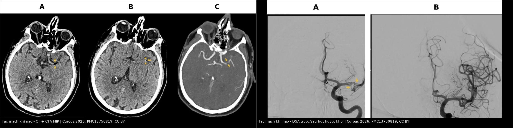
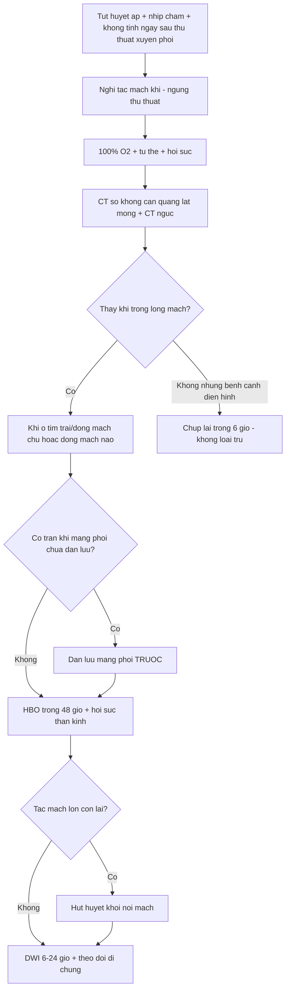
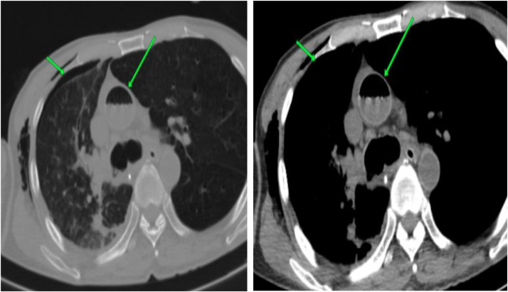
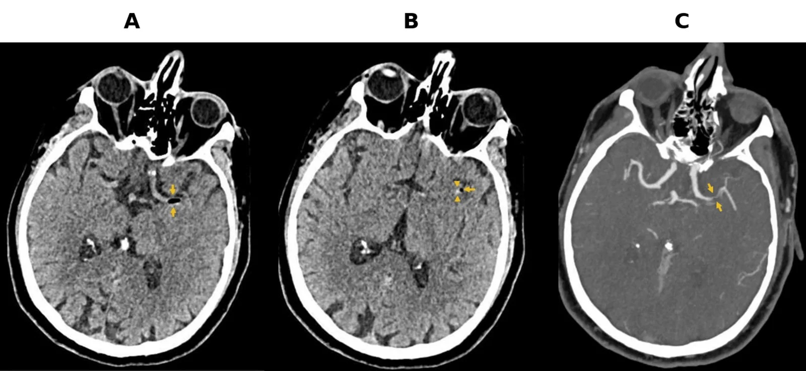
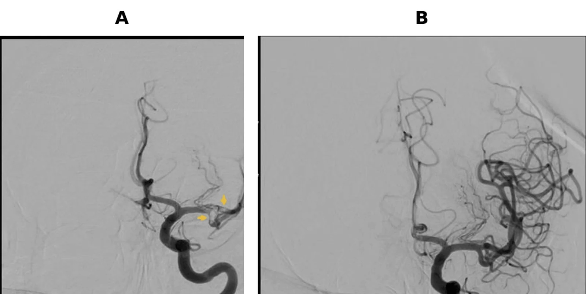

# 3123 — Tắc mạch khí y sinh (iatrogenic systemic air embolism): khí trong tim trái/động mạch chủ, nhồi máu não tính bằng phút

**Tags:** `pattern:khi-trong-long-mach` `pattern:hoi-chung-that-thuong-nao` `pattern:khuyet-thuoc-dong-mach` `vung:nao` `vung:nguc` `anatomy:dong-mach-chu` `anatomy:dong-mach-nao` `protocol:CT-nguc` `protocol:CT-so-nao` `protocol:DWI` `score:GCS`
**Mức chắc chắn (certainty):** tổng hợp y văn (literature synthesis) — ghép **hai ca nguyên văn có ảnh**: sinh thiết phổi xuyên thành qua CT → **khí trong động mạch chủ lên**, tử vong (Radiol Case Rep 2026, PMC13022666); nội soi phế quản định vị → **khí trong động mạch não giữa trái**, lấy huyết khối hút nhưng di chứng nặng (Cureus 2026, PMC13750819); cộng **một tổng quan hệ thống 53 ca** có số liệu dịch tễ – điều trị (Front Med 2026, PMC13050928) và **một tổng quan hình ảnh can thiệp**. Không có ca do nhóm tự chụp.

> **Câu hỏi thực hành:** nam **68 tuổi**, tiền sử khí phế thũng nặng, **nội soi phế quản định vị + sinh thiết xuyên thành thùy dưới phải**. Ngay sau lần lấy bệnh phẩm thứ **5**: **nhịp chậm 38 lần/phút**, huyết áp **58 mmHg**, rồi **không tỉnh lại** sau mê. Câu hỏi: **tai biến gây mê, hay tắc mạch khí — và chụp gì trong 30 phút tới?**
> Bài chốt **ba quyết định**: **(1) tụt huyết áp + nhịp chậm + không tỉnh ngay sau thủ thuật xuyên phổi = tắc mạch khí cho tới khi chứng minh ngược**; **(2) CT sọ không cản quang là cửa đầu nhưng độ nhạy chỉ ~40%** — âm tính **không loại trừ**, chụp lại trong **6 giờ**; **(3) 100% O₂ + tư thế + HBO là điều trị, không phải "theo dõi"** — và **tràn khí màng phổi chưa xử lý là chống chỉ định tuyệt đối của HBO**.

## 1. Tổng quan bệnh học – cơ chế hình ảnh: vì sao bọt khí 1 mL cũng đủ gây đột quỵ

- **Tần suất — bốn con số cần nhớ:**
  - Tắc mạch khí **hệ thống** sau can thiệp phổi qua da: **0,02–0,06%** (Radiol Case Rep 2026, PMC13022666).
  - Tắc mạch khí **não** trong can thiệp phổi: **0,02–0,4%**, **tử vong 20–30%** (Front Med 2026, PMC13050928 — tổng quan **53 ca**, 2001–2024).
  - Trong **559 ca** sinh thiết phổi xuyên thành: tràn khí màng phổi **9–54% (trung bình ~20%)**, và **4,8%** trong số đó có **tắc mạch khí hệ thống** (Monnin-Barres, dẫn trong PMC13022666).
  - Vị trí khí **thường gặp nhất** sau sinh thiết: **thất trái (89,5%)**, và **phần lớn không triệu chứng** — tức là **khí trong tim trái có thể im lặng cho tới khi nó đi lên não** (Liu & Fu, dẫn trong PMC13022666).
- **Ba đường vào (quyết định cách phòng và cách đặt tư thế):**
  1. **Đường động mạch trực tiếp:** kim/ catheter chọc **trực tiếp vào tĩnh mạch phổi** hoặc tạo **rò động–tĩnh mạch phế nang (alveolar–venous fistula)** khi một lần kim xuyên cả phế nang và tĩnh mạch phổi → khí vào **tĩnh mạch phổi → nhĩ trái → thất trái → động mạch chủ → não**. **Ho + tăng áp lực đường thở** đẩy khí vào nhanh hơn.
  2. **Đường tĩnh mạch → động mạch (nghịch thường):** khí vào hệ tĩnh mạch với lượng **vượt ngưỡng lọc của mao mạch phổi ~0,40 mL/kg/phút**, hoặc qua **lỗ bầu dục mở (PFO)** khi áp lực nhĩ phải tăng.
  3. **Đường tĩnh mạch ngược dòng:** bơm khí **nhanh, áp lực cao** vào tĩnh mạch cổ khi bệnh nhân **ngồi/nửa ngồi** → bọt khí **nổi ngược lên xoang tĩnh mạch nội sọ**.
- **TẠI SAO khí gây nhồi máu chứ không chỉ "bịt ống":** tại mặt tiếp xúc khí–máu, **phản ứng viêm–huyết khối qua bổ thể** làm **tổn thương nội mạc, hoạt hóa tiểu cầu, tăng đông** → hình thành **huyết khối tại chỗ cạnh bọt khí**. Ca PMC13750819 cho thấy đúng điều này: **khí và vật liệu huyết khối nằm cạnh nhau** trong động mạch não giữa, và **hút ra được cả hai**.
- **TẠI SAO CT thấy khí — và tại sao có thể KHÔNG thấy:** khí có **tỷ trọng khoảng −1.000 HU**, tương phản cực mạnh trên cửa sổ nhu mô/não. Nhưng bọt **rất nhỏ, di chuyển, hoặc bị "pha loãng" theo dòng** → **độ nhạy CT sớm chỉ khoảng 40%**; vì vậy **CT âm tính đầu tiên không loại trừ** và phải **chụp lại trong 6 giờ** (PMC13050928).
- **TẠI SAO MRI DWI đến muộn hơn:** DWI phản ánh **phù độc tế bào** của vùng nhồi máu, không phản ánh bọt khí; tổn thương **chấm/đốm hạn chế khuếch tán** xuất hiện trong **6–24 giờ** sau khởi phát (PMC13050928). Vì vậy **MRI không phải cửa cấp cứu**, nhưng là cửa **xác định mức lan và tiên lượng**.
- **TẠI SAO hình ảnh não mang tính "nhiều ổ, hai bên, không đối xứng":** khí đi theo dòng, phân bố **nhiều nhánh** ở **vỏ não vùng trán–đỉnh**; không tôn trọng một lãnh thổ mạch như huyết khối xơ vữa.

## 2. Mẫu hình + chẩn đoán phân biệt theo vị trí khí (Gamut)

- **Mẫu hình cốt lõi:** **biến cố tức thì trong hoặc ngay sau thủ thuật** (rút kim, bơm khí, đốt u) + **tụt huyết áp/nhịp chậm/không tỉnh** + **khí thấy được trong lòng mạch** trên CT.
- **Gamut theo vị trí khí:**
  1. **Thất trái / động mạch chủ lên** → **tắc mạch khí hệ thống** (nguồn đi não, mạch vành, thận, chi). Ca PMC13022666: khí trong **động mạch chủ lên** + tràn khí màng phổi.
  2. **Động mạch não (thường MCA)** → **tắc mạch khí não**: liệt nửa người, mất ngôn ngữ, cơn động kinh, hôn mê. Ca PMC13750819.
  3. **Tĩnh mạch nội sọ / xoang** → **tắc mạch khí tĩnh mạch não**: đau đầu, lú lẫn, co giật, phù não lan tỏa.
  4. **Động mạch phổi / tim phải** → **tắc mạch khí tĩnh mạch**: thường **im lặng**, chỉ nguy hiểm khi lượng lớn (suy thất phải, tăng áp phổi cấp) hoặc có **PFO**.
  5. **Động mạch vành** → **nhồi máu cơ tim cấp** ngay sau thủ thuật (đã báo cáo sau sinh thiết phổi qua CT — Circ Rep 2026, PMC13349492).
- **Gamut theo thủ thuật (ai có nguy cơ):** **sinh thiết phổi xuyên thành qua CT (60,4%** các ca tắc mạch khí não), **sinh thiết phổi qua nội soi phế quản (20,8%)**, **tạo tràn khí nhân tạo để nội soi màng phổi (13,2%)** (PMC13050928); ngoài ra **ERCP, nội soi khớp, đặt/rút catheter trung tâm, bơm áp lực, nội nha, mổ nội soi**.
- **Ba câu hỏi đọc ảnh:** **(1) khí nằm ở tim trái/động mạch chủ hay chỉ tim phải? (2) có khí trong động mạch não không? (3) có tràn khí màng phổi kèm theo không?** Câu (3) quyết định **có được đưa đi HBO hay phải dẫn lưu màng phổi trước**.

## 3. Bảng so sánh phân biệt (ma trận đối chiếu)

| Thực thể (entity) | Hình ảnh điển hình (CT/MRI) | Chốt vào (rule-in) | Chốt loại (rule-out) | Gợi ý xác nhận |
|---|---|---|---|---|
| Tắc mạch khí hệ thống | **Khí −1.000 HU** trong **thất trái/động mạch chủ**; khí trong **nhánh động mạch não**; nhiều ổ nhồi máu **hai bên, không đối xứng** ở vỏ trán–đỉnh | **Khí trong lòng mạch + biến cố tức thì đúng lúc thủ thuật** | Không thấy khí nhưng bệnh cảnh điển hình → **không loại trừ** (độ nhạy CT sớm ~40%) | CT lát mỏng, chụp lại < 6 giờ; DWI 6–24 giờ |
| Nhồi máu não do huyết khối/thuyên tắc thông thường | Giảm tỷ trọng **một lãnh thổ mạch**, có **mạch máu tăng đậm** sớm; **không có khí** | **Không khí + yếu tố nguy cơ tim mạch, không thủ thuật gần** | **Khí trong lòng mạch** → không phải huyết khối đơn thuần | CTA/DSA; siêu âm tim tìm nguồn |
| Tắc mạch mỡ (FES) | **Nhiều ổ giảm tỷ trọng** ranh giới mờ ở chất trắng + **"starfield"** trên MRI; bệnh cảnh **gãy xương lớn**, sau **vài giờ–vài ngày** | **Gãy xương + ban xuất huyết + giảm tiểu cầu + mỡ trong nước tiểu** | **Khí thấy rõ trong lòng mạch** → không phải mỡ | MRI; khác thời điểm |
| Tắc mạch khí qua PFO (nghịch thường) | Khí ở **tim trái** sau thủ thuật **tĩnh mạch**; có thể thấy **shunt phải–trái** | **Thủ thuật tĩnh mạch + khí tim trái + PFO** | Khí chỉ ở tim phải → chưa hệ thống | Siêu âm tim cản quang/Ngưng |
| Khí trong tim phải/động mạch phổi đơn thuần | Khí trong **nhĩ–thất phải, động mạch phổi**; **không khí ở tim trái** | **Khí khu trú bên phải, bệnh nhân có thể không triệu chứng** | **Khí ở tim trái/động mạch chủ** → đã hệ thống hóa | CT; theo dõi, 100% O₂ |
| Tràn khí màng phổi đơn thuần | Khí trong khoang màng phổi, xẹp phổi; **không khí trong lòng mạch** | **Khí màng phổi + không có khí nội mạch** | **Khí trong động mạch chủ/não** → có tắc mạch khí | X-quang/CT; dẫn lưu |
| Không tỉnh sau mê (nguyên nhân thuốc) | CT/MRI **bình thường**; hết mê theo thời gian | **Bệnh cảnh phù hợp thuốc, không có khí, không dấu thần kinh khu trú** | **Tụt huyết áp + nhịp chậm đúng lúc rút kim** → nghĩ khí | Theo dõi + chụp lại; không chờ |

*Trái: CT sọ không cản quang + CTA MIP — **khí giảm tỷ trọng trong nhánh động mạch não giữa trái** (mũi tên), cạnh đó là **vật liệu huyết khối tăng đậm** (đầu mũi tên) — khí và huyết khối hình thành tại chỗ. Phải: DSA — **khuyết thuốc trong động mạch não giữa** trước, **thông hoàn toàn sau một lần hút** huyết khối. Nguồn: Cureus 2026 (PMC13750819), **CC BY 4.0**. Ảnh ghép letterbox, giữ nguyên nhãn A/B/C của tác giả.*

### Đọc kỹ ba mẫu hình
- **Khí + huyết khối là một cặp:** đừng chỉ tìm bọt khí; ca gốc có **cả hai** và **hút ra được huyết khối** — vì vậy **can thiệp nội mạch có vai trò** khi còn tắc mạch lớn.
- **Tụt huyết áp + nhịp chậm** là dấu hiệu **sớm** (phản xạ ức chế tim do thiếu máu não/thân não), xuất hiện **trước** khi mất ý thức — đây là cửa sổ để phát hiện.
- **"Không tỉnh sau mê"** là biểu hiện hay bị quy cho thuốc mê: trong **53 ca**, **69,8%** có **rối loạn ý thức cấp ngay sau khi rút kim/bơm khí** (PMC13050928).

## 4. Protocol chụp + xử trí theo phút

- **Bước 1 — Tại bàn thủ thuật (0–5 phút):**
  - **Ngừng thủ thuật**, **100% O₂ qua mask kín** (tạo gradient thải nitơ, làm bọt khí nhỏ lại), đặt **tư thế**:
    - Nghi **khí tĩnh mạch/tim phải** → **Trendelenburg + nghiêng trái** (giữ khí ở đường ra thất phải, tránh vào tuần hoàn phổi).
    - Nghi **khí động mạch/não** → **nằm ngửa hoặc Trendelenburg nhẹ** để hạn chế khí nổi lên động mạch não (PMC13050928).
  - Hồi sức: **theo dõi huyết áp, nhịp, SpO₂**; đặt **catheter tĩnh mạch trung tâm** và **hút khí từ nhĩ phải** nếu siêu âm xác nhận khí trong tim phải.
- **Bước 2 — CT (10–30 phút):**
  - **CT sọ không cản quang, lát ≤ 1 mm** + **CTA đầu–cổ** nếu có dấu thần kinh khu trú; **CT ngực** cửa sổ nhu mô + trung thất để tìm **khí trong tim trái/động mạch chủ** và **tràn khí màng phổi**.
  - **Độ nhạy sớm ~40%** → nếu âm tính mà bệnh cảnh điển hình: **chụp lại trong 6 giờ**, không chờ.
- **Bước 3 — Điều trị đặc hiệu:**
  - **HBO (oxy cao áp) là điều trị hàng đầu** cho tắc mạch khí não có triệu chứng: **nén bọt theo định luật Boyle**, tăng thải nitơ, tăng oxy tới mô thiếu máu; **còn hiệu quả nếu bắt đầu trong 48 giờ** (PMC13050928).
  - **Chống chỉ định tuyệt đối:** **tràn khí màng phổi chưa dẫn lưu** (nguy cơ tràn khí áp lực dưới áp suất cao) → **dẫn lưu trước, HBO sau**.
  - **Can thiệp nội mạch** khi **tắc mạch lớn có thể tiếp cận** (MCA…): **hút huyết khối** — ca PMC13750819 thông hoàn toàn **sau một lần hút**.
  - **Chống co giật, kiểm soát đường huyết–thân nhiệt**, tránh tụt huyết áp (bảo vệ vùng tranh chấp).
- **Bước 4 — theo dõi và tiên lượng:**
  - **DWI MRI 6–24 giờ** để xác định phạm vi nhồi máu; **TCD** có thể thấy **tín hiệu "bão tuyết"** nếu còn vi hạt khí lưu hành (PMC13050928).
  - **Thông mạch ≠ hồi phục chức năng:** ca gốc **thông hoàn toàn** nhưng **di chứng thần kinh nặng vẫn còn** — cần nói rõ với gia đình ngay từ đầu.

## 5. Biến thể bình thường và cạm bẫy

- **CT âm tính không loại trừ:** độ nhạy sớm **~40%**; bọt nhỏ, di chuyển, hoặc đã tan sau vài phút. **Chụp lại < 6 giờ** khi bệnh cảnh điển hình (PMC13050928).
- **Khí trong tim phải thường lành tính và hay gặp:** khí gặp nhiều nhất ở **thất trái (89,5%)** và **phần lớn không triệu chứng** — **đừng** gọi mọi bọt khí là thảm họa; nhưng **khí ở tim trái** thì **phải tìm khí ở não**.
- **Quy cho thuốc mê:** "không tỉnh sau mê" ở bệnh nhân vừa **sinh thiết phổi/bơm khí** là **tắc mạch khí cho tới khi chứng minh ngược**.
- **Bỏ qua tràn khí màng phổi khi đưa đi HBO:** **tràn khí chưa dẫn lưu = chống chỉ định tuyệt đối**; dẫn lưu trước.
- **Tư thế sai:** **nghiêng trái** là để giữ khí ở **tim phải**; với **khí động mạch/não**, tư thế này **không** giúp và có thể làm chậm hồi sức não.
- **Chỉ tìm khí, không tìm huyết khối:** bọt khí làm **hoạt hóa đông** tại chỗ; ca gốc có **huyết khối cạnh khí** và **hút được** — bỏ qua tắc mạch lớn là bỏ lỡ can thiệp.
- **Nghĩ ngay đến nhồi máu cơ tim:** khí vào **động mạch vành** gây **ST chênh lên thoáng qua** ngay sau thủ thuật (Circ Rep 2026, PMC13349492) — đừng chỉ theo dõi "đau ngực do lo lắng".
- **Vị trí kim/tư thế bệnh nhân là yếu tố phòng ngừa:** tránh **ngồi/nửa ngồi** khi can thiệp tĩnh mạch cổ; **bịt đường chọc ngay** khi rút kim; hạn chế **ho và áp lực đường thở cao** trong lúc kim còn trong nhu mô — đây là các bước được khuyến cáo theo thủ thuật (PMC13050928).

## 6. Tự lượng giá — Blind Quiz

**Ca 1 — Nam 75 tuổi, COPD, sinh thiết phổi xuyên thành qua CT. Nhìn ảnh trước, mô tả sau.**

- Gợi ý lâm sàng: sau khi rút kim bệnh nhân tụt huyết áp, SpO₂ giảm; không có dấu thần kinh khu trú lúc đầu.
- Câu hỏi: Khí nằm ở đâu (mũi tên xanh)? Vì sao bệnh nhân có thể chết dù chỉ một lượng khí nhỏ? Việc đầu tiên phải làm?

<b>Bấm để hiện đáp án (findings + chẩn đoán)</b>

- Dấu hiệu: **khí giảm tỷ trọng (−1.000 HU) trong động mạch chủ lên** (mũi tên xanh) + **tràn khí màng phổi** cùng bên; nhu mô phổi nền khí phế thũng.
- Chẩn đoán: **tắc mạch khí hệ thống** sau sinh thiết phổi xuyên thành — khí vào **tĩnh mạch phổi → tim trái → động mạch chủ**.
- Việc đầu tiên: **100% O₂ + hồi sức + tư thế**, **dẫn lưu tràn khí màng phổi**, rồi **HBO** nếu không chống chỉ định; ca này **tử vong** dù đã hồi sức.
- Nguồn: Radiol Case Rep 2026 (PMC13022666), CC BY-NC-ND 4.0.

**Ca 2 — Nam 68 tuổi, nội soi phế quản định vị, không tỉnh sau mê. CT sọ.**

- Câu hỏi: Ba dấu hiệu trên ảnh? Vì sao **không thấy khí** trên lần chụp đầu vẫn không loại trừ? Bước tiếp theo?

<b>Bấm để hiện đáp án (findings + chẩn đoán)</b>

- Dấu hiệu: (A) **khí giảm tỷ trọng trong nhánh động mạch não giữa trái**; (B) **vật liệu huyết khối tăng đậm** ngay cạnh khí; (C) **CTA MIP** xác nhận **tắc nhánh lớn**.
- Vì sao: độ nhạy CT sớm **~40%**; bọt nhỏ/di chuyển; cần **chụp lại trong 6 giờ** và **DWI 6–24 giờ**.
- Bước tiếp theo: **100% O₂, HBO**, và **can thiệp nội mạch** nếu còn tắc mạch lớn.
- Nguồn: Cureus 2026 (PMC13750819), CC BY 4.0.

**Ca 3 — Cùng bệnh nhân, DSA trước và sau can thiệp.**

- Câu hỏi: Vì sao **thông mạch hoàn toàn** mà bệnh nhân vẫn **di chứng nặng**? Điều đó thay đổi cách tư vấn thế nào?

<b>Bấm để hiện đáp án (findings + chẩn đoán)</b>

- Dấu hiệu: (A) **khuyết thuốc trong động mạch não giữa trái**; (B) **thông hoàn toàn sau một lần hút**, lấy ra **vật liệu giống huyết khối**.
- Vì sao vẫn di chứng: **thời gian thiếu máu** và **tổn thương nội mạc do khí** đã gây nhồi máu trước khi tái thông; **mạch thông ≠ nhu mô hồi phục**.
- Tư vấn: nói rõ **tiên lượng thần kinh dè dặt ngay từ đầu**, không hứa "thông mạch là khỏi".
- Nguồn: Cureus 2026 (PMC13750819), CC BY 4.0.

## Bài liên quan chéo
- [098 – Barotrauma & tràn khí áp lực ở bệnh nhân thở máy](../098-barotrauma-tran-khi-ap-luc-tho-may/lesson.md) (cơ chế áp lực đường thở)
- [1800 – Tắc mạch mỡ sau hút mỡ và ghép mỡ](../1800-tac-mach-mo-sau-hut-mo-va-ghep-mo/lesson.md) (phân biệt tắc mạch mỡ)
- [1698 – Hội chứng tắc mạch silicone](../1698-hoi-chung-tac-mach-silicone/lesson.md) (cùng nhóm "vật liệu lạ trong lòng mạch")
- [211 – Đột quỵ não](../211-dot-quy-nao/lesson.md) (nền tảng tái thông và phân bố lãnh thổ mạch)
- [090 – Bỏng hít đường thở ở trẻ](../090-bong-hit-duong-tho-o-tre/lesson.md) (tổn thương đường thở cấp)

## Ảnh
- `images/3123_tac-mach-khi_CT-dong-mach-chu_PMC13022666.jpg` — CT ngực, Radiol Case Rep 2026 (PMC13022666), **CC BY-NC-ND 4.0** (dùng nguyên bản, không phái sinh).
- `images/3123_tac-mach-khi_CT-so-nao_PMC13750819.jpg` — CT sọ + CTA, Cureus 2026 (PMC13750819), **CC BY 4.0**.
- `images/3123_tac-mach-khi_DSA_PMC13750819.jpg` — DSA trước/sau, Cureus 2026 (PMC13750819), **CC BY 4.0**.
- `images/composite_tac-mach-khi-nao.jpg` — ảnh ghép letterbox **chỉ từ hai ảnh CC BY** ở trên.
- Nguồn, giấy phép và ghi chú phái sinh từng ảnh: `images/CREDITS.md`.

> Không dùng để chẩn đoán độc lập khi chưa có người hướng dẫn.
