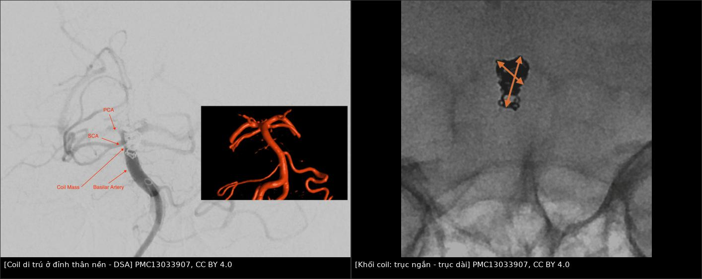
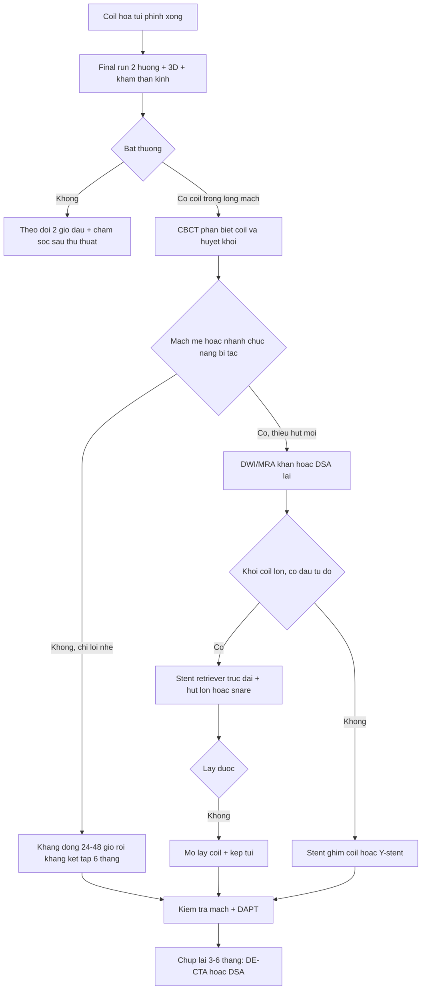
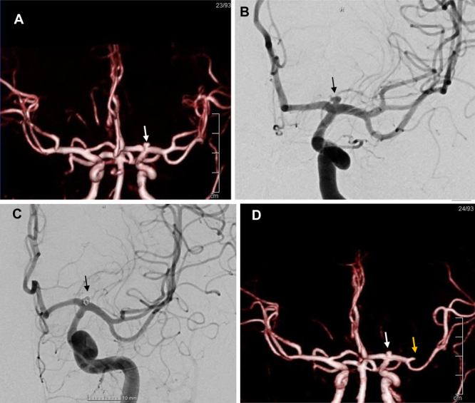
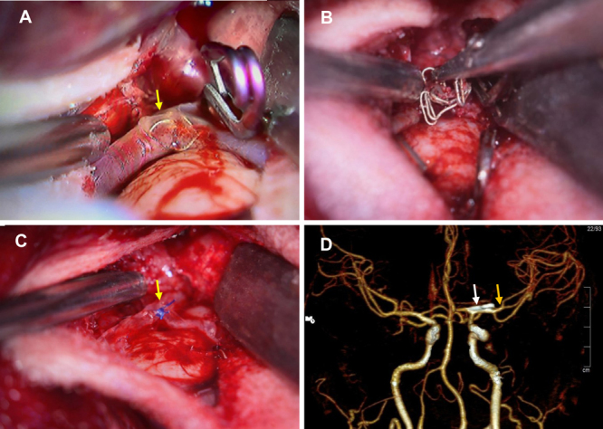
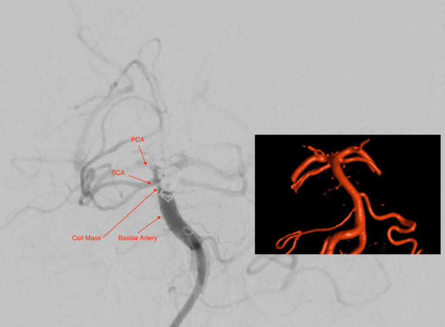

# 3124 — Coil lồi – di trú vào mạch mẹ sau coil hóa túi phình / Coil protrusion and migration into the parent artery

**Tags:** `pattern:coil-trong-tui` `pattern:di-tru-thiet-bi` `pattern:tac-mach` `pattern:thieu-mau-nao` `vung:nao` `vung:mach-nao` `protocol:DSA` `protocol:CBCT` `protocol:DE-CTA` `protocol:MRA-TOF` `protocol:DWI` `score:Raymond-Roy` `score:mRS`

**Mức chắc chắn (certainty):** tổng hợp y văn (literature synthesis) — ghép 4 nguồn mở: (a) ca di trú coil muộn sau 1 giờ, mổ lấy coil + kẹp túi (**Tran CC, Tran DV, Nguyen TNT, Nguyen QH, Le TCL, Nguyen DL**, *J Neurosurg Case Lessons* 2026, PMC13403595, **CC BY-NC-ND 4.0**); (b) kỹ thuật lấy coil di trú ở đỉnh thân nền bằng stent retriever + hút (**Es'haghi N, Khattak Y, Manzoor M, Navarro R**, *Cureus* 2026, PMC13033907, **CC BY 4.0**); (c) loạt 3 ca coil "đùn" ra ngoài túi được kẹp vi phẫu (**Valerio JE** et al., *Surg Neurol Int* 2026, PMC13633592, **CC BY-NC-SA 4.0**); (d) Y-stent cứu nguy khi coil lệch vào mạch mẹ (**Takeda J** et al., *J Neuroendovasc Ther* 2026, PMC12854850, **CC BY-NC 4.0**). Số nào nguồn không đưa thì ghi "chưa rõ".

> **Bài này trả lời 4 câu hỏi của ca "coil hóa xong, bệnh nhân đột ngột yếu nửa người":**
> (1) **Phân biệt coil lồi (protrusion) – di trú (migration) – đùn ra ngoài túi (extrusion) – xẹp khối coil (compaction) — và cái nào cần mổ?** (2) **Vì sao "lần chụp cuối trong mổ đẹp" vẫn có thể di trú sau 1 giờ?** (3) **Lấy coil bằng gì: snare, stent retriever, stent chặn, hay mổ?** (4) **Theo dõi sau coil bằng DSA, DE-CTA hay MRA — và đọc cái gì?**
> Đây là mặt **biến chứng vật liệu** của coil hóa; kỹ thuật coil phối hợp thiết bị nội túi ở [3091 – Coil hóa sau Contour](../3091-coil-hoa-sau-contour-cocojambo/lesson.md), theo dõi dài hạn ở [3076 – Theo dõi sau Contour](../3076-theo-doi-sau-contour-noi-tui/lesson.md), theo dõi sau WEB ở [266 – Theo dõi sau WEB túi phình](../266-theo-doi-sau-web-tui-phinh/lesson.md), di trú catheter trong lòng mạch ở [3126 – Dị vật catheter trong lòng mạch](../3126-di-vat-catheter-trong-long-mach-tre/lesson.md).

## 1. Tổng quan bệnh học – cơ chế hình ảnh

### 1.1 Bốn danh từ phải phân biệt trước khi quyết định

- **Coil lồi (protrusion):** một **vòng coil nhô ra khỏi cổ túi vào lòng mạch mẹ** nhưng **khối coil vẫn nằm trong túi**. Thường do cổ rộng, coil quá dài so với túi, hoặc vòng cuối bung không đúng.
- **Coil di trú (migration):** **toàn bộ hay phần lớn khối coil rời khỏi túi**, trôi theo dòng máu tới **mạch mẹ/nhánh xa** (ca PMC13033907: khối coil trôi tới **đỉnh thân nền**, làm hẹp PCA/SCA; ca PMC13403595: coil trôi tới **ngã ba M2–M3**, tắc nhánh).
- **Coil đùn (extrusion):** vòng coil **chui ra ngoài vòm túi** vào khoang dưới nhện/mô não, thường **muộn (năm–gần 20 năm)** trên nền túi tái phát; là dấu hiệu **thành túi không lành** (PMC13633592).
- **Coil xẹp (compaction):** khối coil **co lại tại chỗ** do "hiệu ứng búa nước" của dòng đập, không di chuyển — khác hẳn di trú, và xử trí khác (coil thêm ± stent).
- **Vì sao coil chưa "dính" ngay:** sau khi thả, khối coil chỉ được giữ bởi **ma sát + huyết khối non**; **nội mạc hóa cần vài tuần**. Trong cửa sổ đó, **lực cản dòng (drag)** ở mạch mẹ lưu lượng cao có thể **đẩy cả khối coil** — nhất là khi **lòng mạch mẹ và cổ túi gần bằng nhau** (không có "vai" để bám) như ca PMC13033907.

### 1.2 Số liệu định lượng bắt buộc nhớ

| Đại lượng | Con số | Nguồn |
|---|---|---|
| Tần suất coil di trú | **0,3–6%** (tùy định nghĩa/thiết kế) · **1,7–6%** theo tổng quan khác | PMC13403595; PMC13033907 |
| Tái thông sau coil hóa | **15–34%** (so với **1–3%** sau kẹp vi phẫu) | PMC13633592 |
| Coil "đùn" ở túi tái phát đã coil | **71%** ca tái phát đã coil có coil đùn | PMC13633592 |
| Kẹp lại túi đã coil | **97,3%** tắc hoàn toàn (111 ca), **1,8%** tái phát, **2,7%** tử vong (loạt kẹp lại túi đã coil) | PMC13633592 |
| Kẹp **không lấy coil** | biến chứng **5,0%** (phân tích gộp) — thấp hơn lấy coil/thắt mạch mẹ | PMC13633592 |
| Phát hiện cổ túi còn sót trên **DE-CTA** | độ nhạy/đặc hiệu **> 90%**; CTA thường **< 10%** | PMC13633592 |
| Nguy cơ tái phát theo **VWI** | tăng tín hiệu thành túi quanh chu vi: **OR tới 14** | PMC13633592 |
| Yếu tố nguy cơ di trú | cổ rộng, **dome-to-neck < 2:1**, coil nhỏ/thiếu cỡ, **coil đầu hoặc cuối**, mạch mẹ lưu lượng cao | PMC13033907 |
| Ca minh họa 1 | túi **1,5 × 3 mm** ở nguyên ủy ĐM cảnh trong trái; coil **1,5 mm × 4 cm**; **1 giờ** sau: GCS **12**, liệt nửa người phải, tắc **M2–M3** | PMC13403595 |
| Ca minh họa 2 | túi bóc tách V4 **6 × 3 mm**, ĐM đốt sống **2,6 mm / 2,2 mm**; 5 coil; thời gian chiếu tia **1 giờ 07 phút**; 6 tháng **mRS 2** | PMC13033907 |
| Ca minh họa 3 | nam **41 tuổi**, túi ACoA cổ rộng đã vỡ; coil lệch → **tắc cả hai A2**; **2 stent Neuroform Atlas** hình Y; 2 năm tắc hoàn toàn, không di chứng | PMC12854850 |

- **Hệ quả:** di trú là biến cố **thời gian thực** — quyết định trong **phút**, không phải ngày; mọi ca coil hóa cần **một lần chụp kiểm tra có dòng chảy** (không chỉ khối coil) trước khi rời bàn.

## 2. Mẫu hình + chẩn đoán phân biệt (Gamut)

- **Theo thời điểm:** **trong thủ thuật** (hay gặp nhất, thấy ngay trên DSA) · **sớm sau thủ thuật vài giờ** (ca PMC13403595: 1 giờ) · **muộn vài ngày–tuần** · **rất muộn (năm, tới ~20 năm)** với coil đùn (PMC13633592).
- **Theo hướng di trú:** **ra mạch mẹ** (lồi → tắc mạch mẹ) · **xuống nhánh xa** (M2–M3, PCA/SCA — gây nhồi máu ổ) · **ra ngoài túi** (đùn vào khoang dưới nhện) · **vào tĩnh mạch** (hiếm, khi có rò).
- **Theo hình thái "vật liệu trong lòng mạch" — gợi nhớ COIL:**
  - **C**oil lồi/di trú (bài này) — **búi sợi cản quang** trong lòng mạch mẹ, mất dòng xa.
  - **O**cclusion do huyết khối (thromboembolism) — **khuyết thuốc không có cấu trúc coil**, thường ở nhánh xa; điều trị khác (hút/thuốc tiêu sợi huyết nội mạch).
  - **I**n-stent stenosis / hẹp trong stent — hẹp **dọc thân stent** sau stent-assisted coiling.
  - **L**oose coil (coil bung rối, tháo không được) — coil vẫn trong túi nhưng **không tạo khối kín**.
  - **L**oop detachment (đứt/tháo coil) — **đuôi coil** trong mạch mẹ, dễ trôi xa.
- **Theo bối cảnh mạch mẹ:** **mạch mẹ = mạch nuôi vùng chức năng** (thân nền, M1, A1, ICA) → ngưỡng can thiệp **thấp**; **mạch mẹ nhỏ, vùng nghèo chức năng** → có thể theo dõi.

## 3. Bảng so sánh phân biệt (ma trận đối chiếu)

| Thực thể (entity) | Hình ảnh điển hình (DSA/CBCT/CTA/MRA) | Chốt vào (rule-in) | Chốt loại (rule-out) | Gợi ý xác nhận |
|---|---|---|---|---|
| **Coil lồi nhẹ (protrusion)** | DSA: **vòng coil nhô < 1–2 mm** qua cổ, **dòng mạch mẹ còn nguyên**; 3D xoay thấy rõ | **Vòng coil qua cổ + mạch mẹ còn thông + không thiếu máu** | Mất dòng xa hoặc khối coil rời túi → không còn là "lồi nhẹ" | DSA 3D/CBCT; DWI loại nhồi máu |
| **Coil di trú ra mạch mẹ** | **Búi coil nằm trong lòng mạch mẹ**, mạch **hẹp/tắc** ngay tại đó; thì muộn vẫn thấy khuyết | **Khối coil ngoài túi + mất dòng xa** | Coil vẫn trong túi, chỉ xẹp tại chỗ → compaction | DSA + CBCT (VasoCT) phân biệt coil với huyết khối |
| **Coil di trú xuống nhánh xa** | Coil ở **M2–M3/PCA/SCA**, nhánh **mất dòng**, có thể thấy **nhồi máu ổ** trên DWI | **Coil ở nhánh xa + thiếu hụt thần kinh mới** | Nhánh mất dòng nhưng **không có coil** → huyết khối/co thắt | DWI/MRI; chụp lại sau 24 giờ |
| **Huyết khối do coil (thromboembolism)** | Khuyết thuốc **không cản quang dạng búi**, thường ở nhánh xa; **không thấy cấu trúc coil** trên CBCT | **Khuyết thuốc + CBCT không có coil** | Có coil trong lòng mạch → di trú | CBCT/DSA; xử trí hút/thuốc |
| **Coil xẹp (compaction)** | Khối coil **co nhỏ tại cổ**, **túi tái thông tại cổ** nhưng coil **không rời vị trí** | **Túi tái thông + coil tại chỗ** | Coil nằm ngoài túi → di trú | So sánh ảnh cũ; DSA 3D |
| **Coil đùn (extrusion)** | Vòng coil **ngoài vòm túi**, thành túi **biến dạng**, thường kèm **túi tái phát** nhiều năm sau | **Coil ngoài vòm + tái phát muộn + không có dòng trong túi** | Coil trong lòng mạch → migration | DSA 3D; cân nhắc kẹp vi phẫu |
| **Co thắt mạch (vasospasm)** | Hẹp **đều, dài**, hồi phục sau thuốc; **không có coil** trong lòng | **Hẹp nhẵn + hồi phục + không coil** | Coil trong lòng mạch → di trú | DSA + nitrate nội mạch |
| **Di trú thiết bị nội túi (WEB/Contour)** | Thiết bị **lệch khỏi cổ/vào túi**, hình dạng méo, **vòng vàng kim loại** | **Thiết bị lệch + mất tắc túi** | Thiết bị đúng vị trí, chỉ chưa tắc hoàn toàn | CBCT; xem bài 3076 |

*Trái: DSA — **khối coil (coil mass)** nằm ở **đỉnh thân nền**, chạm PCA và SCA; ảnh nhỏ là dựng 3D tương ứng. Phải: khối coil **bất đối xứng** — trục ngắn (mũi tên chéo) vs trục dài (mũi tên dài) quyết định hướng đặt stent retriever. Nguồn: Cureus 2026, PMC13033907, CC BY 4.0. Ảnh ghép letterbox, không crop.*

## 4. Protocol chụp + xử lý + theo dõi

### 4.1 Trong thủ thuật: kiểm tra trước khi rời bàn

1. **DSA cuối (final run) ở ít nhất 2 hướng + 3D xoay**, đọc **cả khối coil và dòng mạch mẹ/nhánh** — không chỉ nhìn "túi kín". Trong ca PMC13033907, coil di trú xảy ra **đúng lúc chạy final run sau khi kéo guide về gần** (giảm cản trở dòng → tăng lực đẩy khối coil).
2. **CBCT (VasoCT/DynaCT) có pha loãng cản quang** khi nghi coil trong lòng mạch: phân biệt **coil** với **huyết khối** và xác định **vị trí đầu coil nhô**.
3. **Kiểm tra thần kinh ngay sau thủ thuật** và **mỗi 15–30 phút trong 2 giờ đầu** ở ca nguy cơ (cổ rộng, coil cuối, mạch mẹ lớn). Ca PMC13403595: **1 giờ** sau thủ thuật, GCS từ 15 xuống **12** + liệt nửa người phải.
4. **Có thiếu hụt mới → MRI khẩn (DWI + MRA TOF) hoặc DSA lại ngay**: MRA TOF thấy **mất tín hiệu nhánh xa** (M2–M3) dù coil là kim loại; DWI xác định **nhồi máu đã xảy ra** (quyết định mổ hay không).

### 4.2 Ngưỡng xử trí

- **Coil lồi nhẹ, mạch mẹ còn thông, không thiếu máu:** **theo dõi** — vòng coil nhô thường **nội mạc hóa và dính thành mạch**; dùng **kháng đông 24–48 giờ** rồi **kháng kết tập tiểu cầu 6 tháng** (PMC13033907).
- **Coil lồi có nguy cơ huyết khối, cổ rộng, không lấy được:** **ghim coil vào thành mạch bằng stent** (stent đơn hoặc **Y-stent** khi cổ phức tạp). Ca PMC12854850: coil lệch làm **tắc cả hai A2**, hai **Neuroform Atlas** hình Y → thông lại, 2 năm tắc hoàn toàn, không di chứng. Y-stent là **cứu nguy**, chưa có đồng thuận.
- **Coil di trú gây tắc mạch mẹ/nhánh chức năng, hoặc khối coil lớn:** **lấy coil** — thứ tự thực dụng:
  1. **Stent retriever hybrid (NeVa) đặt dọc TRỤC DÀI của khối coil + catheter hút lớn** (ca PMC13033907: Solitaire X 4 × 20 mm **thất bại khi đi trục ngắn**; NeVa + **AXS Vecta 74** thành công).
  2. **Snare** (vòng bắt) khi coil có **đầu tự do** trong lòng mạch lớn.
  3. **Mổ lấy coil + kẹp túi** khi coil ở **ngã ba nông (M2–M3)**, khi can thiệp nội mạch thất bại, hoặc khi cần xử lý túi một thì (ca PMC13403595: mở dọc M2, lấy coil, khâu, kẹp túi; CTA sau mổ thông mạch).
  4. **Để nguyên + kháng kết tập** khi coil ở **nhánh nghèo chức năng**, không gây tắc, và nguy cơ lấy > lợi ích.
- **Túi tái phát + coil đùn:** **kẹp vi phẫu** là lựa chọn bền vững (97,3% tắc hoàn toàn; **không lấy coil** có biến chứng **5,0%**), đặc biệt khi cổ/chạc ba không thuận lợi cho flow diverter (PMC13633592).
- **Sau can thiệp:** **DAPT** (bắt buộc nếu có stent/flow diverter), khám thần kinh, **DWI 24–48 giờ** nếu có thiếu hụt, và **chụp kiểm tra 3–6 tháng**.

### 4.3 Theo dõi dài hạn: chọn modality nào

- **DSA** là chuẩn khi cần đánh giá **cổ túi còn sót, coil xẹp/đùn, hẹp trong stent**; nhưng xâm lấn.
- **MRA TOF** không cần thuốc: tốt để thấy **dòng mạch mẹ/nhánh** và **túi tái thông**, hạn chế bởi **nhiễu kim loại** tại khối coil (ca PMC13403595 phát hiện di trú bằng **3D TOF MRA**).
- **DE-CTA (dual-energy CTA)** là bước tiến lớn: **> 90%** độ nhạy/đặc hiệu phát hiện cổ còn sót so với **< 10%** của CTA thường, nhờ tách cản quang khỏi nhiễu kim loại (PMC13633592).
- **VWI (vessel wall imaging)**: tăng tín hiệu thành túi dai dẳng **tương quan với tái thông**; quanh chu vi trước điều trị có **OR tới 14** cho tái phát — dùng để **xếp lịch theo dõi dày** ở túi nguy cơ.
- **Raymond–Roy** để ghi kết quả tắc: **I** tắc hoàn toàn, **II** cổ còn sót, **III** túi còn sót; **mRS** để ghi kết cục lâm sàng (ca PMC13033907: **mRS 2** lúc 6 tháng).

## 5. Biến thể bình thường và cạm bẫy

- **"Bình thường" cần biết:** **vòng coil nhô < 1–2 mm** đã nội mạc hóa ở ca theo dõi nhiều năm là **di chứng, không phải biến chứng** — đừng can thiệp chỉ vì thấy coil "nhô".
- **Cạm bẫy 1 — final run đẹp:** coil có thể di trú **sau khi kéo guide/microcatheter** vì dòng tăng; luôn **chạy lại một lần ở vị trí guide cuối** và **khám thần kinh** trước khi rút ống.
- **Cạm bẫy 2 — nhiễu kim loại che coil:** CTA thường chỉ thấy **vệt sáng giả**; dùng **DE-CTA/CBCT** và **DSA 3D**; đừng kết luận "coil đúng vị trí" từ một lát cắt.
- **Cạm bẫy 3 — nhầm huyết khối với coil:** huyết khối **không cản quang**, không có cấu trúc vòng; xử trí **hút/thuốc** khác hẳn **lấy coil**.
- **Cạm bẫy 4 — nhầm coil xẹp với di trú:** xẹp = **coil tại chỗ + cổ tái thông**; di trú = **coil rời túi**. So **ảnh cũ cùng hướng** là bắt buộc.
- **Cạm bẫy 5 — bỏ sót tắc nhánh xa vì "bệnh nhân chỉ hơi yếu":** ca PMC13403595 khởi đầu bằng **giảm ý thức nhẹ + liệt nửa người**, không đau đầu; thiếu hụt **bất kỳ** sau coil hóa = chụp lại ngay.
- **Cạm bẫy 6 — lấy coil làm rách mạch mẹ:** không kéo mạnh, không lấy khi coil đã **dính chắc vào nội mạc**; nếu thất bại **2 lần**, chuyển **ghim stent** hoặc **mổ** thay vì cố.
- **Cạm bẫy 7 — DAPT ở bệnh nhân mới vỡ túi/đang đặt EVD:** cân nhắc **nguy cơ chảy máu** trước khi đặt stent; ca PMC13033907 đã có EVD nhưng vẫn dùng DAPT vì không còn phẫu thuật dự kiến.

## 6. Tự lượng giá — Blind Quiz

**Ca 1 — Nữ 65 tuổi, vỡ túi phình, coil hóa "thành công"; 1 giờ sau GCS 12, liệt nửa người phải. Nhìn 3D TOF MRA và DSA trước/sau.**

- Gợi ý lâm sàng: Hunt–Hess I; túi **1,5 × 3 mm** ở nguyên ủy ĐM cảnh trong trái; coil Barricade **1,5 mm × 4 cm**.
- Câu hỏi: (1) Ảnh D sau can thiệp có gì bất thường? (2) Hai mũi tên (trắng/vàng) chỉ gì? (3) Vì sao phải xử trí trong phút?

<b>Bấm để hiện đáp án (findings + chẩn đoán)</b>

- **Findings:** (A) 3D TOF MRA: túi nhỏ ở nguyên ủy ICA trái (mũi tên). (B) DSA: hình thái túi. (C) Sau thả coil: coil nằm gọn trong túi, tắc gần hoàn toàn. (D) MRA sau khi bệnh nhân xấu đi: **coil đã di trú vào mạch mẹ** — **mũi tên trắng** = túi phình còn thấy lại (coil rời túi), **mũi tên vàng** = **tắc đoạn xa M2** gần ngã ba **M2–M3**, dòng xa giảm.
- **Chẩn đoán:** **coil di trú vào mạch mẹ gây tắc M2–M3** sau coil hóa túi vỡ.
- **Vì sao gấp:** tắc nhánh chức năng → nhồi máu lan rộng trong **vài giờ**; bệnh nhân đã có **liệt nửa người**; mổ lấy coil + kẹp túi được thực hiện cấp cứu.
- **Nguồn:** Tran CC et al., *J Neurosurg Case Lessons* 2026, PMC13403595, CC BY-NC-ND 4.0. Ảnh Hình 1, nguyên bản.

**Ca 2 — Cùng bệnh nhân sau mổ. Nhìn ảnh trong mổ và CTA sau mổ.**

- Câu hỏi: (1) Ảnh A cho thấy gì? (2) Vì sao mở dọc chứ không mở ngang? (3) Ảnh D xác nhận điều gì?

<b>Bấm để hiện đáp án (findings + chẩn đoán)</b>

- **Findings:** (A) **Coil di trú** thấy tại **ngã ba M2–M3**, chiếm một phần lòng mạch (mũi tên). (B) **Mở dọc** ngã ba, lấy coil ra. (C) Khâu lại bằng mũi rời (mũi tên). (D) CTA sau mổ: **mạch thông lại, dòng xa hồi phục** (mũi tên vàng) và **túi đã được kẹp kín** (mũi tên trắng).
- **Vì sao mở dọc:** giảm nguy cơ **hẹp sau khâu** và giúp nhìn rõ coil trong lòng mạch; kẹp tạm M2 gần + hai nhánh M3 để kiểm soát chảy máu.
- **Ảnh D xác nhận:** lấy coil **không làm hẹp/tắc** mạch mẹ, và túi được loại trừ — tức là xử lý **một thì** cả biến chứng và bệnh nền.
- **Nguồn:** Tran CC et al., *J Neurosurg Case Lessons* 2026, PMC13403595, CC BY-NC-ND 4.0. Ảnh Hình 2, nguyên bản.

**Ca 3 — Nữ 52 tuổi, vỡ túi bóc tách V4 phải, đang thắt mạch mẹ thì khối coil trôi tới đỉnh thân nền. Nhìn DSA.**

- Gợi ý lâm sàng: WFNS II; túi bóc tách **6 × 3 mm**, ĐM đốt sống **2,6 mm** (gần) / **2,2 mm** (xa); đã thả 5 coil; khối coil trôi khi chạy final run.
- Câu hỏi: (1) Vì sao khối coil trôi? (2) Lấy bằng gì và theo hướng nào? (3) Sau lấy, xử lý túi thế nào?

<b>Bấm để hiện đáp án (findings + chẩn đoán)</b>

- **Findings:** DSA — **khối coil** nằm ở **đỉnh thân nền**, ngay chỗ chia **PCA** và **SCA**; dựng 3D xác nhận khối coil **bất đối xứng (trục ngắn – trục dài)**.
- **Vì sao trôi:** mạch mẹ và túi **gần bằng đường kính** (không có "vai" giữ coil), coil **quá cỡ 15% so với túi và 45% so với mạch xa** nhưng vẫn không đủ neo; **kéo guide gần để chạy final run làm tăng dòng** → đẩy khối coil.
- **Lấy:** **Solitaire X 4 × 20 mm đi theo trục ngắn thất bại**; **NeVa (hybrid cell) đi theo trục dài + catheter hút AXS Vecta 74** thành công — tăng **diện tiếp xúc** với khối coil.
- **Sau lấy:** chuyển sang **tái tạo mạch mẹ** bằng **flow diverter Pipeline Vantage 3.5 × 16 mm** (DAPT: aspirin 300 mg + tirofiban) thay vì thắt mạch, để tránh **di trú lần hai**.
- **Kết cục:** còn **nhồi máu nhỏ thùy thích trái**, **mRS 2** lúc 6 tháng; thời gian chiếu tia **1 giờ 07 phút**.
- **Nguồn:** Es'haghi N et al., *Cureus* 2026, PMC13033907, CC BY 4.0. Ảnh Hình 1, nguyên bản.

## Bài liên quan chéo
- [200 – Tổng quan hệ Thần kinh](../200-tong-quan-he-than-kinh/lesson.md)
- [3091 – Coil hóa phối hợp Contour (CoCoJaMBO)](../3091-coil-hoa-sau-contour-cocojambo/lesson.md) (kỹ thuật và nguy cơ di trú thiết bị)
- [3076 – Theo dõi sau Contour nội túi](../3076-theo-doi-sau-contour-noi-tui/lesson.md) (di trú thiết bị nội túi)
- [266 – Theo dõi sau WEB túi phình](../266-theo-doi-sau-web-tui-phinh/lesson.md) (theo dõi hình ảnh sau can thiệp nội túi)
- [3126 – Dị vật catheter trong lòng mạch](../3126-di-vat-catheter-trong-long-mach-tre/lesson.md) (nguyên lý "vật liệu trong lòng mạch")
- [3123 – Tắc mạch khí y sinh](../3123-tac-mach-khi-y-sinh/lesson.md) (biến chứng mạch não cấp trong thủ thuật)

## Ảnh
- `images/3124_coil-di-tru_MRA-DSA_PMC13403595-F1.jpg` — 3D TOF MRA + DSA: túi phình trước điều trị, coil đúng vị trí, rồi **coil di trú** + tắc M2 (Hình 1) — *J Neurosurg Case Lessons* 2026, PMC13403595, **CC BY-NC-ND 4.0** (nguyên bản, không chỉnh sửa).
- `images/3124_coil-di-tru_MO_PMC13403595-F2.jpg` — trong mổ: coil ở ngã ba M2–M3, mở dọc lấy coil, khâu; CTA sau mổ thông mạch (Hình 2) — cùng nguồn, **CC BY-NC-ND 4.0** (nguyên bản).
- `images/3124_coil-di-tru_DSA_PMC13033907-F1.jpg` — DSA: khối coil di trú tới đỉnh thân nền (Hình 1) — *Cureus* 2026, PMC13033907, **CC BY 4.0**.
- `images/3124_coil-di-tru_DSA-truc_PMC13033907-F5.jpg` — khối coil bất đối xứng: trục ngắn – trục dài (Hình 5) — cùng nguồn, **CC BY 4.0**.
- `images/composite_3124_coil-di-tru.jpg` — ảnh ghép đối chiếu (DSA có nhãn + hình học khối coil), letterbox nền đen, không crop; chỉ ghép 2 ảnh CC BY 4.0.
- Chi tiết nguồn + giấy phép: `images/CREDITS.md`.

> Không dùng để chẩn đoán độc lập khi chưa có người hướng dẫn.
