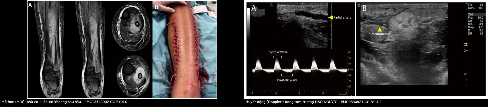
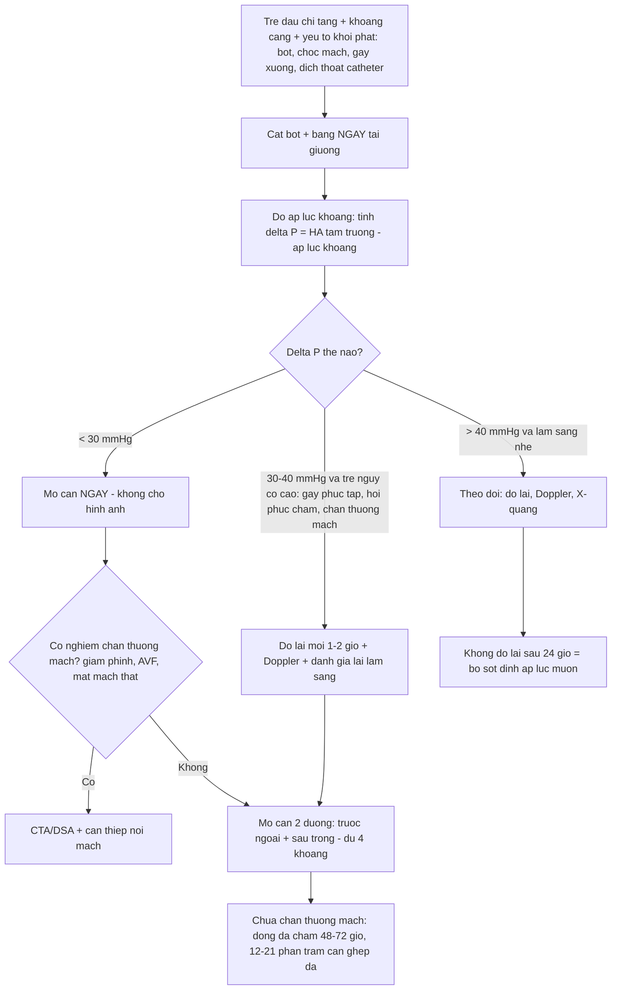
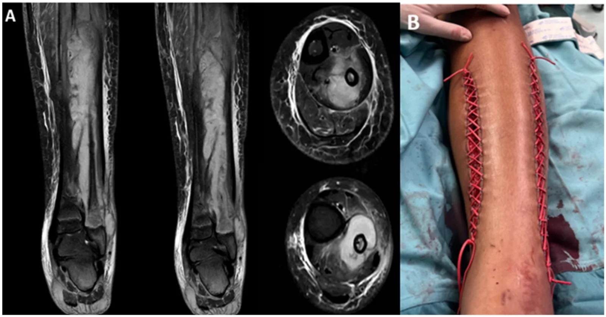
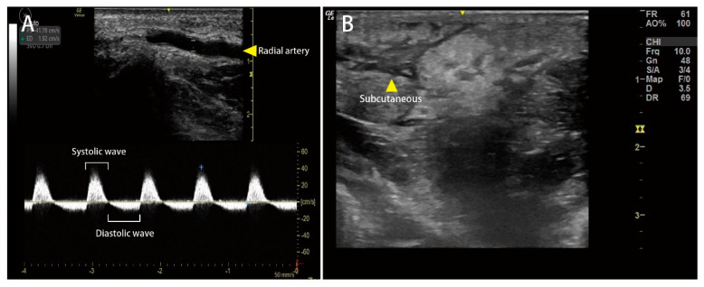
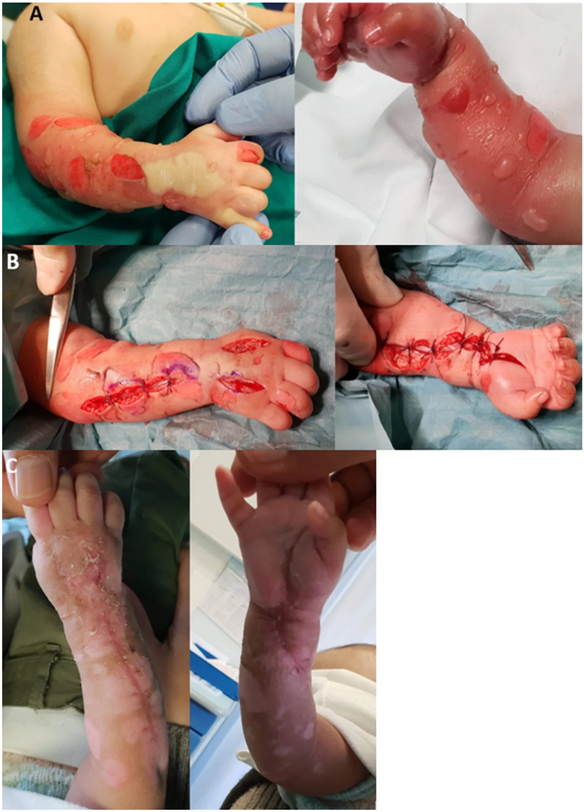

# 3125 — Hội chứng chèn ép khoang cấp ở trẻ (acute compartment syndrome, ACS): chẩn đoán bằng **hiệu áp**, không bằng "mất mạch"

**Tags:** `pattern:phu-co-khoang` `pattern:giam-tuoi-mau-co` `pattern:dao-chieu-tam-truong` `pattern:mat-pho-dong-mach` `vung:chi-duoi` `vung:canh-tay` `anatomy:khoang-can-chi` `protocol:sieu-am-Doppler` `protocol:MRI-chi` `protocol:do-ap-luc-khoang` `protocol:XR-chi` `score:delta-pressure`
**Mức chắc chắn (certainty):** tổng hợp y văn (literature synthesis) — ghép **một tổng quan nhi khoa 2026** về ACS trẻ em (có ảnh MRI + ảnh lâm sàng sau mở cân, **PMC13542002**, CC BY 4.0), **một ca Doppler dự báo ACS sau rắn cắn** (Medicina 2022, **PMC9330921**, CC BY 4.0) và **hai ca ACS chi trên sau can thiệp mạch** (Cureus 2026, **PMC13615642**). Không có ca do nhóm tự chụp.

> **Câu hỏi thực hành:** bé **9 tuổi** gãy trên lồi cầu xương cánh tay **kèm gãy cả hai xương cẳng tay cùng bên**, đã nắn bột 6 giờ trước. Bé **khóc không yên**, đòi tăng liều giảm đau liên tục; **mạch quay vẫn rõ**, đầu chi **hồng**, SpO₂ bình thường. Câu hỏi: **chờ thêm hay mở bột — và chụp gì bây giờ?**
> Bài chốt **ba quyết định**: **(1) "còn mạch" KHÔNG loại trừ ACS** — mạch còn vì áp lực động mạch vẫn cao hơn áp lực khoang, trong khi **tĩnh mạch và mao mạch đã sập**; **(2) chốt chẩn đoán là hiệu áp ΔP = huyết áp tâm trương − áp lực khoang**, ngưỡng mổ **ΔP < 30 mmHg**, và ở trẻ **có thể đã hoại tử cơ khi ΔP mới < 20 mmHg**; **(3) cắt bột/băng là can thiệp đầu tiên tại giường, không chờ chẩn đoán hình ảnh** — cắt bột giảm **40–60%** áp lực, cắt luôn lớp băng dưới giảm tới **80%**.

## 1. Tổng quan bệnh học – cơ chế hình ảnh: vì sao mất tĩnh mạch trước, mất mạch sau

- **Chuỗi sập theo thứ tự áp lực (giải thích toàn bộ bệnh cảnh):** trong khoang cân kín, áp lực tăng → **tĩnh mạch lympho và tĩnh mạch nhỏ (áp lực thấp ~10–15 mmHg) sập trước** → ứ máu, phù thêm → **mao mạch sập** → thiếu máu cơ, trong khi **động mạch (áp lực 80–120 mmHg) vẫn đẩy được máu** → **mạch mu chân/mạch quay vẫn bắt được**. Vì vậy **"mất mạch" là dấu hiệu MUỘN**, xuất hiện khi ΔP gần bằng 0 — lúc đó cơ đã hoại tử.
- **Công thức duy nhất cần nhớ:** **ΔP (delta pressure) = huyết áp tâm trương − áp lực khoang**. Đây là **áp lực tưới máu mao mạch thực tế**, không phải áp lực khoang tuyệt đối.
  - **ΔP < 30 mmHg → ngưỡng mở cân** (chuẩn người lớn, đã dùng cho trẻ).
  - **ΔP < 20 mmHg → trẻ có thể vẫn "im lặng" trong khi cơ đã thiếu máu** (PMC13542002) — nghĩa là **ngưỡng 30 mmHg ở trẻ là ngưỡng muộn, không phải ngưỡng sớm**.
  - **ΔP < 40 mmHg → ngưỡng "hung hăng"** được đề xuất cho nhóm nguy cơ cao ở trẻ, để cứu mô chưa hoại tử (PMC13542002).
  - **Áp lực khoang nghỉ bình thường: trẻ 6,0 mmHg vs người lớn 5,7 mmHg** (PMC13542002) — chênh rất ít, nhưng **huyết áp tâm trương của trẻ thấp hơn** nên **cùng một áp lực khoang, trẻ có ΔP nhỏ hơn**; đây là lý do **ngưỡng tuyệt đối 15 mmHg của Pedowitz (dành cho người lớn) KHÔNG dùng cho trẻ** — đưa vào trẻ sẽ **dương tính giả rất cao** ở vận động viên nhỏ tuổi khỏe mạnh (PMC13542002).
- **Vì sao thần kinh và cơ chết trước da:** sợi trục **không có dự trữ năng lượng** và nhạy với thiếu oxy hơn nguyên bào sợi; cơ vân chịu được **~4 giờ** thiếu máu ấm trước khi hoại tử không hồi phục, còn **dây thần kinh ngoại biên chỉ 1–2 giờ** đã mất dẫn truyền. Thứ tự biểu hiện lâm sàng vì thế là: **đau tăng → dị cảm/giảm cảm → yếu cơ → mất mạch**, và **đau là dấu hiệu DUY NHẤT còn sớm**.
- **TẠI SAO trẻ khác người lớn — ba điểm định lượng:**
  1. **Áp lực khoang đạt đỉnh MUỘN hơn:** khoảng cách từ chấn thương tới đỉnh áp lực **có thể vượt 24 giờ** ở trẻ, lâu hơn người lớn (PMC13542002) → **một lần đo bình thường không loại trừ**, phải đo lặp lại.
  2. **Trẻ nhỏ không mô tả được đau:** **tăng nhu cầu giảm đau** là dấu hiệu **sớm nhất**, xuất hiện **vài giờ trước** khi có thay đổi thần kinh–mạch (PMC13542002). Trẻ **< 10 tuổi** có nhóm nguyên nhân khác hẳn: **tổn thương mạch, thấm dịch qua đường truyền, nhiễm trùng**; trẻ **≥ 14 tuổi**: **chấn thương năng lượng cao, gắng sức, thể thao**.
  3. **Trẻ chịu được ΔP thấp mà không phàn nàn** vì huyết áp nền thấp và mô non — **đừng chờ trẻ "đau dữ dội"** như mô tả trong sách người lớn.
- **Dịch tễ định lượng (PMC13542002):** **tới 85%** ACS do chấn thương, **~40%** do **gãy thân xương chày**; **gãy trên lồi cầu xương cánh tay + gãy cả hai xương cẳng tay cùng bên → nguy cơ ACS tuyệt đối 33%**. ACS **không do chấn thương (NFACS)**: **mạch máu là nguyên nhân hàng đầu, 28%**; **nhiễm trùng ~10%** (và **27%** ở nhóm **< 3 tuổi**); **thấm/thoát dịch qua catheter tĩnh mạch ngoại vi là nguyên nhân iatrogen hàng đầu**. NFACS bị chẩn đoán **trễ trung vị 48 giờ**, **hoại tử cơ 54%**, **hồi phục kém 56%** — so với **> 90%** ở ACS do gãy xương.

## 2. Mẫu hình + chẩn đoán phân biệt theo khoang (Gamut)

- **Mẫu hình cốt lõi:** **đau tăng không tương xứng + đau khi thụ động duỗi cơ trong khoang** (passive stretch pain) ở một chi có **yếu tố khởi phát rõ** (bột/băng, chọc mạch, gãy xương, dịch thoát qua catheter, nhiễm trùng, rắn cắn) — **kèm "mạch vẫn còn"**.
- **Gamut theo khoang (khoang nào cũng có, nhưng khác tần suất và hệ quả):**
  1. **Cẳng chân — 4 khoang, nơi hay gặp nhất:** **trước (anterior)** và **sau sâu (deep posterior)** là hai khoang **bị bỏ sót nhiều nhất**; **sau sâu** chỉ vào được bằng **đường rạch phía trong** (medial) — mở cân chỉ một bên da là **mở thiếu**.
  2. **Cẳng tay — khoang gấp (volar) là khoang tối cấp:** chèn ép kéo dài → **co cơ Volkmann, biến dạng cổ tay, mất chức năng bàn tay**; gãy trên lồi cầu + gãy cẳng tay cùng bên là **bộ đôi kinh điển**.
  3. **Đùi:** khoang lớn, dung tích lớn nên **dấu hiệu đến muộn** nhưng có **sốc giảm thể tích** do mất máu vào cơ; thường sau **chấn thương nặng, đặt catheter động mạch đùi**.
  4. **Bàn tay/bàn chân:** khoang nhỏ, nhiều khoang (bàn tay tới **10 khoang gian cốt**); **chọc mạch quay/mu chân** và **thấm dịch** là nguyên nhân hay gặp ở trẻ.
  5. **Cánh tay:** sau **chọc động mạch cánh tay** hoặc **băng ép quá chặt** sau lấy máu.
- **Gamut theo cơ chế ở trẻ (quan trọng hơn gamut theo vị trí):**
  - **Tăng thể tích trong khoang:** gãy xương, tụ máu, **thoát dịch/thuốc qua catheter tĩnh mạch (extravasation)**, **dịch truyền áp lực cao qua catheter nhỏ** (Cureus 2026, PMC13615642), chảy máu sau chọc mạch, rắn cắn.
  - **Giảm thể tích khoang:** **bột bó kín**, băng ép, garo, **tư thế kê chi không đúng trong mổ**.
  - **Thành khoang cứng hơn:** sẹo bỏng, xơ hóa sau xạ, **cân cơ dày ở trẻ vận động viên**.
- **Mnemonic 6 P (và thứ tự thời gian — điểm hay bị dạy sai):** **P**ain (sớm, tăng khi duỗi thụ động) → **P**ressure (căng khoang) → **P**aresthesia (dị cảm) → **P**allor → **P**aralysis (muộn) → **P**ulselessness (**muộn nhất, thường không bao giờ có**). **Ba chữ P cuối là dấu hiệu của chi sắp mất, không phải dấu hiệu để chẩn đoán.**

## 3. Bảng so sánh phân biệt (ma trận đối chiếu)

| Thực thể (entity) | Hình ảnh điển hình | Chốt vào (rule-in) | Chốt loại (rule-out) | Gợi ý xác nhận |
|---|---|---|---|---|
| **Chèn ép khoang cấp (ACS)** | X-quang: gãy xương/bột; **siêu âm Doppler: mất phổ tâm trương, dòng tâm trương ĐẢO NGƯỢC (DRAF), phù dưới da kiểu "sỏi cuội"**; MRI: **cơ tăng tín hiệu T2/STIR + không ngấm thuốc ở vùng hoại tử** | **ΔP < 30 mmHg** (trẻ: **< 40 mmHg** nếu nguy cơ cao) + **đau khi duỗi thụ động** + khoang căng cứng | **ΔP ≥ 30 mmHg đo đúng kỹ thuật, lặp lại bình thường**, không đau khi duỗi thụ động | Đo áp lực khoang **lặp lại**; **cắt bột/băng trước khi đo lại** |
| Viêm mô tế bào / viêm cơ (cellulitis, myositis) | Phù mô mềm **lan ngoài khoang**, da nóng đỏ, **không tôn trọng giới hạn cân**; MRI: phù cơ + **ngấm thuốc lan tỏa**, có thể áp-xe | **Sốt + ban đỏ lan rộng + CRP/bạch cầu tăng**, phù **vượt giới hạn khoang** | **Khoang căng cứng + đau khi duỗi thụ động + ΔP thấp** → không phải chỉ viêm mô tế bào | Siêu âm/ MRI; **đo ΔP** khi nghi ngờ |
| Huyết khối tĩnh mạch sâu (DVT) | Tĩnh mạch **không đè xẹp**, không có phổ; phù **toàn chi**, tím | **Phù đều cả chi + đau bắp chân + yếu tố nguy cơ huyết khối** | **Khoang căng cứng khu trú + đau khi duỗi thụ động** → nghĩ ACS | Siêu âm ép (compression US); D-dimer |
| Tắc động mạch cấp (thrombosis/embolism) | **Mất phổ hoàn toàn** cả tâm thu; chi **trắng, lạnh**, **mất mạch thật sự** | **Mất mạch + chi trắng lạnh đột ngột + rung nhĩ/chấn thương mạch** | **Mạch còn + chi hồng ấm** → không phải tắc động mạch đơn thuần | CTA/ DSA; Doppler |
| **Chấn thương động mạch do chọc mạch (pseudoaneurysm, AVF, tụ máu)** | **Giả phình: túi ngấm thuốc thì động mạch, giữ hình thì muộn**; **AVF: tĩnh mạch ngấm SỚM**; tụ máu: khối hỗn hợp âm | **Khối đập theo mạch + tiếng thổi + chọc mạch gần đây** | **Không có khối mạch máu** → ACS do nguyên nhân khác | **Doppler màu + CTA**; đây là **nguyên nhân song hành**, không loại trừ ACS |
| Tiêu cơ vận (rhabdomyolysis) | **Không có hình ảnh khoang đặc hiệu**; MRI có thể phù cơ lan tỏa | **CK tăng rất cao, myoglobin niệu, AKI** | **Khoang căng cứng khu trú + ΔP thấp** → ACS thật, không chỉ tiêu cơ | CK, myoglobin, điện giải; **đừng để CK cao làm bỏ qua ΔP** |
| Rách cơ / tụ máu trong cơ | Siêu âm: khối **hỗn hợp âm–tăng âm** trong bụng cơ, **không có phổ bất thường** | **Đau khu trú sau gắng sức/chấn thương nhẹ, ΔP bình thường** | **ΔP < 30 mmHg** → không phải chỉ tụ máu | Siêu âm lặp lại **6–12 giờ**; MRI nếu chưa rõ |
| Chèn ép khoang mạn khi gắng sức (CECS) | Áp lực **chỉ tăng sau gắng sức**, **hồi phục khi nghỉ**; không có tổn thương cấp trên MRI | **Đau khi chạy, hết khi nghỉ, tái diễn nhiều tháng, áp lực nghỉ bình thường** | **Đau liên tục + ΔP thấp khi nghỉ** → ACS cấp | Đo áp lực **trước/sau gắng sức**; **không mổ cấp cứu** |
| Phản ứng tại chỗ sau rắn cắn | Phù, bọng nước, **DRAF có thể DƯƠNG TÍNH** | **Vết răng nanh + phù tiến triển nhanh + DRAF** | **DRAF đơn độc không chốt ACS** — cần ΔP + lâm sàng | Đo ΔP; **kháng nọc đặc hiệu là điều trị đầu** |

*Trái: **MRI cẳng chân** — cơ khoang sau sâu **tăng tín hiệu, phù nề** kèm ổ áp-xe trong khoang; (B) sau mở cân + làm sạch, **đóng da kiểu "dây giày" (shoelace)** bằng vessel loop siết mỗi 48 giờ. Phải: **Doppler động mạch quay** — **sóng tâm thu xuôi dòng bình thường**, nhưng **sóng tâm trương nằm TRÊN đường nền (đảo ngược dòng)** = **DRAF (diastolic retrograde arterial flow)**, tức giường mạch hạ lưu bị ép; kèm hình **phù dưới da kiểu sỏi cuội**. Nguồn: PMC13542002 và PMC9330921, đều **CC BY 4.0**. Ảnh ghép letterbox, không crop/kéo giãn.*

### Vì sao dòng tâm trương ĐẢO NGƯỢC lại là dấu hiệu của chèn ép
- Trong thì **tâm thu**, áp lực động mạch **cao hơn** áp lực khoang nên máu vẫn đi xuôi → **sóng tâm thu bình thường** (đó là lý do **mạch vẫn bắt được**).
- Trong thì **tâm trương**, áp lực động mạch xuống thấp (**~40 mmHg ở trẻ**), **thấp hơn áp lực khoang đang tăng** → **dòng chảy đảo ngược** về phía gần. Trên phổ Doppler, **sóng tâm trương nằm trên đường nền**.
- **Ngưỡng thực nghiệm:** ở người khỏe mạnh, **DRAF xuất hiện khi bơm cuff 40 mmHg** — tức **bằng huyết áp tâm trương/áp lực động mạch trung bình** (Medicina 2022, PMC9330921). Con số này khớp chính xác với **ΔP → 0**, và giải thích vì sao **DRAF là dấu hiệu SỚM hơn mất mạch**.
- **Cạm bẫy:** DRAF **không đặc hiệu cho ACS** — **phù dưới da nặng** ở chi xa (bàn tay, cổ tay) cũng gây DRAF, và **ép một phần động mạch** cũng đủ gây DRAF (PMC9330921). Vì vậy **DRAF = chuông báo, ΔP = quyết định**.

## 4. Protocol chụp + phân tầng theo ΔP

- **Bước 0 — tại giường, trước mọi hình ảnh (0–10 phút):**
  - **Cắt toàn bộ bột và lớp băng dưới** nếu có: cắt bột giảm **40–60%** áp lực khoang, **cắt luôn lớp băng dưới giảm tới 80%** (PMC13542002). Đây là **can thiệp điều trị**, không phải "chuẩn bị chụp".
  - **Đặt chi ngang tim** (không kê cao — kê cao làm giảm ΔP), **không garo**, **bù dịch**, **giảm đau** nhưng **ghi lại lượng giảm đau đang tăng** vì đó là dấu hiệu sớm.
- **Bước 1 — đo áp lực khoang (gold standard, không thay thế được):**
  - Đo **trong khoang nghi ngờ, cách ổ gãy ≤ 5 cm**, **tránh đo vào khối tụ máu**; đo **cả khoang đối diện** ở cẳng chân (trước + sau sâu).
  - Ghi **ΔP**, không chỉ ghi áp lực tuyệt đối; **đo lặp lại mỗi 1–2 giờ** trong 24 giờ đầu vì **áp lực đạt đỉnh muộn ở trẻ**.
- **Bước 2 — hình ảnh (làm song song, KHÔNG được làm chậm mở cân):**
  - **X-quang chi:** xác nhận gãy xương, vị trí bột, di lệch — rẻ, nhanh, có sẵn; **không loại trừ ACS**.
  - **Siêu âm Doppler tại giường:** **phổ tâm trương đảo ngược/mất phổ tâm trương**, **tăng chỉ số sức cản (RI)**, **phù dưới da "sỏi cuội"**, **khoang căng, cơ không đè xẹp**. Ưu điểm: **không cần an thần, lặp lại được**, dùng đúng ở trẻ.
  - **CT có cản quang:** khi cần **loại trừ chấn thương mạch** (giả phình, AVF, rách mạch) hoặc **đánh giá xương phức tạp**; dấu ACS: **cơ căng, giảm ngấm thuốc, mất mặt phẳng mỡ, tụ máu trong khoang**.
  - **MRI:** **T2/STIR cơ tăng tín hiệu** (phù), **vùng không ngấm thuốc = hoại tử**; vai trò chính là **khi chẩn đoán còn mơ hồ** hoặc **đánh giá di chứng** — **không dùng để quyết định có mổ hay không**.
- **Bước 3 — mở cân (fasciotomy):**
  - **Rạch da dài 10–15 cm + rạch cân TOÀN BỘ chiều dài khoang**, không rạch nhỏ "lấy thì"; cẳng chân cần **2 đường (trước ngoài + sau trong)** để mở **cả 4 khoang**.
  - **Chỉ định:** **ΔP < 30 mmHg** (trẻ nguy cơ cao: **< 40 mmHg**) + lâm sàng phù hợp; **hoặc** chi đã có **yếu cơ/mất cảm giác**.
  - **Sau mở:** **đóng da chậm sau 48–72 giờ**; **12–21%** cần **ghép da mỏng** hoặc **giãn da** vì phù không cho đóng (PMC13542002).
  - **Trẻ có thể vẫn hồi phục tốt dù mở cân muộn 72–119 giờ** — nhiều ca được báo cáo **không nhiễm trùng sau mổ** — nhưng **không vì thế mà trì hoãn**.

## 5. Biến thể bình thường và cạm bẫy

- **"Mạch còn nên chưa phải ACS" — sai lầm chết người số 1.** Mạch còn vì **áp lực động mạch vẫn > áp lực khoang trong thì tâm thu**; **tĩnh mạch và mao mạch đã sập**. Trẻ có thể **mất cơ hoàn toàn mà mạch quay/mạch mu chân vẫn rõ**.
- **"Đau là do gãy xương, cho thêm giảm đau" — sai lầm số 2.** **Nhu cầu giảm đau TĂNG dần** là **dấu hiệu sớm nhất**, xuất hiện **vài giờ trước** thay đổi thần kinh–mạch (PMC13542002). Tăng liều giảm đau để "bệnh nhân dễ chịu" có thể **che mất cửa sổ vàng**.
- **Ngưỡng tuyệt đối 15–30 mmHg áp dụng máy móc cho trẻ:** **Pedowitz 15 mmHg** là ngưỡng **người lớn, CECS** → ở trẻ khỏe mạnh cho **dương tính giả rất cao**; còn **30 mmHg tuyệt đối** bỏ qua việc **trẻ có huyết áp tâm trương thấp** → **âm tính giả**. Luôn tính **ΔP**.
- **Đo một lần rồi kết luận:** ở trẻ **áp lực đạt đỉnh có thể sau 24 giờ** → **một lần đo bình thường không loại trừ**; phải **đo lặp lại** và **đo lại sau khi cắt bột**.
- **Chỉ mở một khoang:** **khoang sau sâu cẳng chân** và **khoang gian cốt bàn tay** hay bị bỏ; mở cân **một đường da** ở cẳng chân **gần như chắc chắn thiếu**.
- **Chờ MRI/CT rồi mới mổ:** hình ảnh **không phải cửa quyết định**; **ΔP + lâm sàng** là cửa quyết định. Đưa trẻ đi CT trong lúc khoang đang chèn ép = **mất thêm 30–60 phút thiếu máu**.
- **DRAF dương tính = ACS:** **không** — phù dưới da nặng, ép một phần động mạch, thậm chí **rắn cắn** đều gây DRAF (PMC9330921). DRAF giúp **phát hiện sớm và theo dõi**, **không thay ΔP**.
- **Bỏ qua nguyên nhân mạch máu song hành:** sau **chọc mạch**, ACS có thể đi kèm **giả phình/AVF/tụ máu** (PMC13615642) — **mở cân không chữa được giả phình**, cần **CTA và can thiệp nội mạch**.
- **Tư thế và garo:** **kê cao chi làm giảm ΔP**; **garo làm thiếu máu nặng thêm**; không garo khi nghi ACS.
- **Trẻ sơ sinh/trẻ nhỏ:** đường truyền **tĩnh mạch ngoại vi + nẹp + băng** ở cẳng tay là **bối cảnh iatrogen kinh điển** (ca nguyên văn trong PMC13542002: **trẻ 3 tuần tuổi**, đường truyền cẳng tay quấn nẹp và băng → ACS, phải mở cân). Ở nhóm này **không có "đau khi duỗi thụ động" để hỏi** — phải **nhìn, sờ độ căng khoang, so hai bên, và đo ΔP**.

## 6. Tự lượng giá — Blind Quiz

**Ca 1 — Bé 12 tuổi, tiền sử bong gân cổ chân, đau cẳng chân tăng dần. Nhìn ảnh trước, mô tả sau.**

- Gợi ý lâm sàng: đau nhiều hơn mức giải thích bởi "bong gân", cẳng chân căng, sốt nhẹ.
- Câu hỏi: Khoang nào bị tổn thương (A)? Vì sao **nhiễm trùng** lại gây chèn ép khoang? (B) chứng minh điều gì về đường mổ?

<b>Bấm để hiện đáp án (findings + chẩn đoán)</b>

- Dấu hiệu: (A) **MRI** — cơ **khoang sau sâu** tăng tín hiệu lan tỏa (phù) + **ổ áp-xe trong khoang**; viêm cân nông và sâu.
- Chẩn đoán: **ACS do nhiễm trùng** (viêm tủy xương mác + áp-xe khoang sau sâu) — nhiễm trùng chiếm **~10%** NFACS và **27%** ACS ở trẻ **< 3 tuổi** (PMC13542002).
- (B) cho thấy **hai đường rạch (trong và ngoài)** + **đóng da kiểu dây giày siết mỗi 48 giờ** — chứng minh phải **mở đủ khoang** rồi **đóng chậm**, không khâu kín ngay.
- Nguồn: PMC13542002, CC BY 4.0.

**Ca 2 — Nam 61 tuổi bị rắn lục cắn ở cổ tay trái 1 giờ, tay sưng nhanh. Siêu âm tại giường.**

- Câu hỏi: Sóng tâm trương bất thường thế nào? Vì sao **tâm thu bình thường mà tâm trương đảo**? Dấu hiệu này có đủ chốt ACS không?

<b>Bấm để hiện đáp án (findings + chẩn đoán)</b>

- Dấu hiệu: (A) **phổ Doppler động mạch quay** — **sóng tâm thu xuôi dòng bình thường**, **sóng tâm trương ở TRÊN đường nền** = **DRAF**; (B) **phù dưới da kiểu sỏi cuội** (cobblestone) do phù.
- Vì sao: **tâm thu** áp lực động mạch > áp lực khoang → xuôi dòng; **tâm trương** áp lực động mạch (~40 mmHg) < áp lực khoang → **đảo dòng**. Ở người khỏe mạnh DRAF xuất hiện khi bơm cuff **40 mmHg** — trùng ngưỡng **ΔP ≈ 0**.
- **Không đủ chốt:** DRAF **không đặc hiệu** (phù dưới da nặng, ép một phần động mạch cũng gây) — phải **đo ΔP** và điều trị **kháng nọc** trước.
- Nguồn: Medicina 2022 (PMC9330921), CC BY 4.0.

**Ca 3 — Trẻ 3 tuần tuổi, đường truyền tĩnh mạch ở cẳng tay được cố định bằng nẹp và băng.**

- Câu hỏi: Vì sao **nẹp + băng** quanh một catheter **tĩnh mạch** lại gây chèn ép khoang? Trẻ sơ sinh biểu hiện gì thay cho "đau khi duỗi thụ động"?

<b>Bấm để hiện đáp án (findings + chẩn đoán)</b>

- Dấu hiệu: (A) trước mổ — chi **căng, tím, phù**, vết băng/nẹp quanh vị trí đường truyền; (B) sau **mở cân** — mô mềm hở, tưới máu cải thiện; (C) sau **1 tháng** đóng da.
- Cơ chế: **giảm thể tích khoang** (nẹp + băng) cộng **tăng thể tích** (thấm dịch qua catheter) → áp lực khoang tăng; ở trẻ sơ sinh **chỉ cần băng chặt hơn một chút là đủ**.
- Trẻ sơ sinh **không báo đau**: dấu hiệu thay thế là **chi căng, tím, lạnh, ít cử động, bú kém, nhịp tim nhanh** — và **đo ΔP**.
- Nguồn: PMC13542002, CC BY 4.0.

## Bài liên quan chéo
- [3095 – Tổn thương động mạch đùi–chậu sau can thiệp nội mạch ở trẻ](../3095-ton-thuong-dong-mach-dui-sau-can-thiep-noi-mach-tre/lesson.md) (nguyên nhân mạch máu song hành, cỡ sheath)
- [900 – Đại cương IR & sinh thiết](../900-ir-fundamentals-biopsy/lesson.md) (biến chứng tại chỗ chọc)
- [3126 – Dị vật catheter/mảnh dụng cụ di trú trong lòng mạch ở trẻ](../3126-di-vat-catheter-trong-long-mach-tre/lesson.md) (cùng nhóm biến chứng dụng cụ nội mạch)
- [370 – Nhiễm trùng cơ xương khớp](../370-nhiem-trung-msk/lesson.md) (nhánh nhiễm trùng của NFACS)
- [1936 – Tụ máu bao cơ thẳng bụng](../1936-tu-mau-bao-co-thang-bung/lesson.md) (tụ máu trong khoang kín, cùng nguyên lý áp lực)
- [901 – Tổng quan can thiệp](../901-ir-overview/lesson.md) (bản đồ nhóm Can thiệp)

## Ảnh
- `images/3125_chen-ep-khoang_MRI_PMC13542002.jpg` — MRI + đóng da sau mở cân, **PMC13542002**, **CC BY 4.0**.
- `images/3125_chen-ep-khoang_LS_PMC13542002.jpg` — ảnh lâm sàng trẻ sơ sinh trước/sau mở cân, **PMC13542002**, **CC BY 4.0**.
- `images/3125_chen-ep-khoang_Doppler_PMC9330921.jpg` — Doppler DRAF, **PMC9330921**, **CC BY 4.0**.
- `images/composite_chen-ep-khoang.jpg` — ảnh ghép letterbox từ hai ảnh trên.
- Nguồn, giấy phép và ghi chú phái sinh từng ảnh: `images/CREDITS.md`.

> Không dùng để chẩn đoán độc lập khi chưa có người hướng dẫn.
