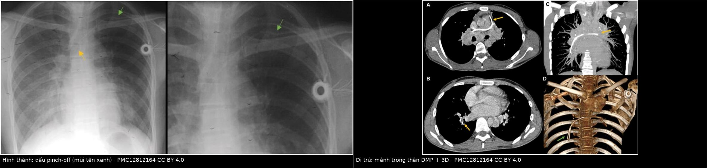
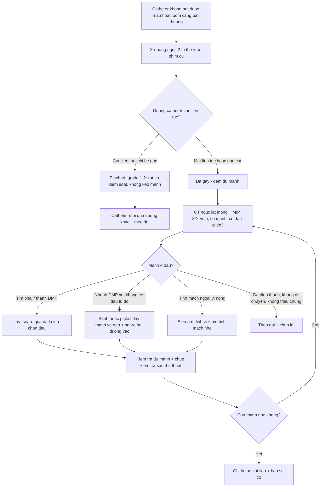
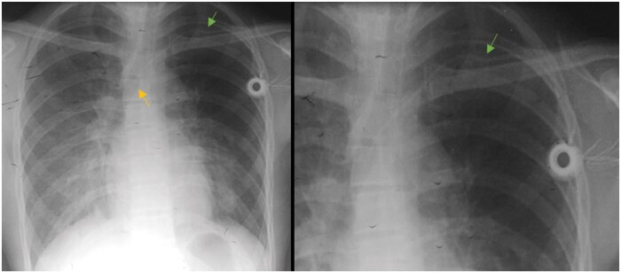
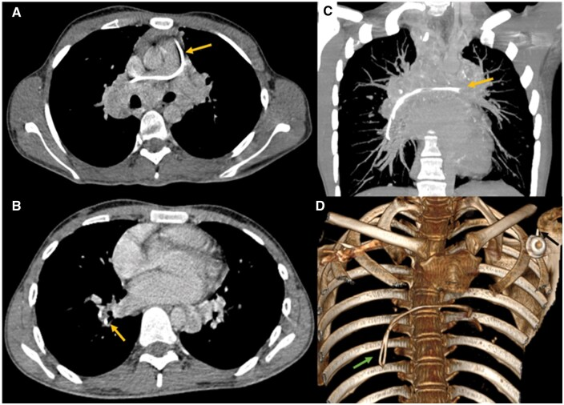
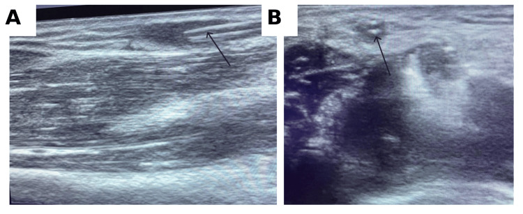
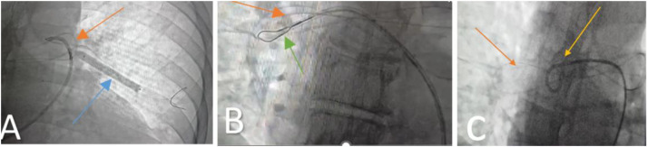

# 3126 — Dị vật catheter & mảnh dụng cụ di trú trong lòng mạch ở trẻ: dấu **pinch-off** trước, **mảnh trong động mạch phổi** sau

**Tags:** `pattern:di-vat-long-mach` `pattern:catheter-gay` `pattern:di-tru-dong-mach-phoi` `pattern:dau-pinch-off` `vung:nguc` `vung:tim` `vung:chi-tren` `anatomy:tinh-mach-chu-tren` `anatomy:dong-mach-phoi` `anatomy:tim-phai` `protocol:XR-nguc` `protocol:CT-nguc` `protocol:fluoro-DSA` `protocol:sieu-am-mach` `score:Hinke-pinch-off`
**Mức chắc chắn (certainty):** tổng hợp y văn (literature synthesis) — ghép **một ca hội chứng pinch-off gây gãy catheter, có X-quang và CT 3D** (BJR Case Reports 2025/2026, **PMC12812164**, CC BY 4.0), **một ca mảnh catheter tĩnh mạch ngoại vi lưu trong lòng mạch, định vị bằng siêu âm** (Cureus 2026, **PMC13152028**, CC BY 4.0), **một ca mảnh PICC trôi vào động mạch phổi được lấy bằng snare hai đường vào** (Radiology Case Reports 2026, **PMC13330607**, CC BY-NC-ND 4.0) và **một ca sơ sinh gãy catheter rốn di trú vào nhĩ trái** (Radiology Case Reports 2024, **PMC10825532**, CC BY 4.0). Không có ca do nhóm tự chụp.

> **Câu hỏi thực hành:** bé gái **4 tuổi** đang hóa trị, có **buồng tiêm truyền dưới đòn trái** đặt 8 tháng. Hôm nay y tá **không hút được máu về**, bơm rửa thấy **căng tay**. Chụp X-quang ngực kiểm tra: **đầu catheter vẫn nằm ở tĩnh mạch chủ trên**, nhưng **đoạn catheter ở cửa ngực bị bẻ góc**. Câu hỏi: **đây là catheter "lệch" hay đã gãy — và bước tiếp theo là gì?**
> Bài chốt **ba quyết định**: **(1) mọi catheter không hút được máu phải tìm dấu pinch-off, không chỉ nhìn đầu catheter**; **(2) X-quang 2 tư thế là cửa đầu, nhưng CT có dựng 3D mới trả lời "còn liền hay đã đứt"**; **(3) mảnh đã đứt phải tìm ĐỦ SỐ MẢNH, và mảnh ở tim phải/động mạch phổi có chỉ định lấy** — snare qua da là lựa chọn đầu, nhưng **mảnh không có đầu tự do thì snare đơn thuần thất bại**.

## 1. Tổng quan bệnh học – cơ chế hình ảnh: vì sao catheter gãy ở đúng một chỗ

- **Tần suất — hai con số nền:** gãy và di trú mảnh catheter xảy ra ở **< 1%** các ca đặt PICC (Radiology Case Reports 2026, PMC13330607), nhưng **gần như chắc chắn bị báo cáo thiếu** vì phần lớn chỉ có ca lẻ; với **catheter tĩnh mạch ngoại vi (PIVC)** thì **rất hiếm và cũng báo cáo thiếu** (Cureus 2026, PMC13152028). Con số nhỏ **không** cho phép chủ quan: hậu quả gồm **huyết khối, nhiễm khuẩn huyết, loạn nhịp, thủng tim, thuyên tắc phổi**.
- **Ba cơ chế gãy (quyết định vị trí gãy trên phim):**
  1. **Chèn ép giữa xương đòn và xương sườn 1 — hội chứng pinch-off (pinch-off syndrome, POS).** Catheter đi qua **cửa ngực (thoracic inlet)** bị **kẹp như kéo cắt** giữa xương đòn và sườn 1 khi vai di chuyển → **mòn → gãy**. Đây là cơ chế **hay gặp nhất ở catheter dưới đòn**, và **nhìn thấy được trên X-quang** nếu tìm đúng chỗ (PMC12812164).
  2. **Gãy do thao tác:** **luồn lại kim mồi (introducer needle) vào lòng catheter đang nằm trong mạch** để "chỉnh" — cắt đứt catheter; hoặc **kéo catheter khi còn lực cản** (Cureus 2026, PMC13152028). Đây là cơ chế **phòng được**, và là lý do **không bao giờ rút catheter khi thấy căng**.
  3. **Mỏi vật liệu tại điểm cố định/gập góc:** catheter **gập góc ở cổ** hoặc **đi qua khớp** (vùng bẹn, khuỷu) → gãy sau nhiều tháng, thường **im lặng** cho tới khi mảnh trôi.
- **TẠI SAO nhìn thấy trên X-quang/CT:** catheter mạch máu thường **phối hợp barium sulfate hoặc tungsten** trong polyurethane/silicone → **cản quang rõ, đậm hơn mô mềm**, nên một **đường 1–2 mm** vẫn thấy được trên phim ngực. Trên CT, catheter là **cấu trúc đậm độ cao, tròn đều, cắt ngang hình chấm** — dựng **MIP/3D** cho thấy toàn bộ đường đi và **điểm đứt** rõ hơn phim thẳng.
- **TẠI SAO có mảnh KHÔNG thấy:** catheter **polyurethane không phối hợp chất cản quang** (một số PIVC, catheter động mạch) **gần như đồng đậm với mô mềm** → **X-quang âm tính không loại trừ**; khi đó **siêu âm** là cửa đúng: mảnh nằm trong lòng mạch hiện là **cấu trúc đường thẳng tăng âm trong lòng mạch, có viền âm** (Cureus 2026, PMC13152028).
- **TẠI SAO mảnh trôi về TIM PHẢI và ĐỘNG MẠCH PHỔI — vật lý dòng chảy:** mảnh nằm trong **tĩnh mạch hệ thống** bị dòng máu **kéo về phía áp lực thấp**: tĩnh mạch chủ trên → **nhĩ phải → thất phải → động mạch phổi**. Đường kính động mạch phổi **giảm dần** nên mảnh **kẹt ở nhánh A3–A6**; đây là lý do mảnh "biến mất" khỏi tim và **không thấy nữa** trên phim ngực nếu không chụp CT.
- **Đường "nghịch thường" — vì sao trẻ sơ sinh đặc biệt nguy hiểm:** ở thai nhi và sơ sinh, **lỗ bầu dục (foramen ovale) còn mở**. Mảnh từ **tĩnh mạch rốn → ống tĩnh mạch → nhĩ phải** có thể **xuyên qua lỗ bầu dục sang nhĩ trái → thất trái → động mạch chủ**; ca nguyên văn ghi nhận mảnh catheter rốn đi **từ nhĩ phải qua lỗ bầu dục vào nhĩ trái rồi tới tĩnh mạch phổi trên trái** (Radiology Case Reports 2024, PMC10825532). Ở trẻ lớn, chỉ cần **PFO/ASD tồn tại** là đủ để mảnh thành **thuyên tắc hệ thống (đột quỵ, thiếu máu chi)**.
- **Vì sao mảnh "nằm im" nhiều tháng:** mảnh **dính vào thành tĩnh mạch** và được **nội mạc hóa (endothelialization)** — đây chính là cơ sở để một số tác giả cho rằng **mảnh không triệu chứng, dính thành mạch có thể theo dõi** thay vì lấy (PMC12812164). Nhưng **mảnh còn tự do trong tim/động mạch phổi thì không có cơ chế "dính"** — nguy cơ loạn nhịp, thủng, thuyên tắc vẫn tiếp diễn.

## 2. Mẫu hình + chẩn đoán phân biệt theo vị trí mảnh (Gamut)

- **Mẫu hình cốt lõi:** **catheter đang dùng đột nhiên "hỏng chức năng"** (không hút được máu, bơm rửa căng, không bơm được) **+ một đường cản quang bất thường hoặc mất liên tục** trên phim kiểm tra — **hoặc** một **mảnh cản quang mới xuất hiện** ở tim/động mạch phổi ở bệnh nhân từng đặt catheter.
- **Gamut theo vị trí mảnh (quyết định cách xử trí):**
  1. **Tại chỗ chọc/cửa ngực — còn liền:** **pinch-off grade 1–2**, chưa đứt → **tháo catheter có kiểm soát, không kéo mạnh**; đây là lúc **chữa được bằng cách rút**.
  2. **Tĩnh mạch chủ trên — đã đứt, còn gần:** mảnh **ngắn, đầu tự do**, dễ lấy bằng **snare**; nguy cơ trôi tiếp nếu chờ.
  3. **Nhĩ/thất phải — mảnh tự do:** nguy cơ **loạn nhịp, thủng, vướng van ba lá**; chỉ định **lấy** rõ nhất.
  4. **Động mạch phổi — mảnh đã trôi xa:** thường **không có đầu tự do**, **snare đơn thuần thất bại**; cần **bóng/pigtail đẩy mảnh về vị trí lấy được** rồi snare (Radiology Case Reports 2026, PMC13330607).
  5. **Tim trái / tuần hoàn hệ thống (qua PFO/ASD):** nguy cơ **đột quỵ, thiếu máu chi, nhồi máu tạng**; ca sơ sinh lấy mảnh **từ tĩnh mạch phổi trái qua lỗ bầu dục** bằng snare 6 Fr (PMC10825532).
  6. **Tĩnh mạch ngoại vi (PIVC):** mảnh **ngắn, nông**, định vị bằng **siêu âm**, lấy bằng **mở tĩnh mạch nhỏ dưới gây tê tại chỗ** (Cureus 2026, PMC13152028).
- **Gamut theo hình dạng mảnh trên phim:** **đường thẳng liên tục** (bình thường) → **bẻ góc nhọn tại một điểm** (pinch-off grade 1–2) → **mất liên tục + hai đầu vát** (đã đứt) → **mảnh cong/xoắn trong buồng tim** (đã trôi, thường ở động mạch phổi).

## 3. Bảng so sánh phân biệt (ma trận đối chiếu)

| Thực thể (entity) | Hình ảnh điển hình | Chốt vào (rule-in) | Chốt loại (rule-out) | Gợi ý xác nhận |
|---|---|---|---|---|
| **Mảnh catheter gãy trong lòng mạch** | **Đường cản quang 1–2 mm, đậm độ kim loại nhưng thấp hơn**, có **hai đầu vát**, nằm dọc lòng mạch; CT: **chấm đậm trong lòng mạch**, 3D thấy rõ | **Catheter mất chức năng đột ngột + mất liên tục trên phim + mảnh di chuyển giữa 2 lần chụp** | **Catheter còn liên tục từ đầu tới cuối** (kể cả bị bẻ góc) → chưa gãy | **X-quang 2 tư thế + CT 3D**; **so phim cũ** |
| Catheter còn nguyên nhưng **lệch vị trí (malposition)** | Đầu catheter **ở tĩnh mạch đối diện, tĩnh mạch trên gan, nhĩ phải**, nhưng **liên tục** | **Đầu catheter sai vị trí + đường đi liên tục + vẫn bơm rửa được** | **Mất liên tục / mảnh thứ hai** → đã gãy | Rút/chỉnh dưới fluoroscopy, **không kéo mù** |
| **Pinch-off grade 1–2 (chưa đứt)** | **Bẻ góc hoặc hẹp lòng** tại cửa ngực giữa **xương đòn và sườn 1**; không có mảnh tự do | **Điểm hẹp đúng vị trí giải phẫu + catheter còn dùng được nhưng hút kém** | **Mảnh tự do ở tim/ĐMP** → đã grade 3 | X-quang **thì hít vào + vai đổi tư thế**; CT 3D |
| **Huyết khối vôi hóa / sỏi tĩnh mạch (phlebolith)** | **Cấu trúc tròn, vôi hóa đồng tâm**, thường ở tiểu khung; **không đổi vị trí** | **Vôi hóa tròn đều + không liên quan catheter** | **Hình dạng ống thẳng, hai đầu vát + tiền sử catheter** → dị vật | CT không cản quang (đo HU > 200 = vôi) |
| **Clip phẫu thuật / ghim / coil / stent** | **Kim loại đậm, có hình dạng xác định** (clip chữ V, coil xoắn, stent lưới), **dính mô** | **Tiền sử mổ/đặt dụng cụ + hình dạng đúng chủng loại** | **Hình ống trơn + mảnh thứ hai ↔ khớp với catheter thiếu đoạn** | Hiểu rõ vật liệu đã cấy; CT |
| **Dị vật do chấn thương (đạn, mảnh kính, kim)** | **Kim loại rất đậm kèm đường đi tổn thương**, có **diện chấn thương** | **Vết thương vào + đường đi của dị vật** | **Không có diện chấn thương + tiền sử đặt catheter** | X-quang 2 tư thế + CT |
| **Mảnh catheter KHÔNG cản quang (polyurethane trơn)** | **X-quang ÂM TÍNH**; siêu âm: **đường thẳng tăng âm trong lòng mạch** | **Đầu catheter ngoài da thiếu một đoạn + siêu âm thấy cấu trúc trong lòng mạch** | **Siêu âm lòng mạch trống, hai đầu catheter khớp nhau** → không gãy | **Siêu âm đầu dò thẳng tần số cao**; nếu cần, **fluoroscopy khi bơm cản quang** |
| **Giả ảnh ngoài cơ thể (dây, khóa, nếp quần áo)** | **Đường thẳng đậm nằm NGOÀI lồng ngực**, **không theo trục mạch** | **Đổi tư thế/chụp lại thì mất** | **Vẫn cố định đúng trục mạch khi chụp lại** → dị vật thật | Chụp lại sau khi bỏ vật ngoài; **luôn chụp 2 bình diện** |

*Trái: **X-quang ngực thẳng** — (A) đầu catheter đúng vị trí tĩnh mạch chủ trên (mũi tên vàng), catheter **bị kẹp ở cửa ngực** giữa xương đòn và sườn 1 (mũi tên xanh) = **dấu pinch-off**; (B) lần chụp sau, **đoạn catheter tại điểm kẹp đã mất** — đã đứt và trôi. Phải: **CT ngực** — (A) mặt cắt ngang: **mảnh catheter trong thân động mạch phổi lan sang động mạch phổi phải** (mũi tên vàng); (B) mặt cắt thấp hơn: mảnh trong nhánh động mạch phổi phải; (C) **MIP coronal** thấy toàn bộ mảnh; (D) **dựng 3D xương–mảnh** cho thấy mảnh nằm trong lồng ngực, tách khỏi catheter ngoài da (mũi tên xanh). Nguồn: BJR Case Reports (PMC12812164), **CC BY 4.0**. Ảnh ghép letterbox, không crop/kéo giãn.*

### Vì sao "hút máu không về" lại là dấu hiệu của gãy catheter
- **Catheter gãy nhưng đầu gần còn trong mạch** → **bơm rửa vẫn được** (dịch đi ra ngoài qua đầu gãy vào tĩnh mạch) nhưng **hút không về** (không tạo được áp lực âm trong lòng catheter) — dấu hiệu **rất hay bị quy cho "catheter tắc"** và dẫn tới **bơm rửa mạnh bằng xy-lanh nhỏ**, làm **mảnh trôi xa hơn**.
- **Bơm rửa thấy căng** (không bơm vào được) nghĩa là **đầu xa bị bịt** — có thể do **huyết khối** hoặc **catheter gập/gãy trong thành**. **Cả hai đều không được bơm mạnh.**
- Vì vậy: **"không hút được + bơm căng" = chụp phim kiểm tra TRƯỚC khi làm bất cứ thao tác nào khác**, và **ghi lại cả hai đầu catheter** (đầu ngoài da, đầu trong mạch) để đếm mảnh.

## 4. Protocol chụp + phân độ Hinke + chỉ định lấy

- **Bước 1 — X-quang ngực 2 tư thế (thẳng + nghiêng), có phim cũ để so:**
  - Đánh giá **toàn bộ đường đi** từ điểm vào da → cửa ngực → tĩnh mạch chủ trên → nhĩ phải; **tìm điểm bẻ góc/hẹp** tại **giữa xương đòn và sườn 1**.
  - **Đếm đầu catheter**: nếu **đầu ngoài da ngắn hơn ban đầu** hoặc **đầu trong mạch "cụt"** → nghi đã gãy; **không được kết luận "catheter bình thường" chỉ vì đầu còn ở tĩnh mạch chủ trên**.
- **Bước 2 — CT ngực (lát ≤ 1 mm) + dựng MIP/3D** khi phim không trả lời được: xác định **điểm đứt**, **số mảnh**, **vị trí mảnh** (tim phải, thân/nhánh động mạch phổi), và **mảnh có đầu tự do hay không** — yếu tố quyết định **snare được hay không** (PMC13330607).
- **Bước 3 — siêu âm** khi nghi **mảnh không cản quang** hoặc **mảnh ngoại vi nông**: đầu dò thẳng tần số cao, **mặt cắt dọc và ngang** xác nhận **cấu trúc trong lòng mạch**, đo **độ sâu** để chọn đường vào (PMC13152028). Siêu âm tim cũng cần để phát hiện **mảnh trong buồng tim** và **shunt phải–trái (PFO/ASD)**.
- **Bước 4 — lấy mảnh (qua da là lựa chọn đầu):**
  - **Snare (gooseneck/single-loop)**: hiệu quả khi mảnh **có đầu tự do**; ca sơ sinh lấy mảnh bằng **snare 6 Fr một quai** qua đường tĩnh mạch gan (PMC10825532).
  - **Khi snare thất bại vì mảnh không có đầu tự do:** dùng **bóng (5 × 40 mm)** hoặc **catheter pigtail** để **đẩy/đổi vị trí mảnh** về nơi lấy được — kỹ thuật **hai đường vào**: **pigtail đưa mảnh về tĩnh mạch chủ dưới**, rồi **snare qua tĩnh mạch cảnh trong phải** (PMC13330607).
  - **Mở tĩnh mạch nhỏ (venotomy)** cho mảnh **ngoại vi nông**: nhanh, an toàn, gây tê tại chỗ (PMC13152028).
  - **Mổ** chỉ khi **mảnh lớn/dính thành không lấy được qua da**, **có biến chứng (thủng, nhiễm trùng ổ)** hoặc **không có điều kiện can thiệp**.
- **Bước 5 — quyết định theo triệu chứng (điểm dễ làm sai):**
  - **Có triệu chứng** (loạn nhịp, thiếu máu, nhiễm khuẩn huyết không rõ ổ, thuyên tắc phổi) → **lấy**.
  - **Không triệu chứng + mảnh còn tự do trong tim/động mạch phổi** → **vẫn nên lấy** vì không có cơ chế "dính" nào bảo vệ.
  - **Không triệu chứng + mảnh đã dính thành tĩnh mạch, không di chuyển giữa hai lần chụp** → **theo dõi** có thể chấp nhận (PMC12812164).

## 5. Biến thể bình thường và cạm bẫy

- **"Đầu catheter vẫn đúng vị trí nên catheter còn nguyên" — sai lầm số 1.** Ca nguyên văn: **đầu catheter vẫn ở tĩnh mạch chủ trên**, chỉ có **một điểm bẻ góc ở cửa ngực**; lần chụp sau mới thấy **đoạn tại điểm đó đã mất** (PMC12812164). **Phải đọc TOÀN BỘ đường đi, không chỉ đầu catheter.**
- **Đếm thiếu mảnh:** mảnh có thể **đứt thành hai**; **luôn đối chiếu chiều dài catheter gốc (PICC 40–60 cm, 1–3 nòng)** với chiều dài còn lại trên phim, và **tìm mảnh thứ hai** ở cả **tim phải** và **động mạch phổi**.
- **Pinch-off grade 0 vs 1 vs 2 (thang Hinke, 4 bậc):** **grade 0** = không hẹp; **grade 1** = **lệch trục, KHÔNG hẹp lòng**; **grade 2** = **hẹp lòng** dưới xương đòn (đúng nghĩa "pinch-off sign"); **grade 3** = **đứt + di trú mảnh đầu xa** (PMC12812164). **Grade 1 không phải "bình thường"** — là **cảnh báo cần theo dõi**, và **không được bơm rửa mạnh**.
- **Bơm rửa mạnh để "thông catheter":** làm **mảnh trôi xa hơn** và có thể **thủng mạch**; với catheter hút kém, **chụp phim trước, bơm sau**.
- **Luồn lại kim mồi vào catheter đang nằm trong mạch:** đây là **cơ chế gãy phổ biến và phòng được** (PMC13152028) — **tuyệt đối không làm**; nếu cần đặt lại thì **rút hẳn rồi chọc mới**.
- **Nghĩ "mảnh nhỏ thì bỏ":** mảnh nhỏ ở **động mạch phổi** vẫn gây **thuyên tắc, nhiễm trùng, loạn nhịp**; ngược lại **mảnh đã nội mạc hóa, không di chuyển** có thể theo dõi (PMC12812164) — quyết định dựa trên **vị trí + tính di động + triệu chứng**, không dựa trên kích thước.
- **Bỏ sót lỗ bầu dục/PFO ở trẻ:** đây là **đường duy nhất** để mảnh đi từ tim phải sang **tuần hoàn hệ thống**; ca sơ sinh mảnh **đi qua lỗ bầu dục tới tĩnh mạch phổi trái** (PMC10825532). Với trẻ có mảnh tim phải, **luôn tìm shunt phải–trái** trên siêu âm tim.
- **Giả ảnh ngoài cơ thể:** dây điện tim, khóa áo, nếp chăn có thể tạo **đường đậm "giống catheter"**; **chụp lại sau khi bỏ vật ngoài**, và **luôn 2 bình diện** — giả ảnh **không giữ nguyên tương quan với trục mạch**.
- **Rút catheter "mù" khi thấy căng:** lực cản có thể do **co thắt tĩnh mạch, gập góc, hoặc mảnh đã bám**; kéo mạnh làm **đứt thêm**. Nếu cần rút, làm **dưới fluoroscopy** để thấy ngay nếu đứt.

## 6. Tự lượng giá — Blind Quiz

**Ca 1 — Bé 4 tuổi, buồng tiêm truyền dưới đòn trái, hút máu không về. Nhìn phim trước, mô tả sau.**

- Câu hỏi: Hai mũi tên chỉ gì? Vì sao **đầu catheter vẫn đúng chỗ mà vẫn phải nghi gãy**? Bậc nào trong thang Hinke?

<b>Bấm để hiện đáp án (findings + chẩn đoán)</b>

- Dấu hiệu: (A) **mũi tên vàng** = đầu catheter ở **tĩnh mạch chủ trên** (đúng vị trí); **mũi tên xanh** = catheter **bị chèn giữa xương đòn và sườn 1** — **dấu pinch-off**; (B) lần chụp sau: **đoạn tại điểm chèn đã mất**.
- Vì sao vẫn nghi: **đầu xa còn đúng chỗ không chứng minh catheter còn liền** — chỗ đứt nằm ở **cửa ngực**, phía gần.
- Bậc Hinke: (A) **grade 1–2**, (B) **grade 3** (đứt + mảnh đầu xa di trú).
- Nguồn: BJR Case Reports (PMC12812164), CC BY 4.0.

**Ca 2 — Cùng bệnh nhi, CT ngực có dựng 3D. Mảnh đã đi đâu?**

- Câu hỏi: Mảnh nằm ở đâu? Vì sao nó **kẹt ở động mạch phổi** mà không đi tiếp? Dựng 3D (D) thêm được thông tin gì?

<b>Bấm để hiện đáp án (findings + chẩn đoán)</b>

- Dấu hiệu: (A) **mảnh cản quang trong thân động mạch phổi**, lan sang **động mạch phổi phải**; (B) mảnh ở **nhánh động mạch phổi phải**; (C) **MIP coronal** thấy toàn bộ chiều dài mảnh; (D) **3D** cho thấy mảnh nằm trong lồng ngực, **tách rời catheter ngoài da**.
- Vì sao kẹt: **đường kính động mạch phổi giảm dần** → mảnh **không qua được nhánh nhỏ**, và dòng máu đưa mảnh **về phía áp lực thấp**.
- 3D giúp: xác nhận **số mảnh** và **vị trí tương quan** — dữ kiện để chọn **snare hay hai đường vào**.
- Nguồn: BJR Case Reports (PMC12812164), CC BY 4.0.

**Ca 3 — Bệnh nhân người lớn, sau rút catheter tĩnh mạch ngoại vi ở hốc khuỷu: đầu catheter bị thiếu một đoạn. Siêu âm tại giường.**

- Câu hỏi: Cấu trúc mũi tên chỉ là gì? Vì sao **siêu âm được chọn** thay vì X-quang? Hai mặt cắt (A) và (B) bổ sung nhau thế nào?

<b>Bấm để hiện đáp án (findings + chẩn đoán)</b>

- Dấu hiệu: (A) **mặt cắt dọc** — **cấu trúc đường thẳng tăng âm trong lòng mạch**, có viền âm; (B) **mặt cắt ngang** — **chấm tăng âm trong lòng tĩnh mạch** xác nhận vị trí trong lòng mạch.
- Vì sao siêu âm: mảnh **PIVC có thể không cản quang đủ** → **X-quang âm tính không loại trừ**; siêu âm còn cho **độ sâu** để chọn đường mở tĩnh mạch.
- Hai mặt cắt: **dọc** chứng minh **hình ống**, **ngang** chứng minh **nằm trong lòng mạch** — thiếu một mặt cắt dễ nhầm với **gân/dây thần kinh**.
- Nguồn: Cureus 2026 (PMC13152028), CC BY 4.0.

**Ca 4 — Mảnh PICC đã trôi vào động mạch phổi, không có đầu tự do. Fluoroscopy trong buồng can thiệp.**

- Câu hỏi: Vì sao **snare trực tiếp thất bại** ở ca này? Bóng (A) và snare (B) làm gì? Thứ tự đúng của kỹ thuật là gì?

<b>Bấm để hiện đáp án (findings + chẩn đoán)</b>

- Dấu hiệu: (A) **bóng 5 × 40 mm** bơm trong động mạch phổi (mũi tên xanh) để **đẩy/ổn định mảnh**; (B) **quai snare** (mũi tên xanh lá) tiếp cận mảnh; (C) **snare đã bắt và kéo mảnh** (mũi tên cam).
- Vì sao thất bại ban đầu: mảnh **không có đầu tự do**, nằm **xa trong nhánh động mạch phổi** → quai snare **không móc được**.
- Thứ tự: **đưa mảnh về vị trí lấy được** (bóng/pigtail, tới tĩnh mạch chủ dưới) → **snare qua đường tĩnh mạch cảnh trong phải** → **chụp kiểm tra** và **đếm đủ mảnh**.
- Nguồn: Radiology Case Reports 2026 (PMC13330607), **CC BY-NC-ND 4.0** (dùng nguyên bản).

## Bài liên quan chéo
- [3123 – Tắc mạch khí y sinh: khí trong lòng mạch](../3123-tac-mach-khi-y-sinh/lesson.md) (cùng nhóm "vật lạ trong lòng mạch", cùng cửa CT)
- [3125 – Chèn ép khoang cấp ở trẻ](../3125-chen-ep-khoang-cap-o-tre/lesson.md) (biến chứng tại chỗ chọc mạch)
- [945 – Nhiễm và biến chứng port-a-cath](../945-nhiem-va-bien-chung-port-a-cath/lesson.md) (nhiễm khuẩn huyết liên quan catheter)
- [3095 – Tổn thương động mạch đùi–chậu sau can thiệp nội mạch ở trẻ](../3095-ton-thuong-dong-mach-dui-sau-can-thiep-noi-mach-tre/lesson.md) (dụng cụ nội mạch & cỡ sheath)
- [900 – Đại cương IR & sinh thiết](../900-ir-fundamentals-biopsy/lesson.md) (lấy dị vật qua da)
- [901 – Tổng quan can thiệp](../901-ir-overview/lesson.md) (bản đồ nhóm Can thiệp)

## Ảnh
- `images/3126_di-vat-catheter_XR_PMC12812164.jpg` — X-quang pinch-off trước/sau, **PMC12812164**, **CC BY 4.0**.
- `images/3126_di-vat-catheter_CT_PMC12812164.jpg` — CT + MIP + 3D mảnh trong động mạch phổi, **PMC12812164**, **CC BY 4.0**.
- `images/3126_di-vat-catheter_US_PMC13152028.jpg` — siêu âm mảnh trong tĩnh mạch hốc khuỷu, **PMC13152028**, **CC BY 4.0**.
- `images/3126_di-vat-catheter_Fluo_PMC13330607.jpg` — fluoroscopy lấy mảnh bằng bóng + snare, **PMC13330607**, **CC BY-NC-ND 4.0** (nguyên bản).
- `images/composite_di-vat-catheter.jpg` — ảnh ghép letterbox **chỉ từ hai ảnh CC BY** (X-quang + CT).
- Nguồn, giấy phép và ghi chú phái sinh từng ảnh: `images/CREDITS.md`.

> Không dùng để chẩn đoán độc lập khi chưa có người hướng dẫn.
