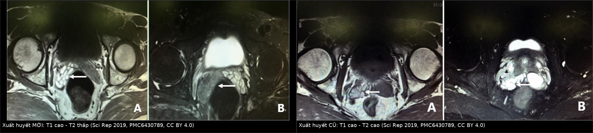
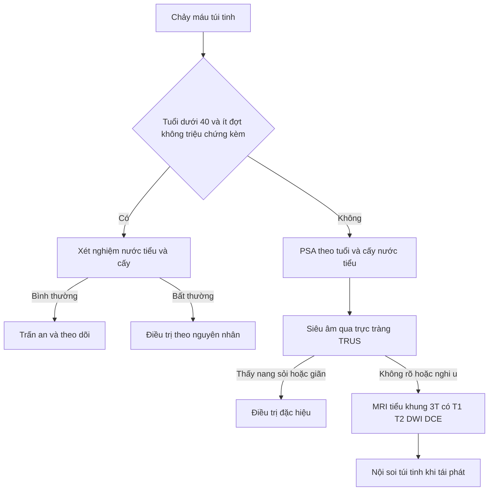
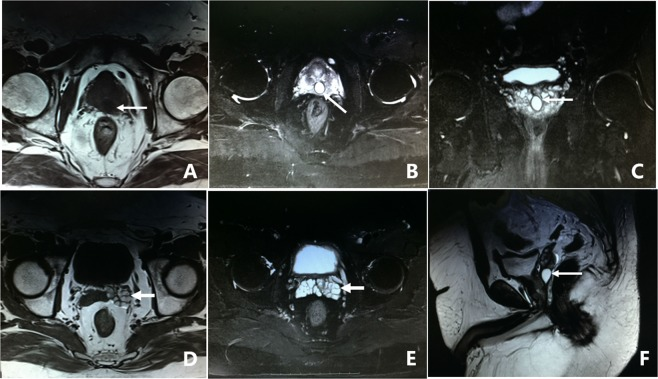
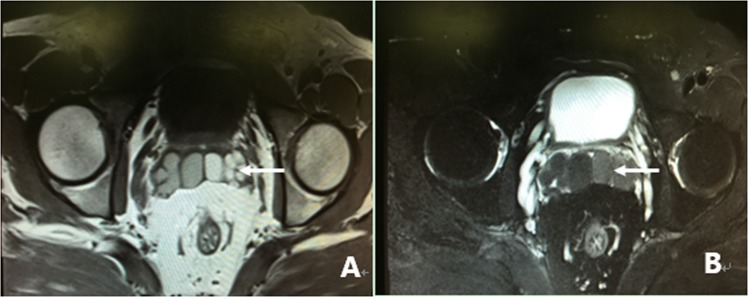

# 3127 — Chảy máu túi tinh: đọc T1/T2 để phân biệt máu mới – máu cũ – nang – tắc ống phóng tinh

**Tags:** `pattern:xuat-huyet-tui-tinh` `pattern:nang-duong-phong-tinh` `pattern:gian-tui-tinh` `pattern:soi-tui-tinh` `vung:tien-liet-tuyen` `vung:tiet-nieu` `anatomy:tui-tinh` `anatomy:ong-phong-tinh` `protocol:TRUS` `protocol:MRI-tieu-khung`
**Mức chắc chắn (certainty):** tổng hợp y văn (literature synthesis) — ghép **một loạt 305 ca chảy máu túi tinh khó trị có MRI + nội soi túi tinh đối chiếu** (*Scientific Reports* 2019, **PMC6430789**, CC BY 4.0), **một loạt 199 ca nguyên nhân chảy máu túi tinh đa trung tâm** (*Balkan Medical Journal* 2025, **PMC12060588**, CC BY-NC-ND 4.0), **một loạt 393 ca tầm soát ung thư ở nam giới chảy máu túi tinh** (*Current Urology* 2022, **PMC9132186**, CC BY-NC-ND 4.0) và **một thuật toán tiếp cận** (*Turkish Journal of Urology* 2022, **PMC12482482**, CC BY 4.0). Không có ca do nhóm tự chụp.

> **Câu hỏi thực hành:** nam **45 tuổi**, ba tháng nay **tinh dịch màu nâu đỏ** mỗi lần xuất tinh, không đau, không tiểu máu. Siêu âm qua trực tràng thấy hai túi tinh không đối xứng. Câu hỏi: **có cần MRI không, và trên MRI phải đo cái gì?**
> Bài chốt **ba quyết định**: **(1) máu mới và máu cũ khác nhau ở T2, không phải ở T1** — T1 luôn cao vì methemoglobin; **(2) túi tinh rộng > 1,7 cm hoặc lòng ống trong > 5 mm là dấu tắc ống phóng tinh**, không phải "to sinh lý"; **(3) nam < 40 tuổi, đợt ngắn, không triệu chứng kèm thì KHÔNG chụp** — tổn thương thực thể gần như không gặp, còn nam ≥ 40 hoặc tái phát thì phải có PSA và TRUS trước.

## 1. Tổng quan bệnh học – cơ chế hình ảnh: vì sao máu trong túi tinh đổi tín hiệu theo thời gian

- **Định nghĩa và tần suất:** chảy máu túi tinh (hematospermia, hemospermia) là **máu trong tinh dịch**. Đây là triệu chứng **ít gặp nhưng không hiếm**: **0,5%** nam giới trong một chương trình tầm soát ung thư tuyến tiền liệt, và **1%** các triệu chứng niệu khoa trong một thống kê bệnh viện (dẫn trong *Scientific Reports* 2019, PMC6430789). Phần lớn **tự hết trong vài tuần**, nhưng thể **tái phát/kéo dài > 2 tháng** là nhóm phải tìm nguyên nhân thực thể.
- **Giải phẫu quyết định hướng máu:** **60–70%** thể tích tinh dịch do **túi tinh** tiết ra, phần còn lại từ tuyến tiền liệt và ống phóng tinh. Vì vậy máu từ **túi tinh** (viêm, nang, sỏi, tăng sinh mạch) là nguồn hay gặp nhất; máu từ **niệu đạo sau** (u máu hang, giãn mạch) cho bệnh cảnh **tiểu máu sau kích thích tình dục**; máu từ **tuyến tiền liệt** (ung thư, sau sinh thiết) thường kèm **PSA bất thường**.
- **TẠI SAO T1 luôn cao:** máu thoát ra khỏi mạch → hồng cầu vỡ → **methemoglobin** (sắt Fe³⁺ thuận từ) **rút ngắn thời gian T1** → **tín hiệu cao trên T1W** ngay từ giai đoạn bán cấp. Đây là lý do **T1 cao không phân biệt được máu mới với máu cũ** — và cũng là lý do **dịch giàu protein/nhầy cũng T1 cao**, một cạm bẫy rất hay gặp trong túi tinh.
- **TẠI SAO T2 phân biệt được thời gian:** máu **mới** còn **deoxyhemoglobin nội bào** → hiệu ứng thuận từ làm **T2 ngắn → tín hiệu THẤP**; khi hồng cầu ly giải, methemoglobin ra ngoài tế bào → **T2 dài trở lại → tín hiệu CAO**. Vì vậy cặp dấu hiệu kinh điển:
  - **máu mới: T1 cao – T2 thấp** (loạt 305 ca: **26,2%**, 80/305, đối chiếu nội soi xác nhận máu tươi);
  - **máu cũ: T1 cao – T2 cao** (**35,7%**, 109/305, xác nhận máu cũ);
  - máu rất cũ/hemosiderin: **T1 thấp – T2 thấp** (ít gặp, không có trong loạt trên).
- **Ngưỡng định lượng trên MRI (dùng để gọi "giãn/tắc"):** túi tinh **rộng > 1,7 cm** hoặc **đường kính lòng ống trong > 5 mm** được coi là **giãn**; trong 98 ca giãn của loạt 305, **chiều rộng trung bình 2,15 ± 0,36 cm**, và nội soi xác nhận **tắc ống phóng tinh một bên hoặc hai bên** tương ứng.
- **Bản đồ tổn thương trên MRI (loạt 305 ca, tất cả đều được nội soi đối chiếu):**

| Nhóm dấu hiệu | Tần suất | Chi tiết |
|---|---|---|
| Bất thường tín hiệu túi tinh | **62,0%** (189/305) | máu mới **26,2%**, máu cũ **35,7%** |
| Nang vùng ống phóng tinh | **36,7%** (112/305) | nang tuyến tiền liệt **25,6%** (78), nang ống Müller **5,9%** (18), nang ống phóng tinh **1,6%** (5), nang túi tinh **3,6%** (11) |
| Giãn/đổi hình thái túi tinh | **32,1%** (98/305) | rộng trung bình **2,15 cm**, do tắc ống phóng tinh |
| Sỏi/calci hóa túi tinh | **8,5%** (26/305) | **0,2 × 0,3** đến **0,5 × 1,0 cm** |
| MRI không bất thường | **13,8%** (42/305) | nội soi vẫn tìm thấy u máu hang hoặc tắc ống phóng tinh |

- **Nguyên nhân theo cơ chế (loạt 199 ca đa trung tâm, PMC12060588):** **viêm 38,1%**; **cấy nước tiểu/tinh dịch dương 10%** (*E. coli* 35%, *S. aureus* 20% trong số dương); **ung thư 5,8%** — **cả 9 ca ung thư đều có tiểu máu kèm theo**; **> 1 nguyên nhân 25,1%**; **vô căn 70,4% ở nhóm < 40 tuổi so với 12,2% ở nhóm ≥ 40 tuổi**. Theo giải phẫu: **bệnh tuyến tiền liệt 40,7%**, **bệnh túi tinh 6%**.
- **Nguy cơ ung thư thực tế (loạt 393 ca, PMC9132186):** **ung thư tuyến tiền liệt 5,3%** toàn loạt (21/393), **7,2%** ở nam ≥ 40 tuổi (21/292), tuổi trung vị **63** (49–80); **mpMRI có tổn thương đáng kể 73,6%** (81/110) và dẫn tới **20 ca ung thư**; **không có tổn thương PI-RADS đáng kể nào ở nam < 40 tuổi**. Đây là cơ sở để **không chụp tràn lan ở người trẻ**.

## 2. Mẫu hình + chẩn đoán phân biệt theo vị trí (gamut)

- **Mẫu hình cốt lõi:** **máu trong tinh dịch ± đau tầng sinh môn/tiểu khó ± tiểu máu**, với **một bất thường tín hiệu hoặc cấu trúc trên MRI/TRUS tại túi tinh – ống phóng tinh – tuyến tiền liệt**.
- **Gamut theo vị trí (quyết định thái độ xử trí):**
  1. **Trong lòng túi tinh — xuất huyết mới/cũ:** hay gặp nhất, thường **tự hết**; tái phát nhiều đợt → nội soi túi tinh.
  2. **Vùng ống phóng tinh/trung tâm tuyến tiền liệt — nang:** nang tuyến tiền liệt (prostatic utricle cyst, PUC) **0,6 × 0,7 đến 2,0 × 2,3 cm**, khu trú trong tuyến tiền liệt; **nang ống Müller (Müllerian duct cyst, MDC) 3,4 × 4,5 đến 8,8 × 11,5 cm**, vượt bờ sau trên tuyến tiền liệt — **hai bệnh khác nhau về kích thước và cách mổ**.
  3. **Túi tinh — nang/giãn:** nang túi tinh thay cấu trúc tổ ong bằng **một hoặc vài khoang**, thường kèm **bất sản thận cùng bên (hội chứng Zinner)**; giãn túi tinh do **tắc ống phóng tinh**.
  4. **Ống phóng tinh — sỏi/calci hóa:** **8,5%**, hiện **chấm tín hiệu trống** trong túi tinh hoặc nang cạnh đó.
  5. **Tuyến tiền liệt — ung thư xâm lấn:** nam **≥ 40 tuổi**, **PSA bất thường**, **tiểu máu kèm theo**, tổn thương **PI-RADS 4–5** ở vùng nền/ống phóng tinh.
  6. **Niệu đạo sau — u máu hang/giãn mạch:** **tiểu máu sau kích thích tình dục**, MRI/TRUS có thể **bình thường**; chẩn đoán bằng nội soi niệu đạo.
  7. **Toàn thân/do thuốc:** rối loạn đông máu, kháng đông, tăng huyết áp, lao/sán máu — **không có tổn thương khu trú** nhưng phải hỏi bệnh sử.
- **Mẹo nhớ 4 nhóm "máu – nang – giãn – sỏi":** mọi ca chảy máu túi tinh khó trị đều rơi vào một trong bốn nhóm này (chiếm **86,2%** loạt 305 ca).

## 3. Bảng so sánh phân biệt (ma trận đối chiếu)

| Thực thể (entity) | Hình ảnh điển hình | Chốt vào (rule-in) | Chốt loại (rule-out) | Gợi ý xác nhận |
|---|---|---|---|---|
| Xuất huyết túi tinh MỚI | **T1 cao, T2 THẤP** trong lòng túi tinh, một hoặc hai bên | **T1 cao + T2 thấp** cùng vị trí, không có vỏ nang | T2 cao đồng tín hiệu với nước → không phải máu tươi | Nội soi túi tinh thấy máu đỏ tươi; theo dõi 4–6 tuần |
| Xuất huyết túi tinh CŨ | **T1 cao, T2 CAO**, có thể có vách mảnh | **T1 cao + T2 cao**, tái phát nhiều đợt | T1 thấp, T2 thấp → hemosiderin hoặc calci | Nội soi thấy máu nâu; MRI lặp lại sau 3 tháng |
| Nang tuyến tiền liệt (PUC) | Nang đường giữa **0,6–2,3 cm**, khu trú trong tuyến tiền liệt, T1 thấp–trung bình, T2 cao | **Nang nhỏ, đường giữa, không vượt bờ tuyến tiền liệt**, kèm giãn túi tinh cùng bên | Kích thước **> 3 cm** và vượt bờ sau trên → nghĩ nang ống Müller | Siêu âm qua trực tràng; nội soi qua lỗ nang |
| Nang ống Müller (MDC) | Nang lớn **3,4 × 4,5 đến 8,8 × 11,5 cm**, vượt bờ tuyến tiền liệt, T1 có thể cao nếu có máu | **Kích thước lớn + vượt bờ sau trên tuyến tiền liệt** | Nang nhỏ trong tuyến → PUC | MRI tiểu khung có T2 sagittal; mổ nội soi |
| Nang/giãn túi tinh | Mất cấu trúc tổ ong, khoang đơn hoặc nhiều khoang; **rộng > 1,7 cm**, lòng ống **> 5 mm** | **Giãn kèm tắc ống phóng tinh cùng bên**; nếu kèm **bất sản thận cùng bên** → Zinner | Túi tinh đối xứng, kích thước bình thường → không phải giãn | Siêu âm thận tìm bất sản; MRI xác nhận |
| Tắc ống phóng tinh (EDO) | Giãn túi tinh hai bên, tín hiệu có thể lẫn máu mới; tinh dịch ít, vô tinh | **Túi tinh giãn > 1,7 cm hai bên + thể tích tinh dịch giảm** | Túi tinh bình thường hai bên → loại tắc hoàn toàn | Nội soi ống phóng tinh; siêu âm sau xuất tinh |
| Sỏi/calci hóa túi tinh | **Chấm tín hiệu trống 0,2–1,0 cm** trên mọi chuỗi xung, thường có bóng lưng trên CT | **Tín hiệu trống + bóng lưng** trong túi tinh/nang | Tín hiệu trống đơn thuần không bóng lưng → khí hoặc mảnh vụn | CT không cản quang; nội soi lấy sỏi |
| Ung thư tuyến tiền liệt xâm lấn | Nốt **PI-RADS 4–5** vùng nền, mất vỏ, xâm lấn túi tinh (T3b), **DWI cao/ADC thấp** | **PSA bất thường + tiểu máu + tổn thương vùng nền xâm lấn** | PSA bình thường, không ổ nghi ngờ ở nam < 40 → nguy cơ rất thấp | PSA theo tuổi; mpMRI; sinh thiết có định vị |

*Trái: máu MỚI — T1 cao (A), T2 thấp (B). Phải: máu CŨ — T1 cao (A), T2 cao (B). Ảnh ghép letterbox từ *Scientific Reports* 2019 (**PMC6430789**), CC BY 4.0.*

### Dấu hiệu đọc nhanh trên từng chuỗi xung
- **T1W không fat-sat:** dấu hiệu nhạy nhất của máu bán cấp; nhưng **mỡ quanh túi tinh cũng sáng** → luôn đọc kèm T2 và so sánh hai bên.
- **T2W lát mỏng:** phân biệt **máu mới (thấp)** với **máu cũ/nang (cao)**; đồng thời thấy **vách nang** và **cấu trúc tổ ong** của túi tinh bình thường.
- **DWI/ADC:** không dùng để chẩn đoán máu; chỉ để đánh giá **ổ đặc trong tuyến tiền liệt** (ung thư) — máu và nang đều **không hạn chế khuếch tán thật**.
- **DCE:** đánh giá **u máu hang/giãn mạch** ở niệu đạo sau và **ổ đặc** ở tuyến tiền liệt.

## 4. Protocol chụp + thuật toán phân tầng

**Bước 1 — hỏi bệnh và xét nghiệm (mọi ca):** màu, số lượng, thời điểm, số đợt, thuốc kháng đông, chấn thương, du lịch vùng sán máu/lao. Xét nghiệm: **tổng phân tích nước tiểu + cấy nước tiểu/tinh dịch**; **PSA theo tuổi** ở nam **≥ 40 tuổi** hoặc có yếu tố nguy cơ; đông máu khi tái phát **> 2 tháng**.

**Bước 2 — chọn hình ảnh theo tuổi và triệu chứng (thuật toán PMC12482482):**
- **< 40 tuổi, ít đợt, không yếu tố nguy cơ, không triệu chứng kèm:** **không chụp thường quy** — xét nghiệm nước tiểu, trấn an và theo dõi. Loạt đa trung tâm cho thấy **không ca nào ở nhóm này có bất thường trên hình ảnh** (PMC12060588).
- **≥ 40 tuổi HOẶC tái phát HOẶC có yếu tố nguy cơ HOẶC có triệu chứng kèm:** **PSA + TRUS** là cửa đầu; nếu TRUS không giải thích được hoặc nghi tổn thương tuyến tiền liệt → **mpMRI**.
- **TRUS (siêu âm qua trực tràng):** đầu dò cao tần, đánh giá **kích thước túi tinh, nang, sỏi, ống phóng tinh, thể tích tuyến tiền liệt**. Giá trị thực tế: **58,7%** ca có bất thường (169/288) trong loạt 393 ca (PMC9132186).
- **mpMRI tiểu khung 3T (khi cần):** **T1W axial** (máu), **T2W độ phân giải cao axial + coronal + sagittal** (nang, vách, tổ ong), **DWI b = 1.000–2.000 + ADC**, **DCE** khi nghi u. Bắt buộc **đo và ghi**: chiều rộng túi tinh (mm), đường kính lòng ống trong (mm), kích thước nang, vị trí nang so với bờ tuyến tiền liệt. Giá trị: **73,6%** ca có tổn thương liên quan (81/110) và phát hiện **20 ca ung thư** trong loạt trên.
- **Nội soi túi tinh (seminal vesiculoscopy):** khi **tái phát/kéo dài dù hình ảnh không rõ**; loạt 305 ca đạt **93,0%** hết triệu chứng sau một lần can thiệp (theo dõi trung bình **32,4 ± 23,6 tháng**), **tái phát 7,0%** sau **5–20 tháng**.

## 5. Biến thể bình thường và cạm bẫy

- **T1 cao không đồng nghĩa với máu:** dịch túi tinh **giàu protein/nhầy** cũng **T1 cao**; phải đọc **T2** và đối chiếu **hai bên**. Túi tinh **bất đối xứng nhẹ** sau xuất tinh gần đó là bình thường.
- **"Không thấy gì trên MRI" không loại trừ:** **13,8%** ca khó trị có MRI bình thường nhưng nội soi vẫn thấy **u máu hang niệu đạo sau** hoặc **tắc ống phóng tinh** (PMC6430789). Đừng kết luận "tâm lý" khi bệnh nhân tái phát nhiều đợt.
- **Nhầm nang nhỏ với nang lớn:** PUC **0,6–2,3 cm** trong tuyến tiền liệt so với MDC **3,4–11,5 cm** vượt bờ — **quyết định kỹ thuật mổ khác nhau**, không được ghi chung là "nang đường giữa".
- **Sỏi túi tinh và calci hóa mạch:** chấm tín hiệu trống trong túi tinh phải có **bóng lưng**; calci hóa động mạch cạnh đó **không di chuyển theo túi tinh** trên các lớp cắt.
- **Bỏ sót ung thư ở nam ≥ 40 tuổi:** trong loạt 199 ca, **cả 9 ca ung thư đều có tiểu máu kèm theo**, nhưng **chỉ 40,6%** ca nhóm ≥ 40 tuổi có triệu chứng kèm — nghĩa là **không có tiểu máu không loại trừ**, vẫn phải PSA + TRUS theo tuổi.
- **Sau xạ trị/xem sinh thiết:** chảy máu túi tinh **do can thiệp** là nguyên nhân thường gặp và **tự hết**; đừng chụp lại nhiều lần nếu bệnh cảnh phù hợp.
- **Thuốc kháng đông/kháng kết tập tiểu cầu:** không tự ngừng thuốc chỉ vì chảy máu túi tinh; đánh giá nguy cơ huyết khối trước.

## 6. Tự lượng giá — Blind Quiz

**Ca 1 — Nam 45 tuổi, ba tháng tinh dịch màu nâu đỏ, không đau. Nhìn hai ảnh dưới, mô tả trước khi mở đáp án.**

- Gợi ý lâm sàng: không tiểu máu, PSA 0,9 ng/mL, không dùng kháng đông.
- Câu hỏi: Tín hiệu túi tinh hai bên khác nhau thế nào? Đây là máu mới hay máu cũ? Có cần nội soi ngay không?

<b>Bấm để hiện đáp án (findings + chẩn đoán)</b>

- Dấu hiệu: **túi tinh phải T1 cao, T2 thấp** (mũi tên) so với bên trái — cặp **T1 cao/T2 thấp = xuất huyết MỚI**; hình còn lại là **T1 cao/T2 cao = xuất huyết CŨ**.
- Chẩn đoán: **xuất huyết túi tinh** (thể mới ở ca này) — methemoglobin rút ngắn T1, deoxyhemoglobin còn trong hồng cầu làm ngắn T2.
- Xử trí: nam 45 tuổi đã có PSA và TRUS; **theo dõi 4–6 tuần + MRI lặp lại**, chỉ nội soi nếu tái phát.
- Nguồn ảnh: *Scientific Reports* 2019, **PMC6430789**, CC BY 4.0 (ảnh ghép letterbox).

**Ca 2 — Nam 38 tuổi, chảy máu túi tinh tái phát, đau tầng sinh môn khi xuất tinh. TRUS thấy nang nhỏ đường giữa.**

- Câu hỏi: Nang nằm ở đâu, kích thước bao nhiêu? Vì sao túi tinh bên trái giãn? Chẩn đoán và bước tiếp theo?

<b>Bấm để hiện đáp án</b>

- Dấu hiệu: nang **1,0 × 1,2 cm** đường giữa tuyến tiền liệt, **T1 thấp, T2 cao** (A–C, F); **túi tinh trái giãn tới 2,1 cm**, tín hiệu cao cả T1 và T2 (D–E) = máu cũ trong túi tinh giãn.
- Chẩn đoán: **nang tuyến tiền liệt (prostatic utricle cyst)** gây **tắc ống phóng tinh** cùng bên và ứ máu túi tinh.
- Xử trí: **nội soi bóc vách nang + nội soi túi tinh** (fenestration) — trong loạt 305 ca, thủ thuật này chiếm **66,6%** và hết triệu chứng **93,0%**.
- Nguồn ảnh: *Scientific Reports* 2019, **PMC6430789**, CC BY 4.0.

**Ca 3 — Nam 52 tuổi, vô tinh, tinh dịch 0,5 mL, không đau.**

- Câu hỏi: Hai túi tinh có gì bất thường? Đo gì để chốt tắc ống phóng tinh? Có phải ung thư không?

<b>Bấm để hiện đáp án</b>

- Dấu hiệu: **giãn rõ hai bên túi tinh**, T1 trung bình–cao (A), T2 thấp (B) = **máu mới trong túi tinh giãn**; không có ổ đặc trong tuyến tiền liệt.
- Chẩn đoán: **tắc ống phóng tinh hai bên (ejaculatory duct obstruction)** — ngưỡng gọi giãn: **rộng > 1,7 cm** hoặc **lòng ống trong > 5 mm**.
- Không phải ung thư: PSA bình thường, không ổ PI-RADS; xử trí **cắt ống phóng tinh qua nội soi (TURED) + nội soi túi tinh**.
- Nguồn ảnh: *Scientific Reports* 2019, **PMC6430789**, CC BY 4.0.

## Bài liên quan chéo
- [3097 – Hội chứng Zinner: nang túi tinh + bất sản thận cùng bên](../3097-zinner-nang-tui-tinh-than-bat-san/lesson.md)
- [3077 – Áp-xe túi tinh](../3077-ap-xe-tui-tinh/lesson.md)
- [3055 – Áp-xe tuyến tiền liệt](../3055-ap-xe-tuyen-tien-liet/lesson.md)
- [158 – PI-RADS: ung thư tuyến tiền liệt trên MRI](../158-tien-liet-tuyen-PIRADS/lesson.md)
- [152 – Sỏi niệu](../152-soi-nieu/lesson.md)
- [3103 – Rò trực tràng–niệu đạo sau xạ trị tiền liệt tuyến](../3103-ro-truc-trang-nieu-dao-sau-xa-tri-tien-liet-tuyen/lesson.md)

## Ảnh
- Tên file: `3127_chay-mau-tui-tinh_MRI_PMC6430789_F*.jpg` (4 ảnh) + `composite_xuat-huyet-moi-cu.jpg`. Nguồn, giấy phép từng ảnh: `images/CREDITS.md`.

> Không dùng để chẩn đoán độc lập khi chưa có người hướng dẫn.
