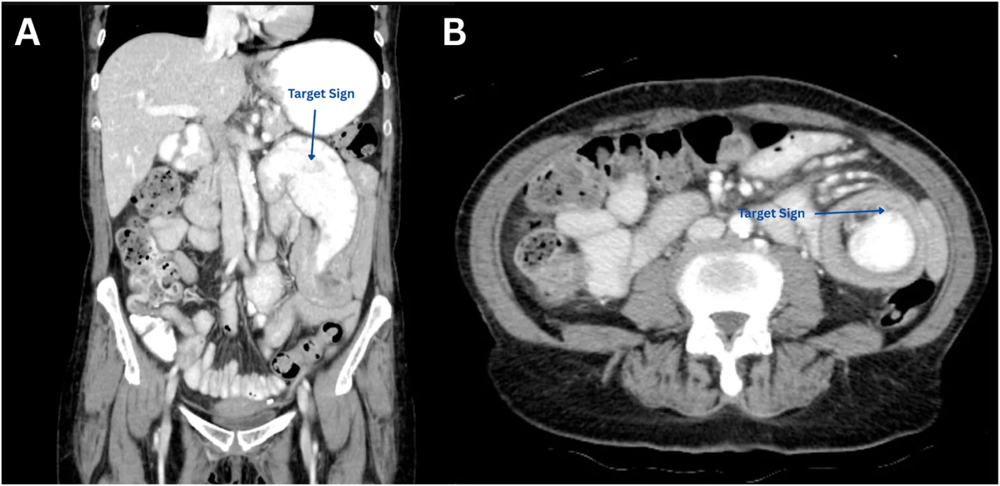
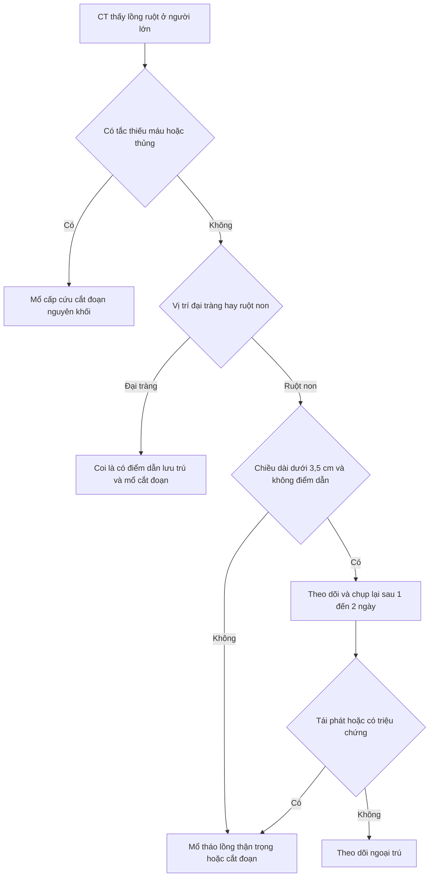
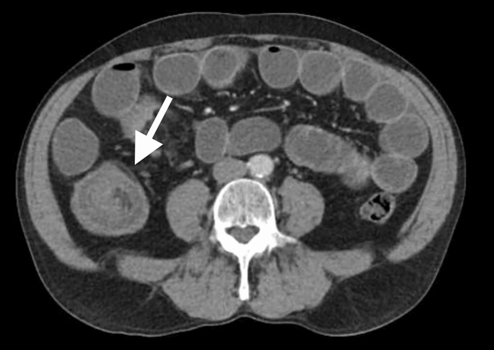
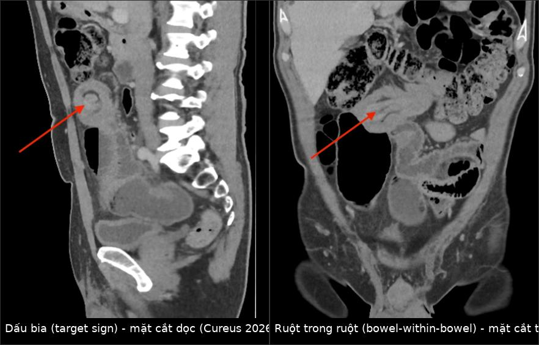
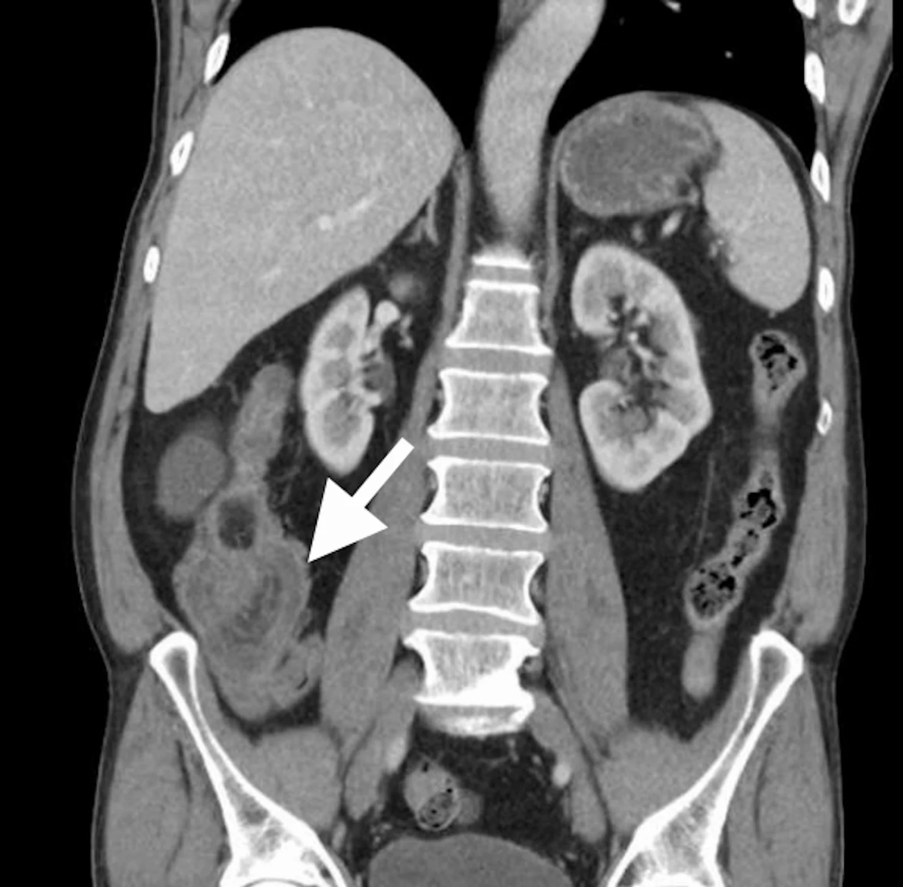

# 3128 — Lồng ruột non–non ở người lớn: dấu bia, ruột trong ruột và câu hỏi "có điểm dẫn lưu trú không?"

**Tags:** `pattern:long-ruot` `pattern:ruot-trong-ruot` `pattern:dau-bia` `pattern:tac-ruot` `vung:ruot-non` `vung:dai-trang` `vung:o-bung` `anatomy:ruot-non` `anatomy:dai-trang` `protocol:CT-bung-co-can-quang`
**Mức chắc chắn (certainty):** tổng hợp y văn (literature synthesis) — ghép **một tổng quan về vai trò MDCT trong lồng ruột người lớn** (*BioMed Research International* 2016, **PMC4706914**, CC BY 4.0), **một mô hình chẩn đoán phân biệt lồng ruột cần mổ và không cần mổ trên MDCT** (*Acta Informatica Medica* 2021, **PMC8116087**, CC BY-NC 4.0), **một loạt 54 ca lồng ruột người lớn** (*JGH Open* 2025, **PMC11840692**, CC BY 4.0) và **một loạt 26 ca** (*Medical Science Monitor Basic Research* 2024, **PMC11629587**, CC BY-NC-ND 4.0). Không có ca do nhóm tự chụp.

> **Câu hỏi thực hành:** nam **58 tuổi**, đau bụng từng cơn **2 tuần**, sụt **3 kg**, không nôn. CT bụng có cản quang: một **khối hình bia 4,8 cm** ở hố chậu phải, có **lớp mỡ mạc treo lẫn vào**, đoạn ruột phía trên giãn **3,4 cm**. Câu hỏi: **đây là lồng ruột thoáng qua hay phải mổ — và mổ theo cách nào?**
> Bài chốt **ba quyết định**: **(1) ở người lớn, "ruột trong ruột" không phải bệnh lành tính của trẻ — 70–90% có điểm dẫn lưu trú, đại tràng có nguy cơ ác tính cao nhất**; **(2) chiều dài < 3,5 cm, không tắc, không điểm dẫn = nhóm theo dõi được**, còn **≥ 5,0 cm / đường kính ≥ 3,2 cm / mỡ chen ≥ 0,5 cm** là nhóm mổ; **(3) khi nghi ác tính thì cắt đoạn nguyên khối, KHÔNG tháo lồng** — tháo lồng làm tăng nguy cơ thủng và gieo tế bào.

## 1. Tổng quan bệnh học – cơ chế hình ảnh: vì sao người lớn khác trẻ em

- **Tần suất và vì sao phải nhớ:** lồng ruột người lớn chiếm **5%** toàn bộ lồng ruột, **1–3%** các ca tắc ruột, và **0,003–0,02%** ca nhập viện; trên hình ảnh, chỉ **0,15%** (96/61.203) ca chụp MDCT bụng–chậu trong 6 năm, tương đương các loạt khác **0,04–0,05%** (PMC8116087, PMC11629587).
- **Khác biệt cốt lõi so với trẻ:** ở trẻ **90%** lồng ruột **vô căn** và điều trị bằng **thụt/nong bóng**; ở người lớn **70–90%** có **điểm dẫn lưu trú (lead point)** thực thể, nên **thụt tháo không có chỗ đứng** và phần lớn cần mổ.
- **TẠI SAO có lồng ruột:** một đoạn ruột (intussusceptum) **lồng vào lòng đoạn kế cận** (intussuscipiens) do **rối loạn nhu động** khi có khối u, polyp, túi thừa, dính hoặc sẹo — khối làm thay đổi nhu động khu trú và "kéo" đoạn ruột theo. Vị trí hay gặp là **nơi chuyển tiếp giữa đoạn ruột di động và đoạn cố định sau phúc mạc**.
- **TẠI SAO CT thấy được (vật lý đậm độ):** lồng ruột tạo ra **4 lớp đậm độ xen kẽ**: thành ruột **ngấm thuốc 60–90 HU**, **mỡ mạc treo bị kéo vào −50 đến −100 HU**, dịch trong lòng **0–20 HU**, và khí **−1.000 HU**. Chính **lớp mỡ mạc treo đậm độ thấp** nằm giữa hai vòng thành ruột là thứ tạo nên **"dấu bia" (target sign)** khi chùm tia **vuông góc** trục lồng ruột, và **"dấu xúc xích" (sausage sign)** khi chùm tia **song song/xiên**. Trên mặt cắt dọc, hai vòng thành lồng nhau cho **"ruột trong ruột" (bowel-within-bowel)**.
- **Ngưỡng định lượng quyết định thái độ (đo trên MDCT):**
  - **chiều dài lồng < 3,5 cm**: hiếm khi cần mổ, thường tự hết (PMC4706914);
  - mô hình phân biệt mổ/không mổ của loạt 96 ca: **chiều dài ≥ 5,0 cm**, **đường kính ≥ 3,2 cm**, **lớp mỡ chen giữa ≥ 0,5 cm** → nhóm cần mổ (PMC8116087);
  - **có điểm dẫn lưu trú + tắc ruột + dấu thiếu máu** → mổ cấp cứu bất kể kích thước.
- **Vì sao đại tràng nguy hiểm hơn ruột non:** thống kê kinh điển **65–70%** lồng ruột đại tràng do **ác tính**, trong khi ruột non chỉ **30–35%** (PMC4706914). Loạt MDCT 2021 xác nhận: **100%** lồng ruột đại tràng có điểm dẫn lưu trú, **70,3%** trong số đó **ác tính** và **84%** là **ung thư biểu mô tuyến nguyên phát**; lồng ruột non–non chỉ **57,1%** có điểm dẫn lưu trú, **30%** ác tính (PMC8116087).
- **Bối cảnh lâm sàng (loạt 54 ca Nhật):** tuổi trung vị **71** (57–78); **đại tràng 53,7%**, **hồi–manh tràng 18,5%**, **ruột non 27,8%**; **48,1%** (26/54) do ác tính, trong đó **25 ca ung thư đại tràng trực tràng** và **1 ca ung thư ruột non**; **14,8% không triệu chứng**; đau bụng **57,4%**; khởi phát **cấp ≤ 4 ngày 44,4%**, **mạn > 14 ngày 27,8%**. Triệu chứng **mạn** và **vị trí đại tràng** là yếu tố độc lập dự báo ác tính (PMC11840692).
- **Loạt 26 ca Jordan:** tuổi trung bình **53,3**; **đại tràng–đại tràng 53,8%**, **ruột non 19,2%**; **92,3%** chẩn đoán trước mổ bằng CT; **57,7%** điểm dẫn lưu trú lành tính (lipoma và polyp mỗi loại **33,3%** trong nhóm lành); **90,9%** điểm dẫn lưu trú ác tính nằm ở đại tràng; **chảy máu trực tràng 54,5% ở nhóm ác tính so với 6,7% ở nhóm lành (p = 0,011)** (PMC11629587).
- **Tỷ lệ ác tính dao động lớn giữa các loạt: 20–57%** (27%, 38%, 20%, 34%, 57%, 39%) — vì vậy **không được suy từ "tỷ lệ chung" sang từng bệnh nhân**, phải đọc đặc điểm khối và bối cảnh.

## 2. Mẫu hình + chẩn đoán phân biệt theo vị trí và cơ chế (gamut)

- **Mẫu hình cốt lõi:** **đau bụng từng cơn ± nôn ± bí trung đại tiện**, CT có **khối hình bia/xúc xích với lớp mỡ mạc treo lẫn vào**, ± **giãn ruột phía trên**.
- **Gamut theo loại (quyết định thái độ):**
  1. **Ruột non – ruột non (enteroenteric), có điểm dẫn lưu trú:** **lipoma** (đậm độ mỡ), **polyp tuyến**, **u mô bào xơ viêm (inflammatory fibroid polyp, IFP/Vanek)**, **túi thừa Meckel**, **dính sau mổ**; ác tính **30%** (di căn hắc tố, GIST, lymphoma, ung thư biểu mô).
  2. **Ruột non – ruột non, KHÔNG điểm dẫn lưu trú:** thường **ngắn, không tắc**, có thể **thoáng qua**; đây là nhóm **theo dõi được** nếu < 3,5 cm và không triệu chứng nặng.
  3. **Hồi–manh tràng (ileocecal) / hồi–đại tràng:** hay gặp ở người trẻ hơn; điểm dẫn lưu trú có thể **van hồi manh tràng dày**, **lipoma**, **túi thừa Meckel**, **u lympho**.
  4. **Đại tràng – đại tràng (colocolonic):** **ung thư biểu mô tuyến** chiếm ưu thế; cũng gặp **lipoma lớn**, **polyp**, **phân cứng (fecaloma)**. **Coi mọi lồng ruột đại tràng là có điểm dẫn lưu trú.**
  5. **Ngược dòng sau mổ (retrograde):** sau **Roux-en-Y** hoặc **cắt dạ dày** — lồng ruột **hỗng tràng vào dạ dày (jejunogastric)**, cấp cứu, dễ bỏ sót vì khối nằm trong dạ dày.
  6. **Do can thiệp:** sau **nội soi đại tràng**, sau đặt **ống thông ruột**, sau mổ nội soi — có thể **thoáng qua** nhưng **vẫn có thể có điểm dẫn lưu trú** (ca 65 tuổi trong PMC13561165 có lipoma thật).
  7. **Lồng ruột non–non do tắc nghẽn phía dưới:** ung thư đại tràng gây tăng nhu động → lồng ruột non thứ phát; **phải tìm tổn thương phía dưới**, nếu không sẽ mổ mà bỏ sót u nguyên phát.
- **Phân loại hình thái CT (Merine) — dùng để mô tả, không phải để chẩn đoán mô học:** **dạng bia (target)** = sớm, ít tắc; **dạng thận (reniform)** = thành ruột phù/thiếu máu; **dạng xúc xích (sausage)** = lát cắt song song trục.

## 3. Bảng so sánh phân biệt (ma trận đối chiếu)

| Thực thể (entity) | Hình ảnh điển hình | Chốt vào (rule-in) | Chốt loại (rule-out) | Gợi ý xác nhận |
|---|---|---|---|---|
| Lồng ruột có điểm dẫn lưu trú ÁC TÍNH | Khối đặc trong lòng, **bờ không đều, ngấm thuốc**, thường đại tràng, kèm **tắc** và **hạch** | **Khối đặc + chiều dài ≥ 5,0 cm + tắc + tuổi ≥ 64 + triệu chứng mạn** | Tổn thương **đậm độ mỡ thuần** hoặc **ngắn < 3,5 cm không tắc** → không nghĩ ác | CT 3 thì bụng–chậu; nội soi đại tràng sau ổn định; mổ cắt đoạn |
| Lồng ruột do LIPOMA | Khối **đậm độ mỡ −50 đến −100 HU**, bờ rõ, đẩy lệch, thường ruột non hoặc đại tràng phải | **Đậm độ mỡ thuần + không ngấm thuốc** | Đậm độ mỡ lẫn mô mềm > 20% → nghĩ u mỡ ác (liposarcoma) | Đo HU trên CT không cản quang; mổ cắt đoạn |
| Lồng ruột do IFP (Vanek) | Polyp **ngấm thuốc đều**, thường **hồi tràng**, gây lồng ruột non–non lặp lại | **Polyp nhỏ ngấm thuốc + tái phát nhiều đợt** | Khối lớn, bờ xâm lấn, hạch → ác tính | Mổ cắt đoạn; mô bệnh học |
| Lồng ruột THOÁNG QUA / không điểm dẫn lưu trú | **Ngắn < 3,5 cm**, đường kính nhỏ, **không tắc**, không thấy khối, thường tình cờ | **Ngắn + không tắc + không khối + không triệu chứng** | **Tắc, dài ≥ 5,0 cm, có khối, hoặc thiếu máu** → không theo dõi | Chụp lại CT có cản quang sau 1–2 ngày; theo dõi lâm sàng |
| Lồng ruột NGƯỢC DÒNG sau mổ | Khối trong **dạ dày** hoặc quai Roux-en-Y, thành dày, ± tắc | **Tiền sử cắt dạ dày/Roux-en-Y + nôn ra dịch mật + khối trong dạ dày** | Không có tiền sử mổ, khối ở vị trí điển hình → loại | CT có cản quang uống; nội soi; mổ |
| Lồng ruột SAU NỘI SOI | Lồng ruột tại đoạn vừa soi, thường **hồi–đại tràng**, có thể tự hết | **Trong 24 giờ sau nội soi + không tắc + không khối** | Có khối đặc/điểm dẫn lưu trú → xử trí như lồng ruột thực thể | CT lặp sau 12–24 giờ; theo dõi sát |
| Lồng ruột non–non DO TẮC PHÍA DƯỚI | Lồng ruột ngắn ở ruột non + **đại tràng giãn** hoặc khối đại tràng | **Tổn thương tắc nghẽn phía dưới + lồng ruột thứ phát** | Không có giãn phía trên, không khối xa → loại | CT toàn ổ bụng; nội soi đại tràng |
| Bắt chước: khối phân/thức ăn trong lòng ruột | "Bia giả" do phân lẫn khí, **không có lớp mỡ mạc treo**, không đổi giữa các lát | **Không có mỡ mạc treo chen giữa + thay đổi theo lát cắt** | **Có lớp mỡ mạc treo + mạch nuôi đi vào khối** → lồng ruột thật | Đọc lại MPR coronal/sagittal; CT lặp |

*Trái (A): mặt cắt trước — lồng ruột hỗng–hỗng tràng với **khối mô mềm trong lòng làm điểm dẫn lưu trú** (mũi tên). Phải (B): mặt cắt ngang — **dấu bia** (mũi tên). Nguồn: *Radiology Case Reports* 2026 (**PMC13652428**), CC BY 4.0.*

### Ba dấu hiệu phải tìm trên mọi ca "ruột trong ruột"
- **Điểm dẫn lưu trú:** khối đặc/đậm độ mỡ ở **đầu mút lồng ruột**; nếu không thấy trên lát ngang, dựng **MPR coronal/sagittal** dọc trục lồng.
- **Mức độ tắc:** đo **đường kính ruột non > 3 cm** và **đại tràng > 6 cm**, mức dịch–khí, quai chuyển tiếp.
- **Dấu thiếu máu:** thành ruột **dày > 3 mm**, **giảm/không ngấm thuốc**, **mạch mạc treo căng**, **khí trong thành**, dịch tự do — đây là chỉ định **mổ ngay**, không chờ.

## 4. Protocol chụp + thuật toán xử trí

**Protocol MDCT (chuẩn chẩn đoán):**
- **CT bụng–chậu có cản quang tĩnh mạch**, thì **tĩnh mạch cửa 70–80 giây**, **lát ≤ 1–2 mm**, luôn dựng **coronal + sagittal**; độ chính xác được báo cáo **58–100%** và trong loạt 26 ca đạt **92,3%** chẩn đoán trước mổ.
- **Không cần cản quang uống** (có thể che khối); nếu cần đánh giá tắc ruột non thì **cản quang uống tan trong nước** có ích nhưng không bắt buộc.
- **Không dùng barium** khi có tắc hoàn toàn hoặc nghi thủng.
- Đo và ghi vào báo cáo: **vị trí, loại (non–non, hồi–manh, đại tràng–đại tràng, ngược dòng), chiều dài, đường kính, độ dày lớp mỡ mạc treo chen giữa, có/không điểm dẫn lưu trú, có/không tắc, có/không thiếu máu, có khối thứ hai**.
- **CT có vai trò kép:** chẩn đoán **và** giai đoạn hóa nếu nghi ung thư (gan, phúc mạc, hạch) — quyết định mổ nội soi hay mổ mở.

**Nguyên tắc mổ (theo bằng chứng trong bài):**
- **Nghi ác tính → cắt đoạn nguyên khối, KHÔNG tháo lồng:** tháo lồng làm tăng nguy cơ **thủng** và **gieo tế bào ung thư**; đây là lý do chính khiến CT phải trả lời "có khối đặc không".
- **Lành tính hoặc vô căn → có thể tháo lồng trước rồi cắt đoạn** để tránh **hội chứng ruột ngắn**, đặc biệt ở ruột non.
- **Đại tràng:** luôn **cắt đoạn**; không nong/thụt như trẻ.
- **Nội soi hỗ trợ:** chỉ khi tổn thương nhỏ, không tắc, không nghi ác tính và có bác sĩ mổ có kinh nghiệm; **không dùng nội soi để "gỡ" lồng ruột đại tràng**.

## 5. Biến thể bình thường và cạm bẫy

- **Lồng ruột thoáng qua là có thật:** nhiều ca **không triệu chứng**, **ngắn < 3,5 cm**, tự hết; mổ ngay là **mổ oan**. Ngược lại, **"thoáng qua" trên một lần chụp không cho phép bỏ qua khối đặc** — phải chụp lại có cản quang và đọc MPR.
- **Bẫy vị trí sau nội soi:** ca 65 tuổi trong PMC13561165 được CT gọi là **hồi–đại tràng**, nhưng mổ xác nhận **hồi–hồi tràng đã chui qua van hồi manh tràng**, với **lipoma dưới niêm mạc** làm điểm dẫn lưu trú. Đừng chỉ mô tả "lồng ruột hồi–đại tràng" rồi dừng — **phải tìm điểm dẫn lưu trú và mô tả đường đi thực**.
- **Bỏ sót tổn thương thứ hai:** **3,1%** ca có **hai lồng ruột** trong loạt 96 ca (PMC8116087); đọc hết ổ bụng, không dừng ở tổn thương gây triệu chứng.
- **Bỏ sót ung thư đại tràng phía dưới:** lồng ruột non–non có thể chỉ là **hệ quả của tắc nghẽn xa**; nếu không nhìn đại tràng, bệnh nhân được mổ ruột non mà ung thư vẫn còn.
- **"Bia giả" do phân/thức ăn:** không có **lớp mỡ mạc treo** và **mạch nuôi đi vào khối**, hình thay đổi giữa các lát cắt và khi đổi tư thế.
- **Thiếu máu không luôn thấy trên CT sớm:** thành ruột có thể còn ngấm thuốc trong giai đoạn đầu; **đau nhiều, lactate tăng, không cải thiện** vẫn là chỉ định mổ.
- **Tuổi và triệu chứng mạn là dấu hiệu ác tính:** tuổi **≥ 64**, triệu chứng **> 14 ngày**, vị trí **đại tràng** — bộ ba này làm tăng xác suất ác tính và phải **soi đại tràng sau mổ** nếu chưa có mô bệnh.

*Cùng ca 65 tuổi sau nội soi: **dấu bia** trên mặt cắt ngang (mũi tên) — hình này dễ bị đọc là "lồng ruột hồi–đại tràng" và bỏ qua khối lipoma ở đầu mút. Nguồn: *Cureus* 2026 (**PMC13561165**), CC BY 4.0.*

## 6. Tự lượng giá — Blind Quiz

**Ca 1 — Nam 58 tuổi, đau bụng từng cơn 2 tuần, sụt 3 kg. Nhìn ảnh, mô tả trước.**

- Gợi ý lâm sàng: không nôn, không tiểu máu; bạch cầu 9.800; lactate 1,6 mmol/L.
- Câu hỏi: Dấu hiệu chính là gì? Có điểm dẫn lưu trú không? Mổ theo cách nào?

<b>Bấm để hiện đáp án (findings + chẩn đoán)</b>

- Dấu hiệu: **lồng ruột hỗng–hỗng tràng** với **khối mô mềm trong lòng** ở đầu mút (A) và **dấu bia** trên lát ngang (B); đoạn ruột phía trên giãn nhẹ.
- Chẩn đoán: **lồng ruột non–non có điểm dẫn lưu trú** — mô bệnh sau mổ là **u cơ trơn (leiomyosarcoma)**.
- Xử trí: **cắt đoạn ruột non nguyên khối**, không tháo lồng vì nghi ác tính; xác nhận bằng hóa mô miễn dịch (SMA+, desmin+).
- Nguồn ảnh: *Radiology Case Reports* 2026, **PMC13652428**, CC BY 4.0.

**Ca 2 — Nữ 47 tuổi, đau quanh rốn 3 ngày, thiếu máu thiếu sắt mạn. Hai mặt cắt dưới đây.**

- Câu hỏi: Dấu hiệu nào trên mặt cắt dọc, dấu hiệu nào trên mặt cắt trước? Vì sao phải tìm khối?

<b>Bấm để hiện đáp án</b>

- Dấu hiệu: mặt cắt dọc — **dấu bia (target sign)**; mặt cắt trước — **ruột trong ruột (bowel-within-bowel)**, kèm **quai ruột non phía trên giãn**.
- Chẩn đoán: **lồng ruột hồi–hồi tràng** do **u cơ trơn ruột non**, gây thiếu máu thiếu sắt mạn (loét niêm mạc).
- Xử trí: **cắt đoạn + nối ruột**; mô bệnh xác định u cơ trơn, Ki-67 khoảng **20%**.
- Nguồn ảnh: *Cureus* 2026, **PMC13676072**, CC BY 4.0 (ảnh ghép letterbox).

**Ca 3 — Nam 65 tuổi, 12 giờ sau nội soi đại tràng tầm soát thì đau hố chậu phải dữ dội.**

- Câu hỏi: Có nên kết luận "lồng ruột sau nội soi, theo dõi"? Điều gì trên ảnh buộc phải mổ?

<b>Bấm để hiện đáp án</b>

- Dấu hiệu: **dấu bia** ở hố chậu phải (mũi tên), kèm **giãn ruột non** phía trên; CT ban đầu gọi là **hồi–đại tràng**, mổ xác nhận **hồi–hồi tràng chui qua van hồi manh tràng**.
- Chẩn đoán: **lồng ruột do lipoma dưới niêm mạc hồi tràng** làm điểm dẫn lưu trú, khởi phát sau nội soi.
- Xử trí: **mổ cắt đoạn hồi tràng + lấy hạch mạc treo**; bài học: **có khối dẫn lưu trú thì không theo dõi đơn thuần**, và **vị trí trên CT có thể sai so với mổ**.
- Nguồn ảnh: *Cureus* 2026, **PMC13561165**, CC BY 4.0.

## Bài liên quan chéo
- [162 – Tắc ruột non/già, quai kín & thiếu máu mạc treo](../162-tac-ruot/lesson.md)
- [160 – Bụng cấp tiêu hóa](../160-bung-cap-GI/lesson.md)
- [1984 – Bệnh màng ngăn ruột non do NSAID & CMUSE](../1984-hep-ruot-nsaid-mang-ngan-va-cmuse/lesson.md)
- [134 – U nhầy ruột thừa chưa vỡ](../134-u-nhay-ruot-thua-chua-vo/lesson.md)
- [1872 – Thoát vị Littre: túi thừa Meckel trong túi thoát vị](../1872-thoat-vi-littre-tui-thua-meckel-trong-tui-thoat-vi/lesson.md)
- [622 – Tắc ruột sơ sinh](../622-tac-ruot-so-sinh/lesson.md)
- [161 – Viêm ruột thừa cấp](../161-viem-ruot-thua-cap/lesson.md)

## Ảnh
- Tên file: `3128_long-ruot-non-non_CT_PMC*.jpg` (5 ảnh) + `composite_target-bowel-within-bowel.jpg`. Nguồn, giấy phép từng ảnh: `images/CREDITS.md`.

> Không dùng để chẩn đoán độc lập khi chưa có người hướng dẫn.
