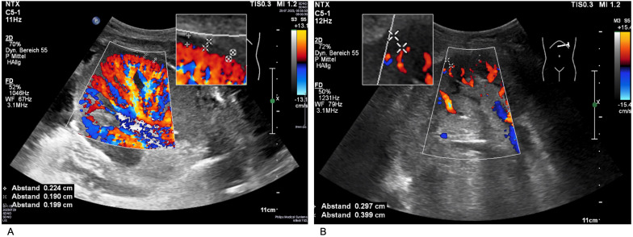
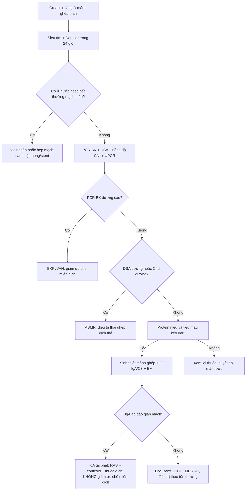
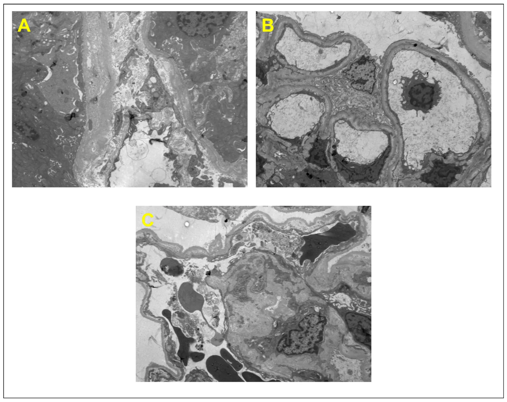
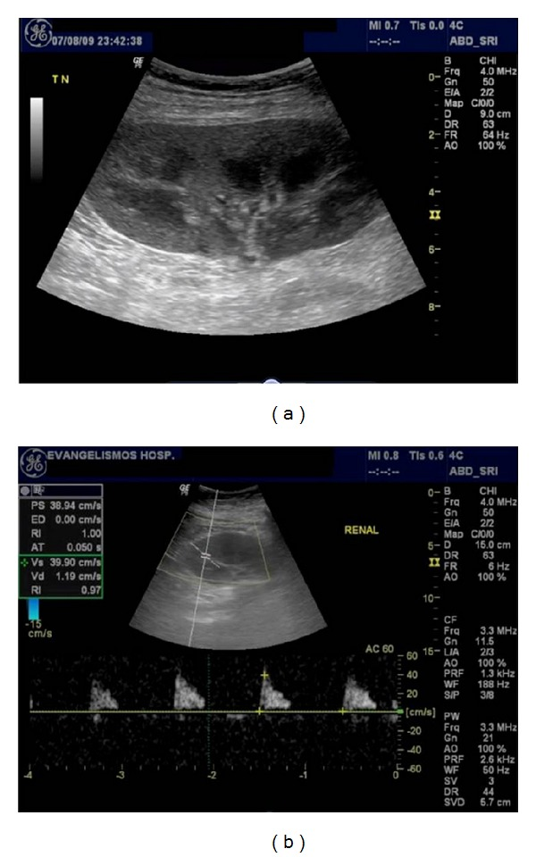

# 3129 — Bệnh thận IgA tái phát sau ghép thận: thận ghép "sạch" nhưng bệnh cũ quay lại

**Tags:** `pattern:tai-phat-cau-than` `pattern:protein-nieu` `pattern:teo-vo-than` `pattern:ngam-thuoc-kem` `vung:than-ghep` `vung:than` `protocol:sieu-am-Doppler` `protocol:MRI-khuếch-tán` `protocol:sinh-thiet-than-ghep` `score:Oxford-MEST-C` `score:Banff-2019` `incidentaloma:khong`
**Mức chắc chắn (certainty):** tổng hợp y văn (literature synthesis) — ghép **đoàn hệ Đan Mạch 118 người nhận** (*PLoS One* 2026, PMCID **PMC13384263**, CC BY 4.0), **đoàn hệ Anh 137 ca IgAN so với 122 ca ADPKD** (*BMC Nephrol* 2026, PMCID **PMC13753379**, CC BY 4.0), **ca lâm sàng 21 trường hợp tái phát** (*Kidney Med* 2026, PMCID **PMC13224066**, CC BY-NC-ND 4.0), **nghiên cứu 350 lần sinh thiết + siêu âm Doppler** (*Front Nephrol* 2026, PMCID **PMC12913139**, CC BY 4.0), **nghiên cứu MRI khuếch tán phụ thuộc thời gian 100 mảnh ghép** (*EBioMedicine* 2025, PMCID **PMC12682057**, CC BY-NC-ND 4.0) và **ba báo cáo điều trị đích** (PMC12630289, PMC13127332, PMC12835414). Không có ca do nhóm tự chụp.

> **Câu chốt:** bệnh nhân **ghép thận vì IgA** rồi **creatinin tăng dần + protein niệu + tiểu máu vi thể**, **không sốt, không đau mảnh ghép, PCR BK âm** — nghĩ **IgA tái phát** trước khi nghĩ "thuốc độc thận". Ba con số định khung: **tái phát mô học 14% (tích lũy 16% sau 10 năm)** ở đoàn hệ Đan Mạch (PMC13384263), **sống ghép 10 năm 35,8% ở nhóm tái phát so với 88,8% ở nhóm không tái phát** (PMC13753379), và **chỉ 12,4% người nhận có tái phát nhưng lại chiếm phần lớn ca mất ghép muộn**. **Siêu âm và MRI không chẩn đoán được tái phát** — chúng loại trừ nguyên nhân khác; **chốt là sinh thiết + miễn dịch huỳnh quang (IgA/C3)**.

## 1. Tổng quan bệnh học – cơ chế hình ảnh (TẠI SAO)

### 1.1. Vì sao bệnh "của người nhận" lại nằm trong "thận của người cho"

- IgA nephropathy (IgAN) là **bệnh toàn thân của hệ miễn dịch niêm mạc**: tế bào B sản xuất **IgA1 thiếu galactose (Gd-IgA1)** → cơ thể tạo **tự kháng thể IgG kháng Gd-IgA1** → **phức hợp miễn dịch lưu hành** lắng ở **gian mạch cầu thận**, hoạt hóa **bổ thể theo con đường lectin/alternate (C3)** → **tăng sinh gian mạch + tiểu máu + protein niệu**.
- Thận ghép **không mang bệnh** — nó chỉ là **cơ quan đích của một bệnh hệ thống vẫn đang hoạt động ở người nhận**. Vì vậy: **tái phát không phụ thuộc người cho**, và **duy trì corticoid không ngăn được tái phát** (đoàn hệ Đan Mạch: **không có liên quan**, PMC13384263).
- **Yếu tố nguy cơ đã xác định:** **tuổi chẩn đoán IgAN trẻ hơn**, **tiến triển nhanh tới suy thận giai đoạn cuối** ở thận gốc, **thận từ người cho sống hoặc có quan hệ huyết thống** (PMC13384263). Nghĩa là: **bệnh "hung hãn" ở thận gốc → hung hãn ở thận ghép**.

### 1.2. Vì sao hình ảnh KHÔNG chẩn đoán được — và vẫn phải chụp

- **Siêu âm B-mode:** mọi nguyên nhân suy mảnh ghép đều cho **cùng một bộ dấu hiệu**: mảnh ghép **to ra**, **vỏ tăng âm**, **mất phân biệt vỏ–tủy**, **ứ nước nhẹ**, **dịch quanh thận**. IgA tái phát **không có dấu hiệu đặc hiệu** — tổn thương là **ở cầu thận**, dưới độ phân giải của siêu âm (đường kính cầu thận ~**200 µm**).
- **Doppler:** **chỉ số sức cản (resistive index, RI)** từng được dùng như "dấu hiệu thải ghép", nhưng trên **350 lần sinh thiết**, **RI KHÔNG liên quan tới tổn thương mô học** (PMC12913139). Ngược lại, **phần trăm tưới máu (POV)** và **khoảng cách mạch ngoại vi (PVD)** lại gắn với **xơ hóa mạn**: **POV < 50%** và **PVD ≥ 0,25 cm** dự báo teo ống/xơ mô kẽ mức vừa–nặng (PMC12913139).
- **Vì sao vẫn chụp:** để **loại trừ 4 nguyên nhân chữa được** — **tắc nghẽn đường niệu** (bài **3011**), **hẹp/huyết khối động mạch thận**, **nhiễm trùng** (bài **116**), **khối/dịch quanh thận**. Bỏ bước này mà sinh thiết ngay là bỏ sót nguyên nhân **mổ/nong được**.
- **MRI khuếch tán phụ thuộc thời gian (td-dMRI):** không cần thuốc cản quang, đo **đường kính tế bào vỏ thận**, **phân suất thể tích nội bào**, **phân suất tưới máu tủy** → phân biệt **xơ hóa** và **thải ghép** với **độ chính xác ~88%**, tốt hơn mô hình lâm sàng (PMC12682057). Đây là hướng **theo dõi không sinh thiết** — nhưng **chưa thay được sinh thiết** để chẩn đoán IgA tái phát.

### 1.3. Ngưỡng định lượng nằm lòng

| Đại lượng | Số liệu | Nguồn |
|---|---|---|
| Tái phát mô học (sinh thiết) | **14% (118 người nhận)**; **tích lũy 16% sau 10 năm** | PMC13384263 |
| Nguy cơ mất ghép khi tái phát | **HR 6,7** (đã hiệu chỉnh) | PMC13384263 |
| Tái phát trong đoàn hệ Anh | **12,4%** | PMC13753379 |
| Sống ghép 10 năm (loại trừ tử vong) | **35,8%** (tái phát) vs **88,8%** (không tái phát) | PMC13753379 |
| Creatinin lúc chẩn đoán (tái phát vs nguyên phát) | **227 vs 128 µmol/L** | PMC13224066 |
| Tiến tới suy thận ở nhóm tái phát | **52%**, trung vị **17 tháng** (so với **50 tháng**) | PMC13224066 |
| Protein niệu sau ghép nói chung | **40–80%** người nhận, đa số **nhẹ, nguồn gốc ống thận** | PMC12644300 |
| RI và mô học | **350 sinh thiết: RI không liên quan tổn thương Banff** | PMC12913139 |
| POV / PVD gợi ý tổn thương mạn | **POV < 50%** / **PVD ≥ 0,25 cm** | PMC12913139 |
| MRI td-dMRI phân biệt xơ hóa & thải ghép | **~88% độ chính xác**, không cản quang | PMC12682057 |

- **Chưa rõ — cần tra:** **không có ngưỡng protein niệu (g/ngày) hay mức creatinin tăng** được thẩm định riêng để chỉ định sinh thiết vì IgA tái phát; các bài dùng **"protein niệu mới/xấu đi + creatinin tăng không giải thích"** rồi sinh thiết khi **không tìm được nguyên nhân khác** (PMC12644300). Bài này **không** đặt ngưỡng riêng.

## 2. Mẫu hình + chẩn đoán phân biệt theo vị trí (Gamut)

- **Mẫu hình chung:** **creatinin tăng dần trong nhiều tháng** + **protein niệu** + **tiểu máu vi thể** ở người **ghép thận vì IgA**, **không sốt**, mảnh ghép **không đau**, **không ứ nước**.
- **Theo "khoang" tổn thương (dùng để chia gamut, vì hình ảnh không định khu rõ):**
  - **Cầu thận:** **IgA tái phát**; **FSGS tái phát** (protein niệu **ồ ạt, sớm trong tuần đầu**, đặc biệt ở trẻ); **màng (membranous) tái phát**; **viêm cầu thận de novo**; **bệnh thận do đái tháo đường** ở mảnh ghép.
  - **Vi mạch:** **thải ghép qua trung gian kháng thể (ABMR)** — kháng thể kháng HLA người cho (DSA), C4d, viêm mao mạch; **bệnh vi mạch huyết khối (TMA)**.
  - **Ống thận – mô kẽ:** **nhiễm BK polyomavirus (bài 3096)**, **độc thận do calcineurin inhibitor**, **hoại tử ống thận cấp**, **viêm thận – bể thận** (bài **116**).
  - **Mạch lớn:** **hẹp động mạch thận ghép**, **huyết khối tĩnh mạch/động mạch mảnh ghép** (bài **3153**).
  - **Đường niệu:** **hẹp miệng nối niệu quản**, **rò nước tiểu** (bài **3011**).
- **Mẫu hình mô phỏng (không phải tái phát):** **thuốc ức chế miễn dịch (CNI)** làm **RI tăng, mảnh ghép không to**; **mất nước** làm **creatinin tăng nhanh, đáp ứng với truyền dịch**; **tăng huyết áp** gây protein niệu nhẹ.
- **Câu hỏi định hướng:** *"Tổn thương ở cầu thận, ở vi mạch, hay ở ống thận?"* — siêu âm/Doppler chỉ trả lời được câu **"có tắc/mạch máu không"**, phần còn lại **phải sinh thiết**.

## 3. Bảng so sánh phân biệt (ma trận đối chiếu)

| Thực thể (entity) | Hình ảnh điển hình | Chốt vào (rule-in) | Chốt loại (rule-out) | Gợi ý xác nhận |
|---|---|---|---|---|
| **IgA tái phát** | **Siêu âm gần như bình thường**; mảnh ghép có thể **to, vỏ tăng âm**; **không ứ nước**; Doppler **RI bình thường hoặc tăng nhẹ** | **Tiền sử ghép vì IgA** + **protein niệu + tiểu máu vi thể** tiến triển **nhiều tháng–năm**; **không DSA**, **PCR BK âm** | **Ứ nước rõ** → tắc, không phải tái phát; **PCR BK > 10⁴ copies/mL** → nghĩ BKPyVAN trước | **Sinh thiết + IF: IgA ≥ 1+ áp đảo ở gian mạch, kèm C3**; Oxford MEST-C; EM thấy lắng đọng gian mạch |
| **BKPyVAN (bài 3096)** | Siêu âm **không đặc hiệu**; mảnh ghép có thể to | **PCR BK huyết thanh dương, tăng dần**; **tế bào decoy** trong nước tiểu | **PCR âm** nhiều lần → **không** phải BKPyVAN | Sinh thiết: **SV40 lớn T dương**, phân độ Banff PVN; giảm ức chế miễn dịch là điều trị chính |
| **ABMR** | Siêu âm **không đặc hiệu**; mảnh ghép to, phù | **DSA dương** + **C4d dương** hoặc **viêm mao mạch (g + ptc ≥ 2)**; thường **sớm và nặng** | **DSA âm, C4d âm** → không đủ tiêu chuẩn ABMR | Sinh thiết + Banff 2019; DSA; điều trị **khác hẳn** tái phát IgAN |
| **Độc thận do CNI** | Doppler **RI tăng**, mảnh ghép **không to**; có thể **dải tăng âm** | **Nồng độ thuốc cao** + creatinin tăng **theo liều**, hồi phục khi giảm liều | **Sinh thiết có tổn thương cầu thận hoạt động** → không chỉ do thuốc | Nồng độ thuốc, sinh thiết (tổn thương ống thận, xơ tiểu động mạch) |
| **Hẹp miệng nối niệu quản (bài 3011)** | **Ứ nước – ứ niệu quản** trên siêu âm; **phổ Doppler tardus–parvus** nếu hẹp mạch kèm theo | **Ứ nước + creatinin tăng**, hồi phục sau đặt stent/nong | **Không ứ nước** → không phải nguyên nhân chính | Siêu âm, CT niệu đồ, MAG3; nong/stent |
| **FSGS tái phát** | Siêu âm **bình thường** | **Protein niệu ồ ạt xuất hiện trong tuần đầu** sau ghép (đặc biệt trẻ) | **Protein niệu xuất hiện sau nhiều tháng** → nghĩ IgA hơn là FSGS | Sinh thiết: **xơ hóa từng phần**, EM **mất chân tế bào lan tỏa** |
| **Bệnh thận do đái tháo đường (mảnh ghép)** | Siêu âm **bình thường** hoặc mảnh ghép **nhỏ** | **Đái tháo đường lâu năm + protein niệu tăng dần**, không tiểu máu | **Tiểu máu vi thể rõ** → không điển hình | Sinh thiết: **nốt Kimmelstiel–Wilson**, dày màng đáy |

*Hai mảnh ghép thận trên siêu âm Doppler năng lượng. **A** — tưới máu tốt: **POV > 50%**, **PVD < 0,25 cm** (mạch máu len tới sát vỏ). **B** — tưới máu kém: **POV < 30%**, **PVD > 0,25 cm** — mạch máu bị "co cụm" ở trung tâm, vỏ gần như không có tín hiệu. Trên 350 lần sinh thiết, **POV/PVD gắn với xơ hóa mạn**, còn **RI thì không** (PMC12913139). Ảnh nguyên bản 2 panel, không crop. Nguồn: *Front Nephrol* 2026, PMCID PMC12913139, CC BY 4.0.*

## 4. Protocol chụp + theo dõi + hệ phân độ

### 4.1. Trình tự khi creatinin tăng ở mảnh ghép

1. **Siêu âm + Doppler mảnh ghép trong 24 giờ** (không chuẩn bị đặc biệt, đầu dò 3,5–5 MHz): kích thước, **vỏ tăng âm**, **phân biệt vỏ–tủy**, **ứ nước**, **dịch quanh thận**, **chỉ số trở kháng (RI)** ở **3 vị trí** (trên, giữa, dưới) và **POV/PVD** nếu máy có.
2. **Xét nghiệm song song, không chờ ảnh:** **PCR BK polyomavirus huyết thanh**, **DSA**, **nồng độ CNI**, **UPCR**, **tổng phân tích nước tiểu**, **CMV**.
3. **Sinh thiết mảnh ghép** khi: creatinin tăng **không giải thích** kéo dài, **protein niệu mới/xấu đi**, hoặc **nghi thải ghép** — **sau khi đã loại trừ tắc nghẽn và nhiễm trùng**.
4. **MRI td-dMRI** (nếu có) khi **chống chỉ định sinh thiết** hoặc để **theo dõi xơ hóa** — hiện là **nghiên cứu**, chưa thay sinh thiết (PMC12682057).

### 4.2. Đọc sinh thiết: hai bộ điểm phải đọc cùng nhau

| Bộ điểm | Thành phần | Ý nghĩa thực hành |
|---|---|---|
| **Oxford MEST-C** (dùng cho IgAN) | **M** tăng sinh gian mạch (M1: > 50% cầu thận), **E** tăng sinh nội mao mạch, **S** xơ hóa từng phần, **T** teo ống/xơ mô kẽ (**T1: 26–50%**, **T2: > 50%**), **C** trăng (C1: < 25%, C2: ≥ 25%) | **T1–T2 và C2** là yếu tố tiên lượng xấu; dùng để quyết định **cường độ điều trị** |
| **Banff 2019** (dùng cho thải ghép) | **i, t, g, ptc, v, cg, ci, ct, cv, ah, mm** + **C4d**, **DSA** | Phân biệt **TCMR** với **ABMR**; quyết định **tăng hay giảm** ức chế miễn dịch |

- **Mẫu bệnh phẩm tối thiểu:** **≥ 2 mảnh**, phải có **cầu thận** (≥ 7 cầu thận để chấm MEST-C đáng tin), **miễn dịch huỳnh quang đủ panel** (IgG, IgA, IgM, C3, C1q, kappa, lambda) và **hiển vi điện tử** cho lắng đọng gian mạch.
- **IF là chốt:** **IgA ≥ 1+ áp đảo ở gian mạch + C3** mới gọi là IgA tái phát; **không có IF** thì chỉ là "viêm cầu thận không rõ loại".

*Mô bệnh học (không phải CĐHA) — mảnh ghép có **IgA tái phát kèm tổn thương vi mạch**: **(A)** tăng sinh gian mạch mức nhẹ–vừa, phù dưới nội mô từng đoạn, dày màng đáy; **(B–C)** các quai mao mạch bị tổn thương. Lưu ý: **EM không "nhìn thấy" IgA** — chất lắng đọng miễn dịch chỉ hiện trên **miễn dịch huỳnh quang**; EM dùng để xác định **vị trí** lắng đọng trong gian mạch và loại trừ bệnh màng đáy khác. Ảnh nguyên bản 3 panel, không crop. Nguồn: *J Clin Med* 2026, PMCID PMC13705921, CC BY-NC-ND 4.0.*

### 4.3. Điều trị (để hiểu vì sao chẩn đoán sớm lại quan trọng)

- **Nền tảng:** **ức chế RAS (ACEi/ARB)** giảm protein niệu, kiểm soát huyết áp; **corticoid** và **MMF** theo mức tổn thương; **không giảm ức chế miễn dịch** như khi điều trị BKPyVAN — vì đây là **bệnh hoạt động miễn dịch**, giảm thuốc sẽ làm bệnh nặng hơn.
- **Thuốc đích mới (bằng chứng bước đầu, chưa có chỉ định chính thức cho người ghép):**
  - **Budesonide phóng thích tại hồi tràng (TR budesonide):** ca 28 tuổi, **UPCR 4,55 → 1,30 g/g** sau 12 tháng; tốc độ giảm eGFR chậm lại còn **−6 mL/min/1,73 m²/năm** (PMC12630289).
  - **Telitacicept** (ức chế BLyS/APRIL) **240 mg/tuần × 12 tuần rồi mỗi 2 tuần**: **protein niệu 24 giờ giảm 51,6%**, **UACR giảm 62,7%** ở tuần 28 (n = 25, PMC13127332).
  - **Iptacopan** (ức chế yếu tố B): 3 ca, **2 ca giảm protein niệu và hết tiểu máu vi thể**, **1 ca tiến triển** (PMC12835414).
- **Ghép lại:** khi mảnh ghép đã xơ hóa **T2/C2** và mất chức năng; **tái phát có thể xảy ra ở thận ghép thứ hai** — cần tư vấn trước.

## 5. Biến thể bình thường và cạm bẫy

- **Cạm bẫy 1 — "RI cao là thải ghép":** trên **350 sinh thiết**, **RI không liên quan tổn thương mô học** (PMC12913139); RI tăng do **mất nước, hẹp mạch, thuốc, nhịp tim**. Đừng chẩn đoán bằng RI.
- **Cạm bẫy 2 — "protein niệu là tái phát":** **40–80%** người ghép có protein niệu, đa số **nhẹ và do ống thận** (PMC12644300); chỉ **protein niệu mới/xấu đi kèm tiểu máu** mới đáng sinh thiết.
- **Cạm bẫy 3 — sinh thiết quá sớm, bỏ qua tắc nghẽn:** **ứ nước nhẹ** sau ghép có thể **lành tính** (mất trương lực niệu quản do cắt thần kinh) — nhưng **ứ nước tăng dần + creatinin tăng** phải loại trừ hẹp miệng nối (bài **3011**) **trước** khi kết luận tái phát.
- **Cạm bẫy 4 — nhầm BKPyVAN với tái phát:** cả hai gây **creatinin tăng + protein niệu + sinh thiết có thâm nhiễm**. Phân biệt bằng **PCR BK** và **SV40 lớn T**; điều trị **ngược nhau** (BK: **giảm** ức chế miễn dịch; IgA: **không giảm**).
- **Cạm bẫy 5 — bỏ IF/EM vì "đủ mô":** không có **IF IgA/C3** thì không phân biệt được **IgA tái phát** với **viêm cầu thận do phức hợp miễn dịch khác**; EM giúp xác định vị trí lắng đọng (gian mạch).
- **Cạm bẫy 6 — "không tái phát vì còn corticoid":** duy trì corticoid **không ngăn được tái phát** trong đoàn hệ Đan Mạch — đừng dùng lý do này để loại trừ.
- **Cạm bẫy 7 — mảnh ghép "bình thường" trên siêu âm:** IgA tái phát **thường không có bất thường siêu âm**; hình ảnh bình thường **không loại trừ**.
- **Cạm bẫy 8 — quy mọi xấu đi cho "bệnh cũ tái phát":** phải loại trừ **ABMR** (DSA, C4d) vì **điều trị hoàn toàn khác**; ABMR có thể **xảy ra đồng thời** với tái phát.

*Minh hoạ **thay đổi Doppler khi mảnh ghép suy** (ca thải ghép cấp, không phải IgA tái phát): **(a)** mảnh ghép **to nhẹ, ép xoang mỡ**, giảm phân biệt vỏ–tủy; **(b)** phổ Doppler động mạch trong thận **một pha, mất dòng tâm trương**, **RI 0,97** — mẫu hình "mảnh ghép suy" **không đặc hiệu** cho nguyên nhân nào. Ảnh nguyên bản 2 panel, không crop. Nguồn: *ISRN Radiol* 2013, PMCID PMC4045518, CC BY 3.0.*

## 6. Tự lượng giá — Blind Quiz

**Ca 1 — Nam 34 tuổi, ghép thận từ mẹ 6 năm trước vì IgA nephropathy. Creatinin 1,9 → 2,6 mg/dL trong 8 tháng, protein niệu 1,4 g/ngày, tiểu máu 20–30 hồng cầu/µL; không sốt, không đau mảnh ghép. Siêu âm: mảnh ghép 12,1 cm, không ứ nước; Doppler RI 0,68.**

- Hỏi: (1) Hình ảnh siêu âm trả lời được gì và **không** trả lời được gì? (2) Xét nghiệm nào phải làm trước sinh thiết? (3) Kết quả sinh thiết nào xác nhận tái phát?

<b>Bấm để hiện đáp án (findings + chẩn đoán)</b>

- **Siêu âm:** **loại trừ ứ nước và huyết khối mạch** — đây là giá trị chính. **Không** phân biệt được IgA tái phát với ABMR/CNI vì tổn thương ở **cầu thận**; **RI 0,68 bình thường không loại trừ** (RI không liên quan mô học).
- **Trước sinh thiết:** **PCR BK polyomavirus**, **DSA**, **nồng độ CNI**, **CMV**, **UPCR** — để loại trừ nguyên nhân chữa được và **tránh điều trị sai hướng**.
- **Xác nhận:** **IF IgA ≥ 1+ áp đảo gian mạch + C3**, EM có lắng đọng gian mạch; chấm **MEST-C**. Tiền sử **ghép vì IgA + thận từ người cho sống có quan hệ huyết thống** là **hai yếu tố nguy cơ** đã biết (HR mất ghép **6,7**).
- Nguồn số liệu: PMC13384263, PMC12913139, PMC13753379.

**Ca 2 — Nữ 41 tuổi, ghép thận 7 tháng, creatinin tăng nhanh 3 tuần, thiểu niệu, mảnh ghép đau nhẹ. Siêu âm: mảnh ghép to, không ứ nước; Doppler RI 0,92. DSA dương, C4d dương trên sinh thiết.**

- Hỏi: (1) Có phải IgA tái phát không? (2) Vì sao **không** được giảm ức chế miễn dịch? (3) Điều trị khác nhau thế nào?

<b>Bấm để hiện đáp án</b>

- **Không phải IgA tái phát:** **DSA dương + C4d dương** = **ABMR** (thải ghép qua trung gian kháng thể); Riêng RI 0,92 **không đủ** để nói gì (không tương quan mô học).
- **Không giảm ức chế miễn dịch:** ABMR cần **tăng/đổi phác đồ** (thường gồm plasma exchange, IVIG, điều trị đích) — **ngược** với BKPyVAN (giảm ức chế miễn dịch). Giảm thuốc trong ABMR làm **mất ghép nhanh**.
- **Khác nhau:** IgA tái phát → **RAS + corticoid + thuốc đích**, giữ nguyên ức chế miễn dịch; ABMR → điều trị **dịch thể**; BKPyVAN → **giảm** ức chế miễn dịch (bài 3096).
- Nguồn số liệu: PMC12913139, PMC13753379.

**Ca 3 — Nam 28 tuổi, ghép thận 4 năm, IgA tái phát đã xác định bằng sinh thiết (M1E0S1T1C0). Protein niệu 4,5 g/g, eGFR giảm từ 45 xuống 24 mL/min/1,73 m² trong 10 tháng. Bệnh nhân hỏi "có nên giảm thuốc chống thải để thận khỏi bị tấn công?"**

- Hỏi: (1) Trả lời thế nào? (2) Lựa chọn điều trị nào có số liệu?

<b>Bấm để hiện đáp án</b>

- **KHÔNG giảm ức chế miễn dịch:** đây là **bệnh miễn dịch đang hoạt động của người nhận**, giảm thuốc làm **bùng bệnh**; khác hoàn toàn với BKPyVAN.
- **Điều trị có số liệu:** tối ưu **ức chế RAS** + kiểm soát huyết áp; **budesonide phóng thích tại hồi tràng** (UPCR **4,55 → 1,30 g/g** sau 12 tháng, tốc độ giảm eGFR còn **−6 mL/min/1,73 m²/năm**); **telitacicept** (protein niệu 24 giờ **−51,6%**, UACR **−62,7%** ở tuần 28); **iptacopan** (2/3 ca giảm protein niệu, 1 ca tiến triển).
- **Tiên lượng:** nhóm tái phát có **52% tiến tới suy thận**, trung vị **17 tháng**; **sống ghép 10 năm 35,8%** — nên **theo dõi sát và chuẩn bị kế hoạch ghép lại**.
- Nguồn số liệu: PMC12630289, PMC13127332, PMC12835414, PMC13224066, PMC13753379.

## Bài liên quan chéo
- [3096 – Bệnh thận do BK polyomavirus sau ghép thận](../3096-benh-than-do-bk-polyomavirus/lesson.md) (hàng phân biệt **quan trọng nhất** — điều trị ngược nhau)
- [3011 – Biến chứng niệu quản sau ghép thận](../3011-bien-chung-nieu-quan-sau-ghep-than/lesson.md) (hẹp miệng nối/rò — loại trừ trước khi sinh thiết)
- [3153 – Huyết khối – tắc động mạch thận ghép cấp](../3153-huyet-khoi-dong-mach-than-ghep-cap/lesson.md) (nguyên nhân mạch máu cấp)
- [116 – Nhiễm trùng nặng sau ghép thận](../116-nhiem-trung-nang-gan-ghep-than/lesson.md) (nhiễm trùng mảnh ghép)
- [189 – Đánh giá trước ghép thận bằng chẩn đoán hình ảnh](../189-danh-gia-truoc-ghep-than-bang-quang-than-kinh/lesson.md) (bối cảnh người cho – người nhận)

## Ảnh
- `3129_iga-graft_US-Doppler_PMC12913139-F1.jpg` — Doppler năng lượng: **POV > 50% / PVD < 0,25 cm** (A) so với **POV < 30% / PVD > 0,25 cm** (B); *Front Nephrol* 2026, PMCID PMC12913139, CC BY 4.0.
- `3129_iga-graft_US-RI_PMC4045518-F3.jpg` — mảnh ghép to, phổ một pha, **RI 0,97** (minh hoạ "mảnh ghép suy", không phải IgA tái phát); *ISRN Radiol* 2013, PMCID PMC4045518, CC BY 3.0.
- `3129_iga-graft_EM_PMC13705921-F3.jpg` — **hiển vi điện tử** mảnh ghép: lắng đọng gian mạch, dày màng đáy (mô bệnh học, không phải CĐHA); *J Clin Med* 2026, PMCID PMC13705921, CC BY-NC-ND 4.0.
- Chi tiết nguồn, giấy phép, phái sinh: `images/CREDITS.md`; link bài gốc: `sources.md`.

> Không dùng để chẩn đoán độc lập khi chưa có người hướng dẫn.
