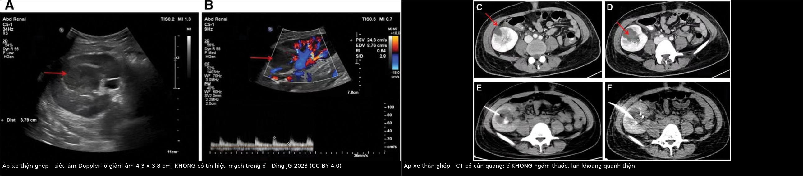
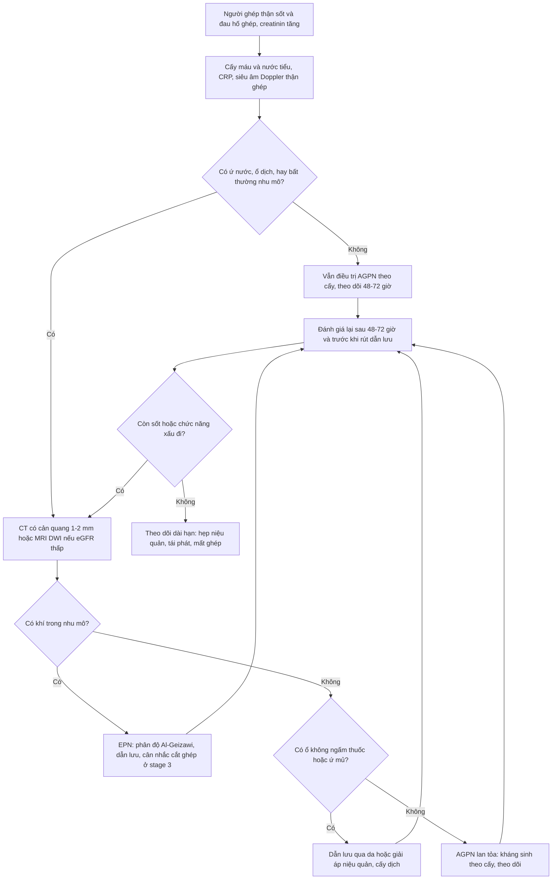
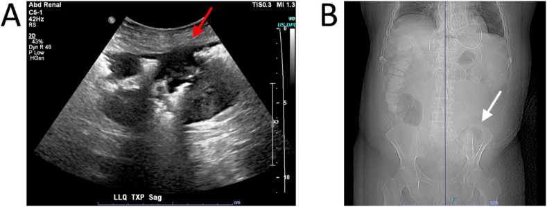
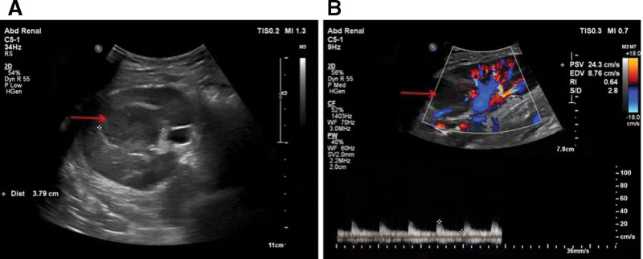

# 3130 — Viêm thận–bể thận cấp ở thận ghép / Acute graft pyelonephritis (AGPN)

**Tags:** `pattern:thap-tang-am` `pattern:khuyet-thuoc-nhu-mo` `pattern:o-ap-xe` `pattern:khi-trong-nhu-mo` `pattern:than-ghep-to` `vung:than-ghep` `vung:he-nieu` `protocol:SA-than-ghep` `protocol:CT-co-can-quang` `protocol:MRI-DWI` `score:Al-Geizawi`

**Mức chắc chắn (certainty):** tổng hợp y văn (literature synthesis) — số liệu từ **9.052 người ghép thận–tụy** (PMC8998071), **939 ca ghép với 130 đợt AGPN xác nhận bằng MRI** (PMC11130444), **tổng quan nhiễm khuẩn niệu ở người ghép** (PMC11596552), **ca áp-xe thận ghép được dẫn lưu qua CT** (PMC10101242), **ca viêm thận–bể thận khí (EPN) ở thận ghép** (PMC8085696, PMC13019114). Ngưỡng **dẫn lưu ≥ 3 cm** và **thời gian kháng sinh** là **thực hành**, không phải số liệu từ thử nghiệm ngẫu nhiên — ghi rõ.

> **Câu chốt:** thận ghép **mất thần kinh** nên **đau không điển hình**, người bệnh **ức chế miễn dịch** nên **sốt và CRP có thể mờ nhạt** — vì vậy **"thận ghép to, giảm âm, ứ nước nhẹ" + creatinin tăng** phải được coi là **AGPN cho tới khi loại trừ**, và **siêu âm bình thường không loại trừ** được. Điểm chốt điều trị không phải tên kháng sinh mà là **ổ áp-xe/khí/ứ mủ** — thứ **chỉ CT hoặc MRI thấy**.

## 1. Tổng quan bệnh học – cơ chế hình ảnh

### 1.1 Vì sao thận ghép "dễ nhiễm và khó đọc"

- **Một thận duy nhất, nằm ở hố chậu**, niệu quản **cắm vào bàng quang** (ureteroneocystostomy) — chỗ hẹp **dễ ứ**, lại có **trào ngược**; **không có thận đối bên** để bù, nên **mỗi đợt nhiễm đều là nguy cơ mất ghép**.
- **Mất thần kinh (denervation):** không có phản xạ đau thành bụng kiểu thận gốc → bệnh nhân chỉ **đau mơ hồ hố chậu**, **đau cơ thành bụng**, hoặc **chỉ sốt**.
- **Ức chế miễn dịch:** sốt có thể **thấp**, bạch cầu **không tăng**, CRP **tăng chậm**; ngược lại **nhiễm khuẩn huyết** tiến triển nhanh.
- **Dịch tễ:** tới **74%** người ghép thận có **ít nhất 1 đợt nhiễm khuẩn niệu trong năm đầu** (PMC11596552); **AGPN tích lũy 20,9%** trong 9.052 người ghép (PMC8998071).
- **Hậu quả lâu dài (số liệu định lượng):** AGPN **muộn (> 6 tháng)** tăng nguy cơ **mất ghép HR 2,25 (95% CI 1,65–3,07)**; **≥ 3 đợt** AGPN **HR 2,08 (1,17–3,69)** (PMC8998071). Trong 939 ca ghép, **130 đợt AGPN xác nhận MRI**: thể **đa ổ 73,9% vs 56,7%** và **hóa mủ/áp-xe 28,3% vs 11,7%** (nhóm donor **< 60** so với **≥ 60 tuổi**); **hẹp niệu quản là yếu tố nguy cơ duy nhất OR 2,9 (1,6–5,2)**; **eGFR giảm thêm ~6 mL/phút/1,73 m²** sau 1 năm (PMC11130444).

### 1.2 Vật lý hình ảnh: TẠI SAO viêm làm thận ghép "giảm âm, giảm ngấm thuốc"

- **Siêu âm:** viêm → **phù nề kẽ** (nước tăng) → nhu mô **giảm âm**, mất tương phản **vỏ–tủy**, thận **to ra**; vùng **áp-xe** là **ổ giảm âm/trống âm**, **không có tín hiệu Doppler** ở trung tâm (Hình 1A–B). Vì **sóng âm xuyên qua ổ dịch tốt hơn mô đặc**, ổ áp-xe còn làm **tăng âm phía sau (through-transmission)**.
- **CT có cản quang:** vùng viêm **giảm ngấm thuốc** do **phù kẽ + co mạch + tắc ống thận bằng mảnh tế bào** → hình **"thận sọc" (striated nephrogram)**: các dải **hình nêm, giảm ngấm**, xen kẽ mô lành. **Áp-xe** = **ổ trung tâm hoại tử không ngấm thuốc (0–20 HU)** + **viền ngấm thuốc**, có thể **lan khoảng quanh thận** (Hình 2C–F).
- **Khí trong nhu mô (EPN):** khí **−1.000 HU**, thấy **sớm hơn trên CT** so với X-quang; khí trong **hệ đài–bể thận** khác khí **trong nhu mô** — vị trí quyết định phân độ và thái độ mổ.
- **MRI:** ổ áp-xe **hạn chế khuếch tán** (DWI sáng, **ADC thấp**) vì **mủ đặc, tế bào chết** cản trở chuyển động nước; đây là lý do **MRI/DWI hữu ích khi muốn tránh thuốc cản quang i-ốt** hoặc **khi CT không rõ**.

### 1.3 Ngưỡng và con số phải nhớ

| Chỉ số | Con số | Nguồn |
|---|---|---|
| Nhiễm khuẩn niệu trong năm đầu sau ghép | tới **74%** | PMC11596552 |
| AGPN tích lũy | **20,9%** (9.052 người ghép) | PMC8998071 |
| AGPN muộn → mất ghép | **HR 2,25** (1,65–3,07) | PMC8998071 |
| ≥ 3 đợt AGPN → mất ghép | **HR 2,08** (1,17–3,69) | PMC8998071 |
| Hẹp niệu quản → AGPN | **OR 2,9** (1,6–5,2) | PMC11130444 |
| Thể đa ổ / hóa mủ trên MRI | **73,9%** / **28,3%** (donor < 60 tuổi) | PMC11130444 |
| Mất chức năng thận ghép sau 1 năm | **−6 mL/phút/1,73 m²** eGFR | PMC11130444 |
| Khí thay nhu mô | **> 50%** = Al-Geizawi **stage 3** | PMC13019114 |
| Áp-xe thận ghép trong ca minh hoạ | **4,3 × 3,8 cm**, **không có tín hiệu mạch trong ổ** | PMC10101242 |

## 2. Mẫu hình + chẩn đoán phân biệt theo vị trí và thời gian (Gamut)

- **Theo mẫu hình:**
  - **Thận ghép to, giảm âm lan tỏa, mất phân biệt vỏ–tủy:** AGPN, **thải ghép cấp**, **hoại tử ống thận cấp (ATN)**, **huyết khối tĩnh mạch ghép**, **ứ nước**.
  - **Ổ khu trú không ngấm thuốc:** **áp-xe**, **nhồi máu hình nêm**, **viêm thận khu trú (lobar nephronia)**, u (PTLD, UTUC — bài 1750).
  - **Khí trong nhu mô:** **EPN** (thường đái tháo đường, tắc nghẽn, thận ghép suy chức năng).
  - **Dịch quanh thận:** **áp-xe quanh thận**, **urinoma**, **máu tụ**, **lymphocele**.
- **Theo thời điểm sau ghép:** **< 1 tháng** (ATN, biến chứng mạch, rò nước tiểu), **1–6 tháng** (thải ghép cấp, BK virus, AGPN), **> 6 tháng** (AGPN muộn, hẹp niệu quản, bệnh thận ghép mạn).
- **Mnemonic "POST-TRANSPLANT"** cho thận ghép to + sốt: **P**yelonephritis, **O**bstruction, **S**tenosis mạch, **T**hrombosis tĩnh mạch, **T**ubular necrosis, **R**ejection, **A**bscess, **N**eoplasia (PTLD/UTUC), **S**urgical collection (urinoma/lymphocele), **P**erigraft hematoma, **L**ithiasis, **A**ntibiotic toxicity, **N**ephrotoxicity (ức chế miễn dịch), **T**ransplant torsion.

## 3. Bảng so sánh phân biệt (ma trận đối chiếu)

| Thực thể (entity) | Hình ảnh điển hình | Chốt vào (rule-in) | Chốt loại (rule-out) | Gợi ý xác nhận |
|---|---|---|---|---|
| **AGPN không hóa mủ** | Thận ghép to, **giảm âm lan tỏa**, **"thận sọc"** thì vỏ–cửa; viêm quanh thận nhẹ | **Sốt/đau hố ghép + cấy niệu dương + hình ảnh viêm lan tỏa** | **Không có bất thường nhu mô và không ứ nước** → vẫn **không loại trừ** (siêu âm nhạy kém) | Cấy máu + niệu; CT nếu nặng/không đáp ứng |
| **Áp-xe thận ghép** | **Ổ không ngấm thuốc + viền ngấm**, có thể **khí**, **lan khoảng quanh thận**; Doppler **không có tín hiệu trong ổ** | **Sốt > 72 giờ dù kháng sinh + ổ dịch khu trú trên CT/MRI** | Ổ **ngấm thuốc đều, có mạch trong** → nghĩ mô đặc/u, không phải áp-xe | CT có cản quang; MRI/DWI; **chọc hút/dẫn lưu để cấy** |
| **EPN thận ghép** | **Khí trong nhu mô** (−1.000 HU) ± mức khí–dịch; **Al-Geizawi 1–3** | **Khí trong nhu mô trên CT + sốc nhiễm khuẩn** | Khí **chỉ trong hệ đài–bể thận** = stage 1, tiên lượng khác | CT; cấy máu/niệu; hội chẩn ngoại–ghép |
| **Ứ mủ do hẹp niệu quản** | **Giãn đài–bể thận ghép**, **mức dịch**, thành niệu quản dày; hẹp tại miệng nối | **Creatinin tăng + ứ nước + sốt** | Không giãn hệ đài–bể → ít nghĩ tắc nghẽn | Siêu âm + CT niệu đồ; **dẫn lưu/mở thông trước** |
| **BKPyVAN** | Thận ghép **không to**, có thể **ổ giảm âm dưới bao**, **ứ nước lệch trục**; **không có khí** | **BK DNAemia cao + sinh thiết có SV40 lớn T** | **Cấy niệu âm, không sốt** → nghiêng virus/thải ghép | PCR BK; sinh thiết (bài 3096) |
| **Thải ghép cấp** | Thận **to, giảm âm**, tăng tín hiệu T2, **ngấm thuốc không đều**; **RI tăng** | **Creatinin tăng nhanh, không sốt, cấy âm**; đáp ứng corticoid | **Sốt + cấy dương + ổ áp-xe** → nhiễm trùng | Sinh thiết; Doppler; loại trừ nhiễm |
| **Nhồi máu thận ghép** | **Vùng hình nêm không ngấm thuốc**, bờ rõ, **không có mạch** | **Đau đột ngột + mất phổ vùng nhu mô**; có thể kèm huyết khối | Ổ **có viền ngấm + sốt** → áp-xe | Doppler/CTA; theo dõi |
| **Urinoma/lymphocele** | Ổ dịch **quanh thận**, **không viền**, **không khí**, hình đa thùy | **Creatinin dịch cao hơn huyết thanh (urinoma)**; không sốt | **Có viền ngấm + khí + sốt** → áp-xe | Chọc hút; CT thì muộn |

*Trái: siêu âm Doppler — ổ **giảm âm 4,3 × 3,8 cm**, **không có tín hiệu mạch trong ổ** (mũi tên), mạch nhu mô còn (RI 0,64). Phải: CT có cản quang — ổ **không ngấm thuốc** lan **khoảng quanh thận** (C–D), đặt **dẫn lưu pigtail** (E–F). Ảnh ghép letterbox, giữ nguyên tỷ lệ; Ding JG 2023, CC BY 4.0.*

## 4. Protocol chụp + phân độ + ngưỡng xử trí

### 4.1 Chọn phương thức theo câu hỏi lâm sàng

| Câu hỏi | Phương thức đầu tay | Kỹ thuật/ngưỡng |
|---|---|---|
| Có ứ nước, có ổ dịch? | **Siêu âm B-mode + Doppler** tại giường | đo **kích thước thận ghép**, **độ dày nhu mô**, **đài bể thận**, **RI**; **so với baseline** |
| Có áp-xe/khí/hẹp niệu quản? | **CT có cản quang** (2 thì: động mạch + cửa) | lát **1–2 mm**; đánh giá **nhu mô, khoảng quanh thận, hệ đài–bể, niệu quản, mạch ghép**; thêm **thì muộn** nếu nghi tắc |
| Nghi áp-xe mà eGFR thấp/lặp lại | **MRI + DWI/ADC** | **ADC thấp** trong ổ mủ; tránh gadolinium khi suy thận nặng |
| Không đáp ứng sau 48–72 giờ | **CT/MRI lại** | tìm **ổ áp-xe mới, khí, tắc nghẽn, huyết khối** — không đổi kháng sinh mù |

### 4.2 Phân độ và ngưỡng can thiệp

- **AGPN đơn giản (không ổ đặc hiệu):** kháng sinh theo cấy, **theo dõi 48–72 giờ**; **7–14 ngày** tùy mức nặng (thực hành, bằng chứng ở thận ghép còn mỏng).
- **Áp-xe thận ghép:** **dẫn lưu qua da dưới hướng dẫn CT/siêu âm** khi ổ **≥ 3 cm**, hoặc **sốt > 72 giờ** dù kháng sinh đúng, hoặc **lan khoảng quanh thận**; **cấy dịch hút** để chỉnh kháng sinh. Ca minh hoạ: ổ **4,3 × 3,8 cm**, dẫn lưu pigtail + kháng sinh → **hết hoàn toàn sau 1 tháng**, chức năng ghép hồi phục (PMC10101242).
- **EPN (Al-Geizawi):** **stage 1** (khí trong hệ đài–bể) — kháng sinh + dẫn lưu; **stage 2** (< 50% nhu mô, viêm quanh thận hạn chế, nhiễm khuẩn kiểm soát) — dẫn lưu ± cân nhắc cắt ghép; **stage 3** (> 50% nhu mô, viêm quanh thận lan rộng, sốc/nhiều cơ quan) — thường **phải cắt thận ghép** (PMC13019114).
- **Hẹp niệu quản/tắc nghẽn:** **giải áp trước** (dẫn lưu qua da hoặc stent niệu quản), rồi mới xử lý hẹp (bài 3011) — vì **ứ mủ dưới áp lực** làm nhiễm khuẩn huyết kéo dài.
- **Nguyên tắc ức chế miễn dịch:** **không giảm mù** khi chưa biết nguyên nhân; **giảm khi có bằng chứng BK/thải ghép** theo phác đồ, còn **nhiễm khuẩn** thì điều trị kháng sinh và **theo dõi chức năng ghép**.

## 5. Biến thể bình thường và cạm bẫy

- **Siêu âm bình thường không loại trừ AGPN:** độ nhạy của siêu âm cho viêm nhu mô **thấp**; sốt + cấy dương vẫn phải điều trị dù ảnh sạch.
- **"Thận sọc" không đặc hiệu:** gặp cả trong **thải ghép, tắc nghẽn, ATN, nhiễm** — phải ghép với **cấy, sốt, thời điểm sau ghép**.
- **Dịch quanh thận sớm sau mổ là bình thường:** **lymphocele/máu tụ** ở 2–4 tuần đầu thường **không viền, không khí, không sốt**; chỉ gọi áp-xe khi có **viền ngấm + khí + lâm sàng**.
- **Khí có thể do can thiệp:** sau **sinh thiết, đốt, đặt dẫn lưu, mổ** có thể có **khí vài ngày**; **khí tăng lên** hoặc **khí trong nhu mô > 50%** mới là EPN.
- **Nhầm với huyết khối tĩnh mạch ghép:** thận to, đau, chức năng xấu — nhưng **mất phổ tĩnh mạch/đảo dòng tâm trương** trên Doppler (bài 3122); **điều trị khác hoàn toàn**.
- **DWI "sáng" chưa chắc là mủ:** **T2 shine-through** — luôn xem **ADC**; ổ hoại tử/u cũng có thể hạn chế khuếch tán nhẹ.
- **Đừng quên ổ thứ hai:** **áp-xe + hẹp niệu quản** thường đi cùng (OR 2,9); giải áp xong mới đánh giá được nhu mô.
- **Cắt thận ghép không phải "thất bại" muộn:** ở **stage 3** hoặc thận **đã mất chức năng**, **cắt ghép sớm** cứu mạng; ca thận ghép **không còn chức năng** vẫn có thể EPN **dù đã ngừng ức chế miễn dịch** (PMC13019114).

## 6. Tự lượng giá — Blind Quiz

**Ca 1 — Người ghép thận 15 tháng, sốt 4 ngày, đau hố ghép, creatinin tăng; cấy niệu E. coli ESBL(+). Siêu âm và CT dưới đây. Chẩn đoán và bước tiếp?**

- Câu hỏi: Mô tả ổ tổn thương trên siêu âm và CT. Vì sao **không đủ** để chỉ tăng kháng sinh? Ngưỡng nào buộc phải can thiệp?

<b>Bấm để hiện đáp án</b>

- Siêu âm Doppler: **ổ giảm âm 4,3 × 3,8 cm**, **không có tín hiệu mạch trong ổ**; CT có cản quang: **ổ không ngấm thuốc**, **lan khoảng quanh thận** → **áp-xe thận ghép**.
- Kháng sinh đơn thuần **không thấm vào ổ mủ**; **sốt > 72 giờ** dù kháng sinh đúng + ổ **≥ 3 cm** là chỉ định **dẫn lưu qua da** và **cấy dịch**.
- Sau dẫn lưu: theo dõi **48–72 giờ**, rút dẫn lưu khi hết dịch; tìm **hẹp niệu quản** đi kèm (OR 2,9).
- Nguồn: Ding JG et al., *Medicine (Baltimore)* 2023 (PMC10101242), CC BY 4.0.

**Ca 2 — Người ghép thận, đái tháo đường, sốt và đau hố ghép; X-quang bụng và siêu âm dưới đây. Vì sao phải chụp CT ngay?**

- Câu hỏi: Hai ảnh cho thấy gì? Khí này khác khí trong **hệ đài–bể thận** ở điểm nào và khác biệt đó đổi thái độ điều trị ra sao?

<b>Bấm để hiện đáp án</b>

- (A) Siêu âm: **khí trong nhu mô** (ổ tăng âm mạnh kèm bóng lưng bẩn, mũi tên đỏ); (B) X-quang bụng: **khí ở hố chậu trái** trong bóng thận ghép (mũi tên trắng).
- Khí **trong nhu mô** = **EPN**, không phải khí đường niệu; CT xác định **mức thay nhu mô** để phân độ **Al-Geizawi** — **> 50% nhu mô = stage 3**, thường phải **cắt thận ghép**.
- Phải chụp CT **ngay** vì X-quang/ siêu âm không đủ để phân độ và **không loại trừ** khí lan khoảng quanh thận.
- Nguồn: Ambinder D et al., *Urol Case Rep* 2021 (PMC8085696), CC BY-NC-ND 4.0 — ảnh nguyên bản.

**Ca 3 — Người ghép thận sốt nhẹ, đau hố ghép; siêu âm Doppler cho ổ dưới đây. Có được kết luận ngay là áp-xe và tăng kháng sinh?**

- Câu hỏi: Mô tả ổ trên siêu âm. Ba chẩn đoán phân biệt của **một ổ giảm âm không có mạch**? Khi nào mới được gọi là áp-xe?

<b>Bấm để hiện đáp án</b>

- Ổ **giảm âm, bờ không đều**, **không có tín hiệu Doppler trong ổ** — gợi ý **dịch/hoại tử**, nhưng **không đặc hiệu**.
- Ba hàng phân biệt: **áp-xe**, **nhồi máu thận ghép hình nêm**, **lymphocele/urinoma/máu tụ quanh thận** — cộng thêm **viêm thận khu trú** hoặc u.
- Chỉ gọi **áp-xe** khi có **ổ không ngấm thuốc + viền ngấm trên CT/MRI**, kèm **sốt > 72 giờ** hoặc **cấy dịch dương**; siêu âm đơn thuần **không đủ** — cần **CT có cản quang** (hoặc MRI/DWI nếu eGFR thấp).
- Đừng giảm ức chế miễn dịch mù: nếu là **thải ghép cấp** thì giảm thuốc = **mất ghép**; nếu là **BKPyVAN** thì mới giảm theo phác đồ (bài 3096).
- Nguồn: Ding JG et al., *Medicine (Baltimore)* 2023 (PMC10101242), CC BY 4.0.

## Bài liên quan chéo

- [3096 – Bệnh thận do BK polyomavirus sau ghép thận](../3096-benh-than-do-bk-polyomavirus/lesson.md)
- [3011 – Biến chứng niệu quản sau ghép thận: hẹp miệng nối & rò nước tiểu](../3011-bien-chung-nieu-quan-sau-ghep-than/lesson.md)
- [3122 – Huyết khối tĩnh mạch thận ghép cấp](../3122-huyet-khoi-tinh-mach-than-ghep-cap/lesson.md)
- [1721 – Nhiễm khuẩn stent niệu quản: biofilm, rút stent ≤ 3 tuần ở thận ghép](../1721-nhiem-khuan-stent-nieu-quan/lesson.md)
- [1750 – UTUC ở bệnh nhân thận ghép: kẻ bắt chước "viêm thận–bể thận" và BK virus](../1750-utuc-than-ghep/lesson.md)

> Không dùng để chẩn đoán độc lập khi chưa có người hướng dẫn.
