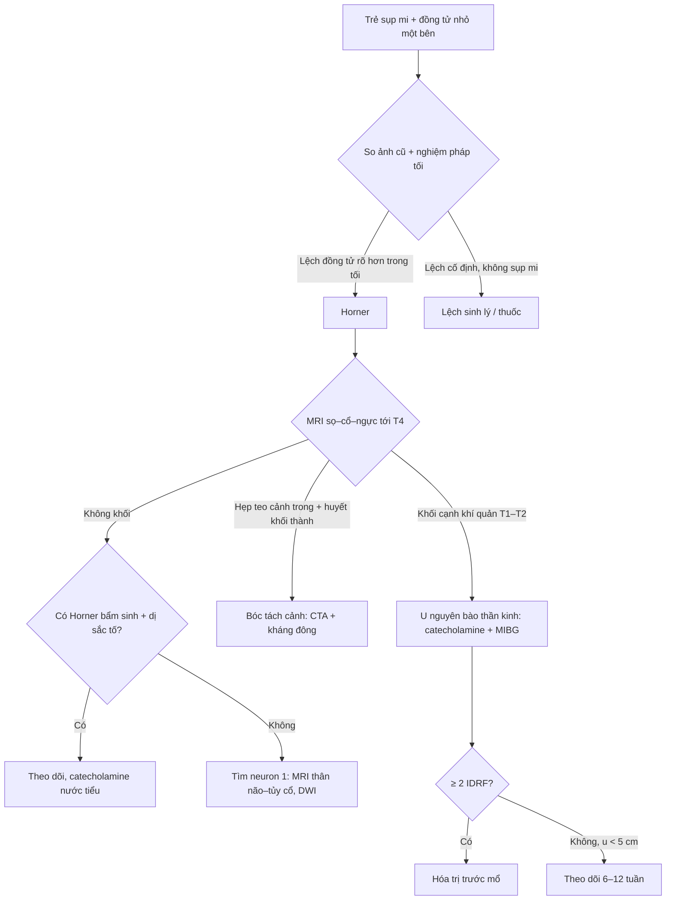
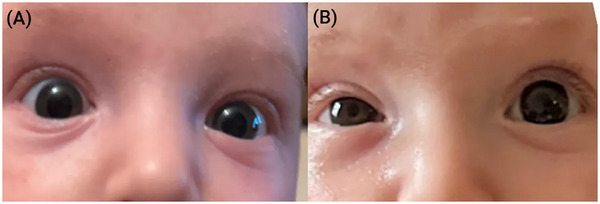
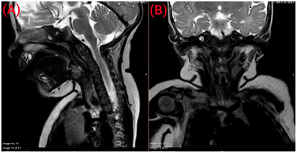
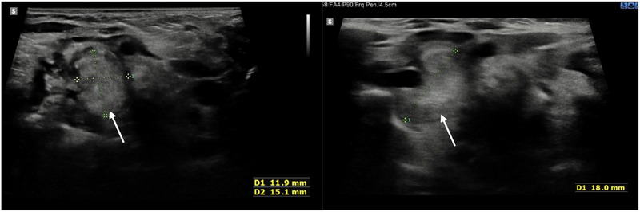

# 3131 — Hội chứng Horner ở trẻ: đồng tử nhỏ + sụp mi là chỉ định chụp MRI cổ–trung thất, không phải "lệch đồng tử lành tính"

**Tags:** `pattern:horner` `pattern:dong-tu-khong-deu` `pattern:khoi-trung-that-tren` `pattern:mot-ben` `vung:co` `vung:trung-that` `protocol:MRI-co-nguc` `incidentaloma:khong` `score:INRG`
**Mức chắc chắn (certainty):** tổng hợp y văn (literature synthesis) — ghép **ca nguyên văn 18 tuần tuổi phát hiện u nguyên bào thần kinh cổ–trung thất** (*Pediatric Investigation* 2025, PMCID **PMC12175629**, CC BY-NC-ND 4.0), **ca Horner do đặt catheter tĩnh mạch cảnh trong ở nhũ nhi** (*Int J Surg Case Rep* 2026, PMCID **PMC13652411**, CC BY-SA 4.0) và **bài tổng quan phân tầng nguy cơ u nguyên bào thần kinh** (*J Clin Med* 2026, PMCID **PMC12898582**, CC BY 4.0).

> **Câu chốt:** trẻ **sụp mi + đồng tử nhỏ cùng bên**, lệch đồng tử **rõ hơn trong tối**, **không đỏ mắt, không đau** = **Horner**, và ở trẻ em đó là **chỉ định chụp toàn bộ đường giao cảm**: **MRI sọ–cổ–trung thất tới T4** (không phải "MRI sọ" đơn thuần), kèm **catecholamine nước tiểu**. Ba con số định khung: **10% Horner mắc phải ở trẻ do khối ác tính, thường là u nguyên bào thần kinh trung thất** (PMC12175629); **Horner thể không điển hình (chỉ một dấu, từng lúc) chiếm tới 40% và làm nguy cơ u tăng gấp 4 lần** (PMC12175629); **u nguyên bào thần kinh chiếm ~15% tử vong do ung thư ở trẻ** và **sống 5 năm < 50% ở nhóm nguy cơ cao** (PMC12898582). Bỏ sót = **chậm chẩn đoán ung thư**, không phải "lệch đồng tử vô hại".

## 1. Tổng quan bệnh học – cơ chế hình ảnh (TẠI SAO)

### 1.1. Ba neuron — ba vùng cần chụp, và vì sao không được rút gọn

- **Neuron 1 (trung ương):** từ vùng dưới đồi sau bên → **bó giao cảm xuống tủy cổ** → **trung tâm Budge C8–T2**. Tổn thương: thân não, tủy cổ, rỗng tủy (syringomyelia), nhồi máu/máu tụ.
- **Neuron 2 (tiền hạch):** thoát **T1** → **chuỗi giao cảm cổ** → **hạch cổ trên (C3–C4)**. Đây là **đoạn hay bị u nguyên bào thần kinh chèn ép nhất**, vì u xuất phát từ chính mầm giao cảm cạnh sống/trung thất trên.
- **Neuron 3 (hậu hạch):** hạch cổ trên → **đám rối quanh động mạch cảnh trong** → xoang hang → **ổ mắt**, chi phối **cơ giãn đồng tử** và **cơ Müller** (nâng mi).
- **TẠI SAO hình ảnh phải phủ cả 3 tầng:** một khối **18 × 11 × 13 mm** ở **ngang T1/T2, cạnh khí quản** (ca PMC12175629) chỉ lộ ra khi **trường chụp xuống tới trung thất trên**; **MRI sọ đơn thuần sẽ âm tính giả** và trẻ bị trả về với nhãn "lệch đồng tử lành tính".

### 1.2. TẠI SAO lệch đồng tử rõ hơn trong tối — vật lý của đồng tử

- Đồng tử bình thường **giãn trong tối** nhờ **cơ giãn đồng tử** (giao cảm); đồng tử Horner **không giãn được** → **hiệu số anisocoria tăng khi tắt đèn**. Đây là **nghiệm pháp tại giường** rẻ nhất và là lý do ảnh chụp trong phòng tối (ánh sáng mờ) thể hiện rõ hơn ảnh chụp ngoài trời.
- **Sụp mi** do liệt **cơ Müller** (chỉ **1–2 mm**), không phải liệt cơ nâng mi chính → **sụp mi nhẹ**; kèm **giả lồi mắt (apparent enophthalmos)** vì khe mi hẹp. Chính tổ hợp này bị đọc nhầm thành **phù quanh ổ mắt / viêm mô tế bào trước vách** — đúng như ca PMC12175629 (trẻ 18 tuần vào viện vì "phù quanh ổ mắt phải", CRP bình thường, điều trị ceftriaxone không cải thiện).
- **Dị sắc tố mống mắt (iris heterochromia)** chỉ có ở **Horner bẩm sinh/khi còn nhỏ** (mống mắt chưa đủ sắc tố) — dấu hiệu **định khu thời gian**, không phải định khu giải phẫu.
- **TẠI SAO khối u gây Horner lại thường canxi hóa:** u nguyên bào thần kinh có **hoại tử + canxi hóa**; trên siêu âm ca này là **cấu trúc không đồng nhất, có ổ tăng âm nhỏ nghi canxi hóa và tưới máu không đều**.

### 1.3. Ngưỡng định lượng nằm lòng

| Đại lượng | Số liệu | Nguồn |
|---|---|---|
| Horner ở trẻ < 19 tuổi | **1,42–2,54/100.000** | PMC12175629 |
| Nguyên nhân mắc phải do khối ác tính | **10%**, thường **u nguyên bào thần kinh trung thất** (chèn neuron 2) | PMC12175629 |
| Horner không điển hình (một dấu, từng lúc) | tới **40%** ca nhi; nguy cơ u **× 4** | PMC12175629 |
| Kích thước khối trong ca | **18 × 11 × 13 mm**, ngang **T1/T2**, cạnh khí quản | PMC12175629 |
| VMA + HVA nước tiểu | độ nhạy **84%**; **29%** ca âm tính đã ở **giai đoạn 4** | PMC12175629 |
| Panel **8 catecholamine** nước tiểu | độ nhạy **95%**; u **không bắt MIBG**: **33% → 89%** | PMC12175629 |
| Apraclonidine 0,5% | độ nhạy **93%** (cocaine **40%**); **tránh ở trẻ < 1 tuổi** (ngưng thở, nhịp chậm, tụt huyết áp) | PMC12175629 |
| U nguyên bào thần kinh | **7–10%** ung thư trẻ; tuổi trung vị **17 tháng**; **~15%** tử vong ung thư trẻ | PMC12898582 |
| Sống 5 năm | nguy cơ thấp/trung bình **~95%**; nguy cơ cao **< 50%** | PMC12898582 |
| Theo dõi u nhỏ, nguy cơ thấp | chụp lại **6–12 tuần**; u **< 5 cm** ở trẻ nhỏ có thể theo dõi **không sinh thiết** | PMC12175629 |
| Horner sau can thiệp tĩnh mạch cảnh trong | xuất hiện **< 24 giờ**, tự hết **~7 ngày** (ca 38 ngày tuổi, 2,7 kg) | PMC13652411 |

- **Chưa rõ — cần tra:** không có ngưỡng **mm lệch đồng tử** được thẩm định riêng cho trẻ; thực hành dùng **so sánh ảnh cũ + nghiệm pháp ánh sáng tối**, không dựa vào một con số.

## 2. Mẫu hình + chẩn đoán phân biệt theo vị trí (Gamut)

- **Neuron 2 — cổ/trung thất trên (hay gặp nhất ở trẻ):** **u nguyên bào thần kinh** (cervicothoracic, thường canxi hóa, bắt MIBG), **hạch thần kinh (ganglioneuroma)** lành tính, **u Pancoast/đỉnh phổi** (bài **1652**), **chấn thương đám rối cánh tay/sinh ngạt**, **can thiệp tĩnh mạch cảnh trong – catheter trung tâm** (bài **3044**, ca PMC13652411), **phẫu thuật tuyến giáp/cổ**.
- **Neuron 3 — động mạch cảnh trong/xoang hang:** **bóc tách động mạch cảnh** (bài **1773**, **3046**) — thể **đau cổ + Horner**, phải **CTA**; **phình/xơ xoang hang**, **viêm quanh ổ mắt**.
- **Neuron 1 — thân não/tủy cổ:** **nhồi máu hành não bên**, **rỗng tủy**, **chấn thương tủy cổ**, **u thân não** — thường kèm dấu thần kinh khác (nhìn đôi, mất cảm giác đối bên).
- **Bẩm sinh:** **chấn thương sinh (forceps/khó sinh)** — Horner **không tiến triển**, có **dị sắc tố mống mắt**, không khối; vẫn cần **MRI để loại u** trước khi kết luận.
- **Không phải Horner:** **lệch đồng tử sinh lý** (nhỏ < 1 mm, phản xạ đều, không sụp mi), **dùng thuốc nhỏ mắt**, **viêm mống mắt dị sắc (Fuchs)**, **sụp mi do bệnh cơ** (không miosis).
- Gợi nhớ **HORNER**: **H**ạch cổ trên/u trung thất, **O**cular (miosis + ptosis), **R**ễ T1, **N**euroblastoma, **E**nophthalmos giả, **R**à soát ảnh cũ.

## 3. Bảng so sánh phân biệt (ma trận đối chiếu)

| Thực thể (entity) | Hình ảnh điển hình | Chốt vào (rule-in) | Chốt loại (rule-out) | Gợi ý xác nhận |
|---|---|---|---|---|
| U nguyên bào thần kinh cổ–trung thất | Khối **cạnh khí quản, ngang T1–T2**, T2 không đồng nhất, **canxi hóa** (US: ổ tăng âm nhỏ), tưới máu không đều | **Khối dọc chuỗi giao cảm + Horner mới xuất hiện + catecholamine nước tiểu** | Khối **ngoài trục giao cảm** (tuyến giáp, nang giáp lưỡi) không gây Horner | MRI cổ–ngực + **panel 8 catecholamine** + **MIBG** |
| Ganglioneuroma (lành) | Khối **dài, bờ nhẵn**, T2 sáng, ngấm thuốc chậm, **không canxi hóa thô** | **Horner mạn, không tiến triển, khối bờ đẹp** | Xâm lấn mạch/khí quản, phát triển nhanh → nghĩ ác | Mô bệnh/Sinh thiết khi mổ |
| Bóc tách động mạch cảnh trong | **Hẹp teo dài (string sign)**, giả lòng, **huyết khối trong thành T1 fat-sat**, nhồi máu trên DWI | **Đau cổ/mặt cùng bên + Horner + CTA bất thường** | CTA bình thường + không đau → ít nghĩ bóc tách | CTA cổ; MRI T1 fat-sat; DWI |
| Horner sau catheter TM cảnh trong | **Không khối, không máu tụ** trên siêu âm tại giường; Horner trong **24 giờ** sau thủ thuật | **Thời gian chặt với thủ thuật + hồi phục trong ~7 ngày** | Khối/thâm nhiễm quanh cảnh → phải MRI | Siêu âm tại giường + theo dõi thần kinh–mắt |
| Horner bẩm sinh (sinh khó) | Không khối; **dị sắc tố mống mắt** cùng bên | **Horner từ lúc sinh, mống mắt nhạt màu, không tiến triển** | **MRI âm tính vẫn chưa loại u** — phải làm catecholamine | MRI + catecholamine nước tiểu |
| U Pancoast/đỉnh phổi | Khối **đỉnh phổi** xâm lấn hạch giao cảm, **hủy xương sườn 1–2** | **Đau vai–cánh tay + Horner + khối đỉnh phổi** | Khối trung thất trên đơn thuần → không phải Pancoast | MRI ngực + CT xương |

## 4. Protocol chụp + hệ phân độ

### 4.1. Quy trình hình ảnh (không rút gọn)

- **Bước 1 — xác nhận Horner tại giường:** so ảnh cũ, đo khe mi, xem **lệch đồng tử trong tối vs sáng**. **Apraclonidine 0,5%** chỉ dùng **≥ 1 tuổi**; **< 1 tuổi** dùng **cocaine 4–10%** nếu có, hoặc **đi thẳng vào hình ảnh** khi nghi ngờ cao.
- **Bước 2 — MRI sọ–cổ–ngực (1,5 T trở lên):** T1W, T2W, **STIR/T2 fat-sat** (khối, phù), **DWI** (nhồi máu), **T1 fat-sat sau tiêm** (hoại tử, xâm lấn); trường chụp **từ nền sọ tới T4** — đủ để phủ neuron 2.
- **Bước 3 — siêu âm cổ tại giường:** khối nông, **đo 3 chiều**, tìm **canxi hóa** và **tưới máu**; siêu âm **không thay** MRI vì không thấy phần trung thất sau khí quản.
- **Bước 4 — CTA cổ** khi **Horner + đau cổ/hàm**, **chấn thương**, hoặc **MRI có bất thường quanh động mạch cảnh** (bóc tách, giả phình).
- **Bước 5 — xét nghiệm:** **panel 8 catecholamine nước tiểu** (VMA, HVA, 3-methoxytyramine, dopamine, epinephrine, metanephrine, norepinephrine, normetanephrine) — nhạy **95%**, tốt hơn **VMA/HVA đơn thuần 84%**; **MIBG** để tìm ổ di căn.

### 4.2. Phân tầng u nguyên bào thần kinh theo hình ảnh (INRG, 2009)

- **INRGSS dựa trên hình ảnh TRƯỚC mổ**, không dựa kết quả phẫu thuật: **L1** = khu trú **1 khoang**, **không IDRF**; **L2** = khu trú nhưng **có ≥ 1 IDRF** (bọc mạch lớn, xâm lấn cơ quan sống); **M** = di căn xa; **MS** = < 18 tháng, di căn **da/gan/tủy xương < 10%** tế bào non.
- **Ngưỡng xử trí:** **≥ 2 IDRF** → cân nhắc **hóa trị trước mổ**; **u < 5 cm, nguy cơ thấp, trẻ nhỏ** → có thể **theo dõi không sinh thiết** (COG NCT02176867), **chụp lại 6–12 tuần**.

## 5. Biến thể bình thường và cạm bẫy

- **"Lệch đồng tử" sinh lý:** lệch < 1 mm, **hai bên giãn đều trong tối**, không sụp mi, không giả lồi mắt — **không chụp**. Cạm bẫy ngược lại: **Horner thật bị bỏ qua vì phòng khám sáng, đồng tử hai bên gần bằng nhau**.
- **Sụp mi nhẹ + giả lồi mắt bị đọc thành "phù quanh ổ mắt":** ca PMC12175629 vào viện vì **phù quanh ổ mắt**, **CRP bình thường**, kháng sinh không đỡ. Quy tắc: **phù quanh ổ mắt không đỏ, không đau, CRP bình thường → soi đồng tử**.
- **MRI sọ đơn thuần = âm tính giả:** khối nằm ở **T1/T2**, ngoài trường chụp sọ thường quy. Luôn ghi chỉ định **"MRI sọ–cổ–ngực, tới T4"**.
- **Horner "từng lúc" (intermittent):** tới **40%** ca nhi; đừng vì "hôm nay cân" mà kết luận bình thường — **nguy cơ u × 4**.
- **Catecholamine âm không loại u:** VMA/HVA **âm ở 29%** ca đã giai đoạn 4 → dùng **panel 8 chất**; **MIBG âm** cũng gặp ở u không bắt MIBG.
- **Sau can thiệp cổ:** Horner **trong 24 giờ** sau đặt catheter TM cảnh trong/bướu giáp là **biến chứng đã biết**, thường **tự hết ~7 ngày**; siêu âm tại giường loại **máu tụ** (ca PMC13652411). Không được biến nó thành "không cần chụp gì" khi có khối/thâm nhiễm.
- **Bẫy thỏa mãn tìm kiếm (satisfaction of search):** thấy **u trung thất** rồi dừng, bỏ qua **hạch giao cảm hai bên**, **di căn xương**, và **bóc tách cảnh đồng thời**.

## 6. Tự lượng giá — Blind Quiz

**Ca 1 — Nhũ nhi 18 tuần, "phù quanh ổ mắt phải" 4 ngày, không sốt, CRP bình thường. Nhìn ảnh, mô tả trước.**

- Gợi ý lâm sàng: trẻ khỏe, không chấn thương, không sinh khó; mắt không đỏ, không chảy mủ.
- Câu hỏi: dấu hiệu ở mắt phải? Vì sao "phù quanh ổ mắt" lại là ảo giác? Cần chụp gì và tới đâu?

<b>Bấm để hiện đáp án (findings + chẩn đoán)</b>

- Dấu hiệu: **sụp mi phải nhẹ + đồng tử phải nhỏ hơn**, khe mi hẹp làm mắt như "lõm vào" (**giả lồi mắt**) — không có phù/mi đỏ thật.
- Chẩn đoán: **Horner phải mới xuất hiện** — phải chụp **MRI sọ–cổ–ngực tới T4**, không phải MRI sọ.
- Nguồn ảnh: *Pediatric Investigation* 2025 (PMC12175629), CC BY-NC-ND 4.0, nguyên bản không chỉnh sửa.

- Câu hỏi tiếp: khối nằm ở đâu, tín hiệu gì, chẩn đoán nào đứng đầu?

<b>Bấm để hiện đáp án</b>

- Dấu hiệu: khối mô mềm **trước thân đốt T1/T2, cạnh khí quản, trong trung thất trên**, **T2 rất thấp bên trong** với **viền tín hiệu trung gian**; đẩy thực quản, lan ra sau nguyên ủy động mạch dưới đòn phải và động mạch cảnh chung.
- Chẩn đoán: **u nguyên bào thần kinh cổ–trung thất** (chèn neuron 2) — xác nhận bằng **catecholamine nước tiểu + MIBG**, không sinh thiết nếu u nhỏ nguy cơ thấp.
- Nguồn ảnh: *Pediatric Investigation* 2025 (PMC12175629), CC BY-NC-ND 4.0.

<b>Bấm để hiện đáp án</b>

- Dấu hiệu: khối **không đồng nhất**, **tưới máu không đều**, vài **ổ tăng âm nhỏ** nghi **canxi hóa**; đo được **18 mm** chiều dài, **11 mm** ngang, **13 mm** trước–sau.
- Ý nghĩa: siêu âm **đo được khối nông** nhưng **không thấy phần trung thất sau khí quản** → vẫn cần MRI.
- Nguồn ảnh: *Pediatric Investigation* 2025 (PMC12175629), CC BY-NC-ND 4.0.

**Ca 2 — Nhũ nhi 38 ngày (2,7 kg) đặt catheter Broviac qua tĩnh mạch cảnh trong phải; 24 giờ sau mẹ thấy mắt phải "sụp".**

- Câu hỏi: cơ chế? Có cần chụp mạch ngay không? Tiên lượng?

<b>Bấm để hiện đáp án</b>

- Dấu hiệu: **sụp mi + đồng tử nhỏ + giả lồi mắt phải**, không đỏ mắt, không liệt vận nhãn; **siêu âm tại giường không có máu tụ, không tổn thương động mạch cảnh**.
- Chẩn đoán: **Horner do can thiệp tĩnh mạch cảnh trong** (tổn thương chuỗi giao cảm cổ) — **theo dõi**, hồi phục **hoàn toàn trong 7 ngày**; không cần CTA khi thăm khám thần kinh bình thường và không có dấu chèn ép.
- Nguồn: *Int J Surg Case Rep* 2026 (PMC13652411), CC BY-SA 4.0.

> Không dùng để chẩn đoán độc lập khi chưa có người hướng dẫn.

## Bài liên quan chéo
- [1652 – U đỉnh phổi / hội chứng Pancoast](../1652-co-nguc-be-loi-thoat-nguc/lesson.md)
- [1773 – Bóc tách động mạch cảnh cổ trong](../1773-boc-tach-dong-mach-canh-co/lesson.md)
- [3044 – Catheter tĩnh mạch trung tâm ở trẻ](../3044-catheter-tinh-mach-trung-tam-o-tre/lesson.md)
- [3046 – Chảy máu cam do vỡ giả phình động mạch cảnh trong xoang bướm](../3046-chay-mau-cam-do-vo-gia-phinh-dong-mach-canh-trong-xoang-buom/lesson.md)

## Ảnh
- `3131_horner-tre_Anh-sang_PMC12175629-fig1.jpg` — ảnh mặt trước/sau, PMC12175629, CC BY-NC-ND 4.0 (nguyên bản).
- `3131_horner-tre_SieuAm_PMC12175629-fig2.jpg` — siêu âm cổ, PMC12175629, CC BY-NC-ND 4.0 (nguyên bản).
- `3131_horner-tre_MRI_PMC12175629-fig3.jpg` — MRI T2 sagittal/coronal, PMC12175629, CC BY-NC-ND 4.0 (nguyên bản).
- Giấy phép **CC BY-NC-ND**: giữ **nguyên bản**, không crop/ghép/composite.
