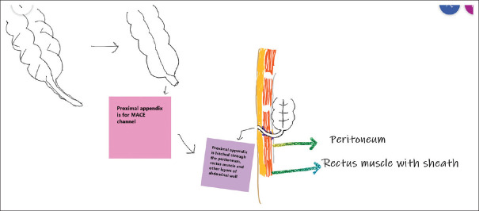
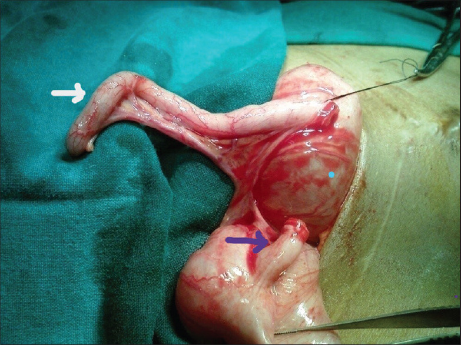
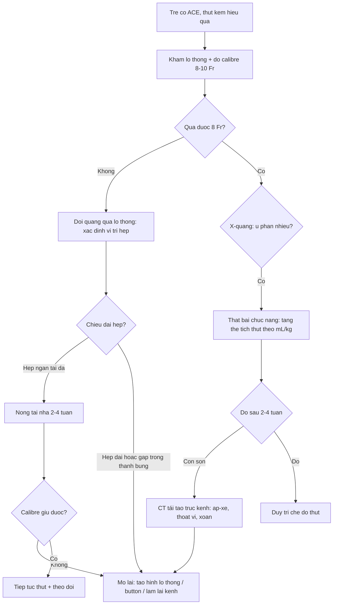
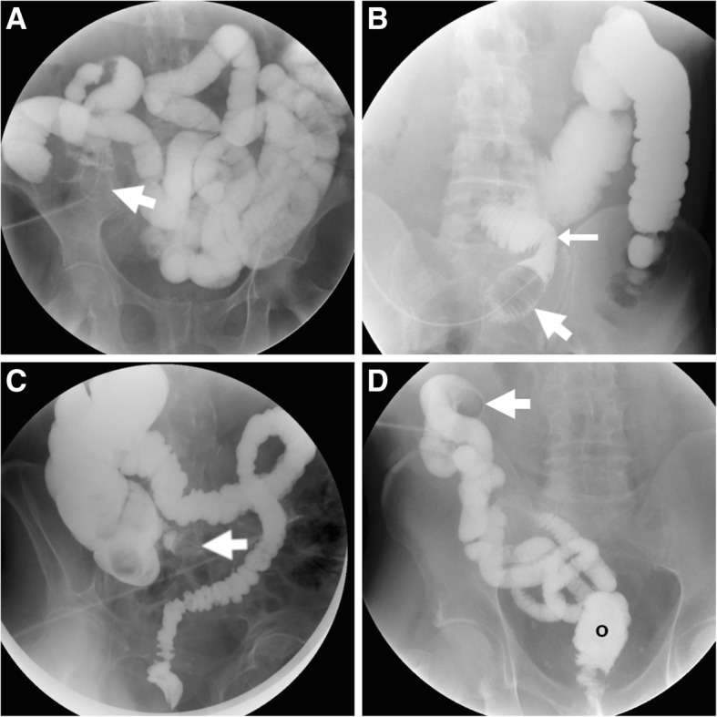
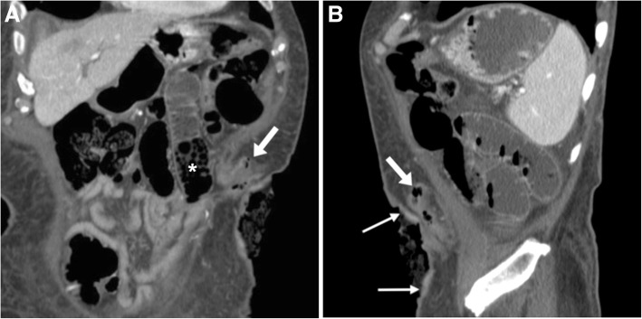

# 3132 — Biến chứng lỗ thông ACE (appendicostomy / Malone) ở trẻ: hẹp da–niêm **37,8%**, mổ lại **33,3%** — phân biệt hẹp THẬT với thất bại chức năng do ứ phân

**Tags:** `pattern:hep-lo-thong` `pattern:lo-thong-ruot` `pattern:sa-niem-mac` `pattern:u-phan` `vung:manh-trang` `vung:thanh-bung` `protocol:XR-doi-quang-qua-lo-thong` `protocol:CT-bung` `protocol:US-thanh-bung`
**Mức chắc chắn (certainty):** tổng hợp y văn (literature synthesis) — ghép **45 trẻ có appendicostomy ở Nam Phi** (Pediatr Surg Int 2026, PMC13357437), **17 trẻ mầm non dị tật hậu môn–trực tràng (ARM)** (Biomed Res Int 2013, PMC3794643), **29 trẻ MACE không van chống trào, theo dõi 11,5 năm** (J Indian Assoc Pediatr Surg 2023, PMC10455713), **35 trẻ đặt button bóng qua nội soi ổ bụng** (J Laparoendosc Adv Surg Tech 2018, PMC7364318), **31 trẻ so sánh MACE với cecostomy** (Children 2026, PMC13025410) và **kỹ thuật chụp đối quang/CT qua lỗ thông** (Insights Imaging 2019, PMC6441068). Phần **ngưỡng hình ảnh cụ thể của ACE** (calibre, góc gập) là **suy luận** từ kỹ thuật lỗ thông nói chung — ghi rõ tại chỗ; không có ca do nhóm tự chụp.

> **Câu hỏi thực hành:** bé gái **6 tuổi**, dị tật hậu môn–trực tràng đã mổ hậu môn nhân tạo, đặt **lỗ thông ACE kiểu Malone** 8 tháng trước vì són phân hằng ngày. Ba tuần nay **bơm thụt qua lỗ thông thấy nước trào ngược ra ngoài**, bụng chướng, vẫn **són phân "dày" giữa các lần thụt**. Bố mẹ xin **tăng liều thuốc thụt**. Câu hỏi: **tăng liều có đúng không, và cần chụp gì trước khi quyết định?**
> Bài chốt **ba quyết định**: **(1) lỗ thông hẹp là biến chứng thường gặp nhất và là chỉ định mổ lại số một** — hẹp da–niêm **37,8%**, mổ lại **33,3%**, trung vị **5,5 tháng** sau mổ (PMC13357437); **(2) trước khi tăng liều, phải trả lời "hẹp thật hay thất bại chức năng"** bằng **đo calibre + đối quang bơm qua lỗ thông**: kênh phải qua được **ống 8–10 Fr (2,7–3,3 mm)** — đây là tiêu chuẩn tối thiểu khi tạo kênh (PMC10136733); **(3) hẹp nhẹ xử lý bằng nong tại nhà** (7/29 ca trong loạt 11,5 năm, **24,1%**) — chỉ **~1/3** cần mổ lại, nên đừng mổ sớm (PMC10455713, PMC13357437).

## 1. Tổng quan bệnh học – cơ chế hình ảnh: vì sao lỗ thông hay hẹp ở đúng chỗ da–niêm

- **Bản chất phẫu thuật (pathology):** lỗ thông ACE (antegrade continence enema, ACE) đưa **ruột thừa (hoặc một ống tạo từ ruột non — neoappendicostomy kiểu Monti)** ra da, để bơm dịch **theo chiều xuôi** làm sạch đại tràng. Kênh gồm **3 đoạn**: **(a) lỗ da–niêm (mucocutaneous junction)**, **(b) đoạn trong thành bụng** (qua **cân cơ thẳng** — nơi ruột thừa được khâu dính từng lớp, ảnh sơ đồ dưới), **(c) đoạn trong ổ bụng** tới **manh tràng**.
- **Điều kiện hình học để làm được Malone** (ngưỡng định lượng, PMC10136733): ruột thừa **dài ≥ 4 cm**, có **≥ 1 mạch mạc treo** nuôi, và **lòng đủ rộng để qua ống 8–10 Fr (2,7–3,3 mm)**. Không đủ 3 điều kiện → phải **neoappendicostomy** (Monti/ống da) chứ không cố dùng ruột thừa.
- **Vì sao hẹp đúng ở chỗ da–niêm:** đây là nơi **niêm mạc ruột (biểu mô trụ, tiết nhầy) gặp da (biểu mô lát)**, chịu **sức căng** khi kênh bị kéo ra da + **thiếu máu viền** do thắt mạch mạc treo + **co rút vết thương** trong 4–8 tuần đầu. Kết quả là **vòng xơ co** quanh lỗ — đó là lý do trung vị thời điểm mổ lại chỉ **5,5 tháng** (PMC13357437) chứ không phải nhiều năm sau.
- **Vì sao hạt thịt (granulation tissue) lại là chuyện của "thiết bị" chứ không phải của ruột:** mọi **ống/button lưu** (MiniACE, button bóng) cọ sát tạo mô hạt quanh lỗ. Số liệu đối chiếu rất rõ: mô hạt **82,6% ở cecostomy (dùng button) vs 13,5% ở MACE (dùng ruột thừa)** (p = 0,001; PMC13025410). Ngược lại, **button giúp giảm hẹp**: loạt 35 trẻ đặt button bóng chỉ có **1 hẹp** phải nong, **1 sa niêm mạc**, **1 thoát vị nội** (PMC7364318) — tức "đổi hẹp lấy mô hạt".
- **Vì sao hẹp gây "són phân" chứ không chỉ gây táo bón:** thụt qua lỗ hẹp → **dịch trào ngược ra ngoài hoặc xuống không đủ**, phân ứ lại **phía trên**; phân ứ tràn qua hậu môn = **són giả** (overflow soiling). Đây là lý do **tăng liều thụt là sai hướng** nếu chưa loại hẹp — càng bơm càng trào.
- **Vì sao phải phân biệt với "thất bại chức năng":** ngay cả khi kênh thông, thụt vẫn có thể thất bại vì **thể tích không đủ** (đối quang **không dự đoán** thể tích hiệu quả, **R² = 0,21** ở bài 3100), **thời gian giữ không đủ**, **nhu động đại tràng kém**, hoặc **không tuân thủ**. Một loạt dài hạn cho thấy **78%** trẻ ARM "thành công" trên ACE, trong đó một phần **còn són nhẹ đêm sau thụt** (qua PMC10217060) — nghĩa là "són" không đồng nghĩa "hỏng kênh".
- **Vật lý hình ảnh — vì sao chọn đối quang chứ không phải CT trước:**
  - **Đối quang tan trong nước bơm qua lỗ thông** cho **hình chiếu toàn bộ chiều dài kênh + đại tràng**, thấy **calibre thay đổi theo mm**, thấy **rò ra ngoài lòng** (extravasation) và **thấy dòng chảy** — CT chỉ thấy một lát cắt tại một thời điểm.
  - **CT** mạnh ở **mô mềm quanh kênh**: **dày thành, mô hạt, áp-xe, tụ dịch, góc gập**, và các biến chứng trong ổ bụng (thoát vị nội, xoắn). Cửa sổ mô mềm + **tái tạo sagittal/oblique theo trục kênh** là bắt buộc — kênh nằm **chéo qua cơ thẳng**, lát axial thuần sẽ cắt kênh thành "vài chấm tròn" vô nghĩa.
  - **Siêu âm đầu dò cao tần** ở thành bụng: thấy **kênh giảm âm, niêm mạc tăng âm ở tâm**, đo được **đường kính lòng** và thấy **mô hạt**; dùng để theo dõi trẻ nhỏ, không bức xạ.
  - **Không có ngưỡng HU đặc hiệu** cho mô hạt/dịch quanh lỗ thông — đừng "chốt" bằng đậm độ; chốt bằng **bờ, vị trí và bối cảnh lâm sàng**.

## 2. Mẫu hình + chẩn đoán phân biệt theo vị trí (Gamut)

- **Mẫu hình cốt lõi:** trẻ **đã có ACE ≥ 1 tháng**, **thụt kém hiệu quả mới xuất hiện** → hình ảnh **hẹp/gập kênh** hoặc **ứ phân trên X-quang** → phân biệt **cơ học** với **chức năng**.
- **Theo vị trí (location) — quyết định cách xử trí:**
  - **Da–niêm (skin level):** hẹp da–niêm (phổ biến nhất, **37,8%**), **mô hạt** (13,5% MACE), **co kéo/lõm lỗ thông (retraction)**, **hở da–niêm (dehiscence)** gây rò dịch.
  - **Đoạn trong thành bụng:** **góc gập (angulation/kink)** sau khi kênh đi qua cân cơ thẳng, **hẹp đoạn giữa**, **thoát vị thành bụng quanh lỗ thông**.
  - **Trong ổ bụng:** **dính/xoắn manh tràng**, **thoát vị nội** (đã gặp 1 ca sau button bóng), **sa ruột non** quanh kênh.
  - **Manh tràng:** **rò/thủng manh tràng** khi bơm quá áp lực hoặc khi đặt catheter xuyên qua — biến chứng nặng nhất, cần mổ.
  - **Toàn thân/chức năng:** **ứ phân tràn (overflow)** do thể tích thụt không đủ, **chậm nhu động**, **không tuân thủ**, **đau khi đặt catheter** (dẫn tới bỏ thụt).
- **Gamut "lỗ thông ruột có biến chứng" nói chung** (nguồn Insights Imaging 2019, PMC6441068): **hẹp/co kéo**, **sa (prolapse)**, **tụt vào trong (retraction)**, **áp-xe quanh lỗ thông**, **thoát vị quanh lỗ thông (parastomal hernia)**, **tắc do góc gập**, **viêm da quanh lỗ thông**, **rò**. ACE chỉ chiếm một phần gamut này nhưng **cùng nguyên lý đọc**.
- **Gợi nhớ STOMA** (dùng cho mọi lỗ thông ruột): **S**tenosis (hẹp) · **T**orsion/angulation (xoắn/gập) · **O**bstruction by load (tắc do ứ phân — không phải hẹp) · **M**ucosal prolapse (sa niêm) · **A**bscess/infection (áp-xe) — cộng thêm **rò dịch (leak)**.

## 3. Bảng so sánh phân biệt (ma trận đối chiếu)

| Thực thể (entity) | Hình ảnh điển hình (đối quang qua lỗ thông / CT / siêu âm) | Chốt vào (rule-in) | Chốt loại (rule-out) | Gợi ý xác nhận |
|---|---|---|---|---|
| **Hẹp da–niêm (stomal stenosis)** | Đối quang: **cột thuốc thắt lại đúng tại da**, đo được **< 8 Fr** ở chỗ hẹp nhất, giãn nhẹ phía trên; CT: **dày mô mềm đối xứng quanh lỗ**, không có ổ dịch | **Không đưa được ống 8 Fr qua lỗ + hình thắt cổ chai tại da** | **Qua 8–10 Fr dễ dàng** → không phải hẹp; nghĩ chức năng | Calibre bằng nong/ống thăm dò; đối quang có thước |
| **Thất bại chức năng do ứ phân (overflow)** | Đối quang: **kênh rộng bình thường**, **đại tràng ứ đầy phân** (hình ảnh "khối lốm đốm" — fecal loading), **không có chỗ thắt**; X-quang bụng: ứ phân lan rộng | **Kênh thông + ứ phân lượng lớn + són giữa các lần thụt** | **Có chỗ hẹp đo được** → hẹp thật | Thử **tăng thể tích thụt theo mL/kg** + đánh giá lại sau 2–4 tuần |
| **Góc gập trong thành bụng (angulation)** | CT tái tạo sagittal/oblique: **kênh gập > 90°**, đoạn trên giãn; đối quang: thuốc **không lên** hoặc **ứ tại chỗ gập** | **Gập nhìn thấy trên tái tạo theo trục kênh** + ứ phía trên | **Kênh thẳng, thuốc lên đại tràng trong 1–2 phút** → loại gập | Tái tạo **oblique theo trục kênh**, không dùng lát axial |
| **Sa niêm mạc (mucosal prolapse)** | Lâm sàng: **khối hồng nhô ra**; CT: **quai niêm mạc lồng trong kênh**, không có ổ dịch; đối quang: **kênh bị chèn một bên** | **Khối niêm mạc nhô ra khi rặn/bơm** | **Mô hạt phẳng, ướt, không di động** → mô hạt | Soi lỗ thông; đánh giá lại sau khi tháo button |
| **Rò dịch quanh lỗ thông / hở da–niêm** | Đối quang: **thuốc chạy ra ngoài lòng** quanh catheter; CT: **dịch/dày mô mềm** giữa kênh và da | **Thuốc ra ngoài lòng kênh** | **Thuốc chỉ trong lòng, không ngấm ra mô** → không rò | Chụp **bơm chậm, áp lực thấp**, ghi rõ vị trí thoát |
| **Áp-xe quanh lỗ thông** | CT: **ổ dịch có vỏ ngấm thuốc ± khí** trong mô dưới da quanh kênh; siêu âm: ổ hỗn hợp âm | **Ổ dịch có vỏ + đau/sốt/đỏ** | **Dày mô mềm đều, không ổ dịch** → viêm da/mô hạt | Siêu âm dẫn đường chọc hút; cấy |
| **Tắc/xoắn trong ổ bụng (volvulus, internal hernia)** | CT: **quai ruột giãn + điểm xoắn + mạch mạc treo xoắn**, dịch ổ bụng; X-quang: mức khí–dịch | **Quai giãn + bối cảnh đau bụng cấp sau ACE** | **Bụng mềm, không quai giãn, ứ phân lan tỏa** → nghĩ chức năng | CT có cản quang cấp cứu; mổ khi có dấu hiệu thiếu máu |

*Vì sao kênh đi **chéo qua cân cơ thẳng**: ruột thừa được khâu dính lần lượt vào **phúc mạc → bao cơ thẳng → mô dưới da** rồi ra da. Kênh vì thế **không thẳng đứng**, và đây chính là lý do phải **tái tạo CT theo trục oblique** thay vì đọc lát axial. Nguồn: J Indian Assoc Pediatr Surg 2023 (PMC10455713), **CC BY-NC-SA 4.0**.*

*Mẹo phẫu thuật quan trọng khi đọc hình ảnh: **"ruột thừa chia đôi" (split appendix)** dùng đồng thời cho **ACE (mũi tên tím) và Mitrofanoff (mũi tên trắng)**. Loạt lớn cho thấy kỹ thuật chia đôi có **tỷ lệ biến chứng 47%** và **nguy cơ mổ lại gấp hơn 2 lần**, phần lớn vì **hẹp lỗ thông đơn độc (65%)** — nên khi thấy trẻ có **hai kênh catheterizable**, phải hạ thấp ngưỡng nghĩ hẹp (qua PMC10136733). Nguồn: J Indian Assoc Pediatr Surg 2023 (PMC10455713), **CC BY-NC-SA 4.0**.*

## 4. Protocol chụp + ngưỡng xử trí

- **Bước 0 — khám và đo trước khi chụp:** nhìn lỗ thông (mô hạt, sa niêm, lõm), **đo calibre bằng ống/nong 8–10 Fr** (tiêu chuẩn tối thiểu khi tạo kênh, PMC10136733), hỏi **thể tích thụt mỗi lần, thời gian giữ, số lần són**. Ba câu này quyết định **có cần chụp hay không**: nếu **calibre tốt + ứ phân nhiều + són giữa các lần** → hướng **chức năng**, thử chỉnh liều trước.
- **Bước 1 — đối quang tan trong nước bơm qua lỗ thông (antegrade contrast study / WSC-SE qua lỗ thông)** — kỹ thuật chuẩn (PMC6441068):
  - Bôi trơn, đưa **catheter Foley niệu (loại nhỏ)** vào lỗ thông **~15 cm** tới lòng đại tràng, **bơm bóng vài mL nước muối** (đủ giữ, **không bơm căng** — bóng căng trong manh tràng non nở dễ **thủng**).
  - Bơm **dung dịch cản quang tan trong nước pha 1:1** (diatrizoate meglumine/na — Gastrografin), **áp lực thấp, bơm tay**, theo dõi từng thì trên màn huỳnh quang; chụp **panorama + khu trú lỗ thông** ở 2 bình diện.
  - Đọc **5 điểm**: calibre lỗ da, góc gập trong thành bụng, chiều dài kênh tới manh tràng, **thuốc có lên đại tràng không** (đánh giá chức năng dẫn), và **có thoát ra ngoài lòng** (rò).
- **Bước 2 — CT bụng có cản quang + tái tạo sagittal/oblique theo trục kênh** khi: đối quang **không giải thích được**, nghi **áp-xe/thoát vị nội/xoắn**, hoặc cần đo **độ dày mô mềm** trước mổ lại. Có thể **kết hợp CT + bơm đối quang qua lỗ thông** (bơm **iopamidol/iopromide pha 5–10%**) để thấy **lòng kênh + mô quanh kênh trong cùng một lần** (PMC6441068) — cách này đặc biệt hữu ích khi bụng đã mổ nhiều lần.
- **Bước 3 — siêu âm thành bụng đầu dò cao tần** ở trẻ nhỏ/trẻ cần theo dõi lặp lại: đo **đường kính lòng kênh**, phát hiện **mô hạt**, **ổ dịch**; không dùng bức xạ.
- **Ngưỡng xử trí (tổng hợp, có ghi nguồn cho từng mốc):**

| Tình huống | Ngưỡng / số liệu | Xử trí |
|---|---|---|
| Hẹp da–niêm nhẹ, vẫn qua được catheter | **7/29 (24,1%)** hẹp trong loạt 11,5 năm, xử lý bằng **nong tại nhà** (PMC10455713) | **Nong tại nhà + hướng dẫn**, không mổ |
| Hẹp lặp lại / không giữ được calibre | **37,8%** hẹp; **33,3%** phải mổ lại, trung vị **5,5 tháng** (PMC13357437) | **Mổ lại: tạo hình lỗ thông, đặt button, hoặc làm lại kênh (neoappendicostomy)** |
| Mô hạt quanh lỗ thông | **13,5% (MACE) vs 82,6% (cecostomy button)** (PMC13025410) | **Bạc nitrate/đốt**, vệ sinh; kiểm tra kích cỡ button |
| Sa niêm mạc | **12%** phải mổ lại vì sa **khi dùng MiniACE** (qua PMC10136733) | Đẩy lại + khâu cố định; tái phát → làm lại lỗ thông |
| Thất bại chức năng (kênh thông) | Thể tích thụt hiệu quả **22 mL/kg (5–48)** ở ARM (bài 3100) | **Tăng thể tích/thời gian giữ**, kiểm tra tuân thủ — **không mổ** |
| Biến chứng nặng (thủng manh tràng, xoắn, thoát vị nội) | Hiếm nhưng **đã gặp** (1 thoát vị nội/35 trẻ, PMC7364318) | **Mổ cấp cứu** |

- **So sánh để chọn loại lỗ thông (khi tư vấn, không phải khi đọc phim):** biến chứng chung **appendicostomy 42% vs cecostomy 17%** (gộp **2.096 bệnh nhân/40 nghiên cứu**); rò dịch **22% vs 3%**, nhiễm vết mổ **28% vs 7%**, can thiệp thêm **35%** ở cecostomy (qua PMC10136733). Nghĩa là **cecostomy ít biến chứng hơn nhưng nhiều mô hạt hơn** — mỗi loại có "giá" riêng.

## 5. Biến thể bình thường và cạm bẫy

- **Kênh xẹp (collapsed tract) là bình thường khi rỗng:** trên CT, kênh **không bơm căng** luôn trông như **dải mô mềm mảnh**, dễ bị đọc là "hẹp/xơ". Muốn đánh giá calibre phải **bơm đối quang** hoặc **đặt catheter đo** — đây là bẫy lớn nhất của CT không bơm.
- **"Co kéo lỗ thông" (retraction) ≠ hẹp:** ảnh CT kinh điển cho thấy **da lõm, kênh xẹp, quai ruột giãn phía trên** — cơ chế là **tụt kênh vào trong**, không phải vòng xơ tại da; xử trí khác (kéo ra/khâu cố định).
- **Bơm bóng Foley quá căng:** đây là **nguyên nhân thủng manh tràng do thủy lực** hay gặp ở lỗ thông nhỏ; quy tắc: **vài mL**, bơm tay, dừng ngay khi trẻ đau.
- **CT lát axial thuần:** kênh chéo qua cơ thẳng nên **xuất hiện thành nhiều "chấm" rời rạc** — dễ kết luận "kênh đứt". Luôn **tái tạo sagittal/oblique theo trục kênh**.
- **Nhầm kênh với viêm ruột thừa/mucocele:** ở trẻ **còn ruột thừa tại chỗ** (không dùng ruột thừa làm kênh) hoặc **kênh dùng đoạn ruột thừa còn lại**, một cấu trúc **hình ống ở hố chậu phải** có thể bị đọc là **viêm ruột thừa**; chốt bằng **tiền sử mổ + thấy lỗ thông ra da trên cùng lát cắt**.
- **Mô hạt đọc thành sa niêm mạc:** mô hạt **phẳng, ướt, dễ chảy máu**; sa niêm là **khối niêm mạc thật nhô ra khi rặn**. Điều trị khác nhau (đốt vs mổ), nên đừng "gộp".
- **Thỏa mãn tìm kiếm:** đã thấy hẹp lỗ thông **vẫn phải đọc toàn bộ khung chậu** — **tủy căng, hẹp miệng nối hậu môn, ROOF** là các nguyên nhân **song song** gây són ở trẻ ARM (bài 3100, 3133).
- **"Són = thất bại"** là kết luận sai: **78%** trẻ "thành công" vẫn có thể **són nhẹ đêm sau thụt** (qua PMC10217060). Mục tiêu là **khô giữa các lần thụt**, không phải khô tuyệt đối.

## 6. Tự lượng giá — Blind Quiz

**Ca 1 — Bé gái 6 tuổi, ARM đã mổ, ACE 8 tháng; 3 tuần nay thụt trào ngược, són phân dày. Nhìn ảnh đối quang qua lỗ thông, mô tả trước.**

- Gợi ý lâm sàng: thụt **500 mL** nước muối, giữ **10 phút**; mẹ thấy nước **chảy ngược ra quanh ống**.
- Câu hỏi: **(1)** Ảnh này cho thấy gì và **thiếu gì** để kết luận hẹp? **(2)** Ba chẩn đoán phân biệt? **(3)** Bước tiếp theo?

<b>Bấm để hiện đáp án (findings + chẩn đoán)</b>

- Dấu hiệu: catheter **Foley có bóng** nằm trong lòng ruột, **cột thuốc lấp đầy đại tràng phía trên**, **không có chỗ thắt cổ chai** và **không thoát thuốc ra ngoài lòng**. Ảnh mẫu này là **kỹ thuật chuẩn** (bóng giữ tại lỗ thông — mũi tên đậm).
- Thiếu: **không có thước đo calibre tại lỗ da** → ảnh đối quang một mình không trả lời "hẹp"; phải **đo bằng ống 8–10 Fr**.
- Phân biệt: **(a) hẹp da–niêm**, **(b) thất bại chức năng do ứ phân/thiếu thể tích**, **(c) góc gập trong thành bụng**.
- Bước tiếp: đo calibre → nếu **< 8 Fr** chụp đối quang khu trú + nong tại nhà; nếu **qua 8–10 Fr** thì **tăng thể tích thụt theo mL/kg (hiệu quả ~22 mL/kg)**, đánh giá lại sau 2–4 tuần.
- Nguồn ảnh: Insights Imaging 2019 (PMC6441068), **CC BY 4.0** — nguyên bản, giữ nhãn A–D.

**Ca 2 — Bé trai 9 tuổi, ACE 1 năm, đau bụng + nôn + bụng chướng 2 ngày. CT bụng có cản quang.**

- Câu hỏi: **(1)** Bất thường nằm ở đâu? **(2)** Cơ chế gây chướng? **(3)** Vì sao **không** được kết luận "hẹp lỗ thông" chỉ từ ảnh này?

<b>Bấm để hiện đáp án</b>

- Dấu hiệu: **da lõm tại lỗ thông (mũi tên mảnh)**, **kênh xẹp kéo dài trong mô dưới da (mũi tên đậm)**, phía trên có **quai ruột giãn chứa phân (\*)** — hình ảnh **co kéo + tắc**.
- Cơ chế: kênh **tụt vào/gập** làm dòng thụt không lên được → ứ phân → giãn quai ruột phía trên.
- Vì sao không chốt "hẹp": kênh **rỗng, không bơm căng** nên **luôn trông mảnh** — phải **bơm đối quang** hoặc **đo calibre** mới phân biệt **co kéo/tụt** với **vòng xơ**.
- Xử trí: hồi sức + **mổ lại kéo cố định lỗ thông** nếu không cải thiện; loại trừ **xoắn/thoát vị nội** trên cùng CT.
- Nguồn ảnh: Insights Imaging 2019 (PMC6441068), **CC BY 4.0**.

**Ca 3 — Bệnh nhi ARM có **hai** kênh catheterizable (ACE + Mitrofanoff), thụt kém 4 tháng sau mổ. Bạn hạ hay nâng ngưỡng nghĩ hẹp?**

- Câu hỏi: Vì sao bối cảnh này làm **tăng** xác suất hẹp, và con số nào hỗ trợ?

<b>Bấm để hiện đáp án</b>

- **Ruột thừa chia đôi** (split appendix) có **biến chứng 47%**, **nguy cơ mổ lại gấp > 2 lần** so với kênh đơn, và **hẹp lỗ thông đơn độc chiếm 65%** các trường hợp phải sửa (qua PMC10136733).
- Vì vậy: **đo calibre ngay** ở lần khám đầu, **không chờ** đến khi són nặng; và khi mổ lại nên cân nhắc **đổi sang button/neoappendicostomy** thay vì nong lặp lại.
- Nguồn ảnh: J Indian Assoc Pediatr Surg 2023 (PMC10455713), **CC BY-NC-SA 4.0**.

## Bài liên quan chéo
- [3100 – Quản lý ruột & kiểm soát đại tiện sau mổ ARM](../3100-quan-ly-ruot-va-kiem-soat-dai-tien-sau-mo-arm/lesson.md)
- [3133 – MRI sàn chậu sau mổ ARM: neorectum, cơ nâng, ROOF](../3133-mri-san-chau-sau-mo-arm-tre/lesson.md)
- [3075 – Dị tật hậu môn–trực tràng ở sơ sinh](../3075-di-tat-hau-mon-truc-trang-so-sinh/lesson.md)
- [1779 – Hẹp miệng nối sau kéo trực tràng](../1779-hep-mieng-noi-sau-keo-truc-trang-o-tre/lesson.md)
- [1867 – Táo bón & ứ phân sau kéo trực tràng](../1867-tao-bon-sau-keo-truc-trang/lesson.md)

## Ảnh
- `images/3132_bien-chung-ace_Anh-mo_JIAPS2023-PMC10455713.jpg` — J Indian Assoc Pediatr Surg 2023 (PMC10455713), **CC BY-NC-SA 4.0**.
- `images/3132_bien-chung-ace_So-do_JIAPS2023-PMC10455713.jpg` — J Indian Assoc Pediatr Surg 2023 (PMC10455713), **CC BY-NC-SA 4.0**.
- `images/3132_bien-chung-ace_Do-quang_InsightsImaging2019-PMC6441068.jpg` — Insights Imaging 2019 (PMC6441068), **CC BY 4.0**.
- `images/3132_bien-chung-ace_CT_InsightsImaging2019-PMC6441068.jpg` — Insights Imaging 2019 (PMC6441068), **CC BY 4.0**.
- Nguồn, giấy phép và ghi chú từng ảnh: `images/CREDITS.md`.

> Không dùng để chẩn đoán độc lập khi chưa có người hướng dẫn.
