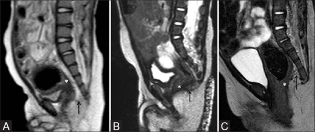
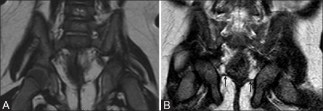
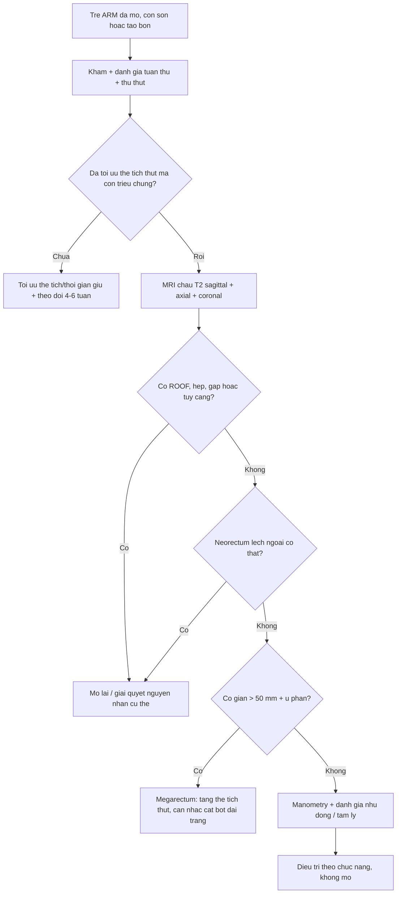
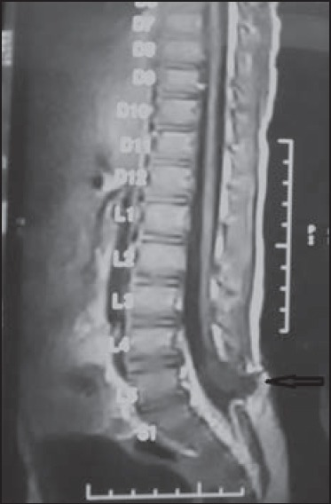
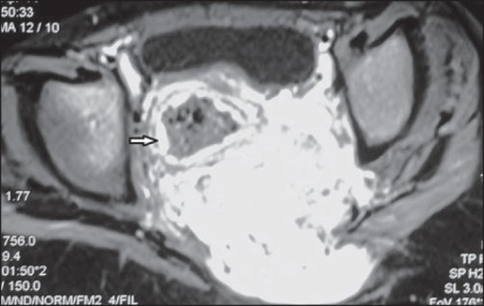
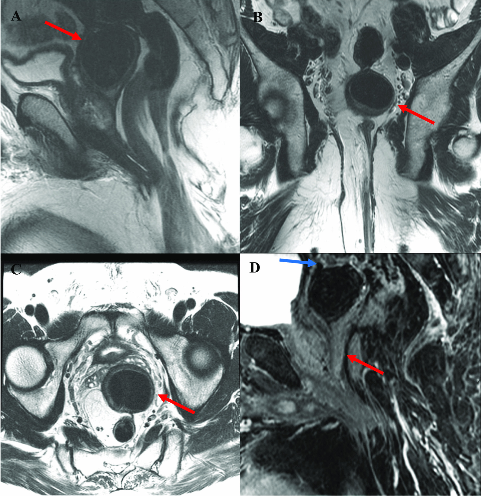

# 3133 — MRI sàn chậu sau mổ dị tật hậu môn–trực tràng (ARM): đọc vị trí neorectum, cơ nâng, ROOF — khi nào MRI thay được đối quang

**Tags:** `pattern:vi-tri-neorectum` `pattern:gian-neorectum` `pattern:tui-ro-con-lai` `pattern:sa-truc-trang` `pattern:thieu-san-co-nang` `pattern:tuy-cang` `vung:hau-mon-truc-trang` `vung:khung-chau` `vung:tuy-song` `protocol:MRI-chau` `protocol:MRI-dong-hoc` `protocol:X-quang-doi-quang` `score:Krickenbeck`
**Mức chắc chắn (certainty):** tổng hợp y văn (literature synthesis) — ghép **33 trẻ đã mổ ARM được MRI chậu đối chiếu kết cục đại tiện** (J Indian Assoc Pediatr Surg 2015, PMC4481621), **30 trẻ ARM: MRI so với đối quang xa (distal colostogram)** (Indian J Radiol Imaging 2018, PMC6038223), **52 trẻ mổ ARM: 20 táo bón vs 32 són, kèm MRI động học ở 18 ca** (Pediatr Radiol 2013, PMID 23467755), **47 trẻ vị thành niên 12–18 tuổi: MRI tìm ROOF và bất thường chưa biết** (J Pediatr Surg 2026, PMID 41690379), **khuyến cáo ESPR 2022 về hình ảnh ARM** (Pediatr Radiol 2022, PMC9360087) và **độ dày/góc cơ nâng trên MRI** (Pediatr Surg Int 2022, PMID 35235013). Không có ca do nhóm tự chụp.

> **Câu hỏi thực hành:** bé trai **11 tuổi**, mổ tạo hình hậu môn–trực tràng (PSARP) lúc 4 tháng, **són phân 3–4 lần/ngày** dù đã thụt và uống senna. Phim **đối quang qua hậu môn nhân tạo** cũ đọc "miệng nối rộng, không hẹp". Bố mẹ hỏi: **có phải con tôi "không có cơ thắt" và không thể chữa?**
> Bài chốt **ba quyết định**: **(1) "đối quang bình thường" không loại trừ nguyên nhân cơ học** — trên **33 trẻ đã mổ**, **66%** còn **bất thường tại chỗ** trên MRI và nhóm này **són/táo bón nặng gấp đôi** (PMC4481621); **(2) MRI trả lời được ba câu mà đối quang không trả lời**: neorectum **có nằm trong phức hợp cơ thắt không**, **cơ nâng/phức hợp cơ vân phát triển bao nhiêu**, và **có ROOF (túi rò còn lại) hay tủy căng không** — ROOF gặp **6,4% (3/47)** ở tuổi 12–18, **8,9% (16/180)** ở nam được chuyển đến vì són/tiểu khó (PMID 41690379, 30879755); **(3) động học chỉ là "gia vị"**: **18/18** ca chụp MRI rặn/ép đều có **sa sàn chậu**, nhưng sa/trực tràng trước chỉ chiếm **6/18** — tức **thuần động học hiếm khi là nguyên nhân duy nhất** (PMID 23467755).

## 1. Tổng quan bệnh học – cơ chế hình ảnh: vì sao phải đọc neorectum và cơ nâng cùng lúc

- **Bối cảnh:** ARM gặp **~1/5.000 trẻ sinh sống** (PMC6038223); sau mổ, **tới 79%** trẻ còn **táo bón và/hoặc són** phải vào chương trình quản lý ruột (PMC10217060). Nghĩa là **MRI sau mổ là câu hỏi thường ngày**, không phải chuyện hiếm.
- **Giải phẫu "neorectum":** ống ruột được kéo xuống **xuyên qua phức hợp cơ thắt** (phức hợp cơ vân — striated muscle complex, SMC gồm **cơ nâng hậu môn/levator ani + cơ mu–trực tràng/puborectalis + cơ thắt ngoài**). Ba biến số quyết định chức năng: **(a) neorectum có nằm TRONG vòng cơ không** (một bên/ra trước/ra sau = "misplaced"), **(b) khối cơ còn bao nhiêu** (giảm sản/thiểu sản), **(c) ống có bị hẹp/giãn bất thường không** (hẹp miệng nối vs **megarectum**).
- **TẠI SAO T2 là chuỗi chủ lực — vật lý đơn giản nhưng quyết định cách đọc:**
  - **Nước/niêm mạc/dịch trong lòng ruột sáng trên T2** → **niêm mạc tăng tín hiệu là "con dấu" để nhận ra lòng trực tràng thật**. Đây chính là mẹo phân biệt **trực tràng** với **đường rò/ổ xơ**: đường rò **không có niêm mạc tăng tín hiệu** (mô tả trong PMC6038223, hình 2).
  - **Cơ vân và xơ đều TỐI trên T2** → phức hợp cơ thắt hiện thành **vòng tối**; neorectum (thành ruột) **sáng hơn** ở lớp niêm. Chênh tín hiệu này là cơ sở để **đo độ dày cơ nâng 1,78–2,97 mm** (PMID 35235013).
  - **Mỡ chậu rất sáng trên T2 không xóa mỡ** → dễ thấy **thoát vị mỡ phúc mạc (peritoneal fat herniation)** — một dấu hiệu **gắn với són** (P = 0,032; PMID 23467755).
- **Vì sao "động học" (dynamic) khác "tĩnh":** neorectum **lệch nhẹ** chỉ biểu hiện khi **rặn/ép**; **sa sàn chậu, trực tràng trước, cystocele** chỉ thấy khi **tăng áp lực ổ bụng**. Vì vậy chuỗi động học là **bổ sung**, không thay thế giải phẫu tĩnh: trong 18 ca được chụp động học, **18/18 có sa sàn chậu** nhưng chỉ **6 trực tràng trước**, **6 cystocele** (PMID 23467755) — nếu chỉ có ảnh động, bạn sẽ gọi mọi trẻ són là "sa".
- **Vì sao bé trai són nhiều hơn "do cơ yếu" lại có thể do cấu trúc:** nhóm **són** khác nhóm **táo bón** ở **vị trí neorectum bất thường** (P = 0,031), **góc hậu môn–trực tràng tăng** (P = 0,031) và **thoát vị mỡ phúc mạc** (P = 0,032); nhóm **táo bón** thì **giãn neorectum** nhiều hơn (P = 0,027). Bốn con số này là **bản đồ đọc phim**: són → tìm **lệch/góc/thoát vị**; táo bón → tìm **giãn/hẹp**.
- **Không có ngưỡng HU** trong bài này (MRI); ngưỡng dùng là **mm, độ, %** — ghi rõ từng chỗ.

## 2. Mẫu hình + chẩn đoán phân biệt theo vị trí và cơ chế (Gamut)

- **Mẫu hình cốt lõi:** trẻ **đã mổ ARM**, còn **són/táo bón** → MRI **T2 sagittal + axial + coronal** → phân loại theo **5 tầng**: **da–hậu môn**, **phức hợp cơ thắt**, **neorectum**, **ổ bụng–chậu (ROOF, sa)**, **tủy–cùng**.
- **Theo tầng giải phẫu:**
  - **Hậu môn/da:** **hẹp da (skin-level stricture)**, **lỗ hậu môn lệch trước/sau**, **sa niêm hậu môn**, **sẹo xơ quanh hậu môn**.
  - **Phức hợp cơ thắt:** **neorectum lệch một bên** (ảnh quiz ca 2), **lệch ra trước**, **cơ nâng giảm sản** (thường gặp ở thể cao), **bất đối xứng cơ nâng** — độ dày **1,78 ± 0,46 mm** ở thể cao vs **2,97 ± 0,55 mm** (thể thấp) vs **2,87 ± 0,32 mm** (chứng); **tỷ lệ trái:phải 0,71 vs 0,93**; **góc lệch cơ nâng 10,8° vs 0°** (PMID 35235013).
  - **Neorectum:** **giãn > 50 mm** (megarectum — gặp **8,5%** ở tuổi 12–18; PMID 41690379), **hẹp miệng nối**, **gập/xoắn ống kéo**, **giãn–hẹp xen kẽ**.
  - **Ổ bụng–chậu:** **ROOF (túi rò còn lại)** — cấu trúc **dạng ống/nang nằm sau–trên tuyến tiền liệt, thành dày, T2 tối, không có niêm mạc sáng ở tâm** (ảnh quiz ca 3); **sa trực tràng**, **thoát vị mỡ phúc mạc**, **dính/xơ quanh trực tràng**.
  - **Tủy–cùng:** **tủy căng (tethered cord)** — **34%** trẻ sau mổ ARM có bất thường cột sống trên MRI (PMC4481621); **bất sản xương cùng**, **u trước cùng** (Currarino, bài 1854).
- **Gamut "són phân sau mổ ARM":** **neorectum lệch ngoài cơ thắt**, **ROOF**, **thiểu sản cơ nâng**, **tủy căng**, **sa trực tràng**, **megarectum với ứ tràn**, **rối loạn nhu động (không thấy trên MRI)**, **hẹp miệng nối gây ứ tràn**.
- **Gợi nhớ PELVIS:** **P**osition (vị trí neorectum) · **E**xcavation (cơ nâng/SMC) · **L**eak & ROOF · **V**olume (calibre neorectum) · **I**ntraspinal (tủy/cùng) · **S**kin & stricture (hậu môn).

## 3. Bảng so sánh phân biệt (ma trận đối chiếu)

| Thực thể (entity) | Hình ảnh điển hình trên MRI T2 (± động học) | Chốt vào (rule-in) | Chốt loại (rule-out) | Gợi ý xác nhận |
|---|---|---|---|---|
| **Neorectum lệch ngoài phức hợp cơ thắt** | Trục neorectum **lệch hẳn một bên** vòng cơ tối (axial); góc hậu môn–trực tràng **tăng**; có thể kèm **thoát vị mỡ phúc mạc** | **Trục ống không nằm trong vòng cơ tối ở ≥ 2 bình diện** | **Ống nằm giữa vòng cơ ở axial + coronal** → loại lệch | Đối chiếu axial–coronal–sagittal; so với mốc **đường mu–cụt (PCL)** |
| **ROOF (túi rò còn lại)** | Cấu trúc **dạng ống/nang sau–trên tuyến tiền liệt**, **thành dày T2 tối**, **không có niêm mạc sáng ở tâm**, có thể dính bàng quang/sigma | **Cấu trúc dạng ống không có niêm mạc sáng, nằm giữa trực tràng và niệu đạo** | **Có niêm mạc tăng tín hiệu ở tâm + thông với lòng trực tràng** → là trực tràng/ống kéo, không phải ROOF | Sagittal T2 mỏng + axial; đối chiếu **niệu đạo sau** trên VCUG |
| **Megarectum do ứ tràn** | **Neorectum giãn > 50 mm**, đầy phân (tín hiệu hỗn hợp), cơ nâng mỏng nhưng **liên tục** | **Đường kính > 50 mm + ứ phân + són giữa các lần thụt** | **Calibre bình thường, không ứ phân** → loại giãn | Đo **đường kính ngang lớn nhất** trên axial; X-quang bụng |
| **Hẹp miệng nối / hẹp ống kéo** | Chỗ thắt **< 8 mm** ở miệng nối, giãn phía trên; **không** có vòng xơ ngoài lòng | **Chỗ thắt khu trú + giãn trên** | **Calibre đều, không chênh** → loại hẹp | Đối quang/calibration; MRI chỉ định vị |
| **Thiểu sản/bất đối xứng cơ nâng** | **Cơ nâng mỏng (< 2 mm)**, **tỷ lệ trái:phải < 0,8**, **góc lệch > 6°** | **Cơ mỏng + bất đối xứng + thể ARM cao** | **Cơ dày ≥ 2,5 mm, đối xứng, góc 0–5°** → loại | Đo trên axial/coronal **2 mm** (PMID 35235013) |
| **Tủy căng (tethered cord)** | Tủy tận **thấp dưới L2–L3**, **dày > 2 mm**, **mỡ/điểm bám bất thường** | **Tủy tận thấp + bó tận bất thường** | **Tủy tận ngang L1–L2, hình dạng bình thường** → loại | Sagittal T1/T2 toàn cột cùng; siêu âm ở trẻ < 6 tháng |
| **Rối loạn nhu động/không tuân thủ** | **Giải phẫu bình thường**, không hẹp/không lệch; có thể **ứ phân lan tỏa** | **MRI giải phẫu bình thường + manometry bất thường** | **Có bất thường giải phẫu rõ** → không quy cho nhu động | Manometry hậu môn–trực tràng; đánh giá tuân thủ |

*Đọc **mức túi trực tràng (\*) so với sàn chậu (mũi tên)** — nền tảng để hiểu "vị trí neorectum" sau mổ: **(A)** thể cao, **(B)** thể trung gian, **(C)** thể thấp (trực tràng mở vào tiền đình). Trên loạt **30 trẻ**, MRI xác định **đúng mức túi 93,33%** so với **76,9%** của đối quang xa (PMC6038223) — đây là lý do **MRI được ưu tiên khi câu hỏi là "vị trí"**, còn đối quang vẫn tốt hơn cho **hình thái đường rò**. Nguồn: Indian J Radiol Imaging 2018 (PMC6038223), **CC BY-NC-SA 4.0**.*

*Đánh giá **cơ nâng hậu môn** theo chủ quan (kém/tốt) tương quan có ý nghĩa với đánh giá của phẫu thuật viên (**P = 0,008 với cơ nâng; P = 0,024 với cơ mu–trực tràng**; PMC6038223). Khi cần **định lượng**: đo độ dày **1,78 vs 2,97 mm** và góc lệch **10,8° vs 0°** (PMID 35235013) — hữu ích để **tiên lượng trước khi quyết định mổ lại**. Nguồn: Indian J Radiol Imaging 2018 (PMC6038223), **CC BY-NC-SA 4.0**.*

## 4. Protocol chụp + ngưỡng xử trí

- **Chỉ định MRI sau mổ (4 nhóm):** **(1)** són/táo bón **không đáp ứng** chương trình quản lý ruột; **(2)** nghi **ROOF** (nhiễm niệu tái diễn, chảy mủ qua niệu đạo, đau vùng chậu); **(3)** nghi **hẹp/gập ống kéo** mà đối quang không giải thích; **(4)** **trước mổ lại** (redo PSARP) để lập bản đồ.
- **Chuẩn bị — "feed and wrap" thay vì gây mê (khuyến cáo ESPR 2022, PMC9360087):** trẻ nhỏ **cho ăn rồi quấn** để ngủ tự nhiên, **KHÔNG cần bơm căng đại tràng bằng nước muối**, **KHÔNG cần thuốc an thần**; các phương pháp "modified MRI" (bơm nước muối qua colostogram + an thần) **đã bị thay thế** vì không thêm thông tin. Nếu trẻ không hợp tác → **an thần có kiểm soát** vẫn tốt hơn phim mờ (loạt 30 trẻ dùng an thần, PMC6038223).
- **Thông số tối thiểu (theo nguồn có sẵn):**
  - **Sagittal T2** (3 mm) toàn khung chậu + **axial/coronal T2 2 mm** vuông góc trục ống và **song song đường mu–cụt (PCL)** (PMID 35235013).
  - **T1** (2–3 mm) để phân biệt **mỡ (sáng T1)** với **dịch/xơ (tối T1)** trong ROOF và u trước cùng.
  - **Không cần tiêm thuốc cản quang** cho câu hỏi giải phẫu thông thường; **T1 sau tiêm + xóa mỡ** chỉ khi nghi **áp-xe/viêm hoạt động** hoặc **u**.
  - **Động học (MRI defecography)** khi câu hỏi là **sa/trực tràng trước/không tống được phân**: chuỗi **nhanh sagittal giữa lúc nghỉ → ép → rặn** (kinh điển MR defecography; **nguồn trong bài không nêu chi tiết chuỗi** — ghi rõ đây là thực hành chung, cần kiểm tra theo máy). Cần **trực tràng có phân/gel** mới đánh giá được — **bẫy lớn nhất là trực tràng rỗng**.
- **Trình tự quyết định sau khi có MRI:**

- **Ngưỡng thực hành (mỗi số gắn nguồn):**

| Ngưỡng | Giá trị | Ý nghĩa |
|---|---|---|
| Đường kính neorectum | **> 50 mm** = giãn (8,5% ở 12–18 tuổi, PMID 41690379) | Tìm ứ tràn; cân nhắc tăng thể tích thụt/cắt bớt |
| Độ dày cơ nâng | **< 2 mm** / tỷ lệ **trái:phải < 0,8** / góc **> 6°** | Thiểu sản–bất đối xứng (PMID 35235013) |
| ROOF | **6,4%** ở 12–18 tuổi; **8,9%** ở nam chuyển đến | Nếu có **triệu chứng niệu** → chỉ định cắt (PMID 41690379, 30879755) |
| Bất thường cột sống sau mổ | **34%** | Luôn đọc **toàn cột cùng** trên cùng buổi chụp (PMC4481621) |
| Tủy tận | **Dưới L2–L3** | Nghi tủy căng → MRI toàn cột + hội chẩn ngoại thần kinh |

- **Khi nào MRI KHÔNG thay được đối quang:** câu hỏi **"đường rò đi đâu, có hẹp không, đại tràng dài bao nhiêu"** vẫn cần **đối quang/đối quang xa**; MRI **76,6%** đúng về **hiện diện rò** nhưng chỉ **76%** đúng về **giải phẫu rò**, trong khi đối quang xa đúng **76,9%** và **65%** (PMC6038223) — hai phương thức **bổ sung**, không thay thế.

## 5. Biến thể bình thường và cạm bẫy

- **"Cơ thắt không thấy" trên một lát axial:** phức hợp cơ vân **không phải vòng tròn hoàn hảo**, lại bị cắt **xiên** do ống kéo chéo; phải xem **3 bình diện + tái tạo song song PCL** trước khi kết luận thiểu sản.
- **Neorectum rỗng trông như "dải xơ":** khi không có phân/dịch, thành ruột **dính vào nhau**, mất "dấu niêm mạc sáng"; **đừng** kết luận teo/hẹp — cho trẻ **nhịn thụt 12–24 giờ** hoặc dùng **gel trực tràng** trước chụp.
- **Nhầm ROOF với trực tràng:** chốt phân biệt là **niêm mạc tăng tín hiệu ở tâm** — ROOF **không có** (PMC6038223); nếu thấy niêm mạc sáng nối liền lòng trực tràng thì đó là **ống kéo**, không phải túi rò.
- **Nhầm ROOF với bàng quang/niệu đạo sau:** ROOF nằm **sau–trên tuyến tiền liệt**, thành dày; bàng quang **thành mỏng, chứa nước**. Luôn đọc **cùng VCUG** khi có triệu chứng niệu.
- **Sa sàn chậu là bình thường khi rặn mạnh:** **18/18** ca chụp động học đều có **sa sàn chậu** (PMID 23467755) — **chỉ có giá trị khi kèm triệu chứng** hoặc khi sa **vượt quá mức sinh lý**; đừng biến một nghiệm pháp rặn thành chẩn đoán.
- **Bỏ sót tủy căng vì "chỉ chụp khung chậu":** **34%** có bất thường cột sống (PMC4481621) — **luôn** đặt field-of-view **đến cùng–cụt**; nếu không, phải chụp bổ sung.

***Tủy căng (tethered cord)**: tủy tận thấp (đầu mũi tên) — tổn thương **không gây són trực tiếp** nhưng **làm nặng thêm** rối loạn đại tiện–tiểu tiện và **thay đổi kế hoạch mổ** (tháo căng tủy trước/đồng thời). Vì **34%** trẻ sau mổ ARM có bất thường cột sống (PMC4481621), đây là mục **bắt buộc** trong báo cáo, không phải "phát hiện phụ". Nguồn: J Indian Assoc Pediatr Surg 2015 (PMC4481621), **CC BY-NC-SA 3.0**.*
- **Không hợp tác → phim rung:** chẩn đoán "hẹp" trên phim rung là lỗi thường gặp; **an thần** hoặc **lặp lại** rẻ hơn nhiều so với **mổ lại oan**.
- **Thỏa mãn tìm kiếm:** đã thấy ROOF **vẫn phải** đọc **cơ nâng, calibre, tủy** — ca redo thường có **≥ 2 bất thường** (13/16 ca ROOF có thêm lý do mổ lại như **hậu môn lệch hoặc sa trực tràng**; PMID 30879755).

## 6. Tự lượng giá — Blind Quiz

**Ca 1 — Bé 4 tháng, ARM thể trung gian, trước mổ. Nhìn 3 ảnh sagittal, xác định mức túi trực tràng.**

- Gợi ý lâm sàng: không có lỗ hậu môn bình thường, có rò niệu.
- Câu hỏi: **(1)** Mốc giải phẫu dùng để xếp mức? **(2)** Vì sao mức này quyết định kỹ thuật mổ? **(3)** Đối quang xa hay MRI đúng hơn về mức túi?

<b>Bấm để hiện đáp án (findings + chẩn đoán)</b>

- Dấu hiệu: **túi trực tràng (\*) — nhận ra nhờ niêm mạc tăng tín hiệu** — so với **sàn chậu/cơ nâng (mũi tên)**: **(A)** trên sàn chậu → **thể cao**; **(B)** ngang sàn → **trung gian**; **(C)** dưới sàn → **thể thấp**.
- Vì sao quan trọng: thể cao/trung gian cần **đường vào bụng hoặc sau trực tràng (PSARP/LAARP)**, thể thấp có thể **mổ đường tầng sinh môn**; mức túi còn quyết định **có phải làm hậu môn nhân tạo**.
- Đúng hơn: **MRI 93,33% vs đối quang xa 76,9%** về mức túi (PMC6038223).
- Nguồn ảnh: Indian J Radiol Imaging 2018 (PMC6038223), **CC BY-NC-SA 4.0**.

**Ca 2 — Bé trai 8 tuổi đã PSARP, són phân. Axial T2 qua phức hợp cơ thắt.**

- Câu hỏi: **(1)** Bất thường chính? **(2)** Vì sao bất thường này gắn với són hơn là táo bón? **(3)** Có cần mổ lại ngay không?

<b>Bấm để hiện đáp án</b>

- Dấu hiệu: **neorectum (đầu mũi tên) lệch hẳn sang PHẢI** vòng cơ thắt (vòng tối bao quanh), tức ống không nằm giữa phức hợp cơ vân.
- Vì sao són: nhóm **són** có **vị trí neorectum bất thường P = 0,031**, **góc hậu môn–trực tràng tăng P = 0,031**, **thoát vị mỡ phúc mạc P = 0,032** (PMID 23467755); nhóm **táo bón** thiên về **giãn neorectum** (P = 0,027).
- Chưa mổ ngay: trước hết **tối ưu thụt + đánh giá cơ nâng/tủy căng**; chỉ mổ lại khi **lệch đủ lớn + thất bại điều trị nội** (nhóm mổ lại trong loạt tham chiếu là **abdominoperineal pull-through** — nhóm có **nhiều bất thường tại chỗ nhất, P = 0,0001**; PMC4481621).
- Nguồn ảnh: J Indian Assoc Pediatr Surg 2015 (PMC4481621), **CC BY-NC-SA 3.0** — nguyên bản.

**Ca 3 — Nam 44 tuổi, tiền sử mổ imperforate anus lúc nhỏ, nay nhiễm niệu tái diễn + sa trực tràng. MRI chậu.**

- Câu hỏi: **(1)** Cấu trúc mũi tên đỏ là gì? **(2)** Ba chẩn đoán phân biệt? **(3)** Vì sao bệnh nhân này cần mổ chứ không theo dõi?

<b>Bấm để hiện đáp án</b>

- Dấu hiệu: **cấu trúc dạng ống/nang thành dày, T2 tối, nằm sau–trên tuyến tiền liệt**, dính **sigma** phía trên và có **đường hướng tới niệu đạo sau** — không thấy **niêm mạc sáng ở tâm** như lòng trực tràng.
- Chẩn đoán: **ROOF (di tích đường rò niệu đạo–trực tràng còn lại)** — trước đây gọi là **túi thừa niệu đạo sau (posterior urethral diverticulum)**, kèm **sa trực tràng** (mô tả trong chính ca này).
- Phân biệt: **(a) ống kéo/neorectum** (có niêm mạc sáng, thông lòng), **(b) nang tuyến tiền liệt/túi tinh**, **(c) áp-xe vùng chậu**.
- Vì sao mổ: ROOF gây **nhiễm niệu tái diễn, chảy mủ qua niệu đạo, sỏi trong túi**; trong loạt **180 nam** chuyển đến, **16 ca (8,9%)** có ROOF và **14 ca được mổ** (tuổi mổ trung bình **4,2 tuổi**; PMID 30879755). Ở người lớn, ROOF tồn tại **hàng chục năm** — đây là lý do **không được "quên"** khi trẻ chuyển sang người lớn.
- Nguồn ảnh: J Med Case Rep 2021 (PMC8281626), **CC BY 4.0**.

## Bài liên quan chéo
- [3100 – Quản lý ruột & kiểm soát đại tiện sau mổ ARM](../3100-quan-ly-ruot-va-kiem-soat-dai-tien-sau-mo-arm/lesson.md)
- [3132 – Biến chứng lỗ thông ACE sau mổ](../3132-bien-chung-lo-thong-ace-tre/lesson.md)
- [3075 – Dị tật hậu môn–trực tràng ở sơ sinh](../3075-di-tat-hau-mon-truc-trang-so-sinh/lesson.md)
- [1779 – Hẹp miệng nối sau kéo trực tràng](../1779-hep-mieng-noi-sau-keo-truc-trang-o-tre/lesson.md)
- [1867 – Táo bón & ứ phân sau kéo trực tràng](../1867-tao-bon-sau-keo-truc-trang/lesson.md)
- [1854 – Màng não tủy trước cùng & tam chứng Currarino](../1854-mang-nao-tuy-truoc-cung-currarino/lesson.md)

## Ảnh
- `images/3133_mri-dong-hoc-arm_T2-sagittal_IJRI2018-PMC6038223.jpg` — Indian J Radiol Imaging 2018 (PMC6038223), **CC BY-NC-SA 4.0**.
- `images/3133_mri-dong-hoc-arm_T2-coronal_IJRI2018-PMC6038223.jpg` — Indian J Radiol Imaging 2018 (PMC6038223), **CC BY-NC-SA 4.0**.
- `images/3133_mri-dong-hoc-arm_T2-axial_IJAPS2015-PMC4481621.jpg` — J Indian Assoc Pediatr Surg 2015 (PMC4481621), **CC BY-NC-SA 3.0**.
- `images/3133_mri-dong-hoc-arm_T2-tuy_IJAPS2015-PMC4481621.jpg` — J Indian Assoc Pediatr Surg 2015 (PMC4481621), **CC BY-NC-SA 3.0**.
- `images/3133_mri-dong-hoc-arm_T2-roof_JMedCaseRep2021-PMC8281626.jpg` — J Med Case Rep 2021 (PMC8281626), **CC BY 4.0**.
- Nguồn, giấy phép và ghi chú từng ảnh: `images/CREDITS.md`.

> Không dùng để chẩn đoán độc lập khi chưa có người hướng dẫn.
