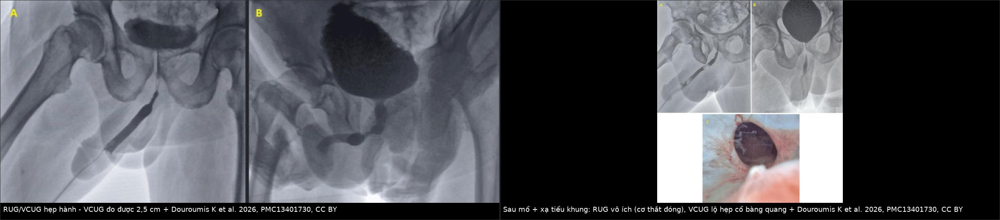
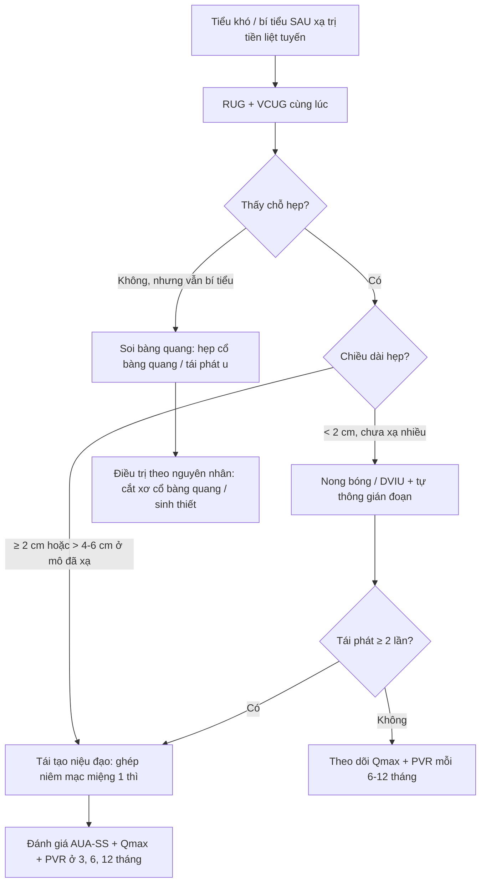
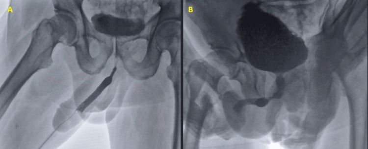
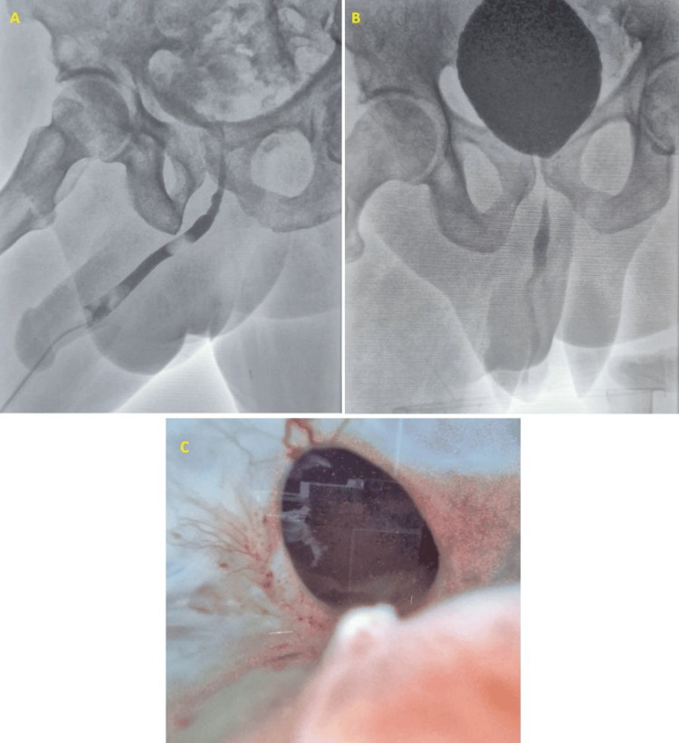
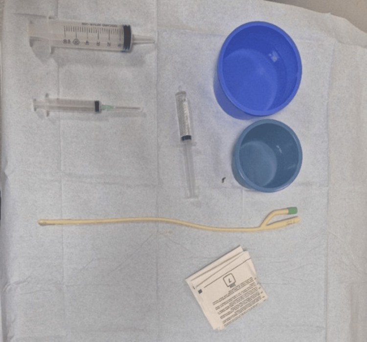

# 3134 — Hẹp niệu đạo sau xạ trị tiền liệt tuyến / Radiation-induced urethral stricture

**Tags:** `pattern:hep-nieu-dao` `pattern:hep-dai-doan` `pattern:viem-sau-xa` `pattern:bi-tieu` `vung:nieu-dao` `vung:tieu-khung` `vung:bang-quang` `score:AUA-SS` `protocol:RUG` `protocol:VCUG` `protocol:niệu-nội-soi` `protocol:MRI-chau` `protocol:nong-bong` `incidentaloma:khong`

**Mức chắc chắn (certainty):** tổng hợp y văn (literature synthesis) — số liệu từ **bài tổng quan cơ chế–điều trị** (PMC10299043, *J Clin Med* 2023), **khảo sát hình ảnh RUG/VCUG có ca minh hoạ** (PMC13401730, *Cureus* 2026, CC BY), **loạt ca Optilume sau điều trị ung thư tiền liệt tuyến** (PMC12541494), **ca tái tạo niệu đạo đã xạ 6 cm** (PMC13742844) và **đoàn hệ 67.527 bệnh nhân** được trích trong PMC10299043. Chỗ suy luận được đánh dấu **[suy luận]**.

> **Câu chốt:** hẹp sau xạ **không phải** "hẹp niệu đạo thông thường". Ba khác biệt quyết định xử trí: **(1)** đoạn hẹp **dài, đều, không có vùng chuyển tiếp rõ** (xơ lan theo trường chiếu) chứ không khu trú như hẹp sau đặt sonde/DVIU; **(2)** mô **thiếu mạch nuôi** nên **nong bóng lặp lại thất bại và có thể làm hẹp thêm**; **(3)** hẹp có thể nằm **sau cơ thắt ngoài/cổ bàng quang** — chỗ **RUG ngược dòng không tới được**, nên **chỉ chụp RUG là bỏ sót** (Hình 6 của PMC13401730).

## 1. Tổng quan bệnh học – cơ chế hình ảnh

- **Bệnh học (pathology):** xạ trị gây **viêm tắc động mạch tận (endarteritis obliterans)** của đám rối mạch quanh niệu đạo + **xơ hóa thể hang xốp (corpus spongiosum)**. Hệ quả: niệu đạo mất tính đàn hồi, **thành dày, lòng hẹp theo chu vi trên một đoạn dài**, và **mô lành kém** vì thiếu tưới máu (PMC10299043).
- **TẠI SAO hẹp sau xạ "dài và đều":** trường chiếu là **khối hình học**, không phải điểm — tổn thương mạch/xơ phân bố **suốt vùng chiếu**, nên khi lành tạo **ống hẹp thuôn dần hai đầu (tapered)** chứ không phải **vòng xơ khu trú**. Đây là lý do trên phim **RUG** hẹp sau xạ hiện **cột thuốc mảnh, dài, bờ không đều, không có "vai" rõ** — khác hẹp sau chấn thương (đứt rời, khoảng cách) hay hẹp sau DVIU (ngắn, ở hành).
- **TẠI SAO mô đã xạ khó lành — số liệu mô học:** thể hang xốp bình thường có **75% collagen type I / 25% type III**; ở niệu đạo hẹp tỷ lệ đảo thành **16% type I / 84% type III** — collagen type III nhiều làm mô **kém bền, co rút**; kèm **acid hyaluronic thấp hơn 50%** và **dermatan sulfate cao hơn 68%** trong chất nền ngoại bào (PMC10299043). **[suy luận]** Đây là cơ sở sinh học cho việc **ghép niêm mạc miệng (buccal mucosal graft)** thay vì nối tận–tận: cần mang **mô lành có mạch** vào vùng xơ.
- **Tần suất — dùng để quyết định có tầm soát hay không:** CaPSURE **1,8%** sau brachytherapy (BT), **1,7%** sau xạ ngoài (EBRT), **5,2%** khi **EBRT + BT**; BT liều cao có thể tới **32%**; EBRT đơn thuần **1,1–4,5%**; phân tích gộp **> 16.000 ca** cho tỷ lệ **3,9%**, **tiền lưu hành gộp 2,2% ở năm thứ 4**, và **4,9%** khi phối hợp EBRT + BT (PMC10299043).
- **Đoàn hệ 67.527 bệnh nhân ung thư tiền liệt tuyến:** **8,44%** có hẹp niệu đạo trong **5 năm** sau xạ trị, so với **5,35%** sau cắt tuyến tiền liệt; **11,22%** sau **xạ cứu vớt (salvage RT)** và **19,34%** sau **mổ cứu vớt** (PMC10299043).
- **Vị trí và thời điểm:** **90–100%** hẹp sau BT nằm ở **niệu đạo hành–màng**, xuất hiện **trung vị 2,2–2,4 năm** sau kết thúc xạ (PMC10299043). **[suy luận]** Vì vậy bệnh nhân **tiểu khó 1–3 năm sau xạ** phải được coi là hẹp cho tới khi chứng minh ngược lại — không quy cho "di chứng xạ chung".
- **Hình ảnh học phản ánh mô học:** trên **MRI**, vùng xơ sau xạ **giảm tín hiệu trên T2** và **mất cấu trúc thể hang xốp bình thường** (mô sáng T2 bị thay bằng dải tối), ngấm thuốc không đều; trên **siêu âm**, thành niệu đạo dày, lòng hẹp, không thấy sỏi/vôi hóa (khác hẹp do lichen sclerosus có vôi hóa quanh niệu đạo đôi khi gặp).

## 2. Mẫu hình + chẩn đoán phân biệt theo vị trí (gamut)

- **Hành–màng (bulbomembranous) — hay gặp nhất sau BT/EBRT:** hẹp **dài 2–6 cm**, thuôn hai đầu; bệnh nhân **yếu tia, tiểu ngắt quãng, nhiễm trùng tiết niệu tái diễn**, có khi **bí tiểu cấp**. Gamut: **hẹp sau xạ**, **hẹp sau DVIU tái phát**, **hẹp sau chấn thương yên ngựa (straddle)**, **hẹp do lichen sclerosus lan ngược**, **ung thư biểu mô niệu đạo**.
- **Cổ bàng quang / miệng nối niệu đạo–bàng quang (sau cắt tuyến tiền liệt + xạ):** hẹp **rất ngắn nhưng ở sau cơ thắt ngoài** → **RUG ngược dòng không thấy**, **VCUG mới lộ**. Gamut: **hẹp cổ bàng quang**, **co thắt cổ bàng quang do thuốc/ thần kinh**, **tái phát u tại miệng nối**, **sỏi bàng quang**.
- **Trong tuyến tiền liệt (intraprostatic) sau điều trị đốt u (TULSA, IRE, HIFU, laser):** hẹp **ngắn, sát sàn bàng quang**; Loạt 4 ca sau TULSA/IRE được nong bóng phủ paclitaxel, **không tái phát tới 14 tháng** (PMC12541494).
- **Toàn bộ niệu đạo trước (pan-anterior) sau xạ toàn vùng:** hẹp **> 6 cm**, gần tắc hoàn toàn; ca báo 42 tuổi sau xạ ung thư biểu mô niệu đạo có **hẹp 6 cm gần tắc hoàn toàn niệu đạo hành + màng**, được tái tạo **một thì bằng ghép niêm mạc miệng hai mặt**, **AUA-SS 25 → 3 ở 3 năm** (PMC13742844).
- **Mnemonic "RADIATE":** **R**adiotherapy tiền sử, **A**cuminate (thuôn dần, không vai), **D**ài đoạn, **I**schaemia (mô thiếu mạch), **A**nastomotic/bladder neck cũng có thể, **T**iming 2 năm, **E**ndoscopy kém bền.

## 3. Bảng so sánh phân biệt (ma trận đối chiếu)

| Thực thể (entity) | Hình ảnh điển hình (RUG / VCUG / MRI) | Chốt vào (rule-in) | Chốt loại (rule-out) | Gợi ý xác nhận |
|---|---|---|---|---|
| **Hẹp sau xạ (hành–màng)** | RUG: **cột thuốc mảnh, dài 2–6 cm, thuôn hai đầu, bờ không đều**; VCUG: thấy **đoạn trên chỗ hẹp**; MRI: **dải xơ T2 tối**, mất cấu trúc thể hang xốp | **Tiền sử xạ + hẹp dài > 2 cm + trung vị 2,2–2,4 năm** | **Hẹp < 1 cm, bờ rõ như vòng** → hẹp sau DVIU/sonde; **khoảng cách đứt rời** → chấn thương khung chậu | RUG + VCUG cùng lúc, đo chiều dài, MRI chậu khi định mổ |
| **Hẹp sau DVIU/sonde tái phát** | Hẹp **ngắn (< 1–2 cm)**, thường **hành**, bờ rõ, tái phát sau mỗi lần nong | **Tiền sử thủ thuật nội soi + hẹp ngắn đúng vị trí cũ** | **Hẹp dài, lan tỏa, không liên quan vị trí can thiệp** → nghĩ xạ/lichen | Soi niệu đạo, đo calibration, đối chiếu phim cũ |
| **Lichen sclerosus** | Hẹp **lỗ niệu đạo/niệu đạo dương vật**, **mảng trắng như sứ**, hẹp **lan ngược dài**; có thể vôi hóa quanh niệu đạo | **Mảng trắng ở quy đầu/bao quy đầu + hẹp lỗ tiểu** | Không mảng trắng, hẹp ở hành → nghĩ xạ/DVIU | Khám lâm sàng + soi niệu đạo, sinh thiết nếu nghi ác |
| **Đứt niệu đạo do chấn thương khung chậu (PFUI)** | **Khoảng cách (gap) giữa hai đầu**, lệch trục, máu tụ vùng chậu; thường **hành–màng** | **Chấn thương + gãy xương chậu + gap ≥ 1–2 cm** | Không gap, cột thuốc liên tục → hẹp lành tính | RUG + VCUG (đo gap), CT chậu |
| **Ung thư biểu mô niệu đạo** | Hẹp **không đều, bờ nham nhở**, khối trong lòng, **ngấm thuốc bất đối xứng** trên MRI; chảy máu niệu đạo | **Chảy máu + khối đặc + hẹp nham nhở** | Bờ đều, không khối → hẹp lành tính | Soi + sinh thiết, MRI chậu |
| **Hẹp cổ bàng quang sau mổ + xạ** | **RUG bình thường hoặc không đánh giá được** (cơ thắt đóng); **VCUG: khuyết thuốc ở cổ bàng quang**, bàng quang căng, thành dày | **VCUG bất thường + tiền sử cắt tuyến tiền liệt + xạ** | **VCUG bình thường** mới loại được hẹp cổ bàng quang | VCUG, soi bàng quang, MRI chậu |

*Trái: hẹp hành — RUG thấy hẹp nhưng không đo được chiều dài, VCUG đo được 2,5 cm và lộ bàng quang tăng sinh cơ. Phải: sau mổ + xạ tiểu khung — RUG vô ích vì cơ thắt ngoài đóng, VCUG lộ khuyết thuốc ở cổ bàng quang. Nguồn: Douroumis K et al., PMC13401730, CC BY 4.0. Ảnh ghép letterbox.*

## 4. Protocol chụp + thang đo chuẩn hóa

- **RUG (retrograde urethrogram) — kỹ thuật chuẩn:** sonde **≤ 14 Fr** đặt ở **hố thuyền (fossa navicularis)**, bơm bóng **2 mL nước** để giữ, bơm **20–30 mL** thuốc cản quang bằng bơm 60 mL; chụp **30–45° chếch** trong lúc bơm, **phim cuối khi bơm căng** để đo chiều dài. Với **hẹp lỗ tiểu**, dùng **sonde niệu quản 6 Fr** thay sonde thường (PMC13401730).
- **VCUG (voiding cystourethrogram) — không được bỏ:** cho thấy **niệu đạo phía trên chỗ hẹp**, **cổ bàng quang**, **độ dài thật khi hẹp gần tắc hoàn toàn**, **túi thừa**, **trào ngược**, và **thành bàng quang tăng sinh cơ**. Trong hẹp gần tắc và hẹp sau cơ thắt, **VCUG là phần bắt buộc của bộ phim** ("up-and-downogram") (PMC13401730).
- **Đo và ghi bắt buộc trong báo cáo:** **chiều dài hẹp (cm)** — ngưỡng thực hành: **< 2 cm** có thể nội soi/nong; **≥ 2 cm** hoặc **> 4–6 cm ở mô đã xạ** thuộc nhóm **phức tạp, ưu tiên tái tạo** (PMC10299043; PMC13742844 dùng ca 6 cm); **đường kính lòng còn lại** (Fr); **vị trí** (hành / màng / cổ bàng quang / trong tuyến); **có gap hay không**.
- **Niệu nội soi + calibration:** xác định **độ dài thật và mức độ xơ**, đồng thời **loại u** (sinh thiết nếu bờ nham nhở). Không nong mạnh trong lần soi đầu ở mô đã xạ (nguy cơ tạo đường giả).
- **MRI chậu (T2 + DWI + sau tiêm, lát 3 mm):** khi cần **đo chiều dài xơ**, đánh giá **mức xâm lấn thể hang**, **loại tái phát u** và **quy hoạch ghép**; xơ sau xạ cho **dải tín hiệu thấp trên T2** thay mô thể hang xốp sáng.
- **Siêu âm:** bàng quang **thể tích tồn lưu (PVR)**, thành bàng quang; **niệu đồ** không thay được RUG/VCUG nhưng rẻ và lặp lại được.
- **Thang đo lâm sàng dùng để theo dõi (không có RADS cho hẹp niệu đạo):** **AUA-SS/IPSS**, **Qmax** (hẹp có ý nghĩa khi **Qmax < 10 mL/s**), **PVR**, **số lần nhiễm trùng tiết niệu/năm**, **số can thiệp/năm**. Ca minh hoạ PMC13742844: **AUA-SS 25 trước mổ → 3 ở 3 năm**.
- **Thời điểm can thiệp:** **[suy luận]** chờ **≥ 6–12 tháng sau xạ** cho mô ổn định trước khi tái tạo; trong lúc chờ, **dẫn lưu trên xương mu (suprapubic)** tốt hơn **đặt sonde niệu đạo lâu** vì sonde gây xơ thêm.

## 5. Biến thể bình thường và cạm bẫy

- **Cạm bẫy 1 — chỉ chụp RUG:** ở hẹp **sau cơ thắt ngoài** (cổ bàng quang, miệng nối sau cắt tuyến tiền liệt), **RUG có thể hoàn toàn bình thường** vì **cơ thắt đóng** chặn thuốc; ca minh hoạ PMC13401730 mô tả đúng tình huống này — **VCUG mới là phim chẩn đoán**. Quy tắc: **bí tiểu sau xạ + RUG bình thường ⇒ vẫn phải VCUG/soi**.
- **Cạm bẫy 2 — đo chiều dài trên RUG khi hẹp gần tắc:** cột thuốc **không qua được** chỗ hẹp nên chiều dài **bị ước thấp**; VCUG (hoặc RUG + VCUG) cho **chiều dài thật** — ca PMC13401730 đo được **2,5 cm** chỉ nhờ VCUG.
- **Cạm bẫy 3 — nong bóng lặp lại "cho nhanh":** mô đã xạ **thiếu mạch**, nong gây **vết rách mới → xơ nhiều hơn**; mỗi lần nong là một chu kỳ **tái hẹp ngắn hơn**. Ở hẹp **≥ 2 cm**, nong không phải điều trị phòng bệnh mà là **trì hoãn** (PMC10299043).
- **Cạm bẫy 4 — đặt stent kim loại ở niệu đạo đã xạ:** stent giải quyết triệu chứng ngắn hạn nhưng **di trú, đóng vôi, đau** và **làm tái tạo sau đó khó hơn**; chỉ dùng chọn lọc ở người không mổ được.
- **Cạm bẫy 5 — quy "tiểu khó" cho xạ trị chung:** phải loại **hẹp niệu đạo**, **hẹp cổ bàng quang**, **tái phát ung thư** (PSA, thăm khám trực tràng, MRI), **bàng quang tăng hoạt**, và **hẹp niệu quản** cùng trường chiếu ([1666](../1666-hep-nieu-quan-sau-va-ro-va-sau-xa-tri/lesson.md)).
- **Cạm bẫy 6 — bỏ qua nhiễm trùng:** hẹp + ứ nước → **viêm niệu đạo/viêm màng tinh hoàn/áp-xe**; cấy nước tiểu **trước** mọi can thiệp; hình ảnh áp-xe (ổ dịch có vỏ ngấm thuốc) không được bỏ qua khi đọc MRI chậu.
- **Biến thể bình thường:** **hẹp nhẹ thoáng qua do sonde** sau rút sonde có thể tự hết trong **1–2 tuần**; **co thắt cổ bàng quang** do lo lắng khi chụp VCUG có thể giả hẹp → chụp lại khi bệnh nhân thư giãn.

## 6. Tự lượng giá — Blind Quiz

**Ca 1 — Nam 71 tuổi, tiểu khó tăng dần 2 năm sau xạ trị tiền liệt tuyến, đã DVIU 3 lần.**

- Câu hỏi: Ảnh A (RUG) cho biết gì và **không** cho biết gì? Ảnh B (VCUG) bổ sung số đo nào? Vì sao đã DVIU 3 lần mà vẫn hẹp?

<b>Bấm để hiện đáp án (findings + chẩn đoán)</b>

- Dấu hiệu: (A) RUG **thấy chỗ hẹp ở niệu đạo hành** nhưng **không đo được chiều dài** và không loại được hẹp thứ hai phía trên; (B) VCUG đo **chiều dài hẹp 2,5 cm** và lộ **bàng quang tăng sinh cơ (trabeculation)**.
- Chẩn đoán: **hẹp niệu đạo hành dài 2,5 cm** — ở bệnh nhân đã xạ, **chiều dài ≥ 2 cm** là lý do DVIU thất bại lặp lại; hướng **tái tạo niệu đạo**.
- Nguồn: Douroumis K et al., *Cureus* 2026, PMC13401730 Fig. 3, CC BY 4.0.

**Ca 2 — Nam 68 tuổi, sau cắt tuyến tiền liệt + xạ tiểu khung, bí tiểu; RUG "bình thường".**

- Câu hỏi: Vì sao RUG không thấy tổn thương? Ảnh B cho thấy gì? Bước tiếp theo?

<b>Bấm để hiện đáp án</b>

- Dấu hiệu: (A) RUG **không đánh giá được** vì **cơ thắt ngoài đóng** chặn thuốc; (B) VCUG **khuyết thuốc ở cổ bàng quang** — dấu hiệu đặc hiệu của **hẹp cổ bàng quang**.
- Chẩn đoán: **hẹp cổ bàng quang sau mổ + xạ** — không phải hẹp niệu đạo hành. Xác nhận bằng **soi bàng quang**; điều trị **cắt xơ cổ bàng quang** (hoặc tái tạo) chứ không nong niệu đạo.
- Bài học: **RUG bình thường không loại trừ hẹp sau cơ thắt** ở bệnh nhân đã mổ + xạ tiểu khung.
- Nguồn: Douroumis K et al., PMC13401730 Fig. 6, CC BY 4.0.

**Ca 3 — Kỹ thuật: bơm thuốc đúng cách.**

- Câu hỏi: Sonde cỡ nào, bóng bơm bao nhiêu, đặt ở đâu? Nếu hẹp lỗ tiểu thì đổi dụng cụ gì?

<b>Bấm để hiện đáp án</b>

- Kỹ thuật: sonde **≤ 14 Fr**, bóng **2 mL nước**, đặt ở **hố thuyền (fossa navicularis)**; bơm **20–30 mL** thuốc bằng bơm 60 mL; nếu **hẹp lỗ tiểu** → dùng **sonde niệu quản 6 Fr**.
- Vì sao quan trọng: bóng quá lớn hoặc sonde quá to **che mất đoạn niệu đạo trước** và có thể **làm rách niệu đạo đã xạ**.
- Nguồn: Douroumis K et al., PMC13401730 Fig. 1, CC BY 4.0.

## Bài liên quan chéo

- [3103 – Rò trực tràng – niệu đạo sau xạ trị tiền liệt tuyến](../3103-ro-truc-trang-nieu-dao-sau-xa-tri-tien-liet-tuyen/lesson.md) (cùng trường xạ, cùng bệnh nhân)
- [1666 – Hẹp niệu quản và rò sau xạ trị](../1666-hep-nieu-quan-sau-va-ro-va-sau-xa-tri/lesson.md) (mặt niệu quản của tổn thương do xạ)
- [158 – Tuyến tiền liệt & PI-RADS](../158-tien-liet-tuyen-PIRADS/lesson.md) (đọc MRI sau xạ, loại tái phát u)
- [3055 – Áp-xe tuyến tiền liệt](../3055-ap-xe-tuyen-tien-liet/lesson.md) (biến chứng nhiễm khi ứ nước)
- [1681 – Di chứng niệu sinh dục muộn sau chấn thương khung chậu](../1681-di-chung-muon-nieu-sinh-duc-be-gai-sau-chan-thuong-khung-chau/lesson.md) (phân biệt PFUI có gap)

## Ảnh

- `3134_hep-nieu-dao_PMC13401730-F1.jpg` — kỹ thuật đặt sonde/bơm thuốc cho niệu đồ ngược dòng.
- `3134_hep-nieu-dao_PMC13401730-F3.jpg` — hẹp hành: RUG không đo được chiều dài, VCUG đo 2,5 cm.
- `3134_hep-nieu-dao_PMC13401730-F6.jpg` — sau mổ + xạ: RUG vô ích, VCUG lộ hẹp cổ bàng quang.
- `composite_RUG-vs-VCUG.jpg` — ảnh ghép letterbox (F3 + F6), tạo bằng `tools/make_composite.py`.
- Nguồn + giấy phép từng ảnh: `images/CREDITS.md`.

> Không dùng để chẩn đoán độc lập khi chưa có người hướng dẫn.
