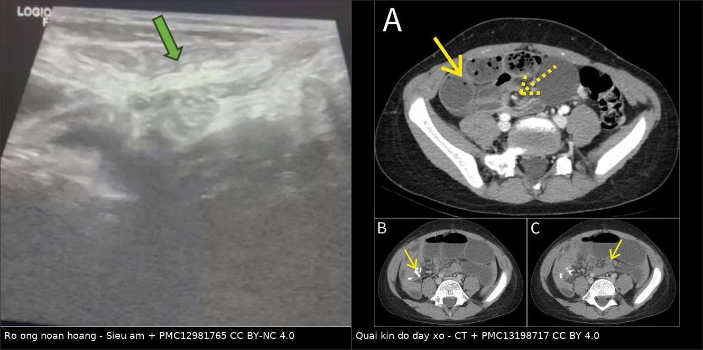
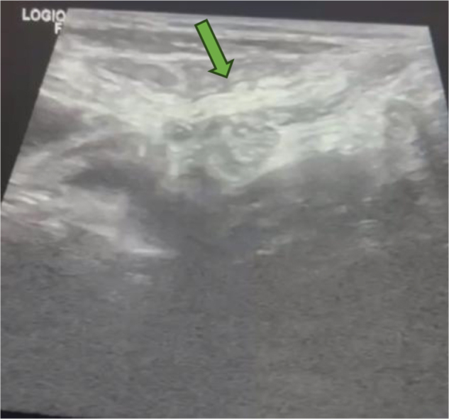
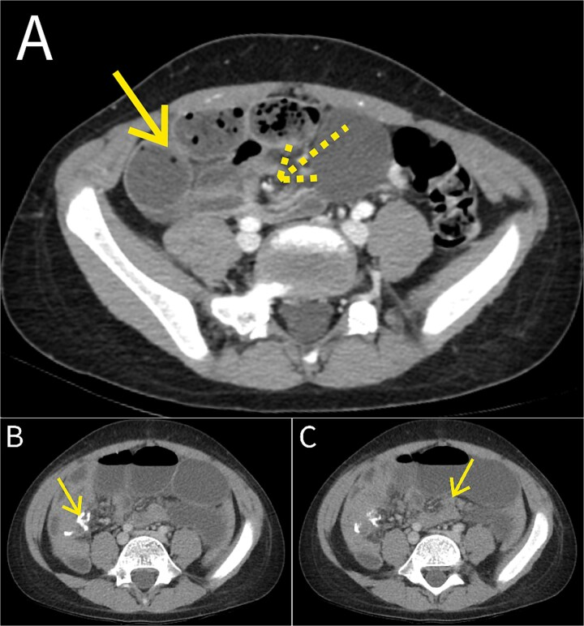
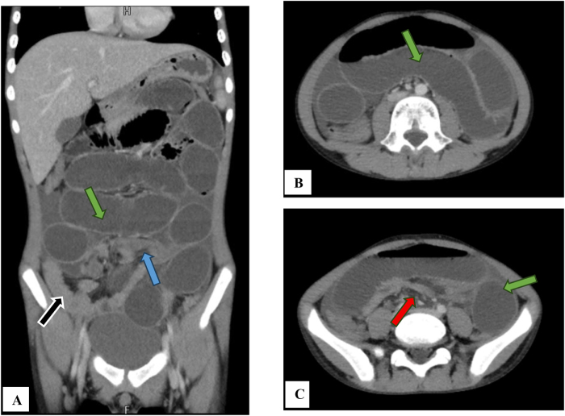
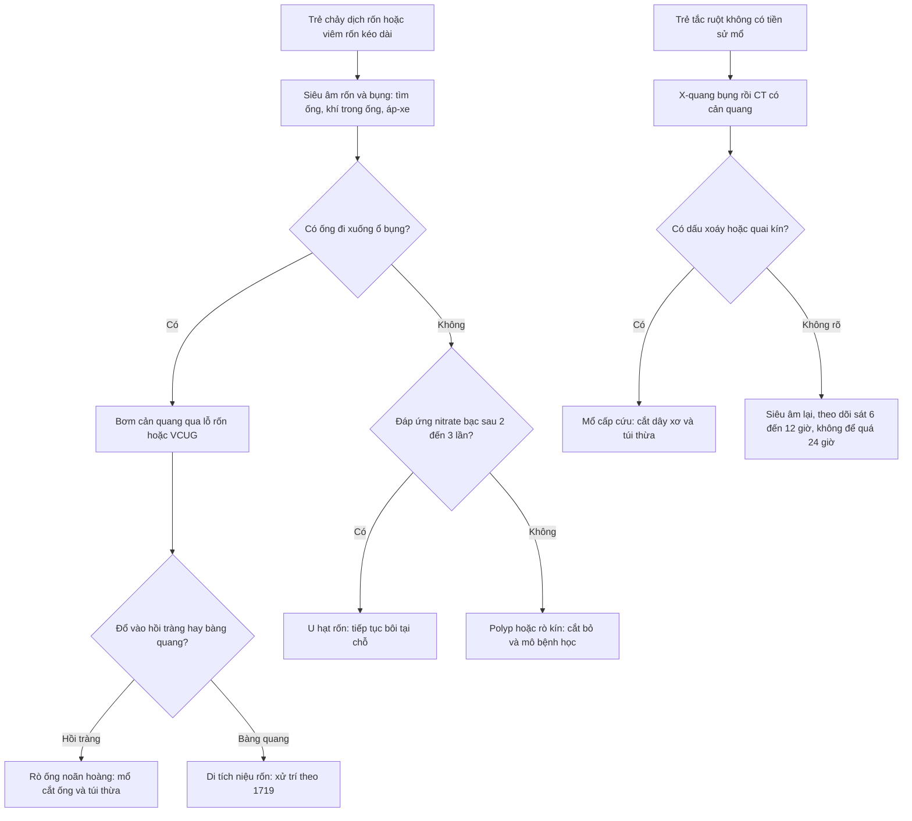
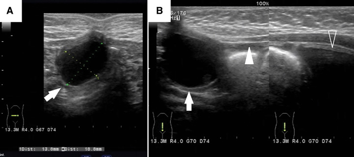

# 3135 — Rò túi thừa Meckel ra rốn & dây xơ mạc treo Meckel: hai mặt của cùng di tích ống noãn hoàng / Omphalomesenteric fistula & mesodiverticular band

**Tags:** `pattern:ro-ron` `pattern:tac-ruot` `pattern:quai-kin` `pattern:day-xo` `vung:ruot-non` `vung:thanh-bung` `vung:ron-bung` `protocol:CT-bung-co-can-quang` `protocol:sieu-am`
**Mức chắc chắn (certainty):** tổng hợp y văn (literature synthesis) — số liệu từ **đoàn hệ 310 trẻ** có túi thừa Meckel triệu chứng (PMC13219009), **ca có ảnh CT–siêu âm** (PMC12981765, PMC13198717, PMC12197850), **loạt 28 trẻ rối loạn rốn** (PMC11298018), **tổng quan hệ thống Littre 98 ca** (PMC10253297 — dùng cho phần phân biệt) và các tổng quan di tích ống noãn hoàng (PMC11415136, PMC12554794). Câu là suy luận được ghi **[suy luận]**.

> **Vì sao bài này quan trọng:** [1872](../1872-thoat-vi-littre-tui-thua-meckel-trong-tui-thoat-vi/lesson.md) đã phủ **túi thừa Meckel đi lạc vào túi thoát vị**. Nhưng cùng một di tích **ống noãn hoàng (omphalomesenteric duct, OMD)** còn hai mặt khác thường gặp hơn ở trẻ: **(1)** ống **không đóng kín** → **rò ruột ra rốn**, chảy dịch/không lành da rốn; **(2)** ống đóng kín nhưng **mạch ống noãn hoàng còn lại thành dây xơ** → quai ruột chui qua → **tắc ruột quai kín**, thiếu máu ruột trong **6–12 giờ**. Cả hai bị chẩn đoán muộn vì: rò rốn bị coi là **u hạt rốn** (điều trị bằng nitrate bạc mãi không khỏi), còn dây xơ **hầu như không thấy trực tiếp trên CT** — chẩn đoán trước mổ chỉ đạt **5,9%** (4/28) trong một loạt có triệu chứng (PMC11415136).

## 1. Tổng quan bệnh học – cơ chế hình ảnh (TẠI SAO)

### 1.1 Một ống phôi, năm kiểu tồn tại

- **Ống noãn hoàng (vitelline/omphalomesenteric duct)** nối **trung tràng** với **túi noãn hoàng**; bình thường **teo và biến mất trong tuần 5–9** thai. Khi không teo hết, tồn tại **5 dạng**: **túi thừa Meckel** (đoạn trong ổ bụng), **dây xơ (fibrous cord)**, **xoang rốn (umbilical sinus)**, **rò ruột–rốn (patent duct/enteric fistula)**, **nang ống noãn hoàng / polyp rốn**.
- **Tần suất:** di tích OMD gặp ở **~2% dân số**; trong đó **túi thừa Meckel chiếm 97%** — nhưng **ống thông hoàn toàn (patent VID) lại là thể hay có triệu chứng nhất** (PMC12554794). Nghĩa là: cái **hiếm** lại là cái **hay phải xử lý**.
- **Túi thừa Meckel:** quy tắc 2 — **2% dân số**, cách **~60 cm** van hồi manh tràng, dài **~5 cm**; **mô lạc chỗ (dạ dày/tụy) ~50%**; **nguy cơ biến chứng suốt đời 4%**; trong đó **chảy máu 4%**, **tắc ruột 6%** (PMC11415136, PMC13544801).
- **Vì sao rò rốn chảy dịch mãi:** ống thông **có niêm mạc ruột/dạ dày lạc chỗ** → tiết dịch và acid → **da quanh rốn bị ăn mòn**, không bao giờ liền; đôi khi **sa niêm mạc** ra ngoài thành **khối đỏ như quả mâm xôi**.

### 1.2 Vì sao dây xơ mạc treo gây tắc ruột **quai kín** (và vì sao nguy hiểm)

- **Dây xơ mạc treo Meckel (mesodiverticular band, MDB)** là di tích **động mạch ống noãn hoàng** còn lại trong **mạc treo** — một dải xơ đi từ **đỉnh túi thừa** tới **mạc treo/thành bụng trước**. Dải xơ này có ở **1–4% dân số** (PMC11415136).
- Khi một quai hồi tràng **chui qua lỗ do dây xơ + túi thừa + mạc treo tạo ra**, quai ruột bị **giam hai đầu** → **quai kín**. Quai kín không thể giảm áp bằng sonde dạ dày vì **không thông với phần ruột còn lại**.
- **Trình tự mạch máu:** ứ tĩnh mạch → **phù thành** → áp lực trong lòng tăng → **tắc động mạch** → **hoại tử** trong **6–12 giờ** **[suy luận từ sinh lý quai kín, xem 162]**. Đây là lý do **quai kín là cấp cứu ngoại khoa**, không phải "theo dõi thêm 24 giờ".
- **Số liệu lịch sử:** Manning & McLaughlin (1947) ghi nhận **tử vong gần 100%** khi ruột bị nghẹt do MDB không mổ — con số này **không dùng để tiên lượng hôm nay**, nhưng giải thích vì sao đây là chẩn đoán **không được bỏ sót** (PMC11415136).
- **Vì sao khó chẩn đoán trước mổ:** dây xơ **mảnh, không cản quang, nằm giữa các quai ruột** → trên CT chỉ thấy **hệ quả** (điểm chuyển tiếp, dấu xoáy, quai C/U), không thấy "sợi dây". Trong loạt có triệu chứng, **chỉ 4/28 (5,9%)** được chẩn đoán trước mổ (PMC11415136).

### 1.3 Số liệu định lượng cốt lõi

| Chỉ số | Con số | Nguồn |
|---|---|---|
| Di tích OMD trong dân số | **~2%**; Meckel = **97%** di tích OMD | PMC12554794 |
| Nguy cơ biến chứng suốt đời của Meckel | **4%** (chảy máu **4%**, tắc ruột **6%** trong các thống kê khác nhau) | PMC11415136 |
| Mô lạc chỗ trong Meckel | **~50%** | PMC13544801 |
| Dây xơ mạc treo (di tích động mạch noãn hoàng) | **1–4%** dân số | PMC11415136 |
| Chẩn đoán trước mổ khi có triệu chứng | **5,9% (4/28)** | PMC11415136 |
| **Rộng túi thừa** và nguy cơ chảy máu (310 trẻ) | quan hệ **hình chữ U ngược**, đỉnh nguy cơ ở **~1,25 cm**; tương tác với **mô lạc chỗ** | PMC13219009 |
| Loạt rối loạn rốn ở trẻ | 28 trẻ khám → **10** có di tích OMD/niệu rốn; biểu hiện: **viêm rốn 4**, **chảy dịch rốn 3**, **đau bụng 2**, **khối rốn 1**; siêu âm dùng **10/10**, CT **7/10** | PMC11298018 |
| Tỷ lệ nam:nữ khi có triệu chứng ở trẻ | **3:1** (58% vs 42% ở người lớn) | PMC11415136 |

## 2. Mẫu hình + chẩn đoán phân biệt theo bệnh cảnh (Gamut)

**Hai câu hỏi lâm sàng khác nhau, hai gamut khác nhau** — đừng gộp:

*Trái: **siêu âm** — cấu trúc ống cùng tận ở bụng dưới. Phải: **CT** — quai kín với **dấu xoáy mạc treo** và quai ruột giãn. Cùng một di tích, hai kiểu biểu hiện. Ảnh ghép letterbox từ PMC12981765 (CC BY-NC 4.0) + PMC13198717 (CC BY 4.0).*

### 2.1 Trẻ **chảy dịch rốn / viêm rốn kéo dài** (gamut "rốn ướt")

- **Rò ống noãn hoàng (rò Meckel ra rốn):** lỗ rốn **ướt liên tục**, có thể **sa niêm mạc đỏ**, da quanh rốn **viêm đỏ–loét**; bơm thuốc cản quang qua lỗ rốn thấy **ống đi xuống ổ bụng đổ vào hồi tràng**.
- **U hạt rốn (umbilical granuloma):** mô hạt đỏ, **mềm, không có lỗ thông**, **đáp ứng nitrate bạc** sau **2–3 lần**.
- **Polyp rốn:** **niêm mạc ruột** thật, **không đáp ứng nitrate bạc**, dễ **chảy máu** khi chạm; là di tích OMD.
- **Rò/u nang niệu rốn (urachal):** dịch **trong**, đường đi **xuống dưới về phía bàng quang** (xem [1719](../1719-bang-quang-doi-va-nang-nieu-ron/lesson.md)); phân biệt bằng **VCUG** hoặc siêu âm đường đi.
- **Viêm rốn (omphalitis):** đỏ, sưng, chảy mủ, sốt — **nhiễm khuẩn**, không có ống thông; siêu âm tìm **áp-xe dưới da**.
- **Nang ống noãn hoàng:** khối **dịch kín** dưới rốn, không thông ra ngoài; có thể thành **dây xơ gây tắc ruột** khi vỡ/nhiễm.

*Siêu âm bụng: cấu trúc **ống/cùng tận** (mũi tên) nằm cạnh các quai ruột giãn — gợi ý túi thừa Meckel hoặc ống rò. Nguồn: PMC12981765, CC BY-NC 4.0.*

### 2.2 Trẻ **tắc ruột không có tiền sử mổ** (gamut "quai kín")

- **Dây xơ mạc treo Meckel (MDB):** tắc ruột **cao**, đau từng cơn, nôn mửa; CT có **dấu xoáy mạc treo**, **điểm chuyển tiếp**, quai ruột **hình chữ C/U**.
- **Dây xơ OMD từ túi thừa tới rốn:** giống MDB nhưng dây đi tới **thành bụng trước** — trên CT thấy **điểm chuyển tiếp sát thành bụng**, có thể kèm **khối/ống ở rốn**.
- **Thoát vị nội bẩm sinh:** lỗ trong mạc treo/mạc nối; CT có **túi thoát vị + quai kín**, không có dây tới rốn.
- **Xoắn ruột non nguyên phát:** **dấu xoáy** rõ, thiếu máu sớm, thường ở trẻ lớn.
- **Lồng ruột non–non:** **dấu bia/ruột trong ruột** (xem [3128](../3128-long-ruot-non-non-nguoi-lon/lesson.md)); khác quai kín.
- **Thoát vị Littre:** túi thừa **nằm trong túi thoát vị** (xem [1872](../1872-thoat-vi-littre-tui-thua-meckel-trong-tui-thoat-vi/lesson.md)).

*(A) CT có cản quang: các quai ruột non **giãn, ứ phân (faecalization)**; **dấu xoáy mạc treo** (mũi tên nét đứt) và quai giãn (mũi tên liền) — nghĩ tắc ruột cao độ. (B, C) CT sau mổ: miệng nối và quai giãn còn lại. Ca: bé trai **8 tuổi**, mổ xác nhận **túi thừa Meckel hoại tử + quai hồi tràng xoắn** quanh dây xơ ống noãn hoàng. Nguồn: Taher O et al., J Surg Case Rep 2026 (PMC13198717), CC BY 4.0.*

## 3. Bảng so sánh phân biệt (ma trận đối chiếu)

| Thực thể (entity) | Hình ảnh điển hình | Chốt vào (rule-in) | Chốt loại (rule-out) | Gợi ý xác nhận |
|---|---|---|---|---|
| **Rò ống noãn hoàng ra rốn** | **Ống hồi âm** từ rốn xuống ổ bụng, đổ vào **hồi tràng**; có thể thấy **khí trong ống**; da rốn loét | **Chảy dịch rốn liên tục + ống nối rốn–hồi tràng trên siêu âm/chụp cản quang qua lỗ rốn** | Đường đi **xuống bàng quang** → rò niệu rốn; khối đặc không lỗ thông → u hạt/polyp | Siêu âm rốn + bơm cản quang qua lỗ rốn; VCUG nếu nghi niệu rốn |
| **U hạt rốn** | Khối **đặc, mềm**, không lỗ thông, **không có ống** | **Đáp ứng nitrate bạc 2–3 lần** | Không đáp ứng, chảy máu khi chạm, có ống → polyp/rò OMD | Thử nitrate bạc; nếu thất bại → siêu âm + cắt bỏ |
| **Polyp rốn** | Khối **niêm mạc đỏ**, có thể **sa ra**, chảy máu | **Mô niêm mạc ruột/dạ dày** trên mô bệnh; không đáp ứng nitrate bạc | Không có niêm mạc, mô hạt → u hạt rốn | Cắt bỏ + mô bệnh học |
| **Rò/nang niệu rốn** | Nang/ống **dưới rốn**, đường đi **xuống bàng quang**, có thể **nhiễm** thành áp-xe | **Đường đi tới đỉnh bàng quang + VCUG** | Đường đi tới **hồi tràng** → OMD | Siêu âm + VCUG; xem 1719 |
| **Dây xơ mạc treo (MDB)** | **Điểm chuyển tiếp** + **dấu xoáy mạc treo**, quai ruột **C/U**, quai kín | **Tắc ruột ở trẻ không mổ trước + dấu xoáy + quai kín trên CT** | Dấu bia/ruột trong ruột → lồng ruột; quai trong túi thoát vị → Littre | CECT bụng–chậu; mổ nội soi |
| **Dây xơ OMD tới rốn** | Điểm chuyển tiếp **sát thành bụng trước**, kèm **ống/khối ở rốn** | **Tắc ruột + bất thường rốn cùng lúc** | Không có bất thường rốn, dây nằm trong mạc treo → MDB | Siêu âm rốn + CT; hỏi kỹ tiền sử rốn ướt |
| **Thoát vị nội bẩm sinh** | **Túi thoát vị** trong mạc treo, quai kín, không dây tới rốn | **Quai kín + lỗ mạc treo** | Có dây xơ tới rốn/túi thừa → OMD | CT; mổ |
| **Lồng ruột non–non** | **Dấu bia**, **ruột trong ruột**, ít dịch tự do sớm | **Dấu bia + khối lồng** | Quai kín có xoáy, không có khối lồng | Siêu âm trước, CT nếu không rõ |

*CT có cản quang: (A) mặt phẳng vành — quai ruột non giãn (mũi tên xanh lá), **điểm chuyển tiếp** ở hồi tràng đoạn cuối (mũi tên xanh dương) với **dải xơ đi từ thành ruột tới thành bụng trước** (mũi tên đen); (B, C) trục — quai giãn và mức dịch. Ca: bé trai **12 tuổi**, sốc nhiễm khuẩn do tắc ruột; mổ xác nhận dải xơ ống noãn hoàng. Nguồn: PMC12981765, CC BY-NC 4.0.*

### 3.1 Đọc chuẩn xác: bốn dấu hiệu quyết định "quai kín"

1. **Điểm chuyển tiếp (transition point):** nơi quai giãn **đột ngột** chuyển sang quai xẹp; đo **đường kính** hai bên (thường chênh **> 2 lần**).
2. **Dấu xoáy mạc treo (mesenteric swirl):** mạch máu và mỡ mạc treo **xoắn quanh trục** — dấu mạnh nhất của xoắn/quai kín.
3. **Hình dạng quai:** quai kín thường **hình chữ C/U**, chứa đầy dịch, **hai đầu kẹp sát nhau**.
4. **Thiếu máu ruột:** thành ruột **không ngấm thuốc**, **dày thành**, **khí trong thành (pneumatosis)**, **khí trong tĩnh mạch cửa** — dấu **muộn**, đừng chờ mới mổ.

## 4. Protocol + xử trí

### 4.1 Chẩn đoán hình ảnh

- **Rốn ướt:** **siêu âm là bước 1** (không bức xạ, trẻ hợp tác kém vẫn làm được): đầu dò **cao tần**, quét **dọc từ rốn xuống**, đo **đường kính ống** (mm), tìm **khí trong ống**, Doppler thành ống. Sau đó **bơm cản quang qua lỗ rốn** (fistulography) để xác định **đổ vào hồi tràng hay bàng quang**; **VCUG** khi nghi niệu rốn. CT **không** cần cho rò đơn thuần, chỉ khi có **áp-xe/khối**.
- **Nghi tắc ruột:** **X-quang bụng** đứng/ngửa (mức khí–dịch, bóng hơi) → **CT bụng–chậu có cản quang** là chìa khóa để phát hiện **quai kín**. Siêu âm hữu ích ở trẻ nhỏ (dấu xoáy, dịch tự do) nhưng **không loại trừ** quai kín.
- **Không** dùng MRI thường quy cho cấp cứu bụng ở trẻ (thời gian, an thần) — CT nhanh hơn.
- **Đo và ghi:** đường kính ống rò (mm), đường kính túi thừa (mm — mốc nguy cơ chảy máu **~1,25 cm**), chiều dày thành ruột, lượng dịch tự do.

### 4.2 Ngưỡng và quyết định

- **Rò OMD xác định** → **mổ cắt ống rò + cắt túi thừa Meckel** (không chỉ thắt ống): bỏ lại túi thừa = còn mô lạc chỗ, còn nguy cơ chảy máu/tắc ruột.
- **Túi thừa Meckel tình cờ** trong mổ khác: cắt nếu **dài > 2 cm**, **có mô lạc chỗ**, **dây xơ**, hoặc **cổ hẹp** **[thực hành đồng thuận, chưa có thử nghiệm]**.
- **Quai kín/thiếu máu ruột** → **mổ cấp cứu**, không chờ hết hội chứng đáp ứng viêm; cắt **đoạn ruột hoại tử** + nối.
- **Kháng sinh** trước mổ khi có viêm rốn/áp-xe; **dẫn lưu** chỉ khi đã loại trừ rò ruột (xem §5).
- **Sau mổ:** theo dõi **tắc ruột sớm do dính** — ca PMC13198717 tái tắc **ngày 7 sau mổ** do dải mạc nối, phải mổ lại.

### 4.3 Sơ đồ tiếp cận

## 5. Biến thể bình thường và cạm bẫy

- **U hạt rốn "không khỏi" là một chẩn đoán sai, không phải thất bại điều trị:** sau **2–3 lần** nitrate bạc mà vẫn ướt → phải **siêu âm + cắt bỏ**. Polyp/rò OMD **không đáp ứng** nitrate bạc.
- **Siêu âm bình thường không loại trừ dây xơ:** dây xơ **mảnh**, có thể nằm giữa quai ruột; chẩn đoán dựa vào **hệ quả** (quai kín/điểm chuyển tiếp). Trong loạt có triệu chứng, chẩn đoán trước mổ chỉ **5,9%**.
- **Đừng chọc/dẫn lưu "áp-xe quanh rốn" trước khi loại trừ rò ruột:** dẫn lưu một ổ thông với ruột → **rò phân ra da**, nhiễm trùng lan. Ca PMC13344074 cho thấy **áp-xe dưới rốn** có thể là **di tích OMD + niệu rốn đồng thời**.
- **Niệu rốn ≠ noãn hoàng:** cùng ở rốn, cùng chảy dịch, nhưng **đường đi khác** (bàng quang vs hồi tràng) và **xử trí khác**. Ảnh dưới: nang **2 cm** dưới rốn + **đường hồi âm đi tới bàng quang** — di tích **niệu rốn**, không phải OMD.

*(A) Nang **2 cm** ngay dưới rốn (mũi tên). (B) Đường hồi âm từ nang **đi xuống bàng quang** (đầu mũi tên) — gợi ý **di tích niệu rốn**; bệnh nhi này có **đồng thời** di tích ống noãn hoàng. Nguồn: Oyachi N, Numano F, Surg Case Rep 2025 (PMC12197850), CC BY 4.0.*

- **Rò OMD có thể biểu hiện ở người lớn** như **đau hố chậu phải** giả viêm ruột thừa (ca 26 tuổi — PMC12435763) hoặc **tắc ruột** (PMC11272375); đừng loại trừ chỉ vì bệnh nhân lớn tuổi.
- **Chảy máu Meckel không đau, không có khối:** khác lồng ruột (đau từng cơn + khối); nội soi/CT có thể âm tính — **xạ hình Meckel** hoặc **chụp mạch** khi nghi cao.
- **Bỏ lại túi thừa sau khi cắt dây xơ** là lỗi thường gặp: dây xơ chỉ là **triệu chứng**, túi thừa + mô lạc chỗ mới là **nguồn biến chứng**.

## 6. Tự lượng giá — Blind Quiz

**Ca 1 — Bé trai 12 tuổi, sốc nhiễm khuẩn, bụng chướng, nôn ra dịch xanh. Nhìn CT trước, mô tả trước.**

- Hỏi: dấu hiệu chính? Vì sao gọi là "quai kín"? Cần làm gì tiếp?

<b>Bấm để hiện đáp án</b>

- Quai ruột non **giãn**, **điểm chuyển tiếp** ở hồi tràng đoạn cuối, **dải xơ từ thành ruột tới thành bụng trước** → tắc ruột do **dây xơ ống noãn hoàng**.
- "Quai kín" vì quai ruột bị giam **hai đầu**, không thông với phần còn lại → **không giảm áp được bằng sonde**, nguy cơ **thiếu máu trong 6–12 giờ**.
- **Mổ cấp cứu** (nội soi hoặc mở), cắt dây xơ + cắt túi thừa; kháng sinh, bù dịch.
- Nguồn: PMC12981765, CC BY-NC 4.0.

**Ca 2 — Bé trai 8 tuổi, đau bụng 1 tuần, nôn, CT có dấu xoáy.**

- Hỏi: hai dấu hiệu trên CT? Nguyên nhân ít gặp nhưng phải nghĩ? Vì sao tái tắc sau mổ?

<b>Bấm để hiện đáp án</b>

- **Dấu xoáy mạc treo** (mũi tên nét đứt) + **quai ruột giãn ứ phân** (mũi tên liền) → tắc ruột quai kín.
- Nguyên nhân: **túi thừa Meckel hoại tử xoắn quanh dây xơ ống noãn hoàng** bám thành bụng trước.
- Tái tắc **ngày 7 sau mổ** do **dải mạc nối** quanh miệng nối → cần mổ lại; đây là lý do phải theo dõi sát sau mổ.
- Nguồn: Taher O et al., J Surg Case Rep 2026 (PMC13198717), CC BY 4.0.

**Ca 3 — Bé gái 4 tháng, rốn ướt từ lúc sinh, bôi nitrate bạc 3 lần không khỏi. Siêu âm:**

- Hỏi: chẩn đoán? Cần thêm thông tin gì để phân biệt với rò ống noãn hoàng? Xử trí?

<b>Bấm để hiện đáp án</b>

- Nang **2 cm** dưới rốn + **đường đi tới bàng quang** → **di tích niệu rốn** (nang/ống niệu rốn), **không** phải rò ống noãn hoàng.
- Cần **VCUG** hoặc **bơm cản quang qua lỗ rốn** để xác định đường đi; siêu âm bàng quang đánh giá liên quan.
- Xử trí: **cắt bỏ** đường rò/nang (nội soi hoặc mở); kháng sinh nếu nhiễm; **không** chỉ bôi nitrate bạc.
- Nguồn: Oyachi N, Numano F, Surg Case Rep 2025 (PMC12197850), CC BY 4.0 — bệnh nhi có **đồng thời** di tích ống noãn hoàng.

## Bài liên quan chéo
- [1872 – Thoát vị Littre: túi thừa Meckel trong túi thoát vị](../1872-thoat-vi-littre-tui-thua-meckel-trong-tui-thoat-vi/lesson.md)
- [162 – Tắc ruột non/già, quai kín & thiếu máu mạc treo](../162-tac-ruot/lesson.md)
- [1719 – Bàng quang đôi, vách bàng quang và nang niệu rốn ở trẻ](../1719-bang-quang-doi-va-nang-nieu-ron/lesson.md)
- [3128 – Lồng ruột non–non ở người lớn](../3128-long-ruot-non-non-nguoi-lon/lesson.md)

> Không dùng để chẩn đoán độc lập khi chưa có người hướng dẫn.
