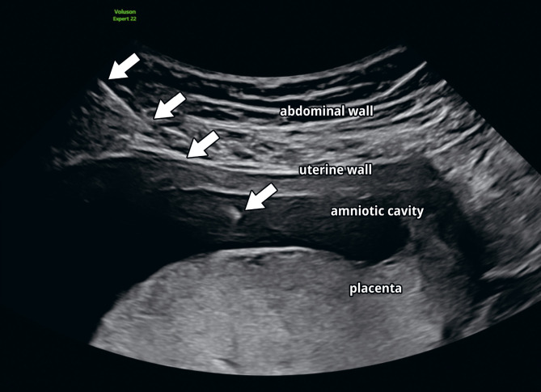
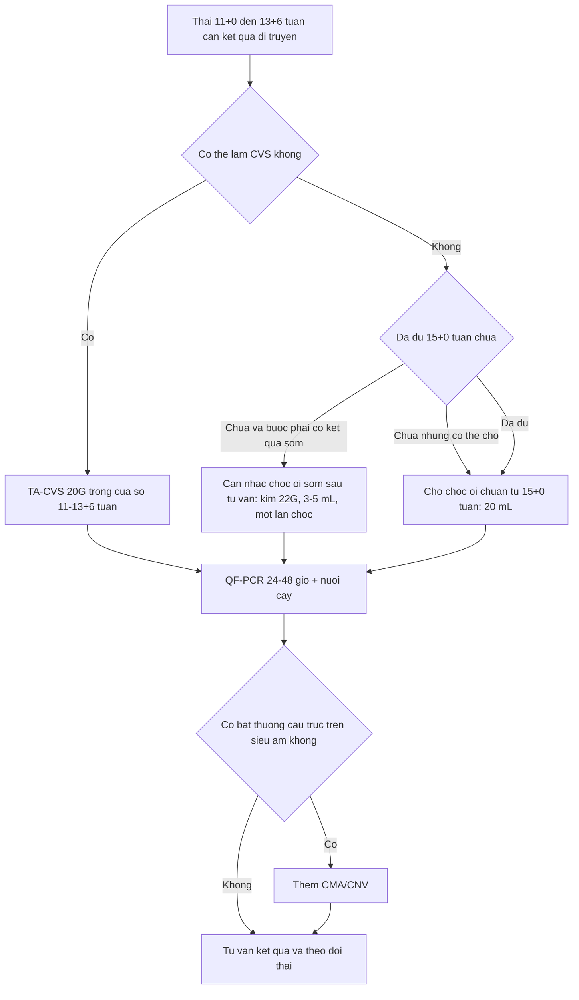
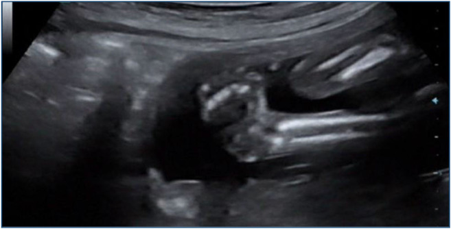
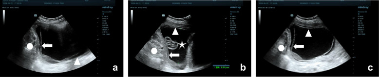

# 3136 — Chọc ối sớm trước 15 tuần (early amniocentesis): vì sao bàn chân khoèo tăng từ 0,1% lên 1,3% và khi nào vẫn phải chọn

**Tags:** `pattern:bien-chung-thu-thuat` `pattern:ro-oi` `pattern:di-tat-chi` `pattern:manh-oi` `vung:thai` `vung:buong-oi` `vung:manh-oi` `vung:banh-nhau` `protocol:choc-oi` `protocol:CVS`

**Mức chắc chắn (certainty):** tổng hợp y văn (literature synthesis) — số liệu lấy từ **thử nghiệm ngẫu nhiên CEMAT 4.374 thai** (Lancet 1998, PMID **9457093**), **tổng quan hệ thống Cochrane 2017 — 16 thử nghiệm, 33.555 thai** (PMID **28869276**), **tổng quan Cochrane 2000 so sánh chọc ối sớm với CVS** (PMID **10796116**), **khuyến cáo tổng quan Tabor & Alfirevic 2010** (PMID **20051662**), **đoàn hệ tiến cứu 15 năm — 3.238 thai, một phẫu thuật viên** (Genes 2026, PMCID **PMC13704424**, CC BY) và **đoàn hệ 331 thai về dính màng muộn** (PMC12858216). Ba ảnh minh hoạ là ảnh CC của bài gốc; **không có ca do nhóm tự chụp**, không có ca nguyên văn nào của người viết.

> **Kịch bản thực hành (ghép từ các nguồn trên, không phải ca nguyên văn):** thai phụ **38 tuổi**, thai **12 tuần 4 ngày**, siêu âm đo CRL tương ứng, bánh nhau **mặt sau**, màng ối và màng đệm **còn tách rời**; NIPT không thực hiện được, cần kết quả di truyền **trước 15 tuần** vì lý do cá nhân. Câu hỏi: **CVS hay chọc ối sớm, và phải tư vấn con số nào?**
> Bài chốt **ba quyết định**: **(1) mốc 15+0 tuần không phải hình thức — chọc ối sớm 11–12 tuần làm bàn chân khoèo tăng từ 0,1% lên 1,3% (p = 0,0001) và mất thai tăng 1,7 điểm % so với chọc ối giữa tam cá nguyệt; (2) khi buộc phải có kết quả trước 15 tuần, **CVS là lựa chọn trước**, chọc ối sớm chỉ là phương án hai với kỹ thuật khắt khe (kim 22 G, 3–5 mL, một lần chọc); (3) ở tay nghề cao, chọc ối sớm 11–14 tuần có thể an toàn (sảy thai 0,25%), nhưng **con số đó không dùng để tư vấn đại trà**.** Nối [1954 – Chọc ối & sinh thiết gai nhau: biến chứng](../1954-choc-oi-sinh-thiet-gai-nhau/lesson.md), [1988 – Chọc ối & CVS ở song thai](../1988-choc-oi-song-thai/lesson.md), [1989 – Chọc dò cuống rốn](../1989-choc-do-cuong-ron/lesson.md), [1725 – Vỡ ối non trước 24 tuần](../1725-vo-oi-non-thang-truoc-24-tuan-tren-seo-mo-lay-thai/lesson.md), [1936 – Tụ máu bao cơ thẳng](../1936-tu-mau-bao-co-thang-bung/lesson.md).

## 1. Tổng quan bệnh học – cơ chế hình ảnh

### 1.1 Chọc ối sớm là gì và vì sao tồn tại

- **Định nghĩa:** chọc ối sớm (**early amniocentesis — EA**) là hút dịch ối trong khoảng **11+0 đến 14+6 tuần**, tức **trước mốc 15+0 tuần** mà các hướng dẫn dùng cho chọc ối tiêu chuẩn. Trong thử nghiệm CEMAT, EA được làm **11+0–12+6 tuần** và lấy **11 mL** dịch; chọc ối giữa tam cá nguyệt làm **15+0–16+6 tuần**, lấy **20 mL** (PMID 9457093). Trong đoàn hệ Croatia 2010–2024, EA làm **11+0–13+6 tuần** (trung vị **12+6**), kim **22 G**, hút **3–5 mL** bằng kỹ thuật "amniovacucentesis" (PMC13704424).
- **Lý do tồn tại:** chọc ối giữa tam cá nguyệt trả kết quả **sau 16–18 tuần**, làm mất cửa sổ can thiệp sớm; CVS cho kết quả sớm hơn nhưng lấy **nhung mao bánh nhau** nên có nguy cơ **khảm giới hạn bánh nhau (confined placental mosaicism, CPM)** và cần chọc ối xác nhận. EA lấy **tế bào thai bong vào dịch ối** nên tránh được CPM — đây là lợi thế sinh học thật của EA, không phải lợi thế thời gian.
- **Vì sao 11 tuần là mốc dưới:** trước 10–11 tuần, màng ối chưa phủ toàn bộ khoang đệm và buồng ối còn nhỏ; CVS trước 10 tuần gắn với **dị tật giảm chi (limb reduction defects)** (PMID 20051662). Vì vậy cửa sổ 11–14 tuần là "cửa sổ duy nhất" cho lấy mẫu sớm.

### 1.2 TẠI SAO chọc ối sớm nguy hiểm hơn — ba khác biệt giải phẫu, không phải "tay nghề kém"

1. **Màng ối và màng đệm CHƯA DÍNH.** Ở 11–14 tuần, hai lá màng còn tách rời và thường dính dần trong khoảng **14–16 tuần**; trong một đoàn hệ 325 thai, **28,0% (91/325)** vẫn còn tách màng ở **16 tuần** (PMC12858216). Hệ quả: kim **luôn xuyên hai lá**, và dịch ối có thể **rò vào khoang màng đệm** — tạo **tách màng ối–đệm (chorioamniotic separation)**, dải màng trôi nổi và cuối cùng là **dải màng ối (amniotic band)** gây thắt chi. Đây là cơ chế **biến dạng (deformation)** do rò dịch, khác hẳn "tai nạn kim" đơn thuần.
2. **Buồng ối nhỏ, khoảng an toàn hẹp.** Cùng một kim, cùng một góc vào, **thể tích hút** ở EA chỉ **3–5 mL** so với **20 mL** ở chọc ối chuẩn (PMC13704424; PMID 9457093). Thai **11–13 tuần** lại nằm sát thành bụng trước, chi dưới thường **gấp vào thân**, nên khoảng cách từ thành bụng đến bàn chân **rất ngắn** — trên siêu âm, kim và bàn chân có thể **chồng hình** ở lát cắt dọc, và đó là lý do phải xem **hai bình diện trực giao**.
3. **Nguy cơ "chạm chi" cao hơn tính theo thời gian phơi nhiễm.** CEMAT ghi nhận bàn chân khoèo (**talipes equinovarus**) tăng **13 lần** (1,3% so với 0,1%), trong khi tổng mất thai chỉ tăng **1,7 điểm %** (7,6% so với 5,9%). Mô hình này — **một dị tật chi định vị cụ thể tăng mạnh hơn tử vong chung** — phù hợp với **tổn thương trực tiếp/thiểu ối cục bộ tại bàn chân** hơn là một biến cố toàn thân. Bài của nhóm CEMAT đặt đúng câu hỏi: **"disruption hay deformation?"** — và đến nay **chưa phân định** (PMID 10544229).

### 1.3 Con số phải thuộc (ngưỡng định lượng)

- **CEMAT (RCT, 4.374 thai):** mất thai toàn bộ **7,6% vs 5,9%** (chênh 1,7%, p = 0,012); **talipes 1,3% vs 0,1%** (p = 0,0001); **rò ối sau thủ thuật 3,5% vs 1,7%** (p = 0,0007) (PMID 9457093).
- **Cochrane 2017 (chọc ối sớm vs chọc ối giữa tam cá nguyệt, 1 thử nghiệm, 4.334 thai):** mất thai **RR 1,29 (1,03–1,61)**; sảy thai tự nhiên **3,6% vs 2,5%, RR 1,41 (1,00–1,98)**; **dị tật (gồm talipes) 4,7% vs 2,7%, RR 1,73 (1,26–2,38)** (PMID 28869276).
- **Cochrane 2017 (chọc ối sớm vs CVS transabdominal):** sảy thai **2,3% vs 1,3%, RR 1,73 (1,15–2,60)** (PMID 28869276).
- **Cochrane 2000 (3 thử nghiệm, 915 vs 917 thai):** thất bại lấy mẫu **0,4% vs 2,0%, RR 0,23 (0,08–0,65)** — nghĩa là **EA lấy mẫu thành công hơn CVS**, nhưng sảy thai tự nhiên **4,4% vs 2,3%, RR 1,92 (1,14–3,23)** (PMID 10796116).
- **Ngưỡng hướng dẫn:** mất thai liên quan thủ thuật của chọc ối và CVS là **0,5–1,0%**; **không chọc ối trước 15+0 tuần**, **không CVS trước 10 tuần** (PMID 20051662).
- **Đoàn hệ tay nghề cao (3.238 thai, một phẫu thuật viên):** kết quả di truyền đạt **99,9% (EA) và 99,8% (CVS)**; sảy thai tự nhiên **0,25% vs 0,18%** (chênh 0,06%, KTC 95% −0,32 đến 0,47; p = 0,73); talipes **2 ca EA, 0 ca CVS**; một lần chọc đủ mẫu **96,6%**; khảm **0,25% ở CVS, 0 ca ở EA**; không có nhiễm trùng (PMC13704424).

### 1.4 TẠI SAO hai bộ số "mâu thuẫn" — và cách đọc

- **Khác biệt kỹ thuật:** CEMAT hút **11 mL** bằng kim thời 1990 và làm ở **11–12 tuần**; đoàn hệ 2026 hút **3–5 mL** bằng kim **22 G** và làm **muộn hơn** (trung vị 12+6). **Thể tích hút nhỏ hơn** làm giảm rò ối, và **tuổi thai muộn hơn** làm giảm nguy cơ talipes.
- **Khác biệt thiết kế:** RCT đa trung tâm có nhiều tay nghề, còn đoàn hệ 2026 là **một phẫu thuật viên duy nhất, hơn 3.000 ca** — tác giả tự viết rằng kết quả **không dùng được để tư vấn chung**.
- **Cách dùng trong tư vấn:** **số của RCT và Cochrane là số để tư vấn**; số của trung tâm mình là số để **đánh giá chất lượng nội bộ**. Không được lấy 0,25% của một phẫu thuật viên để nói "chọc ối sớm an toàn".

## 2. Mẫu hình + chẩn đoán phân biệt theo vị trí (gamut)

- **Mẫu hình chính (pattern):** **kim đi qua thành bụng → cơ tử cung → hai lá màng → buồng ối**, trong khi **màng ối và màng đệm còn tách rời**, và **đầu kim nằm trong khoang ối không có thai/bánh nhau**. Hệ quả hình ảnh chia đúng theo **lớp giải phẫu mà kim đi qua**.
- **Gamut theo lớp (location):**
  - **Thành bụng trước:** tụ máu bao cơ thẳng (rectus sheath hematoma) — khối **không đập**, hình thoi trong bao cơ, **tăng âm → hỗn hợp âm** theo thời gian; đau khu trú, có thể thiếu máu. Bài [1936](../1936-tu-mau-bao-co-thang-bung/lesson.md).
  - **Màng ối – màng đệm:** **rò ối (amniotic fluid leak) 3,5%** (CEMAT), **PPROM**, **tách màng ối–đệm**, **dải màng ối** thắt chi; trên siêu âm: **dải màng mảnh trôi trong khoang ối**, bờ tự do, có thể quấn quanh chi; **thiểu ối** (MVP < 1 cm) là dấu hiệu nặng.
  - **Bánh nhau:** chảy máu/hematoma tại chỗ chọc — đoàn hệ 2026 ghi **8 ca (0,49%)** hematoma **0,5–1 mL**; **xuất huyết thai–mẹ (FMH)** → nguy cơ tạo kháng thể anti-D nếu mẹ **Rh âm**.
  - **Thai nhi:** **talipes equinovarus** (1,3% trong CEMAT), tổn thương chi trực tiếp, **thiểu ngón/đứt chi** khi có dải màng; nhịp tim thai chậm thoáng qua sau chọc.
  - **Khoang ối:** **khô kim (dry tap)**/thất bại lấy mẫu — **0,4% ở EA** so với **2,0% ở CVS** (Cochrane 2000); **thất bại nuôi cấy** do máu/mẫu ít.
  - **Mẹ:** nhiễm trùng (0% trong đoàn hệ 2026), **tan máu do anti-D**, đau/lo âu; chạm **ruột/bàng quang** nếu bàng quang không rỗng hoặc có dính vùng chậu.
- **Gamut của "bàn chân khoèo trên siêu âm thai"** (vì đây là dấu hiệu hay gặp sau EA):
  - **Talipes do biến dạng sau chọc ối sớm** — tiền sử chọc ối **11–14 tuần**, bàn chân khoèo **hai bên hoặc một bên**, không kèm bất thường cấu trúc khác, xuất hiện ở lần siêu âm **18–22 tuần**.
  - **Talipes đơn độc (isolated)** — 1–2/1.000 trẻ sinh; đa số lành tính, cần đánh giá cột sống và khám sau sinh.
  - **Bất thường NST** — trisomy 18/13, thể ba nhiễm khác; kèm dị tật tim, bàn tay nắm, chậm tăng trưởng.
  - **Dải màng ối** — bàn chân khoèo **không đối xứng**, kèm **thiểu ngón/đứt chi**, dải màng thấy được.
  - **Chuỗi thiểu ối (oligohydramnios sequence)** — thiểu ối nặng nhiều tuần → biến dạng chi + phổi giảm sản.
  - **Bệnh thần kinh–cơ thai nhi** — arthrogryposis, loạn dưỡng cơ, tổn thương tủy; nhiều khớp co rút, không chỉ bàn chân.

## 3. Bảng so sánh phân biệt (ma trận đối chiếu)

| Thực thể (entity) | Thời điểm – kỹ thuật | Siêu âm/hình ảnh then chốt | Chốt vào (rule-in) | Chốt loại (rule-out) | Gợi ý xác nhận |
|---|---|---|---|---|---|
| **Chọc ối sớm (EA)** | **11+0–14+6 tuần**; kim **22 G**, hút **3–5 mL** (CEMAT: 11 mL) | Kim vào khi **hai lá màng còn tách**; đầu kim **trong khoang ối**, tránh bánh nhau và chi | **Tiền sử chọc ối 11–14 tuần + bàn chân khoèo/dải màng mới xuất hiện sau đó** | **Không** loại trừ bằng "không thấy bất thường ngay sau chọc" — talipes chỉ rõ ở **18–22 tuần** | Siêu âm hình thái 18–22 tuần; hỏi lại **ngày và số lần chọc** |
| **Chọc ối tiêu chuẩn ≥ 15+0 tuần** | **≥ 15+0**; kim **20–22 G**, hút **20 mL** | Hai lá màng **đã dính**; khoang ối rộng hơn, thai xa thành bụng | **Talipes 1,3% vs 0,1%** nghiêng hẳn về EA khi có tiền sử chọc sớm | Không loại trừ được talipes do nguyên nhân khác nếu không có tiền sử | Đối chiếu ngày chọc; nếu ≥ 15 tuần thì nguy cơ do thủ thuật **thấp hơn hẳn** |
| **CVS transabdominal (TA-CVS)** | **11+0–13+6**; kim **20 G**, lấy nhung mao | Đầu kim **trong bánh nhau**, đường vào **dưới siêu âm liên tục**; có thể **hematoma tại chỗ** | **Cần kết quả sớm + bánh nhau tiếp cận được** | **Không** dùng khi bánh nhau **mặt sau – khó tiếp cận**, hoặc cần tránh CPM | Karyotype/CMA nhung mao; **khảm 0,25%** trong đoàn hệ 2026 |
| **CVS transcervical (TC-CVS)** | **11–13+6**, qua cổ tử cung | Ống thông/forceps trong khoang đệm; **khó hơn**, **thất bại 2,0% vs 1,1%** (TA-CVS) | Khi **không thể đường bụng** (béo phì, bánh nhau cao) | Thất bại lấy mẫu cao hơn | Cochrane 2017: thất bại lấy mẫu **TC 2,0% vs TA 1,1%, RR 1,79 (1,13–2,82)** |
| **Celocentesis (lấy tế bào ối cực sớm)** | **7–9 tuần**, kim mảnh vào khoang đồng tử (coelom) | Đầu kim trong **khoang đồng tử**, ngoài túi ối | **Nghiên cứu**, khi cần chẩn đoán **rất sớm** ở gia đình có bệnh đơn gene | **Chưa dùng thường quy**; dữ liệu an toàn còn mỏng | Chỉ trong nghiên cứu có đạo đức phê duyệt |

*Siêu âm dọc tại **16+4 tuần** (kỹ thuật của chọc ối tiêu chuẩn): mũi tên trắng lần lượt chỉ **thành bụng**, **thành tử cung**, rồi **đầu kim trong khoang ối**; phía dưới là **bánh nhau mặt sau**. Khi làm ở **11–14 tuần**, hai lá màng chưa dính nên kim phải xuyên thêm lớp màng đệm — chính là nơi dịch ối rò qua và tạo dải màng. Nguồn: Med Genet 2026 (PMCID PMC13099245), Fig. 1 — CC BY 4.0.*

## 4. Protocol chụp/thủ thuật + ngưỡng xử trí

### 4.1 Trước thủ thuật (quyết định cửa sổ tuổi thai)

- **Xác định tuổi thai bằng CRL**, không dựa kinh cuối; ghi rõ **11+0–13+6** hay **≥ 15+0**. Đây là **biến số quyết định nguy cơ**, không phải thông tin hành chính.
- **Đánh giá màng:** mô tả **màng ối–đệm đã dính hay còn tách**; nếu còn tách, ghi nhận vì đây là **điều kiện của EA** và là **cơ sở của tư vấn rò ối/dải màng**.
- **Bánh nhau, chi thai, khoang ối:** chọn **đường vào tránh bánh nhau** và tránh chi dưới; đo **MVP** (thể tích ối ít → nguy cơ dry tap).
- **Bàng quang mẹ rỗng**, da sát trùng, **không nhiễm trùng âm đạo–cổ tử cung**; kiểm tra **nhóm máu Rh** trước thủ thuật.
- **Tư vấn bằng số của RCT/Cochrane**, không bằng số của trung tâm: mất thai **7,6% vs 5,9%**, talipes **1,3% vs 0,1%**, rò ối **3,5% vs 1,7%** so với chọc ối ≥ 15 tuần; nếu chọn CVS, nêu **sảy thai 2,3% vs 1,3%** và **khảm bánh nhau 0,25%**.

### 4.2 Kỹ thuật (nếu chọn EA)

- **Kim 22 G**, đường **xuyên thành bụng**, **siêu âm liên tục**, luôn thấy **đầu kim** (in-plane) — không đâm "mù" theo hướng ước lượng.
- **Một lần chọc là mục tiêu** (đoàn hệ 2026: **96,6%** đủ mẫu lần đầu); tối đa **2 lần** trong cùng ngày (CEMAT).
- **Hút 3–5 mL** ở EA (CEMAT dùng 11 mL); **bỏ 1–2 mL đầu** để giảm nhiễm bẩn tế bào mẹ, rồi lấy mẫu cho **QF-PCR (24–48 giờ)** và **nuôi cấy (~7 ngày)**.
- **Nếu có bất thường cấu trúc trên siêu âm:** thêm **CMA/CNV** — trong đoàn hệ 2026, **5/35 (14,3%)** thai có bất thường cấu trúc mang **CNV gây bệnh** (PMC13704424).
- **Anti-D 300 µg trong 72 giờ** nếu mẹ **Rh âm** (liều và thời điểm theo bài [1954](../1954-choc-oi-sinh-thiet-gai-nhau/lesson.md)); CVS trước 13 tuần dùng liều thấp hơn (**50 µg**).

### 4.3 Sau thủ thuật — theo dõi và ngưỡng can thiệp

- **Dấu hiệu đỏ phải tái khám ngay:** **rò dịch âm đạo**, **sốt ≥ 38 °C**, **chảy máu nhiều**, **cơn co tử cung**, **đau bụng tăng**.
- **Rò ối:** siêu âm lại **1–2 tuần**, đo **MVP/AFI**; nếu **MVP < 1 cm** → nguy cơ chuỗi thiểu ối, hội chẩn sản–sơ sinh; **không** kết luận "phải bỏ thai" ngay vì một phần lỗ kim tự bít.
- **Nhiễm trùng:** không có ca nhiễm trong đoàn hệ 2026, nhưng sốt + dịch hôi sau chọc = **viêm màng ối** cho đến khi loại trừ; cấy máu, kháng sinh, cân nhắc kết thúc thai theo tuổi thai.
- **Talipes/dải màng:** siêu âm hình thái **18–22 tuần** là mốc đọc bàn chân; nếu thấy bất thường, **không quy ngay cho thủ thuật** — đối chiếu **ngày chọc**, **tuổi thai lúc chọc**, số lần chọc và các bất thường phối hợp.

### 4.4 Bảng ngưỡng cần nhớ

| Ngưỡng | Con số | Ý nghĩa thực hành |
|---|---|---|
| Tuổi thai chọc ối tối thiểu | **15+0 tuần** | Dưới mốc này: nguy cơ talipes và rò ối tăng rõ (CEMAT, Cochrane) |
| Tuổi thai CVS tối thiểu | **10–11 tuần** | Trước 10 tuần: dị tật giảm chi |
| Thể tích hút EA | **3–5 mL** (CEMAT 11 mL) | Hút ít → giảm rò ối; đủ cho QF-PCR + nuôi cấy |
| Talipes sau EA vs chọc ối muộn | **1,3% vs 0,1%** | Con số tư vấn chính; **RR 1,73** cho nhóm dị tật |
| Rò ối sau EA vs muộn | **3,5% vs 1,7%** | Dấu hiệu đỏ: dịch âm đạo, MVP < 1 cm |
| Thất bại lấy mẫu EA vs CVS | **0,4% vs 2,0%** | EA "dễ lấy mẫu" hơn — đây là lợi thế kỹ thuật, không phải lợi thế an toàn |

## 5. Biến thể bình thường và cạm bẫy

- **Biến thể bình thường 1 — hai lá màng chưa dính ở 11–14 tuần.** Đây là **giải phẫu bình thường**, không phải "bất thường màng ối"; ở **16 tuần vẫn còn 28,0%** thai chưa dính hoàn toàn (PMC12858216). Đừng gọi là bệnh, nhưng **phải ghi nhận** vì nó là nền của rò ối và dải màng.
- **Biến thể bình thường 2 — "bàn chân gập" ở 11–12 tuần.** Bàn chân thai nhi ở tuổi này thường xoay vào trong và có thể **giả bàn chân khoèo**; chẩn đoán talipes đáng tin hơn **từ 13 tuần** và đặc biệt ở **18–22 tuần**. Vì vậy, một siêu âm 12 tuần "bàn chân bất thường" **không đủ** để kết luận.
- **Cạm bẫy 1 — quy talipes cho thủ thuật mà bỏ qua nguyên nhân khác.** Chỉ quy kết khi: **tiền sử chọc ối 11–14 tuần**, bàn chân bất thường **mới xuất hiện**, **không có bất thường NST/dải màng/thiểu ối** và không có bệnh thần kinh–cơ. Nếu có **thiểu ngón/đứt chi**, nghĩ **dải màng** trước.
- **Cạm bẫy 2 — đọc "máu trong dịch ối" là thất bại.** Chảy máu nhẹ sau chọc gặp ở **1,97%** (EA 1,0% vs CVS 2,0%), hematoma bánh nhau **0,49%**, và đa số **không ảnh hưởng kết quả**; nhưng máu nhiều làm **nuôi cấy thất bại** và có thể che lấp chi tiết trên siêu âm.
- **Cạm bẫy 3 — lấy số của một trung tâm để tư vấn.** "Chọc ối sớm chỉ sảy thai 0,25%" là số của **một phẫu thuật viên với > 3.000 ca**; dùng số đó cho mọi trung tâm là **tư vấn sai**. Ngược lại, dùng số 7,6% của CEMAT để dọa bệnh nhân ở một trung tâm làm 100 ca/năm cũng sai — phải nói **khoảng** và **điều kiện kỹ thuật**.
- **Cạm bẫy 4 — coi CVS là "không có khảm".** Khảm bánh nhau **0,25%** trong đoàn hệ 2026 và có thể cao hơn ở trung tâm khác; khảm trên CVS **phải xác nhận bằng chọc ối**, không kết luận thai bất thường ngay.
- **Cạm bẫy mặt cắt:** trên lát dọc, **kim và bàn chân thai** có thể **chồng hình**; cần **hai bình diện trực giao** và **màu Doppler** để phân biệt đầu kim với xương thai. Tương tự, **dải màng ối** trên lát ngang có thể giả **vách ngăn** (trong song thai) — luôn xoay đầu dò và đối chiếu 3D.

## 6. Tự lượng giá — Blind Quiz

**Ca 1 — thai 16+4 tuần, chọc ối vì nguy cơ trisomy 21 cao**

- Gợi ý lâm sàng: thai phụ nguy cơ cao, xét nghiệm sàng lọc ba tháng đầu bất thường, được chọc ối lấy dịch.
- Câu hỏi: Kể tên **các lớp** mũi tên đi qua? Vì sao ở tuổi thai này kim chỉ xuyên **một lớp màng**, còn ở 12 tuần thì khác? Đầu kim nằm ở đâu so với bánh nhau?

<b>Bấm để hiện đáp án (findings + chẩn đoán)</b>

- Dấu hiệu (findings): mũi tên trắng lần lượt chỉ **thành bụng**, **thành tử cung**, **khoang ối**, và **đầu kim** nằm trong khoang ối; **bánh nhau mặt sau** ở dưới, không bị kim xuyên.
- Chẩn đoán (diagnosis): **chọc ối dưới hướng dẫn siêu âm ở 16+4 tuần** — ở tuổi này màng ối và màng đệm **đã dính**, nên kim chỉ qua một "vách" màng; ở 11–14 tuần hai lá còn tách, đầu kim đi qua **hai lớp** và dịch có thể rò vào khoảng giữa.
- Ý nghĩa: đúng vị trí đầu kim + tránh bánh nhau là **điều kiện để không có FMH và không có dry tap**.
- Nguồn ảnh: Med Genet 2026 (PMCID **PMC13099245**), Fig. 1 — **CC BY 4.0**.

**Ca 2 — thai 22 tuần, siêu âm hình thái thấy bàn chân bất thường, tiền sử chọc ối lúc 12 tuần**

- Gợi ý lâm sàng: thai phụ **38 tuổi**, chọc ối lúc **12 tuần 2 ngày** vì lo lắng tuổi mẹ; karyotype bình thường; siêu âm 22 tuần thấy bàn chân **gập vào trong**, không thấy bất thường tim/thận.
- Câu hỏi: Mô tả dấu hiệu chính? Ba chẩn đoán phân biệt? Dấu hiệu nào giúp **quy kết** cho thủ thuật và dấu hiệu nào **chống lại** quy kết đó?

<b>Bấm để hiện đáp án (findings + chẩn đoán)</b>

- Dấu hiệu (findings): **mặt lòng bàn chân nằm cùng mặt phẳng dọc với xương chày và xương mác**, bàn chân gập vào trong — hình ảnh **talipes equinovarus**.
- Chẩn đoán (diagnosis): **bàn chân khoèo**, có thể do **biến dạng sau chọc ối sớm** (tiền sử 12 tuần, không có bất thường khác) hoặc **talipes đơn độc**; cần loại trừ **bất thường NST**, **dải màng ối** và **bệnh thần kinh–cơ**.
- Dấu hiệu quy kết: chọc ối **11–14 tuần**, bàn chân bất thường **mới xuất hiện**, **không kèm dị tật khác** — phù hợp mô hình CEMAT (**1,3% vs 0,1%**). Dấu hiệu chống lại: **thiểu ngón/đứt chi** (dải màng), **bất thường tim/tay nắm** (NST), **nhiều khớp co** (arthrogryposis).
- Nguồn ảnh: Rev Assoc Med Bras 2026 (PMCID **PMC13318272**), Fig. 1 — **CC BY 4.0**.

**Ca 3 — thai 13 tuần, sau chọc ối sớm 5 ngày, siêu âm thấy dải màng mảnh trong khoang ối**

- Gợi ý lâm sàng: chọc ối sớm lúc **13 tuần** vì cần kết quả trước 15 tuần; 5 ngày sau siêu âm kiểm tra thấy **dải màng mảnh** trôi trong khoang ối, lượng ối còn bình thường; thai phụ không sốt, không ra dịch.
- Câu hỏi: Dải màng này được tạo ra thế nào? Nó nguy hiểm khi nào? Theo dõi ra sao và khi nào can thiệp?

<b>Bấm để hiện đáp án (findings + chẩn đoán)</b>

- Dấu hiệu (findings): **màng mảnh, bờ tự do, trôi trong khoang ối** (đầu mũi tên), tách khỏi màng đệm; đây là dạng **tách màng ối–đệm/dải màng ối**.
- Chẩn đoán (diagnosis): **dải màng ối (amniotic band) sau chọc ối sớm** — cơ chế: kim xuyên hai lá màng chưa dính → dịch ối rò vào khoang đệm → màng ối bong, cuộn thành dải. Nguy hiểm khi dải **quấn quanh chi** (thắt, thiểu ngón, đứt chi) hoặc gây **thiểu ối**.
- Theo dõi: siêu âm **mỗi 2–4 tuần** đánh giá chi, dây rốn, MVP; **can thiệp** (fetoscopic release) chỉ khi có **thắt chi tiến triển/thai đe dọa**, không can thiệp dải màng "trôi tự do" không chạm thai.
- Phản biện (critique): hình minh hoạ lấy từ ca **tách màng tự phát** (không do chọc ối), nên chỉ dùng để mô tả **hình thái**; không suy ra tần suất biến chứng sau EA.
- Nguồn ảnh: BMC Pregnancy Childbirth 2025 (PMCID **PMC12522545**), Fig. 1 — **CC BY-NC-ND 4.0** (nguyên bản, không cắt/ghép).

## Bài liên quan chéo
- [1954 – Chọc ối & sinh thiết gai nhau: biến chứng và dự phòng anti-D](../1954-choc-oi-sinh-thiet-gai-nhau/lesson.md)
- [1988 – Chọc ối & CVS ở song thai](../1988-choc-oi-song-thai/lesson.md)
- [1989 – Chọc dò cuống rốn](../1989-choc-do-cuong-ron/lesson.md)
- [1725 – Vỡ ối non tháng trước 24 tuần](../1725-vo-oi-non-thang-truoc-24-tuan-tren-seo-mo-lay-thai/lesson.md)
- [1936 – Tụ máu bao cơ thẳng bụng](../1936-tu-mau-bao-co-thang-bung/lesson.md)
- [500 – Tổng quan Vú & Sản phụ khoa](../500-tong-quan-vu-san-phu-khoa/lesson.md)

## Ảnh
- `3136_choc-oi-som_US_PMC13099245-F1.jpg` — chọc ối 16+4 tuần, các lớp kim đi qua (Med Genet 2026, PMC13099245, CC BY 4.0).
- `3136_choc-oi-som_US_PMC13318272-F1.jpg` — siêu âm bàn chân khoèo bẩm sinh (Rev Assoc Med Bras 2026, PMC13318272, CC BY 4.0).
- `3136_choc-oi-som_US_PMC12522545-F1.jpg` — dải màng ối do màng ối bong khỏi màng đệm (BMC Pregnancy Childbirth 2025, PMC12522545, CC BY-NC-ND 4.0).
- Nguồn + giấy phép từng ảnh: `images/CREDITS.md`; link gốc: `sources.md`.

> Không dùng để chẩn đoán độc lập khi chưa có người hướng dẫn.
