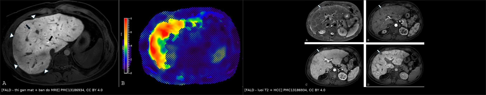
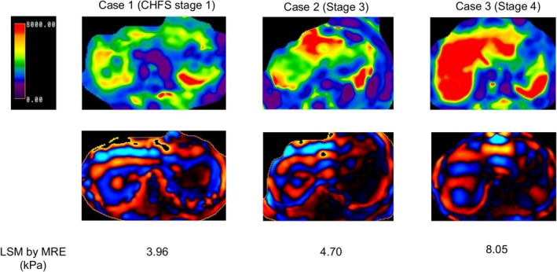
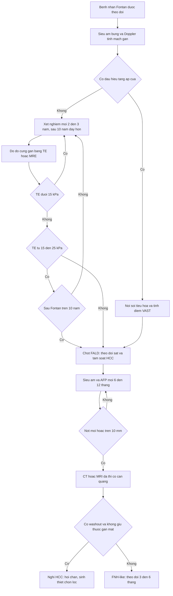
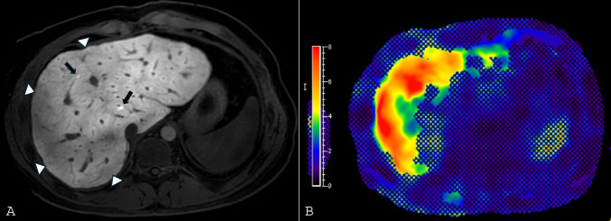
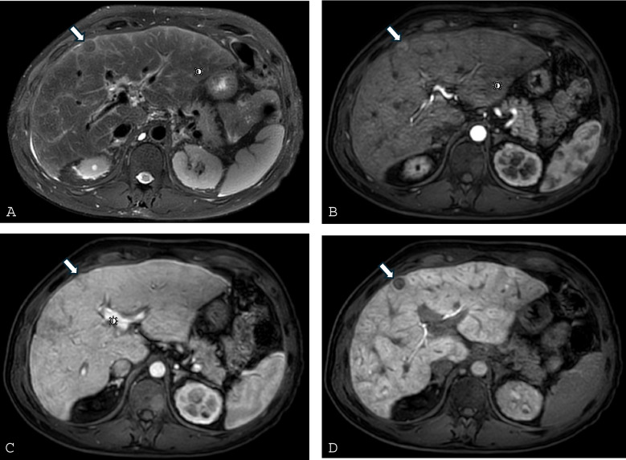
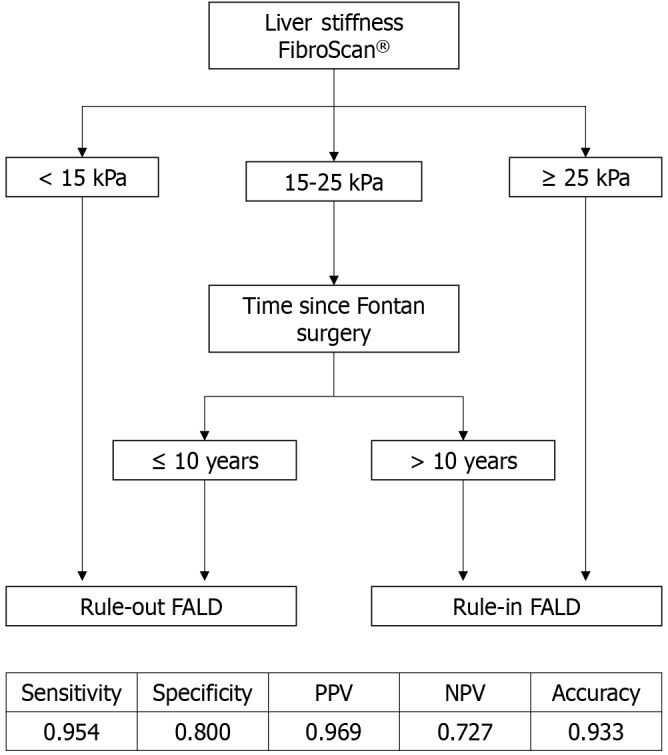

# 3137 — Bệnh gan do tuần hoàn Fontan (FALD): xơ gan sung huyết, elastography bị nhiễu và tầm soát HCC / Fontan-associated liver disease

**Tags:** `pattern:gan-sung-huyet` `pattern:xo-hoa` `pattern:nut-gan` `vung:gan` `vung:bung` `score:VAST` `score:MELD-XI` `protocol:elastography` `protocol:MRI-gan` `incidentaloma:nut-gan`

**Mức chắc chắn (certainty):** tổng hợp y văn (literature synthesis) — biên từ tổng quan *Current Cardiology Reports* 2026 (**PMC13186934**, CC BY 4.0), đoàn hệ **120 bệnh nhân FALD** theo dõi trung vị **50,0 tháng** (*Hepatology Communications* 2026, **PMC12947994**), nghiên cứu **91 bệnh nhân** đo độ cứng gan bằng FibroScan (*World J Gastroenterol* 2025, **PMC11924006**) và nghiên cứu **MRI/MRE** ở FALD (*JGH Open* 2025, **PMC12411670**). Nhóm **không có bệnh nhân của mình**.

> **Câu chốt:** sau Fontan, **áp lực tĩnh mạch trung tâm cao được truyền thẳng vào tĩnh mạch gan và xoang gan**, nên gan **sung huyết trước, xơ hóa sau**. Hệ quả kép cho người đọc hình ảnh: (1) **gan sung huyết tự tạo bờ nốt và độ cứng cao giả xơ gan** — elastography **không** dùng để chẩn đoán xơ gan ở nhóm này; (2) **LI-RADS không áp dụng được**, vì **nốt lành (FNH-like) giữ thuốc gan mật và ngấm mạnh thì động mạch** giống HCC. Tầm soát phải là **siêu âm + AFP mỗi 6–12 tháng**, nốt **> 10 mm** → **CT/MRI đa thì**.

## 1. Tổng quan bệnh học – cơ chế hình ảnh (TẠI SAO)

### 1.1 Sinh lý bệnh: một "hệ thống thoát nước" bị dâng mức

- Tuần hoàn Fontan nối **tĩnh mạch hệ thống trực tiếp vào động mạch phổi**, không có thất phụ dưới phổi bơm máu lên phổi. Dòng phổi chỉ chạy nhờ **chênh áp tĩnh mạch hệ thống – nhĩ trái**, nên **CVP cao là điều kiện sống còn** — và chính CVP cao đó **truyền ngược vào tĩnh mạch gan**.
- Hệ quả huyết động: **gradient cửa–gan giảm**, dòng cửa giảm, **phản ứng đệm động mạch gan (hepatic arterial buffer response)** bù trừ — nhưng cơ chế này **thất bại khi áp lực cửa vượt ~ 20 mmHg**, dẫn tới **thiếu máu vùng 3 (zone 3)** và hoại tử tế bào gan (**PMC13186934**).
- **TẠI SAO xơ hóa xuất hiện sớm và gần như phổ quát:** đây là quá trình **cơ học** — tế bào nội mô xoang bị căng giãn giải phóng chemokine, **tế bào hình sao (HSC)** hoạt hóa và sản xuất fibronectin/collagen **với rất ít thâm nhiễm viêm**. Nghiên cứu tử thiết cho thấy **xơ hóa quanh xoang 65–91%** và **xơ hóa khoảng cửa 30–57%** chỉ **vài ngày đến vài tuần** sau Fontan; **xơ hóa gần như phổ quát sau 10 năm**; **xơ gan ~43% ở mốc 30 năm** sau mổ (**PMC13186934**).
- **Dịch tễ:** dân số Fontan ước **66/1 triệu dân (2020)**, dự kiến **~79/1 triệu (2030)**; sống 10 năm **> 90–95%** với mổ sau 2001 — nghĩa là **số bệnh nhân FALD sẽ tăng chứ không giảm** (**PMC13186934**).

### 1.2 Vật lý hình ảnh: vì sao FALD "đánh lừa" cả CT, MRI và elastography

- **Gan sung huyết làm chậm dòng cửa** → thì tĩnh mạch cửa có **ngấm thuốc không đồng nhất (heterogeneous enhancement)** rồi **đồng nhất dần ở thì muộn 3–5 phút**. Đây là **hiện tượng huyết động**, không phải xơ hóa — đọc sai thành "nhiều ổ tổn thương" (**PMC13186934**).
- **Bờ gan nốt** xuất hiện do **tái phân bố thùy** (thùy phải sau teo, thùy trái và đuôi phì đại) + xơ hóa quanh xoang; **chỉ riêng sung huyết đã đủ tạo bờ nốt giả xơ gan** (**PMC13186934**).
- **MRI T2:** mạng **tăng tín hiệu T2 dạng lưới/vùng ngoại vi (reticulation)** — tương ứng **phù quanh xoang + xơ hóa**, tương quan với **áp lực tĩnh mạch gan cao, xơ hóa tiến triển và thời gian sau Fontan** (**PMC13186934**).
- **MRI với thuốc gan mật (gadoxetate):** vùng **xơ hóa không bắt giữ thuốc** → **giảm tín hiệu ở thì gan mật (20 phút)**, trong khi **FNH-like giữ thuốc** (tăng tín hiệu). Vì vậy **thì gan mật là "bộ lọc" đầu tiên giữa nốt lành và HCC**, không phải thì động mạch.
- **Elastography — điểm mấu chốt:** độ cứng đo được là **tổng của xơ hóa + áp lực trong lòng mạch**. Ở Fontan, **hầu như mọi bệnh nhân đều có độ cứng cao do sung huyết**, nên **TE/MRE không phân biệt được xơ hóa với ứ máu**. Ngưỡng tham khảo:
  - **FibroScan (TE):** giá trị điển hình **~28 kPa** ở bệnh nhân Fontan; trong đoàn hệ 91 người: **loại trừ FALD khi < 15 kPa**, **ngưỡng tối ưu 20 kPa** (Se **92,3%**, Sp **80,0%**), **chốt FALD khi ≥ 25 kPa** (Sp **100%**); **AUC 0,905** cho FALD và **0,764** cho FALD nặng; FALD nặng có **29,5 kPa (22,4–36,6)** so với **19,0 kPa (13,0–30,0)** (**PMC11924006**).
  - **Thuật toán TE + thời gian sau mổ:** **< 15 kPa → loại trừ**; **≥ 25 kPa → chốt**; **15–25 kPa** thì dùng mốc **> 10 năm sau Fontan → chốt FALD**, **≤ 10 năm → loại trừ** (AUC **0,877**, Se **95,4%**, Sp **80,0%**) (**PMC11924006**).
  - **MRE:** **> 4–4,5 kPa** kèm **áp lực Fontan ≥ 14 mmHg** gợi ý bệnh tiến triển/tuần hoàn Fontan suy; **tăng > 0,3 kPa/năm** dự báo tử vong (**PMC13186934**).

### 1.3 Ngưỡng định lượng phải nhớ (lâm sàng – hình ảnh – ung thư)

- **Tăng áp cửa:** giãn tĩnh mạch thực quản **9–38%** (thường **10–17 năm** sau mổ), xuất huyết **5–6%**; cổ trướng **4–58%**; **tiểu cầu < 119 × 10⁹/L** dự báo giãn tĩnh mạch ở trẻ (**AUC 0,946**) (**PMC13186934**).
- **Phân biệt cổ trướng do tim vs do gan:** **BNP > 364 pg/mL** gợi ý cổ trướng do tim (**Se 98%, Sp 99%**), **BNP < 182 pg/mL** gợi ý loại trừ (**PMC13186934**) — quan trọng vì điều trị khác nhau (lợi tiểu/giảm CVP vs xử trí xơ gan).
- **Nốt gan:** gặp ở **20–48%** bệnh nhân FALD; **FNH-like là nốt lành hay gặp nhất**, đặc biệt ở trẻ, do **động mạch hóa bù trừ** khi dòng ra tĩnh mạch bị cản (**PMC13186934**; so sánh với **1733** — FNH-like sau hóa trị).
- **HCC:** tần suất **~0,18–1,3%**, xuất hiện **trung bình ~22 năm** sau Fontan, **có thể ở gan chưa xơ**; trong đoàn hệ 120 bệnh nhân FALD, **tần suất tích lũy 0,9% / 2,7% / 3,9% ở 1 / 2 / 3 năm**; **AFP cao lúc chẩn đoán FALD** là yếu tố nguy cơ độc lập (**HR 1,29; 95% CI 1,04–1,60**) (**PMC12947994**).
- **AFP không đủ nhạy:** **20–25%** HCC ở Fontan có AFP bình thường; **AFP > 400 ng/mL** mới nghiêng ác tính (**PMC13186934**).
- **Tiên lượng:** FALD nặng làm **tử vong tăng gấp ~3,38 lần** (512 bệnh nhân); phân tích gộp **2.466 bệnh nhân** cho **OR tử vong ~3,09**; HCC ở Fontan có **sống 1 năm 79%** khi được tầm soát (**PMC13186934**).

## 2. Mẫu hình + chẩn đoán phân biệt theo vị trí và cơ chế (Gamut)

- **Nhóm A — gan sung huyết (chưa xơ):** gan to, **tĩnh mạch trên gan và tĩnh mạch chủ dưới giãn**, **phổ Doppler tĩnh mạch gan mất dạng ba pha/giảm biên độ**, ngấm thuốc không đồng nhất thì cửa rồi đồng nhất thì muộn. **Không** có nốt thật, **không** có dấu hiệu tăng áp cửa ngoài lách to nhẹ.
- **Nhóm B — FALD xơ hóa/xơ gan:** bờ gan nốt, tái phân bố thùy, **lưới T2 ngoại vi**, vùng giảm tín hiệu thì gan mật, **lách to, giãn tĩnh mạch, cổ trướng**, tiểu cầu thấp, albumin thấp.
- **Nhóm C — nốt gan trong FALD:** **FNH-like** (giữ thuốc gan mật, không washout), **HCC** (ngấm động mạch + washout + **không** giữ thuốc gan mật), **adenoma**, **nốt tái tạo**, hiếm hơn là **cholangiocarcinoma**.
- **Nhóm D — không phải FALD (bắt buộc loại trừ):** **xơ gan do rượu/HBV/HCV/MASLD**, **hội chứng Budd–Chiari**, **tắc mật**, **viêm gan do thuốc (amiodarone)**, **huyết sắc tố**.
- **Gợi nhớ 4 câu hỏi khi mở CT/MRI gan ở bệnh nhân Fontan:** (1) **tĩnh mạch trên gan có giãn không?** (2) **phổ Doppler còn ba pha không?** (3) **có nốt thật hay chỉ là bờ nốt do sung huyết?** (4) **có dấu hiệu tăng áp cửa (lách, tĩnh mạch, cổ trướng) không?**

## 3. Bảng so sánh phân biệt (ma trận đối chiếu)

| Thực thể (entity) | Hình ảnh điển hình | Chốt vào (rule-in) | Chốt loại (rule-out) | Gợi ý xác nhận |
|---|---|---|---|---|
| Gan sung huyết do Fontan (nhóm A) | Gan to, **tĩnh mạch trên gan + chủ dưới giãn**, ngấm thuốc không đồng nhất thì cửa → đồng nhất 3–5 phút | **CVP cao + phổ tĩnh mạch gan mất ba pha + giãn tĩnh mạch trên gan** | Phổ ba pha bình thường, không giãn tĩnh mạch, không có bệnh tim một thất | Doppler tĩnh mạch gan, áp lực Fontan khi thông tim |
| FALD xơ hóa / xơ gan (nhóm B) | **Bờ nốt + tái phân bố thùy**, lưới T2 ngoại vi, lách to, giãn tĩnh mạch, cổ trướng | **Bờ nốt + lưới T2 + tiểu cầu thấp (< 119 × 10⁹/L) + lách to** | Bờ nốt đơn độc mà tĩnh mạch trên gan giãn mạnh và phổ còn tốt → nghĩ sung huyết | Sinh thiết qua tĩnh mạch cảnh (≥ 2 mẫu) khi cần chốt |
| FNH-like (nốt lành hay gặp nhất) | T2 đồng/giảm nhẹ, ngấm mạnh thì động mạch, **đồng tín hiệu thì cửa**, **GIỮ thuốc gan mật** | **Giữ thuốc thì gan mật (20 phút) + không washout + nhiều nốt nhỏ** | **Không giữ thuốc gan mật + washout** → nghi HCC | MRI gan mật; theo dõi 3–6 tháng nếu chưa chắc |
| HCC trong FALD | Nốt **ngấm mạnh thì động mạch + washout**, **không giữ thuốc gan mật**; có thể ở gan chưa xơ | **Ngấm động mạch + washout + không giữ thuốc gan mật + AFP > 400 ng/mL** | Giữ thuốc gan mật đồng nhất → FNH-like | CT/MRI đa thì, AFP, hội chẩn đa chuyên khoa, sinh thiết chọn lọc |
| Xơ gan do nguyên nhân khác (rượu/HBV/MASLD) | Bờ nốt, teo thùy phải, giãn tĩnh mạch, cổ trướng | **Có yếu tố nguyên nhân (men gan, HBsAg, rượu, mỡ gan) + tĩnh mạch trên gan KHÔNG giãn** | Giãn mạnh tĩnh mạch trên gan + bệnh tim một thất → FALD | Xét nghiệm virus, tiền sử, đo độ cứng |
| Budd–Chiari | Gan to, **tĩnh mạch gan không thấy/ huyết khối**, tăng áp cửa | **Huyết khối/hẹp tĩnh mạch gan trên CTV/MRV + đảo dòng** | Tĩnh mạch gan thông, giãn đều → FALD | CTV/MRV, Doppler |
| Tắc mật ngoài gan | Giãn đường mật trong gan, ống mật chủ giãn, vàng da | **Giãn đường mật + bilirubin trực tiếp tăng** | Không giãn đường mật → không phải tắc mật | Siêu âm, MRCP |

*Trái: **A)** thì gan mật sau gadoxetate — bờ nốt ngoại vi, vùng giảm tín hiệu (đầu mũi tên) là xơ hóa, hai nốt giữ thuốc là **FNH-like**; **B)** **bản đồ MRE** với độ cứng trung bình **3,5 kPa**. Phải: **A)** lưới T2 ngoại vi điển hình của FALD; **B–D)** nốt HCC — ngấm mạnh thì động mạch, **washout** thì cửa, **không giữ thuốc gan mật**. Cả hai từ **PMC13186934**, CC BY 4.0; ảnh ghép letterbox, không crop.*

### Dấu hiệu cần đọc đúng trên từng phương thức

- **Siêu âm + Doppler:** **gan to, tĩnh mạch trên gan giãn, phổ mất dạng ba pha**, nhu mô không đồng nhất, **bờ gan nốt**; **tái phân bố thùy** (thùy phải sau teo, thùy trái/đuôi phì đại). Siêu âm **kém nhạy với nốt** trong FALD.
- **CT:** ngấm thuốc không đồng nhất thì cửa **đồng nhất dần ở thì muộn 3–5 phút**; thấy rõ hơn siêu âm về **giãn tĩnh mạch, tuần hoàn bàng hệ, tái thông tĩnh mạch rốn**. Chỉ định khi **không thể MRI** (máy tạo nhịp không tương thích).
- **MRI:** lưới **T2** ngoại vi; **thì gan mật 20 phút** để phân biệt nốt giữ/không giữ thuốc; **MRE** định lượng độ cứng (nhớ: bị nhiễu bởi ứ máu).

## 4. Protocol chụp + phân tầng tầm soát + thuật toán

### 4.1 Chẩn đoán và theo dõi (không có guideline thống nhất — ghi rõ)

- **Đánh giá cơ bản** khi chuyển từ nhi sang người lớn: **công thức máu, AST/ALT/GGT, bilirubin, albumin, INR, AFP, BNP**; **siêu âm bụng + Doppler tĩnh mạch gan**; **đo độ cứng gan** nếu có; **nội soi tiêu hóa** khi đã xơ gan/tăng áp cửa (EASL khuyến cáo) (**PMC13186934**).
- **Nhịp lặp:** xét nghiệm **mỗi 2–3 năm**, **dày hơn sau 10 năm** sau Fontan; **tầm soát HCC bằng siêu âm + AFP mỗi 6–12 tháng**, nốt **mới hoặc to lên > 10 mm** trên siêu âm → **CT/MRI đa thì có cản quang** (**PMC12947994**; **PMC13186934**).
- **Sinh thiết:** là **tiêu chuẩn vàng** nhưng **không thường quy**; ưu tiên **sinh thiết qua tĩnh mạch cảnh (TJLB) với ≥ 2 mẫu** vì nguy cơ chảy máu; sinh thiết qua da ở bệnh nhân Fontan có **tỉ lệ chảy máu 7,4%** và **xơ hóa bị đánh giá thấp ở 40%** ca so với mẫu ghép (**PMC13186934**).

### 4.2 Phân tầng bằng điểm

- **VAST** (**V**arices – **A**scites – **S**plenomegaly – **T**hrombocytopenia): dự báo **biến cố bất lợi**, dùng cho cả giai đoạn sung huyết và xơ hóa (**PMC13186934**).
- **MELD-XI** (không phụ thuộc INR — phù hợp bệnh nhân dùng kháng đông): tương quan với xơ hóa và sống còn ngắn hạn; dự báo kết cục sau ghép tim (**PMC13186934**).
- **Điểm FALD** (số lần chọc dịch, xơ gan, lách to, giãn tĩnh mạch) dự báo kết cục **sau ghép**: **điểm ≥ 2 → sống còn giảm** (**PMC13186934**).
- **Ghép tim đơn thuần vs ghép tim–gan:** ghép tim–gan có **sống 5 năm ~86%** so với **~52%** ở ghép tim đơn thuần khi FALD tiến triển (**PMC13186934**); chỉ định ghép tim–gan khi **suy gan tiến triển, tăng áp cửa, hoặc HCC**.

*Bản đồ độ cứng MRE (hàng trên) và ảnh sóng (hàng dưới) ở **ba bệnh nhân FALD**: độ cứng phân bố **không đều theo vùng**, phản ánh cả xơ hóa lẫn ứ máu — vì vậy một con số kPa trung bình không đủ để phân giai đoạn xơ. Nguồn: *JGH Open* 2025 (**PMC12411670**, CC BY-NC 4.0), hình nguyên bản, không chỉnh sửa.*

## 5. Biến thể bình thường và cạm bẫy

- **Cạm bẫy 1 — gọi xơ gan chỉ vì "bờ gan nốt":** sung huyết đơn thuần tạo bờ nốt giả; hãy kiểm tra **tĩnh mạch trên gan có giãn không, phổ Doppler còn ba pha không** và **có dấu hiệu tăng áp cửa thật không** (**PMC13186934**).
- **Cạm bẫy 2 — dùng elastography để "chốt xơ gan":** độ cứng phản ánh **xơ hóa + áp lực**; hầu hết bệnh nhân Fontan đều **> 15–20 kPa** dù chưa xơ. Chỉ dùng **xu hướng theo thời gian** (tăng **> 0,3 kPa/năm** trên MRE) và **bối cảnh** (**PMC13186934**).
- **Cạm bẫy 3 — áp LI-RADS cho nốt gan ở Fontan:** **không được** — nốt lành có thể có kiểu ngấm "giống ác tính"; **thì gan mật** và **hội chẩn** quan trọng hơn điểm LI-RADS (**PMC13186934**).
- **Cạm bẫy 4 — loại trừ HCC bằng AFP bình thường:** **20–25%** HCC có AFP bình thường; ngược lại AFP **> 400 ng/mL** mới đủ nghiêng ác tính (**PMC13186934**).
- **Cạm bẫy 5 — coi "ngấm thuốc không đồng nhất" là di căn:** ở Fontan, ngấm không đồng nhất thì cửa **đồng nhất ở thì muộn 3–5 phút** — đó là **sinh lý của dòng cửa chậm**, không phải nhiều ổ tổn thương (**PMC13186934**).
- **Cạm bẫy 6 — quên nguồn cổ trướng:** cổ trướng ở Fontan có thể **do tim** (BNP > 364 pg/mL) chứ không phải xơ gan; điều trị và tiên lượng khác nhau (**PMC13186934**).
- **Biến thể bình thường:** **gan to + tĩnh mạch trên gan giãn nhẹ ở bệnh nhân Fontan ổn định, không tăng áp cửa** — hình ảnh "bình thường của tuần hoàn Fontan", không phải bệnh gan tiến triển.

## 6. Tự lượng giá — Blind Quiz

**Ca 1 — Nữ 21 tuổi, sau Fontan, khó thở khi gắng sức; MRI gan có thuốc gan mật và MRE.**

- Hỏi: (A) mô tả bờ gan và hai loại tín hiệu trong nhu mô. Hai nốt nhỏ giữ thuốc gan mật là gì? (B) độ cứng 3,5 kPa nói lên điều gì — và **không** nói lên điều gì?

<b>Bấm để hiện đáp án</b>

- **(A)** Bờ gan **nốt ngoại vi**; các vùng **giảm tín hiệu ở ngoại vi** (đầu mũi tên) là **xơ hóa** (không bắt giữ gadoxetate); hai nốt **giữ thuốc gan mật** là **FNH-like** — nốt lành hay gặp nhất trong FALD, do động mạch hóa bù trừ. Thùy trái phì đại nhẹ (tái phân bố thùy).
- **(B) 3,5 kPa** là **tăng** so với gan bình thường, phù hợp FALD; MRE **> 4–4,5 kPa** kèm **áp lực Fontan ≥ 14 mmHg** mới gợi ý bệnh tiến triển. **Không** dùng một giá trị kPa để chốt xơ gan — độ cứng còn phản ánh **ứ máu**.
- Nguồn ảnh: **PMC13186934**, CC BY 4.0 (ca nguyên văn trong bài tổng quan).

**Ca 2 — Nam 42 tuổi, Fontan 30 năm; MRI gan phát hiện nốt 18 mm ở thùy phải trước.**

- Hỏi: đọc (A)–(D) theo thứ tự. Dấu hiệu nào khiến nốt này **không thể là FNH-like**? Có được dùng LI-RADS ở đây không?

<b>Bấm để hiện đáp án</b>

- **(A) T2 fat-sat:** lưới **tăng tín hiệu ngoại vi** điển hình FALD; nốt **giảm tín hiệu T2**. **(B) thì động mạch:** nốt **ngấm mạnh**. **(C) thì cửa:** **washout**. **(D) thì gan mật:** **không giữ thuốc** (chỉ còn viền mỏng ngoại vi). → **HCC** (đã được sinh thiết chứng minh trong ca gốc).
- **Không thể FNH-like** vì FNH-like **giữ thuốc gan mật** và **không washout** (bài 1733: **63/63** nốt ngấm động mạch nhưng **0/63** có washout, **78,8%** tăng tín hiệu thì gan mật).
- **Không dùng LI-RADS** ở bệnh nhân Fontan: nốt lành có thể mang đặc điểm "ác tính" theo LI-RADS, còn FNH-like có thể trông giống HCC — phải dựa vào **thì gan mật + AFP + hội chẩn**, và **sinh thiết chọn lọc** khi còn mơ hồ.
- Nguồn ảnh: **PMC13186934**, CC BY 4.0.

**Ca 3 — Bệnh nhân Fontan 24 năm, FibroScan 22 kPa; bạn muốn biết "đã xơ gan chưa" và "tầm soát HCC thế nào".**

- Hỏi: 22 kPa thuộc vùng nào của thuật toán? Bước tiếp theo là gì? Lịch tầm soát HCC và ngưỡng gọi nốt?

<b>Bấm để hiện đáp án</b>

- **22 kPa** nằm trong **vùng xám 15–25 kPa**; với **> 10 năm sau Fontan** → **chốt FALD** theo thuật toán (AUC **0,877**, Se **95,4%**, Sp **80,0%**). **Không** kết luận "xơ gan" chỉ từ kPa.
- Bước tiếp: **đánh giá tăng áp cửa** (nội soi, tiểu cầu, lách, cổ trướng, VAST) và **theo dõi độ cứng theo thời gian**; cân nhắc **sinh thiết qua tĩnh mạch cảnh ≥ 2 mẫu** nếu kết quả sẽ đổi điều trị (ví dụ chỉ định ghép tim–gan).
- **Tầm soát HCC:** **siêu âm + AFP mỗi 6–12 tháng**; **nốt mới hoặc > 10 mm** trên siêu âm → **CT/MRI đa thì**; AFP cao lúc chẩn đoán FALD làm tăng nguy cơ (**HR 1,29**).
- Nguồn ảnh: *World J Gastroenterol* 2025 (**PMC11924006**, CC BY-NC 4.0) — hình nguyên bản, không chỉnh sửa.

## Bài liên quan chéo
- [921 – Nút mạch bạch huyết trong bệnh ruột mất protein (PLE)](../921-nut-mach-bach-huyet-ple/lesson.md) — cùng bệnh nhân Fontan, mặt ruột
- [127 – Gan tim & suy tim phải](../127-gan-tim-suy-tim-phai/lesson.md) — gan sung huyết do tim, không phải Fontan
- [1733 – Nốt FNH-like sau hóa trị](../1733-not-tai-tao-fnh-like-sau-hoa-tri/lesson.md) — nốt lành giữ thuốc gan mật, "di căn giả"
- [1910 – Hội chứng tắc xoang gan (SOS/VOD)](../1910-hoi-chung-tac-xoang-gan-sos/lesson.md) — tổn thương xoang gan cấp, cơ chế gần với FALD
- [100 – Tổng quan hệ Bụng](../100-tong-quan-he-bung/lesson.md)

## Ảnh
- Nguồn, giấy phép từng ảnh: `images/CREDITS.md`. Ảnh nguyên bản, không crop; ảnh ghép dùng `tools/make_composite.py` (letterbox, giữ tỉ lệ). Ảnh **CC BY-NC** dùng **nguyên bản, không chỉnh sửa**.

> Không dùng để chẩn đoán độc lập khi chưa có người hướng dẫn.
