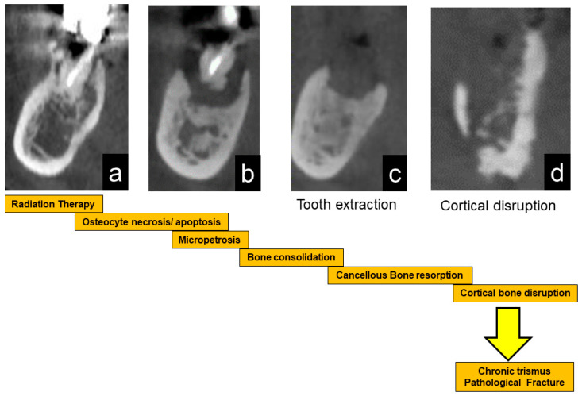
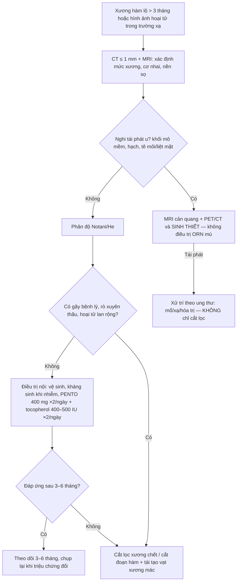
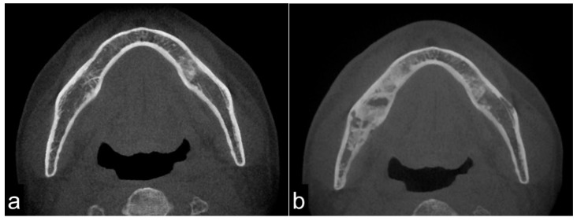
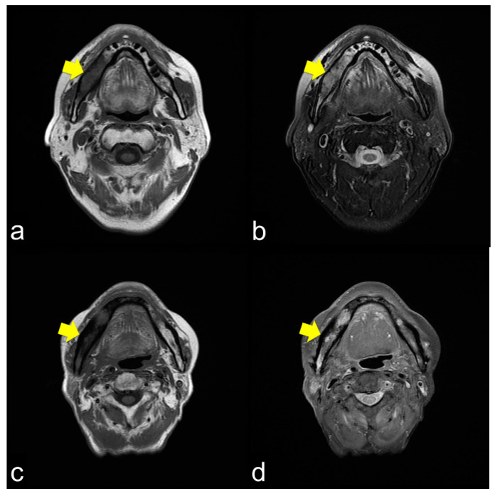
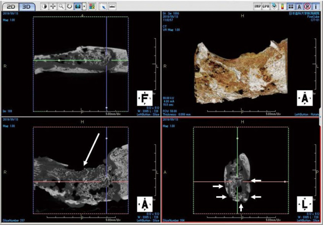
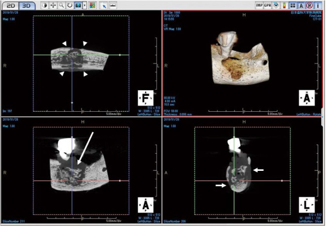

# 3138 — Hoại tử xương hàm dưới sau xạ trị / Mandibular osteoradionecrosis (ORN)

**Tags:** `pattern:hoai-tu-xuong` `pattern:manh-xuong-chet` `pattern:xo-cung` `pattern:tieu-xuong-vo` `pattern:viem-sau-xa` `pattern:co-trismus` `vung:ham-duoi` `vung:rang-ham-mat` `vung:dau-co` `score:Notani` `score:He` `protocol:CT-xuong-ham` `protocol:CBCT` `protocol:MRI-dau-co` `protocol:PET-CT` `incidentaloma:khong`

**Mức chắc chắn (certainty):** tổng hợp y văn (literature synthesis) — dựng từ **đoàn hệ hình ảnh 45 bệnh nhân/48 vị trí** (*J Clin Med* 2021, **PMC8538245**, CC BY 4.0), **đoàn hệ 250 bệnh nhân** (*Acta Oncol* 2024, **PMC11332527**, CC BY 4.0), **RCT HOPON** (*Int J Radiat Oncol Biol Phys* 2019, PMID 30851351), **gộp 2 RCT HBO** (*Acta Oncol* 2022, PMID 34843843, CC BY), **so sánh CBCT ORN – MRONJ** (*Imaging Sci Dent* 2021, **PMC8007393**, CC BY-NC), **FDG-PET/CT phân biệt tái phát** (*EJNMMI Res* 2023, **PMC10070584**, CC BY), **tổng quan hệ thống PENTO** (*Med Oral Patol Oral Cir Bucal* 2023, **PMC10181025**, CC BY). Nhóm **không có bệnh nhân của mình**; chỗ chưa đủ chắc ghi "chưa rõ". **Không ghi tên tác giả** — attribution dùng tạp chí + năm + PMCID.

> **Câu chốt:** ORN hàm dưới là **hoại tử xương do xạ** chứ không phải "viêm tủy xương thông thường": xương mất tế bào tạo xương và mạch máu, nên **chỉ cần một kích thích nhỏ (nhổ răng, hàm giả cọ, nhiễm răng) là không lành**. Ba con số phải thuộc: **(1)** tỉ lệ **3–6%** ở thời IMRT (**4% = 10/250** bệnh nhân; **18,8%** ca khởi phát sau **nhổ răng**); **(2)** liều xương hàm **trung bình 64,3 Gy (40–95)**, và **Dmean hàm dưới > 40 Gy làm nguy cơ tăng HR 5,93** (95% CI 1,27–27,8); **(3)** hình ảnh chốt là **xơ hóa không đồng nhất (62,5%) + tiêu xương vỏ + mảnh xương chết**, và **phản ứng màng xương chỉ 8,3%** — trái ngược hoàn toàn với MRONJ (**7/7 = 100% có phản ứng màng xương**). Thời điểm khởi phát trải **1 tháng đến hơn 10 năm** (trung bình **54,9 ± 44,1 tháng** trong một đoàn hệ; **trung vị 6 tháng** trong đoàn hệ khác).

## 1. Tổng quan bệnh học – cơ chế hình ảnh

### 1.1 TẠI SAO xương đã xạ lại "chết dần" — ba tầng tổn thương

- **Tầng mạch máu (radiation arteritis):** tia xạ làm tổn thương tế bào nội mô → viêm nội mạc tăng sinh → **hẹp và tắc dần các nhánh nuôi xương** (động mạch lỗ chân răng, nhánh màng xương). Mô hình kinh điển **"3H" của Marx: hypoxia – hypovascularity – hypocellularity** (PMC8538245). Xương hàm dưới đặc biệt dễ vì **nuôi dưỡng chủ yếu qua màng xương và một trục mạch dọc ống hàm dưới**, không có tuần hoàn bàng hệ phong phú như xương dài.
- **Tầng tế bào:** tia xạ giết **tế bào tạo xương (osteoblast)**, **tế bào xương (osteocyte)** và **nguyên bào sợi tủy**; ổ khuyết tế bào không được thay thế → xương không còn khả năng sửa chữa vi chấn thương. Đây là lý do ORN **tiến triển chậm, không mủ ồ ạt như viêm tủy cấp**, nhưng **không bao giờ lành** nếu chỉ dùng kháng sinh.
- **Tầng xơ hóa (radiation-induced fibrosis — Delanian):** xạ hoạt hóa **TGF-β1**, tăng nguyên bào sợi → tăng sinh cơ trơn và **myofibroblast**, lắng đọng collagen, teo mô mỡ và mạch máu. Kết quả là **mô xơ, cứng, nghèo tế bào** — mô hình này giải thích vì sao **PENTO/PENTOCLO (pentoxifylline + tocopherol)** có cơ sở sinh học: chống xơ, chống oxy hóa, chứ không phải "diệt khuẩn".
- **Trình tự lâm sàng – hình ảnh (sơ đồ gốc của bài):** xạ → **xơ hóa xương (a)** → niêm mạc mỏng, xương chết lộ ra **(b)** → kích thích (nhổ răng) gây **nhiễm và tiêu xương chết (c)** → **vỏ xương vỡ, viêm lan vào cơ nhai gây trismus (d)** → cuối cùng **gãy xương bệnh lý** (PMC8538245, Fig. 5).

### 1.2 TẠI SAO hình ảnh trông như vậy (vật lý HU – T1 – T2)

- **CT — vì sao "xơ hóa" lại sáng hơn:** xương xốp bình thường là **bè xương + tủy mỡ**. Sau xạ, tủy mỡ bị thay bằng **mô xơ và xương phản ứng dày bè**, nên **hệ số suy giảm tia tăng** → vùng xương đặc hơn, "trắng" hơn trên cửa sổ xương. Trong đoàn hệ 48 vị trí: **xơ hóa đồng nhất 20,8%**, **xơ hóa không đồng nhất 62,5%**, **tiêu xương 12,5%** (PMC8538245). Điểm mấu chốt: ORN **không tạo phản ứng màng xương** (chỉ **8,3%**) vì màng xương đã xơ và nghèo mạch — khác xương viêm nhiễm khuẩn.
- **MRI — vì sao T1 luôn tối:** tủy mỡ bình thường **giàu proton mỡ, T1 rất ngắn → sáng**. Khi tủy bị thay bằng **xơ/nước/hoại tử**, mất mỡ → **T1 tối**. Trong 42 bệnh nhân: **T1 giảm tín hiệu 100%** (đây là dấu **nhạy nhất nhưng không đặc hiệu** — chỉ nói "tủy đã bị thay"). **T2 thì thay đổi theo thành phần:** phù/nước nhiều → **tăng tín hiệu đồng nhất 71,4%** (thể viêm nhẹ); hỗn hợp xơ + phù + hoại tử → **không đồng nhất 26,2%** (thể viêm nặng); xơ đặc/hoại tử khô → **giảm tín hiệu 2,4%**. Bờ tổn thương **không rõ** vì quá trình lan dần trong tủy (PMC8538245).
- **Vì sao cơ nhai dày và ngấm thuốc:** viêm lan từ xương qua màng xương vào **cơ cắn, cơ chân bướm trong** → phù cơ, tăng tín hiệu T2 và ngấm thuốc; đây là **nguyên nhân trismus**, và là **dấu hoạt động** của ORN. Trismus gặp **39,6%** toàn đoàn hệ, tăng theo độ: **He 0: 25% → I: 15% → II: 44% → III: 83%** (PMC8538245).
- **Vì sao mảnh xương chết (sequestrum) "trơ" với mọi thứ:** xương chết **không còn mạch máu** → **không ngấm thuốc, không bắt FDG**. Trong nghiên cứu PET/CT, **vùng sequestrum không có uptake** trong khi mô viêm quanh có **SUVmax trung bình 7,69**; xạ hình xương/SPECT bắt **94,4%** tổn thương nhưng cũng **trống ở vùng chết** (PMC8538245).

### 1.3 Ngưỡng định lượng nằm lòng

| Chỉ số | Ngưỡng / giá trị | Nguồn |
|---|---|---|
| Tỉ lệ ORN | **3–6%** thời IMRT; đoàn hệ **10/250 = 4%**; tổng quan cũ **5–12%** | PMC11332527; PMC10181025 |
| Liều xương hàm | trung bình **64,3 Gy (40–95)**; **Dmean > 40 Gy: HR 5,93** (1,27–27,8; p = 0,002); nhổ răng ở vùng **> 60 Gy** là nguy cơ cao | PMC8538245; PMC11332527; PMC5761154 |
| Thời gian khởi phát | **1 tháng – > 10 năm**; trung bình **54,9 ± 44,1 tháng** (0–168) / **16,7 tháng, trung vị 6 tháng** | PMC8538245; PMC11332527 |
| Yếu tố khởi phát | lộ xương tự nhiên **39,6%**, nhiễm quanh răng **29,2%**, **nhổ răng 18,8%**, implant **2,1%** | PMC8538245 |
| Vị trí | **hàm dưới 81,2%**, hàm trên 18,8%; ưu thế **vùng răng hàm–góc hàm** | PMC8538245 |
| CT | xơ hóa không đồng nhất **62,5%**, đồng nhất **20,8%**, tiêu xương **12,5%**, **phản ứng màng xương 8,3%** | PMC8538245 |
| MRI | **T1 giảm 100%**; T2 tăng đồng nhất **71,4%**, không đồng nhất **26,2%**, giảm **2,4%** | PMC8538245 |
| Trismus | **39,6%** chung; He III **83%** | PMC8538245 |
| FDG-PET | uptake **85,7%**, SUVmax trung bình **7,69**; **sequestrum không uptake** | PMC8538245 |
| Ngưỡng tách tái phát u | voxel SUVmax **trong xương (HU > 275)**; **TLG > 62,68 g**; tuổi **≤ 52** → score 2–3: **HR 32,50** (8,51–124,18) | PMC10070584 |

## 2. Mẫu hình + chẩn đoán phân biệt theo vị trí (gamut)

- **Mẫu hình (pattern) cốt lõi:** trong **trường chiếu xạ**, một vùng xương hàm **xơ hóa không đồng nhất**, **vỏ xương bị tiêu/mất liên tục**, có **mảnh xương chết** (đảo tín hiệu, không ngấm thuốc), **không có phản ứng màng xương**, kèm **dày và ngấm thuốc cơ nhai**.
- **Gamut theo vị trí (location):**
  - **Xương ổ răng sau – góc hàm (posterior mandible/angle):** vị trí điển hình nhất — nơi liều cao nhất, màng xương mỏng, dễ bị hàm giả cọ và nhổ răng.
  - **Thân hàm – vùng răng nanh:** hay gặp sau nhổ răng; dễ gây **gãy bệnh lý** vì mất xương ổ.
  - **Lồi cầu – lên hàm (ramus/condyle):** hiếm; lan lên khớp thái dương–hàm gây **hạn chế há miệng nặng**.
  - **Hàm trên (maxilla, 18,8%):** dễ lan **xoang hàm, hốc mắt, nền sọ** — nguy hiểm hơn vì đường lan.
- **Gamut theo nguyên nhân (mnemonic "XẠ – THUỐC – RĂNG – U – CHẤN THƯƠNG"):**
  1. **XẠ:** ORN (bài này).
  2. **THUỐC:** MRONJ (bisphosphonate, denosumab, antiangiogenic).
  3. **RĂNG:** viêm tủy xương do răng, áp-xe quanh chóp, viêm xương xơ hóa.
  4. **U:** tái phát ung thư tại chỗ, ung thư thứ hai, **sarcoma xương do xạ** (tiềm tàng 18,3 năm — xem [272](../272-sarcoma-xuong-so-do-xa/lesson.md)).
  5. **CHẤN THƯƠNG:** gãy xương bệnh lý, gãy do nhổ răng, mảnh xương gãy sau implant.

## 3. Bảng so sánh phân biệt (ma trận đối chiếu)

| Thực thể (entity) | Hình ảnh điển hình | Chốt vào (rule-in) | Chốt loại (rule-out) | Gợi ý xác nhận |
|---|---|---|---|---|
| **ORN** | Xơ hóa không đồng nhất + tiêu vỏ + **sequestrum**, **không phản ứng màng xương**; T1 tối, T2 tăng/không đồng nhất; cơ nhai dày | **Tiền sử xạ ≥ 40–60 Gy vùng hàm + xương lộ > 3 tháng hoặc hình ảnh hoại tử trong trường chiếu + loại trừ tái phát** | Có khối mô mềm thực sự, có hạch mới, đau/thần kinh tiến triển → nghi **tái phát u**, không phải ORN đơn thuần | CT ≤ 1 mm + MRI; sinh thiết **chỉ khi nghi tái phát** |
| **MRONJ** | Xơ hóa/tiêu xương + sequestrum **+ phản ứng màng xương** (7/7 = **100%**); vỏ xương dày phản ứng | **Tiền sử bisphosphonate/denosumab/antiangiogenic**, không xạ vùng hàm; **mô học còn nguyên bào hủy xương (6/7 = 85,7%)** | Có xạ vùng hàm + không dùng thuốc → nghiêng ORN | Ngừng thuốc theo phác đồ; CBCT so sánh; mô học nếu mổ |
| **Viêm tủy xương do răng** | Ổ tiêu quanh chóp, **phản ứng màng xương rõ**, mủ, lỗ rò; thường một răng nguyên nhân | **Răng sâu/viêm tủy có ổ quanh chóp + đau khu trú + mủ**; cấy dương | Không có ổ răng nguyên nhân, xơ hóa lan tỏa trong trường xạ → nghi ORN | X-quang quanh chóp/CBCT; nội nha |
| **Tái phát ung thư tại chỗ** | Khối mô mềm **không tương xứng**, phá vỏ, xâm lấn cơ/cân, hạch mới; FDG **tập trung đặc**, TLG cao | **Khối đặc + di lệch mô + hạch + đau/thần kinh (tê môi, liệt mặt)**; TLG **> 62,68 g** | Xơ hóa đối xứng trong trường chiếu, không khối, không hạch → nghiêng ORN | MRI cản quang + PET/CT; **sinh thiết** |
| **Sarcoma xương do xạ** | Khối hủy xương **bờ rộng**, vôi hóa/ngấm thuốc mạnh, tiềm tàng **nhiều năm** sau xạ | **Hủy xương tiến triển nhanh, khối mô mềm lớn, bờ không rõ**, sau **> 10 năm** | Xơ hóa ổn định nhiều năm → không phải sarcoma | MRI + sinh thiết (bắt buộc) |
| **Gãy xương bệnh lý do ORN** | Đường gãy qua vùng xơ hóa, di lệch, **không có ổ tiêu mới** | **Đường gãy rõ + ORN nền** | Đường "gãy" do artifact răng/kim loại → không di lệch | CT đa mặt phẳng |
| **Viêm mô mềm quanh hàm đơn thuần** | Dày cơ, phù, ngấm thuốc, **xương bình thường** | Phù/mủ mô mềm, **không tiêu xương** | Có tiêu xương/sequestrum → không đơn thuần | Siêu âm/CT; dẫn lưu |

- **Ảnh ghép đối chiếu:** không tạo composite — ảnh CBCT ORN và MRONJ là **hai bệnh nhân khác nhau** trong cùng nghiên cứu (CC BY-NC, phải giữ nguyên bản, không ghép).

## 4. Protocol chụp + hệ phân độ/điểm chuẩn hóa

### 4.1 Protocol

- **CT xương hàm (MDCT):** lát **≤ 1 mm**, cửa sổ xương, tái tạo **axial + coronal + sagittal** (2,5 mm MPR là mức tối thiểu; nên 1 mm), FOV từ ổ mắt đến cằm. Đọc **5 dấu:** (1) xơ hóa/đặc xương, (2) tiêu vỏ xương, (3) mảnh xương chết, (4) phản ứng màng xương (thường **vắng**), (5) khí/mảnh dị vật. **CBCT** (voxel 0,28 mm) đủ cho răng–xương ổ nhưng **kém mô mềm**.
- **MRI 3T:** **T1W không cản quang** (tủy mỡ bình thường sáng), **T2W fat-sat/STIR** (phù), **T1W sau tiêm fat-sat** (hoạt tính, lan cơ/nền sọ). Lát **3–4 mm**. Giá trị: phân biệt **phù tủy đơn thuần sau xạ** với **hoại tử**, và phát hiện **lan nền sọ/hốc mắt**.
- **PET/CT:** **không dùng thường quy** để chẩn đoán ORN; dùng khi **nghi tái phát/u thứ hai** hoặc **không phân định được trên MRI**. Đọc **vị trí voxel SUVmax** (trong xương: HU > 275), **TLG**, và luôn so với **phim cũ**.
- **Nội soi miệng + thăm khám răng:** bắt buộc trước khi kết luận "ORN" — cần thấy **xương lộ**, lỗ rò, hoặc niêm mạc lành trên xương chết.
- **Trước xạ trị (dự phòng):** khám răng toàn diện, **nhổ/chữa răng ổ nhiễm trước xạ ≥ 14 ngày**, loại bỏ răng không tiên lượng được; sau xạ **không đặt implant** trong vùng > 60 Gy.

### 4.2 Phân độ (version + ngưỡng)

- **Notani I–III** (được CRUK/HOPON khuyến nghị làm tiêu chuẩn trong thử nghiệm, kèm **thêm thể "mảnh xương nhỏ" — minor bone spicules, MBS, gặp 19% bệnh nhân** để tránh tranh cãi):
  - **I:** ORN **khu trú trong xương ổ răng**.
  - **II:** ORN đến **ngang/tới trên ống hàm dưới** (chưa xuống dưới ống).
  - **III:** ORN **xuống dưới ống hàm dưới**, **gãy xương bệnh lý**, **rò miệng–da**, hoặc **xâm lấn bờ dưới hàm**.
- **He (dùng trong đoàn hệ hình ảnh, B = bone, S = soft tissue):**
  - **B0:** không dấu hoặc chỉ tiêu xương trên phim; **B1:** tổn thương **< 2 cm**; **B2:** **> 2 cm**; **B3:** **gãy xương bệnh lý**.
  - **S0:** không khuyết niêm mạc/da; **S1:** khuyết niêm mạc miệng **hoặc** rò da; **S2:** khuyết **xuyên thấu** (miệng–da).
- **Phân bố thực tế (48 vị trí):** He 0 **8,9%**, I **27,1%**, II **52,1%**, III **12,5%**; **B2S1 (41,7%)** là thể gặp nhiều nhất (PMC8538245).

### 4.3 Sơ đồ xử trí

- **Điều trị nội:** vệ sinh miệng, chlorhexidine, kháng sinh **chỉ khi có nhiễm**; **PENTO** (pentoxifylline **400 mg ×2/ngày** + tocopherol **400–500 IU ×2/ngày**) — tổng quan 11 nghiên cứu: **lành niêm mạc hoàn toàn 16,6–100%**, cải thiện/ổn định **7,6–66,6%**, tiến triển **7,6–32%**; **chưa có phác đồ chuẩn** (PMC10181025).
- **HBO — bằng chứng hiện tại KHÔNG ủng hộ thường quy:** HOPON (144 người, 100 phân tích) cho ORN sau 6 tháng **6,4% (HBO) vs 5,7% (chứng)**, **OR 1,13 (0,14–8,92), p = 1** → **không dự phòng được** (PMID 30851351). Gộp 2 RCT điều trị: lành **70% (21/30) vs 51% (18/35)** nhưng **không có ý nghĩa** (thiếu lực — PMID 34843843). Vì vậy **không hứa hẹn HBO** với gia đình; PENTO + phẫu thuật là trục chính.
- **Phẫu thuật:** cắt lọc/sequestrectomy cho thể khu trú; **cắt đoạn hàm + vạt xương mác tự do** cho thể lan rộng/gãy. Ở ORN **hai bên**, biến chứng sau mổ ngay **33,3%** khi mổ hai bên cùng thì; **46,2%** bệnh nhân mổ một bên về sau phát triển ORN bên đối diện (PMID 34320577) — phải theo dõi cả hàm còn lại.

## 5. Biến thể bình thường và cạm bẫy

- **"Xơ hóa sau xạ" không đồng nghĩa ORN:** sau xạ, tủy mỡ có thể chuyển thành tủy xơ **lan tỏa, đối xứng trong trường chiếu**, T1 tối nhưng **không có tiêu vỏ, không sequestrum, không đau**. Đừng gọi ORN khi **chưa có tiêu xương/sequestrum hoặc xương lộ**.
- **MBS (minor bone spicules):** mảnh xương nhỏ **< vài mm** ở ổ răng sau nhổ, gặp **19%** bệnh nhân HOPON — nhiều bác sĩ coi là ORN, nhiều người không; **thêm MBS thành thể riêng** để tránh chẩn đoán sai (PMID 28024727).
- **Artifact kim loại/răng:** streak làm giả "đường gãy" hoặc "tiêu vỏ"; luôn xem **đa mặt phẳng** và **cửa sổ xương**, so với răng bên đối diện.
- **PET dương giả:** viêm sau xạ và mô hạt bắt FDG mạnh — **SUVmax chồng lấp** giữa tái phát và ORN; **sequestrum không bắt FDG** nên PET có thể **âm ở đúng vùng bệnh**. Đừng dùng PET đơn thuần để loại trừ.
- **Trismus không chỉ do xương:** xơ hóa cơ chân bướm/cơ cắn sau xạ gây hạn chế há miệng **dù xương chưa hoại tử** — đừng mổ xương chỉ vì trismus.
- **Cạm bẫy "satisfaction of search":** thấy ổ răng sâu là dừng ở "viêm tủy xương do răng", bỏ qua **khối mô mềm** phía sau cùng bên — luôn đọc **toàn bộ trường chiếu** và **hạch cổ**.
- **Hàm trên nguy hiểm hơn:** ORN hàm trên có thể lan **xoang hàm → hốc mắt → nền sọ**; đau mắt, nhìn đôi, tê vùng V2 là **red flag** cần MRI khẩn.

## 6. Tự lượng giá — Blind Quiz ngay trên trang tĩnh

**Ca 1 — Nam 64 tuổi, ung thư vùng hầu đã xạ 64 Gy cách 3 năm, đau góc hàm phải, há miệng hạn chế. Nhìn ảnh trước, mô tả trước.**

- Gợi ý lâm sàng: không sốt, không khối sờ thấy, niêm mạc vùng góc hàm có điểm lộ xương nhỏ.
- Câu hỏi: Dấu hiệu chính ở (b)? Vì sao xương đặc hơn? Ba chẩn đoán phân biệt? Dấu hiệu nào chốt?

<b>Bấm để hiện đáp án (findings + chẩn đoán)</b>

- **Dấu hiệu:** (a) hàm dưới trước xạ có tủy xốp bình thường; (b) vùng **thân–góc hàm phải** có **xơ hóa không đồng nhất** (đặc xương từng ổ) xen vùng **tiêu xương/khuyết vỏ**, không thấy phản ứng màng xương, không có khối mô mềm lớn.
- **Vì sao:** tủy mỡ bị thay bằng **mô xơ + bè xương phản ứng** → tăng hệ số suy giảm tia; vỏ xương mất nuôi dưỡng nên **tiêu dần**.
- **Chẩn đoán:** **ORN hàm dưới** (He II/B2S0–S1 nếu có khuyết niêm mạc nhỏ) — nền xạ 64 Gy + xương lộ + hình ảnh điển hình.
- **Phân biệt:** MRONJ (không có tiền sử xạ, **có phản ứng màng xương**), viêm tủy xương do răng (ổ quanh chóp + phản ứng màng xương), tái phát u (khối mô mềm + hạch).
- **Chốt:** MRI thấy **T1 tối, T2 tăng/không đồng nhất**, cơ nhai dày; **không có khối** → ORN. Nếu có khối/hạch → sinh thiết.
- Nguồn ảnh: *J Clin Med* 2021, **PMC8538245**, Fig. 1, **CC BY 4.0** (nguyên bản).

**Ca 2 — Nữ 58 tuổi, xạ vùng miệng 60 Gy, đau hàm âm ỉ 8 tháng; MRI không cản quang:**

- Câu hỏi: Chuỗi xung của (a) và (b)? Vì sao tủy xương tối trên T1? T2 nói gì về hoạt tính?

<b>Bấm để hiện đáp án</b>

- **Chuỗi xung:** (a, c) **T1W** — tủy xương vùng góc hàm phải **giảm tín hiệu** so với bên lành; (b, d) **T2W** — (b) tăng tín hiệu đồng nhất (viêm nhẹ), (d) **không đồng nhất** (viêm nặng/xơ xen phù).
- **Vì sao T1 tối:** tủy mỡ bình thường sáng trên T1; sau xạ mỡ bị thay bằng **xơ/nước/hoại tử** nên mất tín hiệu mỡ.
- **T2 nói gì:** tăng tín hiệu = **còn phù/hoạt tính**; giảm tín hiệu = **xơ đặc/hoại tử khô**, ít viêm. T2 **không đồng nhất** là thể hay gây **trismus và tiến triển**.
- **Cạm bẫy:** T1 tối **một mình không đủ** — sau xạ tủy có thể tối lan tỏa mà không hoại tử; cần **tiêu vỏ/sequestrum/xương lộ**.
- Nguồn ảnh: *J Clin Med* 2021, **PMC8538245**, Fig. 2 (phần a–d), **CC BY 4.0** (nguyên bản).

**Ca 3 — Hai bệnh nhân cùng "xương hàm tiêu + mảnh xương chết": bệnh nhân A xạ vòm họng 5 năm trước, bệnh nhân B dùng zoledronate 3 năm. Hai ảnh CBCT mẫu xương:**

- Câu hỏi: Ảnh nào là ORN, ảnh nào là MRONJ? Dấu nào tách hai thể? Vì sao khác nhau?

<b>Bấm để hiện đáp án</b>

- **Dấu hiệu:** cả hai có **xơ hóa + tiêu xương + sequestrum** (mũi tên dài). Khác biệt: **bệnh nhân B có phản ứng màng xương rõ** (mũi tên đầu), **bệnh nhân A thì không**.
- **Số liệu:** CBCT mẫu: MRONJ **7/7 (100%)** có phản ứng màng xương vs ORN **0/3 (0%)**, p < 0,05; mô học MRONJ còn **nguyên bào hủy xương 6/7 (85,7%)** vs ORN **0/3** (PMC8007393).
- **Vì sao:** màng xương trong ORN **đã xơ, nghèo mạch** nên không tạo xương phản ứng; trong MRONJ màng xương **còn sống** và phản ứng với viêm.
- **Chẩn đoán:** **A = ORN** (Fig. 3, có tiền sử xạ); **B = MRONJ** (Fig. 2, dùng bisphosphonate).
- Nguồn ảnh: *Imaging Sci Dent* 2021, **PMC8007393**, Fig. 3 (A) và Fig. 2 (B), **CC BY-NC** (nguyên bản, không chỉnh sửa).

## Bài liên quan chéo
- [3104 – Hoại tử xương thái dương sau xạ vòm họng](../3104-hoai-tu-xuong-thai-duong-sau-xa/lesson.md) (cùng trường xạ, khác xương; xương lộ > 3 tháng)
- [1761 – Trismus sau xạ đầu cổ](../1761-trismus-sau-xa-tri-dau-co/lesson.md) (trismus do xơ cơ, không nhất thiết do xương)
- [751 – Viêm xương hàm do răng](../751-viem-xuong-ham-do-rang/lesson.md) (hàng phân biệt sát nhất: ổ răng nguyên nhân + phản ứng màng xương)
- [749 – Nhiễm khuẩn răng lan trung thất](../749-nhiem-khuan-rang-lan-trung-that/lesson.md) (đường lan nguy hiểm của ổ nhiễm hàm dưới)
- [272 – Sarcoma xương nền sọ do xạ](../272-sarcoma-xuong-so-do-xa/lesson.md) (tiềm tàng 18,3 năm — red flag khi "ORN" tiến triển nhanh)

## Ảnh
- Tên file theo quy ước `3138_orn_<Modality>_<PMCID>-f<so>.jpg`; nguồn + giấy phép từng ảnh ở `images/CREDITS.md`.
- 3 ảnh CT/MRI/sơ đồ từ *J Clin Med* 2021 (**PMC8538245**, **CC BY 4.0**), 2 ảnh CBCT từ *Imaging Sci Dent* 2021 (**PMC8007393**, **CC BY-NC**) — tải từ PMC CDN, **nguyên bản** (không crop, không đổi nhãn).

> Không dùng để chẩn đoán độc lập khi chưa có người hướng dẫn.
