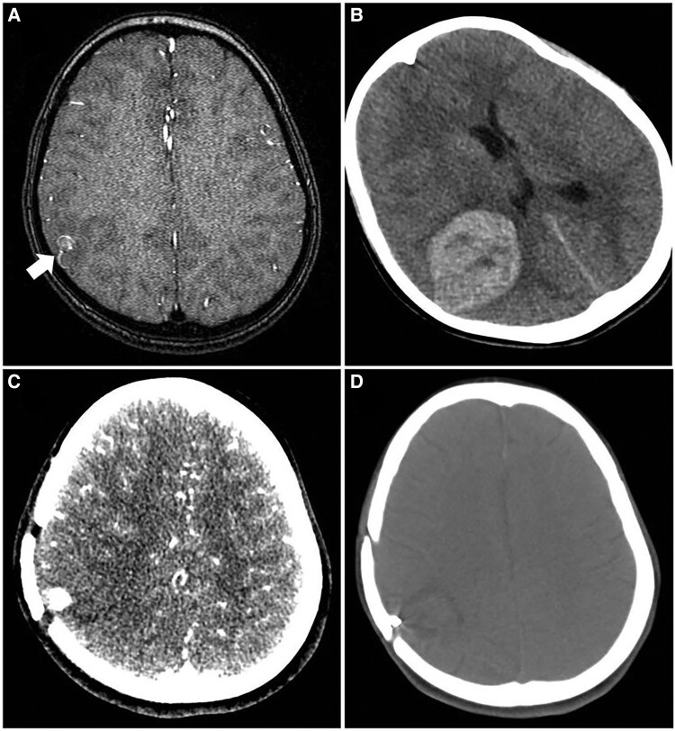
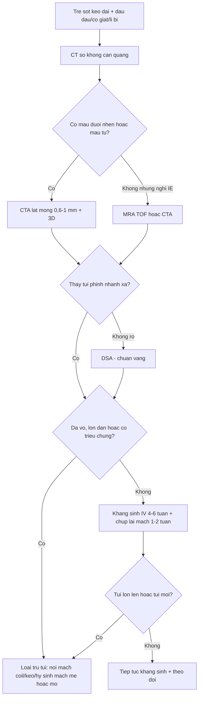
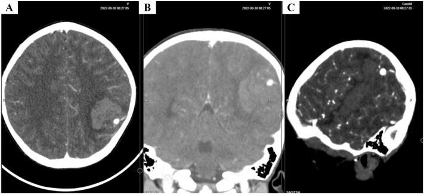
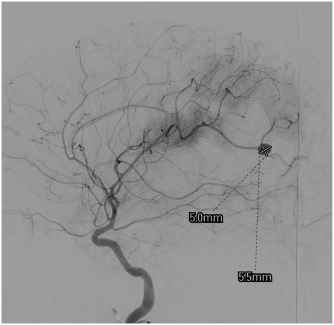
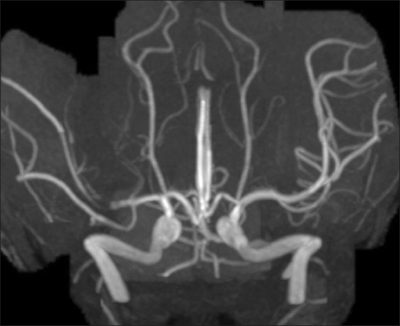

# 3139 — Túi phình nhiễm khuẩn nội sọ ở trẻ (infectious/mycotic intracranial aneurysm): "mọc trong vài ngày" ở nhánh xa — 2 mm vẫn vỡ

**Tags:** `pattern:tui-phinh` `pattern:gia-phinh` `pattern:tui-phinh-nhanh-xa` `pattern:xuat-huyet-nao` `pattern:nhiem-trung` `vung:nao` `vung:dong-mach-nao` `protocol:CTA` `protocol:MRA` `protocol:DSA`
**Mức chắc chắn (certainty):** tổng hợp y văn (literature synthesis) — ghép **tổng quan hệ thống 40 nghiên cứu / 45 trẻ** viêm mạch nhiễm khuẩn nội sọ (Surg Neurol Int 2026, PMC13157906), **ca 14 tuổi dựng túi phình và vỡ trong 5 ngày sau thuyên tắc nhiễm khuẩn** (Surg Neurol Int 2013, PMC3841922), **ca 4 tuổi sốt 2 tháng rồi vỡ túi phình M4 được cuộn** (Int J Surg Case Rep 2023, PMC10667870) và **ca 9 tuổi viêm nội tâm mạc có túi phình nhỏ rồi xuất huyết, tái phát sau cuộn** (Eur Heart J Case Rep 2025, PMC11879440). Không có ca do nhóm tự chụp.

> **Câu hỏi thực hành:** bé trai **4 tuổi**, **sốt cao từng đợt 2 tháng**, nhức đầu về đêm, rồi đột ngột li bì và thiếu máu. Cấp cứu chụp **CT sọ không cản quang**: **khối máu tụ lớn bán cầu trái**. Bác sĩ trực kết luận "xuất huyết não tự phát" và chuẩn bị chọc dò dịch não tủy. Câu hỏi: **có bỏ sót gì trước khi chọc không, và nguyên nhân chảy máu ở một đứa trẻ sốt 2 tháng là gì?**
> Bài chốt **ba quyết định**: **(1) trẻ sốt + dấu thần kinh khu trú phải được chụp mạch máu não — không dừng ở CT không cản quang**, vì **66,7%** ca nhi được chẩn đoán bằng CT thường nhưng CT **không** trả lời được túi phình; **(2) kích thước không trấn an được ai** — trung bình túi phình nhiễm khuẩn chỉ **2,8 mm** (0,2–11 mm), túi **đã vỡ 3,3 mm vs chưa vỡ 2,1 mm, p = 0,324**; **(3) kháng sinh đơn thuần chỉ bít được 50%** (6/12) và **33,3%** vẫn tồn tại/lớn thêm → phải **theo dõi mạch máu lặp lại** và can thiệp khi vỡ, lớn hoặc có triệu chứng.

## 1. Tổng quan bệnh học – cơ chế hình ảnh: vì sao là "túi phình giả" và vì sao mọc nhanh

- **Bản chất mô bệnh (pathology) — không phải túi phình thật:** vi khuẩn từ **mảng sùi (vegetation)** của viêm nội tâm mạc (infective endocarditis, IE) hoặc từ nhiễm khuẩn huyết bám vào **điểm phân nhánh của nhánh động mạch nhỏ ở vỏ não**, gây **viêm động mạch nhiễm khuẩn (infectious arteritis)** phá hủy **lớp áo giữa và áo ngoài**. Kết quả là **giả phình (pseudoaneurysm)** — thành chỉ còn tổ chức viêm/hoại tử, **không có lớp xơ chun**, **cổ không rõ**, thường **hình thoi (fusiform) hoặc bờ không đều**.
- **Vì sao ở nhánh XA (distal):** tắc mạch nhiễm khuẩn dừng ở nơi **lòng mạch nhỏ nhất**. Trong 45 trẻ: **động mạch não giữa (MCA) 49%**, **động mạch não trước (ACA) 15%**, **động mạch não sau (PCA) 11%**; **64,2%** xuất phát từ **tuần hoàn trước xa**, trong đó **76,5% là MCA** (PMC13157906). Vì vậy túi phình nằm **M2–M4**, sát vỏ não — nơi đặt ống thông khó và **can thiệp thường phải hy sinh động mạch mẹ**.
- **Vì sao mọc nhanh và vỡ sớm — mốc thời gian định lượng:**
  - Sau khi nhiễm khuẩn gieo vào thành mạch, **thoái hóa thành mạch có thể xảy ra trong 24–48 giờ** (PMC13157906).
  - Ca kinh điển: nữ **14 tuổi** viêm nội tâm mạc, **MRA ngày 1 chỉ thấy "giả tắc" (pseudoocclusion) M1 phải** (ảnh 4 dưới), **5 ngày sau vỡ túi phình thật** với máu tụ — tức **túi phình hình thành và vỡ trong vòng 1 tuần** (PMC3841922).
  - **68,9%** trẻ trong tổng quan đến viện **đã vỡ** (xuất huyết dưới nhện và/hoặc trong nhu mô).
- **Dịch tễ — bốn con số cần nhớ:** túi phình nhiễm khuẩn chiếm **0,5–6,5%** (một số nguồn **0,7–6,5%**) tổng số túi phình nội sọ; **3–15%** bệnh nhân IE có túi phình nhiễm khuẩn; **tới 65%** túi phình nhiễm khuẩn gắn với IE; ở trẻ, **48,9%** (22/45) có IE kèm theo (PMC13157906, PMC11779502).
- **Tuổi và giới trong loạt nhi:** tuổi **5 tuần – 18 tuổi**, trung bình **8,6 ± 5,5**; **57,8% nam**; **68,9% vào viện qua cấp cứu**; **sốt 68,9%**, **thiếu hụt thần kinh khu trú 77,8%**, co giật **22,2%**, rối loạn ý thức **20,0%** (PMC13157906).
- **TẠI SAO ảnh hưởng tới lựa chọn hình ảnh — vật lý từng phương thức:**
  - **CT không cản quang:** rất nhạy với **máu cấp** (đậm độ **50–90 HU**, tăng theo hematocrit), thấy máu dưới nhện/khoang dưới nhện và máu trong nhu mô, nhưng **không** thấy túi phình — vì vậy đây chỉ là bước **phân loại chảy máu**, và chính là bước đầu ở **66,7%** ca nhi.
  - **CTA:** độ phân giải không gian cao (**lát 0,6–1 mm**, tái tạo MIP/3D), **tương đương DSA với túi phình ≥ 3 mm**, nhưng **kém hơn ở túi < 3 mm, túi ở nhánh xa sát xương và túi thành mỏng không vôi**. Vì thành giả phình **không vôi hóa** và **đậm độ sau tiêm bằng lòng mạch**, dấu hiệu chốt là **"nốt tăng đậm dính vào nhánh mạch, bờ không đều, không cổ"** — rất dễ bị đọc thành "mạch máu xoắn" nếu không xoay 3D.
  - **MRA TOF:** **không bức xạ** (quan trọng ở trẻ), nhưng **nhạy với chuyển động** → thường cần an thần; **dòng chảy chậm trong túi thành mỏng có thể mất tín hiệu** (đọc âm giả). Ca PMC11879440 cho thấy MRA phát hiện túi phình **trước khi vỡ**, nên MRA vẫn có chỗ đứng khi trẻ hợp tác.
  - **DSA:** **chuẩn vàng** cho túi **nhỏ, xa, hình thái phức tạp**; cho phép **can thiệp ngay trong cùng buổi** (coil/keo/hy sinh mạch mẹ). Giá phải trả: **xâm lấn**, nguy cơ **co thắt, thủng, bóc tách**, và **bức xạ** — trẻ chụp mạch não có **tăng ~1% nguy cơ ung thư suốt đời** (PMC13157906).
  - **Siêu âm qua thóp:** chỉ dùng được ở **sơ sinh/nhũ nhi còn thóp** — trong loạt 45 trẻ **chỉ 1 ca (2,2%)** dùng siêu âm đầu tiên; không đủ để loại trừ.

## 2. Mẫu hình + chẩn đoán phân biệt theo vị trí, hình thái và căn nguyên (Gamut)

- **Mẫu hình cốt lõi:** trẻ **sốt kéo dài ± bệnh tim bẩm sinh/van tim** → **đột ngột đau đầu, co giật, li bì, thiếu hụt khu trú** → CT có **máu dưới nhện ở rãnh vỏ não + máu tụ thùy** ở **vùng MCA xa** → CTA/MRA/DSA: **túi nhỏ 2–7 mm, hình thoi/bờ không đều, ở nhánh M3–M4**.
- **Theo vị trí (quyết định can thiệp):**
  - **Nhánh xa vỏ não M2–M4 (49%):** khó bảo tồn mạch mẹ → **hy sinh mạch mẹ (parent artery occlusion)** hoặc **coil/keo**; chấp nhận nhồi máu nhỏ ở vùng vỏ nếu tuần hoàn bàng hệ tốt.
  - **ACA/PCA xa (15%/11%):** tương tự, nhưng **vùng chức năng ưu thế** (động mạch quanh thể chai, nhánh PCA cấp máu thị giác) → cân nhắc kỹ trước khi hy sinh mạch.
  - **Thân chính/đoạn gần ICA–M1:** ít gặp ở trẻ; thường **thấm thuốc thành mạch (blister)** hoặc **giả phình sau chấn thương**, xử trí bằng **stent chuyển dòng (flow diverter)** hoặc **mổ**.
- **Theo hình thái:** **hình thoi (fusiform) 15%**, **hình túi (saccular) 25%**, còn lại **không đều/blister/bóc tách**; **49,1%** ca trong loạt nhi **không mô tả hình thái** — đây chính là lý do phải **mô tả có cấu trúc** (kích thước 3 chiều, cổ, hình thoi, nhánh xuất phát).
- **Theo căn nguyên (45 trẻ):** **vi khuẩn 68,9%**; **Streptococcus 33,3%** (kể cả *viridans*, *Abiotrophia*, *Granulicatella*), **Staphylococcus 17,8%**, **virus/HIV 13,3%**, **Gram âm 8,9%**, **ký sinh trùng 8,9%**, **lao 6,7%**, **nấm 6,7%**, **đa vi khuẩn 6,7%** (PMC13157906). Ở **nhũ nhi** (8 ca): *Staphylococcus* và *Streptococcus* **mỗi loại 25%** — **không được bỏ qua tụ cầu** ở trẻ nhỏ.
- **Gamut "trẻ sốt + đột quỵ/xuất huyết não":** viêm mạch nhiễm khuẩn (mycotic), **bóc tách động mạch (chấn thương cổ, FMD)**, **túi phình thật/AVM** (bài 3113), **blister do viêm nội tâm mạc**, **huyết khối xoang tĩnh mạch não** (bài 1948), **PRES/RCVS** (bài 653), **thiếu máu hồng cầu hình liềm**, **u não chảy máu**.
- **Gợi nhớ SEPTIC:** **S**eptic emboli (mycotic), **E**ndocarditis (luôn hỏi siêu âm tim), **P**seudoaneurysm (giả phình, không cổ), **T**raumatic/dissecting (bóc tách), **I**mmunosuppressed (nấm, lao, HIV), **C**ongenital/AVM (túi phình thật, bài 3113).

## 3. Bảng so sánh phân biệt (ma trận đối chiếu)

| Thực thể (entity) | Hình ảnh điển hình (CT/CTA/MRA/DSA) | Chốt vào (rule-in) | Chốt loại (rule-out) | Gợi ý xác nhận |
|---|---|---|---|---|
| **Túi phình nhiễm khuẩn (mycotic)** | **Túi nhỏ 2–7 mm ở nhánh xa M2–M4**, hình thoi/bờ không đều, **không cổ rõ**, có thể **thay đổi kích thước sau 1–2 tuần**; máu dưới nhện ở rãnh vỏ + máu tụ thùy | **Sốt/IE + túi mới xuất hiện ở nhánh xa + lớn nhanh khi chụp lại** | Túi **ở điểm phân nhánh thân chính, cổ rõ, thành đều, không sốt** → nghĩ túi phình thật | DSA + 3D; **chụp lại 1–2 tuần** để chứng minh tiến triển; cấy máu + siêu âm tim |
| Túi phình thật (berry) | **Cổ rõ**, thường **điểm phân nhánh đa giác Willis**, thành đều, có thể vôi hóa ở người lớn | **Cổ rõ + vị trí thân chính + không nhiễm khuẩn** | **Không cổ + nhánh xa + sốt** → nghĩ nhiễm khuẩn | DSA; tiền sử gia đình, bệnh thận đa nang |
| Bóc tách động mạch nội sọ | **Hẹp dài "string sign"/giả lòng**, thường sau chấn thương cổ; **T1 fat-sat có huyết khối trong thành** | **Hẹp dài + giả lòng + tiền sử chấn thương/đau cổ** | Túi **tròn, dính một nhánh xa, không hẹp dài** → túi phình | CTA/MRA + **T1 fat-sat**; DSA |
| Giả phình sau chấn thương | **Cổ hẹp nhưng thành mỏng**, sát nơi va đập/xương; **không sốt** | **Chấn thương + vị trí điển hình (đoạn gần, xoang hang)** | **Nhiễm khuẩn huyết + nhánh xa** → mycotic | CTA; theo dõi 6–12 tuần |
| Túi phình dòng chảy trong AVM | **Nidus AVM + động mạch nuôi giãn**, túi ở **động mạch nuôi hoặc trong nidus**, thường **1–3 cm**, trẻ có thể co giật/tím | **Thấy nidus + mạch nuôi giãn** | **Không nidus, mạch xa bình thường** → không phải flow-related | DSA (chuẩn); MRA |
| Huyết khối xoang tĩnh mạch não | **Khuyết thuốc xoang + nhồi máu hai bên/không theo lãnh thổ**, có thể **chảy máu thùy** | **Khuyết thuốc xoang + tăng áp lực tĩnh mạch** | **Túi động mạch có cổ/thân** → không phải CVST | **MRV/CTV**; DSA tĩnh mạch |
| Viêm mạch (PACNS, Kawasaki) | **Hẹp–giãn xen kẽ nhiều ổ** ở nhiều nhánh, không có túi đơn lẻ | **Nhiều ổ hẹp/giãn + tổn thương da/thận** | **Một túi đơn độc rõ** → nghiêng nhiễm khuẩn/thật | DSA; sinh thiết não–màng não khi cần |

*Bé gái **9 tuổi** viêm nội tâm mạc (van động mạch chủ, sửa van + thắt ống động mạch trước đó): **(A)** MRA lúc nhập viện — **túi phình nhiễm khuẩn nhỏ ở vỏ não phải (mũi tên trắng)**, chưa có triệu chứng tương xứng; **(B)** CTA **lúc xảy ra xuất huyết não** — máu tụ lớn bán cầu phải; **(C)** 1 tháng sau mở sọ; **(D)** trước khi ra viện. Nguồn: Eur Heart J Case Rep 2025 (PMC11879440), **CC BY 4.0** — dùng nguyên bản, không crop.*

### Ba dấu hiệu "phải nhìn thấy" trên ảnh
- **"Nốt" tăng đậm dính vào một nhánh xa:** trên CTA lát mỏng, túi phình nhiễm khuẩn **nhỏ hơn nhiều so với tưởng tượng** — trong ca 4 tuổi, túi chỉ **7 × 6 mm trên CTA** và **5 × 5,5 mm trên DSA** (ảnh quiz ca 1–2), ở một nhánh **M4 sát vỏ**.
- **"Giả tắc" (pseudoocclusion) trên MRA/CTA** ở nhánh vừa bị thuyên tắc nhiễm khuẩn: mạch **mất tín hiệu/không ngấm thuốc** ở đoạn ngắn — đây **không phải** "mạch đã tắc an toàn" mà là **dấu hiệu sớm của viêm thành mạch**, có thể **thành túi phình trong vài ngày** (PMC3841922).
- **Máu dưới nhện ở rãnh vỏ não một bên + máu tụ thùy nông:** mẫu hình "chảy máu vỏ não" ở trẻ **không do chấn thương** phải đẩy chẩn đoán về **mạch máu**, không phải "xuất huyết tự phát".

## 4. Protocol chụp + ngưỡng và chiến lược xử trí

- **Bước 1 — CT sọ không cản quang (mọi trẻ có dấu thần kinh cấp):** trả lời **3 câu**: có máu không, máu ở đâu (dưới nhện/khoang dưới nhện/nhu mô), có **hiệu ứng khối/thoát vị** không (quyết định **không chọc dò**). Ghi rõ **vị trí máu tụ** để CTA nhắm vùng.
- **Bước 2 — CTA mạch máu não (lát 0,6–1 mm, tái tạo 3D):** chỉ định khi **có máu dưới nhện/nhu mô, hoặc trẻ IE có dấu thần kinh**; đọc **đa bình diện + MIP + 3D**, so **hai bên**, nhìn **nhánh xa** (nơi hay bỏ sót). Nhớ: **CTA tương đương DSA với túi ≥ 3 mm**, kém hơn ở túi **< 3 mm**.
- **Bước 3 — MRI/MRA (khi không có chảy máu cấp hoặc cần đánh giá nhu mô):** **DWI** (nhồi máu do thuyên tắc), **SWI** (vi xuất huyết), **MRA TOF**, **T1 sau tiêm**; trẻ nhỏ **cần an thần** → cân nhắc lợi ích.
- **Bước 4 — DSA (± chụp 3D xoay):** **chuẩn vàng** cho túi < 3 mm, nhánh xa, hình thái không rõ; **thực hiện cùng lúc với can thiệp** nếu định cuộn/hy sinh mạch mẹ.
- **Bước 5 — không quên ổ nhiễm nguyên phát:** **cấy máu 3 bộ trước kháng sinh**, **siêu âm tim (TTE, cân nhắc TEE)**, tìm **ổ răng–xoang–tiết niệu–da**, vì **48,9%** ca nhi có IE và **90%** ca IE có dấu thần kinh khu trú (PMC13157906).
- **Ngưỡng và chỉ định điều trị:**
  - **Vỡ / có máu tụ gây hiệu ứng khối:** **loại trừ túi ngay** — **nội mạch** (coil, keo NBCA/Onyx, stent chuyển dòng) hoặc **mổ** (kẹp/trap + lấy máu tụ). Với nhánh xa, **hy sinh mạch mẹ** được chấp nhận khi có tuần hoàn bàng hệ.
  - **Chưa vỡ, nhỏ, ổn định:** **kháng sinh IV 4–6 tuần** + **theo dõi mạch máu lặp lại**; **không** dùng kháng sinh đơn thuần như "điều trị triệt để".
  - **Lớn lên khi chụp lại, túi mới xuất hiện, hoặc xuất hiện triệu chứng:** **can thiệp** — đây là ngưỡng thực dụng, vì **kích thước tuyệt đối không dự báo vỡ**.
  - **Viêm nội tâm mạc cần mổ van:** nếu **chưa loại trừ được túi phình**, mổ tim có **heparin hóa** làm tăng nguy cơ chảy máu nội sọ → **ưu tiên loại trừ túi trước** (nội mạch giúp rút ngắn thời gian chờ; trung vị **18 ngày** từ can thiệp đến mổ van trong một loạt người lớn).
- **Hiệu quả từng chiến lược (45 trẻ, PMC13157906):**

| Chiến lược | Bít hoàn toàn trên hình ảnh | Kết cục thần kinh tốt | Tử vong |
|---|---|---|---|
| Kháng sinh đơn thuần (n = 18) | **6/12 = 50,0%** (2 bán phần, **4 tồn tại/lớn**) | **11/18 = 61,1%** | **2/18 = 11,1%** |
| Nội mạch (n = 12) | **11/11 = 100%** | **8/12 = 66,7%** | **1/12 = 8,3%** |
| Mổ (n = 14) | **9/11 = 81,8%** | **10/14 = 71,4%** | **2/14 = 14,3%** |

- **Tử vong theo tuổi:** **nhũ nhi 25,0%** (2/8) > **1–5 tuổi 16,7%** (1/6) > **> 5 tuổi 6,5%** (2/31) — trẻ càng nhỏ, **dấu hiệu càng mơ hồ** và **tử vong càng cao**.
- **So sánh người lớn (loạt 24 túi phình nhiễm khuẩn):** trung bình **2,8 mm** (0,2–11); **tử vong trong viện 29,1% nếu vỡ vs 11,7% nếu chưa vỡ**; **58,3%** túi đã vỡ được can thiệp (PMC11984814) — cùng một bệnh, **tiên lượng phụ thuộc vào việc phát hiện trước khi vỡ**.

- **Bức xạ (ALARA):** ưu tiên **MRI/MRA** khi trẻ hợp tác; CTA **một thì**, giới hạn trường chiếu; DSA **giảm frame rate, giảm fluoroscopy time** — vì mỗi lần chụp mạch não ở trẻ **tăng ~1% nguy cơ ung thư suốt đời**.

## 5. Biến thể bình thường và cạm bẫy

- **"Túi nhỏ thì an toàn" — sai hoàn toàn:** túi vỡ trung bình **3,3 mm**, chưa vỡ **2,1 mm**, **p = 0,324**; đã có túi **0,2 mm** trong loạt. **Không dùng ngưỡng 5 mm của túi phình thật** cho bệnh này.
- **CT không cản quang bình thường:** **không loại trừ** — **66,7%** ca nhi khởi đầu bằng CT thường, nhưng chẩn đoán túi phình **chỉ có được nhờ chụp mạch**. Trẻ IE **có dấu thần kinh** phải **chụp mạch**, kể cả khi CT sạch.
- **"Giả tắc" trên MRA đọc thành "mạch đã tắc":** ca PMC3841922 — MRA ngày 1 chỉ là **giả tắc M1**, **5 ngày sau vỡ**. Gặp hình ảnh này phải **chụp lại mạch trong 24–72 giờ**.
- **Bỏ sót túi ở nhánh xa vì khung hình quá nhỏ:** luôn **MIP toàn bộ đa giác Willis + nhánh M3–M4**, xoay 3D; nếu CTA âm mà nghi ngờ cao → **DSA**.
- **Nhầm máu tụ do túi phình với "xuất huyết não tự phát":** ở trẻ, **máu tụ thùy nông + sốt** phải nghĩ **mạch máu nhiễm khuẩn**; chọc dò dịch não tủy trước khi loại trừ túi phình là **nguy hiểm** (nguy cơ tụt áp, chảy máu lại).
- **Kháng sinh "chữa khỏi" trên một lần chụp:** 50% bít hoàn toàn, nhưng **33,3% tồn tại/lớn** → một lần chụp sạch **không** kết thúc theo dõi; phải chụp lại trong đợt điều trị.
- **Tái phát sau can thiệp ở trẻ:** ca 9 tuổi (PMC11879440) **tái phát sau cuộn**, phải can thiệp lần hai — trẻ có mạch nhỏ, thành viêm, dễ tái thông → **theo dõi DSA sau can thiệp** (thường 3–6 tháng và khi có triệu chứng).
- **Sót ổ nhiễm nguyên phát:** điều trị túi mà **không cấy máu/không siêu âm tim** → bỏ sót IE, tái phát thuyên tắc. Và ngược lại, **viêm nội tâm mạc ở trẻ có thể biểu hiện đầu tiên bằng thần kinh** (tới 30% ca) — "không có tiếng thổi" **không loại trừ**.
- **Bẫy "thỏa mãn tìm kiếm":** đã thấy một túi phình vẫn phải đọc **toàn bộ mạch não** — **nhiều túi** đã được báo cáo; và đọc **cả nhu mô** (nhồi máu do thuyên tắc, áp-xe) vì cùng một nguồn sùi.

## 6. Tự lượng giá — Blind Quiz

**Ca 1 — Bé trai 4 tuổi, sốt cao từng đợt 2 tháng, nhức đầu về đêm; nay li bì, hemoglobin tụt, CT có máu tụ lớn bán cầu trái. Nhìn ảnh, mô tả trước.**

- Gợi ý lâm sàng: tiền sử **van động mạch chủ hai lá**; sốt 2 tháng, nhức đầu, nôn; không chấn thương.
- Câu hỏi: **(1)** Dấu hiệu chính nằm ở đâu? **(2)** Ba chẩn đoán phân biệt? **(3)** Bước tiếp theo trước khi can thiệp?

<b>Bấm để hiện đáp án (findings + chẩn đoán)</b>

- Dấu hiệu: **nốt tăng đậm ~7 × 6 mm** ở **nhánh xa động mạch não giữa trái (vùng đỉnh–chẩm)**, **sát khối máu tụ**; không thấy cổ rõ, bờ không đều.
- Chẩn đoán: **túi phình nhiễm khuẩn đã vỡ** trên nền **viêm nội tâm mạc** (van hai lá bẩm sinh) — sốt 2 tháng chính là ổ nhiễm.
- Phân biệt: **túi phình thật/AVM** (không sốt, cổ rõ), **giả phình do chấn thương** (không có tiền sử), **bóc tách** (hẹp dài, giả lòng).
- Bước tiếp: **DSA** (xác nhận + can thiệp cùng buổi), **cấy máu**, **siêu âm tim**, kháng sinh IV **6 tuần**.
- Nguồn ảnh: Int J Surg Case Rep 2023 (PMC10667870), **CC BY-NC-ND 4.0** — nguyên bản, không crop/ghép.

**Ca 2 — Cùng bệnh nhi, DSA trước can thiệp. Đo túi và chọn cách xử trí.**

- Câu hỏi: Túi nằm ở **đoạn nào**, kích thước bao nhiêu, và vì sao **hy sinh mạch mẹ** lại hợp lý ở đây?

<b>Bấm để hiện đáp án</b>

- Dấu hiệu: túi **5,0 × 5,5 mm** ở **đoạn M4** của MCA trái, **rất xa**, nhánh nhỏ, **không có cổ** để kẹp/coil đơn thuần.
- Xử trí: **cuộn (coil) kèm bít cả động mạch nuôi** — chấp nhận nhồi máu vỏ não nhỏ vì vùng này ít chức năng và túi đã vỡ.
- Nguyên lý: giả phình thành viêm, không cổ → **"loại trừ" quan trọng hơn "bảo tồn"**; với nhánh xa, **hy sinh mạch mẹ** là lựa chọn chuẩn.
- Nguồn ảnh: Int J Surg Case Rep 2023 (PMC10667870), **CC BY-NC-ND 4.0**.

**Ca 3 — Bé gái 14 tuổi viêm nội tâm mạc; MRA ngày đầu chỉ thấy "mất tín hiệu" một đoạn M1 phải. Bạn làm gì tiếp?**

- Câu hỏi: Hình ảnh này **có phải** "mạch đã tắc"? Nguy cơ trong **5 ngày tới** là gì?

<b>Bấm để hiện đáp án</b>

- Dấu hiệu: **M1 phải mất tín hiệu đoạn ngắn** — "giả tắc" do **thuyên tắc nhiễm khuẩn + viêm thành mạch**, không phải tắc mạn.
- Diễn tiến thật của ca: **5 ngày sau**, túi phình nhiễm khuẩn **hình thành và vỡ** (máu tụ + chuyển dạng chảy máu của ổ nhồi máu), phải **mở sọ giảm áp**.
- Việc cần làm: **chụp lại mạch máu trong 24–72 giờ** (CTA/MRA, DSA nếu nghi), **không** coi là "đã tắc an toàn"; theo dõi sát thần kinh.
- Nguồn ảnh: Surg Neurol Int 2013 (PMC3841922), **CC BY-NC-SA 3.0** — nguyên bản, không crop.

## Bài liên quan chéo
- [3113 – AVM não ở trẻ & túi phình liên quan dòng chảy](../3113-avm-nao-tre-tui-phinh-lien-quan-dong-chay/lesson.md)
- [212 – Xuất huyết dưới nhện](../212-xuat-huyet-so-nao/lesson.md)
- [227 – Đau đầu sét đánh (thunderclap)](../227-dau-dau-set-danh-thunderclap/lesson.md)
- [653 – PRES & RCVS ở trẻ](../653-pres-rcvs-tre-em/lesson.md)
- [6163 – Viêm đĩa đệm–thân sống & phình ĐMC nhiễm khuẩn](../6163-viem-dia-dem-than-song-va-phinh-dmc-nhiem-khuan/lesson.md)
- [249 – Rò động mạch cảnh–xoang hang chấn thương](../249-ro-dong-mach-canh-xoang-hang-chan-thuong/lesson.md)

## Ảnh
- `images/3139_tui-phinh-nhiem-khuan_CTA-IJSCR2023-PMC10667870.jpg` — Int J Surg Case Rep 2023 (PMC10667870), **CC BY-NC-ND 4.0** (nguyên bản).
- `images/3139_tui-phinh-nhiem-khuan_DSA-IJSCR2023-PMC10667870.jpg` — Int J Surg Case Rep 2023 (PMC10667870), **CC BY-NC-ND 4.0** (nguyên bản).
- `images/3139_tui-phinh-nhiem-khuan_MRA-CTA_EHJCR2025-PMC11879440.jpg` — Eur Heart J Case Rep 2025 (PMC11879440), **CC BY 4.0**.
- `images/3139_tui-phinh-nhiem-khuan_MRA_SNI2013-PMC3841922.jpg` — Surg Neurol Int 2013 (PMC3841922), **CC BY-NC-SA 3.0**.
- Nguồn, giấy phép và ghi chú từng ảnh: `images/CREDITS.md`.

> Không dùng để chẩn đoán độc lập khi chưa có người hướng dẫn.
