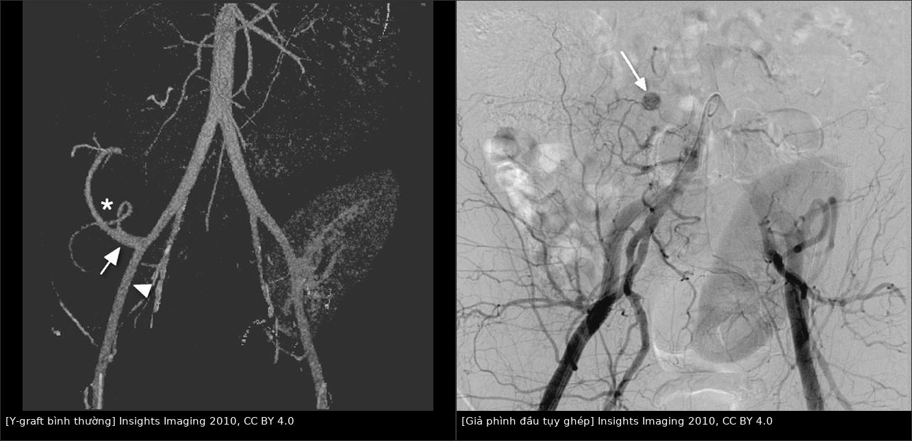
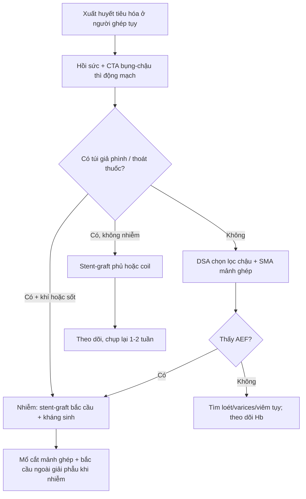
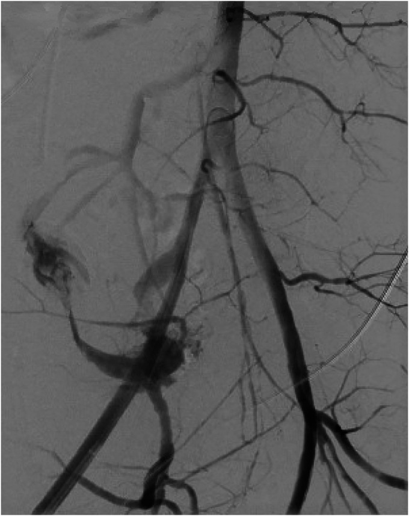
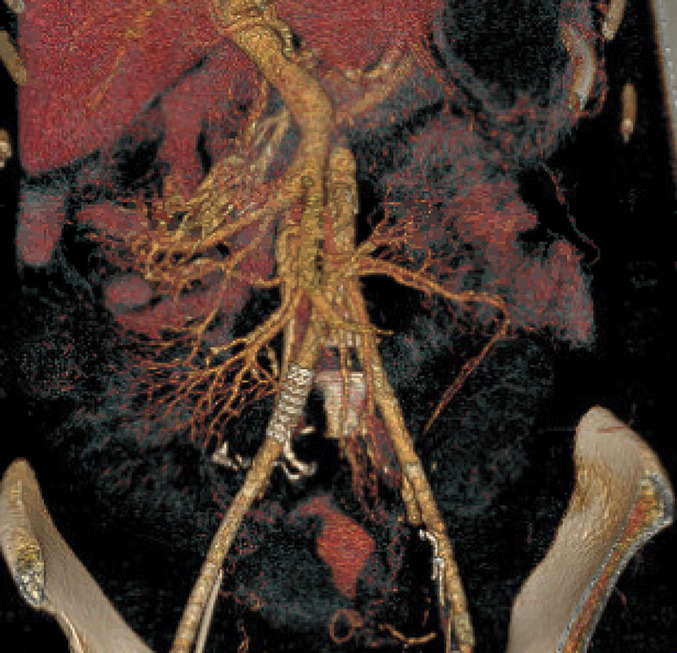

# 3140 — Xuất huyết tiêu hóa sau ghép tụy: giả phình miệng nối & rò động–ruột / Post-pancreas-transplant GI bleeding: pseudoaneurysm and arterioenteric fistula

**Tags:** `pattern:xuat-huyet-tieu-hoa` `pattern:gia-phinh` `pattern:ro-dong-ruot` `vung:bung` `vung:manh-ghep-tuy` `protocol:CTA-bung` `protocol:DSA` `score:Clavien-Dindo` `incidentaloma:khong`

**Mức chắc chắn (certainty):** tổng hợp y văn (literature synthesis) — từ **125 ca** so sánh hai kiểu dẫn lưu ngoại tiết (**PMID 24750305**), **tổng quan 14 ca** giả phình nhiễm sau ghép tạng điều trị nội mạch (**PMID 32081354**), ca rò động–ruột kèm **tổng quan 28 ca trong 20 năm** (**PMID 30711503**), cùng các ca nguyên văn **PMID 35822156 / 30577321 / 32855381 / 15108780 / 36919726 / 34187552** và tổng quan hình ảnh **Insights Imaging 2010 (PMC3259388, CC BY)**. Nhóm **không có bệnh nhân của mình**.

> **Câu chốt:** chảy máu tiêu hóa (xuất huyết tiêu hóa — GIB) sau ghép tụy **không phải "loét dạ dày"**: nội soi **thường âm tính** vì **tá tràng ghép nằm trong hố chậu**, ngoài tầm với của ống soi. Nguyên nhân hay gặp và **chết người** là **giả phình tại miệng nối động mạch (Y-graft)** rồi **rò vào tá tràng ghép** — bệnh cảnh **"sentinel bleed" (chảy máu báo trước) rồi chảy máu ồ ạt**. Chẩn đoán bằng **CTA bụng–chậu thì động mạch**, không phải nội soi; điều trị là **stent-graft bắc cầu** rồi **mổ cắt mảnh ghép** khi có nhiễm.

## 1. Tổng quan bệnh học – cơ chế hình ảnh (TẠI SAO)

### 1.1 Giải phẫu: vì sao giả phình nằm ở hố chậu, không ở "ổ bụng"

- Mảnh ghép tụy được đặt **ngoài phúc mạc trong hố chậu phải**. Động mạch nuôi gồm **động mạch lách (thân/đuôi)** và **động mạch mạc treo tràng trên của người cho (đầu tụy)**, hai nhánh này nối với nhau qua **"Y-graft" động mạch chậu của người cho**; Y-graft được nối **tận–bên vào động mạch chậu chung hoặc chậu ngoài của người nhận**.
- **Miệng nối Y-graft – động mạch chậu là điểm yếu cơ học + nhiễm khuẩn**: vết nối mạch máu nằm **ngay cạnh mỏm tá tràng ghép** và **cạnh ổ dịch/áp-xe** nếu có rò tá tràng (bài 1853). Vì vậy giả phình sau ghép tụy **thường là giả phình nhiễm (mycotic)** — cấy thường ra *Pseudomonas*, *Enterococcus*, *Candida* (**PMID 36919726**).
- **TẠI SAO chảy máu ra đường tiêu hóa:** túi giả phình lớn dần, **ăn mòn mỏm tá tràng ghép** → **rò động–ruột (arterioenteric fistula, AEF)**. Máu phun vào lòng tá tràng ghép, theo quai ruột xuống đại tràng → **đi cầu ra máu đỏ/sẫm** là biểu hiện đầu tiên, dù nguồn ở mạch chậu.
- **TẦN SUẤT:** giả phình sau ghép tụy **1,4–8,0%** (**PMID 30711503**); AEF sau ghép tụy chỉ **28 ca** được báo cáo trong 20 năm — hiếm nhưng **chiếm một nửa** các ca chảy máu tiêu hóa ở người ghép tụy trong y văn (**PMID 35822156**). GIB nói chung gặp ở **11%** ca ghép tụy dẫn lưu ruột (**PMID 30577321**), và **11% ở nối tá tràng–tá tràng vs 3% ở nối tá tràng–hỗng tràng** (**PMID 24750305**).

### 1.2 Vì sao nội soi âm tính — và vì sao điều đó nguy hiểm

- Tá tràng ghép **không nối với dạ dày người nhận**: nó nối vào **hỗng tràng hoặc tá tràng người nhận ở hố chậu**. Vì vậy **nội soi dạ dày–tá tràng (EGD) không tới được miệng nối**, chỉ thấy **máu đọng trong dạ dày/đại tràng** mà không thấy nguồn.
- Trong ca nguyên văn (**PMID 32855381**), chẩn đoán chỉ đặt được sau **6 lần CT, 3 lần EGD, 3 lần nội soi đại tràng và 1 lần chụp mạch**. Ca AEF khác (**PMID 35822156**) có **EGD lặp lại vẫn không thấy nguồn**, trong khi bệnh nhân **tụt 3 g hemoglobin** và cần **65 đơn vị chế phẩm máu**.
- **Hệ quả thực hành:** ở người ghép tụy **xuất huyết tiêu hóa tái diễn, nội soi âm tính**, phải **chuyển thẳng sang CTA/DSA** — không lặp nội soi.

### 1.3 Vật lý hình ảnh: đọc CTA thế nào

- **Giả phình = túi chứa thuốc cản quang nối với lòng mạch.** Trên **CTA thì động mạch**, túi **ngấm thuốc đồng thì với động mạch chậu** và **giữ thuốc ở thì muộn** (khác **thoát mạch hoạt tính** — đổi hình, lan ra ngoài lòng mạch, rửa nhanh). **Đậm độ = đậm độ mạch**, không phải 30–50 HU của máu tụ.
- **Dấu hiệu nhiễm:** **khí trong túi/ổ dịch quanh Y-graft**, **viền ngấm dày không đều**, **mỡ quanh tăng đậm độ**, **dịch cạnh miệng nối** — bối cảnh **sốt + cấy dương** (ca **PMID 36919726**: sốt 48 ngày sau ghép, *Pseudomonas*).
- **Kích thước túi không tương quan nguy cơ vỡ**, nhưng **cổ túi rộng** giải thích vì sao **stent-graft phủ** cần **đoạn lành ≥ 1–2 cm mỗi bên** để neo.
- **Vì sao CTA có thể âm:** túi **đã huyết khối**, hoặc **chảy máu ngắt quãng**. Khi CTA âm mà lâm sàng vẫn nghi, **DSA là chuẩn** — ca **PMID 15108780**: **chụp mạc treo bình thường**, chỉ **chụp mạch chậu** mới thấy **thoát thuốc nhanh từ giả phình động mạch tụy ghép**, sau đó **nút coil**.

## 2. Mẫu hình + chẩn đoán phân biệt theo cơ chế (Gamut)

- **Chảy máu ồ ạt, nội soi âm, có tiền triệu chảy máu nhỏ ("sentinel bleed"):** **AEF từ giả phình Y-graft** (ưu tiên số 1), **giả phình nhánh trong nhu mô** (động mạch lách/SMA mảnh ghép), **loét miệng nối tá tràng–ruột** ăn vào mạch.
- **Chảy máu ỉ ỉ, thiếu máu mạn, nội soi âm:** **giãn tĩnh mạch ngoài (ectopic varices) tại miệng nối** do tăng áp cửa (**PMID 32855381**: 4 năm sau ghép, xơ gan do HEV), **loét mỏm tá tràng ghép**, **CMV** ở niêm mạc ghép.
- **Đau bụng + sốt + tụt Hb, không có máu trong phân:** **viêm tụy mảnh ghép/áp-xe** ăn mòn mạch (bài 1853), **huyết khối mạch mảnh ghép** (bài 1840).
- **Gợi nhớ "SAC":** **S**entinel bleed (tiền triệu), **A**nastomotic artery (Y-graft/chậu), **C**TA thì động mạch → DSA. Nội soi **không** nằm trong chuỗi này khi bệnh nhân đang chảy máu ồ ạt.

## 3. Bảng so sánh phân biệt (ma trận đối chiếu)

| Thực thể (entity) | Hình ảnh điển hình | Chốt vào (rule-in) | Chốt loại (rule-out) | Gợi ý xác nhận |
|---|---|---|---|---|
| **Giả phình miệng nối Y-graft (mycotic)** | Túi ngấm thuốc **sát miệng nối chậu**, ± **khí trong túi**, mỡ quanh tăng đậm độ | **Túi = đậm độ mạch thì động mạch + giữ thuốc thì muộn**; sốt/cấy dương | Không có túi trên **cả CTA và DSA** (khi đang chảy) → không phải giả phình | CTA ≤ 1 mm + DSA chọn lọc; siêu âm Doppler nếu suy thận |
| **Rò động–ruột (AEF)** | **Thoát thuốc từ Y-graft vào lòng ruột**, máu trong quai; giả phình + khí cạnh miệng nối | **Sentinel bleed rồi chảy ồ ạt + nội soi âm + DSA thấy đường rò** | Nội soi thấy **ổ loét đang chảy** tại miệng nối dạ dày–ruột → loét, không phải AEF | DSA (chuẩn), CTA; **không** nội soi lặp |
| **Loét miệng nối tá tràng–ruột** | Không có túi mạch; ổ loét/đông máu tại miệng nối tá tràng ghép–hỗng tràng | Thấy **ổ loét khi soi được** + **không có túi/không thoát thuốc** | Có túi ngấm thuốc/thoát mạch → giả phình/AEF | Nội soi (nếu tới được), CTA âm |
| **Chảy máu mỏm tá tràng ghép** | Máu trong lòng tá tràng ghép, không có bất thường mạch | **Tụt Hb + máu trong tá tràng ghép**, mạch bình thường | Thoát thuốc hoạt tính → can thiệp mạch | CTA; theo dõi Hb |
| **Giãn tĩnh mạch ngoài do tăng áp cửa** | Tĩnh mạch giãn quanh miệng nối, **ngấm thuốc thì tĩnh mạch**, không có túi động mạch | **Tăng áp cửa + giãn tĩnh mạch tại miệng nối**, chụp tĩnh mạch thấy varices | Có túi động mạch → giả phình | Venography/CT tĩnh mạch; DSA thì tĩnh mạch |
| **Viêm tụy/áp-xe mảnh ghép ăn mòn mạch** | Mảnh ghép to, ngấm thuốc không đều, ổ dịch có khí, ± túi nhỏ trong nhu mô | **Viêm tụy + ổ dịch + tụt Hb**, không máu trong phân | **Thoát thuốc vào lòng ruột** → AEF | CTA; nếu có ổ dịch **chọc hút phải loại giả phình trước** |

*Trái: **Y-graft** (dấu hoa thị) nối vào động mạch chậu ngoài người nhận (mũi tên); đầu mũi tên = động mạch chậu chung. Phải: **DSA** thấy **blush tròn** (mũi tên) ở đầu mảnh ghép — giả phình nhỏ. Nguồn: Insights into Imaging 2010, **PMC3259388**, **CC BY 4.0**; ảnh ghép letterbox, không crop.*

### Ba dấu hiệu làm thay đổi quyết định
- **Khí trong túi/ổ dịch quanh Y-graft** = **nhiễm**, nên **stent chỉ là bắc cầu**: trong 11 ca đặt stent đơn thuần, **6 (54,5%)** phải **cắt mảnh ghép** sau đó (**PMID 32081354**).
- **Sentinel bleed**: chảy máu nhỏ tự cầm rồi tái phát ồ ạt sau **vài giờ đến vài ngày** — đây là **cửa sổ để can thiệp**, không phải "đã ổn".
- **Mạch chậu là nguồn**, không phải mạc treo: chụp mạc treo bình thường **không loại trừ** (**PMID 15108780**).

## 4. Protocol chụp + phân độ + sơ đồ quyết định

- **Hồi sức trước hình ảnh:** 2 đường truyền lớn, truyền máu theo **"massive transfusion"**, đặt nội khí quản bảo vệ đường thở nếu nôn máu ồ ạt; **không** đợi Hb ổn định mới chụp — bệnh nhân chảy máu ồ ạt cần **CTA/DSA ngay**.
- **CTA bụng–chậu:** lát **≤ 1 mm**, **thì động mạch (bolus tracking) + thì tĩnh mạch cửa**; MPR/MIP theo trục Y-graft; đo **đường kính túi (mm)**, ghi **cổ túi**, **khí trong túi**, **mỡ quanh**, **dịch cạnh miệng nối**.
- **DSA:** chụp **động mạch chậu chung/ngoài bên ghép trước**, sau đó **SMA và động mạch lách mảnh ghép**; nếu thấy AEF → **bóng chặn (balloon occlusion)** tạm thời, rồi **stent-graft phủ** hoặc **coil** nếu cổ hẹp và không nhiễm.
- **Nội soi:** chỉ để **loại trừ nguồn dạ dày–đại tràng** ở bệnh nhân ổn định; **không lặp lại** khi nghi AEF.
- **Không có RADS cho biến chứng này** — phân độ theo **can thiệp** (Clavien–Dindo): **IIIa** = stent-graft/nút mạch qua da; **IIIb/IV** = mổ cắt mảnh ghép ± bắc cầu ngoài giải phẫu.
- **Ngưỡng can thiệp:** **mọi AEF đều phải xử lý** (không có "theo dõi"); giả phình **không nhiễm, cổ hẹp, < 2 cm** có thể theo dõi ngắn nếu bệnh nhân không chảy máu — nhưng **phải chụp lại 1–2 tuần** vì nguy cơ vỡ.

## 5. Biến thể bình thường và cạm bẫy

- **"Stent đã đặt là xong"** — sai trong **trường nhiễm**: **54,5%** ca stent đơn thuần phải cắt mảnh ghép; có ca **hoại tử thành động mạch chậu lộ stent**, phải **cắt đoạn chậu + bắc cầu đùi–đùi** (**PMID 36919726**).
- **Nội soi âm không loại trừ** — tá tràng ghép **ngoài tầm với**; lặp nội soi chỉ làm chậm can thiệp (**PMID 32855381, 35822156**).
- **Chụp mạc treo bình thường không loại trừ** — nguồn ở **động mạch chậu** (**PMID 15108780**).
- **Giả phình muộn**: có ca xuất hiện **4 năm** sau ghép (**PMID 30577321, 32855381**) — đừng loại trừ chỉ vì "đã lâu".
- **Khí quanh mảnh ghép ngày 1–5 sau mổ** có thể là khí mổ; **khí mới xuất hiện sau 2 tuần** hoặc **khí trong túi mạch** mới là nhiễm.
- **Chọc hút ổ dịch cạnh Y-graft khi chưa loại giả phình** có thể gây **chảy máu tử vong** — **CTA trước mọi kim**.
- **Truyền máu che lấp**: bệnh nhân vẫn có thể **mất máu ồ ạt với Hb "ổn định"** do truyền bù; theo dõi **huyết động + lactat**, không chỉ Hb.

## 6. Tự lượng giá — Blind Quiz

**Ca 1 — Người ghép thận–tụy 4 năm, đi cầu máu sẫm tái diễn, nội soi dạ dày và đại tràng âm tính. Nhìn DSA, mô tả trước.**

- Hỏi: nguồn chảy máu ở đâu? Vì sao nội soi không thấy? Bước tiếp theo?

<b>Bấm để hiện đáp án</b>

- **Thoát thuốc từ động mạch tụy ghép vào quai ruột non** (mũi tên) — **rò động–ruột** sau giả phình miệng nối, trên nền mảnh ghép đã hỏng do huyết khối mạn.
- Nội soi âm vì **tá tràng ghép nằm ở hố chậu**, không nối với đường tiêu hóa trên.
- Xử trí: **stent-graft phủ** cầm máu tức thì, rồi **mổ cắt mảnh ghép** (trường nhiễm). Nguồn: *ACG Case Rep J* 2022, **PMC9270599**, **CC BY-NC-ND 4.0** (nguyên bản, không crop).

**Ca 2 — Sau đặt stent-graft, kiểm tra bằng CT. Đọc hình và nêu 2 điều phải theo dõi.**

<b>Bấm để hiện đáp án</b>

- **Stent-graft nằm trong động mạch chậu chung phải**, che miệng nối Y-graft; không còn thoát thuốc.
- Theo dõi: **(1) nhiễm trường mổ/stent** (sốt, cấy, khí quanh stent) → nguy cơ phải cắt stent + cắt mảnh ghép; **(2) tắc stent/thiếu máu chi dưới** (mạch mu chân, đau cách hồi).
- Nguồn: *ACG Case Rep J* 2022, **PMC9270599**, **CC BY-NC-ND 4.0** (nguyên bản, không crop).

## Bài liên quan chéo
- [1853 – Rò – hoại tử tá tràng mảnh ghép sau ghép tụy](../1853-ro-ta-trang-sau-ghep-tuy/lesson.md) (ổ dịch có khí cạnh miệng nối — nền của giả phình nhiễm)
- [1840 – Huyết khối mạch mảnh ghép tụy](../1840-huyet-khoi-manh-ghep-tuy/lesson.md) (mất ngấm thuốc mảnh ghép)
- [1923 – Áp-xe thận/quanh thận ở thai phụ](../1923-ap-xe-than-quanh-than-thai/lesson.md) (mẫu hình ổ dịch nhiễm, nguyên tắc chọc khi chưa loại mạch)
- [1980 – Dự phòng nhiễm trùng cơ hội sau ghép tạng](../1980-du-phong-nhiem-trung-co-hoi-sau-ghep-tang/lesson.md) (nhiễm khuẩn trường mổ = nguồn giả phình nhiễm)

> Không dùng để chẩn đoán độc lập khi chưa có người hướng dẫn.
