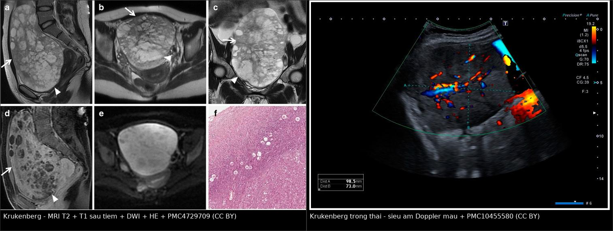
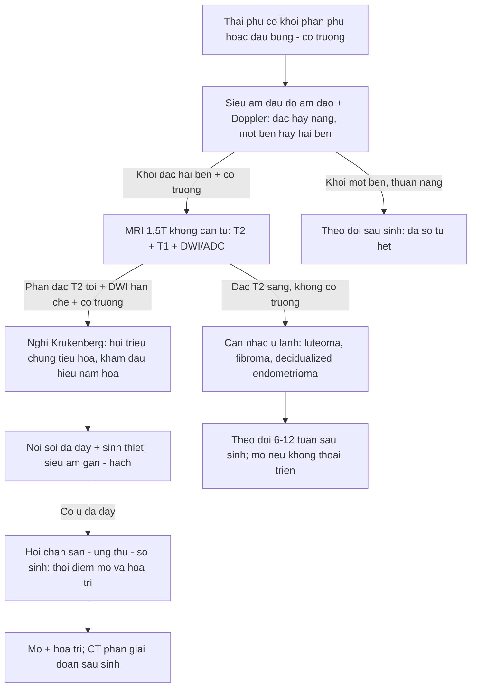
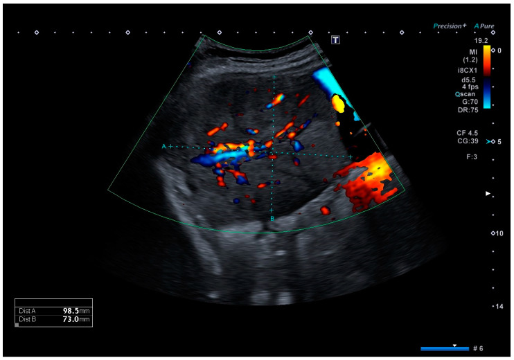
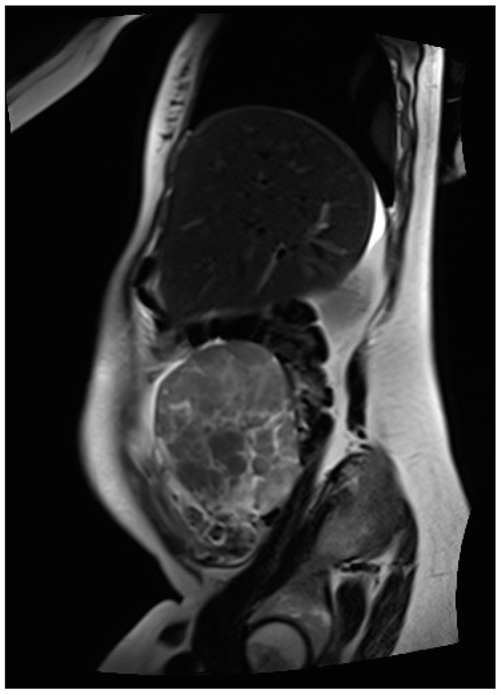
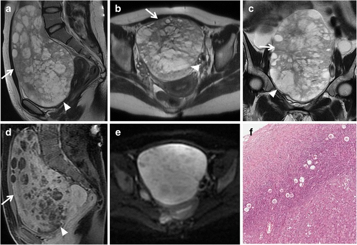

# 3141 — Krukenberg trong thai kỳ: khối đặc HAI BÊN + cổ trướng, sống trung vị 6 tháng, và nam hóa mẹ/thai là dấu hiệu dẫn đường / Krukenberg tumor in pregnancy

**Tags:** `pattern:khoi-buong-trung` `pattern:khoi-dac-hai-ben` `pattern:co-truong` `pattern:di-can` `vung:buong-trung` `vung:thai-nhi` `protocol:MRI-khong-can-tu` `protocol:sieu-am-dau-do` `score:O-RADS`
**Mức chắc chắn (certainty):** tổng hợp y văn (literature synthesis) — ghép **ca nguyên văn có siêu âm Doppler + MRI trong thai** (J Clin Med 2023, PMC10455580, CC BY), **tổng quan hệ thống 35 thai kỳ** (Arch Gynecol Obstet 2016, PMID 26897498, chỉ dùng số liệu), **ca loạt 8 ca trẻ có CT/MRI** (J Comput Assist Tomogr 2024, PMID 38110296, chỉ số liệu), **mô tả hình ảnh Krukenberg trên MRI** (Insights Imaging 2016, PMC4729709, CC BY) và **ca nam hóa thai nữ do Krukenberg của mẹ** (J Endocr Soc 2025, PMC12545912, CC BY-NC-ND, chỉ số liệu). Cơ chế **hCG → mô đệm buồng trứng tiết androgen** ở Krukenberg là **suy luận** từ mô hình luteoma/hyperreactio luteinalis — ghi rõ trong mục 1.

> **Câu chốt:** Krukenberg là **di căn buồng trứng** (thường từ dạ dày, **2/3** ca), và trong thai kỳ nó là chẩn đoán **cực hiếm nhưng gần như luôn muộn**: **65,7% hai bên**, kích thước trung bình **16,7 cm**, **cổ trướng 45,7%**, **di căn phúc mạc 25,7%**, **sống trung vị 6 tháng** sau chẩn đoán (PMID 26897498). Điểm mấu chốt cho bác sĩ hình ảnh: **khối đặc hai bên + cổ trướng ở thai phụ KHÔNG được mặc định là "u lành của thai"** — và nếu mẹ **nam hóa** (mụn, rậm lông, giọng trầm, âm vật to) hoặc **thai nữ có sinh dục không rõ**, phải nghĩ **Krukenberg** (PMC12545912). MRI **không cản từ** trả lời được câu hỏi bản chất: **thành phần đặc T2 tối (mô xơ) + DWI hạn chế + ngấm thuốc**, kèm **cổ trướng và nốt phúc mạc**.

## 1. Tổng quan bệnh học – cơ chế hình ảnh

### 1.1 Bệnh học: vì sao buồng trứng là "đích" của dạ dày (TẠI SAO)

- **Định nghĩa:** Krukenberg = **di căn buồng trứng** chứa **tế bào nhẫn (signet-ring cells) tiết nhầy**, thường từ **dạ dày**; chiếm **1–2%** mọi u buồng trứng và **tới 17,8%** ung thư buồng trứng; **dạ dày chiếm ~2/3** (PMC10455580).
- **Đường lan:** **phúc mạc (transcoelomic)**, **bạch huyết ngược dòng**, **máu**, và **xâm lấn trực tiếp**. Vì sao **hai bên**: lan phúc mạc và bạch huyết **không tôn trọng một bên**, nên **65,7%** ca trong thai là **hai bên** (PMID 26897498).
- **Vì sao khối đặc và xơ:** tế bào nhẫn tiết nhầy → **phản ứng xơ hóa mô đệm (desmoplasia)** mạnh. Chính **collagen** làm **T2 tối**, và các **ổ nhầy** làm **T2 sáng** — nên hình ảnh là **khối hỗn hợp đặc–nang, phần đặc T2 thấp** (PMC4729709, Fig. 9).
- **Vì sao tăng sinh mạch và ngấm thuốc:** mô u di căn cần mạch nuôi, mô đệm viêm tăng sinh mao mạch → **phần đặc ngấm thuốc**, vỏ nang ngấm thuốc (PMC4729709).
- **Vì sao DWI hạn chế:** mật độ tế bào u cao + nhầy nhớt → **ADC thấp**, phần đặc **sáng trên DWI b=800** (PMC4729709, Fig. 9e).
- **Vì sao có thể nam hóa (cơ chế suy luận — inference):** trong thai, **hCG rất cao** kích thích **mô đệm buồng trứng tăng sinh/lutein hóa** và tiết **androgen**; cơ chế này đã được mô tả cho **pregnancy luteoma** và **hyperreactio luteinalis**. Với Krukenberg, mô đệm buồng trứng **bị di căn kích thích** cũng lutein hóa → **nồng độ androgen tăng** → **mẹ nam hóa** (mụn, rậm lông, giọng trầm, âm vật to) và **thai nữ nam hóa** (âm vật to, môi lớn dính, lỗ niệu–sinh dục chung) (PMC12545912). **Đây là suy luận cơ chế**, không phải số liệu đo androgen trong ca gốc.
- **Vì sao tiên lượng tệ:** u đã **di căn phúc mạc** khi được phát hiện; **cổ trướng 45,7%** và **carcinomatosis 25,7%** đều là yếu tố tiên lượng xấu độc lập (PMID 26897498).

### 1.2 Vì sao nhìn thấy — vật lý từng phương thức

- **Siêu âm (bước 1, không tia xạ):** khối **đặc, không đồng nhất**, phần đặc **giảm hồi âm**, các **ổ nang nhầy tăng hồi âm**; **Doppler màu thấy tăng sinh mạch** trong phần đặc; **cổ trướng** là dịch **giảm hồi âm** quanh tử cung và trong túi cùng Douglas. Hạn chế trong thai: tử cung to **đẩy buồng trứng lên cao**, ruột che, và **không phân biệt được u nguyên phát với di căn**.
- **MRI không cản từ (bước 2, ưu tiên trong thai):** **T2W** cho **tương phản mô xơ (tối) với dịch/nhầy (sáng)** — đây là chuỗi xung **quyết định** vì nó cho thấy **phần đặc T2 tối** đặc trưng; **T1W** phát hiện **máu/nhầy đặc** (T1 sáng); **DWI/ADC** cho **độ tế bào**; **SSFSE/HASTE** giảm ảnh giả do chuyển động thai. Gadolinium **không bắt buộc** để chẩn đoán; chỉ dùng khi kết quả sẽ **đổi thái độ điều trị** (ACR: có thể dùng trong thai khi có chỉ định).
- **CT:** chỉ dùng khi **đã có chẩn đoán ác tính** và cần **phân giai đoạn sau sinh** (hoặc khi MRI không thể thực hiện và lợi ích lớn hơn nguy cơ). CT thấy **khối đặc–nang hai bên, cổ trướng, nốt phúc mạc, dày thành dạ dày**; **không** dùng làm bước đầu trong thai.
- **Nội soi dạ dày:** không phải "phương thức hình ảnh" nhưng là **bước chốt nguyên phát** — trong ca chỉ điểm, **ung thư dạ dày 5 cm** chỉ được phát hiện khi **nội soi ngay trong mổ** (PMC10455580).

### 1.3 Ngưỡng định lượng nằm lòng

| Đại lượng | Ngưỡng / con số | Ý nghĩa | Nguồn |
|---|---|---|---|
| Krukenberg trong u buồng trứng | **1–2%**; tới **17,8%** ung thư buồng trứng | Không hiếm trong nhóm "khối đặc hai bên" | PMC10455580 |
| Nguyên phát dạ dày | **~2/3** (trong thai: **68,6%**; đại tràng **14,3%**) | Nội soi dạ dày là bước bắt buộc | PMC10455580, PMID 26897498 |
| Khối phần phụ trong thai (quý I) | **2,3–4,1%**, **~90%** tự hết | Đa số lành — nhưng **10%** không | PMC10455580 |
| Ung thư buồng trứng trong thai | **4–8/100.000** thai kỳ | Cực hiếm, nên dễ bị "chờ sinh rồi tính" | PMC10455580 |
| Tuổi trung bình trong thai | **30,4** (ca loạt trẻ: **24–44**, TB **36,3**) | Người trẻ vẫn có thể có di căn | PMID 26897498, PMID 38110296 |
| Hai bên | **65,7%** | **Khối hai bên = red flag** | PMID 26897498 |
| Kích thước trung bình | **16,7 cm** | Khối rất lớn, dễ thấy trên siêu âm | PMID 26897498 |
| Cổ trướng lúc mổ | **45,7%** | Cổ trướng + khối đặc hai bên = nghi di căn | PMID 26897498 |
| Di căn phúc mạc | **25,7%** | Yếu tố tiên lượng xấu độc lập (**HR 7,95**) | PMID 26897498 |
| Di căn ngoài buồng trứng | **14,3%** | Cần phân giai đoạn | PMID 26897498 |
| Khó thở | **HR 9,74** (sống 2 năm **0% vs 56,6%**) | Triệu chứng hô hấp = bệnh lan | PMID 26897498 |
| Sinh sống | **81,8%** (27/33) | Thai nhi thường sống được | PMID 26897498 |
| Sống trung vị sau chẩn đoán | **6 tháng** | Tiên lượng mẹ rất xấu | PMID 26897498 |
| Hoá trị trong thai | **20 ca**, phơi nhiễm thai **2 ca** | Chưa có chuẩn | PMID 26897498 |
| Tử vong ở ca loạt 8 người trẻ | **6/8**, sống **3–23 tháng** (TB **11**) | Không phụ thuộc thai kỳ | PMID 38110296 |
| CA-125 trong thai | **tăng sinh lý** (ca chỉ điểm **324 kU/L**); AFP **37,7 IU/mL** | **Không dùng để loại trừ** | PMC10455580 |
| CAH (nguyên nhân nam hóa thai hay gặp) | **1/15.000–1/17.000**; **~20%** bị bỏ sót ở sàng lọc sơ sinh | Phải loại CAH **và** tìm u mẹ | PMC12545912 |

## 2. Mẫu hình + chẩn đoán phân biệt theo vị trí (gamut)

- **Mẫu hình cốt lõi:** **khối buồng trứng ĐẶC hai bên, phần đặc T2 tối, ngấm thuốc, DWI hạn chế**, ± **ổ nang nhầy T2 sáng**, kèm **cổ trướng** và **nốt phúc mạc**; ở thai phụ có thể kèm **nam hóa mẹ** hoặc **thai nữ nam hóa**.
- **Gamut theo bối cảnh (context) — đây là cách chia hữu ích nhất trong thai:**
  - **Khối hai bên + cổ trướng + sụt cân/khó thở** → **Krukenberg** (di căn) là giả thuyết **hàng đầu** (PMID 26897498).
  - **Khối hai bên + nam hóa mẹ + hCG rất cao** → **pregnancy luteoma** (thường **hai bên, đặc, giảm sau sinh**), **hyperreactio luteinalis** (nang hóa nhiều ổ), hoặc **Krukenberg** (PMC12545912).
  - **Khối một bên + xoắn/đau cấp** → u **lành** (u quái trưởng thành, u nang nhầy) hoặc **decidualized endometrioma**.
  - **Khối đặc T2 rất tối + không cổ trướng** → **fibroma** (hội chứng Meigs nếu có cổ trướng + tràn dịch màng phổi).
  - **Khối đặc + nội tiết (chảy máu bất thường)** → **u tế bào hạt (granulosa)**.
- **Gamut theo hình thái (morphology):**
  - **Đặc–nang hỗn hợp hai bên:** Krukenberg · di căn đại tràng/vú · lymphoma.
  - **Đặc hoàn toàn hai bên:** Krukenberg · fibroma hai bên (hiếm) · lymphoma · di căn.
  - **Nang nhiều ổ hai bên:** hyperreactio luteinalis · u nhầy giáp biên · Krukenberg thể nang.
- **Gamut nam hóa (virilization) ở thai phụ:** **pregnancy luteoma** · **hyperreactio luteinalis** · **Krukenberg** · **thiếu hụt aromatase** · **dùng androgen ngoại sinh**; ở **thai nhi**: **CAH** (hay nhất), **thiếu hụt aromatase bánh nhau**, **u mẹ tiết androgen** (PMC12545912).

## 3. Bảng so sánh phân biệt (ma trận đối chiếu)

| Thực thể (entity) | Hình ảnh điển hình (US/MRI) | Chốt vào (rule-in) | Chốt loại (rule-out) | Gợi ý xác nhận |
|---|---|---|---|---|
| **Krukenberg (di căn)** | **Hai bên**, đặc–nang, **phần đặc T2 tối**, ngấm thuốc, DWI hạn chế; **cổ trướng**, nốt phúc mạc | **Hai bên + cổ trướng + phần đặc T2 tối + dạ dày dày/loét** | **Một bên, đặc T2 sáng, không cổ trướng** → ít nghĩ Krukenberg | Nội soi dạ dày + sinh thiết; CT phân giai đoạn **sau sinh** |
| **Pregnancy luteoma** | Khối **đặc hai bên**, T2 trung gian, ngấm thuốc, **không cổ trướng**, **tự thoái triển sau sinh** | **Nam hóa mẹ + khối đặc hai bên + hCG cao**, hết sau sinh | **Có cổ trướng + nốt phúc mạc + dạ dày bất thường = loại** | Siêu âm lại **6–12 tuần sau sinh**; không mổ khi không cấp |
| **Hyperreactio luteinalis** | **Nang hóa nhiều ổ hai bên, buồng trứng rất to**, vỏ mỏng, **không có phần đặc thật** | **hCG rất cao** (đa thai, thai trứng), nang nhiều ổ **hai bên** | **Có thành phần đặc ngấm thuốc, DWI hạn chế = loại** | Theo dõi sau sinh; TSH/hCG |
| **Decidualized endometrioma** | Nốt trong nang **T1 sáng**, **T2 tăng tín hiệu khi có thai**, ngấm thuốc mạnh | **T1 sáng (máu cũ) + thai + ngấm thuốc** | **T1 không sáng, hai bên, cổ trướng = loại** | MRI; theo dõi sau sinh |
| **Fibroma / Meigs** | Khối **đặc T2 rất tối**, **không ngấm mạnh**, ± cổ trướng + tràn dịch màng phổi | **T2 tối đen + ngấm rất ít + hết dịch sau cắt u** | **Ngấm mạnh + nốt phúc mạc + dạ dày bất thường = loại** | MRI; cắt u + xét nghiệm dịch |
| **U tế bào hạt** | Khối đặc–nang, **"Swiss cheese"**, ngấm thuốc, chảy máu | **Nội mạc dày + chảy máu bất thường + ức chế FSH** | **Hai bên + cổ trướng + dạ dày bất thường = loại** | MRI; inhibin, AMH |
| **U nhầy giáp biên** | Nang nhiều ổ, **nhầy T1 sáng/T2 rất sáng**, thành mỏng | Nang lớn nhiều ổ, **không có phần đặc T2 tối** | **Phần đặc T2 tối + cổ trướng = loại** | MRI; mô bệnh |
| **CAH ở thai nữ** | Thai nữ **âm vật to**, **buồng trứng bình thường**, không khối | **17-OHP tăng**, gen CYP21A2 | **Có khối buồng trứng ở mẹ = loại CAH đơn thuần** | 17-OHP; xét gen; **không bỏ qua u mẹ** |

## 4. Protocol chụp + hệ phân độ/điểm chuẩn hóa

### 4.1 Trình tự hình ảnh trong thai

1. **Siêu âm đầu dò âm đạo + Doppler (bước 1):** đo **3 chiều**, mô tả **thành phần đặc/nang**, **vách**, **mạch trong phần đặc**, **cổ trướng**, và **khảo sát dạ dày – gan** nếu có triệu chứng tiêu hóa. Trong thai, nhớ rằng **buồng trứng bị đẩy lên cao** — phải quét cả **hố chậu và mạn sườn**.
2. **MRI 1,5 T không cản từ (bước 2):** tối thiểu **T2W axial/coronal (SSFSE/HASTE)**, **T1W**, **DWI b=800–1.000 + ADC**; thêm **T1W fat-sat** nếu nghi máu/nhầy. Gadolinium **chỉ khi đổi thái độ**; **không cần** cho chẩn đoán Krukenberg.
3. **Nội soi tiêu hóa trên** khi hình ảnh gợi ý Krukenberg — **trước hoặc ngay trong mổ** (ca chỉ điểm phát hiện **ung thư dạ dày 5 cm** bằng nội soi trong mổ).
4. **CT ngực–bụng–chậu có cản quang:** **sau sinh** (hoặc sau khi quyết định chấm dứt thai) để **phân giai đoạn** — không phải bước chẩn đoán trong thai.

### 4.2 Phân độ, điểm chuẩn hóa và ngưỡng xử trí

- **O-RADS (US/MRI):** khối **đặc không đồng nhất, thành phần đặc ≥ 3 mm, có mạch/DWI hạn chế, kèm cổ trướng** → **O-RADS 5** (nguy cơ ác **≥ 50%**) — tức **phải xử lý như ung thư**, không "theo dõi tới sau sinh".
- **Phân giai đoạn:** dùng **FIGO** cho u buồng trứng và **TNM 8** cho dạ dày; trong thai, phân giai đoạn đầy đủ thường **hoãn tới sau sinh** vì CT và PET không phù hợp.
- **Thời điểm can thiệp — điều đã biết và điều CHƯA biết:**
  - **Đã biết:** không có chuẩn thống nhất cho Krukenberg trong thai; các ca đã báo cáo mổ ở **36–38 tuần** hoặc sớm hơn khi có **xoắn/CTG xấu**; hoá trị trong thai đã dùng ở **20 ca** (chỉ **2 ca** có phơi nhiễm thai) (PMC10455580, PMID 26897498).
  - **Chưa rõ:** ngưỡng tuổi thai "an toàn" cho hoá trị và lợi ích của **phẫu thuật giảm khối (cytoreduction) trong thai** — **không có thử nghiệm**; cần hội chẩn sản – ung thư – sơ sinh.
  - **Nguyên tắc thực hành:** nếu **nghi ác tính**, **không chờ** tới đủ tháng chỉ vì thai; quyết định dựa trên **tuổi thai + mức lan + nguyện vọng**, với **mục tiêu cứu mẹ** (sống trung vị **6 tháng**).
- **Điều trị:** **phẫu thuật cắt u + toàn bộ tử cung/phần phụ khi cần** + **hoá trị** theo giải phẫu bệnh; **ung thư dạ dày nguyên phát** cần **cắt dạ dày** nếu còn khả năng triệt căn (ca chỉ điểm: mổ lấy thai **36+3**, cắt phần phụ hai bên, cắt bàng quang một phần, **PCI ~15**).

## 5. Biến thể bình thường và cạm bẫy

- **Biến thể bình thường — "khối phần phụ trong thai" đa số lành:** **2,3–4,1%** thai kỳ có khối ở quý I và **~90% tự hết** (PMC10455580). Nhưng chính vì thế mà **10% còn lại bị trấn an sai** — khối **đặc, hai bên, có cổ trướng** phải thoát khỏi nhóm "chờ sinh".
- **Biến thể bình thường — buồng trứng bị đẩy lên cao:** tử cung to đẩy buồng trứng ra **mạn sườn**; siêu âm chỉ hố chậu dễ **bỏ sót** hoặc đo sai kích thước.
- **Cạm bẫy 1 — dùng CA-125 để loại trừ:** CA-125 **tăng sinh lý trong thai** (ca chỉ điểm **324 kU/L**) và **AFP cũng tăng**; CEA/CA19-9/CA15-3 **không bị ảnh hưởng** (PMC10455580). Vì thế **"CA-125 cao do thai"** là câu trả lời sai khi có khối đặc hai bên.
- **Cạm bẫy 2 — gọi là "u lành to của thai" rồi hoãn mổ:** trong y văn, **chẩn đoán sai trên hình ảnh là vấn đề phổ biến**, và **mổ thường bị hoãn để tránh sinh non** → **trì hoãn điều trị** (PMC10455580). Ca chỉ điểm: MRI nghĩ **u tế bào hạt / endometrioma decidualized / ung thư**, chỉ chốt được sau mổ.
- **Cạm bẫy 3 — bỏ qua nam hóa:** **mụn, rậm lông, giọng trầm, âm vật to** ở thai phụ **và** **sinh dục không rõ ở thai nữ** là **cặp dấu hiệu dẫn đường**; nếu chỉ xử lý thai nhi như **CAH** thì bỏ sót **ung thư của mẹ** (PMC12545912).
- **Cạm bẫy 4 — coi "hết sau sinh" là Krukenberg:** **luteoma** và **hyperreactio luteinalis** **thoái triển sau sinh**; Krukenberg **không**. Vì vậy **siêu âm lại 6–12 tuần sau sinh** là ngưỡng phân biệt thực hành — nhưng **không** dùng "chờ sau sinh" khi đã có **cổ trướng + nốt phúc mạc + dạ dày bất thường**.
- **Cạm bẫy 5 — DWI dương tính giả:** nang **nhầy đặc** và **máu cũ** có thể **sáng trên DWI** do **hiệu ứng T2 shine-through** — luôn đọc **ADC**, không chỉ ảnh DWI.
- **Cạm bẫy 6 — CT sớm:** CT bụng trong thai **hạn chế tối đa**; chỉ dùng khi **MRI không thể** và kết quả **đổi thái độ**. Việc phân giai đoạn **không cấp cứu** → **hoãn sau sinh**.

## 6. Tự lượng giá — Blind Quiz ngay trên trang tĩnh

**Ca 1 — Thai phụ 35 tuần, khối bụng phải "dọa nhau cài răng lược"**

- Gợi ý lâm sàng (clinical context): 38 tuổi, **không triệu chứng**, vào viện vì nghi **nhau cài răng lược**; siêu âm thấy khối **99 × 73 × 75 mm** cạnh thành tử cung, kèm **dịch quanh khối**; bên trái có cấu trúc tương tự **70 × 34 × 37 mm**.
- Câu hỏi: Vì sao khối này **không phải** nhau cài răng lược? Ba chẩn đoán phân biệt hàng đầu? Dấu hiệu nào trên Doppler khiến phải **chụp MRI ngay**?

<b>Bấm để hiện đáp án (findings + chẩn đoán)</b>

- Dấu hiệu (findings): khối **đặc, không đồng nhất, giảm hồi âm**, có **mạch máu mức độ vừa** trong phần đặc (Doppler màu), **nằm trong dịch** (cổ trướng); **không có đảo ngược phổ kiểu PAS** và **không có mất mặt phẳng giữa tử cung – bàng quang** điển hình của nhau cài răng lược.
- Chẩn đoán (diagnosis): **khối phần phụ hai bên nghi ác tính** — MRI sau đó xác nhận khối **70 × 130 × 63 mm** giữa gan và tử cung, gợi ý **u tế bào hạt / endometrioma decidualized / ung thư**; mổ ở **36+3** chốt **Krukenberg** (di căn dạ dày). Đây là ví dụ cho **cạm bẫy "dọa nhau cài răng lược"** làm chậm nhận diện khối u.
- Nguồn ảnh: J Clin Med 2023 (PMC10455580), Fig. 1 — CC BY.

**Ca 2 — Cùng bệnh nhân: MRI không cản từ trước mổ**

- Gợi ý lâm sàng: CA-125 **324 kU/L**, AFP **37,7 IU/mL**, beta-2-microglobulin **2,61 mg/L**; CEA/CA19-9/CA15-3 bình thường.
- Câu hỏi: Khối nằm ở **khoang nào** và **nguồn gốc**? Vì sao **không dùng CA-125** để kết luận? Bước tiếp theo trước khi mổ?

<b>Bấm để hiện đáp án (findings + chẩn đoán)</b>

- Dấu hiệu (findings): khối **đặc, không đồng nhất**, giới hạn rõ, **nằm giữa gan và tử cung**, chiếm **phần lớn ổ bụng trên**; tử cung có thai nằm dưới; **có dịch** ở túi cùng.
- Chẩn đoán (diagnosis): **khối phần phụ phải (nguồn gốc buồng trứng) di căn** — sau mổ: **Krukenberg từ ung thư dạ dày** (ổ **5 cm** ở dạ dày, phát hiện bằng **nội soi trong mổ**), **PCI ~15**. **CA-125 tăng sinh lý trong thai**, nên không dùng để phân biệt lành/ác; bước tiếp theo đúng là **nội soi dạ dày** và **hội chẩn** về thời điểm mổ.
- Nguồn ảnh: J Clin Med 2023 (PMC10455580), Fig. 2 — CC BY.

**Ca 3 — Nữ 23 tuổi, khối buồng trứng đặc–nang: đọc 6 chuỗi xung**

- Gợi ý lâm sàng: khối buồng trứng lớn, không có thai; đây là ca **mô tả mẫu hình** để học chuỗi xung.
- Câu hỏi: Phần **đặc** có tín hiệu T2 **tối** vì **mô gì**? Vì sao phần đặc **sáng trên DWI** nhưng phải xem **ADC**? Tiêu bản (f) khớp với nhận định nào?

<b>Bấm để hiện đáp án (findings + chẩn đoán)</b>

- Dấu hiệu (findings): **(a–c)** T2: khối **đặc–nang**, **phần đặc T2 thấp** (mũi tên trắng), **ổ nang T2 cao** (đầu mũi tên); **(d)** T1 sau tiêm fat-sat: **phần đặc ngấm thuốc**; **(e)** DWI b=800: **phần đặc sáng** = tăng độ tế bào; **(f)** H&E: **nhu mô buồng trứng bị thấm nhập lan tỏa bởi tế bào nhẫn**.
- Chẩn đoán (diagnosis): **Krukenberg từ ung thư dạ dày**. **T2 tối = mô xơ/desmoplasia**, không phải vôi; **DWI sáng** chỉ có giá trị khi **ADC thấp** (nếu ADC cao = T2 shine-through của nhầy). Tiêu bản **tế bào nhẫn** là chốt mô học.
- Nguồn ảnh: Insights Imaging 2016 (PMC4729709), Fig. 9 — CC BY.

## Bài liên quan chéo
- [3116 – Krukenberg: chẩn đoán hình ảnh khối buồng trứng di căn](../3116-di-can-buong-trung-krukenberg/lesson.md)
- [1817 – Đau bụng cấp ở thai phụ: protocol MRI không cản từ](../1817-dau-bung-cap-thai-phu-mri/lesson.md)
- [1669 – Hội chứng quá kích buồng trứng](../1669-hoi-chung-qua-kich-buong-trung/lesson.md)
- [3142 – Ung thư dạ dày trên CT: linitis plastica](../3142-ung-thu-da-day-ct-linitis-plastica/lesson.md)
- [500 – Tổng quan Vú & Sản phụ khoa](../500-tong-quan-vu-san-phu-khoa/lesson.md)

## Ảnh
- 3 ảnh gốc, **tất cả CC BY** — chi tiết Fig/PMCID trong `images/CREDITS.md`; ảnh ghép tạo bằng `tools/make_composite.py` (letterbox nền đen, không crop/kéo giãn).
- Không tải ảnh từ bài **CC BY-NC-ND** (PMC12545912) — chỉ dùng số liệu.

> Không dùng để chẩn đoán độc lập khi chưa có người hướng dẫn.
