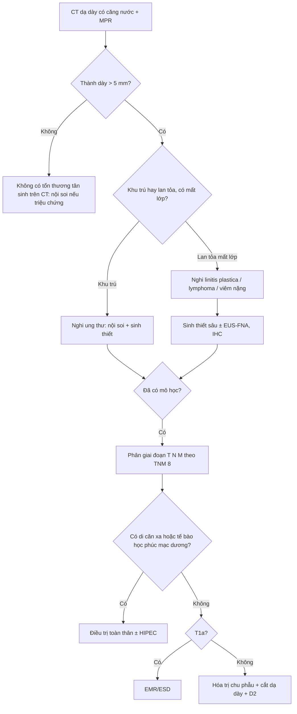
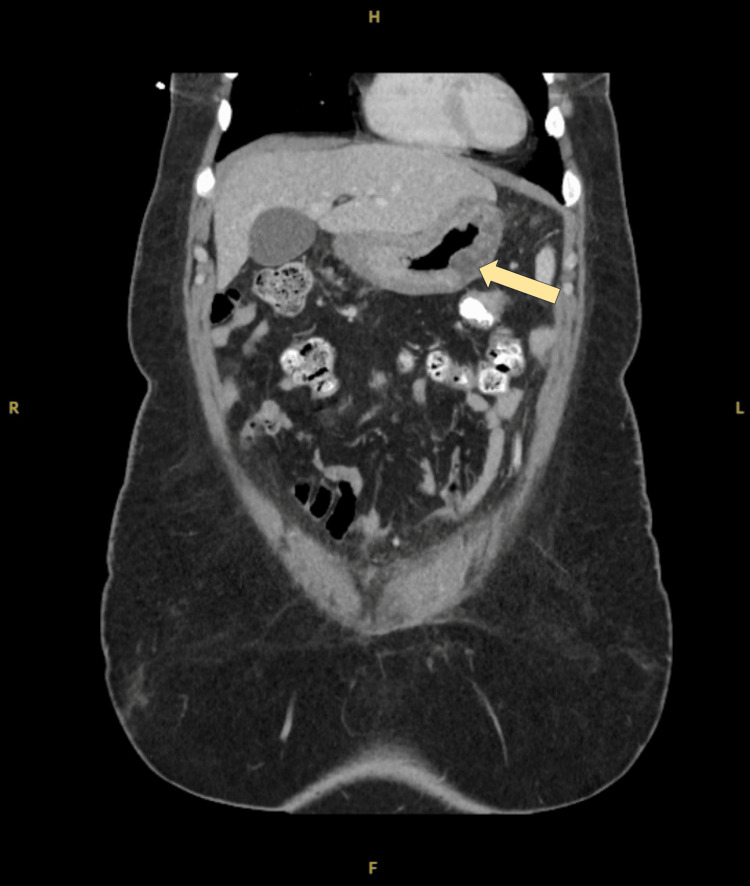
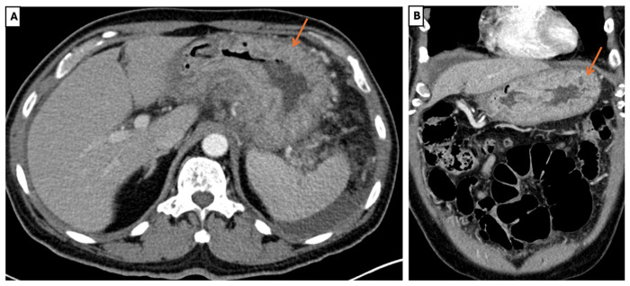
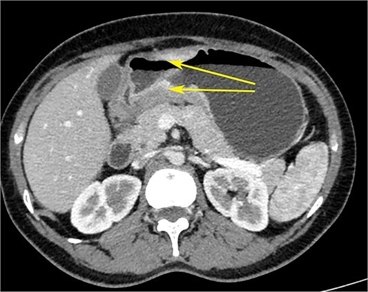

# 3142 — Ung thư dạ dày trên CT: ngưỡng dày thành, "dạ dày cứng" (linitis plastica) và phân giai đoạn T / Gastric cancer on CT

**Tags:** `pattern:day-thanh-da-day` `pattern:linitis-plastica` `pattern:hep-long-da-day` `pattern:o-loet` `pattern:khoi-da-day` `vung:da-day` `vung:o-bung` `protocol:CT-bung-cang-nuoc` `score:TNM-8` `score:Borrmann`

**Mức chắc chắn (certainty):** tổng hợp y văn (literature synthesis) — số liệu hình ảnh và kỹ thuật lấy từ **tổng quan ảnh học ung thư dạ dày** (Cancer Imaging 2013, **PMC3667568**), ghép **ba ca nguyên văn có ảnh CT** (Cureus 2026, **PMC12945401**, CC BY 4.0; J Community Hosp Intern Med Perspect 2024, **PMC11745184**, CC BY-NC 4.0; J Surg Case Rep 2024, **PMC10894678**, CC BY 4.0) và **dữ liệu phân tử của thể linitis plastica** (Gastric Cancer 2023, **PMC9950178**, CC BY). Nhóm **không có bệnh nhân của mình**.

> **Câu hỏi thực hành:** bệnh nhân 58 tuổi, **đau thượng vị, sụt cân, nôn sau ăn**; CT bụng có cản quang (không uống nước căng dạ dày) thấy **"thành dạ dày dày"**. Câu hỏi: **dày bao nhiêu thì gọi là bệnh lý, đo ở đâu, và làm sao phân biệt ung thư lan tỏa với viêm – lymphoma – dạ dày chưa căng?**
> Bài chốt ba điều: **(1) con số "5 mm" chỉ có giá trị khi dạ dày đã căng đủ** — thành dạ dày xẹp có thể dày giả 5–10 mm; **(2) ung thư lan tỏa (linitis plastica) thường *không có khối*, chỉ có thành dày cứng, mất nếp niêm, hẹp lòng — đây là thể dễ bỏ sót nhất**; **(3) CT đủ để T–N–M ở thể tiến xa, nhưng T1a/T1b phải nhờ nội soi ± EUS** — đừng "phân giai đoạn T1" bằng CT.

## 1. Tổng quan bệnh học – cơ chế hình ảnh

### 1.1 Bệnh học và vì sao hình ảnh trông như vậy

- **Mô bệnh:** **ung thư biểu mô tuyến chiếm ~95%** ung thư dạ dày; hai thể Lauren: **ruột (intestinal)** — thường polyp/loét, khu trú; **lan tỏa (diffuse)** — thường **thâm nhiễm thành lan tỏa**, tế bào nhẫn (signet ring), mất liên kết E-cadherin (Cancer Imaging 2013, **PMC3667568**).
- **Linitis plastica (thể Borrmann IV)** là **thể thâm nhiễm toàn thành**: tế bào ung thư lan trong **lớp dưới niêm và cơ**, gây **xơ hóa mạnh (desmoplasia)** → thành dạ dày **dày, cứng, mất nhu động, lòng hẹp** — hình ảnh "**dạ dày cứng**" (leather bottle stomach). Trong loạt mô bệnh của thể này, **100% ca tổn thương toàn bộ thành dạ dày** và **20% có đột biến CDH1** (Gastric Cancer 2023, **PMC9950178**).
- **TẠI SAO cần căng dạ dày — đây là điểm vật lý quan trọng nhất:**
  - Thành dạ dày xẹp **tự chồng lên nhau**; trên lát cắt ngang, một nếp niêm mạc gấp lại có thể dày **5–10 mm** dù hoàn toàn bình thường → **dày giả (pseudothickening)**.
  - Khi dạ dày căng nước, thành bình thường **mỏng 2–3 mm** và có thể thấy **3 lớp**: lớp trong **ngấm thuốc mạnh = niêm mạc**, lớp giữa **giảm đậm độ 2–3 mm = dưới niêm**, lớp ngoài **ngấm thuốc nhẹ = cơ + thanh mạc** (PMC3667568).
  - Vì vậy **ngưỡng thực hành: dày khu trú > 5 mm trên dạ dày căng tốt = nghi tổn thương tân sinh**; đo khi **dạ dày đã căng** và đo **vuông góc với trục thành**.
- **TẠI SAO ung thư thường *giảm* đậm độ so với niêm mạc ở thì tĩnh mạch cửa:** niêm mạc dạ dày ngấm thuốc rất mạnh (giàu mao mạch), còn **mô ung thư + xơ hóa** ngấm **chậm và ít hơn** → tổn thương nổi bật vì **"tối hơn" vùng niêm mạc lành xung quanh**. Đây là lý do phải chụp **thì tĩnh mạch cửa 60–70 giây**, không chỉ thì động mạch.
- **TẠI SAO linitis plastica khó thấy:** không có khối, không có bờ — chỉ là **thành dày đều, mất lớp**, mất nếp niêm, dạ dày **nhỏ, cứng, hình ống**. Trên CT không căng nước, hình này gần như **không thể phân biệt với dạ dày co thắt**.

### 1.2 Ngưỡng định lượng và hiệu năng của CT (các con số phải nhớ)

| Chỉ số | Con số | Nguồn |
|---|---|---|
| Độ dày thành bất thường khi dạ dày căng tốt | **> 5 mm (khu trú)** | Cancer Imaging 2013, PMC3667568 |
| Lớp dưới niêm bình thường | **2–3 mm** (giảm đậm độ) | PMC3667568 |
| Độ chính xác phân giai đoạn T của MDCT | **77–89%** (MPR **84%**, thêm virtual gastroscopy **89%**) | PMC3667568 |
| Độ chính xác phân giai đoạn N | **79%** (69–92%); độ nhạy **84,6%**, độ đặc hiệu **73,9%** | PMC3667568 |
| Phát hiện ung thư sớm (EGC) bằng MDCT | chỉ **44–70%** | PMC3667568 |
| Nốt phúc mạc **< 5 mm** | độ nhạy **43%** (so với **89%** khi > 5 mm) | PMC3667568 |
| Dịch tự do + tế bào học dương | độ nhạy **40%**, độ đặc hiệu **97%** | PMC3667568 |
| Sống 5 năm | giai đoạn I **85–90%** vs giai đoạn IV **3%** | PMC3667568 |
| Linitis plastica | tổn thương **100% thành**; **20% CDH1** đột biến | Gastric Cancer 2023, PMC9950178 |

- **Ghi chú trung thực:** các con số trên là của **các loạt 2005–2013**; với CT đa dãy hiện đại và tái tạo 1 mm, độ chính xác thường cao hơn, nhưng **chưa có ngưỡng mới được thống nhất** — bài giữ nguyên số gốc và ghi rõ nguồn.

## 2. Mẫu hình + chẩn đoán phân biệt theo vị trí (gamut)

- **Bốn mẫu hình cơ bản trên CT:**
  1. **Dày thành khu trú + khối lồi vào lòng** (thể polyp/loét) — dễ thấy nhất.
  2. **Loét sâu, bờ nâng cao** (thể loét) — ổ loét chứa khí/dịch, bờ dày.
  3. **Dày thành lan tỏa, mất lớp, lòng hẹp** (linitis plastica/Borrmann IV) — **dễ bỏ sót nhất**.
  4. **Thành dày + nhiều hạch + dịch ổ bụng** — thể đã lan phúc mạc.

- **Gamut theo vị trí (phân bố ~30/30/40%):** **hang vị 30%**, **thân vị 30%**, **tâm vị–đáy vị 40%** (PMC3667568). Vị trí quyết định **đường mổ và bờ cắt**, nên luôn ghi rõ **tâm vị / thân / hang** và **khoảng cách tới tâm vị**.
- **Gamut chẩn đoán phân biệt theo hình thái:**
  - **Dày lan tỏa:** ung thư lan tỏa, **lymphoma**, **viêm dạ dày nặng (H. pylori, eosinophilic)**, **bệnh Menetrier**, **phù do xơ gan/tăng áp cửa**, **do xạ trị**, **di căn thể linitis plastica (ung thư vú thể tiểu thùy)**, **amyloidosis**.
  - **Dày khu trú:** ung thư, **GIST** (dưới niêm, lồi ra ngoài), **u lympho**, **u thần kinh nội tiết**, **polyp lớn**, **loét lành tính**.
  - **Dày + hẹp hang vị:** ung thư hang vị, **loét môn vị**, **hẹp do loét xơ**, **viêm tụy/giả nang tụy chèn**.
- **Ba câu hỏi đọc CT:** **(1) dạ dày đã căng chưa? (2) dày *khu trú* hay *lan tỏa*, có mất lớp không? (3) có dấu hiệu xâm lấn thanh mạc/tạng lân cận, hạch, dịch, phúc mạc không?**

## 3. Bảng so sánh phân biệt (ma trận đối chiếu)

| Thực thể (entity) | Hình ảnh điển hình trên CT | Chốt vào (rule-in) | Chốt loại (rule-out) | Gợi ý xác nhận |
|---|---|---|---|---|
| **Ung thư biểu mô tuyến (khu trú)** | Dày thành **khu trú > 5 mm**, bờ không đều, **ngấm thuốc không đều**, có thể loét; hạch vệ cận | **Dày khu trú + bờ không đều + hạch** | Thành mỏng đều, lớp còn nguyên → ít nghĩ ung thư | Nội soi + sinh thiết (chuẩn) |
| **Linitis plastica (Borrmann IV)** | **Dày lan tỏa ≥ 1 cm**, mất lớp, **mất nếp niêm**, dạ dày nhỏ/cứng, **không có khối** | **Thành dày toàn bộ + mất nhu động + hẹp lòng** | Có khối rõ, thành mỏng vùng khác → thể khu trú | Nội soi sinh thiết **sâu** (dễ âm giả), EUS-FNA |
| **Lymphoma dạ dày** | Dày thành **rất dày nhưng mềm**, **giữ được mỡ quanh**, hạch lớn, có thể **giãn lòng (aneurysmal dilatation)** | **Dày nhiều + hạch lớn + không hẹp lòng** | Hẹp cứng, mất nếp, xâm lấn mỡ → nghĩ ung thư | Sinh thiết, IHC, PET/CT |
| **GIST** | Khối **dưới niêm, lồi ra ngoài**, bờ nhẵn, **ngấm thuốc mạnh**, có thể hoại tử trung tâm | **Khối lồi ngoài lòng + ngấm mạnh** | Tổn thương **phẳng, lan theo thành** → không phải GIST | EUS-FNA (tránh sinh thiết niêm) |
| **Bệnh Menetrier** | **Nếp niêm phì đại khổng lồ** ở **thân–đáy vị**, thành dày nhưng **mềm, giữ lớp**, hang vị **không bị** | **Phì đại nếp + hang vị bình thường + giảm protein máu** | Dày lan tỏa cả hang vị, mất lớp → nghĩ ung thư | Nội soi, protein máu |
| **Viêm dạ dày nặng / eosinophilic** | Dày **lan tỏa, đối xứng**, **giữ lớp**, ngấm thuốc đều; có thể dịch ổ bụng | **Đối xứng + giữ lớp + bạch cầu ái toan** | Mất lớp, bờ không đều, hạch → nghĩ ung thư | Sinh thiết, công thức máu |
| **Di căn linitis plastica (vú thể tiểu thùy)** | Thành dày lan tỏa **giống hệt** ung thư nguyên phát; tiền sử ung thư vú | **Tiền sử vú + dày lan tỏa + không loét** | Có ổ nguyên phát dạ dày, loét → nghĩ nguyên phát | IHC (GATA3, ER), sinh thiết |
| **Phù thành do tăng áp cửa** | Dày **đều, giữ lớp**, kèm **tuần hoàn bàng hệ, lách to, dịch ổ bụng** | **Bệnh gan + giữ lớp + bàng hệ** | Mất lớp, hạch, không bàng hệ → nghĩ u | Siêu âm Doppler cửa, xét nghiệm gan |
| **Do xạ trị** | Dày **đúng trường chiếu**, giữ lớp, có thể loét | **Tiền sử xạ + giới hạn đúng liều** | Dày ngoài trường xạ → không phải do xạ | Đối chiếu kế hoạch xạ |

- **Ảnh minh họa:** CT coronal dạ dày **dày lan tỏa** (Cureus 2026, PMC12945401); CT axial + sagittal **dày thành thân–hang vị** (PMC11745184); CT **dày thành hang vị** kèm u buồng trứng hai bên (J Surg Case Rep 2024, PMC10894678 — xem bài 3116).

## 4. Protocol chụp + hệ phân độ

### 4.1 Protocol CT dạ dày (theo Cancer Imaging 2013, PMC3667568)

- **Nhịn ăn 4–6 giờ.**
- **Căng dạ dày bằng nước (negative contrast):** **500–750 mL nước uống 10–15 phút trước chụp + thêm 250 mL ngay trước chụp**; có thể dùng **bột sủi bọt (CO₂)** thay nước.
  - **Không dùng cản quang baryt/i-ốt đường uống** — che lấp u nhỏ và tạo giả tổn thương do trộn không đều.
- **Giảm nhu động:** **scopolamine-N-butyl bromide (Buscopan) 20 mg** hoặc **glucagon** tiêm tĩnh mạch/ bắp, nếu không có chống chỉ định.
- **Cản quang tĩnh mạch:** **100–150 mL, 3–4 mL/s**; chụp **thì tĩnh mạch cửa 60–70 giây**; thêm **thì động mạch 30–35 giây** khi cần phân biệt u ngấm mạnh với niêm mạc.
- **Tái tạo:** **lát 1 mm**, **MPR coronal + sagittal** dọc trục dạ dày; có thể chụp **tư thế nghiêng/decubitus** để căng đủ đoạn dạ dày chứa u.
- **Đo và ghi:** độ dày **vuông góc với thành**, vị trí theo **tâm vị/thân/hang**, **khoảng cách tới tâm vị**, **mức xâm lấn**, hạch theo **nhóm**, dịch ổ bụng.

### 4.2 Phân giai đoạn — AJCC/UICC **TNM 8** (dạ dày)

| T | Định nghĩa | Ghi chú hình ảnh |
|---|---|---|
| **T1a** | Niêm mạc / cơ niêm | CT **không đáng tin**; EUS/nội soi |
| **T1b** | Dưới niêm | EUS tốt hơn CT |
| **T2** | Cơ chính (muscularis propria) | Thành dày, **bờ ngoài nhẵn** |
| **T3** | Mô liên kết dưới thanh mạc | **Nốt/đám mờ trong mỡ quanh dạ dày** |
| **T4a** | Thanh mạc (phúc mạc tạng) | **Bờ ngoài không đều, thâm nhiễm mỡ** |
| **T4b** | Xâm lấn tạng lân cận | Mất mặt phẳng với gan/tụy/đại tràng |

- **N (TNM 8):** **N1 1–2**, **N2 3–6**, **N3a 7–15**, **N3b ≥ 16** hạch dương. **M1** gồm di căn xa và **tế bào học phúc mạc dương**.
- **Hệ bổ sung:** **Borrmann I–IV** (hình thái đại thể); **Lauren intestinal/diffuse**; **độ mô học G1–G3**.
- **Ý nghĩa điều trị:** **T1a** có thể **EMR/ESD**; **≥ T2** thường **hóa trị chu phẫu + cắt dạ dày + vét hạch D2**; **M1** điều trị toàn thân ± miễn dịch; **phúc mạc** cân nhắc **HIPEC** trong chọn lọc.
- **Vai trò của EUS và nội soi ổ bụng:** EUS **chính xác hơn CT cho T1a/T1b** (độ nhạy gộp T1 **88,1%**; phân biệt T1–2 vs T2–4: sens 0,86 / spec 0,91) (PMC3667568). Vì CT **bỏ sót nốt phúc mạc < 5 mm tới 57%**, nhiều trung tâm vẫn **nội soi ổ bụng thăm dò** trước mổ.

## 5. Biến thể bình thường và cạm bẫy

- **Biến thể bình thường:**
  - **Nếp niêm phì đại vùng đáy vị** (vùng tuyến) — dày nhưng **mềm, đối xứng, giữ lớp**; thay đổi theo mức căng.
  - **Dạ dày xẹp một phần** ở bệnh nhân không uống đủ nước → **dày giả 5–10 mm**; đây là lý do **phải chụp lại có căng** trước khi kết luận.
  - **Sau mổ nối ruột–dạ dày**: thành vùng nối dày nhẹ, không loét, không hạch — bình thường.
- **Cạm bẫy:**
  1. **Kết luận "ung thư" trên dạ dày chưa căng** — sai cả dương tính và âm tính.
  2. **Bỏ sót linitis plastica** vì "không thấy khối" — phải đo **độ dày toàn dạ dày** và so sánh **hang vị với thân vị**.
  3. **Sinh thiết nông âm giả ở linitis plastica** — tế bào nằm **sâu dưới niêm**; cần **sinh thiết sâu/EUS-FNB**.
  4. **Nhầm lymphoma với ung thư**: lymphoma dày nhiều nhưng **không hẹp lòng** (giãn), hạch lớn, **không xâm lấn mỡ**.
  5. **Cho rằng CT âm là loại trừ ung thư sớm** — EGC chỉ phát hiện **44–70%**.
  6. **Bỏ sót phúc mạc** vì không có dịch: nốt **< 5 mm** chỉ thấy **43%**; phải **ghi rõ "không loại trừ"** và đề xuất nội soi ổ bụng khi T3–T4.
  7. **Đo thành ở chỗ có sóng nhu động** — dày giả theo chu kỳ; dùng Buscopan và đo lại.

## 6. Tự lượng giá — Blind Quiz (bấm để hiện đáp án)

**Ca 1 — sụt cân, đau thượng vị**

- Gợi ý lâm sàng: nữ lớn tuổi, mang **đột biến BRCA2**, sụt cân, đau thượng vị; nội soi thấy nếp niêm to, cứng.
- Câu hỏi: (1) Dấu hiệu trên CT? (2) Vì sao không thấy "khối"? (3) Cần làm gì để có chẩn đoán mô học?

<b>Bấm để hiện đáp án (findings + chẩn đoán)</b>

- **Dấu hiệu:** **dày lan tỏa thành dạ dày**, mất lớp, **khối giảm đậm độ ở bờ cong lớn** (mũi tên vàng) — dạ dày thu nhỏ, cứng.
- **Chẩn đoán:** **ung thư dạ dày thể linitis plastica** (Cureus 2026, **PMC12945401**, CC BY 4.0).
- **Vì sao:** tế bào thâm nhiễm **trong thành** + xơ hóa → thành dày mà **không tạo khối lồi rõ**; đây là **thể dễ bỏ sót**.
- Nguồn ảnh: Cureus 2026 (PMC12945401), Figure 2, CC BY 4.0.

**Ca 2 — dày thành thân–hang vị**

- Gợi ý lâm sàng: bệnh nhân khó nuốt – nôn; nội soi thấy khối từ **1/3 dưới thực quản tới tâm vị**.
- Câu hỏi: (1) Đo độ dày ở đâu? (2) Vì sao cần **mặt phẳng sagittal**? (3) Ba chẩn đoán phân biệt?

<b>Bấm để hiện đáp án (findings + chẩn đoán)</b>

- **Dấu hiệu:** (A) axial: **dày thành mặt trước thân vị** (mũi tên đỏ); (B) sagittal: thấy rõ **đoạn dày kéo dài theo trục dạ dày** — giúp đo **chiều dài tổn thương** và khoảng cách tới tâm vị.
- **Chẩn đoán:** **ung thư biểu mô tuyến dạ dày–tâm vị** (J Community Hosp Intern Med Perspect 2024, **PMC11745184**, CC BY-NC 4.0).
- **Vì sao:** mặt phẳng **vuông góc với thành** cho số đo đúng; axial đơn thuần dễ **cắt chéo** thành dày giả.
- Nguồn ảnh: PMC11745184, Fig. 1, CC BY-NC 4.0.

**Ca 3 — dày thành hang vị + khối buồng trứng hai bên**

- Gợi ý lâm sàng: nữ trẻ, đau bụng, sụt cân; siêu âm phát hiện **nang buồng trứng hai bên có thành phần đặc**.
- Câu hỏi: (1) Dấu hiệu dạ dày? (2) Khối buồng trứng hai bên gợi ý gì? (3) Điều này đổi cách phân giai đoạn thế nào?

<b>Bấm để hiện đáp án (findings + chẩn đoán)</b>

- **Dấu hiệu:** **dày thành hang vị** (mũi tên vàng) + **nang buồng trứng hai bên có phần đặc** → **di căn Krukenberg** (bài 3116).
- **Chẩn đoán:** **ung thư dạ dày thể lan tỏa di căn buồng trứng hai bên** (J Surg Case Rep 2024, **PMC10894678**, CC BY 4.0).
- **Vì sao:** thể **diffuse/signet ring** lan **xuyên phúc mạc** tới buồng trứng; khi đã có Krukenberg → **M1**, điều trị toàn thân (không cắt dạ dày chữa khỏi).
- **Phản biện:** khối buồng trứng **hai bên** ở nữ trẻ dễ bị mổ như **u buồng trứng nguyên phát** — luôn **soi dạ dày** trước mổ.
- Nguồn ảnh: PMC10894678, Figure 2, CC BY 4.0.

## Bài liên quan chéo
- [3116 — Di căn buồng trứng Krukenberg](../3116-di-can-buong-trung-krukenberg/lesson.md) — cùng thể lan tỏa, di căn phúc mạc.
- [143 — U trung biểu mô phúc mạc vs carcinomatosis](../143-u-trung-bieu-mo-phuc-mac-vs-carcinomatosis/lesson.md) — phân biệt dịch/nốt phúc mạc.
- [162 — Tắc ruột](../162-tac-ruot/lesson.md) — biến chứng hẹp môn vị/tắc.
- [1811 — Loét dạ dày tá tràng sau TACE/TARE](../1811-loet-da-day-ta-trang-sau-tace-tare/lesson.md) — tổn thương dạ dày không do ung thư.
- [107 — MRCP và gadoxetic acid (HBP)](../107-mrcp-gadoxetic-acid-hbp/lesson.md) — khi u xâm lấn đường mật/gan.

## Ảnh
- `images/3142_utdd_CT-linitis-plastica_PMC12945401.jpg` — Cureus 2026, Figure 2 (**CC BY 4.0**).
- `images/3142_utdd_CT-day-thanh-lan-toa_PMC11745184.jpg` — J Community Hosp Intern Med Perspect 2024, Fig. 1 (**CC BY-NC 4.0**).
- `images/3142_utdd_CT-hang-vi-day_PMC10894678.jpg` — J Surg Case Rep 2024, Figure 2 (**CC BY 4.0**).

> Không dùng để chẩn đoán độc lập khi chưa có người hướng dẫn.
