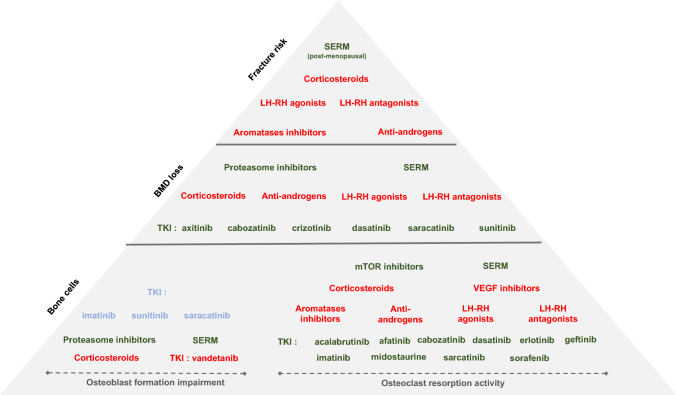
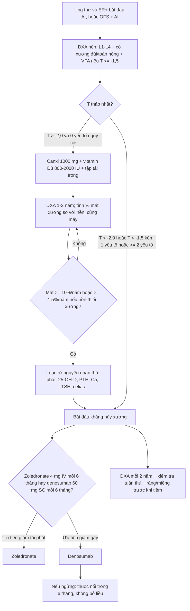
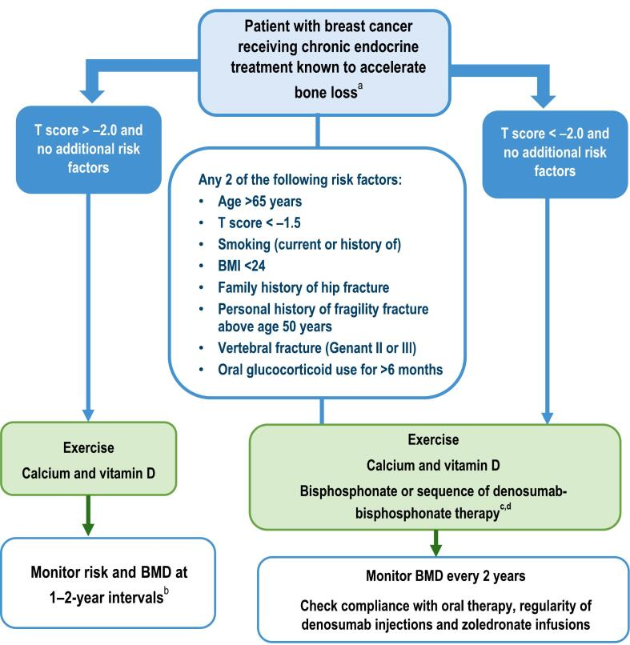

# 3143 — Mất xương do ức chế buồng trứng + ức chế aromatase ở phụ nữ TIỀN mãn kinh: đọc DXA đúng và ngưỡng điều trị AIBL 2025 / Bone loss on ovarian suppression + aromatase inhibitor in premenopausal breast cancer

**Tags:** `pattern:mat-xuong` `pattern:gay-xuong-suy-yeu` `vung:xuong` `vung:cot-song` `score:T-score` `score:FRAX` `protocol:DXA` `protocol:VFA`

**Mức chắc chắn (certainty):** tổng hợp y văn (literature synthesis) — dựng trên **tuyên bố đồng thuận 2025 của IOF–CABS–ECTS–IEG–ESCEO–IMS–SIOG về mất xương do ức chế aromatase (AIBL)** (*J Bone Oncol* 2025, **PMC12301826**, CC BY 4.0) và **tổng quan tác động xương của thuốc ung thư** (*Calcif Tissue Int* 2025, **PMC11950069**, CC BY 4.0); các con số nguyên thủy được đối chiếu đúng PMCID gốc, nhóm **không có bệnh nhân của mình**.

> **Câu chốt:** ở phụ nữ **tiền mãn kinh** dùng **ức chế buồng trứng (OFS, GnRHa) + ức chế aromatase (AI)**, estrogen bị triệt cả **buồng trứng lẫn mô**: mất xương nhanh **gấp 2–4 lần** mất xương sau mãn kinh tự nhiên, nguy cơ gãy đốt sống **RR 1,84** và **31,2% vs 18,9%** gãy đốt sống trên phim so với người không dùng AI (PMC12301826). Vì vậy **DXA nền + ngưỡng AIBL** phải nằm trong hồ sơ trước khi bắt đầu nội tiết, và ngưỡng điều trị ở nhóm này **thấp hơn** ngưỡng loãng xương dân số (**T < −2,0**, hoặc **T < −1,5 kèm 1 yếu tố nguy cơ**), **không chờ tới −2,5**.

## 1. Tổng quan bệnh học – cơ chế hình ảnh (TẠI SAO)

### 1.1 Vì sao nhóm này mất xương nhanh nhất trong ung thư vú
- Khoảng **80%** ung thư vú dương tính thụ thể estrogen (ER+); nội tiết bổ trợ chuẩn **5–10 năm** (PMC12301826).
- **AI (anastrozole/letrozole/exemestane)** chặn aromatase → giảm gần như hoàn toàn estrogen từ mô mỡ/thượng thận; ở **phụ nữ tiền mãn kinh nguy cơ cao**, AI còn được ghép **OFS (GnRHa)** để tắt cả nguồn buồng trứng. Kết quả: **estrogen gần bằng 0** ở người vẫn còn 20–30 năm tuổi xương.
- **Cơ chế tế bào:** estrogen là "phanh" sinh lý của hủy cốt bào — nó **giảm RANKL** và **tăng OPG** (bẫy thụ thể), đồng thời thúc hủy cốt bào **apoptosis**. Mất estrogen → RANKL/OPG tăng → hủy cốt bào nhiều và sống lâu hơn → **mất xương xốp trước** (cột sống, đầu xương) rồi **mất xương vỏ** (cổ xương đùi) muộn hơn.
- **Số liệu định lượng (bắt buộc):**
  - AI làm mất xương **gấp 2–4 lần** tốc độ mất xương sinh lý sau mãn kinh (PMC12301826).
  - Phân tích gộp **30 RCT, n = 117.974**: **RR gãy hông và gãy ngoài cột sống 1,18**; **RR gãy đốt sống 1,84** (p < 0,001) (PMC12301826).
  - **Gãy đốt sống trên phim (không triệu chứng): 31,2% ở nhóm dùng AI vs 18,9% không dùng, OR 1,90** (p = 0,03) — **độc lập với BMD**, nên "T-score đẹp" không loại trừ gãy lún.
  - Ở **phụ nữ tiền mãn kinh** dùng GnRHa + AI: RCT 12 tháng trên **68 người** — nhóm **denosumab** giữ BMD và thông số HR-pQCT, nhóm **placebo giảm có ý nghĩa** (PMC12301826) → chứng minh mất xương ở nhóm này **nhanh và chặn được**.
  - Kéo dài AI **> 5 năm** làm nguy cơ gãy tăng thêm (PMC12301826) — thời gian phơi nhiễm là biến số, không chỉ tuổi.

*Tháp 3 tầng (nguy cơ gãy – mất BMD – tăng xương): **ức chế aromatase (AIs)** và **LH-RH agonist/antagonist** (tức GnRHa/OFS) đều nằm ở tầng **giảm BMD** (đỏ), và AI còn lên tầng **tăng nguy cơ gãy**. Corticoid nằm ở cả tầng nguy cơ gãy cao nhất — lý do bệnh nhân vừa AI vừa dexamethasone dài ngày là nhóm nguy cơ kép. Teissonnière M et al., Calcif Tissue Int 2025 (PMC11950069), Fig. 2, **CC BY 4.0** — nguyên bản.*

### 1.2 Vì sao DXA "thấy" được — và thấy muộn
- **DXA (dual-energy X-ray absorptiometry)** phát **hai mức năng lượng** (~40 và ~70 keV). Ở mức thấp, chênh lệch hấp thụ **xương – mô mềm** lớn (hiệu ứng quang điện ∝ Z³); ở mức cao, hấp thụ chủ yếu do Compton và gần như **không phụ thuộc Z**. Giải hệ hai phương trình → tách được khối lượng **mô mềm** khỏi **xương**, phần còn lại là **BMC (g)** chia cho **diện tích chiếu (cm²)** = **areal BMD (g/cm²)**. Đây là lý do DXA **không đo mật độ thể tích thật** (không phải HU, không phải mg/cm³) và **phụ thuộc kích thước xương**: người khung nhỏ có BMD areal thấp giả.
- **T-score** = số độ lệch chuẩn (SD) so với **đỉnh khối lượng xương của người trẻ khỏe cùng giới** — thang **chẩn đoán loãng xương** (WHO: T ≤ −2,5). **Z-score** = so với **người cùng tuổi** — dùng để phát hiện mất xương "quá mức so với tuổi" và **bắt buộc** khi đọc DXA ở **phụ nữ tiền mãn kinh** (< 50 tuổi hoặc còn kinh nguyệt).
- **Vì sao phải đo lặp đúng kỹ thuật:** thay đổi thật phải vượt **least significant change (LSC)** — với đa số cơ sở khoảng **2–3%** (≈ 0,03 g/cm² ở cột sống). Vì thế hiệp hội khuyến cáo **cùng một máy DXA**, cùng vị trí, và mốc so sánh **12 tháng**; ngưỡng "mất xương nhanh cần điều trị" là **≥ 10%/năm ở bất kỳ vị trí nào** (hoặc **≥ 4–5%/năm** nếu nền đã thiếu xương) (PMC12301826, Fig. 2 chú thích b).

## 2. Mẫu hình + chẩn đoán phân biệt theo bối cảnh (gamut)

**Mẫu hình:** DXA có **BMD giảm nhanh giữa hai lần đo** (hoặc T thấp hơn tuổi rất nhiều) ở người đang điều trị nội tiết ung thư vú, **không có triệu chứng** hoặc chỉ đau lưng cấp do gãy lún.

| Bối cảnh lâm sàng | Gamut chính | Chốt định lượng |
|---|---|---|
| Tiền mãn kinh, **GnRHa + AI** | Mất xương do triệt estrogen kép (nhanh nhất) · suy buồng trứng sớm sau hóa trị · thiếu vitamin D · cường cận giáp thứ phát do thiếu Ca | Mất xương **2–4×** mức sinh lý; T giảm thêm **≥ 10%/năm** = ngưỡng can thiệp |
| Hậu mãn kinh, **AI đơn thuần** | AIBL · loãng xương sau mãn kinh · gãy lún do di căn · đa u tủy | RR gãy đốt sống **1,84**; gãy lún **31,2%** (phim) |
| Đau lưng cấp ở người đang AI | **Gãy lún loãng xương** · **di căn đốt sống** · thoát vị đĩa đệm · gãy do suy yếu trên xẹp cũ | MRI: lún **dưới đĩa đệm còn nguyên**, không phá cuống; di căn: **phá cuống, T1 tối, DWI hạn chế** |
| Đang/đã dùng **corticoid** (dexamethasone vì ICANS, phù não, hóa trị) | Loãng xương do glucocorticoid (nhanh, xương xốp) · bệnh cơ do corticoid (yếu cơ, không đau xương) | Corticoid **> 6 tháng** là một yếu tố nguy cơ trong bảng AIBL |
| Đang dùng **denosumab** rồi trễ liều | Mất xương bùng phát sau ngừng (rebound) · gãy lún dồn dập nhiều tầng | Phải có **thuốc nối** (bisphosphonate/zoledronate) trong **6 tháng** sau liều cuối |

## 3. Bảng so sánh phân biệt (ma trận đối chiếu)

| Thực thể | Hình ảnh điển hình | Chốt vào (rule-in) | Chốt loại (rule-out) | Gợi ý xác nhận |
|---|---|---|---|---|
| **AIBL/AI + OFS** | DXA: T thấp ở **cột sống trước**, hông theo sau; VFA có gãy lún không triệu chứng | **T < −2,0**, hoặc **T < −1,5 kèm 1 yếu tố nguy cơ**, hoặc **≥ 2 yếu tố nguy cơ** (không tính BMD), hoặc **mất ≥ 10%/năm** | T > −2,0, không yếu tố nguy cơ, mất xương < LSC → **chưa cần thuốc** | DXA nền trước AI + DXA 12–24 tháng, **cùng máy**; VFA |
| **Loãng xương sau mãn kinh đơn thuần** | Mất xương chậm, đối xứng, không liên quan phác đồ | **T ≤ −2,5** ở cổ xương đùi/toàn hông/L1–L4 | T bình thường + không gãy lún | FRAX (dân số chung) |
| **Gãy lún loãng xương** | Lún hình nêm/lún đĩa, **bờ đốt sống còn**, không phá cuống; VFA thấy nhiều tầng | Gãy lún + BMD thấp + không có tổn thương đặc | **Phá cuống, mất cuống trên phim/CT, T1 tối + DWI hạn chế** = di căn | MRI cột sống (T1 + STIR + DWI) |
| **Di căn xương ở người ung thư vú** | Nốt/lún một tầng, phá cuống, phần mềm cạnh đốt sống | Tổn thương **đặc**, bắt thuốc, hạn chế khuếch tán | Nhiều tầng lún đều, mỡ tủy còn, không khối | MRI ± PET/CT; sinh thiết khi còn nghi |
| **Cường cận giáp / thiếu vitamin D / kém hấp thu** | DXA giảm cả xương xốp và vỏ; gãy xương sườn, bàn tay | **Ca thấp + PTH cao**; 25-OH-D thấp | Ca/PTH bình thường | Xét nghiệm chuyển hóa (không phải hình ảnh) |
| **Đa u tủy** | Tiêu xương "khoan lỗ", gãy lún nhiều tầng, **DXA có thể bình thường** | Đau xương + thiếu máu + **điện di protein** | DXA bình thường **không loại trừ** | MRI tủy xương (hạn chế khuếch tán lan tỏa) |

**Điểm cần nhớ của ma trận:** DXA là **phép đo mật độ**, không phải phép đo **chất lượng xương** và không phải phép đo **cấu trúc**. Vì vậy **T bình thường không loại trừ gãy lún** (31,2% gãy đốt sống trên phim ở nhóm AI là gãy **không triệu chứng**), và **DXA bình thường không loại trừ đa u tủy/di căn**.

## 4. Protocol chụp + hệ phân độ/điểm chuẩn hóa

### 4.1 Ai chụp, chụp gì, khi nào lặp
- **DXA nền** ngay khi quyết định AI — và **trước khi bắt đầu OFS** ở người tiền mãn kinh (để có mốc so sánh; nếu chưa có, chụp trong vòng vài tuần đầu, đừng chờ hết năm).
- **Vị trí bắt buộc:** **L1–L4** và **cổ xương đùi + toàn bộ hông**; báo cáo **T-score thấp nhất** trong các vị trí (PMC12301826, Fig. 2 chú thích b).
- **VFA (vertebral fracture assessment)** hoặc phim cột sống ngực–thắt lưng khi: T ≤ −1,5, đau lưng mới, chiều cao giảm, hoặc trước khi quyết định có điều trị — vì **gãy lún không triệu chứng đổi hẳn phân tầng**.
- **Nhịp theo dõi:** chưa điều trị → **1–2 năm/lần**; đang điều trị kháng hủy xương → **mỗi 2 năm** (PMC12301826; ESMO).
- **Ngưỡng "mất xương nhanh" (bắt buộc thuốc):** giảm **≥ 10%/năm** ở bất kỳ vị trí nào, hoặc **≥ 4–5%/năm** nếu nền là thiếu xương (T −1,0 đến −2,5) — đo trên **cùng máy**, và phải **loại nguyên nhân thứ phát** (đặc biệt thiếu vitamin D) trước khi kết luận (PMC12301826, Fig. 2).

### 4.2 Ngưỡng điều trị — ba thang đang lưu hành (2025)
| Nguồn | Ngưỡng bắt đầu kháng hủy xương | Thuốc / liều | Theo dõi |
|---|---|---|---|
| **IOF–CABS–ECTS–IEG–ESCEO–IMS–SIOG 2025** (đồng thuận AIBL) | **T < −2,0**; hoặc **T < −1,5 + 1 yếu tố nguy cơ**; hoặc **≥ 2 yếu tố nguy cơ** (không tính BMD); hoặc **mất ≥ 10%/năm** | **Zoledronate 4 mg IV mỗi 6 tháng** (ưu tiên khi mục tiêu là giảm tái phát) hoặc **denosumab 60 mg SC mỗi 6 tháng** (ưu tiên khi mục tiêu là giảm gãy) | DXA **2 năm/lần** |
| **ESMO 2020** | **T < −2**; hoặc **≥ 2 yếu tố nguy cơ**; hoặc **mất > 5%/năm** | Denosumab, alendronate, risedronate, ibandronate, zoledronate | BMD **2 năm/lần** |
| **ASCO 2019** | **T ≤ −2,5** ở cổ xương đùi/toàn hông/L1–L4; hoặc **FRAX 10 năm: gãy xương chính ≥ 20%, gãy hông ≥ 3%** | Như liều loãng xương | DXA khi T cải thiện → cân nhắc ngừng |

**Yếu tố nguy cơ trong bảng AIBL (đếm được, không cảm tính):** tuổi **> 65**; **T < −1,5**; **hút thuốc** (hiện tại hoặc trước đây); **BMI < 24**; **tiền sử gia đình gãy cổ xương đùi**; **đã gãy do suy yếu sau 50 tuổi**; **gãy đốt sống Genant II–III**; **dùng corticoid uống > 6 tháng** (PMC12301826, Fig. 2).

### 4.3 An toàn thuốc — ba con số phải nhớ
- **MRONJ (hoại tử xương hàm do thuốc):** nguy cơ tuyệt đối **~0,05% sau 5 năm** và **~0,18% sau 10 năm** (467.654 phụ nữ, UK CPRD); trong ung thư vú với liều thấp thường **< 1%** — nhưng vẫn phải **khám răng miệng trước** khi bắt đầu (PMC12301826).
- **Ngừng denosumab:** BMD mất nhanh dội lại và **gãy đốt sống dồn dập** — phải nối bằng **zoledronate IV hoặc bisphosphonate uống ≥ 1 năm**, kiểm tra marker chuyển hóa xương sau **3 tháng**, DXA **hằng năm** trong giai đoạn chuyển (PMC12301826).
- **Denosumab không phải thuốc chống tái phát ung thư:** ABCSG-18 (3.420 người, hậu mãn kinh) cho DFS **+2,1% ở 5 năm, HR 0,83** nhưng **D-CARE (4.509 người) âm tính** → chỉ định vì **xương**, không vì u (PMC12301826).

## 5. Biến thể bình thường và cạm bẫy

- **Thoái hóa cột sống/vôi hóa ĐMC/xẹp đĩa đệm làm T-score cao giả** — "gai xương" được máy tính là xương. Cách tránh: đọc **hông**, loại đốt thoái hóa nặng, và so chuỗi thời gian thay vì tin một con số tuyệt đối.
- **Đo trên đốt vừa gãy lún:** vùng nén đặc làm BMD tăng giả ngay sau gãy → **không dùng đốt đó** để kết luận "đang tốt lên".
- **Z-score ở phụ nữ tiền mãn kinh:** WHO/ISCD không dùng T-score để chẩn đoán loãng xương ở người < 50 tuổi hoặc còn kinh nguyệt; ngưỡng "thấp so với tuổi" là **Z ≤ −2,0**. Nhưng **bảng AIBL vẫn dùng T-score để quyết định thuốc** — nên báo cáo **cả hai**: T để áp ngưỡng điều trị, Z để nói "mất xương nhiều hơn tuổi".
- **FRAX không có ô "AI/OFS":** muốn tính phải gán "secondary osteoporosis"; nếu **gán mà không nhập BMD**, FRAX **đánh giá cao giả** nguy cơ 10 năm (1.775 người dùng AI, Canada); nhập BMD thì sát hơn (PMC12301826). Ở người **đã gãy lún** thì FRAX **không dùng để quyết định** — đã đủ chỉ định.
- **Hai máy DXA khác nhau = hai thang đo khác nhau:** chênh lệch hệ thống có thể lớn hơn cả mức mất xương 1 năm. Đừng đổi máy giữa hai lần đánh giá "mất xương nhanh".
- **"Bệnh nhân đã hết AI thì hết nguy cơ":** sai — mất xương tích lũy **không hồi phục hoàn toàn**, và nhiều bệnh nhân chuyển sang **AI kéo dài 7–10 năm** hoặc **OFS + AI**; phải đánh giá lại khi đổi phác đồ.
- **Cạm bẫy gắn thẻ "loãng xương" cho đau lưng sau AI:** đau lưng cấp ở người BMD thấp vẫn có thể là **di căn**; luôn hỏi "đau có khu trú + có phá cuống trên MRI không" trước khi quy hết cho loãng xương.

## 6. Tự lượng giá — Blind Quiz ngay trên trang tĩnh

**Ca 1 — Tiền mãn kinh, OFS + AI 14 tháng**

- Gợi ý lâm sàng: nữ **44 tuổi**, ung thư vú ER+ giai đoạn II, đang **GnRHa + letrozole 14 tháng**, không đau xương. DXA: **L1–L4 T −1,7; cổ xương đùi T −2,1; Z-score −1,4**.
- Câu hỏi: (1) Lấy T-score nào để kết luận? (2) Đủ chỉ định kháng hủy xương chưa, theo ngưỡng nào? (3) Z-score −1,4 nói gì?

<b>Bấm để hiện đáp án (findings + chẩn đoán)</b>

- **Kết luận:** lấy **T thấp nhất = −2,1 ở cổ xương đùi** (quy tắc "lowest T-score from spine or hip", PMC12301826).
- **Chỉ định:** **T < −2,0** → **đủ chỉ định** theo đồng thuận AIBL 2025 dù không có yếu tố nguy cơ nào: **zoledronate 4 mg IV mỗi 6 tháng** hoặc **denosumab 60 mg SC mỗi 6 tháng** (kèm canxi 1.000 mg + vitamin D3 800–2.000 IU, tập tải trọng). Theo dõi **DXA 2 năm/lần**.
- **Z-score −1,4:** nằm trong khoảng dự kiến theo tuổi (> −2,0) — nghĩa là mức mật độ này **không "quá thấp so với tuổi"**, nhưng **vẫn thấp hơn ngưỡng điều trị của AIBL**; hai thang trả lời hai câu hỏi khác nhau.
- Nguồn ảnh: Hadji P et al., J Bone Oncol 2025 (PMC12301826), Fig. 2, CC BY 4.0.

**Ca 2 — "T-score tăng" nhưng đau lưng mới**

- Gợi ý lâm sàng: nữ **58 tuổi**, AI **4 năm**, DXA cột sống **tăng 1,2 điểm T** so với 2 năm trước, nhưng **đau lưng cấp** sau khi bê đồ. Không sốt, không sụt cân.
- Câu hỏi: (1) Giải thích nghịch lý "T tăng"? (2) Cần làm gì trước khi kết luận "xương đang tốt lên"? (3) Dấu hiệu nào trên MRI đổi chẩn đoán sang di căn?

<b>Bấm để hiện đáp án (findings + chẩn đoán)</b>

- **Nghịch lý:** T tăng giả do **gãy lún mới (nén đặc) + thoái hóa/vôi hóa** trong vùng đo — DXA là phép đo **areal**, không phân biệt được canxi của xương với canxi của gãy xương và gai xương.
- **Việc phải làm:** **VFA/phim cột sống** (hoặc MRI nếu đau khu trú) để tìm gãy lún; đánh giá lại **hông**; loại các đốt thoái hóa khỏi vùng báo cáo. Nếu có gãy lún → **đã đủ chỉ định điều trị**, không cần chờ T.
- **Đổi sang di căn khi:** **phá cuống/mất cuống**, tổn thương **đặc** lan ra phần mềm cạnh đốt sống, **T1 tối + DWI hạn chế**, nhiều ổ rời rạc. (Gãy loãng xương: bờ đốt còn, dải đặc dưới đốt, không phá cuống.)
- Nguồn số liệu: 31,2% gãy đốt sống trên phim ở nhóm AI (PMC12301826).

**Ca 3 — Hết 5 năm AI, T −1,9, không yếu tố nguy cơ**

- Gợi ý lâm sàng: nữ **47 tuổi**, đã hoàn tất **5 năm AI** (không OFS), DXA: **T −1,9 ở L1–L4, −1,6 ở hông**, BMI 27, không hút thuốc, không gãy xương, không corticoid. Bệnh nhân xin "tiêm thuốc cho chắc".
- Câu hỏi: Có chỉ định zoledronate/denosumab không? Nếu không thì làm gì, và khi nào đo lại?

<b>Bấm để hiện đáp án (findings + chẩn đoán)</b>

- **Không đủ ngưỡng:** T thấp nhất **−1,9 > −2,0**, và **0 yếu tố nguy cơ** → theo đồng thuận AIBL 2025 **chưa chỉ định** kháng hủy xương; Z-score cũng không ở mức "thấp so với tuổi".
- **Làm gì:** canxi **1.000 mg/ngày** (ưu tiên thức ăn) + **vitamin D3 800–2.000 IU**, **tập tải trọng**, giảm rượu/thuốc lá; **DXA 1–2 năm/lần** và tính **% mất xương** so với nền (ngưỡng can thiệp **≥ 10%/năm**, hoặc **≥ 4–5%/năm** nếu nền thiếu xương).
- **Bài học:** "thiếu xương" (T −1,0 đến −2,5) **không đồng nghĩa** với "phải tiêm"; quyết định dựa trên **ngưỡng + số yếu tố nguy cơ + tốc độ mất xương**, không dựa trên lo lắng của bệnh nhân hay của người đọc phim.

> **Disclaimer y tế:** bài này là học liệu tổng hợp, **không dùng để chẩn đoán/điều trị độc lập** khi chưa có bác sĩ chuyên khoa xương và ung thư đánh giá.

## Bài liên quan chéo
- [1679 – Loãng xương do điều trị ung thư (CTIBL): DXA, FRAX và "hút xương" trên CT](../1679-loang-xuong-do-dieu-tri-ung-thu/lesson.md) — bài nền về CTIBL chung, HU đốt sống trên CT cơ hội
- [511 – AIMSS: đau cơ–khớp do ức chế aromatase](../511-aimss-dau-co-khop-do-uc-che-aromatase/lesson.md) — cùng thuốc, khác cơ chế (đau khớp, không mất xương)
- [3117 – Bảo tồn sinh sản trước hóa trị ung thư vú](../3117-bao-ton-sinh-san-truoc-hoa-tri-vu/lesson.md) — cùng bệnh nhân trẻ, cùng "cửa sổ thời gian"
- [594 – Hóa dự phòng ung thư vú](../594-hoa-du-phong-ung-thu-vu/lesson.md), [510 – BI-RADS nhũ ảnh/siêu âm/MRI](../510-vu-BIRADS-nhu-anh-sieu-am-MRI/lesson.md)

## Ảnh
- `3143_loang-xuong_Diagram_PMC12301826-Fig2.jpg` — thuật toán quản lý xương ở người dùng AI (Hadji P et al., J Bone Oncol 2025, PMC12301826, Fig. 2, CC BY 4.0).
- `3143_loang-xuong_Diagram_PMC11950069-Fig2.jpg` — tháp tác động xương của thuốc ung thư (Teissonnière M et al., Calcif Tissue Int 2025, PMC11950069, Fig. 2, CC BY 4.0).
- Nguồn + giấy phép từng ảnh: `images/CREDITS.md`; link bài gốc: `sources.md`.
