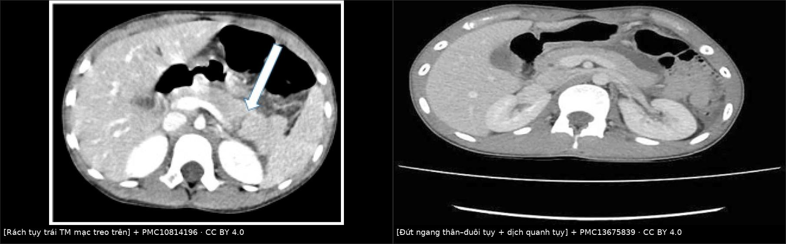
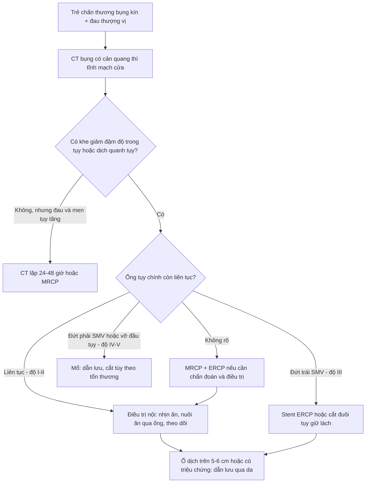
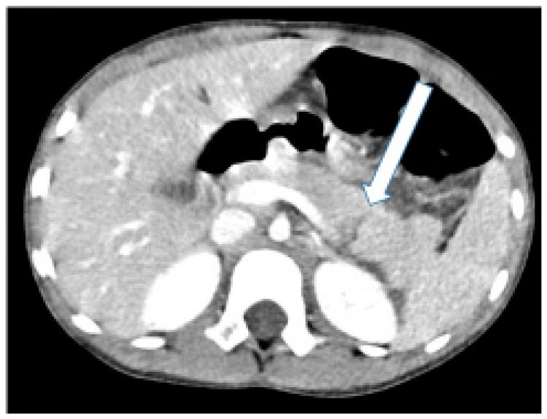
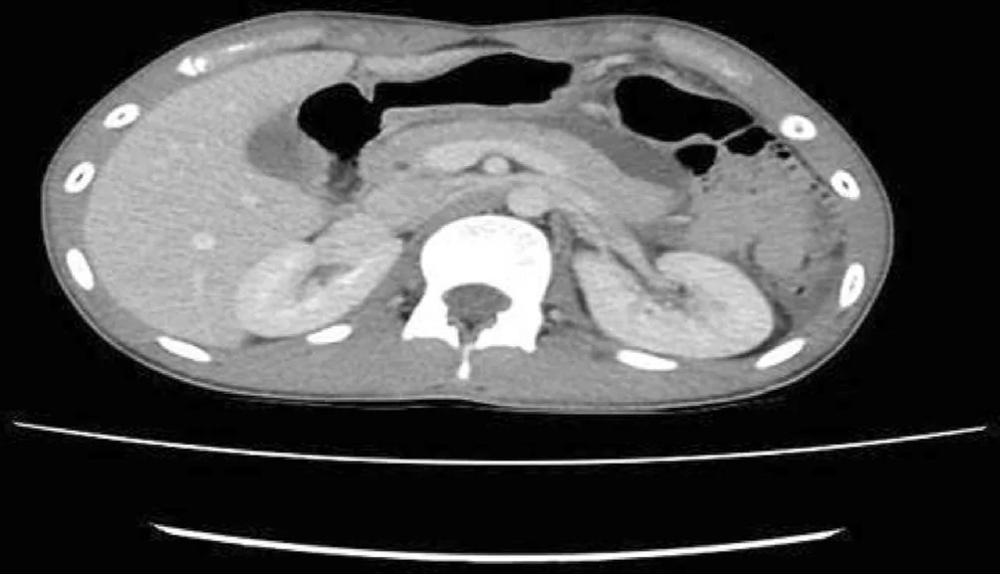

# 3145 — Chấn thương tụy kín ở trẻ: CT sớm có thể âm tính, đứt ống tụy và khi nào mổ / Blunt pancreatic trauma in children

**Tags:** `pattern:rach-nhu-mo` `pattern:dut-tang` `pattern:tu-dich-quanh-tuy` `pattern:gia-nang-tuy` `vung:tuy` `vung:o-bung` `protocol:CT-bung-can-quang` `protocol:MRCP` `protocol:ERCP` `score:AAST`

**Mức chắc chắn (certainty):** tổng hợp y văn (literature synthesis) — số liệu lấy từ **tổng quan + ca minh hoạ** *Children (Basel)* 2024 (**PMC10814196**, CC BY 4.0), **ca có đối chiếu mổ** *Clin Case Rep* 2026 (**PMC13675839**, CC BY 4.0), **tổng quan hệ thống về men tụy** *Eur J Trauma Emerg Surg* 2026 (**PMC13388524**, CC BY), và các loạt bệnh nhi được trích trong hai bài trên (Zhang 51 trẻ; Gong 31 trẻ; Ibrahim 28 trẻ; Rosenfeld 21 trẻ; Phelan 206 trẻ; Kopljar gộp 42 nghiên cứu/1.754 trẻ). Ảnh minh hoạ lấy từ 2 ca nhi có đủ giấy phép CC BY 4.0.

> **Câu chốt:** trẻ **ngã đạp xe/ xe máy đâm tay lái vào thượng vị**, đau nhiều nhưng **CT đầu tiên có thể chỉ là "tụy hơi phù, ít dịch"**, men tụy chỉ tăng nhẹ — và 2–4 tuần sau xuất hiện **giả nang tụy**. Chìa khoá không phải "có khối hay không" mà là **ống tụy chính còn liên tục hay đã đứt**: CT chỉ đạt **độ nhạy 38–61%** cho tổn thương ống tụy chính ở trẻ, nên **CT âm tính không loại trừ** và **vị trí đứt so với tĩnh mạch mạc treo trên (SMV) quyết định mổ hay không mổ**.

## 1. Tổng quan bệnh học – cơ chế hình ảnh

### 1.1 Vì sao tụy trẻ dễ tổn thương kiểu "tay lái đâm"

1. **Tụy nằm trước cột sống, sau phúc mạc** — không có lớp cơ hay xương che chắn; khi lực ép từ trước ra sau, tụy bị **kẹp giữa vật đâm và cột sống** (cơ chế "crush").
2. **Lồng ngực trẻ thấp, khung sườn mềm, ít mỡ quanh tụy** → lực truyền trực tiếp vào tụy thay vì bị hấp thu; **ít mỡ cũng làm dấu hiệu "phù/mờ mỡ quanh tụy" nghèo nàn hơn người lớn**, nên ảnh dễ trông "bình thường".
3. **Bao tụy trẻ mỏng, đàn hồi kém** → dễ rách nhu mô và **dễ đứt ống tụy chính** tại eo tụy (nơi ống nằm sát mặt sau, mạch máu nuôi ít nhất).
4. **Cơ chế điển hình:** tay lái xe đạp/xe đạp điện, ghi-đông xe máy, dây an toàn, ngã cầu thang — **tay lái/ghi-đông chiếm ~50%** các ca chấn thương tụy kín ở trẻ.

### 1.2 Dịch tễ và ngưỡng định lượng bắt buộc nhớ

| Đại lượng | Con số | Nguồn |
|---|---|---|
| Tỉ lệ trong chấn thương bụng kín ở trẻ | **3–12%** | PMC10814196 |
| Tỉ lệ trong toàn bộ chấn thương nhập viện ở trẻ | **0,2–2%** (góp **0,3%** toàn bộ chấn thương trẻ) | PMC10814196 |
| Tử vong | **4,7–5,3%**, phần lớn do **tổn thương phối hợp** | PMC10814196 |
| Chẩn đoán muộn | Biến chứng/tử vong tới **62%** khi chẩn đoán muộn | WTA 2022, trích trong PMC10814196 |
| **CT cho tổn thương ống tụy chính** | **Độ nhạy 38–61%** | PMC10814196 |
| CT 16 lát / 64 lát (206 trẻ) | **Se 54% / Sp 95%** (16 lát) · **Se 52% / Sp 90%** (64 lát) | Phelan, trích trong PMC10814196 |
| Siêu âm phát hiện chấn thương tụy | **Se 27–96%**; độ chính xác **68%** ở 51 trẻ | Zhang, trích trong PMC10814196 |
| **MRCP** đánh giá ống tụy | **Đúng 100%** ở 11 trẻ (Zhang) và 10 trẻ (Ibrahim); CT **77%** và **93%** | PMC10814196 |
| Men tụy đo **< 90 phút** sau chấn thương | Độ nhạy **thấp** → **không dùng để loại trừ** | PMC13388524 (người lớn) |
| Men tụy đo **> 3–6 giờ**, amylase + lipase phối hợp | **Se 85% / Sp 100%** (một nghiên cứu, người lớn) | PMC13388524 |
| Thất bại điều trị nội (gộp 42 nghiên cứu, 1.754 trẻ) | Thành công **87%**; **giả nang 24,9%** (mổ: 7,4%); **rò tụy 1,0%** (mổ: 7,6%) | Kopljar, trích trong PMC10814196 |
| Giả nang ở nhóm **độ III trở lên** | **95%** (điều trị nội) vs **33,8%** (mổ) | Kopljar |
| Giả nang ở 51 trẻ (Zhang) | **47%** chung — **75%** ở độ cao, **42%** ở độ thấp | PMC10814196 |
| Mốc thời gian ổ dịch quanh tụy | **< 4 tuần = ổ dịch quanh tụy cấp (APFC)**; **≥ 4 tuần có vỏ = giả nang (pseudocyst)** | Phân loại Atlanta sửa đổi 2012 |

### 1.3 TẠI SAO hình ảnh trông như vậy (vật lý + mô bệnh)

| Phương thức | Vì sao có tín hiệu đó | Cái gì bị bỏ sót |
|---|---|---|
| **CT có cản quang, thì tĩnh mạch cửa** | Nhu mô tụy lành ngấm thuốc mạnh (điển hình **80–120 HU**, so với **30–50 HU** trước cản quang); vùng **rách/đứt không ngấm thuốc** → **đường/khe giảm đậm độ 10–30 HU** cắt ngang nhu mô. Dịch quanh tụy **0–20 HU**, máu tụ **40–60 HU**, mỡ **−40…−120 HU** — ba mức này cho biết "dịch — máu — mỡ" | Rách **< 2 mm**, đứt ống **< 1 mm** (dưới độ phân giải); ổ dịch ít bị che bởi dạ dày–tá tràng chứa đầy dịch; **cửa sổ thì quá sớm** (nhu mô chưa ngấm đủ) |
| **Siêu âm** | Tụy trẻ **tăng âm** hơn gan; vùng rách **giảm âm**, ổ dịch **trống âm**, máu tụ **echo hỗn hợp** | Hơi ruột/dạ dày che phủ; **không thấy ống tụy**; phụ thuộc người làm |
| **MRCP (T2 nặng, không cản quang)** | Nước tự do có **T2 rất dài** → dịch và ống tụy **tăng tín hiệu mạnh trên ảnh T2 nặng**; ống tụy chính ở trẻ thường **1–2 mm**, **> 3 mm** được coi là giãn; **đoạn ống mất tín hiệu = đứt**, cộng ổ dịch tại chỗ đứt | Cần trẻ nằm yên (thường phải gây mê nhẹ); ống **rất nhỏ ở trẻ < 3 tuổi**; ống **không giãn** vẫn có thể đứt |
| **ERCP** | Bơm thuốc cản quang vào ống → thấy **chỗ thoát thuốc** và cho điều trị tại chỗ (stent) | Xâm lấn (**viêm tụy sau ERCP**), không đánh giá được nhu mô, không thấy đứt **ngoài tầm với của đầu ống soi** |
| **MRI thường (T1/T2)** | Máu tụ bán cấp **T1 sáng**, phù nhu mô **T2 sáng**, mỡ quanh tụy bị thay bằng dịch | Không cần thiết nếu đã có MRCP; giá trị chính là **đánh giá nhu mô và ổ dịch** |

Điểm mô bệnh quyết định: **đứt ống tụy → dịch tụy tiếp tục tiết vào khoang kín** → ổ dịch **không bao giờ tự khô**, trở thành **giả nang** hoặc **rò tụy ra da** nếu bị dẫn lưu đơn thuần. Ngược lại, **giập/rách nhu mô không đứt ống** tự lành trong **vài tuần** với điều trị nội.

## 2. Mẫu hình + chẩn đoán phân biệt theo vị trí (gamut)

**Mẫu hình trung tâm:** *trẻ chấn thương bụng kín + đau thượng vị/đau lan sau lưng + nôn, có thể có "khoảng tỉnh" rồi đau tăng sau 24 giờ* → **CT có cản quang** → thấy **khe giảm đậm độ trong nhu mô tụy ± dịch quanh tụy**.

- **Theo vị trí tổn thương so với SMV (đây là trục phân loại, không phải mô tả):**
  - **Bên trái SMV (thân–đuôi):** thường gặp nhất; đứt ống ở đây = **độ III**, xử lý được bằng **cắt đuôi tụy giữ lách** hoặc **stent qua ERCP**.
  - **Bên phải SMV / đầu tụy:** **độ IV** (đứt ống phải SMV) và **độ V** (vỡ lớn đầu tụy) — mổ phức tạp, nguy cơ rò cao, cân nhắc **dẫn lưu đơn thuần/damage control** ở trẻ chưa ổn định.
  - **Tổn thương phối hợp theo vị trí:** **tá tràng** (D2–D3 nằm sát đầu tụy, cùng cơ chế ép), **thận trái**, **lách**, **gan**, **mạch mạc treo** — bỏ sót các tạng này là nguyên nhân tử vong chính.
- **Theo thời gian (giả nang "mọc" dần):**
  - **0–48 giờ:** phù tụy ± khe rách ± dịch quanh tụy — **dễ âm tính**.
  - **3–7 ngày:** ổ dịch rõ hơn, có vách, đau + sốt + tăng men.
  - **≥ 4 tuần:** **giả nang** thành thục, có vỏ, khu trú ở thân–đuôi, không có mảnh hoại tử bên trong.
- **Mnemonic "PANCREAS"** cho trẻ đau thượng vị sau chấn thương: **P**seudocyst (giả nang muộn), **A**mylase/lipase (đo muộn mới có giá trị), **N**eighbour organs (tá tràng/thận trái/lách), **C**T sớm, **R**epeat imaging 24–48 giờ, **E**RCP khi nghi đứt ống, **A**AST độ III–V, **S**MV là mốc phân độ.

## 3. Bảng so sánh phân biệt (ma trận đối chiếu)

| Thực thể (entity) | Hình ảnh điển hình | Chốt vào (rule-in) | Chốt loại (rule-out) | Gợi ý xác nhận |
|---|---|---|---|---|
| **Giập/rách tụy không đứt ống (độ I–II)** | Khe giảm đậm độ nông **< 50% độ dày**, không cắt ngang, ít dịch quanh tụy | **Khe nông + ống tụy chính thấy liên tục trên MRCP/CT muộn** + trẻ ổn định | Đứt ngang toàn bộ + ổ dịch lớn tại eo tụy → nghĩ độ III | Điều trị nội + CT/MRCP lặp; giả nang **42%** (nhóm độ thấp) |
| **Đứt ống tụy chính bên trái SMV (độ III)** | **Khe cắt ngang thân–đuôi + dịch quanh tụy tại chỗ đứt**; ống giãn đoạn trước chỗ đứt | **Dịch tụ thành ổ tại eo tụy + ống không thấy đoạn nối** trên MRCP | Chỉ phù tụy lan tỏa, không có ổ dịch khu trú → nghĩ giập đơn thuần | MRCP (Se ~100% trong loạt nhỏ); ERCP thấy **thoát thuốc**; mổ đối chiếu |
| **Đứt ống bên phải SMV / vỡ đầu tụy (độ IV–V)** | Tổn thương **đầu tụy**, dịch quanh tá tràng, có thể kèm **máu tụ sau phúc mạc** | **Đầu tụy mất liên tục + dịch quanh D2–D3** | Tổn thương chỉ ở thân–đuôi → không phải độ IV–V | MRCP + ERCP; CTA loại trừ giả phình ĐM vị–tá tràng |
| **Vỡ tá tràng / máu tụ thành tá tràng** | **Dày thành tá tràng > 4–5 mm**, máu tụ trong lòng, **khí sau phúc mạc** (không phải luôn có) | **Khí ngoài lòng ruột quanh D2–D3 + dịch sau phúc mạc** | Khí tự do trong ổ bụng đơn thuần → nghĩ thủng ruột non khác | CT lát mỏng + đối quang; mổ khi khí sau phúc mạc |
| **Giả nang tụy (≥ 4 tuần)** | Ổ dịch **tròn, vỏ rõ, dịch đồng nhất 0–20 HU**, sát thân–đuôi tụy | **≥ 4 tuần + vỏ + không mảnh hoại tử** | Ổ dịch < 4 tuần, không vỏ → **APFC**, không gọi giả nang | Siêu âm/CT; amylase dịch cao; theo dõi 4–6 tuần trước can thiệp |
| **Hoại tử tụy có vách (WON)** | Ổ **dịch + mảnh đặc không ngấm thuốc** bên trong, vỏ dày | **Mảnh hoại tử trong ổ ≥ 4 tuần** | Dịch đồng nhất, không mảnh → giả nang | MRI/CT; cần nội soi/dẫn lưu chuyên biệt hơn giả nang |
| **Máu tụ quanh tụy đơn thuần** | Khối **40–60 HU**, không ngấm, hình liềm theo khoang | **Đậm độ máu + không có khe nhu mô** | Khe giảm đậm độ **trong** nhu mô + dịch 0–20 HU → tổn thương tụy thật | CT lặp: máu tụ **giảm đậm độ dần**, không tạo ổ dịch tụy |

*Trái: bệnh nhi 6 tuổi — khe giảm đậm độ trong thân tụy **bên trái SMV** (mũi tên), tương ứng **độ III**. Phải: ca **18 tuổi** (người trẻ, không phải bệnh nhi) — **mất liên tục nhu mô thân–đuôi** + dịch quanh tụy, mổ xác nhận **đứt ống tụy chính**. Nguồn: PMC10814196 và PMC13675839, **CC BY 4.0**; ảnh ghép letterbox bằng `tools/make_composite.py`.*

### Hai kiểu "dịch quanh tụy" dễ lẫn trên CT ngang
- **Dịch trong khoang ít mạc (lesser sac):** nằm **giữa dạ dày và tụy**, bờ cong lớn dạ dày bị đẩy ra trước — gợi ý nguồn từ **tụy**.
- **Dịch trong lòng dạ dày–tá tràng:** có **mức hơi–dịch**, thành mỏng, và **thay đổi giữa 2 lát** — bẫy kinh điển khiến ổ dịch "to ra rồi mất" hoặc bị chọc nhầm.
- **Máu tụ sau phúc mạc quanh thận trái:** bờ thận trái mờ, **không có khe trong nhu mô tụy** — hướng tới tổn thương thận/lách hơn là tụy.

## 4. Protocol chụp + hệ phân độ AAST

### 4.1 Chọn phương thức theo câu hỏi lâm sàng

| Bước | Việc làm | Ngưỡng/thông số cụ thể |
|---|---|---|
| 1 | **CT bụng–khung chậu có cản quang** ngay khi nghi (không chờ men tụy) | thì **tĩnh mạch cửa 60–70 giây**, lát **≤ 1–1,5 mm**, tái tạo mỏng; liều theo **ALARA**, không cần thì động mạch trừ khi nghi mạch máu |
| 2 | CT **âm tính nhưng vẫn đau/tăng men** | **CT lặp 24–48 giờ** hoặc **MRCP** — không xuất viện chỉ vì CT đầu bình thường |
| 3 | **MRCP** khi CT không thấy ống tụy | ảnh **T2 nặng (SSFSE/HASTE)**, không cản quang; ống tụy chính bình thường **1–2 mm**, giãn **> 2–3 mm** là bất thường |
| 4 | **ERCP** khi nghi đứt ống và trẻ ổn định | vừa chẩn đoán vừa **đặt stent**; trong loạt 31 trẻ, ERCP chẩn đoán đúng **86%** so với **61%** của phân độ trên hình ảnh |
| 5 | **Theo dõi ổ dịch** | siêu âm/CT lặp; **can thiệp khi ổ > 5–6 cm, có triệu chứng, hoặc tăng kích thước** — ưu tiên **dẫn lưu qua da** |

### 4.2 Phân độ AAST (bản 2018) — mốc là **SMV**

| Độ | Tổn thương | Ý nghĩa điều trị ở trẻ |
|---|---|---|
| **I** | Giập nhẹ / rách nông, **không tổn thương ống** | Điều trị nội |
| **II** | Giập lớn / rách lớn, **không tổn thương ống, không mất mô** | Điều trị nội, theo dõi ổ dịch |
| **III** | **Đứt/ rách có tổn thương ống tụy chính BÊN TRÁI SMV** | **Cắt đuôi tụy giữ lách** hoặc **stent ERCP**; điều trị nội có kiểm soát cũng chấp nhận được (giả nang **95%**) |
| **IV** | **Đứt/ tổn thương ống BÊN PHẢI SMV** (hoặc tổn thương liên quan bóng Vater) | Mổ: dẫn lưu ± cắt đầu tụy tùy mức tổn thương; nguy cơ rò cao |
| **V** | **Vỡ lớn đầu tụy** | Mổ phức tạp, ưu tiên **damage control** ở trẻ chưa ổn định |

### 4.3 Điều trị nội (NOM) — khung thực hành
- **Nhịn ăn ngắn + nuôi ăn qua ống mũi–hỗng tràng** sớm (không cần nhịn ăn kéo dài), dịch tĩnh mạch, giảm đau; **octreotide không có bằng chứng mạnh** ở trẻ — không dùng thay thế theo dõi.
- **Theo dõi men tụy mỗi 24–48 giờ** trong tuần đầu, nhưng **quyết định dựa trên lâm sàng + hình ảnh**, không dựa con số men.
- **Dẫn lưu qua da** khi ổ dịch lớn/có triệu chứng; sau đó **theo dõi rò tụy** — **rò tụy gặp 1,0% ở nhóm nội** so với **7,6% ở nhóm mổ** (Kopljar).
- **NOM thành công 87%** nhưng **giả nang 24,9%** — giải thích trước cho gia đình rằng "khỏi không có nghĩa là không cần chụp lại".

## 5. Biến thể bình thường và cạm bẫy

- **CT sớm âm tính không loại trừ** — đây là cạm bẫy số 1: độ nhạy cho tổn thương ống chỉ **38–61%**, và **thời điểm chụp < 6 giờ** làm ổ dịch chưa đủ lớn để thấy. Cách tránh: **hẹn chụp lại 24–48 giờ** nếu lâm sàng không khớp.
- **Men tụy bình thường/ tăng nhẹ** không loại trừ: đo **< 90 phút** có độ nhạy thấp; men **có thể bình thường trong đứt ống đơn thuần** (dữ liệu người lớn, PMC13388524) — không dùng để quyết định cho về.
- **"Có dịch quanh tụy" ≠ "phải mổ"**: dịch ít ở trẻ ổn định, không có khe nhu mô, thường chỉ cần theo dõi. Ngược lại **dịch lớn khu trú tại eo tụy** là dấu hiệu gián tiếp mạnh của đứt ống.
- **Dẫn lưu ổ dịch trước 4 tuần**: chọc/dẫn lưu một **APFC** chưa có vỏ dễ tạo **rò tụy kéo dài**; chờ **≥ 4 tuần** nếu trẻ ổn định và ổ dịch không chèn ép.
- **Bẫy mặt cắt:** "ổ dịch" ngay trước tụy có thể là **dạ dày chứa đầy dịch**; kiểm tra bằng **mức hơi–dịch** và **thay đổi giữa các lát**. Tương tự, **máu tụ sau phúc mạc** quanh thận trái không được đọc thành tổn thương tụy.
- **Bỏ sót tổn thương phối hợp (satisfaction of search):** đã thấy khe tụy là dừng lại → bỏ **vỡ tá tràng**, **tổn thương thận trái**, **mạch mạc treo**. Tử vong **4,7–5,3%** chủ yếu do các tổn thương này.
- **Phân độ trên hình ảnh chỉ đúng 61%** so với mổ (Gong) — nếu hình ảnh và lâm sàng lệch, **MRCP/ERCP** đáng giá hơn tranh luận trên CT.
- **Phản biện (fidelity):** MRCP **nhìn ống tốt hơn CT** nhưng trong loạt 21 trẻ của Rosenfeld, **điểm tổng hợp "ống còn nguyên vẹn" của MRCP không vượt CT** (62% vs 38%, p không ý nghĩa) — nên MRCP là **bổ sung**, không phải "chuẩn vàng thay thế" cho mọi ca; và **MRCP 100%** chỉ đến từ các loạt rất nhỏ (10–11 trẻ), dễ thổi phồng độ chính xác thật.
- **Không gọi "giả nang" khi chưa đủ 4 tuần** và **không mặc định giả nang = WON**: WON có mảnh hoại tử bên trong, xử trí khác.

## 6. Tự lượng giá — Blind Quiz

**Ca 1 — Bệnh nhi 6 tuổi, ngã xe đạp 24 giờ trước, đau thượng vị trái, mạch 140 lần/phút, amylase 815 U/L và lipase 808 U/L. Nhìn CT trước khi đọc đáp án.**

- Câu hỏi: (1) Có bao nhiêu ổ tổn thương nhu mô tụy và nằm bên nào của SMV? (2) Nêu 3 chẩn đoán phân biệt cho hình ảnh này. (3) Dấu hiệu nào trên ảnh khiến phải nghĩ tới **đứt ống tụy chính** thay vì chỉ giập?

<b>Bấm để hiện đáp án (findings + chẩn đoán)</b>

- **Findings:** một **khe giảm đậm độ** cắt vào thân tụy **bên trái tĩnh mạch mạc treo trên** (mũi tên trắng), bờ nhu mô quanh khe **mất ngấm thuốc**, kèm **dịch quanh tụy**; không thấy ống tụy chính đi qua vùng khe trên lát này.
- **Chẩn đoán:** **chấn thương tụy kín, nghi đứt ống tụy chính bên trái SMV = độ III AAST**. Khe cắt ngang + dịch khu trú tại eo tụy là hai dấu hiệu gián tiếp mạnh nhất trên CT; **CT chỉ đạt Se 38–61%** cho tổn thương ống nên **cần MRCP/ERCP** để chốt.
- **Phân biệt:** (1) giập tụy không đứt ống (độ I–II) — khe nông, ống thấy liên tục; (2) máu tụ quanh tụy — 40–60 HU, không có khe trong nhu mô; (3) vỡ tá tràng/máu tụ thành tá tràng — khí sau phúc mạc, dày thành D2–D3.
- **Diễn tiến ca gốc:** ngày 2 sau nhập viện xuất hiện **sốt 38,3 °C, nôn, tăng chỉ số viêm**; siêu âm thấy **ổ dịch 3,7 × 4,5 × 5,1 cm có nhiều vách** ở đuôi tụy → **cắt đuôi tụy nội soi + cắt lách**, sau mổ có **rò tụy** phải dẫn lưu, rút dẫn lưu sau 25 ngày, theo dõi 12 tháng không tái phát.
- **Nguồn ảnh:** *Children (Basel)* 2024, **PMC10814196**, Hình 1 (nguyên bản) — **CC BY 4.0**.

**Ca 2 — Nam 18 tuổi (người trẻ, không phải bệnh nhi), chấn thương bụng kín, nhịp tim nhanh dai dẳng dù bụng mềm. CT bụng có cản quang:**

- Câu hỏi: (1) Mô tả chỗ mất liên tục nhu mô? (2) Có dịch quanh tụy không? (3) Bước tiếp theo: theo dõi, MRCP hay mổ?

<b>Bấm để hiện đáp án (findings + chẩn đoán)</b>

- **Findings:** **mất liên tục nhu mô thân–đuôi tụy** với khe giảm đậm độ rộng, **dịch quanh tụy**; không thấy ống tụy chính bắc qua chỗ đứt.
- **Chẩn đoán:** **đứt ngang thân–đuôi tụy, nghi tổn thương ống tụy chính (độ III AAST)** — mổ thăm dò xác nhận **đứt ống**, xử trí **cắt đuôi tụy giữ lách**; theo dõi 6 tháng không rò, không suy tụy ngoại tiết.
- **Bước tiếp theo:** trẻ/người trẻ **ổn định** → **MRCP** để chốt ống rồi cân nhắc **ERCP stent**; **nhịp tim nhanh dai dẳng + nghi đứt ống** là lý do chính đáng để **mổ sớm** thay vì chờ thêm hình ảnh — ca gốc chọn mổ vì không thể chụp ống tụy chuyên biệt mà không trì hoãn phẫu thuật.
- **Nguồn ảnh:** *Clin Case Rep* 2026, **PMC13675839**, Hình 1 (nguyên bản) — **CC BY 4.0**; **ca người trẻ 18 tuổi**, dùng minh hoạ mẫu hình CT, không gán cho bệnh nhi.

## Bài liên quan chéo
- [6135 – Viêm tụy cấp ở trẻ: ngưỡng chẩn đoán và khi nào chụp](../6135-viem-tuy-cap-o-tre/lesson.md) (phân biệt viêm tụy *tự phát* với chấn thương; mốc 4 tuần của ổ dịch)
- [6171 – Viêm tụy cấp do asparaginase](../6171-viem-tuy-cap-do-asparaginase-tre-all/lesson.md) (cùng ngưỡng giả nang ≥ 4 tuần, khác cơ chế)
- [6121 – Rò tụy sau mổ tụy ở trẻ](../6121-ro-tuy-sau-mo-tuy-o-tre/lesson.md) (biến chứng của nhóm phải mổ)
- [6122 – Giả phình động mạch tạng sau viêm tụy/chấn thương tụy](../6122-gia-phinh-dong-mach-tang-sau-viem-tuy-o-tre/lesson.md) (biến chứng chảy máu muộn — "sentinel bleed")
- [1860 – Chấn thương lách ở trẻ](../1860-chan-thuong-lach-tre-em/lesson.md) (cùng cơ chế tay lái, cùng nguyên lý điều trị nội)
- [1891 – Chấn thương thận kín ở trẻ](../1891-chan-thuong-than-kin-o-tre/lesson.md) (phân biệt máu tụ sau phúc mạc quanh thận trái)
- [6179 – Viêm xương tủy cấp ở trẻ](../6179-viem-xuong-tuy-cap-o-tre/lesson.md) (bài mẫu về "hình ảnh sớm âm tính không loại trừ")

> Không dùng để chẩn đoán độc lập khi chưa có người hướng dẫn.
