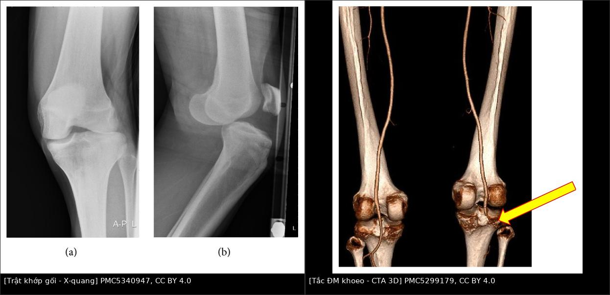
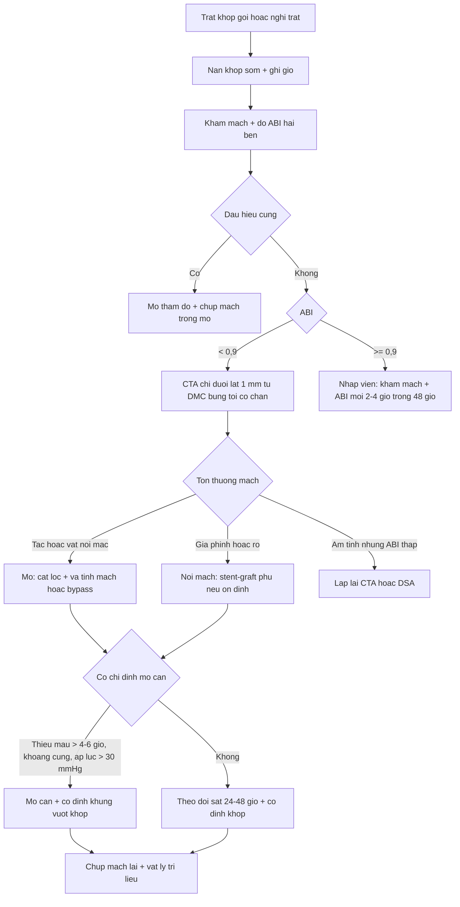
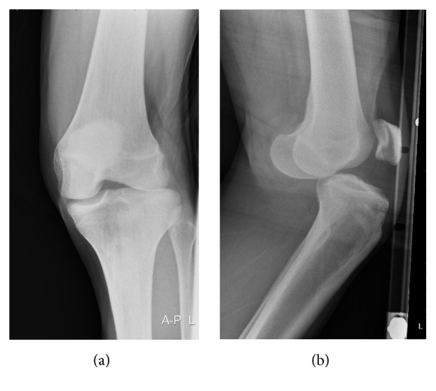
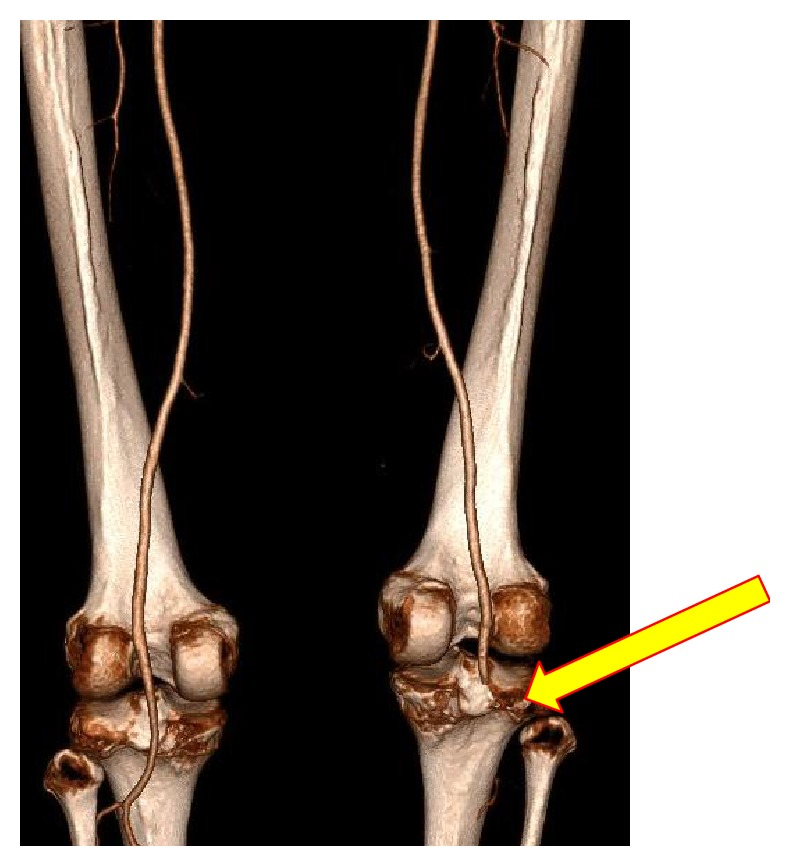
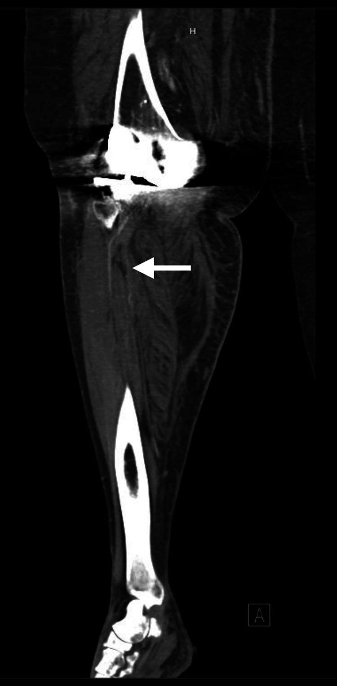
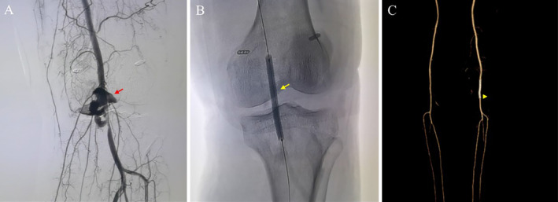

# 3146 — Chấn thương động mạch khoeo sau trật khớp gối / Popliteal artery injury after knee dislocation

**Tags:** `pattern:mat-mach-chi-duoi` `pattern:tac-mach` `pattern:gia-phinh-dong-mach` `pattern:trat-khop` `vung:khop-goi` `vung:khoeo` `protocol:CTA` `protocol:DSA` `protocol:ABI` `score:ABI` `score:Schenck`

**Mức chắc chắn (certainty):** tổng hợp y văn (literature synthesis) — ghép 4 nguồn mở: (a) bài tổng quan trật khớp gối + tiếp cận mạch chọn lọc (**Douma MR, Burg MD, Dijkstra BL**, *Case Rep Emerg Med* 2017, PMC5340947, **CC BY 4.0**); (b) ca tắc ĐM khoeo do rách nội mạc sau trật khớp gối hai bên (**Godfrey AD, Hindi F, Ettles C, Pemberton M, Grewal P**, *Case Rep Surg* 2017, PMC5299179, **CC BY 4.0**); (c) ca trật khớp gối trên khớp nhân tạo tái phát + CTA bị nhiễu (**Smith TJ, Whetstone D**, *Cureus* 2025, PMC12551768, **CC BY 4.0**); (d) tổng quan đa chấn thương dây chằng – mạch (**Hantes M** et al., *EFORT Open Rev* 2026, PMC13150330, **CC BY-NC 4.0**) + đoàn hệ 17.000 ca nội soi khớp (**Xu Z** et al., *Orthop Surg* 2025, PMC11872355, **CC BY 4.0**). Số nào nguồn không đưa thì ghi "chưa rõ".

> **Bài này trả lời 4 câu hỏi của ca "trật khớp gối, chân lạnh nhưng vẫn bắt được mạch mu chân":**
> (1) **Vì sao ĐM khoeo bị rách khi khớp trật mà mạch ngoại vi vẫn còn?** (2) **ABI 0,9 là ngưỡng gì — ai được chờ, ai phải chụp mạch ngay?** (3) **CTA đọc gì, và vì sao "CTA âm" chưa phải là hết chuyện?** (4) **Cửa sổ vàng để tái thông là bao lâu, khi nào phải mở cân?**
> Đây là mặt **mạch máu của khớp gối**; mặt **dây chằng – sụn chêm** ở [360 – MRI khớp gối](../360-mri-khop-goi-day-chang-sun-chem/lesson.md), mặt **mạch lớn ở chi** ở [3107 – Đứt động mạch dưới đòn](../3107-dut-dong-mach-duoi-don/lesson.md) và [3095 – Tổn thương động mạch đùi sau can thiệp](../3095-ton-thuong-dong-mach-dui-sau-can-thiep-noi-mach-tre/lesson.md).

## 1. Tổng quan bệnh học – cơ chế hình ảnh

### 1.1 Giải phẫu: vì sao đúng đoạn này bị kéo đứt

- ĐM khoeo đi từ **lỗ cơ khép (adductor hiatus)** xuống **cung cơ dép (soleal arch)** rồi chia **ĐM chày trước + thân chày–mác**. Hai đầu **bị cố định** vào cân/cơ, còn đoạn giữa **bắc ngang khớp gối** như một sợi dây căng giữa hai cọc.
- Khi **lồi cầu xương đùi trượt khỏi mâm chày** (trật khớp gối), hai điểm cố định bị **kéo xa nhau 1–2 cm trong vài mili-giây** → mạch đàn hồi bị **căng quá giới hạn**: tổn thương hay gặp nhất là **rách nội mạc (intimal tear)**, tiếp đến **đứt toàn thành**, **giả phình**, **rò động–tĩnh mạch**. Trong ca PMC5299179, vạt nội mạc dài **1,5 cm** + huyết khối lấp lòng; ca PMC5340947 chỉ rách dây chằng, mạch nguyên.
- **Vì sao mạch mu chân vẫn bắt được:** quanh gối có **5 ĐM gối (genicular)** nối ĐM đùi với ĐM khoeo dưới chỗ tắc; tuần hoàn bàng hệ này **đủ để duy trì mạch ngoại vi một thời gian** nhưng **không đủ nuôi chi lâu dài** (PMC5340947). Vì vậy **mạch còn ≠ mạch lành**.
- **Vì sao tổn thương "âm thầm" trên hình ảnh ban đầu:** vạt nội mạc **chưa tắc ngay**; dòng máu vẫn qua được lòng thật hẹp → CTA/ABI có thể bình thường, rồi **huyết khối lan trên vạt trong 2–4 ngày** (PMC13150330). Đây là lý do phải **khám lại + đo ABI lại** chứ không chỉ dựa vào phim đầu.

### 1.2 Số liệu định lượng bắt buộc nhớ

| Đại lượng | Con số | Nguồn |
|---|---|---|
| Trật khớp gối / toàn bộ chấn thương chỉnh hình | **0,02–0,2%** (khớp: **< 0,5%** ca trật khớp) | PMC13150330; PMC12551768 |
| Tổn thương mạch trong trật khớp gối | trung bình **18,4%**, cao tới **33%**; tùy kiểu trật **7–64%**; riêng **ĐM khoeo 32–45%** | PMC13150330; PMC5340947 |
| Bệnh nhân **có mạch** mà vẫn tổn thương ĐM | **27%** ca tổn thương ĐM xác nhận có mạch rõ; độ nhạy khám mạch chỉ **80%**; **4%** ca mạch bình thường sau nắn vẫn có tổn thương ĐM | PMC13150330; PMC12551768 |
| **ABI < 0,9** | **100%** ca ABI < 0,9 có tổn thương ĐM; **0%** ca ABI ≥ 0,9 có tổn thương; độ nhạy **95–100%**, NPV **99%** | PMC12551768 (Mills 2004); PMC13150330 |
| Cửa sổ tái thông | cắt cụt **86%** nếu thiếu máu **> 8 giờ**; cắt cụt **6%** (< 60 phút) · **11,7%** (1–3 giờ) · **13,4%** (3–6 giờ) | PMC12551768 (Green 1977; Alarhayem 2019) |
| Mổ tái thông ĐM khoeo | cắt cụt **30%**; kèm tổn thương **tĩnh mạch 60%**, **gãy xương 50%**, **thần kinh 50%** | PMC5299179 |
| Chụp mạch xâm lấn | **âm tính giả 4%**, **dương tính giả 2,4–7%**; CTA: độ nhạy/đặc hiệu **~100%** cho tổn thương có ý nghĩa | PMC5340947 |
| Thần kinh kèm theo | **16–40%**; liệt **thần kinh mác chung 25–40%** | PMC12551768; PMC13150330 |
| Tổn thương ĐM khoeo do **nội soi khớp** (bệnh viện đa trung tâm) | **0,059%** (10/17.000 ca), **80%** phát hiện ngay trong mổ | PMC11872355 |
| Khoảng cách ĐM khoeo – dây chằng chéo sau trên MRI | **5,4 ± 2,1 mm** ở gối duỗi 0°, **7,8 ± 3,6 mm** ở gối gấp 90° | PMC11872355 |
| Trật khớp gối trên khớp nhân tạo (TKA) | **0,15–0,5%** ca TKA; tổn thương mạch kèm theo **~5%**; tái trật **39,1%** nếu chỉ điều trị bảo tồn | PMC12551768 |

- **Hệ quả cho thực hành:** ngưỡng sinh tử là **giờ**, không phải ngày; mọi bước (nắn, ABI, CTA, mổ) phải ghi **giờ** vào hồ sơ. Trong ca PMC5299179, bệnh nhân vào viện **1 giờ** sau chấn thương, ABI **0,9 vs 0,3**, lên bàn mổ **18:30** cùng ngày.

## 2. Mẫu hình + chẩn đoán phân biệt theo cơ chế và vị trí (Gamut)

- **Theo cơ chế:** **trật khớp gối thật** (thường tự nắn trước khi tới viện) · **gãy – trật quanh gối** (gãy mâm chày, đầu dưới xương đùi) · **chấn thương đụng dập trực tiếp** hố khoeo · **y sinh** (nội soi khớp, khoan đường hầm chày, cắt nang khoeo, TKA).
- **Theo hình thái tổn thương mạch:** **rách nội mạc → huyết khối** (hay gặp nhất, "âm thầm") · **đứt toàn thành** (chảy máu, mất mạch tức thì) · **giả phình** (khối đập, xuất hiện muộn) · **rò động – tĩnh mạch** (tiếng thổi liên tục) · **co thắt** (thoáng qua, không được mổ chỉ vì co thắt).
- **Gamut "mất mạch chi dưới sau chấn thương gối" — gợi nhớ KNEE:**
  - **K**nee dislocation with popliteal injury (bài này) — **mất mạch + trật khớp**, ABI < 0,9.
  - **N**erve injury only (thần kinh mác chung) — **bàn chân rớt, tê mu chân nhưng mạch đều**; đừng quy mọi thiếu hụt cho mạch.
  - **E**xtravasation / giả phình — CTA có **túi đối quang**; có thể **mạch vẫn đều**.
  - **E**dema – chèn ép khoang (compartment syndrome) — **đau tăng khi duỗi thụ động**, khoang căng; mạch có thể còn.
  - **C**ompensated collateral flow (bàng hệ gối) — **mạch còn dù mạch đã tắc**, đây là bẫy số 1.
- **Theo vị trí tổn thương:** **P1 (trên khớp)** – sát lỗ cơ khép; **P2 (sau khớp)** – ngang lồi cầu, **đoạn hay bị kéo nhất**; **P3 (dưới khớp)** – trên nguyên ủy ĐM chày trước, nơi vạt nội mạc dễ bị bỏ sót khi đọc CTA.

## 3. Bảng so sánh phân biệt (ma trận đối chiếu)

| Thực thể (entity) | Hình ảnh điển hình (XR/CTA/DSA) | Chốt vào (rule-in) | Chốt loại (rule-out) | Gợi ý xác nhận |
|---|---|---|---|---|
| **Tắc ĐM khoeo do rách nội mạc** | CTA: **cụt thuốc / không ngấm thuốc** đoạn P2–P3, **vạt nội mạc** trên MPR; DSA: hình "cụt đầu" | **Mất ngấm thuốc + ABI < 0,9 + trật khớp gối** | Mạch ngấm đủ tới cổ chân + ABI ≥ 0,9 → không tắc | CTA 1 mm + MPR; DSA khi can thiệp |
| **Đứt toàn thành ĐM khoeo** | **Thoát thuốc tự do**, máu tụ hố khoeo lan nhanh, mất mạch | **Thoát thuốc + mất mạch + máu tụ to** | Có dòng liên tục qua đoạn hẹp → chỉ rách nội mạc | CTA khẩn; mổ ngay nếu không ổn định |
| **Giả phình ĐM khoeo** | **Túi đối quang có cổ**, giữ thuốc thì muộn; có thể thấy **khối 61,4 × 35,9 mm** quanh mạch (PMC11872355) | **Túi + cổ + đậm độ thì muộn** | Không túi, chỉ phù/máu tụ không ngấm → không phải giả phình | CTA thì động–tĩnh mạch; DSA ± stent-graft |
| **Rò động – tĩnh mạch** | **Tĩnh mạch ngấm thuốc sớm** thì động mạch, tĩnh mạch nông giãn | **Ngấm thuốc tĩnh mạch sớm + tiếng thổi** | Không có ngấm sớm → loại | DSA, đo bão hòa O₂ tĩnh mạch |
| **Co thắt mạch (vasospasm)** | Hẹp **dài, đều, nhẵn**, hồi phục sau thuốc giãn mạch | **Hẹp nhẵn + hồi phục + không rách nội mạc** | Có vạt/huyết khối → tổn thương thực thể | DSA + nitrate; không mổ chỉ vì co thắt |
| **Chèn ép khoang cấp** | CTA mạch **có thể bình thường**; MRI: phù cơ, hoại tử muộn | **Đau – căng khoang, ΔP = HA tâm trương − áp lực khoang < 30 mmHg** | Không căng, không đau thụ động → loại | Đo áp lực khoang; mở cân |
| **Chỉ tổn thương thần kinh (mác chung)** | Mạch **đều**, không thiếu máu; **bàn chân rớt** | **Mạch đều + ABI ≥ 0,9 + thiếu hụt theo phân bố thần kinh** | Mất mạch/ABI thấp → nghĩ mạch trước | Khám thần kinh; MRI thần kinh khi ổn định |
| **Tổn thương do nội soi khớp** | Máu tụ hố khoeo, **giả phình** sau mổ nội soi; 80% phát hiện trong mổ | **Tiền sử nội soi + sưng/giảm mạch trong 24 giờ** | Không liên quan thủ thuật → cơ chế khác | CTA; DSA ± stent-graft (ca PMC11872355) |

*Trái: trật khớp gối trước–ngoài, X-quang thẳng và nghiêng (PMC5340947). Phải: CTA 3D nhìn sau — **ĐM khoeo phải tắc** (mũi tên vàng) trong khi bên trái thông (PMC5299179). Nguồn: Case Rep Emerg Med 2017 + Case Rep Surg 2017, CC BY 4.0. Ảnh ghép letterbox, không crop.*

## 4. Protocol chụp + phân độ + ngưỡng can thiệp

### 4.1 Trình tự 60 phút đầu (nắn trước – chụp sau)

1. **Nắn khớp gối sớm** (giảm đau ± an thần), ghi **giờ nắn**; nắn xong **khám mạch lại ngay** và **đo ABI hai bên**. Trật khớp chưa nắn làm mạch bị kéo tiếp và gây chèn ép.
2. **Dấu hiệu CỨNG** → không chờ CTA: **mất mạch, chảy máu phun, máu tụ lan nhanh, tiếng thổi/rung miu, hội chứng 6P** (pain, pallor, pulseless, paresthesia, paralysis, perishing cold) → **mổ thăm dò + chụp mạch trong mổ** (PMC5340947).
3. **Không có dấu hiệu cứng** → **ABI**: **< 0,9 → CTA khẩn**; **≥ 0,9 → nhập viện theo dõi, khám mạch + ABI lại mỗi 2–4 giờ trong 48 giờ** (vì vạt nội mạc có thể tắc sau 2–4 ngày). Ca PMC5340947 đã bỏ bước ABI và suýt trả giá bằng một "khoảng trống quy trình".
4. **CTA chi dưới**: bơm **80–120 mL** cản quang, tốc độ **3–4 mL/s**, **bolus tracking** ở ĐMC bụng, lát **≤ 1 mm**, phủ **từ ĐMC bụng/chậu tới cổ chân** (không chỉ "CTA khớp gối"), dựng **MPR cong (curved planar)** theo trục mạch + **MIP/3D**. Đọc **P1–P3**, tìm **vạt nội mạc, cụt thuốc, túi giả phình**, và **đối chiếu phim scout** (trật khớp có thể chỉ thấy trên scout — đúng ca PMC12551768).
5. **Nghi giả phình/rò hoặc CTA không kết luận** → **DSA** (chẩn đoán + điều trị): đặt **stent-graft phủ** nếu tổn thương khu trú và bệnh nhân ổn định; ca PMC11872355 dùng **Viabahn** cho giả phình ĐM khoeo sau nội soi.

### 4.2 Ngưỡng và lựa chọn điều trị

- **Cửa sổ vàng:** tái thông **càng sớm càng tốt**; sau **6–8 giờ** tỷ lệ cắt cụt tăng vọt (**86%** nếu > 8 giờ — Green 1977). Ghi **giờ thiếu máu** (từ lúc mất mạch) chứ không phải giờ nhập viện.
- **Mổ hở là chuẩn** cho đứt/rách nội mạc: **cắt lọc nội mạc + vá tĩnh mạch tự thân** hoặc **ghép đoạn/ bypass tĩnh mạch hiển**; **hút huyết khối đơn thuần không đủ** (tới **71%** phải làm lại/bypass — PMC5299179).
- **Nội mạch** (stent-graft phủ) hợp với **giả phình/rò** ở bệnh nhân ổn định, tổn thương khu trú, đường kính mạch đủ lớn; **không** dùng khi nhiễm trùng tại chỗ, mất mạch kèm sốc, hoặc mạch quá nhỏ (trẻ nhỏ).
- **Mở cân (fasciotomy)** khi: **thiếu máu > 4–6 giờ**, **sốc trước mổ**, **khoang cứng khi sờ**, **giảm cảm giác/vận động**, **áp lực khoang > 30 mmHg**, **đau không tương xứng** (PMC5299179). Trong ca đó, vì thiếu máu ngắn và khoang mềm, ê-kíp **đóng da thì đầu nhưng để sẵn chỉ để mở lại**.
- **Cố định khớp bằng khung vượt khớp (knee-spanning external fixator)** khi: **có tổn thương mạch đã sửa**, trật khớp hở, gãy–trật, mô mềm nặng, hoặc mất vững dai dẳng; tái tạo dây chằng thường **hoãn 3–6 tuần** (PMC13150330). Ca PMC12551768 tái trật ngay sau mổ vì khớp chưa được cố định đủ.

### 4.3 Phân độ dùng trong chấn thương gối

- **Schenck KD (knee dislocation)**: **KD I** – trật chỉ gây rách 1 dây chằng chéo + 1 dây chằng bên; **KD II** – rách 2 chéo, dây bên còn; **KD III** – rách 2 chéo + 1 bên (M = MCL, L = LCL); **KD IV** – rách cả 4; **KD V** – gãy–trật. Bổ sung **"–EM"** khi có tổn thương cơ chế duỗi (gân tứ đầu/bánh chè) — Delphi 2025 đồng thuận ưu tiên sửa EM thì đầu, hoãn tạo hình dây chằng (PMC13150330).
- **ABI** không phải "phân độ" nhưng là **ngưỡng quyết định**: **< 0,9 = bất thường**; **≥ 0,9** vẫn phải theo dõi vì độ nhạy của khám mạch chỉ **80%** và **27%** ca tổn thương ĐM vẫn có mạch rõ.
- **Không có RADS** cho chấn thương mạch; dùng mô tả **giải phẫu P1–P3 + hình thái tổn thương** (rách nội mạc, đứt, giả phình, rò) trong phiếu — vì mỗi hình thái có chỉ định khác nhau.

## 5. Biến thể bình thường và cạm bẫy

- **Biến thể bình thường 1 — ĐM khoeo chia cao (type 2 Kim–Orron–Skillman): 1,2–7,8%** — ĐM chày trước tách **ngay trên khớp**, nên "không thấy ĐM khoeo bình thường" không có nghĩa là tắc; tìm nhánh tách cao và chạy MPR theo từng nhánh (PMC11872355).
- **Biến thể bình thường 2 — bàng hệ gối phong phú:** mạch mu chân **vẫn bắt được** dù ĐM khoeo đã tắc; đừng dùng "mạch còn" để loại trừ (PMC5340947).
- **Cạm bẫy 1 — trật khớp đã tự nắn:** hình X-quang bình thường, bệnh nhân chỉ đau gối; cơ chế **"trật rồi tự nắn"** vẫn gây tổn thương mạch như trật còn nguyên. Hỏi **cơ chế + xem lại ảnh hiện trường**, đừng đợi thấy trật trên phim.
- **Cạm bẫy 2 — vạt nội mạc "âm tính" rồi tắc muộn:** CTA/ABI bình thường lúc đầu, **tắc hoàn toàn sau 2–4 ngày**; nếu bệnh nhân được mổ dây chằng có **garo (tourniquet)**, vạt nội mạc có thể **huyết khối trong mổ**. Luôn khám mạch **trước và sau garo**.
- **Cạm bẫy 3 — nhiễu kim loại/khung cố định + chuyển động:** ca PMC12551768 có **streak artifact che P2–P3** và báo "không tổn thương"; 2 ngày sau trật lại + **tắc mạch**. Đọc **MPR + ảnh nguồn không bị nhiễu**, chụp lại nếu bệnh nhân diễn biến mới.
- **Cạm bẫy 4 — chỉ chụp "CTA khớp gối":** cắt trường chụp ở dưới khớp sẽ **bỏ sót tắc P3/ĐM chày trước**; phải phủ tới **cổ chân** để thấy **runoff**.
- **Cạm bẫy 5 — nhầm giả phình với khối máu tụ/u mô mềm:** giả phình **ngấm thuốc cùng thì động mạch và giữ thuốc thì muộn**, có **cổ**; máu tụ không ngấm. Ca PMC11872355: khối **61,4 × 35,9 mm** trên CTA, chỉ DSA mới xác định rõ giả phình đã vỡ.
- **Cạm bẫy 6 — bỏ sót chèn ép khoang sau tái thông:** mạch thông lại nhưng chi vẫn đau căng; đo áp lực khoang nếu **đau không tương xứng**, **giảm cảm giác**, **khoang cứng**.

## 6. Tự lượng giá — Blind Quiz

**Ca 1 — Nam 22 tuổi, đau gối trái sau khi chạy và xoay người, gối biến dạng. Nhìn phim.**

- Gợi ý lâm sàng: mạch mu chân rõ, Doppler ba pha, cảm giác nguyên vẹn; **chưa đo ABI**.
- Câu hỏi: (1) Chẩn đoán hình ảnh? (2) Bước tiếp theo bắt buộc trước khi cho về? (3) Vì sao "mạch rõ" chưa đủ để yên tâm?

<b>Bấm để hiện đáp án (findings + chẩn đoán)</b>

- **Findings:** X-quang thẳng + nghiêng: **trật khớp gối trước–ngoài, không gãy xương**; mâm chày ra trước và ra ngoài so với lồi cầu đùi.
- **Chẩn đoán:** trật khớp gối (Schenck KD cao) — cần **nắn kín** rồi **đo ABI** và **khám mạch lại**; ABI < 0,9 → CTA.
- **Vì sao mạch rõ chưa đủ:** bàng hệ gối giữ mạch ngoại vi; **27%** ca tổn thương ĐM vẫn có mạch rõ, và vạt nội mạc có thể tắc sau **2–4 ngày** (PMC13150330). Ca gốc bỏ ABI và bỏ khám hố khoeo — đúng lỗi quy trình cần tránh.
- **Nguồn:** Douma MR et al., *Case Rep Emerg Med* 2017, PMC5340947, CC BY 4.0. Ảnh nguyên bản từ bài (Hình 2).

**Ca 2 — Nam 58 tuổi, chấn thương đụng dập hai gối, chân phải lạnh, chỉ bắt được mạch bẹn. Nhìn CTA 3D.**

- Gợi ý lâm sàng: ABI **0,9 (trái) vs 0,3 (phải)**, thiếu hụt cảm giác–vận động dưới gối, đã dùng heparin tĩnh mạch **5.000 IU**.
- Câu hỏi: (1) Tổn thương ở đâu, hình thái gì? (2) Vì sao phải mổ trong vài giờ? (3) Khi nào mở cân?

<b>Bấm để hiện đáp án (findings + chẩn đoán)</b>

- **Findings:** CTA 3D nhìn sau — **ĐM khoeo phải tắc hoàn toàn** ngang khớp (mũi tên vàng), bên trái thông; không thấy cột thuốc qua đoạn tắc. Trong mổ: **vạt nội mạc 1,5 cm + huyết khối** lấp lòng.
- **Chẩn đoán:** **tắc ĐM khoeo do rách nội mạc sau trật khớp gối hai bên (đã tự nắn)**.
- **Vì sao gấp:** tái thông sau **6 giờ** làm cắt cụt tăng từ **6%** lên **13,4%** (3–6 giờ) và **86%** nếu > 8 giờ; ca này vào viện **1 giờ**, mổ **18:30** cùng ngày.
- **Mở cân khi:** thiếu máu > 4–6 giờ, sốc, khoang cứng, giảm cảm giác/vận động, áp lực khoang > 30 mmHg; ca này khoang mềm sau tái thông nên đóng thì đầu nhưng để sẵn chỉ mở lại.
- **Nguồn:** Godfrey AD et al., *Case Rep Surg* 2017, PMC5299179, CC BY 4.0. Ảnh Hình 2.

**Ca 3 — Nữ 71 tuổi, trật khớp gối nhân tạo, CTA đầu tiên "không tổn thương"; 2 ngày sau mất mạch mu chân. Nhìn CTA.**

- Gợi ý lâm sàng: BMI 40,8; ngã trong viện, tự nắn; lần CTA đầu có **streak artifact che P2–P3**; lần hai mất mạch mu chân + giảm cảm giác dưới gối.
- Câu hỏi: (1) Dấu hiệu trên ảnh? (2) Vì sao CTA đầu âm tính? (3) Xử trí và bài học?

<b>Bấm để hiện đáp án (findings + chẩn đoán)</b>

- **Findings:** CTA vành (MIP) chi dưới — **không có cột thuốc trong các mạch runoff** dưới khớp (mũi tên trắng); ảnh scout cho thấy **trật khớp gối ra trước**.
- **Chẩn đoán:** **tắc ĐM khoeo sau trật khớp gối nhân tạo tái phát**.
- **Vì sao CTA đầu âm:** **streak artifact** từ khớp nhân tạo che P2–P3 + khớp đã tự nắn; bệnh nhân **ngã lại** sau khi tháo nẹp → trật + tắc. CTA âm không loại trừ nếu hình bị nhiễu và bệnh cảnh thay đổi.
- **Xử trí:** nắn kín ngay tại giường sau khi thấy trật trên scout; **bypass ĐM đùi nông – chày sau bằng tĩnh mạch hiển đảo**; huyết khối miệng nối phải mổ lại + embolectomy; khung cố định vượt khớp vì tái trật **39,1%** khi chỉ bảo tồn.
- **Bài học:** đọc **scout**, đọc **MPR**, khám mạch lại mỗi 2–4 giờ; đừng để "CTA âm" thay cho khám lâm sàng.
- **Nguồn:** Smith TJ & Whetstone D, *Cureus* 2025, PMC12551768, CC BY 4.0. Ảnh Hình 2.

**Ca 4 — Bệnh nhân sau nội soi khớp gối, sưng hố khoeo, mất mạch mu chân. Nhìn DSA và can thiệp.**

- Câu hỏi: (1) Hình thái tổn thương? (2) Vì sao giả phình chứ không phải máu tụ? (3) Chọn mổ hay nội mạch?

<b>Bấm để hiện đáp án (findings + chẩn đoán)</b>

- **Findings:** (A) DSA — **giả phình ĐM khoeo đã vỡ** (mũi tên đỏ); (B) đặt **stent-graft Viabahn** bắc qua hai đầu mạch; (C) CTA sau mổ — **mạch khoeo thông** (mũi tên vàng).
- **Vì sao giả phình:** túi đối quang **có cổ**, ngấm cùng thì động mạch và **giữ thuốc thì muộn**; khối trên CTA trước mổ đo **61,4 × 35,9 mm**, không phải máu tụ đơn thuần.
- **Chọn nội mạch:** bệnh nhân ổn định, tổn thương khu trú, mạch đủ lớn → **stent-graft phủ** giúp bịt lỗ rò mà không phải mở hố khoeo; vẫn phải theo dõi huyết khối stent.
- **Bài học:** sau nội soi khớp, **sưng hố khoeo + giảm mạch** = CTA/DSA ngay; tỷ lệ tổn thương ĐM khoeo do nội soi **0,059%** nhưng **80%** phát hiện được ngay trong mổ nếu theo dõi mạch.
- **Nguồn:** Xu Z et al., *Orthop Surg* 2025, PMC11872355, CC BY 4.0. Ảnh Hình 5.

## Bài liên quan chéo
- [300 – Tổng quan hệ Cơ – Xương – Khớp](../300-tong-quan-he-co-xuong-khop/lesson.md)
- [360 – MRI khớp gối: dây chằng – sụn chêm](../360-mri-khop-goi-day-chang-sun-chem/lesson.md) (mặt dây chằng của cùng chấn thương)
- [3107 – Đứt động mạch dưới đòn sau chấn thương](../3107-dut-dong-mach-duoi-don/lesson.md) (nguyên lý "mạch còn không loại trừ")
- [3095 – Tổn thương động mạch đùi sau can thiệp nội mạch](../3095-ton-thuong-dong-mach-dui-sau-can-thiep-noi-mach-tre/lesson.md)
- [3125 – Chèn ép khoang cấp ở trẻ](../3125-chen-ep-khoang-cap-o-tre/lesson.md) (ngưỡng ΔP và chỉ định mở cân)
- [080 – Chấn thương ngực](../080-chan-thuong-nguc/lesson.md) (tiếp cận ATLS khi đa chấn thương)

## Ảnh
- `images/3146_dong-mach-khoeo_XR_PMC5340947-F2.jpg` — X-quang thẳng/nghiêng: trật khớp gối trước–ngoài — *Case Rep Emerg Med* 2017, PMC5340947, **CC BY 4.0**.
- `images/3146_dong-mach-khoeo_CTA3D_PMC5299179-F2.jpg` — CTA 3D: tắc ĐM khoeo phải — *Case Rep Surg* 2017, PMC5299179, **CC BY 4.0**.
- `images/3146_dong-mach-khoeo_CTA_PMC12551768-F2.jpg` — CTA vành: mất thuốc ở runoff sau trật khớp gối nhân tạo — *Cureus* 2025, PMC12551768, **CC BY 4.0**.
- `images/3146_dong-mach-khoeo_DSA-stent_PMC11872355-F5.jpg` — DSA giả phình + stent-graft Viabahn + CTA sau mổ — *Orthop Surg* 2025, PMC11872355, **CC BY 4.0**.
- `images/composite_3146_dislo-va-tac-mach.jpg` — ảnh ghép đối chiếu (X-quang trật khớp + CTA 3D tắc mạch), letterbox nền đen, không crop.
- Chi tiết nguồn + giấy phép: `images/CREDITS.md`.

> Không dùng để chẩn đoán độc lập khi chưa có người hướng dẫn.
